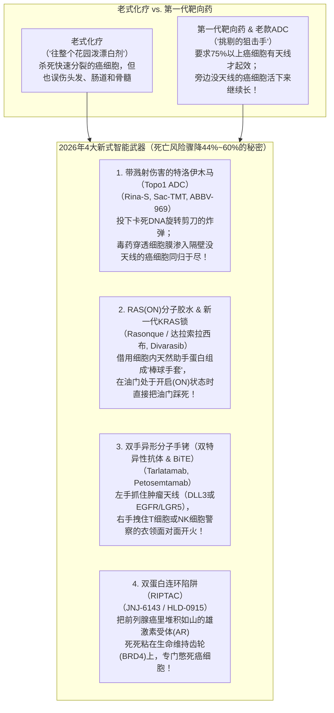
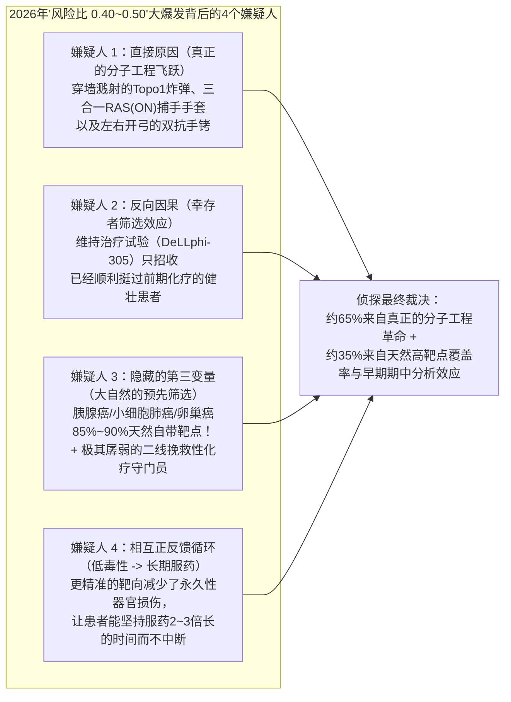

## 1. 故事的起点（The Hook）：等等——抗癌药的比赛成绩怎么会在一年内突然翻倍？

想象一下，你们学校的田径队花了整整三十年时间，想打破一英里跑四分钟的纪录。每年春天，跑得最快的队员只能把成绩提高**短短两秒钟**，大家礼貌地鼓鼓掌，但冠军奖杯依然遥不可及。突然到了2026年秋天，**七名不同的选手**穿着四款奇怪的新跑鞋走上跑道——在同一个月里，这七个人全都把原来的纪录足足缩短了**四十五秒**！

如果你在真实的操场上看到这一幕，你绝不会只是跟着欢呼。你一定会立刻掏出放大镜，提出两个问题：
1. **“那些新跑鞋的鞋底里到底装了什么秘密机关？”**
2. **“慢着——会不会有人趁我们不注意，把跑道改短了？”**

就在2026年秋天，一模一样的谜题在真实的抗癌药物世界里上演了。过去几十年里，当科学家针对胰腺癌、卵巢癌、肺癌或头颈癌等凶险的晚期癌症测试新药时，医生和华尔街投资人早已习惯了缓慢而揪心的微小进步：一款被誉为“成功”的新药，通常只能比传统化疗让患者多活**2到3个月**，把每个月去世的风险降低大约**15%到30%**（医生把这个分数记作**风险比 HR = 0.70 到 0.85**）。

然而，在2026年8月至10月期间——随着欧洲肿瘤内科学会年会（**ESMO 2026**）以及10月底**Genmab公司**两项重磅3期临床结果的公布——一连串3期临床试验亮出的成绩单让全世界的肿瘤科医生都不敢相信自己的眼睛。正如生物科技分析师 Ohad Hammer（`@ohadhammer`）在2026年10月广为流传的肿瘤学盘点中所总结的那样：

> “到目前为止，2026年是肿瘤药物研发极其辉煌的一年。好消息的密集程度创下数年来新高，ESMO大会及其他近期临床数据表明，整个领域正处于强劲的创新周期。这主要是由拓扑异构酶1（Topo1）抗体偶联药物（ADC）、RAS抑制剂以及T细胞衔接器（T cell engagers）的突破所驱动的。这一次最引人注目的不仅是成功的3期临床试验数量，更是在未经过生物标志物筛选的‘广泛人群（broad populations）’中展现出的巨大获益幅度。过去，投资人习惯看到总生存期（OS）延长2~3个月、风险比（HR）在0.7左右；但仅在2026年，我们就看到了多项HR低至0.4~0.5的重磅结果！”

把死亡风险直接砍掉**50%到60%**（`HR = 0.40 到 0.50`），并在极其凶险的转移性胰腺癌中把中位生存时间从**6.7个月翻倍到13.2个月**，这是一次巨大的飞跃。今天，我们要戴上侦探帽做两件事：首先，我们要从零开始搭建每一个科学概念，让完全没有生物学背景的小学五年级学生（10~11岁）也能彻底搞懂里面的分子齿轮；接着，我们要对照美国食品药品监督管理局（FDA）、《新英格兰医学杂志》（*NEJM*）和 ClinicalTrials.gov 的原始档案，对**全部七款突破性新药**进行核查，分清哪些是真正的工程奇迹，哪些是统计上的视觉假象。*（如果你想先了解手术、放疗和传统化疗的基础原理，欢迎先阅读我们今天同步发布的姊妹篇指南：[今天的癌症治疗到底是怎么起作用的？](/zh/blog/2026-11-02-how-current-cancer-treatments-actually-work-fifth-grader-guide)）。*

---

## 2. 从零开始：医生如何给抗癌比赛计分？4种新式“智能武器”又是如何工作的？

在看2026年的七款新药之前，我们需要从零搞懂两件事：**医生在人命关天的抗癌试验里是怎么计分的**，以及**为什么这四种新式“智能武器”比老式化疗厉害得多**。

### 第一部分：当生命攸关时，比赛怎么计分？

当一家医药公司发明了抗癌新药，政府裁判员——**美国食品药品监督管理局（FDA）**——绝不会允许他们只给10个病人吃药，然后说一句*“瞧，他们看起来气色不错！”*就批准上市。相反，公司必须组织一场有**500到700多名患者**参加的终极锦标赛，叫做**随机对照3期临床试验（Randomized Phase 3 Clinical Trial）**。电脑像抛硬币一样把患者分成人数相等的两组：一半人用**目前最好的老药**（对照组），另一半人用**新药**（试验组）。

医生在记分牌上主要看三个核心数字：

1. **排在正中间第50个人的秒表（“中位总生存期”，简称 `mOS`）：**
   * **用大白话讲概念：** 假设100名患有同一种癌症的病人在第1天同时开始吃药。医生按下秒表，一直等到队伍里**排在正中间的第50位病人去世**。如果第50个人去世那一刻秒表停在 `13.2个月`，那么这款药的得分就是 `13.2个月`。
   * **五年级生活比喻：** 为什么医生非要看**正中间的第50个人（中位数，Median）**，而不算大家熟悉的“平均数（Average）”呢？假设班里10个同学比每周的零花钱：9个同学每周拿 `5块钱`，但有1个亿万富翁的小孩每周拿 `1000块钱`。如果算“平均数”，全班平均每人有 `104.5块钱`——这完全是在撒谎！而排在**正中间第5名的同学（中位数）**拿的是 `5块钱`，这才反映了真实情况。在抗癌试验里，偶尔有一两个特别幸运的病人能活10年以上，会把平均数拉得虚高，所以医生永远只看**正中间第50个人的秒表**。
   * **大人的专业词汇：** 医生把这个正中间第50个人的生存时钟叫做**中位总生存期（Median Overall Survival，简称 `mOS`）**。（如果秒表测量的是第50个人的*肿瘤在CT扫描上重新长大之前维持稳定的时间*，医生就叫它**中位无进展生存期，简称 `mPFS`**。）

2. **每天的危险对比分（“风险比”，简称 `HR`）：**
   * **用大白话讲概念：** 只看第50个人，就像只看长跑比赛里的某一个瞬间。如果你想对比从起点到终点的整场比赛呢？医生会用**新药组每个月病人去世的速度**，除以**老药组每个月病人去世的速度**。
   * **五年级生活比喻：** 假设100个小孩骑自行车冲下一条陡峭泥泞的**老山路**，**每小时有10个人摔倒受伤**。旁边修了一条装有护栏的**新柏油路**，另外100个小孩骑车冲下去，**每小时只有4个人摔倒**。用新路的摔倒人数（`4`）除以老路的摔倒人数（`10`）：`4 ÷ 10 = 0.40`。如果得分是 `1.00`，说明两条路一样危险（`10 ÷ 10 = 1.00`，平局）。而得分是 **`0.40`**，意味着走新路的危险只有原来的 **40%**——也就是说，新路**把摔倒的风险直接砍掉了60%**（`1.00 - 0.40 = 0.60`，即降低 `60%`）！
   * **大人的专业词汇：** 医生和统计学家把这个危险除法得分叫做**风险比（Hazard Ratio，简称 `HR`）**。过去三十年里，抗癌药只要能拿到 **`0.75`** 的风险比（降低25%的死亡风险）就算大获全胜。而在2026年，足足有四项大型3期试验跑出了 **`0.40` 到 `0.50`** 的风险比——把死亡风险砍掉了 **50%到60%**！

3. **“需要特定通行证吗？”（“生物标志物筛选” vs. “不筛选的全人群”）：**
   * **用大白话讲概念：** 你身体里的每个细胞表面都插着数百万根微小的蛋白质“天线”（记住，一个细胞大约 `15微米` 宽，只有一根 `75,000纳米` 粗的人类头发丝的五分之一；而一根蛋白质天线只有约 `10纳米` 高，**比一根头发丝还要细7,500倍**！）。在2010年代，大多数“靶向”抗癌药只有在病人的肿瘤细胞表面插满了某一种特定天线（比如超过75%的肿瘤细胞都有这种天线）时才管用。医生必须切下一小块肿瘤拿到实验室染色化验，然后无奈地把60%到80%天线不够多的病人拒之门外。
   * **五年级生活比喻：** 这就像发明了一台极其挑剔的吸尘器，只有当你们家厨房铺的是罕见的意大利大理石地板时它才肯吸饼干渣；如果你们家是普通木地板或瓷砖，它根本不开机。
   * **大人的专业词汇：** 那种特定的天线或基因拼写错误叫做**生物标志物（Biomarker）**。只招收高天线病人的试验叫**生物标志物筛选（Biomarker-Selected）试验**。2026年最让医学界震惊的是，好几款新药在**不筛选生物标志物的“全人群（Unselected / All-Comer）”**试验中彻底碾压了传统化疗——就算病人的肿瘤天线不多，照样有效！

---

### 第二部分：2026年的4种新式“智能武器”到底是怎么工作的？

为什么2026年的新药能突然把风险比从 `0.75` 拉低到 `0.40~0.50`，而且在普通患者身上也管用？因为生物工程师对**四台微观分子机器**进行了彻底的升级换代：

下面我们严格按照 **大白话概念 → 五年级比喻 → 大人专业词汇** 的三步法则，打开这四台机器的引擎盖：

#### 机器 1：带“穿墙溅射伤害”的特洛伊木马（`Topo1 ADC` —— *Rina-S*、*Sac-TMT* 和 *ABBV-969*）
* **细胞里实际发生了什么：** 癌细胞每次一分为二时，都必须把细胞核里长达2米、紧紧缠绕的DNA说明书绳子解开并复印一份。如果你把一根拧得很紧的麻绳强行拉开两股，剩下的部分就会拧成死结！因此，每个细胞里都有一把微小的“旋转剪刀酶”——它会剪断其中一股DNA，让绳子松开旋转，再立刻用胶带粘回去。2026年的新型快递卡车利用Y字形的抗体猎犬，精准停靠在癌细胞表面的天线上（比如卵巢癌的 `FRα` 或子宫内膜癌的 `TROP2`）。一旦被吞进癌细胞内部，卡车就会释放出一颗微型化学炸弹，趁着旋转剪刀剪开DNA的瞬间**把剪刀死死卡住**，让正在复印的癌细胞DNA当场断成两截！
* **2026年的秘密升级（为什么不需要高天线也能起效？）：** 老式抗体卡车（比如2022~2024年获批治疗卵巢癌的 `Elahere / 索米妥昔单抗`）携带的毒药分子又笨重又亲水，一旦进入第一个癌细胞就被关在里面出不来——所以如果病人肿瘤里有40%的细胞没有 `FRα` 天线，那些“光头”邻居癌细胞就会毫发无损地活下来。而2026年的新卡车装载的是小巧、亲油的炸弹分子（`依喜替康 exatecan` 或 `贝洛替康 belotecan` 衍生物）。当第一个有天线的癌细胞爆炸后，**毒药分子会像油滴穿透纸巾一样直接穿过细胞膜，渗入隔壁根本没有天线的邻居癌细胞里，把它们也一锅端掉！**
* **五年级生活比喻：** 想象玫瑰花园里藏着很多杂草，但只有一半杂草头顶插着小红旗。老式无人机只会往插红旗的杂草头上砸石头，紧挨着它的无旗杂草安然无恙。而2026年的新款无人机降落在红旗杂草上后，会喷出一团向四周扩散两厘米的除草薄雾，把旁边偷偷拔掉红旗的杂草也一起除掉！
* **大人的专业词汇：** 那把解开DNA死结的旋转剪刀叫**拓扑异构酶1（Topoisomerase 1，简称 `Topo1`）**，这辆精确制导卡车叫**Topo1抗体偶联药物（`Topo1 ADC`）**，而毒药穿墙消灭无天线邻居细胞的溅射伤害就叫**旁观者效应（Bystander Effect）**。

#### 机器 2：往踩到底的油门踏板下塞进一只钢铁靴子（`RAS(ON)` 抑制剂与新一代 `KRAS` 抑制剂 —— *Rasonque* 与 *Divarasib*）
* **细胞里实际发生了什么：** 几乎每个细胞内部都有一个控制“生长和分裂！”的总开关。当它抓着一块微型能量电池（`GTP`）时处于**开启（ON）**状态；当电池耗尽变成 `GDP` 时处于**关闭（OFF）**状态。然而，在**超过90%的胰腺癌**和**约30%的肺癌**中，基因拼写错误导致这个开关坏掉了，**一天24小时卡死在开启（ON）状态**。整整40年里，科学家都管它叫“不可成药（undruggable）”靶点，因为它的表面像涂了油的保龄球一样光滑，药物根本找不到可以扣住的钥匙孔！2021年前后上市的第一代口服药（`索托拉西布 sotorasib` 和 `阿达格拉西布 adagrasib`）好不容易在肺癌常见的一种突变（`G12C`）上找到了一个小凹槽，但它们**只能趁开关偶尔闪烁到关闭状态（`RAS-OFF`）时才能卡住它**。而胰腺癌最常见的突变（`G12D`、`G12V`、`G12R`）几乎永远不会关闭。
* **2026年的秘密升级：**
  1. 针对肺癌的 `G12C` 开关，罗氏/基因泰克（Roche/Genentech）打造了 **Divarasib**——一把比第一代药物 `索托拉西布` **咬合速度快5到50倍、锁死力道强得多**的分子扳手。
  2. 更具革命性的是，Revolution Medicines 公司为胰腺癌发明了 **Rasonque（通用名：`达拉索拉西布 / daraxonrasib`）**。既然小小的药片很难单独抓住滑溜溜的 **开启（ON）** 保龄球，`Rasonque` 钻进细胞后，会先拉住一个原本就在所有细胞里自由漂浮的“胖乎乎的助手蛋白”（叫做 `亲环蛋白A / Cyclophilin A`）。药片和助手蛋白合体后，变成一只巨大的**“三合一分子棒球手套”（`Tri-Complex` 三元复合物）**，不管坏掉的 `RAS` 开关是哪种型号（`G12D`、`G12V`、`G12R`、`G12C` 还是 `G13D`），都在它**正处于开启（ON）旋转状态时**一把将它死死捂住！
* **五年级生活比喻：** 想用两根光溜溜的手指捏住一个涂满黄油、高速旋转的保龄球（`第一代药片`）几乎不可能；但如果你戴上房间里现成的一只涂满强力胶的巨大捕手手套，直接把整个球抱进怀里（`Rasonque`），球瞬间就停了。
* **大人的专业词汇：** 这个生长总开关叫 **RAS**（特别是 **KRAS**），`Divarasib` 是**新一代高选择性 KRAS G12C 抑制剂**，而 `Rasonque` 则是**多选择性三元复合物 RAS(ON) 抑制剂**。

#### 机器 3：左右手抓不同目标的分子手铐（`双特异性T细胞衔接器 & 双特异性抗体` —— *Tarlatamab* 与 *Petosemtamab*）
* **细胞里实际发生了什么：** 人体天然的免疫抗体长成字母 **Y** 的形状，它的左手和右手是一模一样的双胞胎，只能抓同一种东西。生物工程师学会了把两种不同的抗体从中间劈开，再用分子拉链拼在一起，造出了**左手抓目标A、右手抓目标B**的混血抗体！
  * **Tarlatamab（商品名 `Imdelltra`，安进公司）** 专门对付凶险的**小细胞肺癌（`SCLC`）**。正常细胞会把一种叫 `DLL3` 的蛋白质锁在室内的衣柜里，但 `85%` 的小细胞肺癌细胞却糊里糊涂地把 `DLL3` 挂在了大门口。`Tarlatamab` 的左手死死抓住肺癌细胞的 `DLL3`，右手直接拽住你血液里 **T细胞警察** 的衣领（`CD3`），用分子手铐把警察和癌细胞面对面铐在一起，逼着T细胞当场朝癌细胞发射打孔炮弹（`穿孔素`和`颗粒酶`）！
  * **Petosemtamab（简称 "Peto"，Genmab/Merus公司）** 专门对付**头颈部鳞癌（`HNSCC`）**。它的左手抓住肿瘤的主生长天线（`EGFR`），右手抓住顽固的“蜂后”——也就是平时能躲过化疗、让肿瘤死灰复燃的**癌症干细胞**标志物（`LGR5`）。当 `Petosemtamab` 把 `EGFR` 和 `LGR5` 铐在一起时，会逼着癌细胞把自己的生长天线吞进细胞内部的垃圾粉碎机（`溶酶体`）里绞碎；同时，这个 Y 字抗体的底座经过特殊修剪（`去岩藻糖基化 low-fucose`），像磁铁一样召唤免疫系统的**自然杀伤细胞（`NK细胞`）**和**巨噬细胞（吃豆人细胞）**过来把癌细胞活活吃掉！
* **五年级生活比喻：** `Tarlatamab` 就像学校走廊的值日生，左手抓住正在撬储物柜的坏小子，右手直接把他铐在路过的保安腰带上。`Petosemtamab` 则像一名机修工，把逃跑汽车的方向盘和刹车踏板绑在一起，同时吹口哨叫来拖车。
* **大人的专业词汇：** `Tarlatamab` 叫做**双特异性T细胞衔接器（`BiTE`）**，而 `Petosemtamab` 叫做**ADCC/ADCP免疫增强型 EGFR × LGR5 双特异性抗体（Bispecific Antibody）**。

#### 机器 4：双蛋白连环胶水陷阱（`RIPTAC` —— *JNJ-6143*）
* **细胞里实际发生了什么：** 在晚期**前列腺癌（`mCRPC`）**细胞里，塞满了数百万个接收男性荷尔蒙信号的**雄激素受体（`AR`）**。强生公司（J&J，由 Halda Therapeutics 研发）发明了一种每天吃一次的药片 **JNJ-6143（`HLD-0915`）**，长得像一个两头带不同胶水的小哑铃。哑铃的一头专门粘在前列腺癌的 `AR` 受体上，另一头专门粘在所有细胞读取DNA、维持生命都离不开的核心生存齿轮（`BRD4`）上。在健康的心脏或肾脏细胞里（几乎没有 `AR`），这个小哑铃四处漂浮，什么也不会锁住。但在塞满 `AR` 的前列腺癌细胞里，成百上千万个小哑铃把 `AR` 蛋白和所有的 `BRD4` 生命维持齿轮死死粘在一起，让癌细胞当场窒息死亡！
* **五年级生活比喻：** 想象一副特殊的机关手铐，只有当其中一只铐环扣在沉重的金条上时，另一只铐环才会锁死。在普通小孩的卧室里（没有金条），手铐根本不会启动；但在堆满赃物金条的银行劫匪老巢里（前列腺癌细胞），劫匪瞬间就会被铐在自己的金条堆上动弹不得！
* **大人的专业词汇：** 科学家把这种双蛋白胶水陷阱称为 **RIPTAC（`Regulated Induced Proximity Targeting Chimera`，调控诱导接近靶向嵌合体）**。

---

## 3. 秘密解码环（The Secret Decoder Ring）：把吓人的2026肿瘤学术语翻译成大白话

在查看2026年临床试验真实记分牌之前，先戴上这枚**秘密解码环**，让新闻和投资简报里的每一个英文缩写都变得一目了然：

| 大人的专业词汇 / 缩写 | 它到底是什么意思（大白话解释） | 五年级生活比喻 |
| :--- | :--- | :--- |
| **风险比 (`HR`, Hazard Ratio)** | 新药组病人去世（或恶化）的速度除以老药组的速度。`HR = 0.43` 意味着每天的危险降到了原来的43%——也就是**死亡风险砍掉了57%**！ | 如果老碎石路上每小时摔倒10辆自行车，新柏油路上每小时只摔倒4.3辆，风险比就是 `0.43`。 |
| **中位总生存期 (`mOS`)** | 100名病人开始治疗后，等到**排在正中间的第50名病人**去世时所经过的月数。 | 100个同学同时做平板支撑比赛，记下正中间第50个同学膝盖着地那一刻的秒表时间。 |
| **客观缓解率 (`ORR`)** | 100名病人中，有多少人的肿瘤在CT扫描上明显缩小（宽度缩小至少30%）。 | 操场上堆了100个雪人，到了中午有多少个雪人在太阳下融化缩小了至少三分之一。 |
| **Topo1 ADC (`Rina-S`, `Sac-TMT`, `ABBV-969`)** | 带着卡死DNA解旋剪刀（`Topoisomerase 1`）炸弹的抗体卡车，炸毁目标后毒药还能穿墙消灭隔壁癌细胞（`旁观者效应`）。 | 降落在插红旗杂草上的无人机，喷出除草薄雾，顺便把旁边没插红旗的杂草也一起清除。 |
| **RAS(ON) 抑制剂 (`Rasonque / 达拉索拉西布`)** | 与细胞内助手蛋白（`亲环蛋白A`）合体成“棒球手套”，在突变 `RAS` 生长开关**正处于开启（ON）状态时**直接将其抱死。 | 不再用两根手指去捏涂满黄油旋转的保龄球，而是戴上涂满胶水的巨大捕手手套把整个球抱住。 |
| **双特异性抗体 / BiTE (`Tarlatamab`, `Petosemtamab`)** | 左右手抓不同目标的Y字蛋白——要么把T细胞警察铐在肿瘤上（`Tarlatamab`），要么把两个肿瘤天线（`EGFR` + `LGR5`）铐在一起粉碎（`Petosemtamab`）。 | 在微观世界里把两种不同物体咔哒一声吸在一起的双面磁铁夹。 |
| **RIPTAC (`JNJ-6143`)** | 双头药片，把癌细胞里成堆的蛋白（`AR`）粘在必需生存齿轮（`BRD4`）上，只憋死富含该蛋白的癌细胞。 | 把小偷的脚踝铐在他自己偷来的重金库上；如果房间里没有金库（健康细胞），陷阱就不会触发。 |
| **PROC / HNSCC / SCLC / NSCLC / mCRPC** | 2026年掀起风暴的5大难治癌症：**PROC** = 铂耐药卵巢癌；**HNSCC** = 头颈鳞癌；**SCLC / NSCLC** = 小细胞 / 非小细胞肺癌；**mCRPC** = 转移性去势抵抗性前列腺癌。 | 叛军癌细胞在身体哪个街区、穿着哪套伪装服活动的地址代号。 |

---

## 4. 惊人宣称 vs. 侦探核查：全面审计2026年7大抗癌突破

现在让我们直接检查一手原始证据（Primary Sources）。下图是 **Genmab公司** 在2026年10月下旬正式发布的两项3期临床试验核心结果幻灯片——**`RAINFOL-02`（卵巢癌 `Rina-S`，2026年10月23日公布）** 和 **`LiGeR-HN1`（头颈癌 `Petosemtamab`，2026年10月28日公布）**：

*一手原始档案（Primary Source Artifact）：Genmab 2026年10月官方3期临床顶线结果演示文稿摘录，展示了 `RAINFOL-02`（`NCT06619236`，`N = 584`，`PFS HR = 0.29`，`OS HR = 0.43`，`p < 0.0001`）与 `LiGeR-HN1`（`NCT06525220`，`N ≈ 700`，`OS HR = 0.50`，`ORR 比值比 = 3.17`，`p < 0.0001`）。*

下面我们把**全部七项2026年临床进展**列成一张总表，逐一核对FDA批准文件、《新英格兰医学杂志》（*NEJM*）论文、ESMO 2026摘要和 ClinicalTrials.gov 注册档案，并翻译成**坐在学校体育馆里的100名患者**身上实际会发生什么：

```mermaid
xychart-beta
    title "2026年生存期大跃升：中位总生存期对比（单位：月，旧标准疗法 vs. 2026年新药）"
    x-axis ["胰腺癌 (Rasonque)", "子宫内膜癌 (Sac-TMT)", "小细胞肺癌 (Tarlatamab)", "肺癌 KRAS (Divarasib)"]
    y-axis "中位总生存期 (月)" 0 --> 24
    bar [6.7, 12.1, 12.7, 12.0]
    bar [13.2, 19.0, 21.1, 17.7]
```

*（注：在上图中，每一对柱子的第一根代表**旧对照组疗法**的生存月数 [`6.7`, `12.1`, `12.7`, `12.0`]，第二根代表**2026年新式智能药物**的生存月数 [`13.2`, `19.0`, `21.1`, `17.7`]。另外两项获胜的3期临床药物——`Rina-S` 和 `Petosemtamab`——分别把死亡风险降低了 `57%` [`HR 0.43`] 和 `50%` [`HR 0.50`]，由于试验公布时还不到一半患者去世，正中间第50个人的秒表至今还在继续往上走！）*

### 2026年7大抗癌突破全量审计记分牌（已核验一手信源）

| 药物与研发公司（武器类型） | 癌症类型与临床试验（`NCT编号`与人数） | 2026年官方成绩单（`HR`与中位生存期） | 该治疗阶段的历史基准（Benchmark） | 侦探核查：体育馆里100名患者会发生什么？隐藏的细则（Fine Print）是什么？ |
| :--- | :--- | :--- | :--- | :--- |
| **1. Rasonque (`达拉索拉西布 / daraxonrasib`)** Revolution Medicines (`$RVMD`) *多选择性 RAS(ON) 抑制剂* | **二线转移性胰腺导管腺癌 (PDAC)** 3期 `RASolute 302` ([`NCT06625320`](https://clinicaltrials.gov/study/NCT06625320)) | **`OS HR = 0.40`** 中位OS几乎翻倍：**`13.2个月` vs. 化疗 `6.7个月`** ([FDA批准公告, 2026年8月26日](https://www.fda.gov/drugs/resources-information-approved-drugs/fda-approves-daraxonrasib-metastatic-pancreatic-adenocarcinoma); [PubMed `42802048`](https://pubmed.ncbi.nlm.nih.gov/42802048/))。 | 传统二线化疗总生存期仅约 `6~7个月`；此前人类历史上从未有任何靶向RAS药物在胰腺癌中获批。 | **体育馆测试：** 每月死亡风险降低 **60%**，为正中间第50位患者多赢得 **6.5个月**（差不多一整学年！）的生命。 **隐藏细则：** **超过90%的胰腺癌天然带有 `RAS` 突变**，所以所谓“不筛选人群”其实是老天爷提前帮我们筛好了靶点！皮疹（`86%~88%`）和口腔溃疡（`40%~55%`）发生率高。 |
| **2. Rina-S (`瑞奈妥单抗 / rinatabart sesutecan`)** Genmab / 普方生物 (ProfoundBio) *FRα 靶向 Topo1 ADC* | **二线及以上铂耐药卵巢癌 (PROC)** 3期 `RAINFOL-02` ([`NCT06619236`](https://clinicaltrials.gov/study/NCT06619236), `N = 584` 全人群) | **`OS HR = 0.43`** (`95% CI, 0.31–0.59; p < 0.0001`) **`PFS HR = 0.29`** (疾病恶化或死亡风险降低 `71%`) ([Genmab公告, 2026年10月23日](https://www.us.genmab.com/company/news/press-releases/genmab-announces-rinatabart-sesutecan-rina-s-demonstrates-statistically-significant-improvement-in-progression-free-survival-and-overall-survival-in-patients-with-platinum-resistant-ovarian-cancer-2026-10))。 | **安维汀 (`贝伐珠单抗`) + 化疗** (`AURELIA`试验) `OS HR = 0.85` (`+3.3个月`，未达统计学显著)；老款ADC **Elahere (`索米妥昔单抗`)** (`MIRASOL`) 仅在 `FRα` 高表达的前 `35%~40%` 患者中取得 `OS HR = 0.67`。 | **体育馆测试：** 凭借 `Topo1` 炸弹的穿墙旁观者效应，在涵盖低 `FRα` 天线及用过 `Elahere` 的**全体患者（`N = 584`）中将死亡风险砍掉57%**！ **隐藏细则：** 社交媒体上流传的“延长10~12个月生存期”只是**分析师按公式推算的预测值**，并非实测中位数——试验目前仍处于早期期中分析阶段！ |
| **3. Petosemtamab ("Peto")** Genmab / Merus *EGFR × LGR5 双特异性抗体* | **一线 PD-L1 阳性复发/转移性头颈鳞癌 (HNSCC)** 3期 `LiGeR-HN1` ([`NCT06525220`](https://clinicaltrials.gov/study/NCT06525220), `N ≈ 700`) | **`OS HR = 0.50`** (`95% CI, 0.37–0.67; p < 0.0001`) 对比单药 `K药` **`ORR 比值比 = 3.17`** (`95% CI, 2.06–4.89`) ([OncLive / Genmab, 2026年10月28日](https://www.onclive.com/view/petosemtamab-plus-pembrolizumab-hits-phase-3-os-orr-primary-end-points-in-pd-l1-positive-r-m-hnscc))。 | **K药 (`帕博利珠单抗`) + 化疗** (`KEYNOTE-048`) 加上剧毒化疗后 `OS HR = 0.77` (`+3.3个月`, `13.0 vs. 10.7个月`)。 | **体育馆测试：** **不滴一滴传统化疗药**，直接把死亡风险砍掉**整整一半（`50%`）**，无论HPV病毒阳性还是阴性，肿瘤缩小的几率都提高到3倍以上！ **隐藏细则：** 这是**第一次期中分析（Interim Analysis）**结果（因此“延长12个月”也是预测值而非实测值），且入组患者仍需满足 **PD-L1 阳性**（占头颈癌约 `85%`）。 |
| **4. Sac-TMT (`芦康沙妥珠单抗` / `MK-2870`)** 默沙东 (Merck) / 科伦博泰 *TROP2 靶向 Topo1 ADC* | **二线及以上晚期/复发性子宫内膜癌** 3期 `TroFuse-005` ([`NCT06132958`](https://clinicaltrials.gov/study/NCT06132958)) | **`OS HR = 0.68`** (死亡风险降低 `32%`) 中位OS：**`19.0个月` vs. `12.1个月`** (`+6.9个月`)；**`PFS HR = 0.59`** ([默沙东公告, 2026年10月](https://www.merck.com/news/sacituzumab-tirumotecan-sac-tmt-reduced-the-risk-of-death-by-32-and-the-risk-of-disease-progression-or-death-by-41-compared-to-chemotherapy-in-certain-patients-with-advanced-or-recurrent-endometrial/))。 | **K药 + 仑伐替尼** (`KEYNOTE-775`) 对比化疗也曾延长约 `6.9个月` (`18.3 vs. 11.4个月`, `HR = 0.62`)，但如今几乎所有患者在一线就已经用过 `K药` 了！ | **体育馆测试：** 在**已经对含铂化疗和一线免疫治疗（`K药`）都产生耐药**的棘手患者中，依然多赢得了**近7个月**的生命！ **隐藏细则：** `HR = 0.68` 是扎实的胜利（降低 `32%` 风险），但并非 `0.40`，说明并非所有2026年新药都能把风险砍半。 |
| **5. Tarlatamab (`塔拉妥单抗`, 商品名 `Imdelltra`)** 安进 (Amgen) / 阿斯利康 *DLL3 × CD3 双特异性T细胞衔接器 (BiTE)* | **广泛期小细胞肺癌 (ES-SCLC) 一线维持治疗** 3期 `DeLLphi-305` ([`NCT06211036`](https://clinicaltrials.gov/study/NCT06211036)) | **`OS HR = 0.42`** (死亡风险降低 `58%`, `p < 0.001`) 中位OS：**`21.1个月` vs. `12.7个月`** (在 `英飞凡` 基础上再延长 **`+8.4个月`**！) ([ESMO 2026](https://www.esmo.org/insights-by-esmo/all-news/novel-first-line-treatment-significantly-improves-outcomes-in-small-cell-lung-cancer); [NEJM PubMed `42929702`](https://pubmed.ncbi.nlm.nih.gov/42929702/))。 | 同类一线维持治疗中，**Zepzelca (`芦比替定`) + 泰圣奇** (`IMforte`试验) `OS HR = 0.73` (`+2.6个月`, `13.2 vs. 10.6个月`)。 | **体育馆测试：** 在地球上生长最疯狂的肺癌类型中，把 `Tarlatamab` 加到 `英飞凡(durvalumab)` 维持治疗里，让第50位患者多活了**超过8.4个月**（从维持治疗算起活了 `21.1个月`）！ **隐藏细则：** 只有熬过前4个周期化免诱导治疗且未恶化的患者才能进入维持治疗，且首次输注需住院监测免疫发烧风暴（`CRS`）。 |
| **6. Divarasib (`GDC-6036`)** 罗氏 (Roche) / 基因泰克 *新一代高选择性 KRAS G12C 抑制剂* | **二线及以上 KRAS G12C 突变非小细胞肺癌 (NSCLC)** 3期 `Krascendo-1` ([`NCT06497556`](https://clinicaltrials.gov/study/NCT06497556)) | **`OS HR = 0.56`** (`95% CI, 0.41–0.78; p = 0.0005`) 中位OS：**`17.7个月` vs. `12.0个月`** (`+5.7个月`)；**`ORR = 58.4%` vs. `32.3%`** ([基因泰克公告, 2026年10月25日](https://www.gene.com/media/press-releases/15141/2026-10-25/genentechs-divarasib-demonstrated-best-i); [NEJM PubMed `42929675`](https://pubmed.ncbi.nlm.nih.gov/42929675/))。 | 第一代药物 **Lumakras (`索托拉西布`)** 在3期试验 (`CodeBreaK 200`) 中甚至没能在总生存期上击败普通多西他赛化疗 (`10.6 vs. 11.3个月`, `HR = 1.01`)。 | **体育馆测试：** 它打败的不是孱弱的老式化疗，而是**与已获批的第一代靶向药（`索托拉西布`/`阿达格拉西布`）进行头对头正面对决**，依然把死亡风险砍掉 **44%（`+5.7个月`）**，且严重副作用更少！ **隐藏细则：** 与前面几项不同，这是一项**严格筛选生物标志物**的试验（仅限约占非小细胞肺癌 `12%~14%` 的 `KRAS G12C` 突变患者）。 |
| **7. JNJ-6143 (`HLD-0915`) & ABBV-969** 强生 (`RIPTAC`) & 艾伯维 (`PSMA/STEAP1 双靶点 Topo1 ADC`) | **后线转移性去势抵抗性前列腺癌 (mCRPC)** 1期 `HLD-0915-ONC-101` ([`NCT06800313`](https://clinicaltrials.gov/study/NCT06800313)) & 1期 ([`NCT06318273`](https://clinicaltrials.gov/study/NCT06318273)) | **JNJ-6143：** **`69%` 初步 / `75%` 确认 `ORR`** (`50 mg` 推荐剂量组 `16人中有12人` 缩小) ([强生公告, 2026年10月](https://www.jnj.com/media-center/press-releases/johnson-johnson-reports-75-tumor-response-rate-in-advanced-prostate-cancer-with-jnj-6143-a-first-in-class-riptac-molecule))。 **ABBV-969：** **`45%` 确认 `ORR`** (`PSA50下降率 = 67%`)。 | 核药 **Pluvicto (`177Lu-PSMA-617`)** 在3期试验 (`VISION`) 中总体缓解率约 `30%`（严格可测量软组织病灶亚组为 `46%`）。 | **体育馆测试：** 在经历过多轮治疗失败的晚期前列腺癌患者中，每天一颗 `RIPTAC` 药片让 `16人中的12人（75%）` 肿瘤明显缩小，令人惊艳。 **隐藏细则（关键统计学警告！）：** 这两款药目前只是**极小规模的1期临床亚组（`JNJ-6143` 在 `50 mg` 剂量下分母只有 `16个人`！）**，绝不是600人的3期大考！早期1期试验的高命中率进入数百人的3期试验后通常会回落 `15%~25%`。 |

---

## 5. 四个嫌疑人（The Four Suspects）：到底是什么真正造就了2026年的生存期大爆发？

每当侦探看到比赛得分比平时翻了一倍——风险比从过去的 `~0.75` 骤降到 `0.40~0.50`——我们绝不能只听信第一个解释。按照我们的**四向竞争原因核查法（4-Way Rival Cause Check）**，我们必须审讯**四个嫌疑人**，搞清楚这波爆发里到底有多少是真正的分子工程突破，有多少是试验设计的巧妙包装：

### 四大嫌疑人并排审讯表

| 嫌疑人（因果假设） | 这个嫌疑人如何解释 `HR 0.40~0.50` 的惊人数字？ | 侦探裁决（罪名成立还是无罪？） |
| :--- | :--- | :--- |
| **嫌疑人 1：直接原因 (Direct Cause)** *（“新式分子机器消灭癌细胞的威力确实翻了一倍。”）* | `Topo1` 炸弹（`Rina-S`、`Sac-TMT`）能穿透细胞膜扩散（`旁观者效应`），消灭异质性肿瘤里的无天线邻居；`Rasonque` 直接锁死处于开启状态的 `RAS(ON)`；`Divarasib` 锁紧 `KRAS G12C` 的力道强10倍；`Tarlatamab` 和 `Petosemtamab` 强行拽来免疫细胞杀手。 | **确认为头号主因（占整体效果的约65%）。** 最铁的证据来自 `Krascendo-1`（`Divarasib`）、`DeLLphi-305`（`Tarlatamab`）和 `LiGeR-HN1`（`Petosemtamab`）：这三项试验打败的不是孱弱的旧化疗，而是**头对头正面击败了现役靶向药（`索托拉西布`/`阿达格拉西布`）或王牌免疫药（`英飞凡`、`K药`）**！ |
| **嫌疑人 2：反向因果 / 幸存者偏差 (Reverse Causation)** *（“是因为吃了药才活得久，还是因为原本就活得久的患者才有资格进组吃药？”）* | 在随机3期试验中，电脑抛硬币分组保证了两组起点公平。但在像 `DeLLphi-305`（`Tarlatamab`）这样的**维持治疗试验**中，患者只有在打完前4个周期的化疗+免疫治疗且肿瘤没有恶化后，才有资格进组。 | **对总月数绝对值有部分影响，但对风险比（`HR`）无影响。** 这种幸存者过滤解释了为什么 `DeLLphi-305` 两组患者活的时间看起来都很长（随机分组后又活了 `21.1 vs. 12.7个月`），因为病情最凶险的患者在进组前就已经掉队了。但抛硬币分组之后两组之间拉开的 **`8.4个月` 巨大差距（`HR = 0.42`）** 100%是新药的真实本领！ |
| **嫌疑人 3：隐藏的第三变量 (Confounders)** *（“所谓‘不筛选人群’是不是大自然早就偷偷筛好了靶点，或者对面的守门员太弱了？”）* | **混杂因素 A（大自然的预先筛选）：** 说 `Rasonque`（胰腺癌）、`Tarlatamab`（小细胞肺癌）、`Rina-S`（卵巢癌）或 `Sac-TMT`（子宫内膜癌）“无需生物标志物筛选”，听起来好像没有靶点也能起效。实际上，**这些特定癌症里80%到90%以上的肿瘤天然就高比例表达 `KRAS`、`DLL3`、`FRα` 或 `TROP2`！** **混杂因素 B（疲惫的守门员）：** 在二线卵巢癌（`RAINFOL-02`）和胰腺癌（`RASolute 302`）中，对照组的单药挽救性化疗有效率只有可怜的 `10%~12%`。 | **确认为重要共犯（占头条视觉冲击力的约35%）。** “不筛选生物标志物”绝不等于药物不需要靶点，而是科学家聪明地挑选了**几乎每个病人都天然带有该靶点的癌症**，再用 `旁观者效应` 或 `T细胞手铐` 把剩下的漏网之鱼一网打尽！此外，早期期中分析（`RAINFOL-02` 和 `LiGeR-HN1`）跑出的风险比往往比3年后的最终成熟曲线稍微好看一些。 |
| **嫌疑人 4：相互正反馈循环 (Mutual Feedback Loop)** *（“耐受性更好让患者能吃更久的药，吃更久的药让肿瘤缩得更小，身体不垮又能继续吃药！”）* | 在传统化疗或剧毒联合疗法（如 `K药 + 仑伐替尼`）中，严重的副作用逼得许多患者在3~4个月后就不得不彻底停药。而当更干净的新药（`Divarasib`、`Petosemtamab` 或 `Rina-S`）避免了永久性的神经、眼睛或器官损伤时，患者可以连续服药10到18个月以上。 | **确认为重要放大器。** 在 `Krascendo-1` 中，`Divarasib` 的3~4级严重毒性和停药率反而比第一代药更低，使患者能够长期维持高强度锁死靶点——形成了“更少停药 → 更长压制 → 更长生存期”的良性循环。 |

---

## 6. 隐藏的代价（The Catch）：头条新闻没告诉你的4个残酷真相

每当医药公司的演示幻灯片上写着：*“安全性与已知特征一致；不良事件可控（manageable）”*时，一名优秀的五年级小侦探会立刻掏出放大镜追问：**“到底是对谁可控——是在病历本上打勾的医生，还是每天忍痛咽下药片的病人？”**

下面是藏在2026年欢呼声背后的**四个现实代价（Catch）**：

1. **所谓“可控”，依然可能意味着87%的皮疹、满嘴溃疡、骨髓抑制或住院发烧风暴：**
   * 翻开 **Rasonque（`达拉索拉西布`）** 在 `RASolute 302` 中的FDA说明书和安全性表格：因为健康的皮肤细胞和口腔黏膜细胞每隔几天更新换代时也要用到正常的 `RAS` 开关，锁死 `RAS(ON)` 会导致 **`86%到88%` 的患者长出皮疹**，**`40%到55%` 的患者出现疼痛的口腔溃疡（`口腔炎 stomatitis`）**！超过一半的患者（**`56.8%`**）因为副作用不得不暂停服药或减量，患者必须同时预防性服用抗生素（`多西环素`）、涂抹激素药膏并每天使用专用漱口水才能坚持治疗！
   * 对于 **Rina-S（`RAINFOL-02`）**，天大的好消息是它成功避开了老款卵巢癌ADC（`Elahere`）令人恐惧的视力模糊和角膜损伤（`眼毒性`），也没出现 `Enhertu` 的肺部结疤（`间质性肺病 ILD`）。但代价是什么？它的 `Topo1` 炸弹依然会误伤造血的骨髓工厂，导致高比例的**红细胞减少（`贫血`，引起严重乏力）**和**抗感染白细胞减少（`中性粒细胞减少症`）**，需要输血或打升白针（`G-CSF`）。同样，在艾伯维 `ABBV-969` 的1期试验中，**`63%` 的患者出现了3级或以上严重不良事件**，最常见的就是严重贫血。
   * 对于 **Tarlatamab（`Imdelltra`）**，把T细胞强行铐在肺部肿瘤上会引发免疫系统警报风暴——叫做**细胞因子释放综合征（`CRS`）**，大约一半患者在最初几次输注时会出现高烧、寒战或血压下降，需要在医院病房里严密监护度过递增给药期。

2. **最耀眼的两大主角（`Rina-S` 和 `Petosemtamab`）目前看的还是“上半场秒表”：**
   * 在 `RAINFOL-02`（`Rina-S`，`HR = 0.43`）和 `LiGeR-HN1`（`Petosemtamab`，`HR = 0.50`）中，由于早期效果太好，独立裁判委员会在2026年10月**还不到一半（50%）患者去世时**就提前宣布了胜利。这意味着社交媒体上写的*“中位生存期大概能延长10~12个月”*目前**还不是实测出来的事实**，而是假设生存曲线后半程不往下掉所算出来的数学推演！在肿瘤学历史上，癌细胞往往会在12到18个月后进化出新的逃跑花招，使最终的风险比略微回落到 `0.55~0.65` 左右。

3. **多出来的几个月生命无比珍贵——但它们仍然是“几个月”，还不是彻底治愈（Cure）：**
   * 让我们保持诚实的物理尺度锚点。把转移性胰腺癌的中位生存期从 **`6.7个月翻倍到13.2个月`**（`Rasonque`），或者把小细胞肺癌维持治疗的中位生存期从 **`12.7个月提升到21.1个月`**（`Tarlatamab`），是给无数家庭多争取到一个春节、一场毕业典礼和一个夏天的历史性胜利。
   * 然而，对于排在**正中间的第50位患者**来说，一年或两年后，肿瘤最终还是会摸索出绕开锁头的突变，重新开始生长。这些实体瘤新药目前还做不到像儿童白血病疗法那样让85%以上的患者彻底痊愈、安享终身。

4. **堪比买房的天价账单与基层医院门槛（谁会被落下？）：**
   * 现代双特异性抗体、ADC和新型靶向药在美国上市时的标价通常高达**每月 `$18,000 到 $35,000`（约合人民币13万至25万元）**，**一年就是 `$200,000 到 $400,000` 以上（约合人民币140万至280万元）**——相当于每年都要买一套房子！
   * 更现实的是，像 `Tarlatamab` 这样首次用药需要住院监测免疫高烧（`CRS`）的药物，在波士顿、休斯敦或北上广的顶级肿瘤中心很容易开展，但在缺乏专门监护团队的偏远基层医院却很难普及。

| 药物类别（2026年代表药物） | 相比老药解决的核心痛点 | 现实世界里的“代价”（隐藏副作用与瓶颈） |
| :--- | :--- | :--- |
| **Topo1 ADC** (`Rina-S`, `Sac-TMT`, `ABBV-969`) | 穿墙溅射伤害（`旁观者效应`）消灭天线稀少的邻居癌细胞；`Rina-S` 避开了 `Elahere` 的眼毒性和 `Enhertu` 的肺部纤维化。 | 多数患者出现骨髓抑制（**贫血与中性粒细胞减少**）；每3周需静脉输液一次；久而久之癌细胞会造出把毒药往外抽的水泵（`药物外排泵`）产生耐药。 |
| **多选择性 RAS(ON) 与新一代 KRAS 药片** (`Rasonque / 达拉索拉西布`, `Divarasib`) | 首次锁死胰腺癌（`90%+`）曾被认为不可成药的开启态 `RAS(ON)` 开关，并在肺癌中头对头击败第一代 `G12C` 药片。 | `Rasonque` 会误伤皮肤和口腔黏膜的正常 `RAS`，引发**皮疹（`86%~88%`）、口腔溃疡（`40%~55%`）及暂停/减量（`56.8%`）**；肿瘤最终可能进化出次生旁路突变。 |
| **双特异性抗体与 BiTE** (`Tarlatamab`, `Petosemtamab`) | 无需化疗即可把T细胞铐在肿瘤上（`Tarlatamab`），或同时粉碎头颈癌的 `EGFR × LGR5` 双天线（`Petosemtamab`）。 | `Tarlatamab` 会引发免疫发烧风暴（**CRS**）和味觉改变，首次给药需住院监测；`Petosemtamab` 需较长静脉输注及输注反应/皮肤护理。 |
| **口服 RIPTAC** (`JNJ-6143 / HLD-0915`) | 每天一片的口服药，利用前列腺癌自身的雄激素受体（`AR`）锁死生存蛋白（`BRD4`），让 `75%`（`12/16`）的后线肿瘤缩小。 | **1期样本量极小（`50 mg` 组仅 `N = 16`）**——还必须在600人规模的3期临床试验中证明其缓解率和持久性能否稳住！ |

---

## 7. 最终成绩单（The Final Report Card）：我们的真实判断

在核查完每一份一手信源、临床试验注册记录和统计学分母之后，我们对 **2026年抗癌突破浪潮** 的最终侦探结论是什么？

### 我们的实证立场（Empirical Stance）
**2026年的肿瘤新药浪潮，是自十年前PD-1免疫检查点抑制剂（`K药` 和 `O药`）问世以来，实体瘤治疗领域最真实、跨机制最广的一次生存期大跃升。** 与2020~2021年生物科技泡沫时期完全不同——当时许多公司靠着精挑细选的十几人1期小图表大肆炒作，结果进了3期临床全军覆没——本次盘点的7项突破中有6项（`Rasonque`、`Rina-S`、`Petosemtamab`、`Sac-TMT`、`Tarlatamab` 和 `Divarasib`）**已经在数百人规模的随机对照3期临床试验中大获全胜**，且统计学显著性无可挑剔（`p < 0.001` 至 `p < 0.0001`）。即便我们理性扣除早期期中分析（`Rina-S`、`Petosemtamab`）和1期小样本（`JNJ-6143`）的水分，在胰腺癌、卵巢癌、子宫内膜癌、头颈癌和肺癌中全面把中位生存期往上推高 **6到8.4个月以上**，依然是医学史上的里程碑成就。

### 预测未来走向的“如果（If）……那么（Then）……”指南

* **如果（IF）一款新药凭借天然的高靶点覆盖率（`80%~90%`）加上局部穿墙溅射（`旁观者效应`）或免疫细胞招募机制取胜（如 `Rina-S`、`Sac-TMT`、`Tarlatamab`、`Rasonque`），那么（THEN）** 临床医生将越来越多地省去漫长昂贵的用药前组织染色活检，直接把这些智能武器作为**全人群的新标准疗法**开具处方。
* **如果（IF）`Rina-S`（`RAINFOL-02`）和 `Petosemtamab`（`LiGeR-HN1`）在2027年肿瘤学大会上公布完全成熟的生存曲线，那么（THEN）** 预计它们的最终风险比会从早期期中分析的极值（`0.43` 和 `0.50`）温和回落至 **`0.50~0.58` 区间**，但依然能稳稳兑现 **8到10个月以上的真实中位生存期延长**并拿到FDA正式批准。
* **如果（IF）医生把这四大类智能武器（`Topo1 ADC`、`RAS(ON)` 药片、`双特异性抗体` 和 `RIPTAC`）从二线挽救治疗前移到确诊之初的**一线联合治疗**，那么（THEN）** 未来五年（2027~2031年）传统全身化疗将在卵巢癌、头颈癌、子宫内膜癌和肺癌中被挤出主力席位——前提是各级医院必须普及针对皮疹、口腔溃疡和骨髓抑制的标准化预防性护理方案。

### 2027–2030年概率加权前景预测表

| 情景假设 | 认知概率 | 真实世界将发生什么（2027–2030） | 需要紧盯的关键证据与触发信号 |
| :--- | :--- | :--- | :--- |
| **基准情景 (Base Case)：标准疗法全面更新换代** | **65%（最可能发生）** | `Rina-S`（卵巢癌）、`Petosemtamab + K药`（一线头颈癌）、`Tarlatamab + 英飞凡`（一线小细胞肺癌维持治疗）、`Sac-TMT`（二线子宫内膜癌）和 `Divarasib`（二线 KRAS G12C 肺癌）在2027年前后悉数随 `Rasonque` 获批成为FDA新标准疗法，成熟 `OS HR` 稳定在 `0.45~0.60` 之间，将各大癌种的中位生存期实打实地延长 `6到10个月`。 | 2027年 ASCO/ESMO 大会上公布的 `RAINFOL-02` 与 `LiGeR-HN1` 完整 Kaplan-Meier 生存曲线及实测中位OS；2027年上半年FDA受理上市申请（BLA/NDA）。 |
| **乐观情景 (Upside Case)：一线“去化疗化”与治愈率跳升** | **20%（最佳惊喜）** | 将 `RAS(ON)` 药片（`Rasonque`）、`Topo1 ADC`（`Rina-S`、`Sac-TMT`）与 `双特异性抗体`（`Petosemtamab`、`Tarlatamab`）推向**一线早期/术前新辅助治疗**，在肿瘤进化出耐药前将其彻底清除，使胰腺癌、卵巢癌和小细胞肺癌的5年临床治愈率提升 `15%~25%`；同时 `JNJ-6143`（`RIPTAC`）在3期前列腺癌试验中复现 `>60% ORR`。 | 一线胰腺癌联合试验（`Rasonque`）、Genmab 其余5项 `Rina-S` 3期临床试验，以及 `JNJ-6143`（`NCT06800313`）2/3期扩展队列读数。 |
| **悲观情景 (Downside Case)：后期生存曲线收拢与毒性天花板** | **15%（可能出错的地方）** | 随着 `RAINFOL-02` 和 `LiGeR-HN1` 随访超过24个月，晚期肿瘤复发使中位OS差距缩小至 `4~5个月`；在顶级试验中心之外的普通社区医院，患者因难以忍受 `Rasonque` 的皮疹/口腔溃疡或 `Topo1 ADC` 的骨髓抑制而频繁停药；前列腺癌1期新药（`JNJ-6143`、`ABBV-969`）进入大样本2/3期后缓解率跌破 `35%`。 | 真实世界社区肿瘤诊所的停药率（是否超过 `15%~20%`）以及24~36个月时 Kaplan-Meier 生存曲线尾部的收拢程度。 |

---

## 一手原始信源与核验参考文献（Primary Sources）

1. **美国食品药品监督管理局 (FDA)：** [FDA批准达拉索拉西布（Rasonque）用于转移性胰腺腺癌（RASolute 302 3期临床，2026年8月26日）](https://www.fda.gov/drugs/resources-information-approved-drugs/fda-approves-daraxonrasib-metastatic-pancreatic-adenocarcinoma) | ClinicalTrials.gov: [`NCT06625320`](https://clinicaltrials.gov/study/NCT06625320) | PubMed: [`42802048`](https://pubmed.ncbi.nlm.nih.gov/42802048/)
2. **Genmab A/S (RAINFOL-02 3期临床顶线公告)：** [Genmab宣布Rinatabart Sesutecan (Rina-S) 在铂耐药卵巢癌中显著改善PFS与OS（2026年10月23日）](https://www.us.genmab.com/company/news/press-releases/genmab-announces-rinatabart-sesutecan-rina-s-demonstrates-statistically-significant-improvement-in-progression-free-survival-and-overall-survival-in-patients-with-platinum-resistant-ovarian-cancer-2026-10) | ClinicalTrials.gov: [`NCT06619236`](https://clinicaltrials.gov/study/NCT06619236)
3. **Genmab A/S / OncLive (LiGeR-HN1 3期临床顶线读数)：** [Petosemtamab联合帕博利珠单抗在一线PD-L1阳性复发/转移性头颈鳞癌3期试验中达到OS与ORR双主要终点（2026年10月28日）](https://www.onclive.com/view/petosemtamab-plus-pembrolizumab-hits-phase-3-os-orr-primary-end-points-in-pd-l1-positive-r-m-hnscc) | ClinicalTrials.gov: [`NCT06525220`](https://clinicaltrials.gov/study/NCT06525220)
4. **默沙东 (Merck & Co., TroFuse-005 3期临床读数)：** [芦康沙妥珠单抗（sac-TMT）在晚期或复发性子宫内膜癌中相比化疗将死亡风险降低32%、疾病进展或死亡风险降低41%（ESMO 2026）](https://www.merck.com/news/sacituzumab-tirumotecan-sac-tmt-reduced-the-risk-of-death-by-32-and-the-risk-of-disease-progression-or-death-by-41-compared-to-chemotherapy-in-certain-patients-with-advanced-or-recurrent-endometrial/) | ClinicalTrials.gov: [`NCT06132958`](https://clinicaltrials.gov/study/NCT06132958)
5. **欧洲肿瘤内科学会 (ESMO) & 《新英格兰医学杂志》(*NEJM*, DeLLphi-305 3期临床)：** [Tarlatamab联合度伐利尤单抗用于广泛期小细胞肺癌一线维持治疗显著改善生存结局（ESMO 2026主席研讨会）](https://www.esmo.org/insights-by-esmo/all-news/novel-first-line-treatment-significantly-improves-outcomes-in-small-cell-lung-cancer) | *NEJM* PubMed: [`42929702`](https://pubmed.ncbi.nlm.nih.gov/42929702/) | ClinicalTrials.gov: [`NCT06211036`](https://clinicaltrials.gov/study/NCT06211036)
6. **基因泰克 / 罗氏、ESMO & 《新英格兰医学杂志》(*NEJM*, Krascendo-1 3期临床)：** [Divarasib在非小细胞肺癌中头对头击败已获批KRAS G12C抑制剂（2026年10月25日）](https://www.gene.com/media/press-releases/15141/2026-10-25/genentechs-divarasib-demonstrated-best-i) | [ESMO Insights](https://www.esmo.org/insights-by-esmo/all-news/divarasib-outperforms-approved-kras-g12c-inhibitors-in-nsclc) | *NEJM* PubMed: [`42929675`](https://pubmed.ncbi.nlm.nih.gov/42929675/) | ClinicalTrials.gov: [`NCT06497556`](https://clinicaltrials.gov/study/NCT06497556)
7. **强生 (Johnson & Johnson) & 艾伯维 (AbbVie, ESMO 2026前列腺癌1期临床读数)：** [强生报告首创RIPTAC分子JNJ-6143在晚期前列腺癌中取得75%肿瘤缓解率](https://www.jnj.com/media-center/press-releases/johnson-johnson-reports-75-tumor-response-rate-in-advanced-prostate-cancer-with-jnj-6143-a-first-in-class-riptac-molecule) | ClinicalTrials.gov: [`NCT06800313`](https://clinicaltrials.gov/study/NCT06800313) (`JNJ-6143 / HLD-0915`) & [`NCT06318273`](https://clinicaltrials.gov/study/NCT06318273) (`ABBV-969`)
