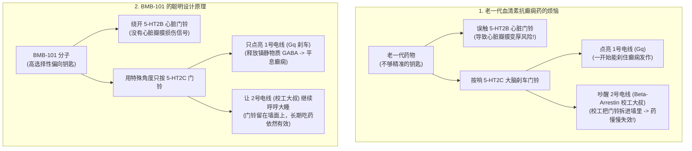
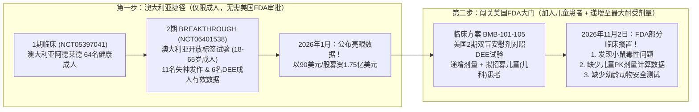
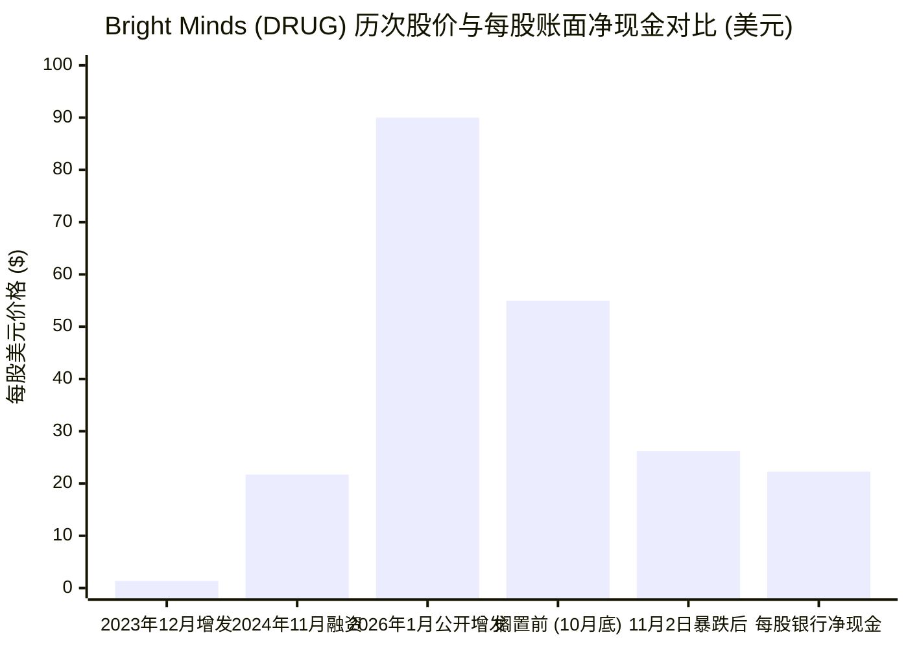

## 1. 悬念开场：等等——几只生病的实验室小鼠，怎么能在一天之内蒸发掉2.84亿美元？

想象一下，你和朋友们把零花钱凑在一起，创办了一家价值**5.42亿美元**（大约能买下**1,800辆全新校车**）的生物科技公司。你们正在研发一种名叫**BMB-101**的口服药水，专门用来帮助那些吃遍了各种药都不管用的重症癫痫患者停下脑海里的“闪电风暴”。

然而在**2026年11月2日**早上，美国政府的药品安全裁判（美国食品药品监督管理局，简称**FDA**）发来了一封电子邮件。邮件里写着：
*“请立刻暂停！在你们把这种药水喂给美国的儿童患者之前，我们在实验室小鼠身上发现了毒性（安全隐患），而且你们还没有拿出足够的数据，证明正在长身体的孩子们能安全地承受这种药物。”*

几个小时后，著名的生物医药记者亚当·费尔斯坦（Adam Feuerstein）在社交媒体上用一句话引爆了全场：

> "$DRUG FDA partial clinical hold due to mouse toxicity."
> （“DRUG因小鼠毒性被美国FDA采取部分临床搁置措施。”）

巧合的是，这家公司在纳斯达克股票市场上的交易代码正好就是英文单词“药”（**DRUG**）。消息一出，股市瞬间陷入恐慌。**Bright Minds Biosciences（明智生物科学公司）**的股价在一天之内暴跌了**52.35%**——从**54.98美元**直接摔到**26.20美元**，短短几个小时就蒸发了大约**2.84亿美元**的市值 ([SEC Form 6-K, 2026年11月2日](https://www.sec.gov/Archives/edgar/data/1827401/000206075526000063/ex991-20261102drug.htm))。

先别急，真正奇怪的谜题才刚刚开始：
既然在澳大利亚已经有**90名人类受试者**亲口喝下了这种药水，而且没有出现任何严重的药物副作用，为什么美国的裁判却因为**实验室小鼠**叫停了新的美国试验？为什么公司坚称“小鼠生病只是巧合，跟我们的药无关”？更奇怪的是，这家公司的银行账户里明明还稳稳地躺着**2.22亿美元现金**（折合`3.0783亿加元`），为什么整个公司在股市上的总价会跌到只剩**2.58亿美元** ([SEC 2026年第三季度财务报表](https://www.sec.gov/Archives/edgar/data/1827401/000106299326004442/exhibit99-1.htm))？

拿起你的侦探放大镜！我们要从零开始，钻进人类的大脑深处，再翻开连许多华尔街大人都懒得细读的美国证监会（SEC）备案文件第19页，一步步解开`Protocol BMB-101-105`背后的全部秘密。

---

## 2. 从零讲起：大脑里的雷暴、三个双胞胎门铃，还有爱管闲事的校工大叔

要想判断美国FDA裁判和制药公司到底谁说得对，我们得先搞明白**BMB-101**究竟是怎么在脑袋里工作的。

### 什么是癫痫发作？（大脑的“油门踏板”与“刹车踏板”）

在你的头骨里，装着一台大约三斤重的超级计算机，由大约**860亿个神经细胞（神经元）**组成。每当你看书、接球或者做白日梦时，这些细胞都在互相传递微小的电火花和化学小纸条。

就像骑自行车冲下陡坡一样，你的大脑需要两个踏板来控制速度：
1. **“冲啊！”油门踏板（兴奋性信号）：** 让脑细胞更快地发射电火花。
2. **“慢点！”刹车踏板（抑制性信号）：** 释放一种让人安静下来的化学物质（叫做**GABA**，氨基丁酸），告诉脑细胞冷静下来、别太激动。

**癫痫发作（Seizure）**，就是当大脑的“刹车踏板”突然失灵，几百万个脑细胞同时失控乱放电，就像脑海里突然劈下一场猛烈的雷暴！

Bright Minds公司想要治疗的是两种最难对付的“大脑雷暴”：
* **失神发作（Absence Seizures —— “暂停键”风暴）：** 病人不会倒在地上抽搐，但大脑的中央中转站和外层皮层会卡在一个死循环里。在**3秒到20秒**的时间里（差不多就是你默念*“一秒、二秒、三秒”*的工夫），病人就像被按下了视频“暂停键”一样，突然愣住、两眼发直，一天可能发作**20到50次**，醒过神来甚至不知道自己漏听了老师讲的半句话。
* **发育性和癫痫性脑病（简称 DEEs —— “童年飓风”风暴）：** 这个大人造出来的超长词组（包括罕见的基因疾病**Dravet综合征**和**Lennox-Gastaut综合征**），意思其实很简单：就是从婴儿或学步期就开始发作的极重度癫痫。患病的孩子每周会经历几十次危险的全身抽搐或突然跌倒（大运动发作），而且没完没了的脑电风暴还会拖慢甚至损伤孩子正在发育的大脑。虽然今天市面上已经有**20多种抗癫痫药**，但大约**30%**的癫痫患者（以及几乎所有DEE患儿）都属于**耐药性（难治性）癫痫**——哪怕每天同时吃**3到5种不同的抗癫痫药**，脑海里的雷暴还是照样发作 ([SEC 2026年第三季度MD&A, p. 2–5](https://www.sec.gov/Archives/edgar/data/1827401/000106299326004442/exhibit99-2.htm))。

### 血清素门铃三胞胎（`5-HT2A`、`5-HT2B` 和 `5-HT2C`）

怎么修好失灵的大脑刹车踏板呢？科学家发现，大脑里负责踩刹车的细胞表面装有一个特殊的“门铃”，专门接收人体自带的一种化学信使——**血清素（Serotonin，化学代号叫 5-HT）**。只要按响这个门铃，刹车细胞就会喷洒镇静物质GABA，把癫痫风暴熄灭！

但麻烦在于：人体里一共有**14种不同的血清素门铃**（科学家把门铃叫做**受体 Receptor**，把专门去按门铃的药叫做**激动剂 Agonist**）。其中有三个门铃——名字分别叫**5-HT2A**、**5-HT2B**和**5-HT2C**——长得就像三胞胎一样像！按对门铃能治病，可一旦手滑按错了旁边的双胞胎门铃，就会惹出大麻烦：

1. **`5-HT2C` 门铃（好用的癫痫刹车 & “我吃饱了”开关）：** 装在大脑的刹车细胞和食欲控制中心上。按响它，既能踩下癫痫刹车，又能告诉肚子*“我饱了，别吃啦！”*（所以Bright Minds也在测试用BMB-101治疗**普拉德-威利综合征 PWS**——这是一种每**15,000个新生儿中有1例**的罕见基因病，患儿因为天生的基因缺失导致`5-HT2C`门铃失灵，每天24小时都处于极度饥饿状态）。
2. **`5-HT2A` 门铃（幻觉开关）：** 装在大脑负责视觉和思考的区域。如果用力按响这个门铃，人就会产生白日梦和幻觉（致幻剂按响的就是这个开关）。
3. **`5-HT2B` 门铃（心脏瓣膜危险开关）：** 装在人类心脏里负责防止血液倒流的“小阀门”（**心脏瓣膜**）上！如果一种药每天不小心按到`5-HT2B`门铃，心脏瓣膜细胞就会越长越厚、越来越硬，最后导致心脏漏血——这就是危险的**心脏瓣膜病（Cardiac Valvulopathy）** ([SEC 2026年第三季度MD&A, p. 3–5](https://www.sec.gov/Archives/edgar/data/1827401/000106299326004442/exhibit99-2.htm))。

事实上，目前市面上用于治疗儿童重症癫痫的老药**芬氟拉明（商品名：Fintepla）**，在按响好门铃`5-HT2C`的同时，也会不小心碰到危险的心脏门铃`5-HT2B`。正因为这个风险，美国政府规定每个服用Fintepla的孩子在服药前、服药期间**每6个月**以及停药后，都必须去医院做**心脏超声波检查（超声心动图）**！

### 为什么BMB-101要专门躲开“爱管闲事的校工大叔”？

Bright Minds在设计**BMB-101**时用上了两大绝招。
第一招是**精准制导**：只需极微小的浓度（`16.2 纳摩尔`，相当于往标准奥运游泳池里撒一小撮糖），它就能精准按响`5-HT2C`癫痫刹车门铃，而对`5-HT2A`幻觉门铃的作用弱`100倍以上`，对`5-HT2B`心脏门铃更是完全不碰。

第二招是解决**“爱管闲事的校工大叔”问题**：
* 平时，当普通药物按响`5-HT2C`门铃时，细胞内部会同时点亮**两条电线**。
* **1号电线（`Gq蛋白`）：** 真正干活的好电线，负责拉下癫痫刹车。
* **2号电线（`β-抑制蛋白，Beta-arrestin`）：** 就像学校里脾气暴躁的校工大叔。如果有人整天按门铃，校工大叔就会跑出来大喊：*“太吵啦！”*然后**拿螺丝刀把门铃拆下来，直接塞进墙洞里藏起来**！门铃被藏进墙里后，病人再怎么吃药也按不到门铃了——这就是为什么很多抗癫痫药刚吃前两个月很管用，后来却慢慢失效的原因（医学上叫**耐药性 / 受体脱敏**）。
* **BMB-101**用了一个特殊的倾斜角度去按门铃，**只点亮1号电线（`Gq`），完全不吵醒2号电线（`Beta-arrestin`校工大叔）**。科学家把这个聪明的设计叫做**Gq蛋白偏向性激动剂（Gq-biased agonist）** ([SEC Form 6-K, 2026年1月6日](https://www.sec.gov/Archives/edgar/data/1827401/000206075526000005/ex991-drugnr.htm))。

---

## 3. 秘密解码器：把吓人的生物医药黑话翻译成大白话

读2026年11月2日的新闻稿时，满篇都是专业术语。别怕，这是专为五年级小侦探准备的**秘密解码器表格**：

| 大人们爱用的专业词 / 缩写 | 用大白话讲到底是什么意思 | 小学五年级日常生活比喻 |
| :--- | :--- | :--- |
| **DEEs（发育性和癫痫性脑病）** | 从婴儿或幼童时期开始发作的罕见重症癫痫，频繁的脑电风暴还会拖慢大脑发育（如Dravet综合征、Lennox-Gastaut综合征）。 | 一台正在安装操作系统的电脑，因为频繁遭遇强力电压浪涌，导致系统安装不断卡死。 |
| **5-HT2C Gq偏向性激动剂（Biased Agonist）** | 只按大脑`5-HT2C`刹车门铃（`激动剂`），而且只接通有用的`Gq`电线、不吵醒拆门铃的`Beta-arrestin`校工大叔的新药。 | 用特殊的轻巧手法按响门铃，让屋里听到铃声，但不会惊动那个爱把门铃拆掉的暴躁校工。 |
| **IND（新药临床试验申请）** | 制药公司想在美国把还没正式上市的新药喂给人类受试者之前，必须交给美国FDA审批的一大摞安全实验档案。 | 科学兴趣小组想在学校操场发射火箭模型前，必须连同安全测试报告一起交给校长签字的“申请许可袋”。 |
| **部分临床搁置（Partial Clinical Hold）** | 美国FDA下达的官方指令：暂停*某一项特定的计划试验*（或限制给儿童用药、限制高剂量），但允许公司的其他试验继续进行，直到安全疑问解释清楚。 | 校长宣布：*“你们在澳大利亚的八年级火箭队可以继续飞，但美国的五年级小组必须等降落伞安全测试补齐后才能发射！”* |
| **药代动力学（Pharmacokinetics, PK）** | 计算药物喝进肚子后多快进入血液、多少到达大脑，以及肝脏和肾脏多快把它排出去的数学模型。 | 往一杯牛奶里舀一勺巧克力酱，拿秒表计算它多快搅匀、多快被喝光。 |
| **幼龄动物毒性数据（Juvenile Toxicity Data）** | 在把新药给人类小孩吃之前，专门在*正在长身体的小动物*（如幼鼠、幼犬）身上做的安全测试。 | 在让6岁小朋友戴着新轮滑头盔冲下斜坡之前，先用儿童尺寸的小号碰撞假人做安全测试。 |
| **开放标签（Open-Label） vs. 双盲安慰剂对照试验** | *开放标签*是指病人和医生都知道喝的是真药；*双盲安慰剂对照*是指一半人喝假药水（`安慰剂`），而且在揭晓前没人知道谁喝的是真药。 | *开放标签*是看着可口可乐瓶子喝可乐；*双盲对照*是蒙上眼睛用没有标记的纸杯做盲测，防止心理作用偏心。 |

---

## 4. 宣传口号 vs. 侦探核查：官方原始档案揭开的4个惊人反转

要想弄懂为什么华尔街在2026年11月2日吓得魂飞魄散，我们得先看看Bright Minds是怎么一步步成为明星股的，然后再核对美国政府的原始档案。

### 第一幕：26亿美元的邻居大奖与2026年1月的狂欢派对

早在2023年底，Bright Minds还是一家股价只有**1.36美元**的袖珍公司 ([SEC 2026年第三季度MD&A, p. 8](https://www.sec.gov/Archives/edgar/data/1827401/000106299326004442/exhibit99-2.htm))。到了**2024年10月**，欧洲医药巨头**灵北制药（Lundbeck）**豪掷**26亿美元**，收购了另一家名叫**Longboard Pharmaceuticals**的公司，而那家公司的主打新药（**bexicaserin**）按的正是同一个`5-HT2C`大脑刹车门铃！华尔街交易员们一夜之间回过神来：*“天哪，Bright Minds手里也有一款同类的BMB-101！”*于是`DRUG`的股价在短短几天内狂飙了**2,000%以上**。

接着在**2026年1月6日**，Bright Minds公布了其2期临床试验**BREAKTHROUGH**（`NCT06401538`）的重磅好消息：
* 持续3秒以上的失神发作中位数大幅减少了**73.1%**（`p = 0.012`），而且患者的**REM（快速眼动/做梦）睡眠时间平均增加了90%**（总睡眠时间不变，但每晚REM睡眠从`56.2分钟`增加到`106.7分钟`）！
* DEE重症癫痫患者的大运动发作中位数减少了**63.3%**！
* **天价募资：** 就在公布好消息的第二天（**2026年1月7日**），趁着投资者热情高涨，Bright Minds以**每股90.00美元**的高价发行了**1,945,000股**新股，一口气往银行账户里装进了**1.7505亿美元**（约合`2.4325亿加元`）现金 ([SEC Form 6-K, 2026年1月8日](https://www.sec.gov/Archives/edgar/data/1827401/000206075526000009/ex991-final.htm))！

### 第二幕：侦探放大镜在字里行间抓到的4个反转

当我们调出美国临床试验注册库的官方档案（[NCT05397041](https://clinicaltrials.gov/study/NCT05397041)、[NCT06401538](https://clinicaltrials.gov/study/NCT06401538)、[NCT07266324](https://clinicaltrials.gov/study/NCT07266324)）并翻开Bright Minds提交给SEC的财报深处时，四个大多数新闻都没提过的真相浮出了水面：

1. **反转 #1 —— 公司迄今为止做过的全部3项人类临床试验，全都是在“澳大利亚”做的，从未经过美国FDA审批！**
   如果你去查美国政府官方数据库`ClinicalTrials.gov`，会发现Bright Minds的1期临床（`NCT05397041`，阿德莱德）、2期BREAKTHROUGH临床（`NCT06401538`，墨尔本、悉尼、布里斯班）以及2期普拉德-威利综合征NOVA临床（`NCT07266324`，悉尼、墨尔本）全部标注着 **`isFdaRegulatedDrug: False`（非美国FDA监管药物）**。因为澳大利亚允许企业通过当地医院伦理委员会快速启动早期人体试验，不需要先过美国FDA这一关。
2. **反转 #2 —— 所谓的“DEE发作减少63.3%”，其实只来自6名成年人，而且没有安慰剂对照组！**
   在2026年1月公布的BREAKTHROUGH试验（`NCT06401538`）中，总共只招募了**24名成年患者**（`平均年龄30岁`，年龄范围`18至65岁`），其中**6人中途退出**（脱落率高达`25%`）。在最受关注的DEE重症组里，只有**9名成年人**入组，3人因头晕、嗜睡或意外肩部骨折中途退出，最后真正算进疗效数据的只有**区区6名成年人**（`4名Lennox-Gastaut患者`、`1名Dravet患者`、`1名Rett综合征患者`）([SEC Form 6-K, 2026年1月6日](https://www.sec.gov/Archives/edgar/data/1827401/000206075526000005/ex991-drugnr.htm))！6个人，刚好只够坐满**学校食堂里的一张餐桌**！更重要的是，这是一项没有假药对照的**开放标签**试验，而且**连一个18岁以下的儿童都没有测过**。
3. **反转 #3 —— 藏在SEC财报第19页的秘密：这其实是Bright Minds第二次撞上美国FDA的“部分临床搁置”警告！**
   几乎所有人都以为2026年11月2日的FDA叫停是平地一声雷。但翻开公司2026年第三季度管理层讨论与分析报告的**第19页** ([SEC Form 6-K, 2026年8月17日, Exhibit 99.2](https://www.sec.gov/Archives/edgar/data/1827401/000106299326004442/exhibit99-2.htm)) 和年度报告 ([SEC Form 20-F](https://www.sec.gov/Archives/edgar/data/1827401/000106299324021301/form20f.htm))，上面清楚地写着这样一段话：
   > *“Bright Minds Biosciences 此前曾向美国食品药品监督管理局（FDA）提交过一份新药临床试验申请（IND），但在全面审查完成前将其主动撤回。在撤回确认函中，FDA提到了与拟议给药方案相关的部分临床搁置缺陷（partial clinical hold deficiencies）。”*
4. **反转 #4 —— 2026年11月2日，为什么`Protocol BMB-101-105`会被FDA按下暂停键？**
   要想在美国拿到DEE癫痫药的上市批文，光靠澳大利亚6个成年人的开放标签试验是不行的——因为DEE主要是儿童疾病，你必须在美国FDA监管下开展包含**儿童患者**的**随机、双盲、安慰剂对照试验**。当Bright Minds正式向美国FDA提交IND和`Protocol BMB-101-105`方案（计划在包括儿童在内的DEE患者中测试递增剂量直至最大耐受剂量）时，FDA直接亮出了**三张红牌**：
   * **红牌 A：** **在小鼠实验中发现了毒性**（根据公司Form 20-F第23页披露的表格，`28天`和`90天`的小鼠与犬类毒性研究此前已完成，而更长周期的**6个月慢性小鼠毒性研究**正在进行中）。
   * **红牌 B：** 缺乏足够的**药代动力学（PK）数据**来支持拟议的儿童患者入组。
   * **红牌 C：** 缺乏足够的**幼龄动物毒性数据（Juvenile Toxicity）**来支持拟议的儿童患者入组 ([SEC Form 6-K, 2026年11月2日](https://www.sec.gov/Archives/edgar/data/1827401/000206075526000063/ex991-20261102drug.htm))。

让我们把公司在新闻稿里的安抚说辞和美国FDA的真实规则放在一起对比看看：

| 公司在新闻稿中强调的安抚观点 | 原始档案与美国FDA法规揭示的硬核真相 |
| :--- | :--- |
| **“小鼠的毒性反应没有在其他物种中出现，公司和多位独立毒理学专家认为这只是巧合（incidental），与药物无关。”** | 就在这句话正下方，公司律师加上了免责声明：*“上述内容仅为本公司的观点，不应被理解为FDA的结论，也不代表已解决FDA提出的关切。”* 根据美国联邦法规（`21 CFR 312.42`），只有FDA自己的毒理审查官——而不是公司聘请的外部专家——才有权解除临床搁置。 |
| **“迄今已有约90名人类受试者服用了BMB-101，未发生与药物相关的严重不良事件。”** | 这`~90名`受试者（`1期64人` + `2期24人`）全部是**成年人（`18–65岁`）**，且主试验服药期较短（不超过3个月）。成年人短期服药没事，绝不能替代长期啮齿类动物器官病理检查，更不能替代正在发育的儿童所需的幼龄动物安全测试。 |
| **“本次部分临床搁置不影响公司正在进行的其他临床试验。”** | 这是因为公司正在进行的其他试验（`NCT06401538`延长期和普拉德-威利综合征`NCT07266324` NOVA试验）都是在**澳大利亚对成年人**开展的！但在最重要的**美国本土DEE临床试验中，只要搁置令不解除，连一个病人都不能招募。** |
| **媒体标题大多只盯着“小鼠毒性争议”。** | 就算Bright Minds最终说服FDA相信小鼠病变只是意外，FDA**同时**还指出了*缺乏支持儿童入组的药代动力学（PK）和幼龄动物毒性数据* ([FDA ICH S11 儿科非临床安全指南](https://www.fda.gov/regulatory-information/search-fda-guidance-documents/s11-nonclinical-safety-testing-support-development-pediatric-pharmaceuticals))。补做一套符合GLP标准的幼龄动物毒性试验通常需要**6到12个月**。 |

---

## 5. 四个嫌疑人：美国FDA到底为什么拉下紧急手刹？

在科学和商业探案中，真正的侦探绝不会只听信单一原因。让我们把导致这次“部分临床搁置”的**四个嫌疑人（竞争性因果假设）**全部请上审讯桌：

| 嫌疑人（因果假设） | 这个故事是怎么讲的？ | 支持证据 vs. 反对证据 | 侦探裁决 |
| :--- | :--- | :--- | :--- |
| **嫌疑人 1：药物直接导致小鼠中毒（`直接原因：BMB-101 -> 小鼠损伤`）** | 在高剂量或长达6个月的慢性测试中，BMB-101（或小鼠体内特有的代谢产物）确实损伤了小鼠的器官或神经系统。 | **支持：** `Protocol BMB-101-105`计划测试*递增至最大耐受剂量*，需要极高的动物安全边际；老一代`5-HT2C`药物（如氯卡色林 lorcaserin）在高暴露量下也曾出现啮齿类动物肿瘤毒性。 **反对：** 犬类实验和`~90名`成年人类的短期测试目前表现安全。 | **高度警惕（不可轻视）：** 在30天内收到的FDA正式信函揭晓小鼠具体*哪个器官*、在*多少倍剂量*下出问题之前，绝不能排除这一风险。 |
| **嫌疑人 2：实验室小鼠的自然生病（`背景噪音 -> 虚惊一场`）** | 关在笼子里养了6个月的实验小鼠自然出现了感染或老年病变，跟BMB-101毫无关系，只是FDA审查官比较谨慎。 | **支持：** 公司明确表示内部毒性报告、同行评审和多位独立毒理学专家均认为小鼠异常属于偶发、非药物相关。 **反对：** FDA毒理学家见过成千上万份小鼠报告并拥有庞大的历史对照组数据库，除非高剂量组比不吃药的对照组出现明显更高的异常比例，否则极少轻易下达临床搁置令。 | **仅对小鼠问题有可能——但不完整：** 就算小鼠真是冤枉的，这也无法解释为什么会缺少儿童PK和幼龄动物毒性数据！ |
| **嫌疑人 3：“澳大利亚成人试验 -> 美国儿童试验”跨步太大（`隐藏的第三变量 Z`）** | 公司做完澳大利亚小规模成人试验（`n = 24`）后，直接向美国FDA申请包含**儿童患者**的高剂量试验，撞上了严格的FDA儿科安全法规（`ICH S11`）。 | **支持：** DEE患儿大脑尚在发育，且平均同时服用`5种`其他抗癫痫药。FDA明确点名*缺乏支持儿童入组的PK与幼龄动物毒性数据*，且公司此前就曾因给药方案缺陷撤回过一次美国IND ([SEC 2026年第三季度MD&A, p. 19](https://www.sec.gov/Archives/edgar/data/1827401/000106299326004442/exhibit99-2.htm))。 | **核心结构性主因：** 从澳大利亚成人试验直接跳到美国儿科高剂量招募，却没补齐FDA标准的幼龄动物毒理与儿科PK数据包，是最核心的卡脖子环节。 |
| **嫌疑人 4：冲击“最大耐受剂量”挤扁了安全气垫（`双向反馈循环`）** | 试验方案要求在患者身上*“递增至最大耐受剂量”*，导致人类最高剂量与小鼠出现异常的剂量之间的“安全缓冲垫”被双向挤压！ | **支持：** FDA通过将动物安全剂量（`NOAEL`）除以人类最高计划剂量来计算安全倍数。如果小鼠在中等剂量出现异常，而方案又想把儿童剂量推到最高，两头一挤，安全边际就会瞬间不及格！ | **确认的放大器：** 调低人类试验的最高剂量上限，或者在补做幼龄动物实验期间先只招募**成年人（`18岁以上`）**，是解开这个死结的标准钥匙。 |

---

## 6. 隐藏的代价：谁受了伤？为什么股价跌到了几乎等于“银行存款”？

每一次临床叫停和股价暴跌背后，都有人为此付出代价。让我们看看谁受了影响，再来算一笔华尔街正在发生的奇妙“存钱罐算术题”。

### 1. 当 `Protocol BMB-101-105` 被冻结时，谁是输家？
* **患有DEE重症癫痫的儿童与家庭：** 患有Dravet综合征和Lennox-Gastaut综合征的孩子们每周都在经历几十次危险的抽搐。对于那些吃Fintepla无效、或者不想每半年做一次心脏超声检查的美国患儿家庭来说，**6到12个月以上的推迟**意味着漫长的等待。
* **2026年1月以90.00美元买入股票的投资者：** 1月份听完澳大利亚2期好消息花90美元买票进场的投资人，到了11月2日手里的股票只值**26.20美元**——账面亏损高达**70.9%**（每股亏掉`63.80美元`）！
* **与竞争对手的赛跑时间：** 当Bright Minds停下来补做FDA的实验作业时，花26亿美元收购了同类新药**bexicaserin**的欧洲巨头**灵北制药（Lundbeck）**正在全力推进全球3期临床试验。BMB-101每耽误一个月，对手的领先优势就扩大一分。

### 2. 2.22亿美元存钱罐悖论（为什么华尔街把科学家的发明标价成几乎零元？）

现在，让我们打开Bright Minds的官方资产负债表 ([SEC 2026年第三季度财务报表](https://www.sec.gov/Archives/edgar/data/1827401/000106299326004442/exhibit99-1.htm))，做一道五年级小学生都会的存钱罐加减法：
* **公司总股本（`已发行普通股`）：** **9,864,061股** ([SEC 2026年第三季度MD&A, p. 10](https://www.sec.gov/Archives/edgar/data/1827401/000106299326004442/exhibit99-2.htm))。
* **按26.20美元计算的股市总市值（`Market Cap`）：** `9,864,061股 × 26.20美元` = **约2.584亿美元**。
* **躺在银行账户里的真金白银（`截至2026年6月30日`）：** **3.0783亿加元**（其中直接以美元形式存放在银行的就有**2.1556亿美元**，全部现金合计约**2.22亿美元**！），而公司欠别人的全部账单（总负债）只有区区**254万加元（约180万美元）**。
* **每股背后的净现金：** 用`2.20亿美元`净现金除以`986万股`，每一股售价`26.20美元`的`DRUG`股票背后，竟然垫着大约**22.30美元的纯现金**！

当你用一家公司的股市总价（`约2.58亿美元`）减去它银行里的净现金（`约2.20亿美元`），剩下的数字（`约3,800万美元`）就是华尔街所说的**企业价值（Enterprise Value, EV）**——也就是市场给这家公司的所有科学发明和新药管线贴上的价格标签。

把这个图表想象成一家卖柠檬水的小摊：
* 昨天，大家愿意花**54.98美元**买一张收银机里装着**22.30美元现金**的股票，相当于大家认为那份“独家柠檬水秘方（`BMB-101`及新药管线）”值**32.68美元/股（约3.22亿美元）**。
* 今天暴跌到**26.20美元**后，扣掉收银机里的**22.30美元现金**，恐慌的交易员们只给整个柠檬水秘方标价**3.90美元/股（总共约3,800万美元）**——简直就像认定这本秘方已经彻底报废了一样，却忽略了公司账上的2.22亿美元现金足够支撑它做好几年的补充实验而根本不用借钱！

---

## 7. 最终成绩单：我们对接下来走势的真实判断

不要陷入“要么全完了、要么大涨”的二元思维。让我们用侦探的**“如果（If）……那么（Then）……”条件法则**，推演30天内FDA正式信函（Partial Clinical Hold Letter）寄到后会发生什么：

1. **如果FDA允许Bright Minds把 `Protocol BMB-101-105` 拆成两步走——即先在成年DEE患者（`18岁以上`）中以温和剂量启动美国2期试验，同时并行补做针对儿童（`<18岁`）的幼龄动物毒性实验（`ICH S11`）和儿科PK建模——那么** 这次临床搁置只是一个短期减速带（成人试验推迟`4–9个月`，儿童入组推迟`9–14个月`），市场把整个新药管线砍到只剩`3,800万美元`估值属于典型的恐慌过度。
2. **如果FDA的正式信函指出小鼠毒性发生在很低的药物浓度下（接近人类治疗剂量），并禁止在查明小鼠毒性机理前给任何美国受试者（包括成人和儿童）用药——那么** 美国DEE试验将被迫推迟**12到20个月**以上，在此期间公司只能依靠澳大利亚正在进行的**失神发作（Absence Seizures）**和**普拉德-威利综合征（NOVA）**试验来提供好消息。
3. **如果小鼠身上的毒性在长期非啮齿类动物（如9个月犬类研究）或幼龄动物补充实验中也同样出现——那么** `BMB-101`作为需要常年每天服用的抗癫痫药可能会遭遇重大挫折，迫使Bright Minds动用账上的2.2亿美元现金转向后备化合物**BMB-105**或抑郁症/疼痛新药项目（**BMB-201**、**BMB-202**）。

### 概率加权的侦探最终裁决表

| 情景名称 | 预估概率 | 接下来在科学和监管上会发生什么？ | 对美国DEE试验的时间影响 | 对患者与公司的实际意义 |
| :--- | :--- | :--- | :--- | :--- |
| **情景 A：“成人先行，儿童补完幼龄毒理后再跟进”的折中方案（基准情景）** | **55%** | 30天内收到的FDA正式信函要求在招募儿童前必须完成GLP幼龄动物毒性研究（`ICH S11`）、儿科PK建模并设定更严格的剂量上限，**但**允许修改方案后先在**成年（`18岁+`）DEE患者**中启动美国2期试验。 | 美国成人组推迟**4–9个月**；儿科扩展推迟**9–14个月**。 | 公司只需从2.22亿美元现金储备中拿出很小一部分（`约1,000万–1,500万美元`）补做实验，同时继续推进失神发作和普拉德-威利综合征（`NOVA`）研究。 |
| **情景 B：“全面重做临床前毒理”的漫长延期（悲观情景）** | **30%** | FDA驳回公司“小鼠毒性只是巧合”的解释，在小鼠毒性机理实验和幼龄动物毒理全部完成并通过审查前，拒绝批准`Protocol BMB-101-105`在美国的任何人体给药。 | 美国DEE试验推迟**12–20个月**。 | BMB-101在美国DEE赛道上落后于灵北制药的`bexicaserin`近两年时间，公司的主要价值支柱转向成人**失神发作**与**普拉德-威利综合征**。 |
| **情景 C：通过补充病理报告与调低剂量上限快速过关（乐观惊喜情景）** | **15%** | 独立病理学复核与现有的跨物种PK/毒理数据成功说服FDA小鼠病变属于背景噪音，仅通过下调最高剂量上限的方案修改就解除搁置，无需新建动物实验。 | 仅推迟**2–4个月**。 | 最快修复路径，2027年上半年即可全面恢复美国2期临床推进。 |

### 给五年级小侦探的终极启示

当一家公司欢呼*“我们的新药把癫痫发作减少了63%到73%！”*时，一定要先检查**测了多少人**（澳大利亚的24名成年人，其中DEE只有6人，儿童为0人）以及**在哪里测的**（美国FDA监管之外的澳大利亚）。反过来，当新闻标题惊呼*“因小鼠毒性遭遇FDA临床搁置！”*时，也一定要**把整句话读完**：美国FDA不仅指出了生病的小鼠，更要求补齐**儿童专属的剂量计算数学题（`PK`）**和**幼龄动物安全测试（`幼龄毒性`）**——因为在把强效脑科学药物交给正在长身体的孩子之前，任何一道安全作业都不能偷工减料！

---

## 一手信源与核验凭证（Primary Sources）

1. **Bright Minds Biosciences — SEC Form 6-K 及 Exhibit 99.1（2026年11月2日）：** [Bright Minds Biosciences Provides Update About Planned Study With BMB-101 in Developmental and Epileptic Encephalopathies](https://www.sec.gov/Archives/edgar/data/1827401/000206075526000063/ex991-20261102drug.htm)
2. **Bright Minds Biosciences — SEC Form 6-K，2026年第三季度财务报表（截至2026年6月30日）：** [Condensed Interim Consolidated Financial Statements (Exhibit 99.1)](https://www.sec.gov/Archives/edgar/data/1827401/000106299326004442/exhibit99-1.htm)
3. **Bright Minds Biosciences — SEC Form 6-K，2026年第三季度管理层讨论与分析（2026年8月17日提交）：** [Management's Discussion and Analysis for the Third Quarter Ended June 30, 2026 (Exhibit 99.2, p. 2–20)](https://www.sec.gov/Archives/edgar/data/1827401/000106299326004442/exhibit99-2.htm)
4. **Bright Minds Biosciences — SEC Form 6-K，2期BREAKTHROUGH临床试验顶线结果（2026年1月6日）：** [Positive Topline Results from Phase 2 Clinical Trial of BMB-101 (Exhibit 99.1)](https://www.sec.gov/Archives/edgar/data/1827401/000206075526000005/ex991-drugnr.htm)
5. **Bright Minds Biosciences — SEC Form 6-K，1.75亿美元公开增发定价公告（2026年1月8日）：** [Pricing of Upsized US$175 Million Public Offering at $90.00/Share (Exhibit 99.1)](https://www.sec.gov/Archives/edgar/data/1827401/000206075526000009/ex991-final.htm)
6. **Bright Minds Biosciences — SEC Form 20-F 年度报告：** [临床前 ADMEPK 与 28天 / 90天 / 6个月慢性小鼠及犬类毒性研究汇总表 (p. 23–27)](https://www.sec.gov/Archives/edgar/data/1827401/000106299324021301/form20f.htm)
7. **ClinicalTrials.gov 官方临床试验注册记录：** [NCT05397041（澳大利亚1期临床）](https://clinicaltrials.gov/study/NCT05397041)、[NCT06401538（澳大利亚2期BREAKTHROUGH临床）](https://clinicaltrials.gov/study/NCT06401538) 与 [NCT07266324（澳大利亚普拉德-威利综合征2期NOVA临床）](https://clinicaltrials.gov/study/NCT07266324)
8. **美国FDA / ICH 儿科药物非临床安全指南：** [S11 Nonclinical Safety Testing in Support of Development of Pediatric Pharmaceuticals](https://www.fda.gov/regulatory-information/search-fda-guidance-documents/s11-nonclinical-safety-testing-support-development-pediatric-pharmaceuticals)
