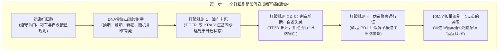
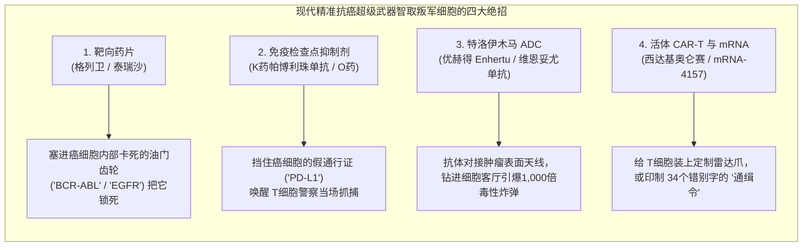

## 1. 悬念开场（The Hook）：等等——为什么医生不能给你吃一颗药就治好癌症？

如果你得了扁桃体发炎或者中耳炎，去医院拿一盒甜甜的草莓味抗生素吃上十天，病就彻底好了。为什么治细菌感染这么容易？因为让你嗓子疼的细菌是**外来入侵者**。它们长得跟我们身体里的细胞完全不一样，所以抗生素药片可以专门寻找细菌的外壳，像扎水球一样把它们统统扎破，却不会伤到你头上的一根头发。

既然这样，为什么科学家不能发明一颗同样的神奇药丸，一口气把**癌症（Cancer）**也消灭掉呢？

这里藏着整个医学界最烧脑的反转：**癌症根本不是外来入侵者。** 癌细胞其实就是*你自己身体里的一个原住民细胞*，突然撕掉了城市规则手册，开始疯狂地自我复制。因为它穿着跟你的健康心脏、肺部和大脑细胞几乎一模一样的校服，任何猛烈到足以毒死癌细胞的毒药，通常也会顺带毒伤健康的你。更夸张的是，“癌症”根本不是一种病——它是穿着不同伪装的 **200多种不同疾病的总称**！

不过，在过去十几年里，科学家们发明出了听起来像科幻电影一样的生物武器：肚子里塞满炸药的微型“特洛伊木马”、能撕掉假身份证的免疫觉醒剂、在实验室“忍者训练营”里改装过的活体警察细胞，以及专门为你一个人印制的 mRNA“通缉令”。有些新疗法能让过去只能活半年的晚期癌症患者健康地活过 **10年以上**；但也有一些新药一年要花掉 **20万美元（约合人民币140万元）**，却只能让患者的生命延长区区 **84天（2.8个月）**。今天，我们就化身科学小侦探，打开人体这座超级城市的引擎盖，从零开始摸清每一个抗癌齿轮的运转原理，并亲自核对顶级医学期刊里的真实账单。

---

## 2. 从零开始：30万亿细胞的超级城市与被打破的四条铁律

在看任何一种抗癌药之前，我们先要搞清楚癌症发生的游乐场——**你的身体**到底是怎么运转的。

你的身体不是一整块实心的橡皮泥，而是一座由大约 **30万亿个微型活体乐高积木**——也就是**细胞（Cells）**——搭建起来的繁华大都市（如果把你身体里的每一个细胞都变成一块 1 厘米宽的乐高积木，它们连起来可以绕地球赤道整整 **7,500圈**！）。每个细胞都极其微小，直径只有 **10 到 20 微米（µm）**，大约只有你**一根头发丝粗细的五分之一**。

每天，你身体里都有数百万个细胞因为磨损而退休（比如你在操场上摔破了膝盖，或者蜕去了老皮），需要新细胞来接班。为了填补空缺，健康的细胞会翻开藏在自己肚子里的那本由 30 亿个字母写成的化学食谱书——**DNA**，把它完整复印一份，然后一分为二，变成两个一模一样的新细胞。

为了让这座拥有 30 万亿居民的城市不陷入混乱，每一个健康细胞都严格遵守**四条城市铁律**：

1. **油门铁律：** 只有当邻居发来信号说*“嘿，这儿膝盖擦破皮了，快造点新皮肤细胞！”*时，才允许踩油门分裂。（科学家把这些负责踩油门的生长基因叫做**原癌基因 / Proto-Oncogenes**）。
2. **刹车铁律：** 一旦伤口填满，立刻踩下刹车停止分裂。（科学家把这些负责刹车的基因叫做**抑癌基因 / Tumor Suppressor Genes**）。
3. **自毁按钮铁律：** 复印一本长达 30 亿个字母的厚书时，难免会印错几个字母（也就是**基因突变**）。如果一个细胞发现自己的食谱书印错了太多地方、修不好了，它会非常礼貌地按下肚子里的自毁按钮，主动消失，绝不给城市添乱。（科学家把这种礼貌的细胞自杀叫做**细胞凋亡 / Apoptosis**）。
4. **警察查证铁律：** 你的血管里 24 小时都有微型警察巡逻，挨个检查每个细胞的身份证。一旦发现长相怪异或坏掉的细胞，警察会当场把它消灭。（科学家把这些精锐警察细胞叫做**T细胞 / T-Cells**）。

### 叛变细胞是怎么拉起一支黑帮的？

当**某一个细胞**因为香烟烟雾、太阳暴晒（紫外线）、衰老或者单纯的复印坏运气，导致它 DNA 食谱书里的关键位置攒够了错别字，**同时打破全部四条铁律**时，癌症就开始了：

* 一个错别字用强力胶把它的**油门踏板**死死粘在地板上，让它以为自己必须每时每刻不停地分裂（坏掉的油门现在被称为**癌基因 / Oncogene**，最著名的就是 `KRAS` 和 `EGFR`）。
* 另一个错别字剪断了它的**刹车线**（大名鼎鼎的总刹车基因叫 `TP53`，超过一半的人类癌症里它都坏掉了），还拔掉了**自毁按钮**的电源线。
* 很快，1 个叛军细胞变成 2 个、4 个、8 个、100 万个，直到堆成一团由 10 亿个贪婪细胞组成的肉块，叫做**肿瘤（Tumor）**（仅仅 **1 克重的肿瘤**——大约一枚回形针那么重——里面就已经挤满了 **10亿个癌细胞**！）。
* 最危险的是，有些叛军细胞学会了咬破原本器官的围墙，钻进血管高速公路，顺着血流漂到肺、肝脏、骨头或大脑里，建立起全新的叛军营地。科学家把这种跨器官搬家叫做**转移（Metastasis）**，它才是真正的终极反派：**高达 90% 的癌症死亡都是因为癌细胞搬家到了远处的器官**，而不是因为最初的那个肿块。

---

## 3. 秘密解码戒指（Secret Decoder Ring）：把吓人的医学词翻译成五年级大白话

大人们在新闻里聊起癌症时，总喜欢拽出一大堆像外星咒语一样的英文缩写和专业名词。在我们继续探案之前，先戴上这枚**秘密解码戒指**，一秒钟看穿所有专家黑话：

| 大人们的专业词 / 缩写 | 它到底是什么意思（大白话版） | 小学五年级的生活比喻 |
| :--- | :--- | :--- |
| **转移 (Metastasis)** | 癌细胞逃出最初生长的器官，顺着血管或淋巴管漂到远处的器官安家落户。 | 院子里的蒲公英种子被风吹走，飞过三条街，在别人家草坪上长出满地野草。 |
| **化疗 (Chemotherapy)** | 顺着血液流遍全身、把*所有*正在复印 DNA 和快速分裂的细胞统统毒死的药物。 | 为了消灭疯长的杂草，往整个后院喷洒除草剂——结果把长得最快的嫩草坪也一起烧黄了。 |
| **靶向药 (Targeted Therapy / 激酶抑制剂)** | 专门针对癌细胞内部某一个卡死的“油门齿轮”设计的微型药片，塞进齿轮缝里把它卡停。 | 给一辆电源开关被胶水粘住的失控玩具火车塞进一个小塑料片，精准卡停开关，不碰别的车。 |
| **免疫检查点抑制剂 (Anti-PD-1 / Anti-PD-L1)** | 一种静脉点滴药，专门撕掉癌细胞用来欺骗 T 细胞警察的“假好人通行证”。 | 一把扯掉银行劫匪身上的隐身斗篷，让原本就在屋里的保安大叔一眼认出劫匪并扑上去。 |
| **抗体偶联药物 (ADC)** | 把专门闻味道找癌细胞天线的“警犬（抗体）”，用微型链条拴上超毒化疗炸弹，钻进癌细胞肚子里才引爆。 | 一架伪装成“特洛伊木马”的快递无人机，敲开反派基地大门钻进去之后，才引爆肚子里的水球炸弹。 |
| **CAR-T 细胞疗法** | 从患者血液里抽出 T 细胞警察，在实验室给它们装上专门锁定癌细胞的雷达抓手，扩增到几亿个再输回体内。 | 把小区保安送到“忍者特训营”，给每个人发一副夜视仪，复制成百万忍者大军再空投回来。 |
| **个性化 mRNA 新抗原疫苗** | 读取手术切下来的肿瘤里独有的 34 个 DNA 错别字，印成 mRNA“通缉令”打进体内，教 T 细胞追杀残余癌细胞。 | 把通缉犯脸上独特的紫色刀疤印成照片发给全城每一个警察，让他再也没法偷偷溜回城里。 |
| **PFS 对比 OS (无进展生存期 vs 总生存期)** | **PFS** 是 CT 扫描上肿瘤暂停长大的月数；**OS** 是患者真正活下来的总时间。 | **PFS** 就像把快输掉的电子游戏按下“暂停键”停住 3 分钟；**OS** 则是真正打赢游戏、一直玩到晚饭时间。 |

---

## 4. 今天医生手里的六大武器（以及最新超级武器的工作原理）

今天，当一位癌症患者走进医院时，医生的工具箱里主要有**六大武器**。前三种是过去一百年打磨出来的**经典重型工具**，后三种则是最近 10 到 15 年威力大爆发的**现代精准超级武器**。

### 经典三剑客：切掉、激光轰炸、地毯式轰炸

1. **武器 1：外科手术（直接端掉叛军老巢）**
   * **工作原理：** 如果所有的叛军细胞还老老实实聚在一个肉块里（比如早期的乳腺癌、结肠癌或皮肤癌），还没有钻进血管高速公路逃跑，外科医生就可以用手术刀把整个肿块干净利落地切掉。
   * **为什么它依然伟大却不够用：** 在人类历史上，外科手术彻底治愈的实体瘤患者比所有药物加起来还要多！但哪怕最顶尖的核磁共振（MRI）扫描仪和医生的眼睛，也看不见躲在肝脏角落里的 1,000 个微型癌细胞小分队。如果蒲公英种子已经飞走了，光拔掉第一朵花是挡不住新杂草的。

2. **武器 2：放射治疗 / 放疗（看不见的隐形激光炮）**
   * **工作原理：** 医生从身体外面发射看不见的超高能量射线（X射线或重粒子**质子束**），精准轰击肿瘤，把癌细胞里的 DNA 食谱炸得粉碎，让它们在尝试分裂时直接散架。
   * **酷炫升级（质子刀 / Proton Therapy）：** 普通的 X 射线就像手电筒照过薄纸一样穿透整个身体，会把肿瘤前面和后面的健康组织一起烤伤。而最新的**质子治疗**像一颗设定好深度的深水炸弹：质子飞进身体后，会在刚好抵达肿瘤深度的那一毫米处，瞬间把近 100% 的爆炸能量全部释放出来（物理学上叫**布拉格峰 / Bragg Peak**），然后**立刻停住**，从而保护肿瘤正后方正在发育的儿童大脑或心脏。

3. **武器 3：传统化疗（专砍快长细胞的除草机）**
   * **工作原理：** 从 20 世纪 40 年代开始，医生们发现了一些化学毒药（有些最早是从芥子气和紫杉树皮里发现的！），能够卡死细胞复印 DNA 和一分为二的机器。因为癌细胞分裂得比大多数成年细胞快得多，化疗毒死的癌细胞远比正常细胞多。
   * **等等——为什么做化疗会掉头发、想吐？** 你有没有好奇过，为什么电视剧里的癌症病人做完化疗会掉光头发、恶心呕吐、还容易发烧感染？现在你自己就能推理出答案了！化疗药根本不认识谁是“癌细胞”，它只是一台**无差别攻击所有“快速分裂细胞”的割草机**。而在你身体里，除了癌细胞，还有哪三种健康好细胞每天都在拼命分裂呢？
     1. **毛囊细胞**（每天都在努力长头发！）→ 被误伤后，头发就会掉光。
     2. **口腔和胃肠道内壁细胞**（每 3 到 5 天就要全部换新一次！）→ 被误伤后，就会口腔溃疡、恶心呕吐。
     3. **骨髓造血工厂细胞**（每秒钟都在制造几百万个新血细胞！）→ 被误伤后，白细胞就会下降，人会极度疲惫、容易被细菌感染。
   * 尽管副作用这么大，多种化疗药联合使用的鸡尾酒疗法至今依然能**彻底治愈 85% 到 90% 以上的儿童急性淋巴细胞白血病（ALL）**，以及 **90% 以上的睾丸癌和霍奇金淋巴瘤患者**。

---

### 现代精准医学革命：只打坏蛋的四件智能超级武器

因为传统化疗就像为了抓一个银行劫匪而炸掉整条街，科学家们花了 25 年时间，造出了能够精准区分“叛军细胞”和“好市民细胞”的四大智能武器。

#### 武器 4：靶向药片（“卡死失控的油门踏板”）
* **先讲原理：** 科学家先读取癌细胞的 DNA，找出那个因为基因印错而永远卡在“开启”状态的故障蛋白质齿轮，然后专门设计一把微型化学钥匙，刚好塞进那个坏齿轮的电池槽里把它冻住。
* **五年级生活比喻：** 就像一辆电源开关被强力胶粘住的失控玩具火车。我们不用大铁锤把整辆车砸烂，而是拿一片薄薄的塑料垫片，精准插进那个坏开关的缝隙里把它卡停。
* **大人们叫它：** **小分子靶向治疗（Small-Molecule Targeted Therapy / 酪氨酸激酶抑制剂，TKI）**。
* **真实临床账单：** 历史上第一颗超级明星靶向药是治疗**慢性髓系白血病（CML）**的**伊马替尼（Imatinib，商品名格列卫）**。在 2001 年以前，每 100 个得这种白血病的患者里，只有不到 30 人能活过 5 年。但在顶级医学期刊[《新英格兰医学杂志》（NEJM）发表的 IRIS 临床试验 11 年随访结果（PMID 28273028）](https://pubmed.ncbi.nlm.nih.gov/28273028/)中，**每天吃格列卫药片的患者有高达 83.3% 在 10 年后依然活着**——把一种绝症白血病变成了像高血压一样每天吃一片药就能正常生活的慢性病！同样，在由 `EGFR` 油门突变引起的肺癌中，第三代靶向药**奥希替尼（泰瑞沙 / Tagrisso）**在 [FLAURA 临床试验（PMID 31751012）](https://pubmed.ncbi.nlm.nih.gov/31751012/)中把患者的中位总生存期延长到了 **38.6个月（超过3年）**。

#### 武器 5：免疫检查点抑制剂（“一把撕掉假警察通行证”）
* **先讲原理：** 还记得你血管里的 T 细胞警察吗？为了防止 T 细胞误伤你健康的器官，每个 T 细胞身上都带着一个叫 **PD-1** 的“停止攻击扫描仪”。健康细胞则举着一张叫 **PD-L1** 的好人安全牌，上面写着：*“我是自己人，别开枪！”* 狡猾的癌细胞偷偷学会了伪造几千张 **PD-L1** 假牌子举在头顶，把走过来的 T 细胞警察当场催眠！
* **五年级生活比喻：** 一个银行劫匪戴着伪造的保安胸牌在走廊里大摇大摆，真警察走过去居然跟他点头打招呼。这时医生打进一针抗体盾牌，把劫匪的假胸牌（或者警察的扫描仪）挡住，警察突然大喊一声：*“站住！你是劫匪！”* 冲上去就把他按倒在地。
* **大人们叫它：** **免疫检查点抑制剂（Immune Checkpoint Inhibitors，比如帕博利珠单抗 / K药 Keytruda，以及纳武利尤单抗 / O药 + 伊匹木单抗 / Y药）**。
* **真实临床账单：** 回到 2010 年，如果致命的皮肤癌（**黑色素瘤**）转移到了肺或大脑，排在最中间的患者只能活 **6 到 9 个月**，几乎没人能活过 5 年。而在[《新英格兰医学杂志》发表的 CheckMate 067 三期临床试验最终 10 年结果（PMID 39282897）](https://pubmed.ncbi.nlm.nih.gov/39282897/)中，同时使用两种免疫检查点抑制剂（O药 + Y药）的晚期黑色素瘤患者，中位总生存期飙升到了 **71.9个月（整整6年！）**，而且 **10 年后依然有 43% 的患者活着**（超过一半的患者再也没有死于黑色素瘤！）。

#### 武器 6A：抗体偶联药物（ADC）与核药（“特洛伊木马与2毫米放射性狙击手”）
* **先讲原理：** 如果一个肿瘤既不怕靶向药片，又能躲开 T 细胞怎么办？科学家派出了一只生物警犬（**单克隆抗体**），它只认癌细胞表面伸出来的特定天线（比如乳腺癌表面的 `HER2` 或膀胱癌表面的 `Nectin-4`）。接着，科学家用一条微型化学牵引绳（连接子），在警犬背上绑了 4 到 8 颗**比普通医院化疗药毒 100 到 1,000 倍的超级化疗炸弹**。在血液里漂流时，炸弹锁在木马肚子里不伤人；一旦警犬咬住癌细胞的天线、被癌细胞吞进客厅，牵引绳就会断开，在癌细胞肚子里引爆炸弹！更妙的是，炸出来的毒药还会透过墙壁渗到隔壁，把旁边没长天线的癌细胞也一并消灭（科学家把这叫做**旁观者效应 / Bystander Effect**）。
* **大人们叫它：** **抗体偶联药物（ADC）**——以及它的近亲**放射性配体疗法（Radioligand Therapy，简称核药 RLT）**，后者把化疗炸弹换成了一颗放射性原子（`镥-177`），它发射出的射线火花只跑 **1 到 2 毫米**（也就是你口袋里一枚一角硬币的厚度！），只烧死癌细胞和紧挨着的坏邻居，绝不伤到一厘米外的健康器官。
* **真实临床账单：**
  * 在表面只有一点点 `HER2` 天线的乳腺癌（“HER2低表达”）中，特洛伊木马药物**德曲妥珠单抗（优赫得 / Enhertu）**在 [DESTINY-Breast04 试验（PMID 35665782）](https://pubmed.ncbi.nlm.nih.gov/35665782/)中把肿瘤不长大的时间延长了近一倍（**9.9个月 vs 5.1个月**），并把总生存期从 **16.8个月提高到23.4个月**。
  * 在晚期膀胱癌（尿路上皮癌）中，把 ADC（**维恩妥尤单抗 / Padcev**）和免疫检查点抑制剂（**帕博利珠单抗 / K药**）联用的 [EV-302 三期临床试验（PMID 38446675）](https://pubmed.ncbi.nlm.nih.gov/38446675/)，**将人类总生存期从 16.1 个月几乎翻倍至 31.5 个月**——这是 40 年来第一个彻底击败传统铂类化疗的方案！
  * 在晚期前列腺癌中，2 毫米核药狙击手 **Pluvicto（`177Lu-PSMA-617`）**在 [VISION 试验（PMID 34161051）](https://pubmed.ncbi.nlm.nih.gov/34161051/)中将总生存期从 **11.3个月延长至15.3个月**，无进展生存期翻了一倍多（**8.7个月 vs 3.4个月**）。

#### 武器 6B：活体细胞疗法（CAR-T）与个性化 mRNA 疫苗（“忍者特训营与34个错别字通缉令”）
* **CAR-T 细胞疗法（忍者特训营）：** 对付白血病、淋巴瘤和多发性骨髓瘤等血液癌症时，医生把患者连上采血机，收集数百万个疲惫的 T 细胞警察，冷冻运到专门的实验室。科学家用去掉毒性的安全病毒把一段新基因装进 T 细胞里，让它们表面长出一个定制的机械抓手——**嵌合抗原受体（CAR）**，专门死死咬住血癌细胞表面的标志（`CD19` 或 `BCMA`）。在温暖的营养液里把这些活体忍者细胞扩增到**几亿个**后，再输回患者的静脉里。
  * *真实账单：* 在所有疗法都失败、濒临绝境的复发难治性儿童 B 细胞白血病患儿中，单次输注 **Tisagenlecleucel（Kymriah）** 在 [ELIANA 试验（PMID 29385370）](https://pubmed.ncbi.nlm.nih.gov/29385370/)中让 **81% 的孩子在 3 个月内实现了癌细胞完全消失（完全缓解）**！在多发性骨髓瘤中，**西达基奥仑赛（Carvykti）** 在 [CARTITUDE-4 试验（PMID 37272512）](https://pubmed.ncbi.nlm.nih.gov/37272512/)中把癌症恶化或死亡的风险比标准治疗降低了整整 **74%（风险比 0.26）**。
* **个性化 mRNA 癌症疫苗（34个错别字通缉令）：** 和预防流感的疫苗不同，癌症疫苗是在外科医生切掉高危肿瘤*之后*打的，目的是防止残留的癌细胞卷土重来。医生对切下来的肿瘤进行基因测序，挑出最多 **34 个只存在于这位患者癌细胞里的独特蛋白质错别字（新抗原 / Neoantigens）**，在大约 6 周内专门为这一个人印制一批 **mRNA 疫苗（`mRNA-4157 / V940`）**。打进手臂后，mRNA 就像把印着 34 张嫌犯大头照的通缉令发给全身的 T 细胞。
  * *真实账单：* 在[《柳叶刀》（The Lancet）发表的 KEYNOTE-942 二期 b 临床试验（PMID 38246194）](https://pubmed.ncbi.nlm.nih.gov/38246194/)中，与单用 K 药相比，加上个性化 mRNA 疫苗让高危黑色素瘤患者在约 2 年内的复发或死亡率从 **40%（50人中20人）降至 22%（107人中24人）**，远处转移或死亡风险更是大幅降低了 **65%（风险比 0.347）**！

| 治疗武器支柱 | 它如何找到癌细胞 | 著名代表药物 | 顶级临床试验真实账单 | 最大软肋（“隐藏的代价”） |
| :--- | :--- | :--- | :--- | :--- |
| **1. 传统化疗** | 无差别攻击体内所有快速分裂的细胞 | 顺铂、阿霉素、紫杉醇 | 治愈 >85% 儿童白血病与 >90% 睾丸癌 | 误伤毛囊（脱发）、胃肠黏膜（呕吐）和骨髓（白细胞降低） |
| **2. 靶向药片** | 塞进癌细胞内特定的故障油门蛋白质孔位 | 格列卫 (Imatinib)、泰瑞沙 (Osimertinib) | 慢粒白血病 10 年生存率达 83.3% ([PMID 28273028](https://pubmed.ncbi.nlm.nih.gov/28273028/)) | 实体瘤在 9~18 个月内会改变锁孔形状产生耐药 |
| **3. 免疫检查点抑制剂** | 挡住癌细胞的假 `PD-L1` 通行证，唤醒 T 细胞 | K药 (Pembrolizumab)、O药+Y药 | 晚期黑色素瘤中位总生存期达 71.9 个月 ([PMID 39282897](https://pubmed.ncbi.nlm.nih.gov/39282897/)) | 所有癌症患者中仅约 12.5%~20% 真正有效 ([PMID 31050774](https://pubmed.ncbi.nlm.nih.gov/31050774/)) |
| **4. 抗体偶联药物 (ADC)** | 抗体对接肿瘤天线，在细胞内投下千倍毒性炸弹 | 优赫得 (Enhertu)、维恩妥尤单抗+K药 | 晚期膀胱癌总生存期翻倍：31.5 vs 16.1 个月 ([PMID 38446675](https://pubmed.ncbi.nlm.nih.gov/38446675/)) | 约 98% 药量未进肿瘤而在健康组织分解；间质性肺炎风险 (12.1%) |
| **5. CAR-T 活体细胞疗法** | 在实验室给患者 T 细胞装上追踪雷达机械爪 | Kymriah、传奇生物 Carvykti | 儿童白血病 81% 完全缓解 ([PMID 29385370](https://pubmed.ncbi.nlm.nih.gov/29385370/))；骨髓瘤风险降 74% | 很难钻进实体瘤水泥墙；定价超 45 万美元；细胞因子风暴高烧 |
| **6. 个性化 mRNA 与核药** | 34个错别字通缉令 (`mRNA-4157`) 与 2毫米射线狙击 (`Pluvicto`) | V940 (`mRNA-4157`)、Pluvicto (`177Lu-PSMA-617`) | 18个月无远处转移生存率 92% vs 77% ([PMID 38246194](https://pubmed.ncbi.nlm.nih.gov/38246194/)) | 定制 mRNA 需等约 6 周；Pluvicto 中位总生存仅延长 4.0 个月 |

---

## 5. 夸张头条 vs 侦探查账：当 100 名癌症患者走进学校体育馆会发生什么？

如果你只看电视广告或医院宣传栏，会觉得每一种新上市的抗癌药都是包治百病的奇迹。现在让我们拿起侦探放大镜，用原始医学论文核查三个最重要的统计谜题。

### 谜题 #1：免疫疗法的“学校体育馆 100 人测试”
* **宣传头条：** *“免疫疗法唤醒你自己的免疫系统，让肿瘤凭空融化！”*
* **侦探查账：** 在所有癌症患者里，到底有多少人能拿到这个奇迹？肿瘤学家 Vinay Prasad 和 Alyson Haslam 统计了美国 FDA 批准的所有免疫检查点抑制剂在全体美国癌症患者中的真实覆盖率，并发表在 [*JAMA Network Open* (PMID 31050774)](https://pubmed.ncbi.nlm.nih.gov/31050774/) 上。
* **扳着手指算一算：** 想象有 **100 名晚期癌症患者**走进学校体育馆：
  * **100 人里有 56 人**得的癌症类型根本不在免疫检查点抑制剂的批准名单上——他们连试药的门票都没有，只能直接坐到看台长椅上。
  * **100 人里有 44 人**（`43.63%`）符合条件，拿到了打针的门票。
  * 而在打上点滴的这 44 个人里，肿瘤真正缩小的只有**最初 100 人里的 12 到 13 个人**（`12.46%`）！
  * 为什么另外 87 个人没能获益？因为许多最凶险的肿瘤——比如**胰腺癌、脑胶质母细胞瘤、卵巢癌，以及绝大多数结直肠癌和前列腺癌**——是科学家所说的**“冷肿瘤（Cold Tumors）”**。它们在自己周围筑起了一道像厚疤痕一样的钢筋水泥墙（叫做**基质 / Stroma**），还往外喷洒化学迷雾，把 T 细胞警察死死挡在大楼外面。如果房间里连一个警察都没有，你把劫匪的假身份证撕得再碎也没用！

### 谜题 #2：“一个暑假（2.8个月）”的中位数陷阱 vs 超级幸存者长尾
* **宣传头条：** *“FDA 批准了 170 款抗癌新药、覆盖 455 项适应症——每一款都是重大突破！”*
* **侦探查账：** 当研究人员对 2000 年至 2021 年间 **FDA 批准的全部 170 款抗癌药和 455 项适应症**（[PMID 38244983](https://pubmed.ncbi.nlm.nih.gov/38244983/)）以及 **42 项乳腺癌新药批准**（[PMID 39320645](https://pubmed.ncbi.nlm.nih.gov/39320645/)）进行地毯式查账时——这也印证了 Tito Fojo 著名的 71 款实体瘤新药审计（[PMID 25068501](https://pubmed.ncbi.nlm.nih.gov/25068501/)）——吃新药的队伍里排在最中间的那位患者（**中位数 / Median**），比用老办法治疗的患者到底多活了多久？
* **惊人的真实数字：** 在数百项随机临床试验中，新抗癌药带来的**中位总生存期（OS）延长只有区区 2.8 个月**——大约 **84 天**，也就是一个小学暑假的长度！与此同时，乳腺癌新药的中位价格却高达**每月 $16,013（每年超过 19.2 万美元，相当于每年买四辆全新的家用 SUV 汽车！）**，而且研究人员发现：**一款抗癌药卖多贵，和它能帮患者多活几个月之间，数学相关性是零！**
* **更隐蔽的“游戏暂停键”把戏（替代终点 / Surrogate Endpoints）：** 为了让新药更快上市，FDA 经常只要看到 CT 扫描上肿块暂时不长大（**无进展生存期 / PFS**），就先发一张**加速批准（Accelerated Approval）**门票。哈佛医学院团队在 [*JAMA* (PMID 38583175)](https://pubmed.ncbi.nlm.nih.gov/38583175/) 上对获得加速批准的抗癌药进行了长达 5 年以上的追踪审计，结果发现：**高达 57%（46 项中的 26 项）在后续确证试验中根本没能证明患者多活了一天或生活质量有任何改善**（只有 **43%**，即 46 项中的 20 项，真正证明了总生存期或生活质量获益）！

### 等等——如果“排中间的人”只多活了几个月，为什么医生还是把免疫疗法称为奇迹？
这里有一个五年级小侦探必须掌握的核心数学秘密：**“排在队伍中间的人（中位数）”和“队伍最前面那群超级幸存者（长尾曲线）”的区别！**
* 假设 100 名患者用了一款新的免疫疗法，如果其中 65 个人完全没反应，那么排在**第 50 名的人（中位数）**看起来只多活了短短几个月。
* **但是！** 排在队伍最前面的那 **20 到 35 个人（“超级响应者”）**，他们的免疫系统彻底记住了癌细胞的长相。**整整 10 年过去后，他们依然健健康康地活着，去踢足球、参加毕业典礼、和家人吃晚饭，体内连一个癌细胞都找不到了！**
* 换句话说，许多现代免疫和细胞疗法不是给每个人发一小块糖，而是一张**有着 15% 到 40% 真实中奖率能活过十年的超级彩票**。今天全世界科学家最大的任务，就是弄明白怎样让剩下的 60% 患者也能中头奖。

---

## 6. 四大嫌疑人：为什么自 1991 年以来癌症死亡人数大降、拯救了 480 万条生命？

现在来看整个医学界最振奋人心的好消息：根据美国癌症协会（ACS）发表在顶级神刊《临床医师癌症杂志》上的最新[**《2026年癌症统计报告》（Cancer Statistics, 2026，PMID 41528114）**](https://pubmed.ncbi.nlm.nih.gov/41528114/)，美国的年龄标准化癌症死亡率自 1991 年见顶以来，到 2023 年已经**累计下降了超过三分之一（34%）**！这一持续下降相当于**挽救了 480 万人的生命**——差不多等于救下了整个深圳市一半的人口，或者洛杉矶加旧金山的全部人口！而且在人类历史上，**所有癌症合并的 5 年相对生存率第一次突破了 70% 大关**。

看看从 20 世纪 90 年代中期到今天，几种最凶险癌症的 5 年生存率跳升了多少（[PMID 41528114](https://pubmed.ncbi.nlm.nih.gov/41528114/)）：

```mermaid
xychart-beta
    title "五年生存率对比 (%)：90年代中期 vs 今天 (ACS 2026 数据)"
    x-axis ["所有癌症", "多发性骨髓瘤", "局部晚期肺癌", "转移性黑色素瘤", "肝癌", "转移性肺癌"]
    y-axis "活过5年的患者比例 (%)" 0 --> 80
    bar [63, 32, 20, 16, 7, 2]
    bar [70, 62, 37, 35, 22, 10]
```

*（上面每组柱子中，第一根代表 20 世纪 90 年代中期的 5 年生存率，第二根代表 ACS 2026 报告中最新的 2015–2021 年 5 年生存率。）*

每当医药公司看到“拯救 480 万生命”这个数字时，总喜欢把 100% 的功劳算在新药头上。但优秀的侦探绝不轻信第一个嫌疑人的口供！让我们把**四个因果嫌疑人（Rival Causes）**排成一排，看看究竟是谁立下了大功：

| 嫌疑人名单 | 这个嫌疑人是如何起作用的 | 铁证如山的真实功劳领域 | 这个嫌疑人被过度吹嘘的地方 | 在拯救 480 万生命中的真实功劳占比 |
| :--- | :--- | :--- | :--- | :--- |
| **嫌疑人 1：直接原因（靶向药、免疫新药与手术进步）** | 靶向药片、免疫检查点抑制剂、ADC 和 CAR-T 直接消灭了过去无药可救的叛军细胞。 | **在血癌、皮肤癌和肺癌中功不可没：** 慢粒白血病 10 年生存率从 <30% 飙至 83.3%；转移性黑色素瘤 5 年生存率从 16% 翻倍至 35%；骨髓瘤从 32% 跃升至 62% ([PMID 41528114](https://pubmed.ncbi.nlm.nih.gov/41528114/))。 | 在胰腺癌、脑胶质瘤和许多没有靶点的冷肿瘤中，20 万美元的新药依然只能把中位生存期延长几个月。 | **占总死亡率下降的约 25%–30%**（且自 2014 年以来加速上升）。 |
| **嫌疑人 2：反向/秒表错觉（“领先时间偏倚”与过度诊断）** | 用高灵敏度扫描仪提前 5 年发现一个小黑点，就算病人死在同一天，“生存秒表”也提前了 5 年按下，让 5 年生存率暴涨！ | 在甲状腺或前列腺里找出大批一辈子都不会害人的“乌龟小肿块”，确实会人为吹高**5年生存率百分比**。 | 但绝对骗不了**死亡证明书上的真实死亡人数下降（死亡率下降 34%、少死 480 万人）**！死神可不管你的秒表是什么时候按下的。 | **解释了部分 5 年生存率(%)的上涨，但对少死 480 万人贡献为 0%。** |
| **嫌疑人 3：隐藏的幕后巨星（戒烟运动与一级预防）** | 如果细胞根本不被香烟烟雾或致癌病毒（`HPV`、乙肝/丙肝）破坏，或者做肠镜在息肉变成肠癌前就夹掉，癌症就根本不会发生！ | 美国成人吸烟率从 **1965 年的 42% 暴跌至今天的约 11%**。少抽烟 + 肠镜筛查 + 宫颈涂片与 HPV 疫苗，在不用吃一颗贵价药的情况下阻止了数百万例致命癌症。 | 预防没法拍成炫酷的电视广告，因为从来没有人会为自己“没有得上的癌症”放烟花庆祝！ | **占 1991 年以来拯救 480 万生命的约 55%–60%，是头号大功臣。** |
| **嫌疑人 4：正反馈飞轮（早期扫描发现 + 术后智能巩固药）** | 低剂量 CT 和基因检测在肿瘤只有 `1 厘米` 时就抓住它，让手术切除 + 术后 mRNA 疫苗/靶向免疫巩固药的效果翻三倍！ | 局部晚期肺癌 5 年生存率从 **20% 几乎翻倍到 37%**，正是因为早期 CT 筛查与术后靶向/免疫药物联手配合。 | 只有当患者买得起医保、家附近有医院做早期筛查时，这个飞轮才能转起来。 | **占总下降的约 10%–15%（并且是未来十年最强的增长引擎）。** |

---

## 7. 隐藏的代价与最终成绩单：为什么癌症还没被彻底消灭——以及我们的真实结论

既然科学家已经造出了特洛伊木马导弹（ADC）、忍者 T 细胞（CAR-T）和 mRNA 通缉令，为什么 2026 年全美预计依然会有 **626,140 人**死于癌症（[PMID 41528114](https://pubmed.ncbi.nlm.nih.gov/41528114/)）？一份诚实的侦探报告必须直面**挡在路上的四大物理与经济瓶颈（The Catch）**，看看究竟是谁在承担代价。

### 1. 癌细胞在以超音速玩“达尔文进化游戏”
还记得一克重的肿瘤里挤着 **10 亿个癌细胞**吗？就算像泰瑞沙这样优秀的靶向药片在两个月内杀死了其中 **99.999%** 的癌细胞，用五年级乘法算一算（`1,000,000,000 × 0.00001`），依然有 **10,000 个叛军细胞活了下来**！因为癌细胞复印 DNA 时总是粗心大意，这 1 万个幸存者肚子里刚好带着一个新的错别字，改变了锁孔的形状，让靶向药片再也塞不进去。当周围的同伴都被清空后，这些耐药细胞独占所有营养疯狂繁殖，`9 到 18 个月`后肿瘤就会重新长回来。科学家把这叫做**获得性耐药（Acquired Resistance）**，要想击败它，必须像当年人类用鸡尾酒疗法击败艾滋病病毒（HIV）一样，从一开始就用 **2 到 3 种不同原理的武器同时夹击**。

### 2. “冷实体瘤”的钢筋水泥堡垒
白血病、淋巴瘤和骨髓瘤等血癌细胞漂浮在血管管道里，CAR-T 细胞和抗体很容易就能撞见并消灭它们。但**近 90% 的人类癌症是硬邦邦的实体肿块**（肺癌、乳腺癌、肠癌、胰腺癌、前列腺癌、脑瘤）。实体瘤会筑起高压物理围墙，抢光周围所有的葡萄糖和氧气让 T 细胞饿肚子，还会释放酸液和催眠气体。如何造出能像推土机一样撞开胰腺癌或脑瘤水泥墙的 CAR-T 细胞和双特异性抗体，是今天整个生物学界最难啃的硬骨头。

### 3. 身体内部的“友军误伤（Friendly Fire）”
每一件超级武器都有真实的副作用代价：
* **免疫检查点抑制剂**拆掉了 T 细胞警察的刹车。结果在 **20% 到 50% 的患者**体内，过度兴奋的警察开始胡乱开罚单甚至暴打健康器官，引起结肠、甲状腺、肝脏或肺部的严重发炎（**免疫相关不良反应 / irAEs**）。
* **抗体偶联药物（ADC）**在图纸上看像是百发百中的激光导弹，但在真实人体内，**打进血管的 ADC 分子有大约 98% 根本没能进入肿瘤**，它们的牵引绳最终在正常血液和组织里断开了。在优赫得（Enhertu）的 DESTINY-Breast04 试验（[PMID 35665782](https://pubmed.ncbi.nlm.nih.gov/35665782/)）中，**12.1% 的患者出现了药物引起的肺部瘢痕发炎（间质性肺病 / 肺炎）**，其中 **0.8% 因此不幸去世**，所以医生必须像老鹰一样紧盯患者的肺部 CT。
* **CAR-T 细胞疗法**在几亿个忍者细胞同时开火时，会引发一场叫**细胞因子释放综合征（CRS）**的免疫大风暴，导致 40°C 以上的高烧、血压骤降和短暂的神经错乱，必须在重症监护室（ICU）随时准备抢救。

### 4. “财务毒性”与药企的切蛋糕定价套路
在今天的抗癌经济里，谁是最大的输家？**患者家庭和医保基金。**
* 一针定制的 CAR-T 细胞疗法，不算 ICU 住院费，光药费标价就高达 **45 万至 50 万美元以上**。
* 免疫检查点抑制剂每 28 天就要花掉 **$7,783 到 $14,872（每年 10 万至 19 万美元以上）**。既然市面上已经有 11 种不同的免疫检查点抑制剂了，为什么它们不降价竞争呢？哈佛大学 Benjamin Rome 团队发表的卫生政策审计（[PMID 41202200](https://pubmed.ncbi.nlm.nih.gov/41202200/)）揭穿了这个秘密：药企们没有打价格战，而是把 **55 个细分癌症适应症像切蛋糕一样瓜分掉，让其中 44% 的适应症只有唯一一款获批药物**，从而让五大主力药物的价格差距保持在 **7% 以内**，吞掉了美国联邦医疗保险（Medicare Part B）近 **20%** 的总药费！

---

### 最终侦探成绩单：我们到底怎么看（What We Actually Think）

如果一个五年级小学生问：*“那我们到底是在打赢还是打输这场抗癌战争？”*，聪明的侦探绝不会偷懒只回答“赢”或“输”。因为答案完全取决于你站在城堡的哪一个房间里，我们用清晰的**“如果（If）……那么（Then）……”条件法则**来给出最终裁决：

* **如果（IF）癌症在钻进血管高速公路之前的早期阶段（I期或II期）就被抓住——并且我们将外科手术与现代 mRNA 通缉令（`mRNA-4157`）或靶向/免疫术后巩固治疗结合起来：** **那么（THEN）** 我们正在进入一个 **80% 到 95% 以上的患者都能被终身治愈的黄金时代**，因为清理手术后剩下的 1,000 个微型残余癌细胞，比攻克一座拥有 1,000 亿个细胞的晚期转移堡垒要容易一万倍。
* **如果（IF）患者得的是晚期血液肿瘤（白血病、淋巴瘤、多发性骨髓瘤），或者是“免疫热肿瘤”及单一油门驱动的实体瘤（黑色素瘤、HER2阳性/低表达乳腺癌、膀胱癌、EGFR/ALK突变肺癌）：** **那么（THEN）** 现代 CAR-T、双特异性抗体、ADC 和免疫检查点组合疗法，已经把过去的死亡判决变成了 35% 到 80% 患者的 **3 到 10 年以上长期生存**。
* **如果（IF）患者得的是晚期“免疫冷实体瘤”且伴有复杂的多重基因突变（如转移性胰腺癌、脑胶质母细胞瘤、微卫星稳定型结直肠癌），并且只用上了单靠“扫描图上肿块暂时缩小”而加速获批的每月 1.6 万美元单药：** **那么（THEN）** 现有的治疗剧本通常只能在达尔文进化绕开路障之前，买到 **2 到 4 个月**的缓冲时间。

以下是我们对未来十年（2026–2036年）癌症治疗走向的概率加权预测成绩单：

| 情景名称 | 发生概率 | 2026–2036 年这个世界会发生什么 | 需要紧盯的核心证据与触发指标 |
| :--- | :--- | :--- | :--- |
| **1. 基准情景 (Base Case)：“早期筛查 + 鸡尾酒围剿”稳步推进** | **60%** | 不会出现一颗包治百病的神药。但通过把 ADC（`Enhertu`、`Padcev`）、免疫检查点抑制剂和个性化 mRNA 疫苗前移到**手术后的 I–III 期早期治疗**，加上抽一管血就能比 CT 提前几个月抓出微小残留病灶（`ctDNA`），全部癌症的 5 年生存率将从 **70% 攀升至 ~78–80%**。 | `mRNA-4157` 的三期临床结果（INTerpath-001/002）、早期癌症 ADC 试验，以及医保谈判压低联合用药价格。 |
| **2. 乐观情景 (Bull Case)：攻破“冷实体瘤”水泥堡垒** | **25%** | 下一代**泛-RAS (Pan-RAS) / KRAS 抑制剂**、不用去工厂而在体内直接改造 T 细胞的**体内原位 (in-vivo) CAR-T**（把成本从 50 万美元降到 1 万美元），以及**T细胞衔接双抗**成功凿穿胰腺癌、肠癌和脑瘤的围墙，到 2036 年将癌症死亡率再砍一半。 | 在转移性胰腺癌（`KRAS G12D`/pan-RAS）和微卫星稳定型结直肠癌的三期试验中实现 >24 个月的总生存期（OS）提升。 |
| **3. 悲观情景 (Bear Case)：进化耐药僵局与医疗财务配给** | **15%** | ADC + 免疫组合疗法对老年患者的肺和肝脏毒性过大，实体瘤进化出对 ADC 炸弹的交叉耐药，同时高达 30 万美元以上的组合药价压垮医院和医保预算，导致癌症死亡率年降幅停滞在 1% 以下。 | 多药联用临床试验中 3–5 级严重毒性退组率居高不下，以及联邦政府大幅削减 NCI/NIH 基础科研经费 ([PMID 41528114](https://pubmed.ncbi.nlm.nih.gov/41528114/))。 |

### 今晚饭桌上可以讲给全家人听的终极总结
癌症不是从外太空闯进你身体的怪物，而是油门被胶水粘死、刹车线被剪断、自毁按钮坏掉、手里还举着假警察通行证的**你自己的叛变细胞**。在过去 70 年里，我们最好的药物工具是一台把所有快长细胞统统推平的化学割草机（`传统化疗`）；而今天，科学家们已经能够精准卡住坏掉的油门（`靶向药`）、一把撕掉假警察通行证（`免疫检查点抑制剂`）、把炸药藏进特洛伊木马（`ADC`）、把你的 T 细胞送进忍者特训营（`CAR-T`），还能专门为你印制 34 个错别字的`mRNA通缉令`。这些了不起的发明，加上戒烟和早期筛查，自 1991 年以来已经实实在在挽救了 **480 万人的生命**。以后每当你在新闻里听到“神奇抗癌新药”时，你都知道要像大侦探一样问出那两个终极问题：
1. **“它只是让扫描图上的肿块暂时停住不长（PFS），还是真的让病人活得更久、生活得更好（OS）？”**
2. **“走进学校体育馆的 100 个病人里，有多少人能用上它，又有多少人能抽中活过 10 年的大奖？”**

---

## 一手文献出处（Primary Sources）与临床试验核查清单

1. **美国癌症协会（ACS）— 2026年癌症统计报告 (Siegel et al., *CA: A Cancer Journal for Clinicians*, 2026):** [https://pubmed.ncbi.nlm.nih.gov/41528114/](https://pubmed.ncbi.nlm.nih.gov/41528114/)
2. **CheckMate 067 晚期黑色素瘤最终 10 年随访结果 (Wolchok et al., *New England Journal of Medicine*, 2024/2025):** [https://pubmed.ncbi.nlm.nih.gov/39282897/](https://pubmed.ncbi.nlm.nih.gov/39282897/)
3. **FDA 加速批准抗癌药的临床获益与监管结局审计 (Liu, Kesselheim & Cliff, *JAMA*, 2024):** [https://pubmed.ncbi.nlm.nih.gov/38583175/](https://pubmed.ncbi.nlm.nih.gov/38583175/)
4. **KEYNOTE-942 个性化新抗原疫苗 mRNA-4157 联合帕博利珠单抗 2b 期研究 (Weber et al., *The Lancet*, 2024):** [https://pubmed.ncbi.nlm.nih.gov/38246194/](https://pubmed.ncbi.nlm.nih.gov/38246194/)
5. **DESTINY-Breast04 德曲妥珠单抗治疗 HER2 低表达晚期乳腺癌 (Modi et al., *NEJM*, 2022):** [https://pubmed.ncbi.nlm.nih.gov/35665782/](https://pubmed.ncbi.nlm.nih.gov/35665782/)
6. **EV-302 维恩妥尤单抗联合帕博利珠单抗治疗晚期尿路上皮癌 (Powles et al., *NEJM*, 2024):** [https://pubmed.ncbi.nlm.nih.gov/38446675/](https://pubmed.ncbi.nlm.nih.gov/38446675/)
7. **CARTITUDE-4 西达基奥仑赛 CAR-T 治疗复发难治性多发性骨髓瘤 (San-Miguel et al., *NEJM*, 2023):** [https://pubmed.ncbi.nlm.nih.gov/37272512/](https://pubmed.ncbi.nlm.nih.gov/37272512/)
8. **VISION 试验 177Lu-PSMA-617 核药治疗转移性去势抵抗性前列腺癌 (Sartor et al., *NEJM*, 2021):** [https://pubmed.ncbi.nlm.nih.gov/34161051/](https://pubmed.ncbi.nlm.nih.gov/34161051/)
9. **美国癌症患者免疫检查点抑制剂适用率与响应率评估 (Haslam & Prasad, *JAMA Network Open*, 2019):** [https://pubmed.ncbi.nlm.nih.gov/31050774/](https://pubmed.ncbi.nlm.nih.gov/31050774/)
10. **IRIS 试验伊马替尼治疗慢性髓系白血病 11 年长期随访 (Hochhaus et al., *NEJM*, 2017):** [https://pubmed.ncbi.nlm.nih.gov/28273028/](https://pubmed.ncbi.nlm.nih.gov/28273028/)
11. **FLAURA 奥希替尼一线治疗 EGFR 突变晚期非小细胞肺癌总生存期 (Ramalingam et al., *NEJM*, 2020):** [https://pubmed.ncbi.nlm.nih.gov/31751012/](https://pubmed.ncbi.nlm.nih.gov/31751012/)
12. **ELIANA 试验 Tisagenlecleucel CAR-T 治疗儿童及年轻成人 B 细胞白血病 (Maude et al., *NEJM*, 2018):** [https://pubmed.ncbi.nlm.nih.gov/29385370/](https://pubmed.ncbi.nlm.nih.gov/29385370/)
13. **FDA 批准的 170 款抗癌药总生存期、无进展生存期与定价全量审计 (Michaeli et al., *JNCI* / *BCRT*, 2024):** [https://pubmed.ncbi.nlm.nih.gov/38244983/](https://pubmed.ncbi.nlm.nih.gov/38244983/) 与 [https://pubmed.ncbi.nlm.nih.gov/39320645/](https://pubmed.ncbi.nlm.nih.gov/39320645/)
14. **免疫检查点抑制剂价格趋势与非重叠适应症切分策略研究 (Rome et al., 2025):** [https://pubmed.ncbi.nlm.nih.gov/41202200/](https://pubmed.ncbi.nlm.nih.gov/41202200/)
15. **高价抗癌药的意外后果与边际获益追逐批判 (Fojo, Mailankody & Lo, *JAMA Otolaryngol Head Neck Surg*, 2014):** [https://pubmed.ncbi.nlm.nih.gov/25068501/](https://pubmed.ncbi.nlm.nih.gov/25068501/)
