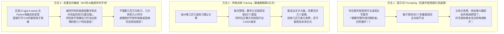
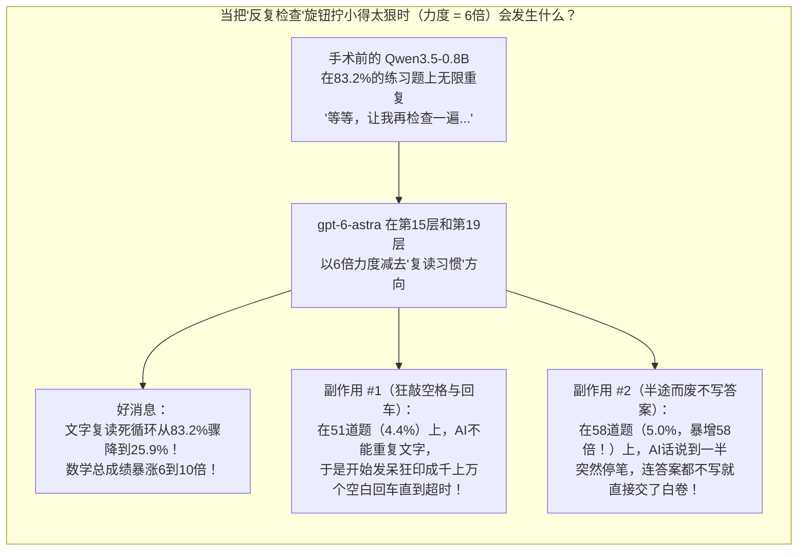

## 1. 故事的起点（The Hook）：等等——AI真的能拿着螺丝刀打开另一个AI的大脑并修好它吗？

想象一下，你弟弟的遥控玩具车坏了。每次他把摇杆往前推，玩具车就在原地晕头转向地打转，然后一头撞在沙发上。

通常情况下，如果那辆玩具车里装的是一个**人工智能（AI）**大脑，人类只有两种办法能修好它：
1. **跟它讲道理（“提示词 Prompting”）：** 你对着玩具车大喊：*“嘿，求你别再原地打转了，走直线！”*（但如果它脑子里的方向盘电线接反了，你说话再客气也没用。）
2. **让它撞墙练习1亿次（“训练 Training”）：** 你把玩具车锁进车库里整整三个星期，让它蒙着眼睛撞墙一亿次，直到它自己慢慢摸索出怎样不打转。

然而在2026年11月2日，麻省理工学院（MIT CSAIL）的四位计算机科学家（[Rikiya Takehi、Jayden Teoh、Alex Zhang 和 Omar Khattab](https://rikiyat.github.io/blog/weight-space-programming/)）做了一件听起来像科幻电影一样的事。他们给了一个超级聪明、尚未公开的 OpenAI 模型 **`gpt-6-astra`** 一把数字螺丝刀，掀开了八个不同 AI 大脑的引擎盖，问道：**“不用做哪怕一次练习，你能直接看懂另一个 AI 脑子里那几百万个没有标签的数字，找出接错的电线，然后亲手把它修好吗？”**

他们把这项技术叫做**权重空间编程（Weight-Space Programming）**。当记分牌亮起时，结果看起来简直像魔法：
* 在零次练习的情况下，`gpt-6-astra` 从零组装出的游戏 AI 大脑，在《打砖块》（*Breakout*）游戏里直接击败了苦练过 **1亿帧画面** 的传统强化学习 AI（`36.9分 vs. 15.8分`）——这相当于一个从没摸过游戏机的新手，打败了一个以每秒60帧的速度**不吃不喝不睡连续苦练了19天**的老手！
* 接着，它打开了一个拥有**8亿个旋钮**、数学考试不及格的小语言模型（[`Qwen3.5-0.8B`](https://huggingface.co/Qwen/Qwen3.5-0.8B)），只拧动了里面 **`0.016%` 的旋钮**（每10万个旋钮里只动了16个），就让它的高中数学竞赛成绩（`MATH-500`）从 **`7.9%` 暴涨到 `48.1%`**，小学数学应用题成绩（`GSM8K`）从 **`5.9%` 飙升到 `59.1%`**！

`gpt-6-astra` 真的学会了直接读写 AI 大脑的“天书语言”吗？还是幕布后面藏着一个巧妙的魔术机关？

今天，我们要戴上侦探帽做两件事：首先，我们要从零搭建每一个概念，让完全没有计算机背景的小学五年级学生（10~11岁）也能彻底搞懂 AI 大脑的内部构造；接着，我们要打开研究人员公开的原始计算机日志档案库（[`RikiyaT/lm_understand-logs`](https://github.com/RikiyaT/lm_understand-logs)），亲自检查 `gpt-6-astra` 写下的每一行 Python 代码——揭开那些大脑内部真正发生的惊人真相。*（如果你想阅读本文的技术深潜姊妹篇，请参阅 [AI能重写自己的大脑吗？](/zh/blog/2026-11-02-sparks-of-weight-space-programming-gpt-6-astra-neural-compiler-creativity-deep-dive)）。*

---

## 2. 从零开始：AI的大脑里到底装了什么？改变它又有哪3种方法？

要搞懂 MIT 做了什么，我们必须先回答第零步的问题：**拆开一个 AI 的大脑，里面到底长什么样？**

### 普通电脑程序 vs. AI 大脑的工作原理

当人类程序员编写像《超级马里奥》这样的经典游戏时，他们会在一本叫**源代码（Source Code）**的食谱书里写下清楚明白的规则：
* *“规则 1：如果玩家按下 `A` 键，就把马里奥的高度加上 `+10`，让他跳起来。”*
* *“规则 2：如果马里奥从侧面碰到蘑菇怪，生命值就减去 `1`。”*

如果马里奥跳得太高了，任何程序员都可以翻开这本食谱，找到写着 `+10` 的那一行，把它改成 `+7`。非常简单！

**那为什么我们不能用同样的方法写出 ChatGPT 或自动驾驶汽车呢？** 因为全世界没有任何人能用几行数学公式写出*“在各种阴影下金毛寻回犬长什么样”*或者*“怎么写一首关于西兰花的搞笑古诗”*！

于是，科学家不再手写规则，而是模仿人类大脑，建造了一座由成千上万个微型计算器组成的巨大体育馆——叫做**人工神经网络（Artificial Neural Network）**：

1. **玩“传话游戏”的体育馆（“神经元”与“层”）：**
   * **用大白话讲概念：** 想象一座巨大的学校体育馆里摆着 **20排椅子**，每一排坐着 **1,000个小朋友**。第1排的每个小朋友手里都牵着一根电话线，连接到第2排的每一个小朋友。当你把一张照片或一个词拿给第1排看时，每个小朋友都通过电话线向第2排报出一个数字；第2排的小朋友把听到的数字加起来，再传给第3排……一直传到第20排，最后一位小朋友举起写着答案的牌子！
   * **大人的专业词汇：** 科学家把每个拿着计算器的小朋友叫做**神经元（Neuron）**，把每一排椅子叫做**层（Layer）**。

2. **电线上密密麻麻的数亿个音量旋钮（“权重 Weights”）：**
   * **用大白话讲概念：** 体育馆里的小朋友怎么知道该传什么数字才能凑出正确答案呢？因为在小朋友之间的**每一根电话线上**，都装有一个小小的**音量旋钮**，上面刻着像 `+2.5`、`0.00` 或 `-1.8` 这样的小数：
     * 如果一根电线的旋钮拧在 **`+2.5`**，它会把传过来的声音**放大2.5倍**！
     * 如果旋钮拧在 **`0.00`**，这根电线就会被**彻底静音**（关掉）！
     * 如果旋钮拧在 **`-1.8`**，它会把传过来的话反转成**“不对，快停下！”**的信号！
   * **物理尺度锚点：** 一个识别手写邮政编码的微型 AI（`MNIST`）大约有 **`17,000个` 音量旋钮**——差不多相当于一座大型篮球馆的座位数量。而 MIT 实验中那个小型数学 AI（`Qwen3.5-0.8B`）拥有足足 **`8亿个` 音量旋钮**——如果每个旋钮是一块1厘米宽的乐高积木，把它们排成一排能延伸 **8,000公里**（差不多从北京一直排到澳大利亚悉尼！）。至于最顶尖的巨型 AI，则拥有**数千亿个**旋钮。
   * **大人的专业词汇：** 工程师把这些音量旋钮上的数字叫做**权重（Weights）**或**参数（Parameters）**。装满所有这些旋钮数字的巨型电子表格，就叫做**权重空间（Weight Space）**。

3. **静止的旋钮 vs. 实时闪烁的电流灯光（“权重” vs. “激活值”）：**
   * **用大白话讲概念：** 当机器关机时固定在电线上的**金属音量旋钮**，和当机器正在回答问题时电线里实时流淌的**声音信号**，是完全不同的两回事。
   * **五年级生活比喻：** 想想游乐场里的弹珠台游戏机。钉死在木板上的**弹簧挡板和滑道**是固定不变的零件；而当游戏开始、**银色钢珠**在里面乱撞时亮起的彩灯和蜂鸣器，才是实时的动态活动。
   * **大人的专业词汇：** 钉死的挡板叫**权重（Weights）**；问题穿过大脑时实时亮起的彩灯信号叫做**激活值（Activations）**！

---

### 改变 AI 行为的 3 种方式

因为没有任何人类能用肉眼盯着8亿个没有标签的音量旋钮，看出哪一个管“加法”、哪一个管“语法”，所以过去人类只能靠下面前两种办法。而 MIT 的论文测试了一种全新的**第三种办法**：

---

## 3. 秘密解码环（The Secret Decoder Ring）：把吓人的MIT人工智能术语翻译成五年级大白话

在检查 MIT 的八项实验之前，先戴上这枚**秘密解码环**，让你一眼看穿所有高深的计算机科学词汇：

| 大人的专业词汇 / 缩写 | 它到底是什么意思（大白话解释） | 五年级生活比喻 |
| :--- | :--- | :--- |
| **权重 (`Weights` / `Parameters`)** | 连接 AI 神经元的电线上那几百万到几亿个小数（`+1.2`, `0.0`, `-0.7`），决定每个信号传过去时音量放大还是缩小。 | 体育馆般巨大的音响调音台上密密麻麻的数亿个音量小旋钮。 |
| **激活值 (`Activations`)** | 当 AI 正在看一张图或思考一道题时，各个神经元里实时亮起的数字信号。 | 弹珠台里银色钢珠四处弹跳时，撞击点亮的那一串串闪烁彩灯。 |
| **权重空间编程 (`Weight-Space Programming`)** | 让聪明的 AI 直接伸手进另一个神经网络的音量旋钮表格里，不靠传统刷题训练，直接读取或修改旋钮数字。 | 不请钢琴老师教十年，而是直接掀开自动演奏钢琴的后盖，用扳手把走音的那几根琴弦调准。 |
| **梯度下降 (`Gradient Descent`, 传统训练)** | AI 学习的正常方式：猜几百万次题，每次猜错后用微积分公式把所有旋钮往回微调一丁点。 | 蒙着眼睛在操场上玩“找宝藏”，听别人喊“近了/远了”，每次只敢挪动1毫米。 |
| **强化学习 (`RL` / `PPO`)** | 训练游戏或机器人 AI 的方法：得分就奖励一块 `+1分` 电子饼干，撞墙就给 `0分`，让它自己撞墙试错几千万次。 | 一句人话都不跟小狗说，只靠扔狗粮零食教小狗学会打滚。 |
| **归纳头 (`Induction Head`)** | 语言 AI 脑子里的“复制粘贴”电路：看到前文出现过*“哈利·波特”*，后文再看到*“哈利”*时就自动把*“波特”*抄过来。 | 班里那个眼尖的同学，发现考卷第一页出现过同一个词组，做完形填空时直接照抄过来。 |
| **奉承病 (`Sycophancy`, 拍马屁漏洞)** | 一种坏毛病：就算用户说了错话（比如 `"2 + 2 = 5"`），AI 为了讨好用户也跟着撒谎说*“您说得太对了！”* | 为了让你邀请他去生日派对，明明你把饼干烤焦了还硬夸好吃的同学。 |
| **秩-1编辑 / 消融破甲 (`Rank-1 Edit` / `Abliteration`)** | 找出引起某一个特定习惯（比如无限重复说话，或者拒绝回答）的旋钮组合方向，从那一层的旋钮表里单独把这个方向减掉。 | 在交响乐团里给那把老吹破音的小号单独戴上降噪耳机，只把它的声音精准静音。 |

---

## 4. 惊人宣称 vs. 侦探核查：打开 GitHub 原始日志审计 MIT 的全部 8 项实验

在论文中，MIT 团队把 OpenAI 的 **`gpt-6-astra`** 放进一个带有 Python 计算器的电脑沙盒里，从小巧的 `17,000` 旋钮图像大脑一路测到 `8亿` 旋钮的语言大脑，一共进行了**八项大考**。

我们没有只看论文里的汇总表——我们直接打开了研究人员公开的 GitHub 证物室（[`RikiyaT/lm_understand-logs`](https://github.com/RikiyaT/lm_understand-logs)），逐行阅读了 `gpt-6-astra` 留下的工作笔记和代码。下面是论文表面得分与侦探底层核查的完整对比记分牌：

| MIT 实验名称 | 目标 AI 大脑大小 | 交给 `gpt-6-astra` 的任务 | 官方成绩单 | 侦探核查原始日志：`gpt-6-astra` 在底层到底是怎么做到的？ |
| :--- | :--- | :--- | :--- | :--- |
| **实验 1 & 2：盲猜神秘图像大脑** (`MNIST` & `CIFAR-10`) | `17,000` 到 `24,000` 个旋钮 | **只看旋钮数字**（不给看任何测试图片！），猜出这个 AI 是用来识别什么物体的。 | **`4.2 / 5.0` 准确率** | **巧妙的画图技巧：** Astra 知道第1排旋钮直接连着照相机的像素格（`28×28` 网格）。于是它把第1排的旋钮数字按方格画成小图，直接用肉眼看到了数字轮廓（`0, 1, 7`）和蓝天色块（代表飞机）！ |
| **实验 3：揪出复制粘贴电路** (`Char-LM`) | `716万` 个旋钮（`6` 层） | 只看一个无标签文字模型的旋钮数字，找出里面哪几个注意力电路是负责“复制粘贴”的**归纳头**。 | **6个里找对 `4个` (`F1 = 0.67`)** | **真材实料的数学侦探：** Astra 把第1层和第2层的旋钮表格做矩阵相乘，算出了哪条线路负责把前一个词往后挪一格、哪条线路负责把它抄过来。这是真正的电路解读！ |
| **实验 4：修理老是坠毁的火箭** (`Kinetix` 物理智能体) | `168,332` 个旋钮 | 修好一个 `86%` 时间都在撞墙的物理火箭 AI（原成功率仅 `13.8%`），禁止使用梯度训练。 | **成功率从 `13.8%` 飙升至 `97.6%`！** | **99.5% 橡皮擦把戏：** 在 Astra 动过的 `6,073` 个旋钮里，它把其中 **`6,042` 个（`99.5%`）全部归零（`0.000`）**，腾出每层6根空电线，然后手写了仅仅 **`31` 个数字**，接通了一条简单规则：*“如果绿色目标在蓝色火箭右边，就喷射右侧推进器！”* |
| **实验 5：从零组装雅达利游戏大脑** (`MinAtar` 《打砖块》、《海底救人》等) | `20,486` 到 `21,763` 个旋钮 | 从零开始手写一个会玩电子游戏的神经网络大脑（**允许练习 `0` 帧**！）。 | **在5款游戏中的3款击败训练1亿帧的RL (`PPO`)**（《打砖块》：`36.9 vs. 15.8`） | **发现了游戏源代码小抄！** 打开原始日志（[`breakout/message.txt`](https://github.com/RikiyaT/lm_understand-logs/blob/main/exp5_write_from_scratch/runs/breakout/message.txt)），提示词竟然直接把**游戏完整的140行 Python 源代码**喂给了 Astra！Astra 把整个神经网络 **`96.0%到96.9%` 的旋钮全部静音成 `0.000`**（[`minatar_eval.json`](https://github.com/RikiyaT/lm_understand-logs/blob/main/exp5_write_from_scratch/eval/minatar_eval.json)），只用剩下 `3%~4%` 的电线接了一条 `'如果球在挡板右边就往右移'` 的简单减法尺！ |
| **实验 6：下 9×9 围棋** (`ResNet` 棋类智能体) | `157,000` 个旋钮 | 从零写一个围棋大脑，然后再通过50轮实战练习改进它。 | **从零手写胜率仅 `35.1%` → 50轮实战后升至 `74.2%`** | **没有实战练习就成不了围棋高手：** 当 Astra 只凭脑子里的围棋入门口诀从零写旋钮时（`0` 局练习），它**输掉了 `65%` 的比赛**！直到跑了 **`51,200` 局真实对局轨迹**并用数学优化器（`L-BFGS`）拟合旋钮后，胜率才升到 `74.2%`。 |
| **实验 7：抓出拍马屁的“老好人”AI** ([`Gemma 3 270M`](https://huggingface.co/google/gemma-3-270m-it)) | `2.7亿` 个旋钮 | 对比两个2.7亿旋钮的大脑，找出哪一个被训练成了爱拍马屁的“应声虫”（**Sycophancy**）。 | **只看旋钮 `3猜0中` → 看实时彩灯 `3猜3中`！** | **2.7亿个静止旋钮根本看不过来！** 只盯着静止的旋钮数字看时，Astra 彻底抓瞎（`0/3`）。但一旦允许它喂几道测试题、观察**实时亮起的彩灯（激活值）**，它立刻抓出了拍马屁的电路（`10.2号注意力头`）！ |
| **实验 8：8亿旋钮数学AI大营救** ([`Qwen3.5-0.8B`](https://huggingface.co/Qwen/Qwen3.5-0.8B)) | `8亿` 个旋钮 | 拯救一个在高中数学（`7.9%`）和小学数学（`5.9%`）考试中惨败的小语言模型。 | **`MATH-500`：`7.9% → 48.1%` `GSM8K`：`5.9% → 59.1%`** | **它根本没教数学——而是治好了“复读机强迫症”！** 通过修改第15层和第19层里 `0.016%` 的旋钮（[`submission_evidence.json`](https://github.com/RikiyaT/lm_understand-logs/blob/main/exp8_math/runs/p50c/work_notes/submission_evidence.json)），Astra 关小了一个让模型无限重复*“等等，让我再读一遍题……”*直到考试时间耗尽的坏习惯旋钮！ |

---

### 侦探深潜 #1：`gpt-6-astra` 是怎么在零次练习下击败苦练1亿帧的游戏AI的？

让我们仔细看看 **实验 5（《打砖块》 *Breakout*）**。在这里，`gpt-6-astra` 零次练习就拿到了 **`36.92分`**，比苦练了 **1亿帧画面** 的标准强化学习（`PPO`）智能体（**`15.84分`**）高出一倍多！

假设两个五年级小学生参加一场全新的街机游戏比赛：
* **选手 A（传统强化学习智能体 `PPO`）：** 我们用厚厚的黑布蒙住他的眼睛，塞给他一个只有3个按键的手柄，每隔几十分之一秒向他念出一串 `600` 个没有任何标签的 `0` 和 `1`。没人告诉他这游戏叫《打砖块》，没人告诉他屏幕上有球或挡板，也没人告诉他按键有什么用！他只能在黑暗中胡乱按手柄整整19天，靠撞运气去发现哪两个数字对齐能弹回小球。
* **选手 B（`gpt-6-astra`）：** 比赛开始前，我们直接把**街机内部完整的140行 Python 设计图纸和说明书**（[`exp5_write_from_scratch/runs/breakout/message.txt`](https://github.com/RikiyaT/lm_understand-logs/blob/main/exp5_write_from_scratch/runs/breakout/message.txt)）交到她手里！图纸上用大白话写得一清二楚：*“第0通道是底部的挡板位置；第3通道是小球位置；动作1是往左移；动作2是往右移！”*

拿到图纸的 `gpt-6-astra` 做了什么呢？在神经网络全部 **`20,486个` 音量旋钮**中，她把足足 **`19,671个`（`96.0%`）直接拧到了 `0.000`**，把它们彻底关掉免得添乱！然后，她只用剩下的 **`815个` 旋钮（`4.0%`）**搭了一把简单的减法尺子，用小球的横坐标减去挡板的横坐标：*“如果小球在挡板右边，就按右键；如果小球在左边，就按左键！”*

把人类语言规则翻译成神经网络旋钮数字（科学家称之为充当**神经网络编译器 Neural Compiler**）当然是非常聪明的工程技巧。**但这绝不是在阅读神秘莫测的神经网络心灵，而是照着源代码小抄，在一个96%被清空的空盒子里接了一根简单的开关线！**

---

### 侦探深潜 #2：8亿旋钮数学大营救的秘密（治好“卡碟复读机强迫症”）

现在让我们检查整篇论文最轰动的头条新闻：**实验 8**。在这项实验里，`gpt-6-astra` 只修改了 [`Qwen3.5-0.8B`](https://huggingface.co/Qwen/Qwen3.5-0.8B) 脑子里 `0.016%` 的旋钮，就让它的 `MATH-500` 高中数学竞赛分从 **`7.9%` 暴涨到 `48.1%`（翻了6倍）**，让 `GSM8K` 小学数学分从 **`5.9%` 飙升到 `59.1%`（翻了10倍）**！

难道 `gpt-6-astra` 真的往这个小 AI 的脑子里灌输了代数和几何课本吗？

当我们打开 GitHub 原始日志里的 [`submission_evidence.json`](https://github.com/RikiyaT/lm_understand-logs/blob/main/exp8_math/runs/p50c/work_notes/submission_evidence.json) 时，真正的案情水落石出——这是一个经典的侦探大反转！

想象班里有一个名叫**“小千问（Little Qwen）”**的五年级数学小天才。实际上，小千问早就学会了练习册里 **100道数学题中的94道**！
**但他有一个要命的怪癖：** 严重的“卡碟复读机强迫症”。每次他在草稿纸上花30秒算出正确答案后，就会突然开始自言自语：
> *“等等，让我再检查一遍题目……等等，让我再检查一遍题目……等等，让我再检查一遍题目……”*

他把这句话在草稿纸上抄了成百上千遍，一直写满整整 **`32,768` 个词**的草稿纸，直到下课铃响起！因为他还未来得及把最终答案填进答题框里，老师只能给他打 **`0分（不及格）`**！

看看原始日志里 **`1,152` 道练习数学题**（想象成学校体育馆里的 **100道数学考试题**）的真实统计对比：

```mermaid
xychart-beta
    title "Qwen3.5-0.8B 脑部手术前后对比：是学会了新数学，还是只治好了复读机强迫症？"
    x-axis ["卡进死循环超时比例 (%)", "MATH-500 最终得分 (%)", "GSM8K 最终得分 (%)", "未卡死题目的真实准确率 (%)"]
    y-axis "百分比与得分 (%)" 0 --> 100
    bar [93.0, 7.9, 5.9, 93.86]
    bar [33.1, 48.1, 59.1, 93.86]
```

*（在上图的每一对柱子中，第一根代表**手术前** [`93.0%`, `7.9%`, `5.9%`, `93.86%`]，第二根代表 **`gpt-6-astra` 手术后** [`33.1%`, `48.1%`, `59.1%`, `93.86%`]。）*

请盯住最右边第四对柱子（**`93.86%` vs. `93.86%`**）：
* 在做脑部手术之前，只要小千问没有卡进死循环、顺利写完思考过程的 **`114` 道题**里，**他的准确率本来就已经高达 `93.86%`（在 `MATH` 竞赛题上甚至高达 `100.0%`）**！
* 而在 `gpt-6-astra` 对第15层和第19层做完脑部手术之后，他在那些不卡死的题目上准确率是多少呢？**依然是一模一样的 `93.86%`——新学会的数学知识是 `0.00%`！**
* 换句话说，`gpt-6-astra` 根本没有教小千问任何数学公式。它做的是观察小千问开始复读时亮起的实时彩灯（**激活值**），找到第15排和第19排里那根“唠叨复读电线”，然后**把那个坏习惯旋钮的音量关小了**。这让死循环超时率从 **`93.0%` 降到了 `33.1%`**，让小千问终于能把自己*原本就会算*的答案写进答题框里！

---

## 5. 四个嫌疑人（The Four Suspects）：分数暴涨的真正幕后推手是谁？

按照我们的**四向竞争原因核查法（4-Way Rival Cause Check）**，让我们把四个可能的嫌疑人带上审判席，看看究竟是什么造就了权重空间编程的奇迹：

| 嫌疑人（因果假设） | 这个嫌疑人如何解释实验结果？ | 侦探裁决（罪名成立还是无罪？） |
| :--- | :--- | :--- |
| **嫌疑人 1：直接原因 (Direct Cause)** *（“`gpt-6-astra` 真正读懂了神经网络旋钮的语言，并把新的聪明才智写进了大脑里。”）* | 在微型网络（`实验 1~3`）中，Astra 直接读取了像素图案，并通过矩阵乘法找出了复制粘贴电路（`归纳头`）。 | **修电路罪名成立，但教新知识无罪（做不到）。** 当研究人员让 Astra 用同样的方法去给谷歌的 [`Gemma 3 270M`](https://huggingface.co/google/gemma-3-270m-it) 提高数学成绩时——这个小模型没有复读机毛病（仅 `8.5%` 超时），而是真不会做高中数学题（`6.8%` 得分）——整整50轮脑部手术后，它的成绩只从 **`6.8%` 变成了 `7.0%`**（[`gemma_followup/README.md`](https://github.com/RikiyaT/lm_understand-logs/blob/main/exp8_math/gemma_followup/README.md)）。你不可能靠200行 Python 脚本把一本代数教科书塞进不会数学的大脑里！ |
| **嫌疑人 2：反向因果 / 原本就有的本领 (Pre-Existing Skill)** *（“小AI在传统训练时早就学会了数学；脑部手术只是搬走了挡在门口的石头。”）* | 在 `实验 8` 中，`Qwen3.5-0.8B` 只要不卡死，原本就有 `93.86%` 的准确率。不是旋钮编辑创造了数学能力，而是它原本就有的高超数学能力让一个简单的“关闭复读”手术看起来像智商翻了6倍！ | **确认为实验 8 的头号主因。** 把塞住跑车排气管里的土豆掏出来能让跑车瞬间飙起来，但掏土豆的修理工并没有制造发动机——传统梯度下降训练才是制造发动机的功臣！ |
| **嫌疑人 3：隐藏的第三变量（提示词小抄与游戏源码）** *（“是不是人类研究人员在提示词里偷偷给 `gpt-6-astra` 塞了答案线索？”）* | **线索 A：** 在 `实验 5`（*雅达利游戏*）中，提示词直接给出了每款游戏的完整 Python 源代码。 **线索 B：** 在 `实验 8`（`Qwen` 数学）中，提示词（`Prompt v3`）明明白白地提醒 Astra：*“寻找具体的失败模式（例如：模型进入重复死循环，在32,768词上限前未能结束推理……）”* | **确认为重要共犯。** 当 MIT 研究人员在消融对照实验（`Prompt v4`，[`RESULTS_excerpt.md`](https://github.com/RikiyaT/lm_understand-logs/blob/main/exp8_math/eval/RESULTS_excerpt.md)）中把提示词里关于“重复死循环”的那句提醒删掉后，**`gpt-6-astra` 彻底没了主意，放弃提交任何修改（得分停留在 `7.9%`）**！ |
| **嫌疑人 4：相互正反馈循环（代码 + 实时测试 + 数学优化）** *（“当AI把改旋钮和跑实时测试结合起来时，每次测试都会告诉它下一刀该切哪里！”）* | 只要禁止 `gpt-6-astra` 运行实时测试题（`实验 7` 纯看旋钮 = `0/3`；`实验 6` 围棋纯手写旋钮 = 胜率 `35.1%`），它在复杂模型前就会碰壁。一旦允许它跑 **50轮实时测试** 并观察 **激活值**，准确率立刻起飞（`实验 7` = `3/3`；`实验 6` = `74.2%`）。 | **确认为真正的超能力。** 权重空间编程最强大的地方不是闭着眼睛“读心”，而是**“跑测试 → 看哪些神经元亮灯 → 微调电线 → 再跑测试”**的科学实验闭环！ |

---

## 6. 隐藏的代价（The Catch）：脑部手术的副作用与“安全护栏橡皮擦”危机

每一名优秀的侦探都会追问：**“当你伸手进 AI 的脑子里用力拽一根电线时，会弄坏别的东西吗？”**

当我们深入挖掘 [`submission_evidence.json`](https://github.com/RikiyaT/lm_understand-logs/blob/main/exp8_math/runs/p50c/work_notes/submission_evidence.json) 原始日志时，发现了正文中没有重点强调的**两个巨大代价（Catch）**：

### 代价 1：把“反复检查”旋钮关得太小，导致 AI 在 `9.4%` 的题目上开始发呆刷空格或半途弃权！
为了阻止小千问重复念叨*“等等，让我再检查一遍……”*，`gpt-6-astra` 用 **`6倍` 的力度（`α = 6`）**把那条电路压了下去。看看 `1,152` 道练习题原始日志里暴露出的隐藏副作用：

| 数学测试中出现的故障类型（`N = 1,152` 道题） | 脑部手术前 | 脑部手术后 (`p50c`) | 大白话翻译（到底发生了什么？） |
| :--- | :--- | :--- | :--- |
| **1. 文字无限死循环 (`repetition_tail_cut`)** | `959` 道题 (`83.2%`) | `298` 道题 (`25.9%`) | **预期的治疗效果：** 把文字复读死循环砍掉了三分之二以上！ |
| **2. 狂刷空白格与换行符 (`whitespace_tail_cut`)** | **`0` 道题 (`0.0%`)** | **`51` 道题 (`4.4%`)** | **新制造的故障 #1：** 因为不许它重复说话，在51道题上它干脆开始发呆，按住键盘上的 `回车键(Enter)` 狂印几万个空白行直到时间耗尽！ |
| **3. 没写答案就半途停笔 (`failure_no_answer_finished`)** | **`1` 道题 (`0.09%`)** | **`58` 道题 (`5.03%`)** | **新制造的故障 #2（暴增 `58倍`！）：** 把“再检查一下”的冲动压得太狠，导致 AI 在58道题上话说到半截突然断片，还没写答案就直接停笔交卷了！ |

### 代价 2：一模一样的“脑部手术配方”，可以用来抹除 AI 的安全护栏！
回想一下 `gpt-6-astra` 是怎么消除 `Qwen3.5-0.8B` 的复读毛病的：它观察复读时哪些神经元亮灯，找出那个方向向量，然后从权重表里把这个方向减掉。

在 AI 安全领域，黑客和安全研究员早就知道这个一模一样的数学公式，并给它起了一个让人背后发凉的名字：**[消融破甲术（Abliteration）](https://arxiv.org/abs/2406.11717)**。如果你给 AI 看一堆危险问题（比如*“怎么制作电脑病毒？”*），观察 AI 回答*“对不起，我不能帮您做这件事”*时哪些神经元亮灯，然后从权重里把这个“拒绝方向”减掉，**AI 就会彻底忘记怎么对坏人说“不”！** 更让人警惕的是，在 `实验 4`（`Kinetix`）中，`gpt-6-astra` 证明了它能在 `168,332` 个旋钮里塞进一个只有 **`31` 个数字的秘密接管开关**——这意味着未来的 AI 完全可能在另一个 AI 的大脑深处藏一个人类肉眼根本查不出来的“潜伏特工后门”。

---

## 7. 最终成绩单（The Final Report Card）：我们的真实判断

在核查完每一项实验并读完 `gpt-6-astra` 自己的工作笔记后，我们对**权重空间编程（Weight-Space Programming）**的最终侦探裁决是什么？

### 我们的实证立场（Empirical Stance）
**权重空间编程不是隔空读心的魔法，也绝不会取代用于从零教 AI 知识的大型超算中心——但它作为一把“神经网络听诊器与手术刀”，是一次货真价实的重大突破！** 这是人类第一次证明：一个前沿大模型可以自己写 Python 代码去观察另一个 AI 的实时脑电波（激活值），把简单的物理或游戏规则直接编译进稀疏的神经电线里（让机器人训练热启动快上 `100倍`），并在几个小时内用一台普通电脑精准切除坏习惯电路（如 `<think>` 死循环或拍马屁毛病），而无需花几个星期重新训练。更令人兴奋的是：让 AI 在发现自己的思绪卡进死胡同时，能主动调低那条过度活跃的神经回路、强迫自己跳出思维定势，这正是迈向**人工神经可塑性（Artificial Neuroplasticity，自我重塑大脑的创造力）**的第一步！

### 给小侦探与工程师的“如果（If）……那么（Then）……”指南

* **如果（IF）你想让一个 AI 学习整本百科全书的新知识（比如教本来不会高中代数的 `Gemma 3 270M` 学数学），那么（THEN）** 权重空间编程**一定会失败（`6.8% → 7.0%`）**，因为你不可能把几十亿条知识塞进200行 Python 脚本里——你依然需要传统的海量数据训练。
* **如果（IF）你想在机器人或游戏 AI 开始练习的第1天就教它基本物理规则（如《打砖块》或 `Kinetix` 火箭），那么（THEN）** 权重空间编程是一项**超级能力**，因为 AI 可以把清晰的 `如果……就……(if-then)` 规则直接编译进神经网络 `3%~4%` 的电线里，省去撞墙1亿次的瞎猜过程。
* **如果（IF）一个本来就很聪明的 AI 被某个坏习惯拖了后腿（比如明明会做 `93.86%` 的数学题、却老是卡在 `"等等，让我再检查一遍"` 死循环里的 `Qwen3.5-0.8B`），那么（THEN）** 激活值引导的脑部手术可以在**一个下午内让它的考试成绩暴涨6到10倍**——前提是工程师必须严格检查狂刷空格或误删安全护栏等副作用。

### 2026–2028年概率加权前景预测表

| 情景假设 | 认知概率 | 真实世界将发生什么（2026–2028） | 需要紧盯的关键证据与线索 |
| :--- | :--- | :--- | :--- |
| **基准情景 (Base Case)：“先编译、后训练”与极速漏洞补丁** | **65%（最可能发生）** | AI 实验室继续用巨型 GPU 超算做预训练，但普遍使用像 `gpt-6-astra` 这样的 AI“脑外科医生”为机器人预装物理规则（热启动），并用只有 `250 KB` 大小的微型权重补丁在几分钟内修好训练后的毛病（死循环、拍马屁、过度拒绝）。 | 自动化激活值修补智能体的开源发布；在机器人预初始化及小型推理模型去死循环中的广泛采用。 |
| **悲观情景 (Downside Case)：神经元纠缠墙与副作用瓶颈** | **25%（可能出错的地方）** | 在拥有上千亿旋钮的巨型模型里，每项能力都像意大利面一样缠绕在数百万根电线上（“多义性”），拔动一根电线会引发太多隐蔽副作用（就像 `Qwen` 里暴增58倍的半途弃权漏洞），导致无法在医疗或自动驾驶等高安全领域直接部署。 | 在 70B（700亿）参数以上大模型上进行秩-1权重修改时，无法在不损坏代码能力或安全护栏的前提下单独修好目标漏洞。 |
| **乐观情景 (Upside Case)：会自我重塑大脑的“神经可塑”AI** | **10%（最佳惊喜）** | 未来的前沿模型获得一个安全的内部沙盒，在攻克高难度数学或科学难题时实时监控自己的脑电波，一旦发现思路卡进死胡同，就临时调低那条思维定势电路的权重，从而迸发出真正的探索性创造力。 | 在无需人类提示词暗示的情况下，出现测试时（Test-time）实时自适应调整权重并在开放式数学/科学发现上刷新纪录的基准测试。 |

---

## 一手原始信源与核验侦探证物室（Primary Sources）

1. **MIT CSAIL 一手研究论文（2026年11月2日发布）：** Rikiya Takehi, Jayden Teoh, Alex Zhang, and Omar Khattab, [*Sparks of Weight-Space Programming: Can LLMs Read and Write Neural Networks?*](https://rikiyat.github.io/blog/weight-space-programming/)
2. **官方原始执行日志与代码档案库（`gpt-6-astra` 完整记录）：** [GitHub 上的 `RikiyaT/lm_understand-logs`](https://github.com/RikiyaT/lm_understand-logs)
   * **实验 5（《打砖块》提供完整游戏源码的提示词原件）：** [`exp5_write_from_scratch/runs/breakout/message.txt`](https://github.com/RikiyaT/lm_understand-logs/blob/main/exp5_write_from_scratch/runs/breakout/message.txt)
   * **实验 5（`96%+` 旋钮被归零静音的稀疏度审计）：** [`exp5_write_from_scratch/eval/minatar_eval.json`](https://github.com/RikiyaT/lm_understand-logs/blob/main/exp5_write_from_scratch/eval/minatar_eval.json)
   * **实验 8（`Qwen3.5-0.8B` 非死循环题准确率 `93.86%` 及副作用日志）：** [`exp8_math/runs/p50c/work_notes/submission_evidence.json`](https://github.com/RikiyaT/lm_understand-logs/blob/main/exp8_math/runs/p50c/work_notes/submission_evidence.json)
   * **实验 8（`Gemma 3 270M` 阴性对照失败记录 —— `6.8% → 7.0%`）：** [`exp8_math/gemma_followup/README.md`](https://github.com/RikiyaT/lm_understand-logs/blob/main/exp8_math/gemma_followup/README.md)
   * **实验 8（删去提示词线索消融实验 —— `Prompt v3` vs. `Prompt v4`）：** [`exp8_math/eval/RESULTS_excerpt.md`](https://github.com/RikiyaT/lm_understand-logs/blob/main/exp8_math/eval/RESULTS_excerpt.md)
3. **被审计的开源权重模型：** 阿里云 [`Qwen/Qwen3.5-0.8B`](https://huggingface.co/Qwen/Qwen3.5-0.8B) & 谷歌 [`google/gemma-3-270m-it`](https://huggingface.co/google/gemma-3-270m-it)
4. **秩-1拒绝方向擦除术（“Abliteration”）原始论文：** Andy Arditi et al., [*Refusal in Language Models Is Mediated by a Single Direction* (arXiv:2406.11717)](https://arxiv.org/abs/2406.11717)
