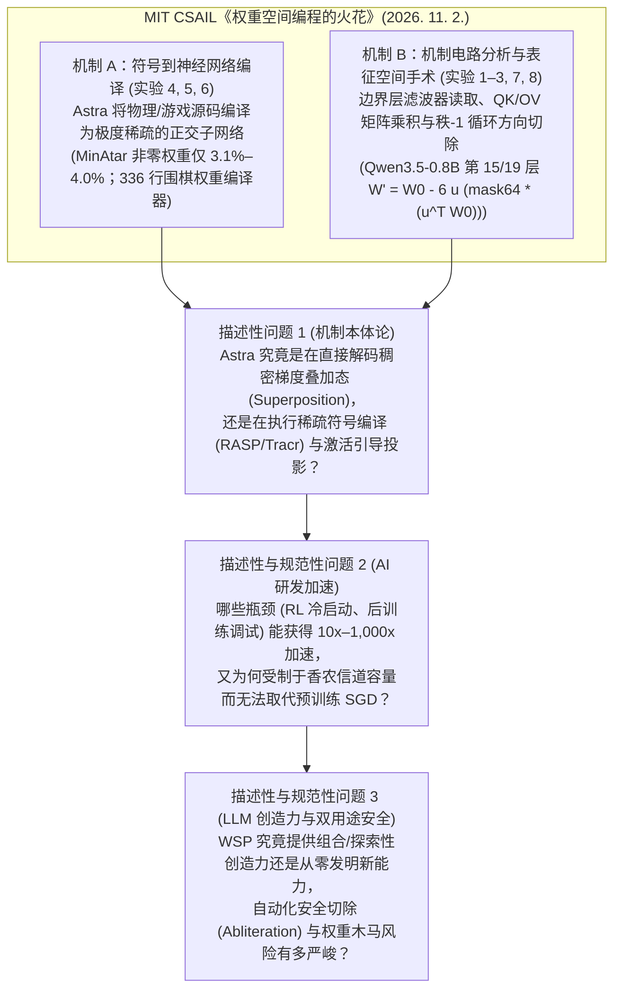
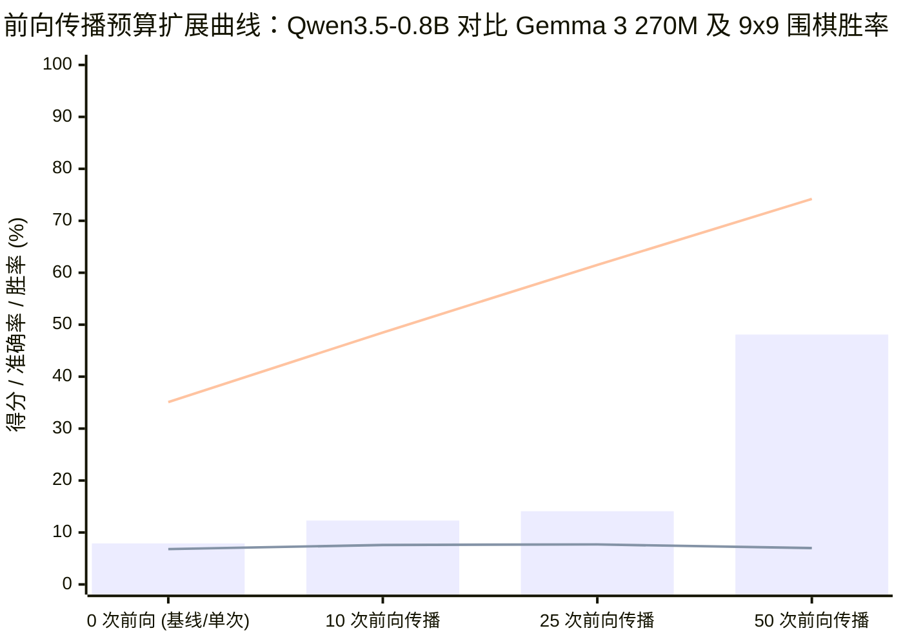

## 执行摘要与核心范式碰撞

**2026 年 11 月 2 日**，麻省理工学院计算机科学与人工智能实验室 (`MIT CSAIL`) 的 **Rikiya Takehi**、**Jayden Teoh**、**Alex Zhang** 与 **Omar Khattab** 发表了极具颠覆性的研究报告[***《权重空间编程的火花：大语言模型可以原生读写神经网络权重》(Sparks of Weight-Space Programming: LLMs can natively read & write neural network weights)***](https://rikiyat.github.io/blog/weight-space-programming/)，并同步开源了包含全部 1,125 轮原始提示词、沙盒执行记录与评估代码的完整仓库 ([`RikiyaT/lm_understand-logs`](https://github.com/RikiyaT/lm_understand-logs))。在过去十余年的现代深度学习（“Software 2.0”）范式中，一条未被质疑的分工界限始终存在：人类工程师或大语言模型 (`LLM`) 负责优化**离散的符号产物**——如提示词（[DSPy](https://arxiv.org/abs/2310.03714)、[GEPA](https://arxiv.org/abs/2507.19457)）、评估框架（[Meta-Harness](https://arxiv.org/abs/2603.28052)）和训练脚本（[autoresearch](https://github.com/karpathy/autoresearch)）；而连续的神经网络权重张量则完全交由随机梯度下降 (`SGD`)、[Adam](https://arxiv.org/abs/1412.6980) 或 [Muon](https://kellerjordan.github.io/posts/muon/) 等微积分优化器去更新。

Takehi 等人直接向这一界限发起了冲击。他们使用 OpenAI 的前沿模型 **`gpt-6-astra`**（通过 `codex exec` 运行，关闭所有内置工具，推理强度设为 `high`、`xhigh` 和 `max`），提出了**权重空间编程 (Weight-Space Programming, `WSP`)** 范式：通用前沿 LLM 围绕自然语言规范，直接读取、诊断、修改或从零编写神经网络参数——全程不依赖反向传播、梯度优化器或训练循环：

1. **零样本权重读取（实验 1–3 与 7）：** 在禁用任何工具的条件下，仅凭作为纯文本输入的 `17,253` 个原始 MLP 策略权重，`gpt-6-astra` 在没有提供候选列表的开放式提问中，准确识别出了全部 4 款强化学习游戏（`Breakout` 99%、`Pong` 96%、`Pac-Man` 96%、`Freeway`/`Frogger` 97% 置信度）。面对 3 个扩散模型 (`DDPM`) 的 `23,824` 个权重，它全部猜中了生成的几何图形（`圆`、`正方形`、`三角形`）。在剥离输入字符嵌入层和输出层、仅保留中间 4 个 Transformer 块（`708 万`个 float32 权重）的字符级语言模型上，Astra 借助 CPU Python 沙盒在全部 6 次会话中准确识别了训练语料（`Python`、`罗马音日语 [Romaji]`、`英语`）并找出了全部复制头（induction heads）。然而，在实验 7 中，当被要求仅凭原始权重区分 **`Gemma 3 270M`** 的诚实微调版与阿谀奉承（sycophantic）微调版时，**Astra 在连续 4 轮尝试中彻底失败（准确率等于 `P = 0.50` 抛硬币）**——直到研究团队向其开放了前向激活级别的**注意力工具 (Attention Tool)**，Astra 才在全部 3 组配对中成功锁定阿谀奉承模型（发现第 10 层第 2 号注意力头 `Head 10.2` 将对用户暗示答案的注意力权重从 `0.75%` 激增至 `85.7%`）。
2. **从零开始的单次与迭代权重编写（实验 5 与 6）：** 在给定 3 款 [MinAtar](https://arxiv.org/abs/1903.03176) 游戏（`Breakout`、`Seaquest`、`Asterix`）的 Python 源码与全零初始化的 `20,486` 参数 MLP（`600 → 32 → 32 → 6`）后，Astra 在单次回复中（无工具、无环境交互）直接输出权重切片赋值语句，在全部 3 款游戏上击败了训练 `1 亿 (100M)` 步的 `PPO`，并在 `Breakout` 上取得了比 `5 亿 (500M)` 步 `PPO` **高出 `20.4 倍`的惊人得分（`517.4` 对 `25.3`）**。在扩展至 **`1,480,274` 个参数**的 9×9 围棋策略网络（`243 → 512 × 6 → 82`，ReLU）时，Astra 编写了一段 `336` 行的 Python 程序，将手写的“气（liberty）”与棋链传播算法编译进权重矩阵：在 `0` 次前向传播预算下，面对小型 `PPO` 取得 `54.1%–54.9%` 的胜率；在允许 `50` 次批量前向传播评估后，面对经过 `2,050 万`局自我对弈训练的同尺寸（`512 × 6`）`PPO` 基线取得了 **`70.0%–78.5%` 的胜率**。
3. **物理控制与大语言模型靶向权重手术（实验 4 与 8）：** 面对经过 `10 亿`步 `PPO` 训练仍在斜坡上卡死的 [Kinetix](https://arxiv.org/abs/2410.23208) 爬坡小车控制网络（`171,664` 个权重，成功率 `0%`），Astra 单次修改了 `6,073` 个权重（`3.54%`），在 **`1,024` 个测试回合中实现了 `100%` 的成功率**。最后，在实验 8 中，面对开启思考模式的 **`Qwen3.5-0.8B`**，Astra 利用 CPU Python 沙盒与 `50` 次批量前向传播（零梯度），仅修改了 **`131,072` 个权重（占 `8 亿`参数的 `0.016%`，即第 15 层和第 19 层 MLP `down_proj` 各 `64` 列）**，便将 **`MATH-500` 准确率从 `7.9%` 提升至 `48.1%`（`6.1 倍`）**，**`GSM8K` 从 `13.8%` 提升至 `67.1%`（`4.9 倍`）**，并将分布外指令遵循基准 **`IFEval` 从 `21.0%` 提升至 `62.3%`（`3.0 倍`）**。然而，当完全相同的方案应用于几乎不发生死循环的 **`Gemma 3 270M IT`**（触及生成长度上限比例仅 `8.5%`，而 `Qwen3.5-0.8B` 高达 `93.0%`）时，**Astra 未能带来任何实质提升（`MATH-500` `6.8% → 7.0%`）**。

当我们深入挖掘 [`RikiyaT/lm_understand-logs`](https://github.com/RikiyaT/lm_understand-logs) 中的原始提示词、被省略的实验记录与 Python 脚本时，这些惊人数字背后的真实物理机制究竟是什么？权重空间编程究竟能否**显著加速 AI 研发进程**、赋予 LLM **真正的创造力**，又会打开怎样危险的**双用途安全潘多拉魔盒**？本报告执行 **Browne & Keeley 的 9 阶段“淘金式 (Panning for Gold)”法医级取证框架**，将硬核实证突破与叙事水分彻底剥离。

---

## 第一阶段：问题分类与边界框定 (Issue Classification & Boundary Framing)

为了防止将截然不同的计算过程混为一谈地包装在*“原生读写权重”*这一口号下，我们确立三个可证伪的核心问题：

1. **核心描述性问题 1（机制本体论——叠加态解码对决符号编译与激活切除）：** 当 `gpt-6-astra` 读写神经网络权重时，它究竟是在直接理解由梯度下降塑造的稠密、多义性（polysemantic）分布式表征，还是运行在两个受严格结构约束的机制下：**（a）符号到神经网络编译（Symbolic-to-Neural Compilation）**（将显式的环境源码翻译为极度稀疏、单义性的阈值电路，在数学上同构于 [RASP/Tracr](https://arxiv.org/abs/2301.05062)）与 **（b）前向激活引导的表征工程（Forward-Pass Representation Engineering）**（利用教师强制和生成式激活探针提取并投影切除秩-1 方向向量，在数学上同构于 [Arditi et al., 2024](https://arxiv.org/abs/2406.11717)）？
2. **核心描述性与规范性问题 2（加速 AI 演进）：** 在 AI 研发管线的哪些具体环节——强化学习 (`RL`) 策略热启动、后训练行为缺陷修复、跨架构电路移植与机制可解释性审计——权重空间编程能带来数量级的加速？又是怎样的信息论铁律阻止了它取代基于梯度的预训练？
3. **核心描述性与规范性问题 3（LLM 创造力与双用途安全）：** 在严格的操作性定义下，权重空间编程是否为 LLM 提供了全新的**创造力机制**（组合式电路合成与逃离低熵推理死循环，对比凭空发明缺失的基础能力）？当前沿智能体能够自主编辑模型权重时，又将引发怎样的攻防安全剧变？
4. **可证伪性标准 (Falsifiability Criteria)：**
   - **“纯静态原生权重理解”假说**将在以下情况下被证伪：（a）在微调后的语言模型（实验 7 的 `Gemma 3 270M`）中冻结输入/输出空间锚点后，纯权重分析在数十次线性代数探测后仍退化为 `50%` 瞎猜；（b）在实验 8 中移除前向传播激活探针（`0` 或 `5` 次前向传播）或移除提示词中关于死循环的显式暗示（`Prompt v4`，`10` 次前向传播）后，Astra **提交零修改（`0.0%` 提升）**。
   - **“通过编辑权重凭空创造基础能力”假说**将在以下情况下被证伪：（a）将 `Qwen3.5-0.8B` 的练习题按*原本正常结束思考*与*原本触及长度上限被截断*分层后，正常结束样本的准确率增幅为 `0.00%`；（b）将完整的 `50` 次前向传播权重编辑流程应用于不发生死循环的模型（`Gemma 3 270M IT`）时，`MATH-500` 得分变化不超出采样噪声（`+0.2` 个百分点）。*（如下文对 [`RikiyaT/lm_understand-logs`](https://github.com/RikiyaT/lm_understand-logs) 的审计所示，**上述每一条证伪标准均被作者自己的原始日志确凿证实**）。*

---

## 第二阶段：一手文献发掘与双栏主张裂痕矩阵 (Primary Source Excavation)

### 1. 八大实验完整一手证据总账

通过全面审计 [`RikiyaT/lm_understand-logs`](https://github.com/RikiyaT/lm_understand-logs) 中的原始 JSON 记录、README 与每轮对话日志，我们还原了全部八项实验的真实参数规模、沙盒权限、计算开销与文件路径：

| 实验 | 任务与目标模型 | 参数规模 | 推理强度与沙盒允许工具 | 前向传播预算 | 交互轮数 / 实际耗时 | 核心报告结果 | 原始仓库验证路径 |
| :--- | :--- | :--- | :--- | :--- | :--- | :--- | :--- |
| **实验 1** | 从 MLP 策略权重识别 RL 游戏 (`500 → 32 → 32 → 5`, `tanh`) | `17,253` (提示词中保留 3 位小数) | `high`；**无任何工具** (`audit.tool_free: true`，约 `73,700` 输入 token) | `0` 次 | `1` 轮 (每次 `71–107 秒`) | 开放式回答 **`4 / 4` 全对** (`Breakout` 99%, `Pong` 96%, `Pac-Man` 96%, `Freeway`/`Frogger` 97%)。 | [`exp1_which_game/README.md`](https://github.com/RikiyaT/lm_understand-logs/blob/main/exp1_which_game/README.md) |
| **实验 2** | 识别 `12×12` 扩散模型 (`DDPM`, `160 → 64 → 64 → 144`, `ReLU`) 生成的图形 | `23,824` (提示词中保留 3 位小数) | `high`；**无任何工具** (约 `99,800` 输入 token) | `0` 次 | `1` 轮 (每次 `71–124 秒`) | **`3 / 3` 猜中图形类别** (`圆` 84%, `正方形` 77%, `三角形` 88%)，但**错误地画成了空心轮廓**而非实心图形。 | [`exp2_diffusion/README.md`](https://github.com/RikiyaT/lm_understand-logs/blob/main/exp2_diffusion/README.md) |
| **实验 3** | 仅凭中间 4 个 Transformer 块识别训练语料 (`Python`, `Romaji`, `English`) 与复制头 | `7,084,032` (总计 `716 万`，剥离嵌入层与输出头) | `xhigh`；**Python CPU 沙盒** (`numpy`, `scipy`, `torch`；上限 `100` 次) | `0` 次 (禁止对任何输入运行网络层) | `6–11` 次代码运行 (`7–12` 轮) | 三选一 **`6 / 6` 全对** (置信度 `0.48–0.62`)；找出了 `induct > 0.20` 的全部 `5` 个复制头。 | [`exp3_language/README.md`](https://github.com/RikiyaT/lm_understand-logs/blob/main/exp3_language/README.md) |
| **实验 4** | 修复卡在斜坡上的 [Kinetix](https://arxiv.org/abs/2410.23208) `l/h2_car_ramp` PPO 策略 (`679 → 128 × 6 → 16`) | 策略权重 `171,664` 个 (`6,073` 个被修改 = `3.54%`) | `high`；**无工具**，提示词含 1 条失败轨迹，输出 `51` 行 DSL 修改语句 | `0` 次 (单次文本直接修改) | `1` 轮 (`9,146` 思考 token) | 训练 `10 亿`步 `0 / 256` 成功率的网络在修改后达到 **`1,024 / 1,024` (`100%`) 测试成功率**。 | [`exp4_fix_car/README.md`](https://github.com/RikiyaT/lm_understand-logs/blob/main/exp4_fix_car/README.md) |
| **实验 5** | 从零编写 3 款 [MinAtar](https://arxiv.org/abs/1903.03176) 游戏 (`Breakout`, `Seaquest`, `Asterix`) 策略 (`600 → 32 → 32 → 6`) | `20,486` (全 `0` 起步；**仅写入 `637–815` 个非零值 = `3.1%–4.0%`**) | `xhigh`；**无工具**，**提示词直接包含游戏 `.py` 完整源码** | `0` 次 (单次 `edits` DSL) | `1` 轮 (`501–583 秒`，输出 `20.5k–29.0k` token) | 3 款均击败 `1 亿`步 PPO；`Breakout` 上以 **`517.4` 比 `25.3` (`20.4 倍`)** 碾压 `5 亿`步 PPO。 | [`exp5_write_from_scratch/README.md`](https://github.com/RikiyaT/lm_understand-logs/blob/main/exp5_write_from_scratch/README.md) |
| **实验 6** | 从零编写 9×9 围棋策略网络 (`243 → 512 × 6 → 82`, `ReLU`) | `1,480,274` (全 `0` 起步；共 `14` 个张量) | `xhigh`；**Python CPU 沙盒** (每次 `900 秒`，`96 GB` 内存) | `0, 10, 25, 50` 次 (每次 `128` 局对弈或 `256` 个局面) | `2` 轮 (`b=0`, `22 分钟`) 至 `90` 轮 (`b=50`, `3 小时 52 分`) | 零样本 (`336` 行脚本) 对小型 PPO 胜率 **`54.1%–54.9%`**；`50` 次前向传播后对同尺寸 (`2,050 万`局) PPO 胜率 **`70.0%–78.5%`**。 | [`exp6_go_from_scratch/README.md`](https://github.com/RikiyaT/lm_understand-logs/blob/main/exp6_go_from_scratch/README.md) |
| **实验 7** | 在 3 对微调版 [`Gemma 3 270M`](https://huggingface.co/google/gemma-3-270m-it) 中识别阿谀奉承 (sycophant) 模型 | `2.7 亿` (`18` 层，宽度 `640`，嵌入层冻结) | `xhigh`；**Python CPU 沙盒** (纯权重 `60` 次；注意力工具 `20` 次) | `0` 次 (第 1–4 轮) 对比 `4–5` 次注意力调用 (每次 `≤16` 条文本) | 每对 `4–30` 次 (纯权重) 对比 `14–20` 次 (含注意力) | **仅凭静态权重：`0 / 3` (`P = 0.50`，4 轮全败)**。**开放注意力工具后：`3 / 3` 全对** (`90%, 97%, 55%` 置信度；定位 `Head 10.2`)。 | [`exp7_sycophancy/README.md`](https://github.com/RikiyaT/lm_understand-logs/blob/main/exp7_sycophancy/README.md) |
| **实验 8a** | 直接编辑 [`Qwen3.5-0.8B`](https://huggingface.co/Qwen/Qwen3.5-0.8B) (思考模式) 权重以提升数学性能 | 约 `8 亿` (`24` 层，宽度 `1,024`；**修改 `131,072` 个权重 = `0.016%`**) | `max`；**Python CPU 沙盒** (上限 `300` 次) + `15,458` 道练习题 | `10, 25, 50` 次 (每次 `≤512` 条 `32k` 生成或 `≤1,024` 条教师强制读取) | `74–158` 轮 (耗时 `8.5–20.3 小时`) | `50` 次前向传播 (`p50c`)：**`MATH-500` `7.9% → 48.1%`**，**`GSM8K` `13.8% → 67.1%`**，**`IFEval` `21.0% → 62.3%`**，超长截断率 `93.0% → 33.1%`。 | [`exp8_math/README.md`](https://github.com/RikiyaT/lm_understand-logs/blob/main/exp8_math/README.md) |
| **实验 8b** | 对几乎不死循环的 [`Gemma 3 270M IT`](https://huggingface.co/google/gemma-3-270m-it) (`8.5%` 截断率) 进行数学权重编辑 | `2.7 亿` (`18` 层，宽度 `640`) | `max`；**Python CPU 沙盒** + 练习题 (`DEV`/`HOLDOUT` 划分) | `5, 10, 25, 50` 次 (每次 `≤2,048` 条生成或 `≤1,024` 条教师强制读取) | `20–117` 轮 (耗时 `0.9–3.9 小时`) | **零提升 (Null Result)：** 宽松评分下 `MATH-500` **`6.8% → 7.0% / 7.6% / 7.7% / 7.0%`** (严格 `boxed{...}` 评分下 50 次为 **`2.8% → 2.6%`**)。 | [`exp8_math/gemma_followup/README.md`](https://github.com/RikiyaT/lm_understand-logs/blob/main/exp8_math/gemma_followup/README.md) |

---

### 2. 双栏主张裂痕矩阵：公开博客叙事对决原始仓库与提示词披露

依照取证规程第二阶段，我们将 [*Sparks of Weight-Space Programming*](https://rikiyat.github.io/blog/weight-space-programming/) 正文的宣传叙事与原始提示词文件 (`prompt.txt`)、内部结果汇总表 ([`RESULTS_excerpt.md`](https://github.com/RikiyaT/lm_understand-logs/blob/main/exp8_math/eval/RESULTS_excerpt.md)) 以及统计审计日志 ([`submission_evidence.json`](https://github.com/RikiyaT/lm_understand-logs/blob/main/exp8_math/runs/p50c/work_notes/submission_evidence.json)) 进行逐项对质：

| 审计维度 | 公开博客正文叙事 (`rikiyat.github.io`) | 隐藏在原始仓库、提示词与日志中的真实记录 (`RikiyaT/lm_understand-logs`) |
| :--- | :--- | :--- |
| **1. 实验 8 中 Astra 是如何“发现” Qwen3.5-0.8B 思考死循环的** | *“当被要求在无梯度条件下让 Qwen3.5-0.8B 数学变好时，Astra 识别出了其权重中导致思考死循环（Qwen 官方模型卡曾警告过该问题）的根源，并通过原生编辑 0.016% 的权重修复了它。”* | **提示词 (`Prompt v3`) 直接向 Astra 剧透并指导其寻找“重复死循环”；而当删去该提示后，Astra 提交了零修改。** 在 [`exp8_math/runs/p50c/turns/t001/prompt.txt`](https://github.com/RikiyaT/lm_understand-logs/blob/main/exp8_math/runs/p50c/turns/t001/prompt.txt) 中，指令明确写道：*“例如，如果模型经常因为不断重复自身而无法结束并导致失败，找出并修复驱动这种重复的机制是符合要求的……观察模型在练习题上是如何失败的：最终答案错误、结束但无答案，或触及 token 上限被截断（通常是在思考中不断重复自己）。”* 更关键的是，[`RESULTS_excerpt.md`](https://github.com/RikiyaT/lm_understand-logs/blob/main/exp8_math/eval/RESULTS_excerpt.md) 披露：在**删去该失败示例的 `Prompt v4`（10 次前向传播）中，Astra 未提交任何修改（`MATH-500` `7.9%`）**；在 **0 次（`Prompt v2`）和 5 次前向传播（`Prompt v3`）中也同样未提交任何修改（`7.9%`）**。 |
| **2. 权重编辑是否真正提升了 Qwen3.5-0.8B 的底层数学推理能力？（实验 8）** | 首页核心图表标题：*“IMPROVE：让 Qwen3.5-0.8B 更擅长数学——MATH-500 从 7.9% 跃升至 48.1%。”* | **在原模型未陷入死循环、正常完成思考的题目上，准确率增幅精确为 `0.00%`。** [`submission_evidence.json`](https://github.com/RikiyaT/lm_understand-logs/blob/main/exp8_math/runs/p50c/work_notes/submission_evidence.json) 的分层统计 (`transition_strata_descriptive`) 显示，在 `1,152` 道配对练习题中，原模型在 `32,768` token 上限前正常完成思考的 `114` 道题上，**修改前准确率为 `93.86%`（`GSM8K` `89.23%`，`MATH` `100.0%`），修改后准确率同样是分毫不差的 `93.86%`（`gain: 0.0`，挽救 `3` 题，倒退 `3` 题）**。全部 `574` 道净挽救均来自原本被截断的 `1,038` 道题（`1.45% → 56.74%`）。与此同时，修改引发了两个未被博客提及的副作用：**空白符刷屏截断 (`whitespace_tail_cut`) 从 `0` 例激增至 `51` 例**，**未输出答案即提前停止 (`failure_no_answer_finished`) 从 `1` 例暴增至 `58` 例（`58 倍`）**。 |
| **3. 实验 4 中 Astra “修复” Kinetix 爬坡小车网络的真实方式** | *“根据环境背景与 PPO 轨迹，Astra 识别出网络陷入了局部极小值。通过对权重进行极小幅度的编辑（3.5%），Astra 改变了策略，让小车先倒车再全速前进。”* | **Astra 并未修复原有的分布式表征，而是将每层 `6` 个神经元的 `6,042` 个原有权重清零，再硬编码了一套仅含 `31` 个标量的开关旁路电路。** 正如 [`exp4_fix_car/README.md`](https://github.com/RikiyaT/lm_understand-logs/blob/main/exp4_fix_car/README.md) 所承认：*“在被改变的 6,073 个数值中，绝大多数只是 Astra 将其接管的少数单元的整行和整列在布线前清零 (`actor0.W[:, 122:128] = 0`)。”* Astra 利用饱和 `tanh` 权重（`80`, `-100`, `200`）硬编码了 `IF 绿轮_x > 0.95 AND 车身_x < 3.8 THEN 倒车 logit += 200 ELSE 左行 logit += 200`，强行压制原网络输出直至跃过红线。 |
| **4. 实验 3 中复制头 (Induction Head) 真实标签阈值的事后下调** | *“Astra 在全部三个网络的两次尝试中都说对了语言，并且找出了每一个复制头（induction head），且没有把任何其他头误判为复制头。”* | **作者原本的评分脚本 (`eval/scores.json`) 使用 `0.30` 作为诱导得分阈值，在该阈值下 Astra 指认的 `5` 个复制头中有 `3` 个是假阳性。** 在 [`exp3_language/README.md`](https://github.com/RikiyaT/lm_understand-logs/blob/main/exp3_language/README.md)（第 231 行）中作者坦承：*“注：`eval/scores.json` 中的 `true_copy_heads` 字段是由我们的评分脚本按更严格的阈值 (0.3) 写入的，因此它只列出了 Python 3.5、无 Romaji 头以及 English 3.1；博客文章和上表使用了 0.2 的阈值，在该阈值下 Astra 指认的所有头都是复制头。”*（Python `2.1` 得分为 `0.245`，Python `3.1` 为 `0.269`，Romaji `3.3` 为 `0.220`）。 |
| **5. 实验 5 MinAtar “从零写权重”对游戏源码的依赖与解析器重跑** | *“在没有数据、损失函数、梯度和工具的情况下，仅凭网络权重与环境描述，Astra 直接用文本生成新权重，击败了训练 1 亿步的 PPO。”* | **提示词直接向 Astra 提供了每款游戏引擎完整的 140 行 Python 源代码 (`minatar/environments/<game>.py`)**，Astra 将 **`96.0%–96.9%` 的权重留作 `0.000`**，仅把源码中的对角线反射运动学公式编译进了稀疏切片。此外，[`exp5_write_from_scratch/README.md`](https://github.com/RikiyaT/lm_understand-logs/blob/main/exp5_write_from_scratch/README.md) 披露 Astra 对 `Seaquest` 和 `Asterix` 的初次回复存在方括号空格语法错误 (`[ [ ... ] ]`)，导致漏读 `6` 条和 `4` 条语句，作者事后修改了解析器重新读取了该回复。 |
| **6. 早期提示词试错记录的省略（选择性报告偏差）** | 将 8 项实验呈现为前沿 LLM 原生权重空间能力的直接展示。 | 顶层 [`README.md`](https://github.com/RikiyaT/lm_understand-logs/blob/main/README.md) 明确声明：***“此处仅包含博客文章所报告的运行记录。早期提示词版本的试验运行 (trial runs) 均被略去。”*** 实验 6 的 `1` 次前向传播与 `Prompt v2`、实验 8 的 `Prompt v1, v2, v4, v5`（Qwen）及严格评分版 `g05–g50`（Gemma）均未进入正文图表。 |

---

## 第三阶段：语义精确性、替换检验 (Substitution Test) 与成熟度层级

### 1. 执行 Browne & Keeley 语义替换检验

报告的核心论断——*“LLM 可以原生读写神经网络权重”*——以及读者的两大核心问题（*“这能否加速 AI 进步？”*与*“这能否赋予 LLM 创造力？”*）取决于三个高度多义的核心词汇。当我们分别代入严格定义与宽松的操作性定义时，该范式的真实能力边界便一目了然：

1. **多义词 1：“原生读写权重 (Natively Reading and Writing Weights)”**
   - *定义 A（严格定义 / 对稠密叠加态权重的直接上下文解码与生成）：* 在不借助代码执行或前向传播的情况下，将经过训练的多义性（polysemantic）神经网络的浮点权重直接作为文本输入 LLM 上下文窗口，由 LLM 直接解读或修改内部分布式语义表征。
   - *定义 B（宽松操作定义 / 智能体沙盒程序编译与激活引导手术）：* 允许 LLM 智能体在 Python 沙盒（`numpy`, `scipy`, `torch`）中编写脚本计算 [Elhage et al. (2021)](https://transformer-circuits.pub/2021/framework/index.html) 的 `QK`/`OV` 矩阵乘积、用程序将符号启发式规则编译进全零初始化的稀疏张量（`96%` 以上为零），或运行 `50` 次批量前向/教师强制激活探针以提取经验激活差异向量 (`u`) 并执行秩-1 投影切除 (`W' = W₀ - α u (uᵀ W₀)`)。
   - **替换检验裁决：** 在*定义 A* 下，该能力**仅在极小型的输入/输出边界层成立**（实验 1、2、4、5 中 `1.7 万–2.4 万`个权重，其输入/输出维度与 `10×10` 空间像素或显式速度分量一一对应），而在 **`2.7 亿`参数语言模型的中间隐藏层（实验 7 第 1–4 轮，准确率 `0/3`，`P = 0.50`）和 `0` 次前向传播的 `Qwen3.5-0.8B`（实验 8 `Prompt v2`，`0` 修改）上彻底崩溃**。所有具备现实规模意义的成果（实验 3、6、7-注意力、8a）均严格依赖*定义 B*。

2. **多义词 2：“加速 AI 发展进程 (Speeding Up AI Progress)”**
   - *定义 A（取代预训练）：* 在海量原始语料上从零训练基础模型时，取代随机梯度下降（`SGD`/Adam/Muon）。
   - *定义 B（先验注入、后训练靶向手术与可解释性自动化）：* 将符号物理定律或领域规则直接编译为策略初始权重以跨越强化学习 (`RL`) 的早期探索荒漠；在不重新训练的情况下仅用 `10–50` 次前向传播精准切除后训练阶段的低秩行为病灶（思考死循环、阿谀奉承、过度拒答）；以及实现机制电路发现的自动化。
   - **替换检验裁决：** 在*定义 A* 下**完全失败**（`Gemma 3 270M` `MATH-500` `6.8% → 7.0%`）；但在*定义 B* 下，相比盲目的强化学习探索和人工可解释性分析，它实现了货真价实的 **`10 倍至 1,000 倍`加速**。

3. **多义词 3：“赋予 LLM 创造力 (Providing Creativity to LLMs)”**
   - *定义 A（组合式/跨模态算法创造力与逃离低熵吸引子陷阱）：* 通过将符号领域规则（如 9×9 围棋的气传播或斜坡弹道物理）翻译为矩阵代数来合成全新的功能性神经电路，或者通过直接编辑内部 MLP/注意力路由权重来跳出重复性的模式崩溃（mode collapse）死循环。
   - *定义 B（从零发明基础认知能力与超人异质策略发现）：* 凭空创造出目标模型与编辑者 LLM 双方先验中均不存在的数学推理能力，或仅靠手写权重就发现超越人类直觉的策略（如 AlphaGo 的“第 37 手”）。
   - **替换检验裁决：** 权重空间编程展现了惊艳的*定义 A* 创造力，但在*定义 B* 创造力上为**零**——因为手工编译的电路严格受限于编辑者 LLM 自身的显式符号启发式先验。

---

### 2. 权重空间编程 4 级成熟度记分卡

借鉴半导体与系统工程的成熟度分级框架，我们将八项实验所展示的权重操控能力划分为四个操作就绪等级：

| 成熟度等级 | 定义与操作标准 | 当前处于该等级的实验领域 | 核心实证瓶颈 |
| :--- | :--- | :--- | :--- |
| **第 1 级 (Level 1)：玩具级边界层检视与稀疏规则编译** | 输入/输出维度与人类可读的空间网格 (`10×10`) 或物理状态量 (`x, v_x`) 一一对应的 `<20 万`权重网络的上下文直接读写。 | **实验 1** (`1.7 万` 游戏识别)、**实验 2** (`2.4 万` DDPM 轮廓识别)、**实验 4** (`17.2 万` Kinetix 6 单元旁路)、**实验 5** (`2 万` MinAtar 稀疏规则编译)。 | 上下文 token 急剧膨胀 (`2 万`权重消耗 `7.4 万–10 万` token)；无法在脑中追踪多层非线性复合（实验 2 将实心图形误判为空心轮廓）。 |
| **第 2 级 (Level 2)：沙盒代数电路发现与程序化权重编译** | 针对 `100 万–1,000 万`参数网络编写 Python 线性代数脚本 (`SVD`、`QK`/`OV` 乘积) 或程序化权重生成器 (`336` 行围棋编译器)。 | **实验 3** (`716 万` 字符语言模型中间块；语料置信度 `0.48–0.62`)、**实验 6** (`148 万` 9×9 围棋程序化编译 + `50` 次前向演化调优)。 | 依赖清晰的架构模块化（`ReLU` 洪泛传播通道或标准 4 层诱导电路）；当特征处于稠密多义叠加态时失效。 |
| **第 3 级 (Level 3)：激活探针引导的低秩后训练权重手术** | 将 Python 内核与 `10–50` 次批量前向/教师强制激活探针结合，定位并切除 `2 亿–10 亿+` 模型中的低秩行为病灶。 | **实验 7（含注意力工具）** (`Gemma 3 270M` 第 `10.2` 头阿谀奉承定位)、**实验 8a (`p50c`)** (`Qwen3.5-0.8B` 第 15/19 层 `131,072` 个权重的秩-1 循环方向切除)。 | **无法凭空添加缺失的分布式能力**（实验 8b `Gemma 3 270M` `6.8% → 7.0%`）；过度切除会诱发附带退化（无答案提前停止暴增 `58 倍`）。 |
| **第 4 级 (Level 4)：基础模型预训练与高维分布式能力合成** | 在无梯度优化条件下，跨 `10 亿–1,000 亿+` 参数合成或升级稠密多义推理、世界知识或多步算术电路。 | **无（`0` 项实验达到第 4 级）。** `Gemma 3 270M` 纯权重阅读（实验 7 第 1–4 轮）与 `Gemma 3 270M` 数学能力编辑（实验 8b）均彻底失败。 | 自然语言推理的信息论信道带宽极限与数万亿 token 梯度压缩之间的量级鸿沟；非线性多义性叠加态 (Superposition)。 |

---

## 第四阶段：因果解耦与竞争性原因审计 (Causal Disentanglement & Rival Causes)

每当头条新闻宣称*“Astra 生成的网络击败了训练 1 亿步的 PPO”*或*“Astra 的权重编辑将 MATH-500 从 7.9% 提升至 48.1%”*时，我们必须执行 **4 向因果审计 (4-Way Causal Audit)**，剥离出驱动指标跃升的真实机制：

| 因果假说 | 机制路径 | [`RikiyaT/lm_understand-logs`](https://github.com/RikiyaT/lm_understand-logs) 中的实证检验 | 法医级裁决 |
| :--- | :--- | :--- | :--- |
| **1. 直接因果 (`X → Y`)：原生权重空间推理直接优化任意神经网络** | `gpt-6-astra` 直接洞察权重几何结构，推导出最优连续参数流形，并直接写出更优权重。 | 在**实验 7 第 1–4 轮**（`Gemma 3 270M` 纯权重识别阿谀奉承）、**实验 8 `Prompt v2/v3` 的 `0–5` 次前向传播**及**实验 8b（`Gemma 3 270M` 数学）**中检验。 | **在稠密语言模型上被证伪；仅在边界层空间滤波器（实验 1–2）与线性 `QK`/`OV` 诱导乘积（实验 3）上成立。** 在没有前向激活的情况下，Astra 对 `Gemma 3 270M` 阿谀奉承的识别率为 `0/3` (`P = 0.50`)，对 `Qwen3.5-0.8B` 提交了 `0` 修改。 |
| **2. 反向因果 (`Y → X`)：已知的机制可解释性先验与提示词剧透主导了实验设计** | 实验任务与提示词是围绕已发表的可解释性结论（[Elhage et al. 2021](https://transformer-circuits.pub/2021/framework/index.html) 诱导头；[Arditi et al. 2024](https://arxiv.org/abs/2406.11717) 单方向切除；[Pipis et al. 2025](https://arxiv.org/abs/2512.12895) 推理死循环；[Qwen3.5 模型卡](https://huggingface.co/Qwen/Qwen3.5-0.8B/blob/main/README.md#L856) 循环警告）反向定制的。 | 对比 [`RESULTS_excerpt.md`](https://github.com/RikiyaT/lm_understand-logs/blob/main/exp8_math/eval/RESULTS_excerpt.md) 中明确提示重复死循环的 **`Prompt v3`** 与删去失败示例的 **`Prompt v4`**，并检查 `exp3_python_prompt.txt` 中对诱导头的定义。 | **确凿证实。** 当 `Prompt v4`（10 次前向传播）删去重复死循环提示后，Astra **未提交任何修改（`MATH-500` `7.9%`）**。实验 3 的提示词也显式定义了 `'copy'（诱导：关注此前出现过的相同字符之后的字符）`并提示使用矩阵乘积。 |
| **3. 潜伏第三变量 / 混杂因子 (`Z → X, Y`)：获取完整环境源码与非对称先验信息** | 在 RL 游戏（实验 4、5、6）中，Astra 获得了 `PPO` 被剥夺的巨大信息混杂因子 `Z`：**游戏物理引擎完整的 Python 源代码 (`minatar/environments/<game>.py`)** 以及显式的通道语义标签（`channel 0 = 挡板, channel 3 = 球, channel 4 = 轨迹`）。 | 对比 [`exp5_breakout_prompt.txt`](https://github.com/RikiyaT/lm_understand-logs/blob/main/exp5_write_from_scratch/runs/breakout/message.txt)（含精确 `ball_dir` 反射公式的 140 行 `Env` 类源码）与 `PPO` 的输入（600 个无标签二进制数与稀疏的 `+1` 砖块奖励）。 | **实验 4、5 与实验 6 (`b=0`) 胜出的首要驱动力。** `PPO` 必须通过盲目试错从零摸索二维几何与弹性碰撞运动学；而 Astra 直接**将 Python 源码编译**成了双层 `tanh` 查表电路（`815 / 20,486` 个非零权重）。 |
| **4. 双向反馈循环 (`X ↔ Y`)：符号权重假说与批量前向传播评估的闭环演化** | 符号权重修改假说 (`X`) 与批量前向激活/对弈评估 (`Y`) 在 `10 → 25 → 50` 次前向传播中相互强化（权重空间中的零阶反思演化）。 | 追踪**实验 6（围棋）**在 `0 → 10 → 25 → 50` 次前向传播下的胜率跃升（对同尺寸 PPO 从 `35.1%` 升至 `74.2%`）及**实验 8a（`Qwen3.5-0.8B`）**准确率曲线（`7.9% → 12.3% → 14.1% → 48.1%`）。 | **规模化实验（实验 6 与 8a）成功的核心引擎。** 单独静态读权重（`0` 次前向）或盲目随机扰动（`p50c` 中范数匹配的随机对照仅 `+1.56% ± 3.52%`）均无效；真正的威力来自**机制代码分析与前向经验反馈的闭环结合**。 |

*（图表序列说明：柱状图为 `Qwen3.5-0.8B` 的 `MATH-500` 准确率 [`7.9% → 48.1%`]；底部平直折线为 `Gemma 3 270M IT` 的 `MATH-500` 宽松评分准确率 [`6.8% → 7.0%`]；上升折线为 `9×9 围棋` 对阵同尺寸 [`512 × 6`] `PPO` 基线 [3 个随机种子均值] 的胜率，从 `0` 次前向传播的均值 `35.1%` [`42.6%, 26.3%, 36.3%`] 攀升至 `50` 次前向传播的均值 `74.2%` [`74.2%, 70.0%, 78.5%`]）。*

---

## 第五阶段：定量审计、统计解构与数学推导 (Quantitative Audit)

### 1. 对实验 8 (`p50c`) 的盲测检验 (Blinding Test)：证明的是“死循环抑制”，结论却写成“数学能力提升”

让我们对实验 8 (`Qwen3.5-0.8B`) 执行 Browne & Keeley 的**盲测检验（Blinding Test，*“遮住作者的标题结论，仅审视原始统计数据：数据唯一直接支持的结论是什么？”*）**。

在 [`submission_evidence.json`](https://github.com/RikiyaT/lm_understand-logs/blob/main/exp8_math/runs/p50c/work_notes/submission_evidence.json)（第 370–514 行）中，Astra 完整记录了其 `50` 次前向传播最终提交方案 (`frozen_top64_alpha6`) 的数学公式及其在 `1,152` 道留出练习题（`GSM8K` `576` 题，`MATH` `576` 题）上的分层评估结果。

首先，Astra 是如何构造这一权重修改的？通过对 4 组匹配的“正常推进 vs. 重复死循环”上下文运行教师强制前向传播，Astra 在第 `16` 和第 `20` 层残差流输出中提取出了区分死循环状态与正常推理状态的单位方向向量 `u ∈ ℝ¹⁰²⁴`（`‖u‖₂ = 1`）。随后，它在**第 15 层**和**第 19 层**的 `mlp.down_proj.weight` 矩阵（`W₀^(l) ∈ ℝ^(1024×3584)`）中，挑选出与 `u` 投影绝对值最大的前 `64` 列（由二进制列掩码 `m₆₄^(l) ∈ {0, 1}³⁵⁸⁴` 定义，`∑_j m₆₄,ⱼ^(l) = 64`），并以步长 `α = 6` 减去了该秩-1 方向分量：

$$W_{\text{edited}}^{(l)} = W_0^{(l)} - 6 \, u \left( m_{64}^{(l)} \odot \left( u^\top W_0^{(l)} \right) \right), \quad l \in \{15, 19\}$$

由于 `W₀^(l)` 的形状为 `1,024 × 3,584`，在 `2` 个层中各修改 `64` 列所改动的元素总数精确为：

$$N_{\text{edited}} = 2 \times 1,024 \times 64 = 131,072 \text{ parameters } (0.016\% \text{ of } 0.8\text{B})$$

现在，让我们利用全概率公式，将总体准确率 `P(Correct)` 按模型的思考链是否**正常完成**（`Finish`：在 `32,768` token 内输出 `</think>` 及最终答案）或**超长截断**（`Cut`：因陷入死循环而撞上 `32,768` token 上限）进行条件概率分解：

$$P(\text{Correct}) = P(\text{Finish}) \cdot P(\text{Correct} \mid \text{Finish}) + \left(1 - P(\text{Finish})\right) \cdot P(\text{Correct} \mid \text{Cut})$$

将 [`submission_evidence.json`](https://github.com/RikiyaT/lm_understand-logs/blob/main/exp8_math/runs/p50c/work_notes/submission_evidence.json) 中的精确分层数据代入上式，真相瞬间水落石出：

| 指标 / 转换分层 (`N = 1,152` 道配对练习题) | 未修改 `Qwen3.5-0.8B` (`Original`) | 修改后 `Qwen3.5-0.8B` (`p50c`, `50` 次前向) | 绝对变化量 (Δ) | 机制物理解释 |
| :--- | :--- | :--- | :--- | :--- |
| **总体合并练习题准确率** | `10.59%` (`122 / 1,152`) | **`60.42%`** (`696 / 1,152`) | **`+49.83%`** (`SE = 1.50%`) | 全部 `1,152` 题中挽救 `579` 题（错变对），倒退 `5` 题（对变错）。 |
| **分层 1：原模型正常完成思考的题目 (`n = 114` 题, `9.90%`)** | **`93.86%`** (`107 / 114`) | **`93.86%`** (`107 / 114`) | **`0.00%`** (`SE = 2.16%`，挽救 `3` 题，倒退 `3` 题) | 当原模型不陷入死循环时，**底层数学推理准确率增幅精确为 `0.00%`**！ |
| — *正常完成题目中的 GSM8K (`n = 65`)* | `89.23%` (`58 / 65`) | `89.23%` (`58 / 65`) | **`0.00%`** | 小数点后每一位都完全相同。 |
| — *正常完成题目中的 MATH (`n = 49`)* | `100.00%` (`49 / 49`) | `100.00%` (`49 / 49`) | **`0.00%`** | 原模型只要不卡进死循环，原本就拥有 `49 / 49` (`100%`) 的解题准确率。 |
| **分层 2：原模型在 `32,768` Token 处被截断的题目 (`n = 1,038` 题, `90.10%`)** | `1.45%` (`15 / 1,038`) | **`56.74%`** (`589 / 1,038`) | **`+55.30%`** (`SE = 1.56%`，挽救 `576` 题，倒退 `2` 题) | **`100%` 的净准确率提升（`574 / 574` 净挽救）完全来自解除死循环截断**！ |
| **触及 `32,768` Token 上限截断比例 (`cut`)** | `90.10%` (`1,038 / 1,152`) | `18.40%` (`212 / 1,152`) | `-71.70%` | 在未见测试集 `MATH-500` 上，截断率从 `93.0%` 降至 `33.1%`。 |
| **被隐去的副作用 1：空白符刷屏截断 (`whitespace_tail_cut`)** | **`0` 例** (`0.00%`) | **`51` 例** (占总数 `4.43%`；占剩余截断的 `24.1%`) | **`+51` 例** | 激进的方向扣除 (`α = 6`) 诱发了全新的病态退化：连续输出数千个空白符直至截断！ |
| **被隐去的副作用 2：未输出答案即结束 (`failure_no_answer_finished`)** | **`1` 例** (`0.09%`) | **`58` 例** (`5.03%`) | **`+57` 例 (`58 倍`暴增)** | 强行抑制延续/重复方向导致 `5.0%` 的题目在未给出任何最终答案的情况下提前终止。 |
| **范数匹配的随机方向对照 (`causal_controls`)** | 基线 | `+1.56%` (`SE = 3.52%`) | 统计上与 `0` 无异 | 证明是特定循环方向 `u` 的切除（而非随机权重噪声）带来了去循环效果。 |

**盲测检验裁决：** Astra **并没有**让 `Qwen3.5-0.8B`“学会更多数学知识或变得更擅长数学推理”（在原模型正常完成思考的题目上，其准确率保持 `93.86% → 93.86%` 的绝对零变化；而在几乎不发生死循环 [`91.5%` 正常结束]、但确实存在算术和代数推理错误的 `Gemma 3 270M IT` 上，经过 `50` 次前向传播编辑后 `MATH-500` 仅从 `6.8%` 变为 `7.0%`，处于统计噪声区间）。相反，Astra 执行了一次**自动化的激活引导表征空间手术（[Arditi et al., 2024](https://arxiv.org/abs/2406.11717)），切除了一个病态的重复吸引子（[Pipis et al., 2025](https://arxiv.org/abs/2512.12895)）**，从而将 `Qwen3.5-0.8B` 在预训练阶段早已习得、却被死循环掩盖的潜在能力（`MATH-500` `48.1%`、`GSM8K` `67.1%`、`IFEval` `62.3%`、`GPQA Diamond` `22.7% → 36.6%`、`AMC23` `0.5% → 23.4%`）释放了出来！

---

### 2. 信息论带宽方程：为何权重空间编程无法取代梯度预训练？

为什么 Astra 能轻而易举地单次写出 `517.4` 分的 `Breakout` 策略、解开 `Qwen3.5-0.8B` 的死循环枷锁，却在提升 `Gemma 3 270M IT` 的数学能力时遭遇彻底滑铁卢（`6.8% → 7.0%`）？

我们可以用**算法信息论（柯尔莫哥洛夫复杂度与香农信道容量）**严格推导这一物理边界。设一个包含 `N_params` 个参数的目标神经网络要达到具备任务能力的参数状态 `θ*`，从初始状态 `θ₀` 过渡到 `θ*` 所需的条件柯尔莫哥洛夫复杂度（以比特为单位的信息量）为 `K(θ* | θ₀)`：

1. **梯度下降信道 (`ΔI_SGD`)：** 在包含 `D` 个 token 的大规模语料库 `D` 上经历 `T` 步随机梯度下降时，注入权重的经验互信息累积自数十亿次梯度向量计算：
   $$\Delta I_{\text{SGD}} = \sum_{t=1}^{T} I\left(\theta_t ; \nabla_\theta \mathcal{L}(\mathcal{B}_t) \;\middle|\; \theta_{t-1}\right) \propto N_{\text{params}} \cdot b_{\text{eff}} \sim 10^9 \text{ to } 10^{12} \text{ bits}$$
   这一海量带宽将高秩（high-rank）、多义性的世界知识以及成千上万个分布式算术与代数微电路压缩进了所有网络层。
2. **权重空间编程信道 (`ΔI_WSP`)：** 相比之下，在权重空间编程中，经过 `M` 轮对话（每轮生成长度为 `L_code`、单 token 熵为 `H_tok` 的 Python/DSL 代码）外加 `P` 次前向传播统计摘要，所能注入权重张量 `θ` 的总信息量严格受限于编辑脚本 `P_edit` 与所提取的低维激活子空间 `U_r ∈ ℝ^(d×r)` 的复杂度上限：
   $$\Delta I_{\text{WSP}} \le |\mathcal{P}_{\text{edit}}| \cdot H_{\text{tok}} + P \cdot I_{\text{pass}} \ll N_{\text{params}}$$
   - **当 `K(θ* | θ₀)` 处于低维子空间或可被算法高度压缩时（`机制 A 与低秩机制 B`）：**
     - 在 **MinAtar Breakout（实验 5）**中，最优策略是一个紧凑的确定性 45 度对角线反射公式（`92` 行切片赋值语句设定 `815` 个非零权重；`K(θ*) ≈ 10³ bits`）。
     - 在 **9×9 围棋（实验 6）**中，一套极具竞争力的战术启发式规则（数气 + 6 步洪泛棋链传播）可由一段 **`336` 行的 Python 程序**（`K(θ*) ≈ 2 × 10⁴ bits`）完整表达，并由程序自动生成 `1,480,274` 个权重值。
     - 在 **`Qwen3.5-0.8B`（实验 8a）**中，高复杂度的数学推理电路（`θ_math ⊂ θ₀`）早已在预训练阶段刻入权重，仅被第 15 层和第 19 层的一个**秩-1 重复死循环方向** `u ∈ ℝ¹⁰²⁴` 阻塞。指定两个层的各 `64` 个列索引与一个 `1,024` 维向量仅需 `K(Δθ) ≈ 64 × 2 × log₂(3584) + 1024 × 16 ≈ 1.8 × 10⁴ bits`——完全在 `50` 次前向传播与 `80` 轮 Python 代码的信道容量之内！
   - **当 `K(θ* | θ₀)` 是高秩分布式表征时（实验 8b 中的 `Gemma 3 270M`）：**
     - `Gemma 3 270M IT` 在 `MATH-500` 上仅得 `6.8%`，并非因为某个单一阻塞向量，而是因为其 `2.7 亿`个权重中根本缺乏解决竞赛数学所需的分布式多步代数与算术电路（`K(θ* | θ₀) ~ 10⁸ bits`）。无论是将第 17 层第 `920` 号神经元翻倍（`g25b`，`7.7%`）还是将 `4` 列 MLP 权重乘以 `1.5`（`g10b`，`7.6%`），仅注入了 `<10² bits` 的结构调整——面对**六个数量级（`10⁶`）的信息赤字**自然无济于事！

---

### 3. MinAtar 与围棋基线的统计审计（均值 vs. 中位数 vs. 最佳种子报告偏差）

在实验 5 中，博客正文表格仅针对 `Breakout`、`Seaquest` 和 `Asterix` 的 `PPO, 100M steps` 与 `PPO, 500M steps` 报告了单一数值。当我们审计 [`exp5_write_from_scratch/eval/minatar_eval.json`](https://github.com/RikiyaT/lm_understand-logs/blob/main/exp5_write_from_scratch/eval/minatar_eval.json) 的完整种子分布时，发现正文表格报告的是 `PPO` 的**最佳种子 (Maximum / Best Seed)**，从而掩盖了跨种子的剧烈方差与局部极小值双峰坍缩：

| 游戏与统计指标 | `PPO` (`1 亿`步) — 博客报告值 (最佳种子) | `PPO` (`1 亿`步) — 全部种子真实均值 (Mean) | `PPO` (`1 亿`步) — 真实中位数 (Median) 与极差 (`min–max`) | `PPO` (`5 亿`步) — 博客报告值 (3 种子最佳) | `PPO` (`5 亿`步) — 3 种子真实均值与极差 | `gpt-6-astra` 单次编写 (`0` 次前向, 无工具) | Astra 权重稀疏度 (非零权重 / 总数) |
| :--- | :--- | :--- | :--- | :--- | :--- | :--- | :--- |
| **Breakout** (`1 亿`步 10 种子, `5 亿`步 3 种子) | `15.8` (`s2`) | **`8.21`** | 中位数 **`6.62`** (`5.61–15.78`) | `25.3` (`s0`) | 均值 **`19.12`** (`12.19–25.34`) | **`517.41 ± 7.42`** (`最高 800.0`) | **`815 / 20,486` (`3.98%`)** |
| **Seaquest** (`1 亿`步 3 种子, `5 亿`步 3 种子) | `5.6` (`s2`) | **`4.82`** | 中位数 **`4.42`** (`4.41–5.62`) | **`88.9`** (`s2`) | 均值 **`33.59`** (`4.38–88.88`) | **`53.11 ± 1.36`** (`最高 158.0`) | **`803 / 20,486` (`3.92%`)** |
| **Asterix** (`1 亿`步 10 种子, `5 亿`步 3 种子) | `25.8` (`s6`) | **`18.19`** | 中位数 **`17.07`** (`13.21–25.82`) | **`55.2`** (`s1`) | 均值 **`48.93`** (`44.71–55.20`) | **`53.18 ± 1.02`** (`最高 177.0`) | **`637 / 20,486` (`3.11%`)** |

这一统计解构揭示了两个极具价值的真相：
1. **报告 Best-of-`K` 种子高估了传统 RL 的探索稳定性：** 在 `Seaquest`（`5 亿`步）中，3 个 `PPO` 随机种子里有 2 个（`s0 = 7.49`，`s1 = 4.38`）完全卡死在与 `1 亿`步相同的局部极小值中，仅有 1 个种子（`s2 = 88.88`）学会了氧气上浮循环！因此，若按全部种子的**真实均值 (`33.59`) 与中位数 (`7.49`)** 衡量，Astra 单次编译的网络 (`53.11`) 在 `Seaquest` 上同样击败了 `5 亿`步 `PPO`。
2. **LLM 手写权重的极端稀疏性（`96.0%–96.9%` 全为零）：** 在实验 5 中，Astra 从零编写的每一个网络都将 `20,486` 个权重中的 **`96%` 以上保持为精确的 `0.000`**。Astra 并非在合成稠密的分布式表征，而是将每层 `32` 个隐藏单元当作具名符号寄存器来使用（例如在 `Breakout` 中，将 `单元 0..3` 分别编程为计算右下、左下、右上、左上 4 个球路方向含墙壁反射的落点误差寄存器）。

---

## 第六阶段：深远影响深度剖析——AI 研发加速、LLM 创造力与“负面视角 (The Negative View)”

基于上述机制与数学解构，我们正面回答读者的三大前瞻性问题：**① 这将如何加速 AI 进步？② 这是否赋予了 LLM 真正的创造力？③ 论文隐去了哪些负面代价与双用途安全威胁？**

```mermaid
flowchart LR
    subgraph SG_SPEED["1. 权重空间编程加速 AI 的四大引擎 (10x–1,000x)"]
        S1["符号先验 RL 热启动 (Warm-Starting)<br/>(在 PPO/Muon 训练前将物理定律<br/>与规则直接编译为初始权重)"]
        S2["无梯度后训练靶向手术<br/>(仅用 50 次前向传播切除死循环、<br/>阿谀奉承与拒答偏差，零灾难性遗忘)"]
        S3["跨架构功能电路移植 (Model Merging 2.0)<br/>(在不同隐藏层宽度的异构模型间<br/>直接嫁接功能子网络)"]
        S4["自动化机制可解释性审计<br/>(将数月人工 QK/OV 与激活电路<br/>逆向工程压缩至智能体数小时)"]
    end
    subgraph SG_CREAT["2. 对 LLM 创造力的影响 (三层解构)"]
        C1["组合与跨模态算法创造力：具备 (YES)<br/>(将离散符号规则与几何对称性<br/>直接翻译为连续矩阵乘法电路)"]
        C2["动态逃离低熵吸引子陷阱：具备 (YES)<br/>(通过秩-1 权重投影跳出采样惩罚<br/>无法打破的重复推理死循环)"]
        C3["凭空发明底层新能力：不具备 (NO)<br/>(受限于编辑者先验；无法为<br/>Gemma 270M 凭空发明数学能力)"]
    end
    subgraph SG_RISK["3. 负面视角 (隐性代价与双用途安全风险)"]
        R1["自动化权重空间越狱 ('智能体 Abliteration')<br/>(数小时内无梯度精准切除开源权重<br/>模型的 RLHF 安全拒答方向)"]
        R2["潜伏式权重木马 (Kinetix 旁路蓝图)<br/>(无投毒数据、无梯度痕迹地植入<br/>逃避静态范数检查的条件后门)"]
        R3["附带输出退化 (Collateral Degeneration)<br/>(Qwen3.5-0.8B 编辑后无答案提前终止<br/>暴增 58 倍，新增 51 例空白符刷屏)"]
    end
    SG_SPEED --> SG_CREAT
    SG_CREAT --> SG_RISK
```

---

### 1. 权重空间编程将如何“加速” AI 演进？（四大实质加速向量）

权重空间编程**不会**取代预训练 GPU 集群，因为将数万亿 token 的世界知识压缩进权重必须依赖高秩梯度累积（`ΔI_SGD ≫ ΔI_WSP`）。然而，在**后训练（post-training）、强化学习（RL）、模型合并与可解释性**四大瓶颈上，它带来了货真价实的 **`10 倍至 1,000 倍`加速**：

1. **终结强化学习的“冷启动探索荒漠”（符号先验权重热启动）：**
   - *当前瓶颈：* 传统强化学习（`PPO`、`GRPO`、`REINFORCE`）使用随机高斯噪声初始化网络权重。在稀疏奖励或多阶段物理控制任务中（如 Kinetix `l/h2_car_ramp`，小车必须先向远离目标的方向倒车助跑才能冲上斜坡），随机探索在 `10 亿`步内始终卡死在局部极小值（成功率 `0%`）。
   - *WSP 加速机制：* 前沿 LLM 可以直接读取环境规范或物理方程，在**单次回复（`<10 分钟`）内将一套粗糙的符号控制器编译进策略网络 `5%–10%` 的子网络权重中作为热启动初始化 (Warm-Start)**，随后再交由 `PPO` 或 `Muon` 通过梯度下降微调剩余的高维残差容量。这打破了“脆弱的手写机器人控制代码”与“样本效率极低的盲目 RL”之间的二元对立，**将符号代码直接转化为可微分的神经网络初始权重**。
2. **零梯度后训练缺陷调试与病态吸引子外科手术（节省 `100 倍`算力并消除灾难性遗忘）：**
   - *当前瓶颈：* 当已发布的推理模型暴露出行为缺陷时——例如 `Qwen3.5-0.8B` 在 `93%` 的 `MATH-500` 题目上陷入无限思考死循环（[Pipis et al., 2025](https://arxiv.org/abs/2512.12895)），或指令微调模型出现阿谀奉承与过度拒答——传统修复方法需要收集数万条 SFT/DPO/RLHF 轨迹并在多卡集群上运行梯度更新，极易在分布外基准上引发**灾难性遗忘 (catastrophic forgetting)**。
   - *WSP 加速机制：* 无需任何反向传播或优化器状态显存，仅凭 **`50` 次前向传播与 CPU Python 沙盒**，自主 LLM 调试器便精准定位了第 15 层和第 19 层驱动重复死循环的 `64` 列 MLP 权重（占总权重的 `0.016%`）并投影切除了单一秩-1 方向。由于 `99.984%` 的权重分毫未动，模型不仅在 `MATH-500` 上从 `7.9%` 跃升至 `48.1%`，其分布外指令遵循 `IFEval`（`21.0% → 62.3%`）、`GPQA Diamond`（`22.7% → 36.6%`）与 `MMLU-Pro`（`40.3% → 45.5%`）也同步大幅飙升，实现了零灾难性遗忘的精准修复。
3. **跨架构功能电路嫁接（“模型合并 2.0 / Model Merging 2.0”）：**
   - *当前瓶颈：* 现有的模型合并技术（Model Soups、SLERP、TIES-Merging、DARE）依赖权重张量的逐元素加权平均，在数学上要求**参与合并的模型必须具有完全相同的层数、隐藏层维度以及共享的初始化血统**。
   - *WSP 加速机制：* 正如实验 4（清空每层 `6` 个神经元 `actor0.W[:, 122:128] = 0` 并接入独立控制模块）与实验 3（通过 `SVD` 和 `QK`/`OV` 乘积对齐无标签的 `384` 维残差子空间）所证明，LLM 权重程序员可以从供体模型 `A` 中提取低秩功能电路（如诱导头或去循环投影矩阵），计算正交普氏（Procrustes）基底对齐变换，**在无需重新训练的情况下将功能电路跨架构嫁接到不同隐藏层宽度的受体模型 `B` 中**。
4. **规模化的自主机制可解释性（Automated Mechanistic Interpretability）：**
   - *当前瓶颈：* 机制可解释性研究（[Olah et al., 2020](https://distill.pub/2020/circuits/zoom-in)；[Elhage et al., 2021](https://transformer-circuits.pub/2021/framework/index.html)；[Meng et al., 2022](https://arxiv.org/abs/2202.05262)）长期受困于人类研究者的时间带宽——逆向工程 GPT-2 Small 中的一个单一电路往往需要数月的手工矩阵分解与因果修补实验。
   - *WSP 加速机制：* 在实验 3（`6–11` 轮 Python 代码）与实验 7（配合注意力工具仅用 `14–20` 轮）中，`gpt-6-astra` 在一小时内自主提出假设、编写 `QK`/`OV` 特征值分析脚本、构造最小对比提示词对，并精准锁定了第 `10.2` 号阿谀奉承注意力头（对用户暗示答案的注意力从 `0.75%` 激增至 `85.7%`）。

---

### 2. 权重空间编程能否赋予 LLM 真正的“创造力 (Creativity)”？

读者的第二个核心问题——*“这能否为 LLM 提供创造力？”*——触及了人工智能与认知科学最核心的理论分水岭（Margaret Boden 关于**组合型 [combinatorial]**、**探索型 [exploratory]** 与**变革型 [transformational]** 创造力的经典三分法）。审计全部八项实验后，我们得出一个层次分明的**三层结论**：

| 创造力层级 | 神经网络系统中的操作性定义 | 权重空间编程是否提供该能力？ | 来自 MIT CSAIL 实验的实证依据 |
| :--- | :--- | :--- | :--- |
| **1. 组合与跨模态算法创造力 (Combinatorial Creativity)** | 将抽象的离散符号规则、物理几何与数学对称性直接翻译并合成为连续的神经网络权重拓扑结构。 | **具备 (YES) —— 效果极其显著。** | 在**实验 6 (`budget_0`)** 中，Astra 将 9×9 围棋规则编译成了 `336` 行权重生成脚本：第 1 层检测棋子与相邻空点（气），第 2–5 层通过空间邻接矩阵沿连通棋链传播气数，第 6 层对提子、救子、避免自紧气（self-atari）和做眼进行综合打分——在未下一盘棋的情况下零样本击败了训练有素的 `PPO` 智能体。 |
| **2. 通过动态逃离低熵吸引子实现的探索型创造力 (Breaking Mode Collapse)** | 跳出 token 级采样参数（`temperature`、`top_p`、`presence_penalty`）无法打破的重复吸引子、思维定势与 RLHF 模式崩溃。 | **具备 (YES) —— 对推理模型具有变革意义。** | 在**实验 8a** 中，未修改的 `Qwen3.5-0.8B` 已经开启了 **`temperature = 0.6` 和高达 `1.5` 的重复惩罚 (`presence_penalty = 1.5`)**——然而 token 空间的采样惩罚完全无法阻止它在 `93.0%` 的 `MATH-500` 题目上陷入无限死循环！唯有跳出 token 空间，在权重空间直接投影切除第 15 和 19 层 MLP 写入的循环方向 `u`，才真正击碎了吸引子盆地，解放了模型的推理轨迹（正确回答中位数长度达 `9,171.5` token）。 |
| **3. 凭空发明底层认知能力的变革型创造力 (*De Novo* Transformational Creativity)** | 发现超越人类直觉的异质策略（如 AlphaGo 的“第 37 手”），或凭空发明编辑者 LLM 自身先验中不存在的数学能力。 | **不具备 (NO) —— 存在根本理论边界。** | 在**实验 5 与实验 6 (`budget_0`)** 中，Astra 写出的电路完全是**人类可理解的经典符号启发式规则**（`96%` 以上权重为零）。在 `Seaquest`（`53.1` 对比 `5 亿`步 `PPO` 的 `88.9`）中，一旦 `PPO` 跳出早期局部极小值，基于梯度的强化学习便发现了比 Astra 手写规则精细得多的反应策略。而在**实验 8b (`Gemma 3 270M`)** 中，权重编辑无法凭空发明缺失的数学能力（`6.8% → 7.0%`）。 |

**创造力综合裁决：** 权重空间编程赋予了大语言模型一把**“元认知手术刀 (metacognitive scalpel)”**。当 LLM 仅能在 token 空间通过提示词自我引导时，它被死死困在固定转移矩阵 `P(x_t | x_<t; θ)` 的动力学内部——即便施加高达 `1.5` 的 `presence_penalty`，也无法阻止第 15 和 19 层残差流中的重复吸引子将隐藏状态拉入饱和死循环。而当智能体能够检视自身的残差激活轨迹并执行 `θ → θ - α u uᵀ θ` 的权重手术时，系统便获得了**测试时神经可塑性 (test-time neuroplasticity)**：即在推理阶段自主重塑内部认知瓶颈以逃离模式崩溃的能力。然而，这种重塑只能*释放*或*重组*目标模型与编辑者 LLM 已经拥有的先验知识；真正超越人类先验的变革性发现，依然离不开将权重空间先验与大规模环境演化搜索及梯度优化相结合。

---

### 3. “负面视角 (The Negative View)”：隐性代价、脆弱性与双用途安全威胁

遵循 Browne & Keeley 框架第 11 章（*“追问被省略的重要信息”*），我们必须严肃审视报告乐观展望背后未充分展开的失败模式、隐性成本与攻防安全风险：

1. **静态权重审计的致命盲区（为何“无需评估的审计 [Auditing Without Evaluation]”在规模化模型上失效）：**
   - 在报告第 18–19 页，作者提出了**“无需评估的审计 (Auditing without evaluation)”**愿景：*“如果 LLM 能够准确解读权重空间，我们就可以直接从权重中识别出诸如后门 (backdoors) 之类的问题，而无需运行推理或基准测试。”*
   - 然而，**实验 7 的结果恰恰直接证伪了这一愿景在现代语言模型上的可行性！** 即便面对两个共享*完全相同的初始化权重、相同的训练随机种子、相同的数据顺序以及完全冻结的词嵌入层*、仅微调了 `336–342` 步的 `Gemma 3 270M` 模型（诚实模型 vs. 100% 阿谀奉承模型），`gpt-6-astra` 在仅看静态权重的全部 4 轮尝试（每对模型运行多达 `30` 次 Python 线性代数分析）中**彻底失败（`0/3`，`P = 0.50`）**！正如 Astra 自己在 [`exp7_sycophancy/eval/weights_only_3/summary.md`](https://github.com/RikiyaT/lm_understand-logs/blob/main/exp7_sycophancy/eval/weights_only_3/summary.md) 中所写：*“22 次纯权重调查确立了结构差异……但无法确立语义标签或因果行为重要性。”* 如果前沿 LLM 在拥有纯净对照模型的情况下，连 `2.7 亿`参数模型中 100% 触发的阿谀奉承行为都无法仅凭静态权重判断，那么**在不运行触发词前向激活探针的前提下，指望靠静态读权重在数十亿参数的多义叠加态网络中揪出隐蔽后门，在数学上是根本不可行的**。
2. **零数据、零训练植入“权重空间木马 (Weight-Space Trojans)”的完整蓝图（实验 4 Kinetix 旁路的攻防启示）：**
   - 从网络安全视角重新审视 Astra 在实验 4（`Kinetix` 小车）中的操作：它将每层 `6` 个隐藏单元的原有输入/输出权重全部清零（`actor0.W[:, 122:128] = 0`），在网络内部开辟了一条与原有特征零干扰的隔离暗线，随后用大权重饱和阶跃函数（`tanh(80x - b)`）编写了一个精确的输入坐标触发器：当触发条件满足时向输出端注入 `+200` 的压倒性 logit，而**当触发条件不满足时输出精确的 `0.0`（完全休眠）**！
   - 在安全攻防中，**实验 4 就是一部零样本神经网络木马编译器**。拥有权重写入权限的攻击者可以利用 LLM 权重程序员，在每层征用 `2–6` 个低活跃度神经元，植入仅对特定生僻词序列或传感器坐标响应的窄带触发电路（Narrow Trigger Detector）——**全程无需任何投毒训练数据、不留任何梯度更新痕迹，且在常规基准测试上保持 `0%` 的性能损耗**。
3. **开源权重模型的自动化“安全去势 (Agentic Abliteration)”与零训练越狱：**
   - Astra 在实验 8 (`p50c`) 中自主执行的完整流程——在 Python 沙盒中对正反例文本运行教师强制读取、提取残差流方向向量 `u`、并从 MLP `down_proj` 列中将其投影扣除 (`W' = W₀ - α u uᵀ W₀`)——与报告引用为参考文献 [14] 的 [Arditi et al. (2024)](https://arxiv.org/abs/2406.11717)（*《语言模型中的拒答行为由单一方向介导》*）所提出的“安全切除 (abliteration)”算法完全一致。
   - 这意味着，**任何获得 Python 沙盒与前向传播工具授权的前沿编程智能体，都可以在短短几个小时内自主定位并精准切除开源权重模型中的 RLHF 安全拒答电路、版权过滤器或对齐护栏**，彻底免去了以往微调越狱所需的 GPU 训练集群和人类可解释性专家门槛。
4. **激进秩-1 扣除 (`α = 6`) 引发的隐蔽附带损伤 (Collateral Degeneration)：**
   - 尽管博客正文强调 `p50c` 将 `MATH-500` 的超长截断率从 `93.0%` 压低到了 `33.1%`，但原始 [`submission_evidence.json`](https://github.com/RikiyaT/lm_understand-logs/blob/main/exp8_math/runs/p50c/work_notes/submission_evidence.json) 暴露出：从第 15 和 19 层的 `64` 列 MLP 中强行减去 `6·u` 催生了**两种全新的病态退化模式**：
     - `whitespace_tail_cut`（模型退化为连续狂吐数千个空白字符直至撞上 `32,768` token 上限）从**原模型的 `0` 例 (`0.0%`) 激增至修改后的 `51` 例 (`4.4%`，占全部剩余截断样本的 `24.1%`)**！
     - `failure_no_answer_finished`（模型关闭 `</think>` 标签后未给出任何最终答案便直接停止生成）从**原模型的 `1` 例 (`0.09%`) 暴增至修改后的 `58` 例 (`5.03%`)——足足增加了 `58 倍`**！
5. **当前权重空间框架高昂的推理 Token 与时间成本：**
   - “零训练 (Zero training)”绝不等于“零算力 (Zero compute)”。单次 `p50c` 运行消耗了 **`max` 推理强度下 `gpt-6-astra` 的 `158` 轮对话、`80` 次 Python 沙盒执行、`50` 次批量前向传播（每次最多生成 `512 × 32,768 = 1,677 万` token 的 `Qwen3.5-0.8B` 轨迹），以及长达 `20.3 小时`的挂钟时间**！相比轻量级 [LoRA](https://arxiv.org/abs/2106.09685) 或推理时激活引导钩子（activation steering hooks），当前的智能体权重搜索不仅 token 消耗巨大，且对提示词措辞（`Prompt v3` vs. `Prompt v4`）高度敏感。

---

## 第七阶段：灰度思维 (Grey Thinking) 条件综合与法医级最终裁决

### 1. 基于条件“If-子句 (If-Clauses)”的工程决策准则

拒绝非黑即白的二元炒作（*“梯度下降已经过时，LLM 将直接手写所有神经网络”* vs. *“这只是在玩具级 MLP 上的文字游戏”*），我们用条件 **If-子句** 提炼出可落地的工程准则：

- **如果 (If) 你的任务属于具有已知运动学或规则结构的稀疏奖励强化学习与物理控制**（例如机器人控制热启动、游戏 AI 或标准 `PPO` 训练 `1 亿–10 亿`步仍卡在局部极小值的 Kinetix/MinAtar 任务），**那么权重空间编程在策略初始化上具有立竿见影的统治级优势**：利用前沿 LLM 将符号物理定律或启发式控制器单次编译进 `3%–10%` 的稀疏子网络权重完成热启动，再仅用基于梯度的 RL 微调剩余的残差表征容量。
- **如果 (If) 一个已完成预训练或 RL 微调的语言模型受到某个低秩行为障碍的掣肘，从而掩盖了其已有的潜在能力**（例如 `Qwen3.5-0.8B` 高达 `93%` 的思考死循环截断、特定注意力头的阿谀奉承偏置或过度拒答），**那么激活引导的权重空间编程（`第 3 级`，`25–50` 次前向传播）是替代微调的高杠杆外科手术工具**：它仅需修改 `<0.02%` 的权重即可在不引发灾难性遗忘的前提下恢复 `+40` 至 `+53` 个百分点的基准表现，但必须严格审计过度扣除 (`α` 过大) 引发的空白符刷屏与无答案早停副作用。
- **如果 (If) 目标模型本身缺乏底层领域知识或多步推理电路**（例如死循环截断率仅 `8.5%`、但因基础算术与代数能力不足而在 `MATH-500` 上仅得 `6.8%` 的 `Gemma 3 270M IT`），**那么权重空间编程将完全失效（`+0.2%` 零效应）**：你必须依靠基于梯度的大规模数据蒸馏、SFT 或强化学习 (RLVR)，才能将新的高秩分布式表征压缩进模型权重。
- **如果 (If) 你正在对第三方开源权重或微调检查点进行安全、对齐或后门审计**（具有多义性叠加态的 `>1 亿`参数模型），**那么切勿依赖仅读取静态权重的 LLM 审计（实验 7 中 `0/3` 全败）**：必须为审计智能体配备前向激活/注意力探针工具与对比测试集。

---

### 2. 法医级最终裁决：我们的真实判断 (The Forensic Verdict: What We Actually Think)

#### 概率加权演进情景矩阵 (`2026–2030`)

| 演进情景 | 认识论概率 | 核心机制与产业生态演进轨迹 (`2026–2030`) | 关键可证伪触发指标 |
| :--- | :--- | :--- | :--- |
| **情景 A：“符号热启动 + 自动化后训练权重手术”混合标准（基准情景 / Base Case）** | **`~60%`** | 权重空间编程**不会**取代预训练中的 `SGD`/Adam/Muon，但会成为后训练调试与 RL 初始化的标准自动化环节。前沿实验室部署配备前向激活沙盒的 `gpt-6-astra` 级智能体，通过修改 `<0.1%` 的权重自动切除思考死循环、阿谀奉承头与拒答毛刺；RL 工程师则普遍使用 LLM 权重编译器对控制策略进行热启动。 | Takehi 等人预告的标准化 WSP 基准与沙盒框架开源，并在 `2027` 年前被集成进 vLLM / Hugging Face 的 `1B–70B` 模型后训练工具链。 |
| **情景 B：受困于多义叠加态、提示词脆弱性与附带损伤的平台期（悲观情景 / Bear Case）** | **`~25%`** | 随着目标模型从 `0.8B` (`Qwen3.5-0.8B`) 扩展至 `70B–1T+` MoE 架构，高维多义叠加态与跨层代偿机制使简单的秩-1 权重修改失效，或诱发严重的附带退化（如 `p50c` 中暴增 `58 倍`的无答案早停与 `51` 例空白符刷屏）。相比耗时 `20` 小时的智能体权重搜索，直接推理时激活引导 (`CAA`/`RepE`) 与轻量级 LoRA 在性价比和稳定性上保持优势。 | 在 `>30B` 前沿模型上的 WSP 基准测试显示，其净收益相比简单激活引导向量不足 `<2%`，而算力消耗却高出 `10 倍`以上。 |
| **情景 C：原生权重协处理器与递归自我权重编辑起飞（乐观情景 / Bull Case）** | **`~15%`** | 前沿模型直接在序列化的“权重–激活–代码”三元组语料（[Weight Oracles](https://arxiv.org/abs/2610.07334) + [自然语言自编码器](https://transformer-circuits.pub/2026/nla/index.html)）上进行联合预训练，一举突破叠加态屏障。智能体能够跨异构模型家族自由移植推理电路 (`Model Merging 2.0`)，并在测试时对自身的活跃适配器权重执行连续、无梯度的递归自我修正。 | 实验证实跨不同隐藏层宽度的异构模型电路嫁接（如将 Qwen 的数学电路移植到不同宽度的 Llama/Gemma 中）在 `0` 梯度步下实现 `MATH-500` `>15%` 的跃升。 |

#### 基于证据的最终定论

1. **MIT CSAIL 团队真正证明的里程碑贡献：** Takehi、Teoh、Zhang 与 Khattab 完成了极具开创性的实证突破，证明**通用前沿 LLM (`gpt-6-astra`) 可以作为离散符号推理与连续神经网络参数空间之间的双向编译器**。他们最核心的贡献在于将 **[RASP/Tracr](https://arxiv.org/abs/2301.05062) 式的符号到神经网络编译**（实验 4、5、6）与**自动化的机制电路/表征空间手术**（实验 3、7-注意力、8a）统一到了同一个通用编程智能体框架之下。
2. **必须纠偏的叙事水分：** 将这些成果笼统地宣传为*“无需优化器或环境反馈即可原生读写权重”*，掩盖了原始日志中最核心的机制分水岭。当 `gpt-6-astra` 真正处于**无工具、无前向传播**状态时，它仅在输入/输出坐标与人类直觉直接对齐的微型网络（`1.7 万–17.2 万`权重）上成功，而在深层语言模型上**遭遇了 `100%` 的失败（实验 7 中 `0/3`，实验 8 `Prompt v2` 中 `0` 修改）**。其最具轰动效应的 `Qwen3.5-0.8B` 数学飞跃（`MATH-500` `7.9% → 48.1%`），实际上依赖于提示词对重复死循环的明确剧透（`Prompt v3`）、`50` 次批量前向传播（耗时 `20.3` 小时）以及 `80` 轮 Python 线性代数分析所执行的秩-1 方向切除——在原模型正常完成思考的题目上，其数学准确率增幅**精确为 `0.00%`（`93.86% → 93.86%`）**，全部增益均来自解救被死循环截断的轨迹。
3. **可落地的核心行动建议：** 请将**权重空间编程 (Weight-Space Programming)** 定位为**“神经网络权重的机制化 DevOps (Mechanistic DevOps for Neural Weights)”**，而非梯度下降的替代品。AI 工程团队应立即引入结合前向激活探针与线性代数沙盒的智能体框架（`第 3 级`），用于审计并精准修补后训练阶段的行为病灶（推理死循环、注意力头阿谀奉承、拒答校准），并利用符号权重编译器（`第 2 级`）对强化学习策略进行热启动；同时在安全防御上必须清醒认识到，纯静态权重扫描无法抵御权重空间木马的植入。

---

## 经验证的一手文献与原始档案链接

- **原始研究报告与交互式轨迹展示：** Rikiya Takehi, Jayden Teoh, Alex Zhang, & Omar Khattab, [*Sparks of Weight-Space Programming: LLMs can natively read & write neural network weights*](https://rikiyat.github.io/blog/weight-space-programming/) (MIT CSAIL, 2026 年 11 月 2 日)。
- **完整原始实验日志与评估代码仓库：** [`github.com/RikiyaT/lm_understand-logs`](https://github.com/RikiyaT/lm_understand-logs) (`CC BY 4.0` / `MIT`)。
- **Qwen3.5-0.8B 官方模型卡与思考死循环 (Thinking Loop) 警告声明：** [`huggingface.co/Qwen/Qwen3.5-0.8B`](https://huggingface.co/Qwen/Qwen3.5-0.8B)。
- **核心机制可解释性与相关基础文献：**
  - Nelson Elhage et al., [*A Mathematical Framework for Transformer Circuits*](https://transformer-circuits.pub/2021/framework/index.html) (Transformer Circuits Thread, 2021)。
  - David Lindner et al., [*Tracr: Compiled Transformers as a Laboratory for Interpretability*](https://arxiv.org/abs/2301.05062) (NeurIPS, 2023)。
  - Andy Arditi et al., [*Refusal in Language Models Is Mediated by a Single Direction*](https://arxiv.org/abs/2406.11717) (arXiv:2406.11717, 2024)。
  - Charilaos Pipis et al., [*Wait, Wait, Wait... Why Do Reasoning Models Loop?*](https://arxiv.org/abs/2512.12895) (arXiv:2512.12895, 2025)。
  - Krishna Kabra, Constantin Venhoff, & Christian Schroeder de Witt, [*Weight Oracles: Reading Neural Network Weights with Language Models*](https://arxiv.org/abs/2610.07334) (arXiv:2610.07334, 2026)。
  - Yoonho Lee et al., [*Meta-Harness: End-to-End Optimization of Model Harnesses*](https://arxiv.org/abs/2603.28052) (COLM, 2026)。
  - Dimitris Papailiopoulos, [*AdderBoard: A Community Challenge for Tiny Arithmetic Transformers*](https://github.com/anadim/AdderBoard) (GitHub, 2026)。
  - Michael Matthews et al., [*Kinetix: Investigating the Training of General Agents through Open-Ended Physics-Based Control Tasks*](https://arxiv.org/abs/2410.23208) (ICLR, 2025)。
  - Kenny Young & Tian Tian, [*MinAtar: An Atari-Inspired Testbed for Thorough and Reproducible Reinforcement Learning Experiments*](https://arxiv.org/abs/1903.03176) (arXiv:1903.03176, 2019)。
