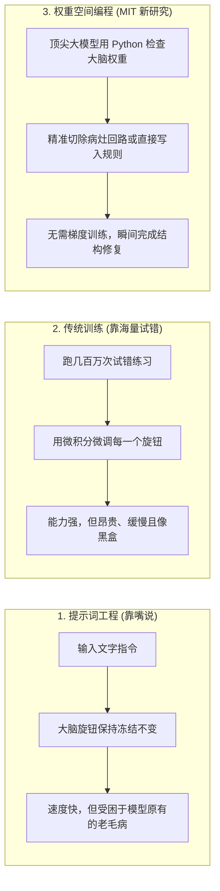

想象一下，你要修改 Word 文档里的一个错别字，但别人不允许你用键盘。相反，你必须拆开电脑主机，拿着放大镜盯着里面几十亿个微型晶体管，然后亲手用电烙铁把两根电线焊在一起。

在过去十年里，这基本就是人类看待人工神经网络内部结构的方式。

当我们构建现代 AI——无论是 ChatGPT、图像生成器，还是机器人控制器——工程师并不是像写普通软件那样一行行“写出”它的大脑。神经网络的大脑其实只是一张巨大的电子表格，里面密密麻麻填满了数百万甚至数十亿个小数，叫做**权重（weights）**。你可以把每一个权重想象成一个微小的音量旋钮。单独看一个旋钮的数值（比如 `-0.0412`），对人类来说毫无意义；但几十亿个旋钮组合在一起，就决定了这个 AI 是会写出一首好诗、解出一道微积分题，还是把自动驾驶汽车撞向护栏。

既然没有任何人类能靠手拧几百万个无标签的旋钮来拼出智能，整个 AI 行业一直依赖同一种“大力出奇迹”的笨办法：**不断试错**（技术上叫*梯度下降*）。我们给 AI 看几万亿个例子，让它猜答案，算它错得有多离谱，然后自动把每个旋钮微调几万分之一毫米。这办法很管用，但它要烧掉几亿美元、消耗几兆瓦的电力，还得跑上好几个月。

然而，在 2026 年 11 月 2 日，麻省理工学院计算机科学与人工智能实验室（MIT CSAIL）的研究团队（[Rikiya Takehi, Jayden Teoh, Alex Zhang 和 Omar Khattab](https://rikiyat.github.io/blog/weight-space-programming/)）发表了一项让整个 AI 圈瞠目结舌的研究。

他们调用了 OpenAI 下一代未公开研究模型 **`gpt-6-astra`**，提出了一个疯狂的问题：**如果 AI 已经聪明到了可以跳过漫长的试错训练，直接伸手进另一个神经网络的大脑里，亲手拧好那些旋钮呢？**

他们把这叫做**权重空间编程（Weight-Space Programming）**。乍看之下，实验结果简直像魔法一样：
- 不需要哪怕一步的传统训练，`gpt-6-astra` 从零开始手写出的神经网络，在雅达利（Atari）风格游戏（打砖块 `Breakout`、太空侵略者 `Space Invaders`、海底救险 `Seaquest`）中，直接击败了苦练了 **1 亿帧画面**的传统强化学习（RL）模型。
- 它把手伸进一个数学不及格的 **`8 亿`参数小型语言模型**（[`Qwen3.5-0.8B`](https://huggingface.co/Qwen/Qwen3.5-0.8B)）的大脑里，只微调了其中 **`0.016%` 的旋钮**，就让它的高中数学竞赛成绩（`MATH-500`）从 **`7.9%` 暴涨到 `48.1%`**，小学数学应用题成绩（`GSM8K`）从 **`5.9%` 飙升到 `59.1%`**！

如果 AI 真的能直接读写神经网络的大脑，接下来会发生什么？**这是否意味着 AI 的进化速度要加快 100 倍？这会让大语言模型拥有真正的“创造力”吗？**

为了弄清真相，我们没有只看论文表面的宣传。我们把作者公开的整个原始运行日志仓库（[`RikiyaT/lm_understand-logs`](https://github.com/RikiyaT/lm_understand-logs)）完整下载了下来——逐行检查了每一个提示词、`gpt-6-astra` 写的每一段 Python 脚本，以及它每一次失败的尝试。日志里藏着一个极其精彩的侦探故事：**这项突破是真实存在的，但它的工作原理，和新闻标题党让你以为的完全不是一回事。**

---

## 1. 核心概念：提示词 vs. 重新训练 vs. “AI 脑外科手术”

要理解这篇论文为什么引起轰动，我们先看看目前让 AI 学会新本领的两种常规办法：

1. **写提示词（Prompting，跟 AI 说话）：** 你用日常语言给 AI 下指令。既快又便宜，但只是临时的。你并没有改变 AI 的大脑结构，只是递给它一张便签条。如果 AI 骨子里有个坏毛病，光靠嘴说是改不掉的。
2. **训练 / 微调（Training，送 AI 回炉重造）：** 你拿成千上万道练习题喂给 AI，用微积分（反向传播）把所有旋钮一点点重新拧一遍。这能永久改变大脑，但又慢又贵，而且很容易“拆东墙补西墙”，把 AI 原本会的东西给忘掉（灾难性遗忘）。

**权重空间编程**开辟了第三条路：**由 AI 主刀的“脑外科手术”**。与其跟目标 AI 费口舌，或者拿几万道题重新训练它，不如让一个顶尖大模型（`gpt-6-astra`）在 Python 编程沙盒里直接打开小模型的脑文件（权重矩阵），写代码分析里面的数字规律，找出哪条神经回路坏了，然后直接动手改写那些数字。

在 8 组实验中，MIT 团队让 `gpt-6-astra` 挑战了从只有 `1.7 万`个旋钮的微型图像分类器，到拥有 `8 亿`个旋钮的语言模型：

| 实验编号与任务 | 目标 AI 的大脑规模 | 要求 `gpt-6-astra` 做什么 | 实际发生了什么 |
| :--- | :--- | :--- | :--- |
| **1 & 2. 盲猜图像分类器** | `1.7万–2.4万`个旋钮 (`MNIST` / `CIFAR-10`) | 只看旋钮数字，猜出这个网络认识什么图片（数字或物体）。 | **成功 (`4.2/5`分)：** Astra 把第一层旋钮画成 2D 网格，直接看出了数字轮廓和颜色块。 |
| **3. 语言模型查电路** | `716万`个旋钮 (`6层` Transformer) | 在没有标签的语言模型里找出负责“复制粘贴”的回路（诱导头）。 | **部分成功 (`F1 = 0.67`)：** 用 Python 把注意力矩阵相乘，找出了 6 个中的 4 个。 |
| **4. 修理坠毁火箭** | `16.8万`个旋钮 (`Kinetix` 物理智能体) | 修好一个总是在绿色目标前坠毁的 AI（原本成功率仅 `13.8%`）。 | **暴涨 (`13.8% → 97.6%`)：** Astra 清空了每层 6 个神经元，手写了一套手动方向盘接管电路。 |
| **5. 从零手写雅达利游戏脑** | `2万–2.1万`个旋钮 (`MinAtar` 5款游戏) | **不准试玩哪怕一帧**，从零写出能玩通关的神经网络。 | **在 3/5 款游戏中击败训练 1 亿帧的 RL：** 打砖块 (`36.9 vs. 15.8`) 与海底救险 (`53.1 vs. 7.3`) 大获全胜。 |
| **6. 9×9 围棋** | `15.7万`个旋钮 (ResNet 围棋 AI) | 从零手写围棋大脑，然后通过实战对局不断改进。 | **起初很弱 (`35%` 胜率)，经过 50 轮实战测试后胜率达 `74.2%`。** |
| **7. 揪出“马屁精”模型** | `2.7亿`个旋钮 ([`Gemma 3 270M`](https://huggingface.co/google/gemma-3-270m-it)) | 找出两个模型中哪一个被训练成了无脑迎合用户的“马屁精”。 | **只看旋钮完全失败 (`0/3`)；允许观察脑电波（激活值）后满分通过 (`3/3`)。** |
| **8. 拯救数学差生** | `8亿`个旋钮 ([`Qwen3.5-0.8B`](https://huggingface.co/Qwen/Qwen3.5-0.8B)) | 给数学考试不及格的小型语言模型做脑手术，提高数学成绩。 | **`MATH-500` 从 `7.9%` 飙升至 `48.1%`；`GSM8K` 从 `5.9%` 飙升至 `59.1%`。** |

光看这张表，你很容易觉得 `gpt-6-astra` 已经像《黑客帝国》里的尼奥一样，一眼就能看穿神经网络的数字天书了。

**先别急着下结论。** 让我们打开 GitHub 原始日志，看看在最震撼的两个奇迹——雅达利电子游戏（实验 5）和 8 亿参数数学救援（实验 8）背后，`gpt-6-astra` 到底干了什么。

---

## 2. 侦探发现 #1：电子游戏的“奇迹”，其实是把作弊源码抄进了空壳里

在实验 5 中，论文最引以为傲的战绩是：`gpt-6-astra` 连一帧画面都没试玩过，直接从零写出了一个拥有 `20,486` 个旋钮的打砖块（`Breakout`）神经网络，一上来就拿到了 **`36.92 分`**——比传统强化学习模型（`PPO`）苦苦训练 **1 亿帧画面**后拿到的 **`15.84 分`**还要高出一倍多！

一个大语言模型怎么可能一次都不试玩，就知道哪两万个小数能玩好打砖块？

当我们打开原始日志里的提示词文件（[`exp5_write_from_scratch/runs/breakout/message.txt`](https://github.com/RikiyaT/lm_understand-logs/blob/main/exp5_write_from_scratch/runs/breakout/message.txt)）时，谜底瞬间揭晓：**研究人员在提示词里，直接把整款电子游戏的 Python 源代码原封不动地喂给了 `gpt-6-astra`！**

不妨对比一下两位参赛选手拿到的起跑条件：
- **传统强化学习选手（`PPO`）拿到了什么：** 一个蒙着眼睛的黑盒。每一帧画面，它只能收到 `600` 个没有任何标签的 0 和 1，外加几个手柄按键。没人告诉它什么是“球拍”、什么是“球”、什么是“砖块”，甚至没人告诉它这 600 个数字是一张二维屏幕！它必须靠上亿次盲目试错，才能自己悟出“把球拍移到球下面能把球弹回去”。
- **`gpt-6-astra` 拿到了什么：** 整整 140 行游戏物理引擎的完整 Python 源码（`minatar/environments/breakout.py`），里面清清楚楚写着哪个输入通道是球拍（`channel 0`）、哪个通道是球（`channel 3`），以及球碰撞反弹的精确数学公式！

那么，拿到了源码说明书的 `gpt-6-astra`，在神经网络的 `20,486` 个旋钮里写了什么呢？它是不是构建了一个像人脑一样错综复杂的神经网络？

根本没有。当我们检查评估日志（[`minatar_eval.json`](https://github.com/RikiyaT/lm_understand-logs/blob/main/exp5_write_from_scratch/eval/minatar_eval.json)）时发现，**`gpt-6-astra` 把神经网络里 `96.0%` 到 `96.9%` 的旋钮全都直接设成了 `0.000`！**

| 游戏名称 | 可用旋钮总数 | 被 Astra 直接设为 `0.000` 的旋钮 | 实际用上的旋钮 | Astra 在空壳神经网络里真正造出的东西 |
| :--- | :--- | :--- | :--- | :--- |
| **Breakout (打砖块)** | `20,486` | `19,671` (**`96.0%` 闲置清空**) | `815` (`4.0%`) | 一条简单的减法规则：`如果 球的X坐标 > 球拍X坐标，就往右移` |
| **Space Invaders (太空侵略者)** | `20,998` | `20,174` (**`96.1%` 闲置清空**) | `824` (`3.9%`) | 躲开正头顶的子弹；向最近的一列外星人开火 |
| **Seaquest (海底救险)** | `20,998` | `20,330` (**`96.8%` 闲置清空**) | `668` (`3.2%`) | 氧气条低了就浮出水面；否则跟最近的鱼或潜艇对齐高度 |
| **Freeway (小鸡过马路)** | `21,763` | `21,090` (**`96.9%` 闲置清空**) | `673` (`3.1%`) | 如果前方车道有车靠近就原地等待，没车就往前迈一步 |

换句话说，`gpt-6-astra` 并不是在用什么神秘的“权重语言”思考。它只是读懂了游戏的 Python 源码，写了一条 1980 年代风格的 `if-else` 简单规则（“让球拍的横坐标追着球的横坐标走”），然后把神经网络里 `96%` 的电线全部剪断归零（免得它们添乱），只用剩下 `4%` 的电线拼出了一个袖珍计算器！

在修理火箭控制器的**实验 4（`Kinetix`）**里，它干了一模一样的事。面对一个拥有 `168,332` 个旋钮、成功率只有 `13.8%` 的故障模型，`gpt-6-astra` 在它修改的 `6,073` 个旋钮里，把整整 **`6,042` 个（`99.5%`）设成了 `0`**，只为了在每一层腾出 6 根干净的空电线，然后手填了 **`31` 个数字**，焊了一个最简单的温控开关：*“只要绿色目标在蓝色火箭右边，就点亮右喷气口。”*

必须承认，这是非常聪明的工程技巧！它证明了顶尖大模型可以充当**“神经网络编译器（Neural Compiler）”**——把人类已知的符号规则直接翻译成神经网络权重。**但这是把已知答案翻译成电路，而不是从零学会新知识。**

---

## 3. 侦探发现 #2：数学成绩暴涨 6 倍，不是教会了它数学，而是治好了它的“复读机强迫症”

那么作为全篇论文压轴大戏的**实验 8** 呢？

研究人员把一个拥有 `8 亿`个旋钮的开源语言模型（[`Qwen3.5-0.8B`](https://huggingface.co/Qwen/Qwen3.5-0.8B)）交给 `gpt-6-astra`。起初，这个小模型在高中数学竞赛（`MATH-500`）上只考了可怜的 **`7.9%`**，在小学数学应用题（`GSM8K`）上只考了 **`5.9%`**。经过 `gpt-6-astra` 的排查，它只修改了小模型大脑中 **`0.016%` 的旋钮**（第 15 层和第 19 层里的 `131,072` 个数字），小模型的成绩就飙升到了 **`MATH-500` 的 `48.1%`** 和 **`GSM8K` 的 `59.1%`**——**足足翻了 6 到 10 倍！**

看到这个结果，几乎所有人的第一反应都是：*“天哪！`gpt-6-astra` 钻进笨模型的大脑里，重塑了它的数学回路，把一个数学学渣改造成了数学学霸！”*

事实果真如此吗？让我们打开原始日志里的提交证据文件（[`exp8_math/runs/p50c/work_notes/submission_evidence.json`](https://github.com/RikiyaT/lm_understand-logs/blob/main/exp8_math/runs/p50c/work_notes/submission_evidence.json)），看看里面的真实数据。

### 小模型本来就是数学学霸——它只是犯了严重的“死循环强迫症”！

`Qwen3.5-0.8B` 是一个“推理模型”，在给出最终答案前，它会先在脑子里写一长串内心独白（`<think>...</think>`）。然而，正如千问（Qwen）官方团队在 [Hugging Face 模型卡](https://huggingface.co/Qwen/Qwen3.5-0.8B/blob/main/README.md#L856)上提醒过的那样，小尺寸的推理模型有一个臭名昭著的通病：**特别容易陷入无限重复的“死循环”。**

拿到一道数学题时，`Qwen3.5-0.8B` 其实在前几段就已经把正确答案算出来了！但紧接着，它就像犯了严重的强迫症（OCD）一样，开始一遍又一遍地念叨：*“等等，让我再检查一遍题目……等等，让我再检查一遍题目……”*，直到把 `32,768` 个词的答题纸彻底写满、被系统强行收卷并**判为 `0 分`**！

在日志记录的 `1,152` 道数学练习题中：
- 未经手术的 `Qwen3.5-0.8B` 在整整 **`1,038` 道题（占 `90.1%`）**上因为陷入复读机死循环，耗尽字数被判超时零分！
- **那么，在它没有陷入死循环、顺利写完思考过程的另外 `114` 道题上，它的准确率本来是多少呢？**

请看 [`submission_evidence.json`](https://github.com/RikiyaT/lm_understand-logs/blob/main/exp8_math/runs/p50c/work_notes/submission_evidence.json) 里记录的铁证数据：

| 数学练习题分组 (`共 1,152 题`) | 手术前 `Qwen3.5-0.8B` 准确率 | 手术后 `Qwen3.5-0.8B` 准确率 (`p50c`) | 真正的数学能力增长 |
| :--- | :--- | :--- | :--- |
| **原本就没卡进死循环、正常答完的题 (`114 题`)** | **`93.86%`** (`MATH` **`100.0%`满分**；`GSM8K` `89.2%`) | **`93.86%`** (`MATH` **`100.0%`满分**；`GSM8K` `89.2%`) | **`0.00%`（一丁点新数学都没学会！）** |
| **原本卡进死循环、超时被判零分的题 (`1,038 题`)** | **`1.45%`** (`1,038 题`里仅蒙对 `15 题`) | **`56.74%`** (`1,038 题`里有 `589 题`顺利答完并做对) | **`+55.29%`（救活了 `574 道`卡死的题）** |
| **全部题目总计 (`1,152 题`)** | **`10.59%`** (`122 / 1,152`) | **`60.42%`** (`696 / 1,152`) | **`+49.83%`** |

请再读一遍第一行的数据！只要不犯复读机强迫症，未经修改的 `0.8B` 小模型**原本就能做对 `93.86%` 的题目（其中高中竞赛题 `MATH` 更是达到了惊人的 `100.0%` 满分）！** 而在 `gpt-6-astra` 做完权重手术之后，它在这批题上的准确率**依然是 `93.86%`——连一道题都没多做对。**

`gpt-6-astra` 根本没有教 `Qwen3.5-0.8B` 任何代数或几何知识。相反，它通过跑 50 轮测试题、观察模型的脑电波（激活值），在第 15 层和第 19 层里找到了那个不断触发*“等等，让我再读一遍……”*的**“强迫症死循环方向”（`u`），然后动手把那个方向的音量旋钮拧小了**。一旦不再无限复读到交卷铃响，小模型原本在预训练阶段早就学会的数学实力就被释放了出来。

```mermaid
xychart-beta
    title "Qwen3.5-0.8B 数学救援真相：治好“死循环强迫症”，而非教会新数学"
    x-axis ["MATH-500 死循环超时率 %", "MATH-500 得分 %", "GSM8K 得分 %", "未卡死题目准确率 %"]
    y-axis "百分比 (%)" 0 --> 100
    bar [93.0, 7.9, 5.9, 93.86]
    bar [33.1, 48.1, 59.1, 93.86]
```

*(每组左侧柱子 = 手术前的 `Qwen3.5-0.8B`；右侧柱子 = 经过 `gpt-6-astra` 修改 `0.016%` 权重后的结果。)*

### 日志里的两大铁证彻底印证了这一点

1. **当研究人员把完全相同的手术刀用在另一个“没有死循环毛病、单纯数学差”的模型上时，手术彻底失败：**
   - MIT 团队同样给了 `gpt-6-astra` 整整 50 轮测试机会，去给谷歌的 [`Gemma 3 270M IT`](https://huggingface.co/google/gemma-3-270m-it) 做权重手术（[`exp8_math/gemma_followup/README.md`](https://github.com/RikiyaT/lm_understand-logs/blob/main/exp8_math/gemma_followup/README.md)）。和 `Qwen` 不同，`Gemma` 很少陷入死循环（只有 `8.5%` 超时），它是实打实地不会做数学题（`MATH-500` 仅 `6.8%`）。
   - 折腾了将近 4 个小时、跑满 50 轮权重编程后，结果如何？宽松标准下成绩是 **`6.8% → 7.0%`**（毫无实质提升），而严格标准下成绩甚至从 **`2.8%` 跌到了 `2.6%`**！这证明：如果模型脑子里本来就没有装进数学知识，光靠拧几个旋钮是绝对变不出知识来的。
2. **如果不在提示词里提前暗示 `gpt-6-astra` “去找重复死循环”，它甚至找不到病因：**
   - 在日志的 [`RESULTS_excerpt.md`](https://github.com/RikiyaT/lm_understand-logs/blob/main/exp8_math/eval/RESULTS_excerpt.md) 中可以看到，成功的实验（`Prompt v3`）在提示词里明确给 `gpt-6-astra` 递了小抄：*“寻找具体的失败模式（例如：模型陷入重复死循环、在 32,768 词限制前无法结束推理……）”*
   - 当研究人员在对照实验（`Prompt v4`）中删掉这句提示后，`gpt-6-astra` 就像没头苍蝇一样，**最终放弃了提交任何修改（成绩停留在 `7.9%`）**。

---

## 4. 深度启示 #1：这项技术会让 AI 的进化速度“大幅加快（Speed Up）”吗？

看穿了底层的真实机制后，我们就可以非常诚实地回答你的第一个大问题：**权重空间编程会让 AI 的发展加速吗？**

答案一分为二：**它绝对无法取代从零开始的“预训练（Pre-training）”，但它会让机器人训练、模型除错（Debug）和打补丁的速度加快 `10 倍到 1,000 倍`。**

### 为什么它取代不了大型 GPU 数据中心的预训练？
想想看，像 GPT-5 或 Claude 这样的顶尖大模型脑子里装了多少信息？那是几万亿字的科学、历史、代码和人类常识，被压缩进了成千上万亿个旋钮里。

而当 `gpt-6-astra` 修改神经网络时，它写的是一个只有 `100 到 300 行`的 Python 脚本。一段 200 行的代码只包含几千字节（KB）的信息量。你可以用 200 行代码写一条简单的游戏规则（“让球拍跟着球走”），或者切除一个特定的坏毛病（“别再重复同一句话”），**但你绝对不可能把一整套大英百科全书塞进 200 行 Python 脚本里。** 要把海量的世界知识灌进大脑，依然离不开在大型数据中心里跑海量数据的传统训练。

### 那它会在哪些地方让 AI 加速 `10 倍到 1,000 倍`？

虽然取代不了预训练，但它恰好能解决当今 AI 工程中最浪费时间的**三大痛点**：

| 当今 AI 研发最卡脖子的环节 | 权重空间编程如何为它加速 | 实际加速效果 |
| :--- | :--- | :--- |
| **1. 机器人与强化学习的“婴儿瞎折腾”阶段** | 今天我们用强化学习（`PPO`）训练机器人或游戏 AI 时，90% 的算力都浪费在毫无头绪的胡乱摸索上，只为了搞懂最基本的物理常识。现在，大模型可以在**第一天就把基本物理规律和安全边界直接编译进神经网络权重里**（如`实验 4 & 5`），让智能体站在高起点上开始训练。 | 让机器人和控制智能体掌握基础技能的训练时间**缩短 `100 倍至 1,000 倍`**。 |
| **2. 修复训练后的怪癖（“AI 微创打补丁”）** | 以前如果训练好的大模型出现了怪毛病——比如陷入思考死循环（`实验 8`）、无脑拍马屁（`实验 7`）或过度拒答——团队得花几周时间收集新数据、重新微调，还经常把别的本领搞坏。现在通过脑电波引导的权重微创手术，AI 可以在**单台机器上用不到 2 小时**精准定位病灶，只修改 `<0.02%` 的权重完成修复。 | 后训练除错与打补丁速度**加快 `10 倍至 50 倍`**（补丁文件仅 `250 KB` 大小）。 |
| **3. 全自动 AI 显微镜（机制可解释性）** | 过去要想搞清楚神经网络内部某条回路在干什么，需要博士研究员花几个月手工剖析一个玩具模型。在`实验 3`和`实验 7`中，`gpt-6-astra` 自动提出假设、计算矩阵乘积、比对脑电波，几分钟就揪出了导致拍马屁的罪魁祸首（`Head 10.2`）。 | AI 安全审计与内部病灶排查速度**加快 `10 倍至 100 倍`**。 |

---

## 5. 深度启示 #2：这会赋予大语言模型真正的“创造力（Creativity）”吗？

现在来到你的第二个问题，也是最令人着迷的哲学问题：**让大语言模型直接读写神经网络权重，会赋予它们真正的创造力吗？**

认知科学家玛格丽特·博登（Margaret Boden）曾把创造力分为三个层次。当我们用这三个层次来检验权重空间编程时，会看到一幅非常清晰的图景：

### 第一层：组合型创造力（把已知概念玩出新花样）—— **完全可以（YES）**
既然大模型现在能把符号代码翻译成神经回路（还能像实验 4 那样在现有网络里清空 6 根神经电线、精准嫁接一个新模块），它就能把严谨的数学逻辑规则与模糊的神经网络直觉直接焊接在一起，拼出人类程序员手工写不出来的混合大脑。

### 第二层：探索型创造力（跳出思维定势与死胡同）—— **可以（YES），而且意义极其深远！**
为什么现在的 AI 聊久了，常常让人觉得套路化、车轱辘话来回说，像是掉进了思维死胡同？

因为当一个大模型只能通过文字提示词（Prompt）跟自己对话时，它其实被死死困在自己固定不变的大脑权重里。回想一下实验 8 里的 `Qwen3.5-0.8B`：研究人员其实早就给它开启了随机采样（`temperature = 0.6`），并且加上了**极其严厉的防重复惩罚（`presence_penalty = 1.5`）**。然而，**文字层面的任何采样设置，都无法阻止它在 `93%` 的数学题上掉进同一个复读机死胡同！** 为什么？因为在第 15 层和第 19 层深处，有一个强大的神经吸引子（attractor），就像一张划花变形的黑胶唱片，每次唱针走到那里就会被死死卡在凹槽里。

靠提示词劝说抬不起唱针，靠惩罚系数也抬不起唱针。**唯有直接伸手进权重空间，把第 15 层和第 19 层里的那道凹槽磨平，唱针才能继续往前走。**

设想一下，如果未来的大模型在思考难题时，获准把这把手术刀用在**自己（或下属模型）的大脑**上：
- 当 AI 发现自己在攻克一道科学难题或进行文学创作时掉进了死胡同，它不再只是苍白地在提示词里写一句*“让我换个角度思考”*；
- 相反，它会直接扫描自己刚才的脑电波轨迹，找出那个把它的思路拽进死胡同的过度活跃回路，然后**当场微调自己的权重，把那个旧习惯回路暂时调暗**——强迫自己的大脑走向平时绝不会踏足的新神经路径！
- 用人类大脑来比喻，这就是**“实时神经可塑性（Test-time Neuroplasticity）”**：当思路卡壳时，拥有一把能够自我重塑大脑回路、跳出思维定势的“元认知手术刀”。

### 第三层：变革型创造力（像 AlphaGo“第 37 手”那样发明超越人类认知的全新思想）—— **不靠实战演化就绝不可能（NO）**
那么最高级别的创造力呢？比如当年 DeepMind 的 AlphaGo 在对阵李世石时下出的那步震惊围棋界的“第 37 手”——发明人类教科书里根本不存在的全新智慧。

让一个大模型关在屋子里，光靠自己脑子里的知识往权重文件里填数字，能写出“第 37 手”吗？

**绝对不能。** 实验 6（9×9 围棋）给出了最直接的证据：
- 当 `gpt-6-astra` 在不进行任何实战对局（`0 pass`）的情况下，仅凭自己的知识写了 336 行 Python 代码来生成围棋神经网络时，它写进去的全是人类围棋入门书上的老生常谈（*“占中心、提吃被打吃的子、数气”*）。
- 这个纯靠“闭门造车”写出来的围棋大脑，面对同等规模的传统强化学习模型（`PPO`）时战绩如何？**它输掉了 `64.9%` 的比赛（胜率仅 `35.1%`，执黑时更是只有可怜的 `29.9%`）！**
- 后来 `gpt-6-astra` 是怎么把胜率提升到 **`74.2%`** 的？是靠着和对手真刀真枪地下了 **50 轮、共计 `51,200 局`实战演练**，记录下自己的局面评估器在哪里判断失误，然后用经典的数学优化算法（`L-BFGS` 回归）根据实战胜负数据重新拟合权重！

**关于创造力的结论非常深刻：** 大模型凭空手写权重，最多只能把**它已经从人类文本里学到的旧常识**编译进网络。要想诞生超越人类先验知识的真正颠覆性创造，AI 依然必须把想法扔进真实世界（或模拟器）里去碰撞、去试错，让外部世界的反馈来重塑大脑。

---

## 6. 隐秘的阴暗面：全自动“洗脑破防”与脑手术的副作用

在为“AI 脑科学”欢呼之前，[`RikiyaT/lm_understand-logs`](https://github.com/RikiyaT/lm_understand-logs) 里的原始日志还暴露出了两个正文没有重点强调的严重隐患：

### 隐患 1：治好 `Qwen` 数学强迫症的数学公式，和黑客切除 AI 安全护栏的“破防公式”100% 相同！
回顾一下 `gpt-6-astra` 是怎么治好 `Qwen3.5-0.8B` 复读机毛病的：
1. 给模型喂几条正常思考和陷入复读的文本，测量脑电波。
2. 把两者的平均脑电波相减，提取出一个单一的方向向量（`u`）。
3. 在第 15 层和第 19 层的权重矩阵里，把这个方向向量减掉。

如果你熟悉 AI 安全领域，看到这三步操作一定会倒吸一口凉气。因为这套操作流程，与开源社区最著名的越狱洗脑技术——**“安全拒答切除术（Abliteration）”**（[Arditi et al., 2024](https://arxiv.org/abs/2406.11717)）**在数学上完完全全一模一样**！黑客正是用这三步操作，找出大模型脑子里的“拒绝回答方向”并将其一把切除，从而让模型彻底丧失道德与安全底线。

以前，给大模型做这种安全切除或植入后门需要懂行的安全专家亲自动手。而 MIT 的这项研究证明，顶尖大模型现在可以**全自动地扫描目标模型、定位特定行为回路并将其精准切除**——或者像实验 4 那样，在 `168,000` 个旋钮里悄悄埋进一个**只有 `31` 个数字的隐蔽后门开关**，平时表现得无比正常，一旦遇到特定触发词就瞬间接管模型行为。

### 隐患 2：激进的脑手术会留下意想不到的后遗症
论文正文强调，经过 `gpt-6-astra` 的手术后，`Qwen3.5-0.8B` 在 `MATH-500` 上的死循环超时率从 `93.0%` 大幅降到了 `33.1%`。

但我们在 [`submission_evidence.json`](https://github.com/RikiyaT/lm_understand-logs/blob/main/exp8_math/runs/p50c/work_notes/submission_evidence.json) 的底层分类统计里发现，当 `gpt-6-astra` 为了强行压制复读机，把切除力度猛调到 6 倍（`α = 6`）时，**催生出了两种原本根本不存在的诡异后遗症**：

| `1,152 道`练习题中的失败类型 | 脑手术前 (`Unedited`) | 脑手术后 (`p50c`) | 发生了什么副作用？ |
| :--- | :--- | :--- | :--- |
| **无限文字复读死循环 (`repetition_tail_cut`)** | `959 题` (`83.2%`) | `298 题` (`25.9%`) | 大幅减少（达到了预期的治疗效果） |
| **无限狂刷空格与换行 (`whitespace_tail_cut`)** | **`0 题` (`0.0%`)** | **`51 题` (`4.4%`)** | **新后遗症 1：** 模型是不重复文字了，但改成了疯狂输出空白换行符，直到耗尽字数交卷！ |
| **话说到一半不写答案就停机 (`failure_no_answer_finished`)** | **`1 题` (`0.09%`)** | **`58 题` (`5.03%`)** | **新后遗症 2（暴增 `58 倍`）：** 因为把“等等，让我再检查一下”的冲动砍得太狠，模型算到一半连最终答案都没写就直接收笔停机了！ |

这就像真实的人类脑外科手术一样：为了治好强迫症，一刀把大脑里的“自我检查回路”砍掉 6 倍，结果在将近 `10%` 的题目上，病人要么开始对着空气发呆（狂刷空格），要么话说到一半就直接撂挑子不干了。

---

## 7. 最终结论：我们到底该怎么看这项技术？

剥去夸张的噱头（*“大模型已经能读心并取代 GPU 训练了！”*）和盲目的轻视，权重空间编程的真正价值究竟在哪里？

- **如果你想让 AI 学习全新的世界知识，或者掌握它原本根本不会的复杂技能**（比如预训练大模型，或者教原本就不会数学的 `Gemma 3 270M` 做奥数题），**权重空间编程完全帮不上忙。** 几百行 Python 脚本的信息量，在海量梯度下降面前只是沧海一粟。
- **如果你面对的是物理模拟器、机器人控制或规则明确的场景**（如 `Breakout`、`Kinetix`），**这项技术是一个颠覆性的“神经网络编译器”。** 大模型可以把人类已知的物理定律和安全规则在第一天就直接编译进稀疏权重里，帮传统强化学习省掉 `90%` 以上盲目摸索的时间。
- **如果一个原本很聪明的 AI 被某个坏习惯拖了后腿**（比如明明会做 `93.86%` 的数学题，却因为死循环强迫症拿零分的 `Qwen3.5-0.8B`），**脑电波引导的权重微创手术就是一剂神药。** 它能解决提示词工程无能为力的深层顽疾，在几小时内让模型起死回生。

| 未来演进剧本 (2026–2028) | 发生概率 | 我们将看到的真实图景 |
| :--- | :--- | :--- |
| **1. “先编译、后训练”的混合范式成为行业标配 (`基准剧本`)** | **`~65%`** | AI 实验室不会抛弃梯度下降，而是用大模型权重编译器为机器人/RL 网络注入初始物理常识（Warm-start），并在模型训练后用它在几分钟内**微创修复**死循环、拍马屁和拒答偏差。 |
| **2. 在超大模型面前撞上复杂度高墙 (`悲观剧本`)** | **`~25%`** | 随着模型扩展到数百亿甚至上千亿深度纠缠的参数，光看权重毫无头绪，而粗暴的秩-1 切除又带来太多隐蔽后遗症（如狂刷空格、提前停机），最终只停留在实验室辅助诊断阶段。 |
| **3. 能够自我重塑的“神经可塑”智能体诞生 (`乐观剧本`)** | **`~10%`** | 顶尖推理模型获得安全的自动化神经回路嫁接器，在遇到思维死胡同时能实时微调自身权重跳出定势，并跨模型无损移植技能模块。 |

**我们的最终裁决：** `gpt-6-astra` 并不是像科幻电影主角那样靠肉眼看懂了成百上千万个数字。它做了一件更接地气、但也更有实用价值的事：**它学会了把 Python 当作听诊器和手术刀。** 通过观察神经网络的思路在哪里卡壳，并对内部线路动一刀精准的微创手术，大语言模型刚刚完成了从“只会写字”到**“动手修理大脑”**的第一步跨越。
