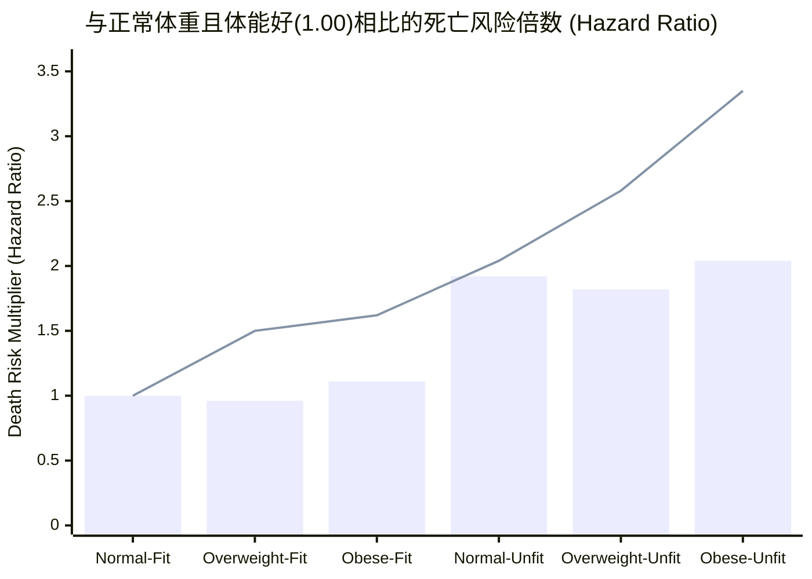
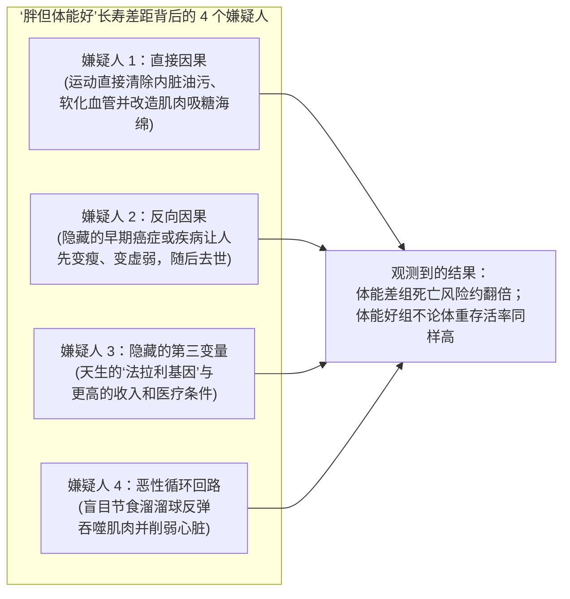

## 1. 故事的起点：等等——背着沉重书包的人，真的能比看起来苗条的人活得更久吗？

想象有两个成年人走进医院做体检：

* **A 先生（“瘦但体能差”）**站上体重秤，立刻拿到了一颗小红星。按照身高计算，他的体重完全“标准”。但他整天坐在办公桌前，从不运动，只要爬一层楼梯就会像老旧蒸汽火车一样气喘吁吁。
* **B 先生（“胖但体能好”）**站上体重秤，警报灯马上亮了。因为他身上多背了 25 公斤（大约 50 斤，相当于一只成年金毛寻回犬的重量），医生的体检表把他的体型归类为“超重”或“肥胖”。然而，B 先生每周都会快走、骑车或慢跑四次。他的心脏和肺非常强壮，一口气爬三层楼梯还能边走边聊天，大气都不喘一下。

在过去 40 年里，几乎所有的健康建议都盯着体重秤上的数字：*“先把体重减下来！”*

然而，运动生理学家 **布雷迪·霍尔默（`Brady Holmer, @Brady_H`）** 在社交媒体上分享了一项由弗吉尼亚大学 **内森·威尔德雷尔（Nathan R. Weeldreyer）** 和 **悉达多·安加迪（Siddhartha S. Angadi）** 团队发表在《英国运动医学杂志》（*British Journal of Sports Medicine*）上的超大规模研究，瞬间引发全网热议（[Weeldreyer et al., 2024/2025, PMC11874340](https://pmc.ncbi.nlm.nih.gov/articles/PMC11874340/)）：

> “瘦但体能差，还是胖但体能好？哪一种更健康？
> 2025 年的一项荟萃分析汇总了 20 个队列研究、近 40 万份观测数据。每一项研究都通过极限运动测试直接测量了体能并实地测量了 BMI，随后追踪受试者的全因死亡率和心脏病死亡率。
> 与体能好且体重正常的人相比……
> - 体能差（Unfit）的人在任何体重下，死亡风险都大约翻了一倍（+82% 至 +104%）。
> - 超重或肥胖但体能好（Fit）的人，与体重正常的体能好人群在统计学上没有显著差异（-4% 和 +11%）。
> 但单看心脏病死亡，超重或肥胖的体能好人群确实比基准组风险更高，因此可能需要更高的体能才能完全抵消心脏风险。
> （在这些研究中的大多数里，‘体能好’仅仅意味着脱离同龄人最垫底的 20%）。”

等一下，请把上面这几行数字再读一遍：
1. **看起来苗条但体能差的人**，死亡风险几乎是苗条且体能好人群的 **两倍（+92%）**！
2. **体重超重或肥胖但体能好的人**，总体死亡风险居然和苗条且体能好的人 **几乎一模一样（超重体能好 -4%，肥胖体能好 +11%）**！

为什么多背 50 斤体重对活命的影响，竟然远远不如“爬坡喘不喘气”重要？更精彩的是，当我们拿起侦探放大镜，直接翻开这 **398,716 人** 背后的原始论文和补充数据表时，发现了社交媒体上几乎没人注意到的 **四个巨大悬念**：

* **悬念 #1：** 论文摘要和热帖都声称，*每一项*研究都使用了拼尽全力的**“极限运动测试（maximal exercise test）”**。真的吗？当我们翻开数据量最大的两项现代研究——占了全部样本的 **54.2%（398,716 人中的 216,284 人）**——它们居然全都不是极限测试，而是轻松的 **6 分钟室内单车测试**！
* **悬念 #2：** 20 项研究原本一共测试了 **458,784 人**，但最终进入统计的只有 **398,716 人**。中间凭空消失的 **60,068 人** 去哪儿了？
* **悬念 #3：** 如果只看**死于心脏病**的风险，“超重体能好”和“肥胖体能好”的风险倍数分别是 **1.50 倍（+50%）** 和 **1.62 倍（+62%）**。那为什么论文的要点总结框里却写着心脏病死亡风险*“没有统计学上的显著增加”*？
* **悬念 #4：** 在英国生物银行（UK Biobank）的数据里，一个“肥胖但体能好”的人必须把室内单车踩出 **288.9 瓦（Watts）** 的功率——比“苗条但体能差”的人（**87.0 瓦**）足足高出 **3.3 倍**——才能跨进“体能好”的大门（[Tarp et al., 2021, PMC8174221](https://pmc.ncbi.nlm.nih.gov/articles/PMC8174221/)）！这又是为什么？

打开你的侦探笔记本。我们要从零开始，先钻进课间跑步时你的心脏和肌肉里看清工作原理，再核对科学家们的一手原始数据账单，彻底解开这个关乎每个人寿命的科学谜题。

---

## 2. 从零开始：你身体里的“氧气快递卡车” vs “书包重量”

在检查科学家们的算术之前，我们先要搞懂这场比赛里对决的两个指标：**你的发动机有多强**，以及**你的书包有多重**。

### 指标 #1：你的氧气快递卡车跑得有多快？（`CRF`、`VO2peak` 与 `METs`）

就在你安静地坐着读这句话的每一秒钟，你肌肉、大脑和内脏里的数万亿座微型发电厂都在燃烧燃料，维持你的体温和生命。而这些微型发电厂没有**氧气**就无法点火。

当你突然在足球场上全速冲刺时，你的肌肉会立刻大喊：*“快给我平时 10 倍的氧气！”* 这时，你身体里的三个部门会立刻组成一支紧急快递车队：
1. **装货码头（你的肺）：** 从吸入的空气里抓取新鲜氧气。
2. **消防水泵（你的心脏）：** 跳得更快、更用力，把装满氧气的血液泵进全身血管。
3. **卸货车间（你的肌肉）：** 利用细小的血管网（**毛细血管**）和细胞里的火炉（**线粒体**）接住氧气，把它变成奔跑的动力。

在剧烈运动时，你的肺、心脏、血管和肌肉配合运送氧气的最大能力，科学家称之为**心肺体能（Cardiorespiratory Fitness，简称 `CRF`）**。而在跑步机或单车测试中测出的氧气快递车队的最高速度，就叫做**峰值摄氧量（`VO2peak` 或 `VO2max`）**。

因为“每分钟每公斤体重消耗多少毫升氧气”听起来太绕口了，医生们发明了一把超级好懂的尺子，叫做**“静坐单位”**：
* **1 个静坐单位**，就是你安安静静坐在椅子上看动画片时身体消耗的氧气量（每分钟每公斤体重消耗 `3.5 毫升`氧气）。
* 如果你出门快步走，身体消耗的氧气大约是静坐时的 **3 到 4 倍**（3 到 4 个静坐单位）。
* 如果你以 10 分钟跑完 1.6 公里的速度慢跑，身体消耗的氧气大约是 **10 个静坐单位**。
* 医生把这种“静坐单位”叫做**代谢当量（Metabolic Equivalents，简称 `METs`）**（[Mandsager et al., 2018, PMC6324439](https://pmc.ncbi.nlm.nih.gov/articles/PMC6324439/)）。

### 指标 #2：不拉开拉链直接称书包重量（`BMI`）

那么，医生是怎么区分一个人是“苗条”、“超重”还是“肥胖”的呢？

最理想的办法是用专门的扫描仪看清你身体里有多少是健康的肌肉和骨头、多少是脂肪，以及脂肪*藏在什么位置*。但在大多数医院里，医生用的是一个 200 年前的算术捷径：用你的体重（公斤）除以身高（米）的平方（`kg/m²`）。

这就像**不拉开学生的书包拉链，直接把整个书包放到行李秤上称重**。你知道这个书包相对于它的个头有多沉，但你根本看不见里面装的是厚重的数学课本（肌肉和骨骼），还是油腻的薯片袋子（有害脂肪）。医生把这个身高体重公式叫做**身体质量指数（Body Mass Index，简称 `BMI`）**（按本研究所采用的国际通用标准）：
* **正常体重（Normal Weight）：** BMI 在 `18.5 至 24.9 kg/m²` 之间
* **超重（Overweight）：** BMI 在 `25.0 至 29.9 kg/m²` 之间
* **肥胖（Obese）：** BMI 达到 `30.0 kg/m²` 或更高

### 为什么体重秤一斤没掉，升级“心肺发动机”就能修好身体？

等等——如果一个人站上体重秤连一斤都没有瘦下来，为什么光靠把心肺发动机（`CRF`）练强壮，就能保护生命呢？

因为当你坚持规律运动时，身体内部会发生**四项体重秤看不见的深度维修**（[Gaesser & Angadi, 2021, PMC8560549](https://pmc.ncbi.nlm.nih.gov/articles/PMC8560549/)；[Fabbrini et al., 2009, PMC2741268](https://pmc.ncbi.nlm.nih.gov/articles/PMC2741268/)）：
1. **清理“放错地方的油污”（`减少内脏脂肪与异位脂肪`）：** 身体里的脂肪并不是全都一样坏。储存在皮肤下面（臀部、大腿、手臂）的皮下脂肪，就像叠好放在衣柜里的厚棉被，背着虽然沉，但不会主动破坏家具。真正致命的脂肪，是包裹在肝脏、胰腺和心脏周围，甚至渗进器官细胞*内部*的黏稠油污（科学家称之为**内脏脂肪**和**异位脂肪**）。规律运动哪怕不减轻总体重，也会优先烧掉这些包裹内脏的有毒油污！
2. **把肌肉变成“吸糖海绵”（`提高胰岛素敏感性`）：** 吃完午饭后，糖分（葡萄糖）进入血液。缺乏锻炼的肌肉对这些糖分爱答不理，任由糖分泡在血管里腐蚀血管壁；而经常锻炼的肌肉就像一块巨大的干海绵，能立刻把血液里的糖分吸进去当成燃料烧掉。
3. **让血管像新水管一样有弹性（`改善血管内皮功能`）：** 运动时心脏每一次有力地泵血，血管内壁都会释放一种天然气体（一氧化氮），让原本生锈变硬的动脉血管重新变得像新买的花园软管一样柔软有弹性。
4. **扑灭身体里的隐形小火苗（`降低慢性炎症`）：** 内脏脂肪多且不运动的人，血管里全天 24 小时都在燃烧着看不见的化学小火苗（慢性炎症）。运动时的肌肉会分泌有益的信使分子（肌动蛋白），像微型灭火器一样把火扑灭。

---

## 3. 秘密解码环：把大人的专业术语翻译成大白话

每当医生和统计学家争论“体能重要还是胖瘦重要”时，总会甩出七个听起来很吓人的专业词。下面是你的专属秘密解码环：

| 大人的专业词 / 缩写 | 大白话到底是什么意思 | 小学五年级日常比喻 |
| :--- | :--- | :--- |
| **心肺体能 (`CRF`) / 峰值摄氧量 (`VO2peak`)** | 你的肺、心脏和血管每分钟能向运动中的肌肉运送的最大氧气量。 | 身体发动机的马力大小——就像对比玩具滑板车马达和消防车发动机的动力。 |
| **代谢当量 (`MET`)** | 运动时消耗的氧气量是安静坐着看书时（`1 MET = 3.5 mL/kg/min`）的多少倍。 | 数一数你现在燃烧了几个“静坐能量单位”（`8 METs` = 比坐着不动多花 8 倍力气）。 |
| **身体质量指数 (`BMI`)** | 用体重（公斤）除以身高（米）的平方（`kg/m²`）。 | 不拉开书包拉链直接上秤称重——只知道书包有多沉，但不知道里面装的是厚课本（肌肉）还是薯片袋（脂肪）。 |
| **去脂体重 (`Fat-Free Mass, FFM`)** | 身体里除了脂肪以外的所有部分：肌肉、骨头、心脏、肝脏、大脑和水分的总重量。 | 卸掉自行车后座绑着的货物（脂肪）之后，自行车车架、车轮和脚踏板（肌肉与骨骼）本身的重量。 |
| **风险比 (`Hazard Ratio, HR`)** | 与基准参考组（`HR = 1.00`）相比，某一组人在追踪期间发生死亡的可能性高出（或低出）多少倍。 | 电子游戏里的受伤倍率：`1.00` 是正常伤害，`1.92` 是承受将近双倍伤害（+92%），`0.96` 是少受 4% 伤害。 |
| **95% 置信区间 (`95% CI`)** | 真实答案有 95% 的把握落在这个“模糊波动范围”内。如果这个范围跨过了 `1.00`，科学家就称它“没有统计学显著差异”。 | 在刮风的房间里投飞镖：如果你的落点范围从 `0.82 晃到 2.76`，说明风太大，没法 95% 确定你真的超过了 `1.00`。 |
| **反向因果 (`Reverse Causation`)** | 把原因和结果搞反了——其实是未查出的隐藏疾病让人先变瘦、变虚弱，随后去世，却被误以为是“因为瘦和体能差才导致死亡”。 | 看到街上很多人打湿雨伞，就怪雨伞招来了暴风雨。 |

---

## 4. 惊人结论 vs 侦探核查：翻开 398,716 人的原始数据账单

首先，让我们看看 **Weeldreyer 等人（2024/2025）**（[PMC11874340](https://pmc.ncbi.nlm.nih.gov/articles/PMC11874340/)）公布的官方成绩单。研究团队汇总了 **20 项长期追踪研究**（平均追踪 **7.7 年至 26.0 年**），把五个分组与黄金标准组——**“正常体重 & 体能好”（`HR = 1.00`）**进行对比。

为了让这些风险倍数（`HR`）一眼就能看懂，假设**学校体育馆里有 100 个人**，在十多年的追踪里，健康的`正常体重 & 体能好`基准组里有 **10 个人**去世，我们来数数其他组里会有多少人去世：

| 分组名称（体重 + 发动机状态） | BMI 范围 (`kg/m²`) | 全因死亡风险倍数 (`HR` 与 `95% CI`) | 体育馆 100 人画面（若基准组 100 人中有 10 人去世） | 心血管疾病 (`CVD`) 死亡风险倍数 (`HR` 与 `95% CI`) | 论文是否判定为“统计学差异显著”？ |
| :--- | :--- | :--- | :--- | :--- | :--- |
| **1. 正常体重 & 体能好（基准组）** | `18.5–24.9` | **1.00**（基准线） | **100 人中 10 人** | **1.00**（基准线） | 基准参考组（Reference） |
| **2. 超重 & 体能好** | `25.0–29.9` | **0.96** (`0.61–1.50`) | **100 人中约 10 人** (`-4%`) | **1.50** (`0.82–2.76`) | **否**（全因 `p = 0.80`；心脏 `p = 0.104`） |
| **3. 肥胖 & 体能好** | `30.0+` | **1.11** (`0.88–1.40`) | **100 人中约 11 人** (`+11%`) | **1.62** (`0.87–3.01`) | **否**（全因 `p = 0.25`；心脏 `p = 0.078`） |
| **4. 正常体重 & 体能差** | `18.5–24.9` | **1.92** (`1.43–2.57`) | **100 人中约 19 人** (`+92%`) | **2.04** (`1.32–3.14`) | **是 — 死亡风险几乎翻倍！** (`p = 0.003`) |
| **5. 超重 & 体能差** | `25.0–29.9` | **1.82** (`1.47–2.24`) | **100 人中约 18 人** (`+82%`) | **2.58** (`1.48–4.52`) | **是 — 1.8 倍至 2.6 倍风险！** (`p = 0.007`) |
| **6. 肥胖 & 体能差** | `30.0+` | **2.04** (`1.54–2.71`) | **100 人中约 20 人** (`+104%`) | **3.35** (`1.17–9.61`) | **是 — 2 倍至 3.35 倍风险！** (`p = 0.003`) |

看看下面这张把全因死亡（柱状图）和心脏病死亡（折线图）放在一起对比的图表：

*（在上图中，**柱子**代表**任何原因导致的死亡风险**，**折线**代表**死于心脏病和中风的风险**。）*

现在，让我们戴上侦探帽，打开原始队列论文和补充材料附表。我们在里面找到了社交媒体上几乎没人发现的**四条关键线索**。

### 侦探线索 #1：“每一项研究都用了极限运动测试”？不——超过一半样本（`54.2%`）用的是轻松的 6 分钟单车估算！

Weeldreyer 等人的论文摘要（*“入选标准：…… (3) 使用极限运动或 VO2peak 运动测试评估 CRF”*）以及热门推文都声称，**所有入选研究**都使用了**极限运动测试**（在越来越陡、越来越快的跑步机上一直跑到双腿彻底跑不动为止）。

然而，当我们打开 [Weeldreyer 等人（PMC11874340）](https://pmc.ncbi.nlm.nih.gov/articles/PMC11874340/) 的表 1，并调出整个数据库里**规模最大的两项现代欧洲研究**的原始论文时，真相令人大吃一惊：
1. **Hemmingsson 等人（2022）** 追踪了 **169,989 名瑞典职场成年人**——光这一项研究就占了整个荟萃分析全部 398,716 人的 **42.6%**（[Europe PMC `34669922`](https://www.ebi.ac.uk/europepmc/webservices/rest/search?query=EXT_ID:34669922&format=json)）。他们是怎么测体能的？根本不是极限跑步机测试！他们用的是**阿斯特兰德（Åstrand）6 分钟亚极限（submaximal）室内单车测试**——受试者只需以中等舒适的速度踩 6 分钟单车，护士根据心率来估算体能。
2. **Tarp 等人（2021）** 贡献了 **46,295 名英国生物银行（UK Biobank）成年人**（从总受试者 `77,169 人`中提取高低体能组）——占了整个荟萃分析的另外 **11.6%**（[PMC8174221](https://pmc.ncbi.nlm.nih.gov/articles/PMC8174221/)）。他们是怎么测的？同样是 **6 分钟亚极限室内单车测试，而且最高阻力只调到受试者预计最大能力的 30% 到 50%**！然后电脑根据心率上升的斜率画一条直线，一直延伸到 `208 - (0.7 × 年龄)`，靠算术*猜*出受试者的极限功率！

这两项亚极限单车研究加起来，占了 **398,716 份数据中的 216,284 份（`54.2%`）**！

为什么用轻松的 6 分钟踩单车心率来猜体能会出漏洞？看看 **Tarp 等人（2021）** 论文的表 1（[PMC8174221](https://pmc.ncbi.nlm.nih.gov/articles/PMC8174221/)）：
* 在“低体能（Low CRF）”组里，有 **4.9%** 的人在服用 **β-受体阻滞剂（一种降压护心药）**。
* 而在“高体能（High CRF）”组里，服用 **β-受体阻滞剂心脏药** 的比例反而高达 **7.2%**（`p < 0.001`）！
* 为什么吃心脏药的病人在“高体能”组里反而更多？因为 β-受体阻滞剂的作用就是**强行压低心率、不让心跳加速**！当一个吃着这种药的病人在单车上轻松踩踏时，他的心跳保持得很慢——结果把电脑公式给骗了，电脑还以为他有一颗马拉松冠军般强壮的心脏！

### 侦探线索 #2：凭空消失的 `60,068 人`去哪儿了？“体能好（Fit）”到底指什么？

如果你把 Weeldreyer 论文表 1 里 20 项研究的人数加起来，总数是 **458,784 人**，但最终进入统计的只有 **398,716 人**。那 **60,068 人**去哪儿了？

翻开补充附表 4（`Supplementary Table 4`，[PMC11874340](https://pmc.ncbi.nlm.nih.gov/articles/PMC11874340/)），谜底揭晓了：
* 20 项研究原本把体能分成了不同数量的档次（有的分 2 档，有的分 3 档或 4 档）。
* 为了把所有研究硬塞进简单的**“体能好 vs 体能差”**两组对决，作者只保留了每项研究里**最差的一档（当成“体能差”）**和**最好的一档（当成“体能好”）**，然后**把中间档次的 60,068 人直接删掉了**！

这意味着，在不同研究里，“体能好（Fit）”代表完全不同的门槛：
* **在美国早期的库珀研究所（`ACLS/CCLS`）诊所研究中：** 研究者本来就只按 **倒数 20% 分界线**把人分成两组。在这里，**体能差 = 倒数 20%**，而**体能好 = 前 80%**（也就是说，你只需要脱离同龄人最垫底的 20%——大约相当于每天快走 20 到 30 分钟——就能算进“体能好”）。
* **但在最新的大型欧洲和退伍军人研究中：** 删掉中间组之后，在英国生物银行（[Tarp 2021](https://pmc.ncbi.nlm.nih.gov/articles/PMC8174221/)）里删掉了 `30,874 名`中等体能者，**“体能好”变成了前 40%**；在瑞典研究（[Hemmingsson 2022](https://www.ebi.ac.uk/europepmc/webservices/rest/search?query=EXT_ID:34669922&format=json)）里，**“体能好”变成了前 25%**；而在美国退伍军人研究（`McAuley 2010`）里删掉了 `8,429 名`中等体能者，**“体能好”要求达到 `10 METs` 以上**！

所以，虽然脱离最垫底的 20% 就能获得最大的健康收益，但在占人数最多的新近研究里，要进入“体能好”那一栏，实际上需要达到同龄人的**前 25% 到前 40%**！

### 侦探线索 #3：心脏病死亡的盲区（`1.50 倍`和 `1.62 倍`绝不等于“零额外风险”！）

请仔细对比成绩单上的两列不同结果：
* 看**全因死亡率（死于任何原因）**时，`超重 & 体能好`（`0.96`）和`肥胖 & 体能好`（`1.11`）确实和`正常体重 & 体能好`（`1.00`）几乎没有差别。
* 但单看**心血管疾病死亡率（`CVD Mortality`，死于心脏病或中风）**时，`超重 & 体能好`的风险倍数是 **1.50 倍（+50%）**（`95% CI: 0.82–2.76`，`p = 0.104`），`肥胖 & 体能好`的风险倍数是 **1.62 倍（+62%）**（`95% CI: 0.87–3.01`，`p = 0.078`）。

等等——既然心脏病死亡风险高出了 **+50% 和 +62%**（甚至比 2018 年 [Barry 等人的荟萃分析，Europe PMC `29981352`](https://www.ebi.ac.uk/europepmc/webservices/rest/search?query=EXT_ID:29981352&format=json) 算出的 `+25%` 和 `+42%` 还要高！），为什么 Weeldreyer 论文的摘要和结论框里却说心脏病死亡风险*“没有统计学上的显著增加”*呢？

这是一个经典的统计学陷阱！因为 20 项研究里有很多篇都来自同一个美国得州诊所数据库（`ACLS/CCLS`），为了消除重复计算，作者使用了严格的**三水平随机效应模型加稳健方差估计（RVE）**。当独立的数据库集群缩减到只有 `3 到 5 个`时，“误差棒”（`95% CI`）被拉得极其宽大（`0.87 到 3.01`）。仅仅因为这根超宽误差棒的下缘（`0.87`）勉强擦过了 `1.00`，电脑就判定 `p = 0.078`（“未达到显著水平”）。

事实上，当我们查看论文的`图 3B`（肥胖体能好组的心脏病死亡森林图）和`补充附表 2`时：
* **10 项研究中有 8 项**都指向肥胖体能好组的心脏病死亡风险升高，其中人数最多的两项研究——**Farrell 2013**（`44,674 人`，**HR = 4.47**，`95% CI: 2.11–9.48`）和 **Hemmingsson 2022**（`169,989 人`，**HR = 3.90**，`95% CI: 1.46–10.39`）——心脏病死亡风险都高达基准组的 **4 倍左右**！
* 更能说明问题的是：在`补充附表 2`里，当作者在**“肥胖 & 体能差”**的心脏病死亡模型中仅仅剔除一个集群（`Stevens 2004` 或 `Farrell 2013`）时，误差棒瞬间拉宽到 `0.72–22.20`（`p = 0.062`），导致连高达 **3.99 倍（+299%）的心脏病死亡风险**也变成了“统计学不显著”！

这就是为什么优秀的科学侦探绝不会把*“误差棒太宽”*当成*“完全没有风险”*。作者自己在正文讨论（Discussion）中也坦承：高体能可以**大幅削弱**肥胖带来的心脏病死亡风险（从 `3.35 倍`降到 `1.62 倍`），但**并不能将它彻底清零**。

### 侦探线索 #4：沉重书包的除法魔术（`288.9 瓦` vs `206.0 瓦`）

这是整场调查里最酷的一条物理学线索：为什么那些成功入选**“肥胖 & 体能好”**的人，在总体存活率上表现得如此出色？

回想一下跑步机和单车测试的打分公式：你的输出功率（`瓦特，Watts` 或耗氧量）必须**除以你的总体重（`W/kg`）**。

现在想象两个骑手想要拿到一模一样的及格分——**每公斤体重 `3.0 瓦`（`3.0 W/kg`）**：
* **骑手 1（`正常体重 & 体能好`）：** 体重 `65.3 公斤`。要拿到 `3.1 W/kg`，他的双腿只需要踩出 **206.0 瓦**的功率（大约能点亮两盏 100 瓦的老式灯泡）。
* **骑手 2（`肥胖 & 体能好`）：** 体重 `94.5 公斤`（等于背着一个 `29.2 公斤`的大书包）。要拿到同样每公斤 `3.0 W/kg` 的分数，他的双腿和心脏实际需要踩出多大的功率？

我们不需要猜——**Tarp 等人（2021）**（[PMC8174221](https://pmc.ncbi.nlm.nih.gov/articles/PMC8174221/)）的表 2 直接记录了 `77,169 名`英国成年人的真实单车功率：

| 英国生物银行分组 (`Tarp et al., 2021`) | 平均体重 (`kg`) 与 `BMI` | 真实体脂率 (`BF%`) | 除以总体重后的得分 (`W/kg`) | 实际踩出的绝对单车功率 (`Watts`) | 每公斤纯肌肉骨骼 (`FFM`) 的发动机功率 (`W/kg FFM`) |
| :--- | :--- | :--- | :--- | :--- | :--- |
| **正常体重 & 体能差** | `64.2 kg` (`BMI 22.8`) | `27.4%` | `1.3 W/kg` | **87.0 Watts** | `1.8 W/kg FFM` |
| **正常体重 & 体能好** | `65.3 kg` (`BMI 22.8`) | `26.3%` | `3.1 W/kg` | **206.0 Watts** | `4.2 W/kg FFM` |
| **超重 & 体能好** | `79.5 kg` (`BMI 27.1`) | `30.1%` | `3.2 W/kg` | **256.8 Watts** | `4.5 W/kg FFM` |
| **肥胖 & 体能差** | `97.1 kg` (`BMI 34.4`) | `38.7%` | `1.4 W/kg` | **136.8 Watts** | `2.2 W/kg FFM` |
| **肥胖 & 体能好** | `94.5 kg` (`BMI 32.7`) | `36.6%` | `3.0 W/kg` | **288.9 Watts** | **4.7 W/kg FFM** |

看最下面那一行！为了在除以体重后还能评上**“肥胖 & 体能好”**，这群人实际踩出了 **288.9 瓦**的惊人功率——比`正常体重 & 体能好`组（`206.0 W`）**高出 40% 的绝对功率**，更是`正常体重 & 体能差`组（`87.0 W`）的 **3.3 倍**！如果按每公斤纯肌肉和骨骼（`去脂体重，FFM`）来算，`肥胖 & 体能好`组拥有全场最强大的肌肉发动机（**4.7 W/kg FFM**）！

---

## 5. 四个嫌疑人：到底是谁在起作用？（四路因果排查）

当科学家看到无论体重秤数字是多少，**体能好**的人都比**体能差**的人死亡率低一半时，敏锐的侦探一定会问：*“这全是运动直接带来的功劳，还是有其他隐藏嫌疑人在暗中帮忙？”* 让我们把四个嫌疑人排成一排逐一审问：

| 嫌疑人名称（因果方向） | 它是怎么起作用的 | 一手原始证据证明了什么 | 它能解释多少真相？ |
| :--- | :--- | :--- | :--- |
| **嫌疑人 #1：直接因果 (`心肺体能 → 延长寿命`)** | 规律运动能强化心脏水泵、清除肝脏和心脏周围的毒性脂肪、降低血压，并让肌肉立刻吸收血糖，哪怕体重一斤没掉。 | 严格的人体随机对照试验（RCT）证明，有氧和力量训练在**体重变化为 0 公斤**时，依然能直接减少内脏脂肪、改善胰岛素抵抗并软化动脉（[Gaesser & Angadi, 2021, PMC8560549](https://pmc.ncbi.nlm.nih.gov/articles/PMC8560549/)）。 | **头号主因（占总效应的约 50%–60%）：** 真实且强大的生理保护机制。 |
| **嫌疑人 #2：反向因果 (`隐藏疾病 → 瘦且体能差 → 去世`)** | 患有未查出的早期癌症、心力衰竭或吸烟损伤的人，往往在去世前几年体重下降（变成“正常体重”）且浑身无力（变成“体能差”）。 | 在 [Tarp 等人（2021, PMC8174221）](https://pmc.ncbi.nlm.nih.gov/articles/PMC8174221/) 中，当剔除基线患病者、去掉前 2 年死亡病例并改用真实体脂率（`Model 4`）后，**男性**中的结论依然稳固（`肥胖体能好`比`苗条体能差`死亡风险低 45%，`HR = 0.55`），但在**女性**（`73%` 死于癌症）中，`苗条体能差`的额外风险彻底消失并反转（`HR = 0.63`）。 | **中等偏倚（占约 15%–25%，在中年女性中尤其明显）：** 夸大了原始数据里“瘦但体能差”的危险程度。 |
| **嫌疑人 #3：隐藏第三变量 (`基因与财富 → 同时带来高体能与长寿`)** | 有些人天生拥有造就强大心肺发动机且不易得心脏病的 DNA；此外，20 项研究中有 12 项来自达拉斯库珀诊所（`ACLS/CCLS`）的高收入白人高管群体。 | 当 [Ballin、Nordström 等人（2020, PMC7666408）](https://pmc.ncbi.nlm.nih.gov/articles/PMC7666408/) 追踪瑞典 **4,260 对男性双胞胎**（对比 DNA 100% 相同的同卵双胞胎中体能较好和较差的两兄弟）时，存活率差距明显缩小——说明先天基因确实贡献了一部分优势。 | **中等混杂因素（占约 20%–25%）：** 先天基因和经济条件有帮助，但后天通过锻炼提升体能依然能显著降低死亡率。 |
| **嫌疑人 #4：溜溜球恶性循环 (`盲目节食 ↔ 肌肉流失与反弹`)** | 只听信*“赶紧减肥”*的人往往靠挨饿不运动来掉秤，结果减掉了宝贵的肌肉，且近 100% 的人在 10 年内反弹回原体重，变得更胖、更虚弱。 | 在 **176,495 名肥胖成年人**的电子病历追踪中，靠传统减重恢复正常 BMI 的概率**男性不到 1/120，女性不到 1/100**（[Fildes et al., 2015, PMC4539812](https://pmc.ncbi.nlm.nih.gov/articles/PMC4539812/)）。相反，在**糖尿病预防计划（DPP）**中，**74%** 的人达到了运动目标，而只有 **50%** 达到了减重目标（[Knowler et al., 2002, PMC1370926](https://pmc.ncbi.nlm.nih.gov/articles/PMC1370926/)）。 | **现实公共卫生的放大器：** 解释了为什么单盯体重秤的公共卫生策略屡屡失败。 |

---

## 6. 隐藏的代价：为什么“胖但体能好”不是免死金牌？

在把体重秤扔进垃圾桶之前，诚实的科学侦探必须审视**反面视角（The Negative View）**——有哪些地方依然会出问题？谁还在承担风险？

1. **你的心脏在几十年里依然要加班工作（`心脏病死亡 HR = 1.50 至 1.62`）：**
   就算你的心肺发动机很强，身上多背 30 到 40 公斤的组织，意味着你的心脏每天 24 小时、每年 365 天都要向多出来的血管网泵血。长达 15 到 25 年的额外负担会推高血压，增加心力衰竭和房颤（心跳紊乱）的风险。别忘了：在规模最大的两个队列（[Farrell 2013](https://pmc.ncbi.nlm.nih.gov/articles/PMC11874340/) 与 [Hemmingsson 2022](https://www.ebi.ac.uk/europepmc/webservices/rest/search?query=EXT_ID:34669922&format=json)）中，`肥胖 & 体能好`人群的心脏病死亡风险虽然远低于`肥胖 & 体能差`（`6.11 倍至 6.67 倍`），但依然是`正常体重 & 体能好`人群的 **3.90 倍至 4.47 倍**。
2. **地球引力从不放假（膝关节磨损与睡眠呼吸暂停）：**
   这项荟萃分析只统计了**死亡证明**，没有统计膝盖疼、换人工关节或睡不好觉！你身上每多 1 斤体重，走路时膝盖软骨每一步就要多承受 **3 到 4 斤的冲击力**。脖子和舌头周围多余的脂肪还会在夜里睡觉时压迫气道，引起打呼噜和憋气（**阻塞性睡眠呼吸暂停**）。
3. **轻度肥胖（`BMI 32`）不等于重度肥胖（`BMI 42+`）：**
   虽然研究把所有 `BMI ≥ 30.0` 的人都装进了同一个“肥胖”篮子，但看看 [Tarp 等人（2021, PMC8174221）](https://pmc.ncbi.nlm.nih.gov/articles/PMC8174221/) 里真正的`肥胖 & 体能好`人群：他们的平均 `BMI` 只有 **32.7 kg/m²**（刚刚跨过 `30.0` 的门槛），而且拥有极高比例的纯肌肉（去脂体重占 `63.4%`）。对于重度肥胖（`BMI 40 到 50+`）的人来说，很难在不伤关节的情况下踩出 `289 瓦`的单车功率。
4. **为什么新型减肥药（`GLP-1`）时代反而更需要运动：**
   如今数以百万计的成年人使用新型抑制食欲药物（如司美格鲁肽或替尔泊肽）来减重。但这里有一个大陷阱：如果你躺在沙发上光靠打针减掉 40 斤，**减掉的重量里有 25% 到 40% 可能是你宝贵的肌肉和骨头**！这会让你的心肺发动机缩水，把你推进最危险的**“瘦但体能差（正常体重 & 低体能）”**陷阱！因此，把体能训练与健康饮食（或必要的药物治疗）结合起来，才能同时保住你的发动机和关节。

---

## 7. 终极成绩单：我们的真实结论

让我们用清晰实用的**“如果（If）……那么（Then）……”**行动指南，以及概率加权的最终成绩单，为这次侦探调查收尾。

### 现实生活中的“如果……那么……”行动指南

* **如果你在体重秤上看起来“很苗条”（`BMI < 25`），但平时从不运动、爬楼梯就喘，那么千万别被体重秤骗了：** 处于同龄人**体能垫底的 20%** 会让你的**全因死亡风险翻倍（`1.92 倍`）**，**心脏病死亡风险也翻倍（`2.04 倍`）**。只要脱离最垫底的 20%、达到中等体能（比如每天快走 25–30 分钟，或每天走 `7,000 到 8,000 步`；[Paluch et al., 2022, PMC9289978](https://pmc.ncbi.nlm.nih.gov/articles/PMC9289978/)），就是你能为自己生命做的回报率最高的一项投资。
* **如果你目前体重超重或肥胖（`BMI 25–35`），因为体重秤数字掉得很慢而灰心丧气，那么请先把目标切换到“升级心肺发动机”：** 提升心肺体能（`CRF`）和肌肉力量，能把你的总体早亡风险比不运动时砍掉一半（从 `2.04 倍`降到 `1.11 倍`），立刻融化肝脏和心脏周围的有毒油污——哪怕体重秤上一斤都没轻。
* **如果你已经是“胖但体能好”，并且希望连心脏病和膝盖疼痛的风险也一起降到最低，那么请把强大的发动机与温和缩小腰围结合起来：** 因为单靠高体能并不能 100% 抹平长期心脏病风险（`1.50 倍至 1.62 倍`）和关节压力，在保持强劲肌肉发动机的同时通过营养饮食慢慢缩小腰围，才能拿到双倍满分。

### 概率加权终极裁决表

| 情景名称 | 认知概率 (Epistemic Probability) | 身体内部发生的真实机制 | 核心底线结论 |
| :--- | :--- | :--- | :--- |
| **情景 1：“发动机胜过体重秤”基准情景** | **~65%（最可能发生）** | 只要脱离同龄人心肺体能最垫底的 20%–25%，哪怕体重零下降，也能通过清除内脏脂肪、恢复胰岛素敏感性和保持血管弹性，将所有 BMI 组别的全因死亡风险降低 `约 40%–50%`。 | 医生在体检时不应只称体重，而应把**心肺体能（`CRF` / 步行速度 / 爬楼能力）**作为核心生命体征来测量。 |
| **情景 2：“心脏加班与关节磨损”残余风险情景** | **~25%（重要限制条件）** | 虽然高体能几乎完全抵消了轻中度肥胖的*总体*早亡风险（`HR 1.11`），但数十年携带大量脂肪仍会留下 **`+30% 至 +62%` 的心血管专项死亡残余风险**（`CVD HR 1.50–1.62`）以及膝关节炎和睡眠呼吸暂停。 | 心肺体能是强大的盾牌，但不是魔法无敌衣。为了长期的心脏与关节健康，发动机大小（`CRF`）与腰围/内脏脂肪管理缺一不可。 |
| **情景 3：“隐藏疾病与双胞胎基因”统计折扣情景** | **~10%（方法学修正）** | 观测图表中“瘦但体能差”与“胖但体能好”之间约四分之一的差距，来自未确诊疾病导致的消瘦虚弱（`反向因果`）、亚极限单车测试中 β-受体阻滞剂的心率假象以及先天遗传体能（[Tarp 2021](https://pmc.ncbi.nlm.nih.gov/articles/PMC8174221/)；[Ballin 2020](https://pmc.ncbi.nlm.nih.gov/articles/PMC7666408/)）。 | 就算原始观测图表把差距夸大了 `约 20%–30%`，后天坚持锻炼对延长寿命的真实效果依然极其巨大。 |

---

## 一手文献与可核验原始账单 (Primary Sources)

1. **Weeldreyer NR, De Guzman JC, Paterson C, Allen JD, Gaesser GA, Angadi SS (2024/2025).** *Cardiorespiratory fitness, body mass index and mortality: a systematic review and meta-analysis.* British Journal of Sports Medicine, 59(5), 339–346. [PMC11874340 全文与补充附表](https://pmc.ncbi.nlm.nih.gov/articles/PMC11874340/)
2. **Tarp J, Grøntved A, Sanchez-Lastra MA, Dalene KE, Ding D, Ekelund U (2021).** *Fitness, Fatness, and Mortality in Men and Women From the UK Biobank: Prospective Cohort Study.* Journal of the American Heart Association, 10(6), e019605. [PMC8174221 全文](https://pmc.ncbi.nlm.nih.gov/articles/PMC8174221/)
3. **Hemmingsson E, Väisänen D, Andersson G, Wallin P, Ekblom-Bak E (2022).** *Combinations of BMI and cardiorespiratory fitness categories: trends between 1995 and 2020 and associations with CVD incidence and mortality and all-cause mortality in 471,216 adults.* European Journal of Preventive Cardiology, 29(6), 959–967. [Europe PMC REST API 元数据与摘要 (`PMID: 34669922`)](https://www.ebi.ac.uk/europepmc/webservices/rest/search?query=EXT_ID:34669922&format=json)
4. **Barry VW, Caputo JL, Kang M (2018).** *The Joint Association of Fitness and Fatness on Cardiovascular Disease Mortality: A Meta-Analysis.* Progress in Cardiovascular Diseases, 61(2), 136–141. [Europe PMC REST API 元数据与摘要 (`PMID: 29981352`)](https://www.ebi.ac.uk/europepmc/webservices/rest/search?query=EXT_ID:29981352&format=json)
5. **Gaesser GA, Angadi SS (2021).** *Obesity treatment: Weight loss versus increasing fitness and physical activity for reducing health risks.* iScience, 24(10), 102995. [PMC8560549 全文](https://pmc.ncbi.nlm.nih.gov/articles/PMC8560549/)
6. **Ballin M, Nordström A, Nordström P (2020).** *Cardiovascular Disease and All-Cause Mortality in Male Twins With Discordant Cardiorespiratory Fitness: A Nationwide Cohort Study.* American Journal of Epidemiology, 189(10), 1114–1123. [PMC7666408 全文](https://pmc.ncbi.nlm.nih.gov/articles/PMC7666408/)
7. **Mandsager K, Harb S, Cremer P, Phelan D, Nissen SE, Jaber W (2018).** *Association of Cardiorespiratory Fitness With Long-term Mortality Among Adults Undergoing Exercise Treadmill Testing.* JAMA Network Open, 1(6), e183605. [PMC6324439 全文](https://pmc.ncbi.nlm.nih.gov/articles/PMC6324439/)
8. **Fildes A, Charlton J, Rudisill C, Littlejohns P, Prevost AT, Gulliford MC (2015).** *Probability of an Obese Person Attaining Normal Body Weight: Cohort Study Using Electronic Health Records.* American Journal of Public Health, 105(9), e54–e59. [PMC4539812 全文](https://pmc.ncbi.nlm.nih.gov/articles/PMC4539812/)
9. **Knowler WC, Barrett-Connor E, Fowler SE, et al. (2002).** *Reduction in the Incidence of Type 2 Diabetes with Lifestyle Intervention or Metformin (Diabetes Prevention Program).* New England Journal of Medicine, 346(6), 393–403. [PMC1370926 全文](https://pmc.ncbi.nlm.nih.gov/articles/PMC1370926/)
10. **Paluch AE, Bajpai S, Bassett DR, et al. (2022).** *Daily steps and all-cause mortality: a meta-analysis of 15 international cohorts.* The Lancet Public Health, 7(3), e219–e228. [PMC9289978 全文](https://pmc.ncbi.nlm.nih.gov/articles/PMC9289978/)
11. **Fabbrini E, Magkos F, Mohammed BS, et al. (2009).** *Intrahepatic fat, not visceral fat, is linked with metabolic complications of obesity.* Proceedings of the National Academy of Sciences (PNAS), 106(36), 15430–15435. [PMC2741268 全文](https://pmc.ncbi.nlm.nih.gov/articles/PMC2741268/)
12. **Gaesser GA (2022).** *Type 2 Diabetes Incidence and Mortality: Associations with Physical Activity, Fitness, Weight Loss, and Weight Cycling.* Reviews in Cardiovascular Medicine, 23(11), 364. [PMC11269068 全文](https://pmc.ncbi.nlm.nih.gov/articles/PMC11269068/)
