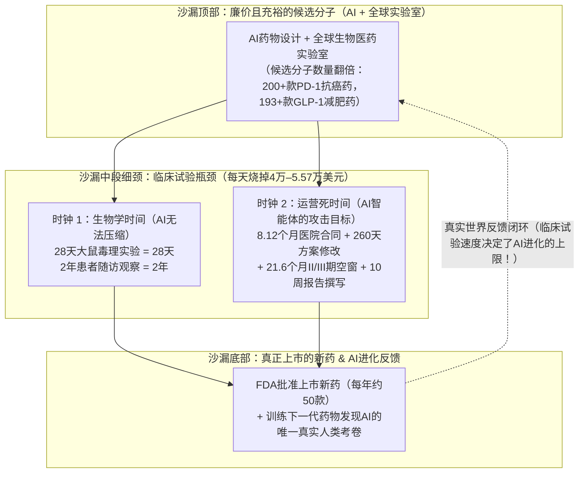
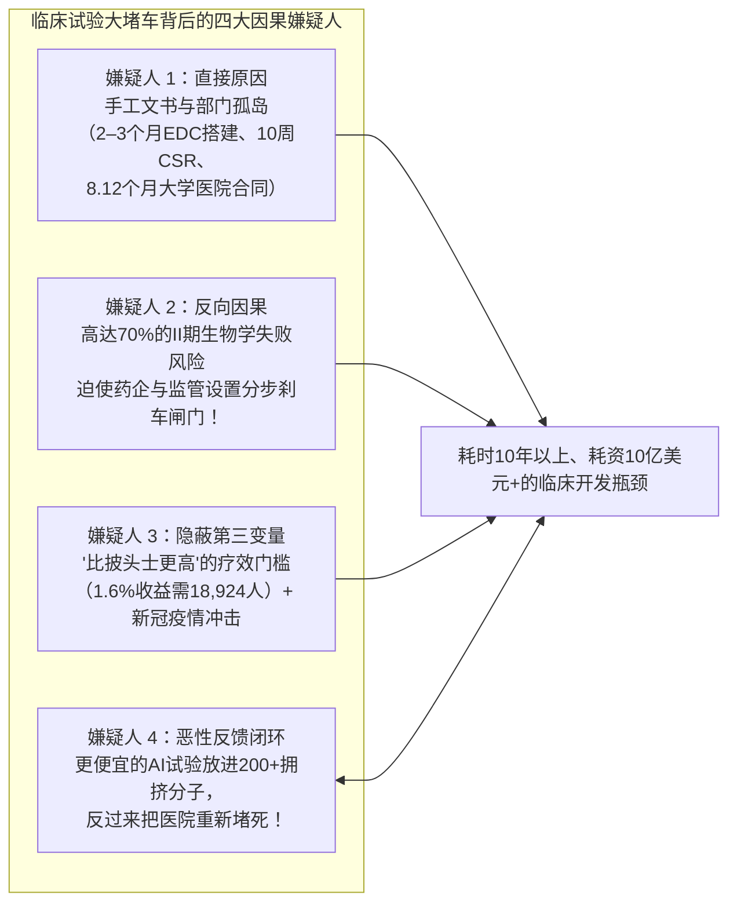
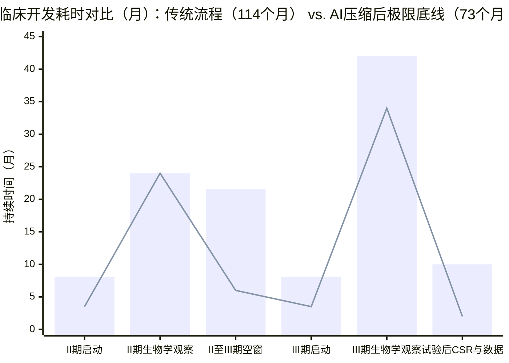

## 1. 悬念开场（The Hook）：等等——如果AI能像激光打印机一样疯狂印出新药配方，为什么这反而可能拖慢真正救命药的诞生？

想象一家只有两个房间的自行车工厂。

在**1号房间（设计图室）**里，工程师们坐在桌前画新款山地车的图纸。
在**2号房间（安全测试跑道）**里，只有一条狭窄的单车道障碍跑道，和仅仅 **10名人类测试骑手**。按照法律规定，任何新款自行车在进商店售卖之前，都必须由测试骑手在陡峭的石头山坡上整整骑行一年，确保刹车绝对不会断裂。

现在，假设有人把一台神奇的人工智能（`AI`）超级计算机搬进了1号房间！一夜之间，工厂不再是每周画5张图纸，而是**每周打印出500张全新的自行车图纸**！

等等——这样一来，商店里的孩子们能更快买到安全的新自行车吗？**恰恰相反！**在2号房间门外，发生了一场灾难：
* **500辆还没测试的自行车**在狭窄的跑道门口排起了十几公里的大堵车。
* 原本10名测试骑手可以集中精力测完最好的2辆车，现在却被迫分散开来——这里1个人、那里1个人——试图同时测试50辆长得几乎一模一样的自行车。
* 因为没有哪辆车能分到足够的骑手按时跑完测试，**结果每一辆自行车完成安全测试的时间反而比AI到来之前更长、花钱更多！**

2026年11月3日，生物科技研究者兼投资人 **Soleil Wizman**（[soleilwizman.com](https://www.soleilwizman.com/)，曾任职于Thrive Capital、age1以及被OpenAI收购的Orchestra Bio，目前在耶鲁大学与Arc研究所训练基因组AI模型）在X平台上发表了一篇引发行业震动的深度长文：**《廉价分子时代的临床开发（Clinical Development in an Age of Cheap Molecules）》**。这篇文章呼应了 **Formation Bio**（一家刚募资**6亿美元**——足够买下**2,000辆崭新校车**——专门收购并推进临床试验的生物科技公司）联合创始人兼CEO **Ben Liu** 的著名文章[《不均衡的前沿（Uneven Frontiers）》](https://www.a16z.news/p/uneven-frontiers)，以及Atlas Venture资深合伙人 **Bruce Booth** 的警告：廉价候选分子的泛滥，在未来 **3到5年内** 很可能会先**恶化**整个制药行业的研发生产率，然后才谈得上改善！

当我们打开Wizman文章背后的第一手学术论文、美国政府临床试验注册库和医院运营基准数据时，**四个巨大的侦探谜团**跃然纸上：

* **谜团 #1（候选药物翻了一倍，获批新药为何原地踏步？）：** 过去十年里，得益于更好的实验室工具、AI分子设计软件以及中国生物医药研发力量的爆发，全球新发现的候选药物（`分子 / Molecules`）数量大约**翻了一番**。如今，有超过 **180家公司** 正在测试 **200多种** 针对同一个癌症开关（`PD-1/PD-L1`）的疗法，还有 **193种** 药物在追逐同一个减肥与代谢开关（`GLP-1`）（[Ben Liu, 2026, *Uneven Frontiers*](https://www.a16z.news/p/uneven-frontiers)）！然而，美国食品药品监督管理局（`FDA`）每年最终批准上市的新药有多少款呢？依然稳定在**每年约50款**（2024年为`50款`）！为什么漏斗顶端的图纸翻倍了，漏斗底端出来的新药却纹丝不动？
* **谜团 #2（每天烧掉55,716美元的计价器与21.6个月的“空白等待期”）：** 根据美国**塔夫茨大学药物开发研究中心（`Tufts CSDD`）**的实证统计，开展一项人类临床试验的直接运营成本平均高达**每天40,000美元**，而在最关键的第三阶段（`III期临床试验`）更是飙升至**每天55,716美元**（相当于时钟每走一天，就烧掉一名小学老师整整一年的薪水！）。更糟的是，药物的**20年专利保护期**通常在第一名患者服药前早就开始倒计时了，试验每耽搁一天，未来上市后的巅峰期销售额就会少一天（塔夫茨估算这相当于每天损失约 **500,000美元** 的潜在收入！）。然而，在2008年至2018年获批的非加速审批药物中，竟有 **82%的药物在完成II期临床与启动III期关键临床之间，经历了平均长达 `17个月` 的“空白期（White Space）”**——而且这一空窗期从2008–2013年的平均 **`12个月`** 暴涨到了2014–2018年的 **`21.6个月`**（差不多等于小学生整整两年的上学时间，期间没有任何一名患者在服药！）。
* **谜团 #3（AI把10周的报告压缩到10分钟——可为什么仍有80%的试验错过招募期限？）：** 在最后一名患者完成最后一次医院随访之后，药企通常还要花**好几个月**来清理数据库、编写统计表格，并撰写提交给监管机构的巨型总结报告（`临床研究报告 / CSR`），光写这份报告就要花 **10周以上**。最近，减肥神药`Ozempic（司美格鲁肽）`的制造商 **诺和诺德（Novo Nordisk）** 组建了一个仅有 **11人** 的小团队（其中好几个人甚至不是程序员！），利用Anthropic的 **Claude** 模型打造了内部平台 **`NovoScribe`**（[Anthropic官方案例](https://claude.com/customers/novo-nordisk)），把原本需要 **10周以上** 的报告初稿压缩到了 **10分钟**，写作时间大砍 **90%**！等等——既然AI智能体能把10周的文书工作变成10分钟，为什么仍有 **约80%的临床试验** 无法按期完成患者招募？为什么被选中的医院研究中心里有 **11%连一名患者（`0人`）都没招到**？又为什么全球跑得最快的AI临床试验服务商（**Lindus Health**）会在2026年8月突然**卖掉自己的临床服务业务**，转型为一家自己囤药研发的公司（**Lindus Therapeutics**）？
* **谜团 #4（为什么医院的文书堵车会卡住AI药物发现模型的智商上限？）：** 很多人以为AI科学家只需要在电脑上算化学分子，不用管医院里的繁文缛节。错了！人类临床试验是检验AI发现模型的预测在真实人体内是否有效的**唯一真实考卷（`Ground Truth Evaluation`）**。如果医院的测试管道堵死了，前端的AI发现模型就拿不到批改后的考卷，从而限制了AI自我进化和学习的速度上限！

拿起你的侦探放大镜。我们将从零开始拆解一颗候选分子如何变成药房里的药片，把不可压缩的**“生物学时间（Biological Time）”**与可被AI消灭的**“行政死时间（Operational Dead Time）”**彻底分开，核查每一家AI初创公司的数据底牌，并看看美国政府全新的 **`SURPASS`** 计划如何试图重构整个临床试验体系。

---

## 2. 从零开始（Starting from Zero）：一个化学猜想如何变成药房里的药片？每场临床试验里滴答作响的“两个时钟”是什么？

假设电脑设计出了一把全新的微观化学钥匙，认为它能治好哮喘、缩小肿瘤或降低胆固醇。科学家把这把候选化学钥匙称为**分子（Molecule）**。

药企能明天就把这颗分子摆上药房货架卖给病人吗？**绝对不能。**因为电脑屏幕和实验鼠笼不是真正的人类！在培养皿和动物实验中看起来安全有效的药物，每100个里大约有 **90个在真实人类身上测试时会失败**（[Wong, Siah, & Lo, 2019, PMC6409418](https://pmc.ncbi.nlm.nih.gov/articles/PMC6409418/)；[ARPA-H SURPASS, 2026](https://arpa-h.gov/explore-funding/programs/surpass)）。

为了保护患者，**美国食品药品监督管理局（`FDA`）**等监管裁判要求每一款候选分子都必须闯过三关人类测试障碍赛，这被称为**临床开发（Clinical Development）**或**临床试验（Clinical Trials）**：

1. **第一关（`I期临床 / Phase 1` —— 安全性测试）：** 医生给 **`20到80名`志愿者** 服用药物，检查它在人类血液中是否安全，并摸索合适的剂量。
2. **第二关（`II期临床 / Phase 2` —— “它真的能治病吗？”概念验证）：** 医生把药给 **`50到300名`真正患有该疾病的患者** 使用。这是医药研发中最残酷的悬崖：只有大约 **30%（10个里有3个）** 的药物能闯过II期临床！正因为II期临床证明了药物在人体内真的有效，Ben Liu在[《不均衡的前沿》](https://www.a16z.news/p/uneven-frontiers)中指出，一旦拿到成功的II期临床结果，一款药物的商业价值会瞬间暴涨 **4倍（`400%`）**！
3. **第三关（`III期临床 / Phase 3` —— 万人级终极锦标赛）：** 医生在全球几十甚至上百家医院招募 **`500到19,000名以上`患者**，将新药与目前最好的标准疗法（或不含药效的淀粉片，即**`安慰剂 / Placebo`**）进行正面交锋。

### 核心机密：每一场临床试验的日历上，都同时转着“两个完全不同的时钟”！

为什么跑完I期、II期和III期临床试验要花 **10年以上**、耗资 **10亿到20亿美元**（[ARPA-H SURPASS, 2026](https://arpa-h.gov/explore-funding/programs/surpass)）？

Soleil Wizman提出了一个极其清晰的拆解视角：把任何一场临床试验的日历切开，里面的时间其实分为**两种截然不同的时间**：

* **时钟 #1：生物学时钟（“不可压缩的生物学时间 / Irreducible Biological Time”）：**
  假设在进入人体前，安全法规要求做一项**28天大鼠毒理学研究**，每天给大鼠喂药，连续喂28天，观察它的肝脏会不会受损。请问28天的大鼠实验需要多少天？**整整28天！**全宇宙没有任何一个AI算法能让大鼠的肝脏以10倍速代谢化合物！同样，如果一项III期癌症试验需要观察患者服药后 **24个月内** 肿瘤是否复发，你就必须老老实实等地球绕太阳转两圈。**AI智能体对1号时钟完全无能为力。**
* **时钟 #2：等待与文书时钟（“运营死时间 / Operational Dead Time”）：**
  那么，在那些*没有任何患者在吃药、也没有任何生物学指标在产生*的漫长岁月里，时间都去哪儿了？
  * 等待大学附属医院的法务部门和委员会签下一纸启动合同，中位耗时 **8.12个月**。
  * 在试验开始前，等待数据库程序员手动搭建数据录入界面（`EDC`），耗时 **2到3个月**。
  * 每次试验方案（`Protocol`）需要修改时，从发现问题到最后审批通过，平均耗时 **260天（超过8.5个月）**（[Getz et al., 2024, PMID 38438658](https://eutils.ncbi.nlm.nih.gov/entrez/eutils/esummary.fcgi?db=pubmed&id=38438658&retmode=json)）。
  * 在II期结束到III期启动之间，高管开会拍板、与监管机构来回沟通、等待工厂生产临床试验药瓶，平均空耗 **17到21.6个月**。
  * 在最后一名患者完成最后一次随访回家后，核对数据弹窗、编写SAS统计代码、撰写长达10周以上的总结报告，又要花掉 **好几个月**！

仔细看就会发现，2号时钟里的绝大多数步骤，真正动手干活的时间只有**几小时或几天**，剩下的全是在不同部门和外包商之间排队等待信息、预算核对和签字交接！**而这个“等待与文书时钟（运营死时间）”，正是自主AI智能体（Agentic AI）大显身手的靶心！**

---

## 3. 秘密解码环（The Secret Decoder Ring）：10个吓人的临床试验大人词汇大白话翻译

在进入侦探核查之前，先收好这张**秘密解码表**，把行业里最拗口的英文缩写变成小学生熟悉的校园日常：

| 大人的专业词汇 / 缩写 | 它的真实意思（大白话解释） | 小学五年级的生活比喻 |
| :--- | :--- | :--- |
| **`试验方案（Protocol）` & `方案修正案（Amendment）`** | 临床试验的官方操作说明书（规定谁能参加、吃多少剂量、做哪些抽血检查），以及在试验中途发现规则行不通时进行的官方修改程序（`Amendment`）。 | **巨型乐高套装的拼装说明书**——而且一旦发现其中一页印错了，全国50个班级得停工 **`260天`** 等老师寄来盖章的新页面。 |
| **`主要终点（Primary Endpoint）`** | 试验开始前就白纸黑字定好的“第一胜负评判指标”（比如：“服药12周后患者吹出的气量增加了多少毫升？”）。 | 篮球赛开打前就规定好：只看**记分牌上的进球得分**定输赢，花哨的运球或帅气的球鞋都不算数。 |
| **`EDC（电子数据采集系统）`** | 医院协调员录入每位患者体重、血压和化验单的超级安全数据库，每一次按键和修改都会留下供FDA检查员审计的永久追踪记录。 | 由五位校长同时检查的**不可擦除电子成绩册**，一旦填错一个数字，不能用橡皮擦掉，必须附上一张签名说明条解释为什么改。 |
| **`CRO（合同研究组织）`** | 药企花钱雇佣的大型外包服务公司，专门出租成千上万名员工帮药企跑医院、管文书、查数据，按人头和工时收费。 | 学校办运动会时花钱请来的**校外活动执行公司**，派来的每个工作人员都要按小时收服务费。 |
| **`IRB（机构审查委员会）`** | 由医生、科学家和社区代表组成的独立伦理委员会，必须先审阅并批准试验方案，确保参加试验的人类志愿者不会遭受不公平的伤害。 | 学校操场安装新滑梯时，必须在任何学生爬上去之前先检查并盖章放行的**校园安全督察委员会**。 |
| **`医保覆盖分析（Coverage Analysis）`** | 对照美国联邦医保（`Medicare`）规则，把临床试验里的每一项检查费用逐行拆开，算清楚哪些归**患者自己的医保**报销，哪些归**药企**掏钱。 | 班级聚餐吃完披萨后拿着长长的账单逐行核对，分清哪些基础披萨由**学校春游经费**出，哪些额外加的芝士培根由**社团赞助商**出。 |
| **`CRF（病例报告表）` & `CDISC / CDASH`** | 患者每次去医院随访时护士填写的标准化登记表（`CRF`），并按照统一的国际电脑标准（`CDISC`）排版，方便FDA电脑直接读取。 | 全国100所学校统一使用的**标准答题卡（涂卡纸）**，阅卷机一扫就能自动读出分数，不需要人工重新打字录入。 |
| **`数据库锁定（Database Lock）` & `CSR（临床研究报告）`** | 把核对完所有错误的试验数据库彻底封存冻结（`Database Lock`），并写出长达上千页的终极总结大书（`CSR`）交给FDA审批。 | 期末把**最终成绩单锁进保险柜**，并写出提交给教育局的**年度总结大报告**。 |
| **`PTRS（技术与监管成功概率）` & `rNPV（风险调整后净现值）`** | 估算一款药闯关成功的百分比概率（`PTRS`），再乘以它未来能赚到的钱并折算到今天（`rNPV`），用来判断这笔试验费花得值不值。 | 算一算花 **`10美元`买一张抽奖券** 去抽一辆价值 **`100美元`的自行车**（中奖率`30%`，期望价值=`30美元`，减去`10美元`成本净赚`+20美元`）是不是一笔划算的买卖。 |
| **`平台试验（Platform Trial）`（`ARPA-H SURPASS`）** | 不再为每个药单独办I期、II期、III期试验，而是在一份统一的主方案下，让5到10款不同新药同时共用**同一个对照组（安慰剂组）**进行持续测试。 | 不再为了10名跑步选手分别修建10座独立体育场，而是办一场**联合运动会**，让10名选手在同一条跑道上跟同一辆领跑车比速度。 |

---

## 4. 宏大口号 vs. 侦探核查：为什么临床试验产能如此稀缺？智能体AI究竟在哪里真正管用？

让我们拿起放大镜，分两部分核查Soleil Wizman的调查报告：
1. **为什么早在生成式AI爆发之前，医院的临床测试管道就已经堵得水泄不通了？**
2. **四大AI智能体救援小队分别攻打哪个临床环节？第一手学术与监管证据揭示了哪些真实边界？**

### 第一部分：一场临床试验究竟消耗什么？让情况雪上加霜的“三大稀缺陷阱”

AI和自动化实验室也许能让候选化学分子变得像自来水一样便宜，但每一场临床试验都必须消耗**四样永远稀缺的资源**：

| 稀缺的临床试验投入 | I期临床（安全性） | II期临床（概念验证） | III期临床（关键确证） | 为什么AI不能直接“凭空打印更多”？ |
| :--- | :--- | :--- | :--- | :--- |
| **1. 真实的人类患者** | `20–80名` 志愿者 | `50–300名` 患病患者 | `500–19,000名+` 患病患者 | 患有特定疾病、住在试验医院附近、且符合几十条严苛入组标准的真实患者人数是有限的。 |
| **2. 医院中心与研究协调员** | `1–5家` 专业中心 | `10–50家` 医院/诊所 | `50–1,300家+` 全球医院 | 医院研究护士和协调员每天的工作时间有限；**被选中的研究中心里有11%连1名患者都招不到**。 |
| **3. 真实日历时间** | 中位 `1.6年` | 中位 `2.9年`（外加 `17–21.6个月` 空窗） | 中位 `3.8年` | 药物在人体器官内的代谢、肿瘤缩小或疾病缓解需要真实的物理时间。 |
| **4. 现金账单与专利倒计时** | 数百万美元（`~$1.5万–$2.5万/天`） | 数千万美元（`~$2.37万–$4万/天`） | `5,000万–10亿美元`（直接成本 **`$55,716/天`**） | 每过一天都在烧现金，同时砍掉20年专利垄断期的1天（相当于损失 **`~$500,000/天`** 的未来峰值销售额）。 |

而且正如Wizman所指出的，**三个残酷的经济学陷阱**让上面这张表比表面看起来还要棘手得多：

#### 陷阱 #1：Jack Scannell的“必须比披头士更棒（Better Than the Beatles）”困境与10亿美元`ODYSSEY`试验的数学账
在2012年发表于《自然综述：药物发现》（*Nature Reviews Drug Discovery*）的一篇经典论文（[Scannell et al., 2012, PMID 22378269](https://eutils.ncbi.nlm.nih.gov/entrez/eutils/esummary.fcgi?db=pubmed&id=22378269&retmode=json)）中，生物学家兼投资人 **Jack Scannell** 提出了著名的**“反摩尔定律（Eroom's Law）”**，并指出了一个核心原因：**“比披头士更棒（Better than the Beatles）”困境**。

想象一下，如果法律规定任何新乐队要想卖唱片，都必须先证明自己的歌比传奇乐队**披头士（The Beatles）**更好听；而且每诞生一张经典唱片，下一支新乐队就必须打败披头士*加上*此前所有的经典唱片！医药研发就是如此：一旦一款好药获批并变成几毛钱一片的平价药（比如降胆固醇的**`他汀类药物 / Statins`**），后来的新药就不能只和淀粉片比了，它必须证明在**患者已经吃着高强度他汀类药物的基础上**，还能额外挽救更多生命！

来看看Wizman引用的真实证据：降胆固醇抗体注射液 **`阿利西尤单抗（Alirocumab，商品名Praluent）`的[`ODYSSEY OUTCOMES` III期临床试验](https://clinicaltrials.gov/study/NCT01663402)**（发表于《新英格兰医学杂志》*NEJM*，[Schwartz et al., 2018, PMID 30403574](https://eutils.ncbi.nlm.nih.gov/entrez/eutils/esummary.fcgi?db=pubmed&id=30403574&retmode=json)）。
* **付出的巨大代价：** 赛诺菲（Sanofi）和再生元（Regeneron）在全球 **57个国家的1,315家医院** 招募了 **18,924名急性冠脉综合征患者**（足以坐满**整座纽约麦迪逊广场花园体育馆**或北京五棵松体育馆！），历时约 **5年**（中位随访 `2.8年`，每两周打一针），耗资约 **10亿美元**。
* **侦探统计审计（相对百分比 vs. 绝对基线人数！）：** 新闻标题欢呼阿利西尤单抗实现了 **“15%的相对风险降低（Hazard Ratio 0.85）”**。等等——`15%`听起来不小啊，为什么要找将近 `19,000人` 才能测出这 `15%`？
* 打开 `PMID 30403574` 论文里的原始分子和分母：因为试验里的每一位患者*已经在每天服用最大耐受剂量的他汀类药片*，在打安慰剂假针的 **`9,462名`患者中，有`1,052人`（`11.1%`）** 发生了主要心血管不良事件；而在打阿利西尤单抗真针的 **`9,462名`患者中，有`903人`（`9.5%`）** 发生了事件。
* 用 `11.1%` 减去 `9.5%`：按**绝对人数（绝对风险降低率 `ARR`）**计算，每 **100名患者** 连续近三年每两周挨一针，只减少了 **1.6起心脏事件（即 `1.6个百分点` 的绝对改善，`11.1%` 的 `15%` 就是 `1.6%`）**！换句话说，医生必须连续近三年给 **63名患者打针（`需治疗人数 NNT = 63`）**，才能多阻止 **1起** 心脏事件！
* 为了在统计学上把这微小的“百里挑1.6”与随机掷硬币的运气区分开来，你就*不得不*招募将近 **19,000人**！如果明天AI设计出12款他汀类赛道周边的降脂新药，这12款药每一款都需要各自找一座坐满 `19,000名` 患者的体育馆和 `10亿美元`！

#### 陷阱 #2：95%都是无效噪音的临床拥堵（FDA代理局长Janet Woodcock的全球审计）
甚至在生成式AI爆发前，全球临床试验就已经陷入了严重的重复与低效。2021年，时任FDA代理局长 **Janet Woodcock** 博士与 **Kevin Bugin** 对全球注册的 **2,024项新冠（COVID-19）临床试验（共`2,895个试验组`）** 进行了全面审计（[Bugin & Woodcock, 2021, PMC7903288](https://pmc.ncbi.nlm.nih.gov/articles/PMC7903288/)）。
* 结果令人瞠目结舌：在全球所有新冠临床试验组中，**只有约 `5.0%`（二十分之一）同时满足了“随机对照”和“样本量足够大（统计学把握度充足）”这两个条件，能够产生真正指导临床决策的可靠证据！**
* 剩下的 **95%的试验组** 白白消耗了宝贵的病房、护士和患者，却因为规模太小或设计缺陷而根本无法回答药物是否有效！如今，同样的拥挤正发生在免疫肿瘤学（超过`180家`公司扎堆研发`200多款` `PD-1/PD-L1`疗法）和代谢疾病（`193款` `GLP-1`药物）中。

#### 陷阱 #3：极度偏态的收益分布（平均值 `46亿美元` vs. 中位数 `15亿美元`）
许多科技投资人喜欢说：*“做药就是多射门（More shots on goal）——只要AI让我们射门的次数增加10倍，回报自然翻10倍！”*
慢着——请做一次**平均值（Mean）与中位数（Median）侦探检验**！
* 新药上市后的终身总收入分布极度向头部集中：**排名前10%（`Top Decile`）** 的重磅炸弹药物拿走了整个行业 **超过50%的总价值**，把新药终身收入的算术**平均值（Mean）**拉高到了约 **46亿美元**。
* 但如果你把100款获批新药按收入从低到高排成一排，看正中间第50名那款药的**中位数（Median）**终身收入，却只有约 **15亿美元**——还不到平均值的三分之一！
* 为什么？因为一个靶点上的首创药（`First-in-class`）或绝对最优药（`Best-in-class`）会赢家通吃，而第12个、第15个挤进来的跟风药（`Me-too`）只能分走长尾末端的残羹冷炙，却在测试阶段占用了同样昂贵的医院患者池！

---

### 第二部分：为什么三大传统软件巨头（`Cytel`、`Medidata`、`Veeva`）如此稳固？四大AI智能体小队表现如何？

在早期的**药物发现**阶段，计算化学家周二下午在自己的笔记本电脑上试用一个新的AI分子生成模型，不需要征求任何人的同意。
但在**临床开发**阶段，录入电脑的每一个数字都是受FDA严格审计的法定记录，并且必须同时穿过**五个不同组织**：**药企申办方（Sponsor） + 合同研究组织（CRO） + 几十家独立医院 + 伦理委员会（IRB） + 监管机构（FDA）**。正因如此，三家老牌软件巨头统治了临床行业几十年：
1. **Cytel（创立于`1987年`）：** 近四十年来在适应性试验设计和模型引导药物开发领域的霸主，其 `East®` 软件（2024年扩展为 `East Horizon™`）被 **美国FDA、日本PMDA以及全球前30强跨国药企** 直接采用。
2. **Medidata（达索系统旗下）：** 临床试验数据库（`EDC`）的绝对龙头，记录了遍布 **140多个国家的38,000多项临床试验和超过1,200万名患者** 的数据。
3. **Veeva Systems：** 监管申报与临床文档管理（`Veeva Vault`）的行业基石。

因此，最聪明的AI初创公司不再试图硬拆这三座铁打的保险库，而是围绕着临床试验生命周期的**四大死时间集群**发起进攻。下面是我们结合第一手资料整理的侦探核查记分牌：

| 临床试验四大集群与瓶颈 | 第一手文献证实的时间与金钱痛点 | 代表性AI系统与初创公司 | 侦探的第一手证据核查（真实优势与隐蔽局限） |
| :--- | :--- | :--- | :--- |
| **1. 试验设计与方案修改（`Design`）** | `76%`的试验方案经历修改（平均修改`3.3次`）；每次修改从提出到获批平均耗时 **`260天`**（[Getz et al., 2024, PMID 38438658](https://eutils.ncbi.nlm.nih.gov/entrez/eutils/esummary.fcgi?db=pubmed&id=38438658&retmode=json)），直接成本中位数为 **II期 `$141,000` / III期 `$535,000`**（[Getz et al., 2016, PMID 30227022](https://eutils.ncbi.nlm.nih.gov/entrez/eutils/esummary.fcgi?db=pubmed&id=30227022&retmode=json)）。 | **PhaseV**（`5,000万美元`A轮；数百万次贝叶斯反事实模拟 + `AI Conductor`）、**伊利诺伊大学/Medidata `AMEND++`**（[arXiv:2601.06300](https://arxiv.org/abs/2601.06300)）、**Biorce**（训练于`200+份`FDA拒绝信`CRL`）。 | **关键核查发现：** 我们直接查阅 `Getz et al. (2024)` 原文发现，**高达 `77%` 的方案修改被评定为“不可避免（Unavoidable）”**（由试验中途FDA的要求或研发策略调整引起）！此外，基于 `161,970项` 试验训练的 `AMEND++` 模型预测入组标准是否修改的 **`AUROC` 仅为 `0.70–0.71`（准确率约 `64.4%`）**，且只能预测*会不会改*，无法告诉你*怎么改*或*为什么改*。 |
| **2. 研究启动与阶段间空窗（`Execution`）** | II期与III期之间平均 **`17至21.6个月`** 空白期（占`82%`项目）；学术医疗中心激活中位耗时 **`8.12个月`** vs. 独立中心 **`4.37个月`**：**`~70%`** 的中心将预算合同与**医保覆盖分析（Coverage Analysis）**列为头号延误原因。 | **Formation Bio `Forge`**（在尽调和II期阶段同步自动更新III期方案与供应链）、**Medable**（将方案转为 `CDISC USDM 4.0` 机器可读格式）、**UpSite Clinical** 与 **Advarra**（AI医保覆盖分析）。 | **关键核查发现：** AI智能体可以在几分钟内生成预算表并同步方案修改，**但当等待卡在“拥有签字权的人”（如大学医院积压的法务办公室或每月才开一次会的`IRB`委员会）时，除非双方都用AI按规则手册自动谈判，否则单靠药企一侧的AI无法强行加速签字。** |
| **3. 患者招募与中心运营（`Recruitment & Ops`）** | **`~80%`的试验** 无法按期完成招募；**`11%`的入选中心招募人数为`0`**；成功招募1名患者的平均直接成本高达 **`$6,533`**。 | **Formation Bio `Muse`**（与赛诺菲、OpenAI合作）、**Alleviate Health**（a16z领投`430万美元`种子轮；在`190+`中心完成`50万+`次患者全天候语音/短信互动）、**Intera**（将初筛失败患者转介至同中心其他试验）、**Tilda（`Tilda Sense`）**（让研究协调员效率提升`10倍`）。 | **关键核查发现：** 试图自己建诊所或包揽全流程CRO服务的明星初创公司（**Lindus Health**、**Topography Health**）都在 **2026年卖掉了自己的诊所/CRO服务业务**！因为卖“提速服务”只能收一次固定服务费，远不如自己拥有药物资产赚钱。 |
| **4. 数据管理与试验后FDA申报（`Data`）** | 试验前搭建`EDC`耗时`2–3个月`；试验中人工处理数据质疑弹窗（`Query`）耗时数周；最后一名患者随访结束后，还需 **`10周以上`** 撰写 **`临床研究报告（CSR）`** 并完成 `SAS`/`R` 双重独立编程核对。 | **Saama**（按角色模块化的EDC内嵌数据智能体）、**Octozi**（`300万美元`种子轮；预计单个III期肿瘤试验可省 **`500万美元+`**）、**GSK**（内部统计代码生成智能体）、**Novo Nordisk `NovoScribe`**（基于Claude的自动报告系统）。 | **目前最确凿的低垂果实：** **诺和诺德的 `NovoScribe`**（[Anthropic官方案例](https://claude.com/customers/novo-nordisk)）仅靠 **11人团队** 就将 **`10周以上`** 的 `CSR` 报告撰写时间缩短到 **`10分钟`（缩短`90%`）**！但在患者数据修改环节，`药物临床试验质量管理规范（GCP）`仍强制要求医院的研究者医生本人签字确认。 |

### 等等——用小学算术戳破旧金山创投圈的“预测临床试验结果”游戏！

Wizman在文中提到，旧金山许多生物科技投资人热衷于玩一个游戏：宣称自家的AI模型能**在临床试验揭盲之前精准预测谁赢谁输**。

作为一名五年级侦探，我们怎样一眼看出某家AI预测公司是真有本事，还是仅仅撞上了掷硬币的好运气？

来看看Ben Liu在[《不均衡的前沿》](https://www.a16z.news/p/uneven-frontiers)中给出的**体育馆掷硬币数学（二项分布检验）**：
* 在医药行业里，II期临床试验的平均自然成功率（`基准率 / Base Rate`）大约是 **30%（每10个药里有3个成功）**。
* 假设有个人声称戴上了神奇的AI眼镜，挑选了 **5项** II期临床试验，结果猜中了 **3项成功（`60%`）**！这能证明眼镜真的有效吗？**不能！**在 `30%` 的基础成功率下，哪怕闭着眼睛瞎猜，5次猜中3次及以上的概率也有 **`16.3%`（差不多每6个人瞎猜就有1个人能撞上）**！
* 就算他挑了 **10项** 试验并成功了 **5项（`50%`）**，纯靠运气撞上的概率依然高达 **`15%`**！
* 要想在统计学上真正证明（`p = 0.048`，即纯属巧合的概率低于`5%`）你的AI模型比行业平均水平更聪明，你必须在试验结果公布**之前**把预测锁进信封（`前瞻性读出 / Prospective Readouts`），并且在 **10次前瞻性预测中至少命中6次（`60%`）**，或者在 **20次前瞻性预测中至少命中10次（`50%`）**！
* 因为一项II期临床试验通常要跑 **2到4年**，攒够10到20个前瞻性结果需要好几年的真实时间。在那之前，任何只拿历史数据跑出来的漂亮曲线，都只是“看着昨天的彩票号码猜中大奖”的**回测（Backtest）**而已！

---

## 5. 四大嫌疑人（The Four Suspects）：究竟是谁造成了临床试验的大堵车？

每当有人说*“临床试验之所以又慢又贵，全怪医院软件太老旧，所以只要上AI智能体就能解决！”*时，真正的侦探绝不会只盯着1号嫌疑人。我们必须把**四个因果嫌疑人（直接原因、反向因果、隐蔽第三变量、反馈闭环）**全部请上审讯席：

| 嫌疑人 | 表面逻辑 | 第一手证据揭示的真相 | 侦探最终裁决 |
| :--- | :--- | :--- | :--- |
| **嫌疑人 #1：直接原因（`陈旧的手工流程 → 临床试验缓慢`）** | 护士手动翻阅PDF病历、程序员花 `2–3个月` 建 `EDC` 表单、撰写员花 `10周+` 写 `CSR` 报告，导致试验被拖慢。 | **在试验首尾两端完全属实！** 诺和诺德的 `NovoScribe`（`10周+ → 10分钟`）、GSK的统计编程智能体以及 `CDISC USDM 4.0` 自动转换证明，大量规则明确的文书工作确实是无谓的摩擦。 | **对约25%–35%的非生物学延误负有直接责任**（尤其是研究中心启动包、数据清理与试验后申报文档）。 |
| **嫌疑人 #2：反向因果（`极高的生物学失败风险 → 故意设置的分步暂停闸门`）** | 等等——II期和III期之间长达 `17至21.6个月` 的空窗期真的是因为大家懒惰吗？还是因为 **II期临床高达70%的失败率**，迫使药企在看到确凿人体数据前，不敢提前花几千万美元去生产III期药瓶和签约上百家医院？ | **极其关键的深层原因！** 如果药企在II期还没出结果时就提前建好III期生产线并签下100家医院，**10次里有7次（`70%`）这些钱会随着II期失败而打水漂！** 同样，`Getz et al. (2024)`（[PMID 38438658](https://eutils.ncbi.nlm.nih.gov/entrez/eutils/esummary.fcgi?db=pubmed&id=38438658&retmode=json)）证实 `77%` 的方案修改是试验中途因监管要求或安全策略调整而**不可避免**的修改。 | **罪名成立！** 许多在外行眼里看似“繁琐低效”的停顿，本质上是药企控制巨额财务风险的止损阀，以及保护患者安全的伦理盔甲（`IRB` + `GCP`）。 |
| **嫌疑人 #3：隐蔽第三变量（`不断抬高的疗效标尺 & 疫情混杂因素`）** | 外部客观环境的变化，同时推高了试验规模、时长与方案修改次数。 | **两大第一手数据集证实：** （1）因为平价他汀类药物已经非常有效，`ODYSSEY OUTCOMES`（[PMID 30403574](https://eutils.ncbi.nlm.nih.gov/entrez/eutils/esummary.fcgi?db=pubmed&id=30403574&retmode=json)）为了证明 **`1.6%` 的绝对获益** 被迫招募 **`18,924人`**。（2）在 `Getz et al. (2024)` 中，方案修改次数升至 `3.3次`、耗时 `260天` 受到了 **新冠疫情期间** 全球医院随访中断的强烈混杂影响！ | **罪名成立！** 当一款新药只能带来 `1.6%` 的边际增量时，任何AI聊天机器人都无法替代那近两万名真实患者。 |
| **嫌疑人 #4：恶性反馈闭环（`更便宜的AI试验 → 分子扎堆拥挤 → 吞噬效率红利`）** | 当AI同时降低了设计分子的成本和开展临床试验的成本，原本预期净现值（`rNPV`）不够格的边际跟风项目纷纷跨过成本线，一窝蜂涌进医院。 | **正在真实发生！** 超过 **`180家`公司的`200+款` `PD-1`药物** 和 **`193款` `GLP-1`药物** 在同一个患者池里抢人，导致每个中心要筛查更多患者才能招满1人，研究中心借机在合同谈判中涨价——**把AI省下来的钱又全吞了回去！** | **罪名成立！** 如果没有跨公司的严格候选筛选或共享平台试验，单点试验降本反而会引发高速公路连环追尾（**医药界的杰文斯悖论**）。 |

---

## 6. 隐蔽的代价（The Catch）：为什么跑得最快的AI临床试验公司卖掉了自己的业务？当“分子大堵车”来临时谁是输家？

遵循Browne与Keeley批判性思维框架的第11章**“负面视角（The Negative View）”**，我们必须追问：*水面之下隐藏着什么代价？谁会受损？为什么最懂行的局内人突然掉头？*

Wizman的调查揭示了三个振聋发聩的结构性真相：

### 代价 #1：`Lindus Health` 的惊天大转折（“为什么卖‘提速服务’远不如自己拥有药物资产？”）
看看2021年成立、自称**“反CRO（Anti-CRO）”**的明星初创公司 **Lindus Health**。它没有按单项功能拆卖软件，而是把方案设计、中心筛选、患者招募、数据采集和生物统计全部垂直整合进一个接入了 **超过4,000万份电子健康档案（`EHR`）** 的平台。截至2025年1月，Lindus在欧美跑完了 **42项端到端临床试验**，入组了 **超过36,000名患者**，速度比传统CRO快达 **3倍**！

等等——既然Lindus Health真能把临床试验提速3倍，它应该顺理成章变成全球最赚钱的临床试验服务巨头才对吧？
**恰恰相反！**2026年8月，Lindus **把自己的CRO服务业务整体卖给了Curavit Clinical Research**，随后摇身一变重组为 **Lindus Therapeutics**——一家自己引进并开发新药管线的生物制药公司！（无独有偶，2022年从a16z和Bain Capital Ventures募资 `2,750万美元`、专门培训社区医生做临床试验的 **Topography Health**，也在2026年5月把自己的诊所网络业务卖给了 **FOMAT Medical Research**！）

为什么最擅长给临床试验提速的团队，最后决定不再向药企出卖“速度服务”了？
* 算一笔简单的小学算术题：如果一家外包服务商（`CRO`）帮药企把试验提前12个月跑完，按固定总价合同，服务商只能赚到**一次性的服务费**（比如 `1,000万美元`）。
* 而拥有这款药产权的 **药企申办方（`Sponsor`）** 却能多拿一整年的专利独占销售额，并在II期临床读出后享受资产价值 **4倍的跃升**——这笔收益高达**数亿甚至数十亿美元**！
* **发人深省的铁律：** 真正掌握了AI临床加速引擎的顶尖团队（如 **Formation Bio** 和 **Lindus Therapeutics**），在经济激励上都必然倾向于**把速度留给自己买来的药物资产**，而不是廉价出租给其他药企！

### 代价 #2：医院病床上的“公地悲剧”（谁在为分子拥挤买单？）
想象一个村子里有一片供12户牧民共用的草场。第12户牧民自己在家里打算盘：*“我多放一头牛，卖牛奶的钱全归我自己（`rNPV > 0`），而草场被踩坏的损失由12户人家平摊！”* 结果12户牧民都拼命加牛，直到草场变成泥潭，所有牛都饿死。这就是经济学上著名的**公地悲剧（Tragedy of the Commons）**。

在临床开发里，**患者池和医院研究协调员就是那片公共草场**：
* 当 **第12家公司** 决定启动针对同一个靶点的第12款跟风药试验时，它的财务模型只算*自己这一项试验*能不能回本，完全无视它抽走患者后对 **前11项试验** 造成的延误与涨价！
* **最终谁吃了大亏？**
  1. **罕见病与绝症患者：** 真正具有突破性机制的首创药物（`First-in-class`），因为竞争不过财大气粗的第15款热门靶点跟风药，抢不到医院研究护士的排期和病床。
  2. **医院研究协调员（Study Coordinators）：** 他们本来就是临床试验中最稀缺的人力瓶颈，如今却被十几家不同药企的系统登录口令、自动化催促电话（`Alleviate`、`Intera`）压得喘不过气。
  3. **把身体托付给医学试验的普通患者：** 在那 **95%样本量不足或设计缺陷的试验**（[Bugin & Woodcock, 2021, PMC7903288](https://pmc.ncbi.nlm.nih.gov/articles/PMC7903288/)）或低水平重复试验中白白承受了风险，却没能换来医学的真正进步。

### 代价 #3：`49% vs. 16%` 的试点陷阱，以及 `ARPA-H SURPASS` 面临的商业高墙
难道我们不能把同一个靶点上的12款候选药放进**同一个大型联合试验**里同场比武，一次性挑出冠军吗？

2026年秋天，美国政府的健康科研登月机构 **健康高级研究计划局（`ARPA-H`）** 正式启动了 [**`SURPASS`** 项目（*Simulation-augmented, Real-time Platform Adaptive Seamless Trials*，招标编号 `ARPA-H-SOL-26-164`）](https://arpa-h.gov/explore-funding/programs/surpass)，目标是把长达 **10年以上的临床开发周期缩短到4年以内**：
* `SURPASS` 不再让10家药企各自跑独立的I/II/III期试验、各自招募10批吃淀粉片的安慰剂患者，而是用**一份主方案（Master Protocol）**建立常设的自适应平台试验，让多款药物共用**同一个公共对照组（Shared Control Group）**。
* 算算这能省下多少患者：传统方式测试10款药，每款药需要 `100名` 用药患者 + `100名` 安慰剂患者 = 共 **`2,000名`患者**（其中 `1,000人` 吃的是假药！）。而在共享 `100人` 安慰剂对照组的平台试验中，总共只需要 `1,000名` 用药患者 + `100名` 共享安慰剂患者 = **`1,100名`患者**——直接让 **900名患者** 免于服用安慰剂，还能实时淘汰无效药物！

既然 `SURPASS` 这么好，为什么各大药企没有马上排队加入呢？
* **残酷的商业博弈：** 药企之间是生死竞争对手！没有哪家药企愿意把自家砸了5亿美元的重磅候选药，和竞争对手的药放在同一张记分牌上公开对比——万一自家的药比对手低了2个百分点，公司股价第二天就会崩盘！此外，在药企内部，**贝恩公司（Bain & Company）2026年4月的调研**显示，虽然有 **49%的申办方和CRO正在试点（Piloting）AI工具**，但真正围绕AI **重新设计岗位职责与工作流程的只有区区16%**！在15个手工收费站面前，开再快的AI跑车也一样得排队停车。

---

## 7. 终极成绩单（The Final Report Card）：我们的真实判断（“如果……那么……”法则 & 2026–2030年概率预测）

下面这张图表直观对比了传统临床开发流程（涵盖II期、阶段间空窗、III期及试验后报告，总计约 `114个月 / 9.5年`）与 **AI智能体真正能压缩的“运营死时间”** 以及 **不可逾越的“生物学时间底线（Floor）”**：

看懂这张图，你就掌握了整个AI临床医疗的核心：
* **折线大幅低于柱状图的环节（`II期启动`、`II至III期空窗`、`III期启动`、`试验后CSR与数据`）：** AI智能体可以从一款药的研发旅途中砍掉 **约41个月（将近3.5年！）的纯合同扯皮、阶段衔接等待、数据清洗和报告撰写时间**！
* **折线依然居高不下的环节（`II期生物学观察 = 24个月`，`III期生物学观察 = 34–42个月`）：** 药物在人体内发挥作用所需的 **约58至66个月（5到5.5年）真实生物学时间** 是任何大语言模型都无法快进的，只能靠更聪明的贝叶斯适应性设计（`PhaseV`）和共享对照组平台（`ARPA-H SURPASS`）将所需样本量缩减 `15%–20%`。

### 聪明侦探的“如果……那么……”（If ... Then ...）决策指南

1. **如果一家AI公司主攻“试验结束后的报告撰写与统计数据编程”（如 `NovoScribe`、`GSK`的统计代码生成智能体、`Saama` 或 `Octozi`），那么** 它将收获**立竿见影的巨大胜利（缩短`50%至90%`的时间）**——因为最后一名患者出院后，把原始数据转成 `CDISC` 表格和 `CSR` 报告是100%规则明确的纯信息处理工作，不存在任何生物学等待。
2. **如果一家AI公司主攻“医院中心启动包与研究协调员减负”（如 `Tilda`、`Medable`、`Alleviate Health` 或 `UpSite Clinical`），那么** 只要它能悄悄嵌入现有的 `Medidata`/`Veeva` 底层并自动搞定繁琐的 `医保覆盖分析（Coverage Analysis）`，就能让超负荷运转的研究护士效率提升 **2到3倍**。
3. **如果一家AI公司吹嘘自己能“在试验开始前精准预测II期临床成败”或“彻底消灭方案修改”，那么** 请捂紧钱包，要求查看至少 **10到20个事先锁定的前瞻性临床读出结果（`10中6` 或 `20中10` 以上）**——永远记住 `Getz et al. (2024)` 中 `77%` 的方案修改是试验中途不可避免的监管或策略调整，而历史数据回测赢不了 `30%` 的真实生物学随机波动。
4. **如果前端AI继续让候选分子变得越来越便宜，而行业又缺乏跨公司的联合筛选机制（如 `ARPA-H SURPASS`），那么** Bruce Booth的预言将会应验：**分子扎堆拥挤**（`200+`款药争抢同一批肿瘤或减肥患者）将推高单名患者 `$6,533+` 的招募成本，并在热门赛道吞噬掉一大部分AI带来的运营红利。

### 2026–2030年概率加权情景预测表

| 情景预测 | 发生概率 | 2026年至2030年间将发生的真实演变 | 赢家与输家 |
| :--- | :--- | :--- | :--- |
| **基准情景（Base Case）：“首尾文书大幅压缩，中段医院分子拥堵”** | **55%（最可能）** | 头部药企利用AI智能体将试验后报告撰写（`10周+ → 数天`）、`EDC`建库（`2–3个月 → 2周`）以及II/III期衔接空窗（`21.6个月 → 6–9个月`）大幅压缩，省下 **2至3年的行政死时间**。但大量廉价的AI及中国出海分子涌入热门靶点（`PD-1`、`GLP-1`、自免），推高医院中心报价，全行业II期临床成功率仍维持在 `30%–35%` 左右。 | **赢家：** 拥有自研AI临床引擎并亲自持有药物资产的公司（**Formation Bio**、**Lindus Therapeutics**）、嵌入医院与EDC底层的智能体工具（**Tilda**、**Saama**、**Octozi**、**PhaseV**）、大型医院中心网络。**输家：** 缺乏差异化的第15家跟风Biotech，以及靠堆砌人工计费的传统CRO。 |
| **悲观情景（Bear Case）：“医院官僚大堵车与试点泥潭”** | **30%** | 候选分子的增长速度超过研究协调员人数的3倍；大学医院的合同积压（`8.12个月`）和人工 `IRB`/`GCP` 签字制度拒绝接受AI自动谈判；绝大多数药企停留在贝恩调查中那 `84%` 未重构工作流的“只试点不改流程”阶段。未来3–5年全行业研发投资回报率如Bruce Booth所料出现下滑。 | **赢家：** 掌握法定记录系统的老牌巨头（**Medidata**、**Veeva**、**Cytel**）及拥有定价权的顶级医院网络。**输家：** 向僵化的药企部门孤岛兜售单点工具的纯软件AI初创公司。 |
| **乐观情景（Bull Case）：“无缝平台试验与AI智能分流大突破”** | **15%** | FDA与 `ARPA-H SURPASS` 主方案平台试验在肿瘤与罕见病领域成为主流，让5–10款新药共享同一个对照组；`CDISC USDM 4.0` 实现从方案到EDC的全自动端到端生成；AI患者匹配将 `80%` 的招募延期率砍半，到2030年推动FDA年度获批新药从 `~50款` 跃升至 `75–90款/年`。 | **赢家：** 苦等罕见病与绝症疗法的患者、获得2倍速人体真实反馈从而飞速进化的前端药物发现AI模型、极精简的“一人管线”创新药企。 |

### 最终底线裁决（The Bottom-Line Verdict）

Soleil Wizman的洞察一针见血：**在AI让候选分子变得廉价的时代，医药界最稀缺的宝藏不再是“化学图纸”，而是“真实人体内的临床证据”。**

没有任何软件智能体能让人类肿瘤在10分钟内缩小，也没有任何算法能跳过长达3年的心脏安全观察期。任何宣称AI能抹平**生物学时间（Biological Time）**的人都是在兜售童话。相反，请把目光锁定在**等待与文书时钟（Operational Dead Time）**上：当诺和诺德的11人团队能把 **10周以上** 的临床总结报告压缩到 **10分钟**，当AI智能体能帮医院和药企砍掉 **21.6个月** 的阶段空窗和 **8.12个月** 的合同拉锯时，哪怕生物学一秒钟都没变快，**仅仅砍掉2到3年的纯文书排队时间**，就意味着真正救命的新药能提前好几年送到病人手中——同时也为前端的AI科学源源不断地送回最宝贵的人类真实考卷。

---

## 第一手文献与核查凭证（Primary Sources & Verification Receipts）

1. **Soleil Wizman（2026年11月3日）：** *Clinical Development in an Age of Cheap Molecules*（作者学术主页与发表记录：[soleilwizman.com](https://www.soleilwizman.com/)）。
2. **Benjamine Liu，Formation Bio CEO（2026年6月17日）：** *Uneven Frontiers: How AI Will Transform Biopharma—and Why the Sequence of Change Matters*，a16z News（[a16z.news/p/uneven-frontiers](https://www.a16z.news/p/uneven-frontiers)）。
3. **Tufts CSDD 临床方案修改最新基准研究（Getz et al., 2024）：** *New Benchmarks on Protocol Amendment Practices, Trends and their Impact on Clinical Trial Performance*，*Therapeutic Innovation & Regulatory Science* 58(3):539–548（[PubMed PMID 38438658](https://eutils.ncbi.nlm.nih.gov/entrez/eutils/esummary.fcgi?db=pubmed&id=38438658&retmode=json)）。
4. **Tufts CSDD 临床方案修改直接成本研究（Getz et al., 2016）：** *The Impact of Protocol Amendments on Clinical Trial Performance and Cost*，*Therapeutic Innovation & Regulatory Science* 50(4):436–441（[PubMed PMID 30227022](https://eutils.ncbi.nlm.nih.gov/entrez/eutils/esummary.fcgi?db=pubmed&id=30227022&retmode=json)）。
5. **伊利诺伊大学（UIUC）& Medidata `AMEND++` 基准数据集（Das, Beigi, Aptekar, & Sun, 2026）：** *AMEND++: Benchmarking Eligibility Criteria Amendments in Clinical Trials*，arXiv:2601.06300v2（[arxiv.org/abs/2601.06300](https://arxiv.org/abs/2601.06300)）。
6. **Jack Scannell 等（“比披头士更棒” / 反摩尔定律 Eroom's Law，2012）：** *Diagnosing the Decline in Pharmaceutical R&D Efficiency*，*Nature Reviews Drug Discovery* 11(3):191–200（[PubMed PMID 22378269](https://eutils.ncbi.nlm.nih.gov/entrez/eutils/esummary.fcgi?db=pubmed&id=22378269&retmode=json)）。
7. **ODYSSEY OUTCOMES 阿利西尤单抗III期临床试验（Schwartz et al., 2018）：** *Alirocumab and Cardiovascular Outcomes after Acute Coronary Syndrome*，*New England Journal of Medicine* 379(22):2097–2107（[PubMed PMID 30403574](https://eutils.ncbi.nlm.nih.gov/entrez/eutils/esummary.fcgi?db=pubmed&id=30403574&retmode=json)；[ClinicalTrials.gov NCT01663402](https://clinicaltrials.gov/study/NCT01663402)）。
8. **FDA 全球新冠临床试验注册库评估（Bugin & Woodcock, 2021）：** *Trends in COVID-19 Therapeutic Clinical Trials*，*Nature Reviews Drug Discovery* 20(4):254–255（[PMC7903288](https://pmc.ncbi.nlm.nih.gov/articles/PMC7903288/)）。
9. **MIT 临床试验周期与成功率大规模审计（Wong, Siah, & Lo, 2019）：** *Estimation of Clinical Trial Success Rates and Related Parameters*，*Biostatistics* 20(2):273–286（[PMC6409418](https://pmc.ncbi.nlm.nih.gov/articles/PMC6409418/)）。
10. **诺和诺德（Novo Nordisk）& Anthropic `NovoScribe` 官方案例：** *Novo Nordisk Accelerates Clinical Documentation and Drug Development with Claude*（[claude.com/customers/novo-nordisk](https://claude.com/customers/novo-nordisk)）。
11. **美国 ARPA-H `SURPASS` 自适应平台试验计划（2026）：** *Simulation-augmented, Real-time Platform Adaptive Seamless Trials (`ARPA-H-SOL-26-164`)*（[arpa-h.gov/explore-funding/programs/surpass](https://arpa-h.gov/explore-funding/programs/surpass)）。
