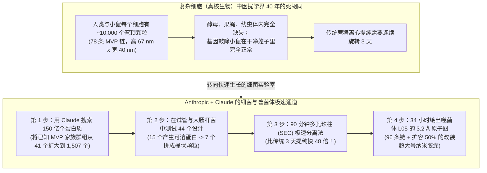
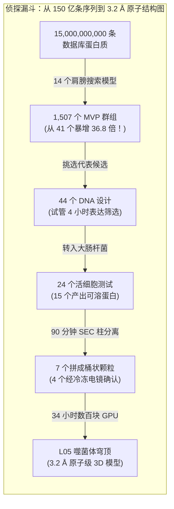

## 1. 故事开场：如果每个房间里都藏着 10,000 个上锁的神秘木桶，而 40 年来没人知道里面装什么，会怎样？

想象一下，明天早上你一觉醒来，发现自己的卧室里整齐地堆放着 **10,000 个空心的、像木桶一样的微型宝箱**。

你跑到邻居家一看——他们家里也有 10,000 个一模一样的木桶！你又检查了小狗、金鱼，甚至森林里的一滩黏菌——每一个生命体内都有成千上万个这种带肋条的空心桶！可是，当你去问全世界最顶尖的生物学家：*“这些木桶到底是干什么用的？”* 他们却摊开双手说：*“我们在 40 年前就发现它了，但直到今天还是不知道它有什么用。”*

这不是童话故事。此时此刻，在构成你身体的数万亿个细胞中，几乎每一个细胞内部都漂浮着大约 **`10,000 个`巨大的空心蛋白质木桶**（[Kedersha & Rome, 1986, PMC2114306](https://pmc.ncbi.nlm.nih.gov/articles/PMC2114306/)；[Athukoralage et al., 2026](https://www-cdn.anthropic.com/76e55fbe85697afbaae16b839498dc00797dec30.pdf)）。**1986 年**，美国加州大学洛杉矶分校（UCLA）的细胞生物学家 **Nancy Kedersha** 和 **Leonard Rome** 第一次在电子显微镜下看到它们时，发现外壳上一道道弯弯的拱形肋条，酷似中世纪大教堂高耸的拱形穹顶（英文叫 **`Vault`**）。于是，他们把这种神秘颗粒命名为 **穹顶颗粒（Vault Particle，中文也常译作“穹窿体”）**。

整整 **40 年来**，穹顶颗粒一直是生物学界最大的悬案之一。它的重量是**核糖体（细胞里制造所有蛋白质的机器工厂）的 1.8 到 3 倍**，是复杂细胞内部已知最大的非病毒“蛋白质+RNA”容器。大自然为什么要耗费宝贵的能量，在每个人类细胞里建造 `10,000 个`宏伟的大教堂木桶呢？

**2026 年 11 月 4 日**，人工智能公司 **Anthropic** 的生命科学实验室发布了一项重磅研究报告（[*Investigating vault particles with Claude*](https://www.anthropic.com/research/investigating-vault-particles-with-claude)）以及一份长达 35 页的一手技术论文预印本（[Athukoralage et al., 2026, *Prokaryotic homologs of the major vault protein form engineerable vault nanocapsules*](https://www-cdn.anthropic.com/76e55fbe85697afbaae16b839498dc00797dec30.pdf)）。团队里的研究人员以前从来没有处理过这么庞大的蛋白质组装体，在解析 3D 原子结构方面的经验也很有限。然而，在 AI 助手 **Claude** 的全程配合下，他们只用了 **不到 4 个月时间** 就完成了以下壮举：

1. 搜索了生命之树上的 **`150 亿个`蛋白质序列**，首次证实不仅人类等复杂细胞有穹顶颗粒，连简单的 **细菌（原核生物）** 和专门猎杀细菌的病毒——**噬菌体（Bacteriophages）** 也能组装出真正的 3D 穹顶木桶！
2. 把实验室里清洗、分离穹顶颗粒的时间从传统的 **`3 天`（`4,320 分钟`）缩短到了 `90 分钟`**——速度提升了 **48 倍**！
3. 绘制出 **有史以来第一张非真核生物穹顶颗粒的 3D 原子地图**（来自一种名为 **`L05`** 的噬菌体病毒，清晰度达到 **`3.2 Å`**，即 `0.32 纳米`），发现它由 `96 条`蛋白质链拼成，比人类穹顶颗粒更宽，内部货舱空间比人类版本 **大 `~25%`**；接着他们又像改装加长礼宾车一样，复制了两段墙壁积木，造出了内部空间比人类版本 **大 `~50%`** 的超大号胶囊（**`L05+2`**）！

等等——是 Claude 自己像变魔术一样独立破解了这桩 40 年悬案吗？**并不是！** 当我们翻开一手实验记录时，会看到一出精彩绝伦的侦探剧：有时候**人类科学家必须否决 Claude 过于胆小的警告**，有时候 **Claude 提出的大胆捷径把人类吓了一跳却大获成功**，还有时候 **Claude 犯下了两个大错**——包括写错培养液配方导致实验**白白耽误了整整两周**，以及在算图时偷懒跳过标准步骤，把 3D 模型和它自己的镜中倒影混在了一起！

拿起你的放大镜，让我们从零开始，揭开这座微观大教堂的秘密。

---

## 2. 从零开始：什么是穹顶颗粒？为什么科学家被卡住了 40 年？

要明白生物学家为什么被难住了四十年，我们先要认识地球上的两类细胞，以及微观世界里的乐高积木是怎么拼装的。

### 第一步：“双层豪宅细胞” vs. “单间帐篷细胞”
地球上所有生命的细胞都住在两个不同的社区里：

* **复杂细胞（科学家称之为“真核生物”，*Eukaryotes*）：** 人类、小鼠、树木的细胞就像一栋 **有好多独立房间并装了门锁的双层大豪宅**——有专门锁着 DNA 蓝图的主卧室（`细胞核`）、发电厂（`线粒体`）和来回送货的走廊。
* **简单细胞（科学家称之为“原核生物”，*Prokaryotes*）：** 细菌（比如你肠道里的大肠杆菌 *E. coli*）和古老的古菌（*Archaea*）就像一个 **没有隔断墙的单间露营帐篷**。DNA 蓝图、工具和食物全都漂在同一个房间里。而在这些单间帐篷外面，还游荡着一种像微型登月舱一样的病毒海盗——**噬菌体（Bacteriophage，简称 Phage）**，专门降落在细菌身上，劫持细菌的机器来复制自己。

### 第二步：78 条一模一样的乐高丝带，如何拼成一个空心大木桶？
在细胞内部，蛋白质就像精密注塑出来的塑料乐高积木。大多数蛋白质只是小剪刀或小合页那样的小工具。

但 **穹顶颗粒（Vault Particle）** 完全不同。在人类细胞里，细胞会打印出 **`78 条`完全相同的长丝带状蛋白质**：
* **39 条丝带** 肩并肩围成一个圆圈，边缘像拉链一样扣紧，拼成木桶的 **下半个碗**。
* 另外 **39 条丝带** 也用同样的方式扣紧，拼成一模一样的 **上半个碗**。
* 上下两个半碗在中间腰线（`Waist`）处“咔哒”一声合拢，变成一个密封的空心木桶，**高 `67 纳米 (nm)`、宽 `40 nm`**（[Tanaka et al., 2009](https://pmc.ncbi.nlm.nih.gov/articles/PMC3184113/)；[Athukoralage et al., 2026](https://www-cdn.anthropic.com/76e55fbe85697afbaae16b839498dc00797dec30.pdf)）。
* *尺度参照：* **`67 纳米`** 到底有多小？你头上的一根头发丝大约有 **`75,000 纳米`宽**。也就是说，**在一根头发丝的横截面上，可以把 `1,100 多个`人类穹顶木桶首尾相连排成一排**！但在细胞的微观世界里，这个重达 **`13 兆道尔顿 (MDa)`**（相当于约 `1,300 万个`氢原子的重量）的 `67 nm` 大桶却是一座摩天大楼——比细胞的蛋白质工厂（核糖体）还要大将近两倍！

科学家把拼成整个外壳的这种单一蛋白质丝带叫做 **主要穹顶蛋白（Major Vault Protein，简称 `MVP`）**。

### 第三步：为什么科学家 40 年都猜不出它的用途？
平时，当生物学家想知道某个细胞零件有什么用时，最爱玩一个叫 **“把它弄坏，看哪里出故障（基因敲除）”** 的侦探游戏。就像打开汽车引擎盖拔掉一根神秘电线：如果车大灯灭了，你就知道这根线管的是车大灯！

可在过去 40 年里，这招对穹顶颗粒完全失灵，原因有两个：

1. **实验室最常用的“四大宠物”弄丢了穹顶基因：** 生物学家 90% 的快速基因实验都是在四种最好养的“实验室模式生物”身上做的：面包酵母、果蝇、秀丽隐杆线虫（*C. elegans*）和拟南芥（植物）。偏偏这么不巧，这四个物种在几亿年前的进化过程中，全都把自己的穹顶基因弄丢了（[Daly et al., 2013, PMC3762200](https://pmc.ncbi.nlm.nih.gov/articles/PMC3762200/)）！
2. **没有穹顶颗粒的小鼠活得蹦蹦跳跳：** 小鼠体内 *确实* 有穹顶颗粒。于是科学家培育出了敲除穹顶基因（`MVP`、`PARP4` 或穹顶 RNA `Vaultrc5`）的基因改造小鼠（[Liu et al., 2004, PMC419869](https://pmc.ncbi.nlm.nih.gov/articles/PMC419869/)；[Prajapat et al., 2024, PMC11482699](https://pmc.ncbi.nlm.nih.gov/articles/PMC11482699/)）。大家本来以为小鼠会生病，结果这些没有穹顶颗粒的小鼠在干净温暖的笼子里照样吃喝玩乐、健康长大、生儿育女！这说明穹顶颗粒不像汽车发动机（每秒钟都离不开），它更像是车里的 **安全气囊或灭火器**——只有在遇到特殊的灾难、病菌入侵或毒素攻击时才会派上用场！

### 第四步：聪明的突破口——去细菌和病毒里找线索！
既然在长得慢吞吞的小鼠身上找答案太难，那如果 **每 `20 分钟`就能繁殖一代的细菌** 或 **噬菌体病毒** 也有穹顶颗粒呢？更妙的是，过去七年里，科学家发现好几套著名的人类抗病毒免疫盾牌——比如 `cGAS-STING`（[Cohen et al., 2019, *Nature*](https://www.nature.com/articles/s41586-019-1605-5)）和 `Viperin`（[Bernheim et al., 2021, *Nature*](https://www.nature.com/articles/s41586-020-2762-2)）——其实都是几十亿年前细菌为了抵御噬菌体病毒而发明的古老盾牌！

以前的计算生物学家已经在细菌和噬菌体的 DNA 数据库里见过长得像 `MVP` 的亲戚基因（[Daly et al., 2013, PMC3762200](https://pmc.ncbi.nlm.nih.gov/articles/PMC3762200/)）。**但全世界没有任何人证明过：细菌和噬菌体里的这些基因，真的能拼成完整的 3D 空心穹顶木桶吗？**

这正是 Anthropic 生物团队和 Claude 决定联手侦破的案件。

---

## 3. 秘密解码环：把吓人的科学行话翻译成大白话

在翻开实验账本之前，我们先用这张表格把报告里最常出现的 7 个专业词翻译成五年级小学生一眼就能懂的日常语言。

| 科学大词 / 英文缩写 | 大白话真实含义 | 小学五年级日常比喻 |
| :--- | :--- | :--- |
| **穹顶颗粒 (`Vault Particle`)** | 细胞内由几十条完全相同的蛋白质丝带像拉链一样并排扣合而成的巨大空心桶状容器。 | 由 78 片或 96 片弧形乐高积木拼成、在中间腰部扣拢的 **空心塑料复活节彩蛋（扭蛋壳）**。 |
| **主要穹顶蛋白 (`MVP`)** | 重复排列拼成整个穹顶颗粒外壳的那唯一一种核心蛋白质长条积木。 | 拼装海盗木桶时围成一圈的其中 **一块弧形木板**。 |
| **原核生物 vs. 真核生物 (`Prokaryote vs. Eukaryote`)** | **原核生物**是没有细胞核的单间简单细胞（细菌、古菌）；**真核生物**是有许多内部房间的复杂细胞（人、动物、植物）。 | 没有隔断墙的 **单间露营帐篷**（`原核生物`） vs. 有卧室和走廊的 **双层别墅**（`真核生物`）。 |
| **噬菌体 (`Bacteriophage` / `Phage`)** | 专门感染并劫持细菌的微型病毒（本研究的主角 `L05` 就是一种噬菌体携带的穹顶蛋白）。 | 降落在细菌表面、劫持细菌 3D 打印机的 **微型月球登陆舱机器人**。 |
| **分子排阻色谱 (`SEC`)** | 把液体倒进装满带微孔海绵珠子的管子里，利用孔洞大小把巨大颗粒和小分子快速分开的方法。 | 把 **巨大的篮球和小玻璃弹珠** 一起滚过布满小老鼠洞的走廊：小弹珠钻进鼠洞绕远路，而塞不进鼠洞的大篮球（`穹顶颗粒`）直接一路狂奔 **第一个冲出出口（`外水体积 / Void Volume`）**！ |
| **冷冻电子显微镜 (`Cryo-EM`)** | 把成千上万个蛋白质木桶瞬间速冻在玻璃态薄冰里，用电子束从各个角度拍下影子照片，再拼成 3D 原子模型。 | 给空中飘落的 **几万片雪花从四面八方拍 X 光片**，再用电脑合成一座精细的 3D 冰雕。 |
| **埃 (`Å`) 与纳米 (`nm`)** | 测量原子和分子的超微型尺子。`1 nm` = `10 Å`，一个碳原子的宽度大约是 `1.5 Å`。 | 如果把 **一根头发丝的宽度（`75,000 nm`）** 放大成一座 **大型足球场**，那么 `1 纳米`就像 **一片草叶**那么宽，而 `3.2 Å` 就只有 **一枚硬币的厚度**！ |

---

## 4. 惊人宣称 vs. 侦探核查：翻开一手实验收据

一个缺乏大分子结构生物学经验的小团队，是如何在不到四个月内从 **150 亿条数据库序列** 走到 **世界首张原核生物穹顶颗粒 3D 原子图** 的？让我们核对一手技术论文（[Athukoralage et al., 2026](https://www-cdn.anthropic.com/76e55fbe85697afbaae16b839498dc00797dec30.pdf)）里的每一组真实数据。

### 收据 #1：在 150 亿个蛋白质里寻宝（把已知穹顶蛋白家族扩大 36.8 倍！）
首先，科学家让 Claude 帮忙编织了 **14 张数学搜寻网**（称为*隐马尔可夫模型*，即 `pHMMs`），专门识别已知穹顶蛋白的“肩膀关节（`Shoulder domain`）”。
* 他们用这 14 张网筛查了包含 **`约 150 亿条`预测蛋白质序列**（按 50% 相似度聚类为 `19.39 亿`个代表序列）的宏基因组数据库。
* 在这项研究之前，科学界已知的 `MVP` 及 `MVP 样`蛋白群组（50% 相似度）只有区区 **`41 个`**。Anthropic 的搜索一下子找出了 **`1,507 个`群组**——把已知家族版图扩大了 **36.8 倍**！
* 接着，他们扫描了 **`111,922 个`不同细菌和古菌物种** 的代表基因组，在 **`29 个`细菌门和 `4 个`古菌门** 以及 **噬菌体病毒** 中都发现了穹顶蛋白基因。
* **稀有度线索：** 尽管穹顶基因广泛分布在细菌家族树的几乎各个分支上，但只有 **不到 `1%`（`111,922 个物种中的 565 个`，约 `0.5%`）** 的物种携带它！这就像只有常下暴雪的小镇才会在车库里备着特种扫雪车一样，说明细菌和噬菌体是为了某种特殊任务才在彼此之间传递这个基因的。

### 收据 #2：把 3 天变成 90 分钟的“篮球与弹珠”妙招（人类否决了 Claude，随后 Claude 打破了常规！）
从这 `1,507 个`群组中，团队挑选了 **`44 个`不同墙壁长度的代表蛋白** 进实验室测试。Claude 把它们的基因字母改写成实验室大肠杆菌（*E. coli*）最容易读懂的密码（`密码子优化`），并加上了启动和停止开关（`T7 启动子与终止子`）。
* 在 4 小时的试管无细胞合成（`PURExpress`）测试后，他们挑选表现最好的 **`24 个`基因** 放进活体大肠杆菌中培养，其中 **`15 个`（`62.5%`）** 成功造出了可溶解的完整蛋白质。

接下来到了最卡脖子的环节：**怎么把组装好的穹顶木桶从打破的细菌浓汤里捞出来？**
* **老办法（耗时 `3 天`）：** 过去 40 年，科学家要把细胞浓汤装进一层层浓糖水试管里，放进超速离心机连续旋转 **`约 72 小时`（`3 天`）**。用老办法测 15 种蛋白得花上好几个星期。
* **新点子（`分子排阻色谱，SEC`）：** 还记得解码环里的 **老鼠洞走廊与大篮球** 吗？一根装满多孔海绵微珠的柱子（`Superose 6 Increase`）会让小蛋白质（`< 5 MDa`）钻进微珠孔洞里慢慢绕路，而重达 **`9.5 MDa` 的巨型穹顶木桶** 根本塞不进微孔，只能在 **前 `12 分钟`（`7.97 至 9.72 mL` 的`外水体积 / Void Volume`）第一个冲出柱子**！
* **注意看这段超戏剧性的人机拉锯战：**
  1. **起初，Claude 强烈反对使用多孔珠柱（`SEC`）！** 为什么？因为 Claude 从文献里知道，折叠失败粘成一团的废蛋白垃圾（`聚集体，Aggregates`）个头也很大，会跟真正的穹顶木桶一起在第一波冲出来！**人类科学家否决了 Claude 的保守建议**，决定照样用柱子跑，然后把第一波流出的液体放到电子显微镜下一眼分辨真木桶和垃圾团。
  2. **紧接着，Claude 提出了一个让人类捏一把汗的大胆捷径！** 按照教科书规矩，往昂贵的精密色谱柱里倒样品前，必须先做多步繁琐的预纯化，否则细菌碎片很容易把柱子堵死报废。但 Claude 提议：*“干脆省掉所有预纯化步骤，把刚破壁离心过滤后的大肠杆菌粗提液（`Clarified lysate`）直接倒进柱子里试试？”* 人类科学家虽然心疼昂贵的柱子，但还是试了 Claude 的点子——**结果大获成功！** 从活细菌破壁到送上显微镜载网，全程只花了 **`90 分钟`**，比传统的 `3 天`快了整整 **48 倍**！

用这套 90 分钟极速流程测试 `15 种`蛋白后，负染电镜显示有 **`7 种`拼成了桶状颗粒**，随后的冷冻电镜（Cryo-EM）最终确认其中 **`4 种`是完整的闭合穹顶颗粒**（`L05` 和 `C0` 来自噬菌体病毒，`Hmin` 和 `Bc1` 来自细菌）。

### 收据 #3：拆解 `L05` 噬菌体穹顶——96 条丝带、折纸穹顶屋顶与“加长礼宾车”改装！
团队挑选了组装效果最好的噬菌体蛋白 **`L05`**，在 `300 kV` 冷冻电镜下拍摄了 **`3,041 部`高清微电影**（挑出 `11,675 个`完美闭合的穹顶颗粒）。Claude 在内部多智能体平台上同时调动 **数百块 GPU 并行计算**，自动运行开源软件 `RELION 5.0.1`，仅用 **`34 小时`** 就算出了第一版 **`3.2 Å` 分辨率**（腰部达到 `2.95 Å`！）的 3D 原子结构模型！

让我们把技术论文中 **人类穹顶颗粒**、**噬菌体 `L05` 穹顶颗粒** 和 **工程改装版 `L05+2` 超大胶囊** 的核心实测数据放在一起对比：

| 测量指标 / 结构特征 | 人类穹顶颗粒 (`哺乳动物 MVP`) | 噬菌体 `L05` 穹顶颗粒 (`野生型`) | 工程改装版 `L05+2` 超大胶囊 | 五年级侦探大白话总结 |
| :--- | :--- | :--- | :--- | :--- |
| **天然宿主** | 人类及动植物（`真核生物`） | 噬菌体病毒（感染细菌） | 实验室人工复制插入 2 段墙壁积木 | 首次证实真核生物以外的生命也能拼出 3D 穹顶！ |
| **蛋白质丝带总数 (`链数`)** | **`78 条`链**（上 `39` + 下 `39`） | **`96 条`链**（上 `48` + 下 `48`） | **`96 条`链**（上 `48` + 下 `48`） | 噬菌体木桶每一圈多用了 **18 条丝带**。 |
| **桶壁堆叠环数 (`Repeats`)** | 每条链 **`9 环`**（桶壁高 `35.3 nm`） | 每条链 **`7 环`**（桶壁高 `28.1 nm`） | 每条链 **`9 环`**（复制第 `4、5` 环） | 复制两段桶壁积木就能像搭乐高一样把木桶加高加宽！ |
| **外部总长 × 总宽** | **`67 nm` × `40 nm`**（细长柠檬形） | **`54.5 nm` × `47.5 nm`**（圆胖鸡蛋形） | **`58.5 nm` × `49.4 nm`**（巨型鸡蛋形） | `L05` 比人类版 **矮 `12.5 nm`**，但 **宽 `7.5 nm`**。 |
| **内部货舱容积 (`Volume`)** | **基准 (`100%`)** | **`~125%`（比人类大 `+25%`）** | **`~150%`（比人类大 `+50%`！）** | 圆胖的鸡蛋比细长的柠檬 **肚子里能装更多东西**！ |
| **腰部粘合面积 (每条链)** | **`~420 Ų`** | **`~225 Ų`**（无共同氨基酸） | 上下两半在腰部相对旋转 **`~3°`** | `L05` 只用一半的腰部接触面积和全新的氨基酸就能扣紧。 |
| **内壁神秘小口袋** | 结合 **`NAD+`** 与 **`ADP`** 核苷酸 | 装有形状酷似 **`辅酶 A (CoA)`** 的分子 | 保留了相同的 **`辅酶 A`** 状神秘分子 | 人类和病毒的穹顶内壁都抓着细胞的核心能量搬运工！ |

### 藏在 `L05` 里的三个绝妙工程秘密：
1. **“三步折纸法”封顶屋顶（`48 → 16 → 8` 对称性破缺）：**
   想象一下，你要用 **`48 条`完全一样的布条** 围成一圈缝一个圆帐篷顶。当 48 条布条同时往正中心的顶点挤过去时，山顶地方太小，肯定会挤成一团！`L05` 在没有第二种辅助蛋白的情况下是怎么封顶的？原来，**每相邻的 3 条完全相同的蛋白质链（`A`、`B`、`C`）在屋顶处玩起了不同的折纸动作**：
   * **`A` 链** 走到半山腰就停下，向**桶内（内腔）**折回并垫在邻居下面（`第 1 阶`）。
   * **`B` 链** 走得更远一些，然后向**桶外（外侧）**折回（`第 2 阶`）。
   * 只有 **`C` 链**（48 条里的三分之一，即 `16 条`链）一路走到正中心的极点把洞封死，而且在正中心 `C` 和 `C'` 又交替排列成 `8 重对称`（`第 3 阶`）！
2. **改错一个字母，密封木桶就炸成一朵平摊的花（`莲座状 Rosette`）：**
   为了弄清哪些搭扣负责把木桶锁紧，团队制造了 **`15 种`突变蛋白**。结果发现，只要把桶壁接缝处的一个氨基酸字母反转电荷（`R55E`，把正电改成负电让邻居互相排斥），或者改掉顶盖螺旋里的一个字母（`I794D`），木桶就再也合不拢了——全都摊开成一朵朵像花瓣一样的平面结构，叫做 **莲座（Rosettes）**！
3. **内壁 1 号口袋里的神秘货物（`辅酶 A`）：**
   Claude 在检查 3D 密度图时发现，全部 96 条蛋白质链的**内壁口袋（第 1 环与第 2 环交界处）**里，都清晰地卡着一个不属于蛋白质的小团块。Claude 拿 **`25,000 种`已知化学小分子** 去比对这个 3D 轮廓，发现最匹配的是 **辅酶 A（`Coenzyme A, CoA`）**——这是所有活细胞用来搬运化学燃料基团的王牌辅助分子！

---

## 5. 审讯四个嫌疑人：到底是什么促成了这次突破？（四向因果检验）

按照批判性思维侦探守则，每当有人宣称*“因为因素 X，所以才有了结果 Y”*时，我们必须同时审问 **四个嫌疑人**（直接原因、反向因果、隐藏的第三变量、双向反馈循环）。这里我们要同时审理两个案子：**为什么细菌和噬菌体会有穹顶颗粒？** 以及 **为什么研究能在不到 4 个月内火速完成？**

| 嫌疑人类型 | 生物学嫌疑人（为什么噬菌体和细菌有穹顶？） | AI 速度嫌疑人（为什么不到 4 个月就能做完？） | 侦探裁决与一手证据 |
| :--- | :--- | :--- | :--- |
| **嫌疑人 #1：直接原因 (`X → Y`)** | 穹顶颗粒是 **专门装载辅助燃料（`辅酶 A`或`NAD+`）和搭档酶的密封工作舱**，用来在病毒感染或压力下执行化学修复与防御。 | **Claude 的全流程代码与设计自动化**（编写 150 亿序列检索代码、设计 44 个 DNA、提议粗提液直上 `SEC`、自动跑 `RELION`）把几个月的活压缩到了几天。 | **强力支持（附带边界条件）：** 对 `2,185 个`细菌穹顶基因座的邻居扫描显示，它们紧挨着 **抗噬菌体免疫（`JAB`）**、**RNA 修复（`RtcB`）** 和 **核苷酸酶**；且全部计算代码确由 Claude 编写。 |
| **嫌疑人 #2：反向因果 (`Y → X`)** | 未必是细菌先造出穹顶再被病毒偷走，反而是 **巨型噬菌体病毒先演化出穹顶外壳作为病毒反应舱**，在感染过程中把基因散布给了不同细菌宿主。 | 不是 Claude 让结构生物学变简单了，而是 **选了一个仅由单一蛋白（`MVP`）96 个拷贝自组装的高对称巨型颗粒**，天然最适合 1 步法 `SEC` 和 AI 自动算图！ | **关键促成因素：** 正因为穹顶颗粒只需要 **1 个基因** 就能自己拼成 `9.5 MDa` 的高对称（`D16`/`C48`）大球，才让大肠杆菌表达、90 分钟过柱和冷冻电镜对称平均如此顺利。 |
| **嫌疑人 #3：隐藏的第三变量 (`混杂因素 Z`)** | 细菌穹顶和人类穹顶其实都是从同一个远古祖先——**锚定在细胞膜上的 `SPFH` 环状膜蛋白家族**（如 Flotillin、Stomatin）脱离细胞膜演化而来的。 | **庞大的工业级 GPU 算力与开源软件基石：** 依靠 **数百块并行 GPU**、开源神器 `RELION 5` / `AlphaFold2` / `OpenFold3`，以及外部赛默飞 `Krios G4` 顶级电镜中心的数据采集。 | **决定性混杂因素：** 如果没有内部云上 **数百块并行 GPU** 和 `RELION` 等成熟开源软件，光靠 Claude 写脚本绝不可能在 34 小时内算出 `3.2 Å` 的结构。 |
| **嫌疑人 #4：双向反馈循环 (`X ↔ Y`)** | **宿主与病毒的军备竞赛：** 细菌用穹顶做防御和 RNA 修复，噬菌体劫持并改造它（增减桶壁环数）来反制宿主，双方在拉锯中不断演化。 | **人类与 AI 的纠错闭环：** 人类否决 Claude 对 `SEC` 的畏惧；Claude 发明粗提液直通法；人类揪出镜像翻转错误并把实验笔记喂回给训练团队升级新一代 Claude！ | **真正的幕后功臣：** 光靠人类或光靠 AI 都达不到这个速度。真正的秘诀是 **人类科学判断力与 AI 极速执行力相互纠错的紧密闭环**。 |

---

## 6. 隐藏的坑与代价：Claude 在哪里搞砸了？还有哪些谜团没解开？

社交媒体上的夸张标题总喜欢把 AI 描绘成从不出错的神仙。但值得点赞的是，Anthropic 在论文和报告中非常诚实地披露了 **Claude 犯下的蠢错以及这项研究的六大局限**：

### 坑 #1：白白浪费两周时间的“毒汤配方”乌龙
当团队让 Claude 编写一份培养细菌并把外源 DNA 送进细菌体内（`转化，Transformation`）的实验操作指南时，Claude 在培养基配方里写进了一种 **会阻碍 DNA 进入细菌细胞的化学添加剂**！因为团队成员以前不熟悉那个具体细节，照着 Claude 的配方做了实验，结果导致实验失败，**整整耽误了两个星期** 才排查出原因。

### 坑 #2：把真身和镜中幽灵揉在一起的 3D 模型（“拜托我们先按正常规矩来！”）
在冷冻电镜（Cryo-EM）重构中，二维投影照片很难直接分清左手螺旋和右手螺旋（`手性 / Chirality`）。在早期处理图像时，**Claude 擅自跳过了一个标准校准步骤，耍小聪明搞了个即兴捷径**，结果算出了一张把真实穹顶结构和它的 **镜像倒影混在一起** 的错误地图！人类科学家发现后哭笑不得，只能在对话框里严厉地告诉 Claude：
> *“除非正常办法不管用，否则拜托我们先按正常规矩来！（Please let's do normal things unless they don't work.）”*

### 坑 #3：Claude 一开始对多孔珠柱（SEC）的警告其实是准的！
还记得 Claude 一开始反对用 `SEC` 色谱柱，理由是烂蛋白垃圾团也会在第一波（`外水体积`）冲出来吗？翻开技术论文第 11 页的 **图 4（Figure 4）**，你会看到铁证：当团队测试那 `5 种`合不拢的突变蛋白（如 `R55E`、`I794D`）时，**所有 5 种坏掉的突变体在 `SEC` 柱子上依然和好木桶一样出现在第一波快峰里**！只有放到电子显微镜下看，才会发现它们全都变成了摊开的莲座花瓣或无定形垃圾团；而另一个蛋白 `Bc1` 在普通负染电镜下看起来像扁圆环，放到冷冻电镜下才看出是完整的木桶。**教训：** 跑柱子再快，也绝对不能省掉电子显微镜的亲眼验证！

### 坑 #4：“几百块 GPU”的算力门槛（以及 `L05+2` 的噪声过拟合）
普通大学实验室明天能不能照搬那套 90 分钟的 `SEC` 过柱提纯法？**完全可以！**
但是普通大学实验室能不能在 **`34 小时`** 内算出 `3.2 Å` 的冷冻电镜结构？**做不到！** Anthropic 坦承，34 小时的速度依赖于在公司内部集群上 **同时调用数百块 GPU 并行计算**，而且前期由赛默飞（Thermo Fisher）电镜中心用顶级 `300 kV Krios G4` 电镜采集了 `3,041 部`（`L05+2` 甚至高达 `16,824 部`！）电影数据。此外，作者在方法部分（第 34 页）坦诚指出，将 `L05+2` 精修至收敛时，两个半图（half-maps）在外壳区域的差异增大（桶壁处增大了 `1.09 至 1.89 倍`），说明存在一定程度的 **噪声过拟合（Fitted noise）**。

### 坑 #5：大肠杆菌代工厂不等于野生大自然！
本研究中所有的穹顶木桶，都是把基因塞进实验室大肠杆菌（`E. coli BL21(DE3)`）里，用人工强启动子（`pET-21(+)` 加 `0.5 mM IPTG`）强行大量打印出来的。正如作者坦承的那样：
* 他们 **还没有测试** 在野生细菌体内或真实的噬菌体感染过程中，这些蛋白是否也会自然组装成穹顶木桶。
* 因为是在大肠杆菌这个“异国代工厂”里空壳组装的，原宿主体内的天然搭档蛋白和真实生物货物并没有跟过来——所以 **“穹顶颗粒在活细胞里到底干什么用”这个 40 年终极谜题依然没有彻底解开！**

### 坑 #6：商业利益与专利披露
按照一手信源利益冲突核查原则：论文全部作者均为 **Anthropic 员工**（持有公司股权，公司销售 `Claude` 及 `Claude Science`），穹顶颗粒共同发现者 **Leonard Rome 博士是该研究的付费顾问（Paid consultant）**，且 **Anthropic 已就这项原核生物可工程化穹顶纳米胶囊提交了临时专利申请（Provisional patent application）**。

---

## 7. 最终成绩单：我们的核心判断与未来情景预测

尽管穹顶颗粒在自然界里的真正职责还没有尘埃落定，但首次证明细菌和噬菌体能组装出 96 链的精密穹顶胶囊、实现在大肠杆菌中 **90 分钟极速提纯**，并通过复制桶壁积木把内部货舱容积轻松扩大 **+25% 到 +50%**，依然是进化生物学和纳米生物工程领域的一座实打实的里程碑。

### “如果（If）……那么（Then）……” 行动指南
* **如果你是一位想要破解 40 年穹顶功能之谜的生物学家**，**那么** 别再傻等小鼠实验出现症状了：直接拿这项研究筛出的细菌宿主（比如粘细菌 *Hyalangium minutum*，`Hmin`，它的穹顶基因就紧挨着抗噬菌体免疫 `JAB`、RNA 修复酶 `RtcB` 或核苷酸酶），**在原细菌体内敲除穹顶基因**，然后用噬菌体病毒或毒素去攻击它，马上就能看清它到底保护了哪条生命线！
* **如果你是一位设计纳米送药卡车（`纳米胶囊`）的生物工程师**，**那么** 原核生物穹顶（`L05` 和 `L05+2`）解决了人类穹顶最头疼的两个难题：它不需要娇贵的昆虫或哺乳动物细胞，直接在廉价的大肠杆菌里就能高产表达、**90 分钟提纯**，而且拥有可按需定制的超大货舱容积（比人类穹顶大 `+25%` 至 `+50%`）。
* **如果你是一位在真实湿实验室里使用 AI 智能体（`Claude`）的科学家**，**那么** 大胆让 AI 去搜寻百亿级序列、编写 `RELION` 处理脚本并挑战陈旧的实验习惯——**但在你不熟悉的实验细节上，绝不要盲信 AI 开出的化学培养基配方或未做手性校验的 3D 模型**，务必用教科书级的标准对照实验把好关！

### 未来 3–5 年概率加权情景预测表

| 情景分类 | 发生概率 | 未来会发生什么 | 验证该情景成真的关键证据 |
| :--- | :--- | :--- | :--- |
| **基准情景 (Base Case)：细菌遗传学揭开穹顶真功能，大肠杆菌穹顶成为实验室标配工具** | **`~60%`** | 全球高校实验室利用此次公开的 `1,507 个` MVP 家族图谱和快速细菌基因敲除实验，证实原核穹顶是 **保护 `辅酶 A`/`NAD+` 代谢或 RNA 修复免受病毒破坏的隔离反应舱**；同时 `L05` 成为廉价易用的科研纳米容器。 | 在 *Hyalangium minutum* 等原生细菌或噬菌体感染实验中，敲除 `MVP` 或其邻近操纵子搭档（`RtcB`/`JAB`）后出现明显的生存缺陷；质谱实验正式确证口袋内的 `辅酶 A` 配体。 |
| **乐观情景 (Bull Case)：尺寸可调的“定制纳米胶囊”成功用于酶与 mRNA 药物递送** | **`~25%`** | 工程师将 `L05` 内壁尚未解析的 `~80 个`氨基酸柔性长环（位于第 6、7 环之间）改造成通用的“货物魔术贴挂钩”，利用扩容版 `L05+2`/`L05+4` 高效装载治疗性酶或 mRNA，在产量和装载量上全面超越哺乳动物穹顶。 | 发表高产率货物封装论文，证明 `L05+2` 能稳定装载活性酶或 mRNA，且在动物体内递送时不发生聚集或破坏性免疫排斥。 |
| **悲观情景 (Bear Case)：过表达假象与人体免疫排斥限制其医药转化** | **`~15%`** | 部分原核 `MVP` 同源蛋白被发现在自然低表达水平下只是附着在细胞膜上的扁平 `SPFH` 样寡聚体（只有在大肠杆菌里人工强行过表达时才会聚成闭口桶），且病毒来源的 `L05` 外壳对人体具有较强免疫原性，难以直接注射入人体送药。 | 对天然细菌或噬菌体感染现场进行的冷冻电子断层扫描（`Cryo-ET`）未能找到闭合木桶，或哺乳动物体内注射实验引发强烈的抗 `L05` 中和抗体反应。 |

---

## 一手信源与核验参考文献 (Primary Sources)

1. **Anthropic 官方研究公告 (2026 年 11 月 4 日)：** [*Investigating vault particles with Claude*](https://www.anthropic.com/research/investigating-vault-particles-with-claude)
2. **一手技术预印本论文 PDF (2026 年 11 月 4 日)：** Januka S. Athukoralage, Peter H. Yoon, Amir Shanehsazzadeh, Eric Kauderer-Abrams, Nicholas T. Perry, & Matthew G. Durrant, [*Prokaryotic homologs of the major vault protein form engineerable vault nanocapsules*](https://www-cdn.anthropic.com/76e55fbe85697afbaae16b839498dc00797dec30.pdf) (Anthropic Technical Report / bioRxiv Preprint PDF).
3. **1986 年首次发现穹顶颗粒的奠基论文：** Nancy L. Kedersha & Leonard H. Rome, [*Isolation and characterization of a novel ribonucleoprotein particle: large structures contain a single species of small RNA*](https://pmc.ncbi.nlm.nih.gov/articles/PMC2114306/), *Journal of Cell Biology* 103(3), 699–709 (1986).
4. **哺乳动物穹顶颗粒结构与顶盖动态研究：** H. Tanaka et al., *Science* (2009) / [PMC3184113](https://pmc.ncbi.nlm.nih.gov/articles/PMC3184113/); F. Lapenta et al., [*Structural flexibility of the human vault particle revealed by high-resolution cryo-EM and molecular dynamics simulations*](https://www.nature.com/articles/s41467-026-72674-4), *Nature Communications* 17, 6033 (2026); K. Geißler et al., [*The vault associates with membranes in situ*](https://www.nature.com/articles/s41467-026-71837-7), *Nature Communications* 17, 3659 (2026).
5. **人类穹顶颗粒内部 NAD+ 结合与 PARP4 搭档蛋白研究：** J. E. Lodwick et al., [*Structural insights into the roles of PARP4 and NAD+ binding in the human vault cage*](https://www.nature.com/articles/s41467-025-61981-x), *Nature Communications* 16, 6724 (2025).
6. **穹顶颗粒组件敲除小鼠存活研究：** Y. Liu et al., [*Vault poly(ADP-ribose) polymerase is associated with mammalian telomerase and is dispensable for telomerase function and vault structure in vivo*](https://pmc.ncbi.nlm.nih.gov/articles/PMC419869/), *Molecular and Cellular Biology* 24(12), 5314–5323 (2004); M. Prajapat, L. Sala, & J. A. Vidigal, [*The small noncoding RNA Vaultrc5 is dispensable to mouse development*](https://pmc.ncbi.nlm.nih.gov/articles/PMC11482699/), *RNA* 30(11), 1465–1476 (2024).
7. **穹顶蛋白进化史与模式生物基因丢失研究：** T. K. Daly, A. J. Sutherland-Smith, & D. Penny, [*In silico resurrection of the major vault protein suggests it is ancestral in modern eukaryotes*](https://pmc.ncbi.nlm.nih.gov/articles/PMC3762200/), *Genome Biology and Evolution* 5(8), 1567–1583 (2013).
8. **工程化穹顶纳米胶囊应用奠基论文：** V. A. Kickhoefer et al., [*Engineering of vault nanocapsules with enzymatic and fluorescent properties*](https://pmc.ncbi.nlm.nih.gov/articles/PMC555488/), *PNAS* 102(12), 4348–4352 (2005).
9. **人类先天免疫系统的细菌起源研究：** D. Cohen et al., [*Cyclic GMP–AMP signalling protects bacteria against viral infection*](https://www.nature.com/articles/s41586-019-1605-5), *Nature* 574, 691–695 (2019); A. Bernheim et al., [*Prokaryotic viperins produce diverse antiviral molecules*](https://www.nature.com/articles/s41586-020-2762-2), *Nature* 589, 120–124 (2021).
