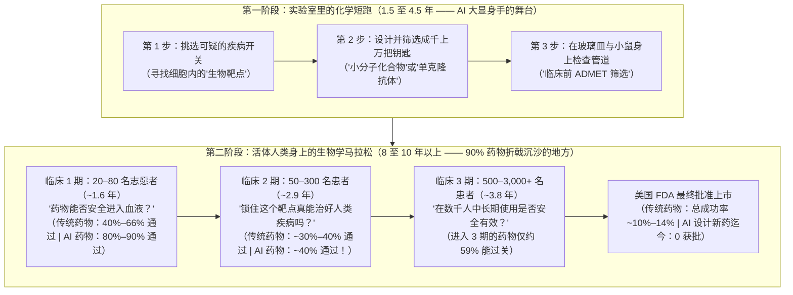
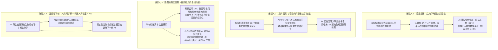

## 1. 故事开场：等等——既然AI能击败国际象棋世界冠军、几秒钟写出电脑代码，为什么它至今还没治好哪怕一种病？

想象一下，地球上最聪明、最富有的一群大人站在一个巨大的学校体育馆两端，正为了“电脑到底能不能在几年内治好人类所有疾病”吵得不可开交。

站在**一号角落（硅谷科技巨头老板们）**的，是打造超级人工智能（`AI`）计算机的人：
* 人工智能公司 **Anthropic** 的首席执行官达里奥·阿莫迪（Dario Amodei）在他著名的长文[《仁爱机器》（*Machines of Loving Grace*）](https://darioamodei.com/machines-of-loving-grace)以及社交平台 X 的帖子里预测：AI 可以把原本需要 50 到 100 年的生物医学进步压缩到短短几年内完成——*“虽然听起来很疯狂，但我认为在大约 5 到 10 年内，治愈人类大多数疾病将成为可能。”*
* 另一位硅谷科技领袖甚至当面告诉一家大型制药公司的董事长：AI 将在**未来 7 年内消灭人类 90% 的疾病**。
* 正如《华尔街日报》（*The Wall Street Journal*）记者哈维尔·马丁内斯（Xavier Martinez）在 2026 年 11 月 3 日的深度报道（《硅谷承诺 AI 将治愈疾病，制药商 CEO 们并不买账》）中披露的那样，甚至有科技高管开玩笑说，AI 研究员们已经开始抽烟了，因为他们无比确信在自己生病之前，AI 就已经把肺癌彻底攻克了！

而站在**二号角落（真正发明药物的制药公司总裁与科学家们）**的，是在实验室和医院里摸爬滚打了 30 到 40 年、亲手拯救过无数生命的医药界老兵：
* 研发出囊性纤维化和镰状细胞病突破性疗法的制药巨头 **福泰制药（Vertex Pharmaceuticals）** 执行董事长、医学博士 **杰夫·莱顿（Jeff Leiden）**，听完那位科技领袖“7 年内治愈 90% 疾病”的豪言壮语后，直接甩出了三个字：**“纯属胡扯（That's complete BS）。”**
* 莱顿为什么敢这么笃定？因为福泰制药真的动手测试过了！他们雇佣了大约 **50 家不同的 AI 公司**，去筛选福泰内部珍藏的 **10,000 种化学物质数据库**。结果这 50 家 AI 公司靠自己找出了多少种真正能用的新药？**零个（`0`）。** 莱顿对《华尔街日报》坦言：*“光靠 AI 自己根本行不通。任何声称自己能做到的公司——至少在我们的经验里，绝大多家我们都考察过了——都不是真的。”*
* 跨国药企 **阿斯利康（AstraZeneca）** 首席执行官帕斯卡尔·索里奥特（Pascal Soriot）也摇头表示：*“如果我们在这一行干得够久，很快就会学会敬畏与谦卑。疾病太复杂了，生物学太复杂了。说 AI 马上就能治愈癌症，恐怕有点跨度太大了。”*
* 拥有超过 1,000 项专利的 **再生元（Regeneron）** 首席科学官 **乔治·扬科波洛斯（George Yancopoulos）** 补充道：*“AI 不会像变魔术一样突然降临，直接告诉我们该怎么做，然后把 15 年的研发周期一下子砍到 5 年。”*

慢着！戴上你的侦探帽，让我们先看一眼记分牌。当我们翻开《华尔街日报》这篇报道背后的原始医学论文和美国政府临床试验档案时，**四个巨大的谜团**立刻跳了出来：

* **谜团 #1（砸下 84 亿美元，上市批文却是“0”）：** 根据麦肯锡（McKinsey）的数据，仅在 2025 年一年，全球风险投资和私募股权基金就向 AI 药物研发公司砸下了 **84 亿美元**——比两年前的 **40 亿美元**翻了一倍多（这笔钱足够给 **840 万名五年级小学生**每人买一台价值 `1,000 美元`的高端笔记本电脑！）。然而截至 2026 年 11 月，完全由 AI 设计并通过美国食品药品监督管理局（`FDA`）最终审批、能去药店买到的新药有多少种？**一种都没有（`0`）。**
* **谜团 #2（第一关拿高分，第二关却撞上南墙）：** 波士顿咨询公司（`BCG`）的科学家对所有进入人体测试的 AI 研发药物进行了首次全面盘点（[Jayatunga et al., 2024, PMID 38692505](https://eutils.ncbi.nlm.nih.gov/entrez/eutils/esummary.fcgi?db=pubmed&id=38692505&retmode=json)）。结果发现：在人体测试的**第一关（`临床 1 期`安全性测试）**中，AI 药物的通关率高达 **80% 到 90%（`24 个过了 21 个`）**，远超传统制药行业 `40% 到 65%` 的历史平均水平！可是，为什么一进入**第二关（`临床 2 期`病人疗效测试）**，AI 药物的通关率就瞬间暴跌到 **40%（`10 个只过了 4 个`）**——和传统人工研发药物的不及格率一模一样？
* **谜团 #3（全球最著名的 AI 新药临床试验表格里藏着什么线索？）：** 一家名叫 **英矽智能（Insilico Medicine）** 的公司，利用生成式 AI 同时找到了全新的疾病开关并画出了全新的小分子药片 **`rentosertib`（曾用名 `ISM001-055`）**，仅用 **18 个月**就完成了早期实验室设计（[Ren et al., 2024, PMC11738990](https://pmc.ncbi.nlm.nih.gov/articles/PMC11738990/)）。随后，在对 **71 名**致命肺纤维化患者进行的 12 周临床 2a 期试验中（[Xu et al., 2025, PMC12353801](https://pmc.ncbi.nlm.nih.gov/articles/PMC12353801/)），最高剂量组（每天一次 `60 mg`）患者的吹气肺活量平均增加了 **`+98.4 毫升`**（大约相当于学校课间一盒 `250 毫升`牛奶的五分之二），轰动了全球媒体！但当我们翻开这篇《自然·医学》（*Nature Medicine*）论文的 `表 2（Table 2）`时，为什么短短 12 周内就有 **16 名患者（`22.5%`）中途退出了试验**，其中 **7 人是因为肝脏受损或肝功能异常而被迫停药**？
* **谜团 #4（既然 AI 自己治不好病，为什么药企还在花几十亿美元买它？）：** 既然制药巨头老板们都说 AI 不能独自发明神药，为什么 **礼来（Eli Lilly）和英伟达（Nvidia）** 在 2026 年 1 月宣布共同投入 **10 亿美元（为期 5 年）**建立联合实验室？为什么 **阿斯利康** 刚刚向 AI 生物科技公司 **Insitro 支付了 4,000 万美元首付款**？为什么连 **Anthropic**（收购了 **Mithril Medicine** 和 **Coefficient Bio**）与 **OpenAI**（收购了 **Orchestra Bio**）也亲自下场买起了生物科技初创公司？

拿起你的放大镜！我们要从零开始，钻进你身体里的 **37 万亿个房间**，核对真实的医院原始账单，看看为什么“人体生物学”是全宇宙最难解开的谜题。

---

## 2. 从零开始：科学家到底是怎么发明一种药的？为什么 10 种新药里有 9 种会失败？

在评判硅谷大佬和药企老板谁对谁错之前，我们先要搞清楚：当你吞下一颗药片时，它在你身体里究竟干了什么？

### 你的身体是一座由 37 万亿个房间组成的超级城市，里面装满了微小的“折纸机器”

此时此刻，你的身体是由大约 **37 万亿个活细胞（`小房间`）**组成的——这个数量比**整个地球上所有树木加起来还要多出 10 倍以上**！

在每一个细胞小房间里，都有成百上千万台微型机器在日夜不停地运转。这些微型机器是由长长的链条像折纸千纸鹤一样精确折叠成三维立体形状的。它们负责消化你的午饭、在血液里运送氧气、指挥细胞什么时候生长或休息。科学家把这些折叠起来的微型机器叫做 **蛋白质（`Proteins`）**。

### 第一步：找到坏掉的门锁（`生物靶点 / Target`）

当一个人得了重病——比如癌症、心力衰竭或肺部纤维化——往往是因为这座城市电路图里的某一台蛋白质机器坏掉了，卡在了**“开启（ON）”**的位置停不下来：
* 在 **癌症（Cancer）** 中，一个卡住的开关不停地对细胞大喊：*“永远不停地复制自己！”*
* 在 **肺纤维化（Fibrosis）** 这种疾病中，一个卡住的开关不停地命令肺部细胞：*“到处浇灌又厚又硬的伤疤胶水，把原本柔软的肺变成像干丝瓜络一样硬邦邦的石头！”*

为了治好病，科学家首先要查清楚：**成千上万台机器里，究竟是哪一个蛋白质开关坏掉了？** 你可以把那个坏掉的开关想象成一扇漏水教室门上的 **坏门锁**。只要能把这把锁卡死关上，错误的指令就会停止！科学家把这把引发疾病的蛋白质锁叫做 **生物靶点（`Biological Target`，简称 `靶点`）**。

### 第二步：打造一把微小的定制钥匙（`化合物` 或 `单克隆抗体`）

一旦科学家认为自己找到了那把坏门锁（`靶点`），接下来就要打造一把微小的 **定制钥匙**。它必须顺着血管游遍全身，准确找到那把坏锁，插进锁眼，把它彻底卡住。

科学家通常打造两种钥匙：
1. **微型乐高积木钥匙（`小分子化合物 / Small-Molecule Compound`）：** 由几十个原子（碳、氢、氮、氧）拼接而成的极小化学分子。因为它比单个细胞还要小几千倍，你可以把几百万个小钥匙装进一颗胶囊里，喝口水吞下去，让它穿过肠胃进入血液。科学家把这种候选化学钥匙叫做 **化合物（`Compound`）** 或 **小分子（`Small Molecule`）**。
2. **制导魔术贴抓钩钥匙（`单克隆抗体 / Monoclonal Antibody`）：** 有时候坏门锁表面太光滑平整，找不到小锁眼。于是科学家模仿人体免疫系统的天然防御武器，在实验室里造出一种巨大的 Y 字形蛋白质，像精准制导的魔术贴抓钩一样死死抱住目标。因为胃酸会像消化牛肉一样把大块蛋白质融化掉，所以这种药不能做成药片吞服，只能通过皮下或静脉打针注射。科学家把它叫做 **单克隆抗体（`Monoclonal Antibody`）**。

### 第三步：为什么活生生的人体会弄断几乎所有的钥匙？（四大死亡陷阱）

等等——如果造药只是**“找把锁，配把钥匙”**，那为什么不能直接用谷歌 DeepMind 获得诺贝尔奖的 AI 工具 **AlphaFold**（它已经预测了 2 亿种蛋白质的三维形状；[Jumper et al., 2021, PMC8371605](https://pmc.ncbi.nlm.nih.gov/articles/PMC8371605/)；[Abramson et al., 2024, PMC11168924](https://pmc.ncbi.nlm.nih.gov/articles/PMC11168924/)），在电脑上花 10 分钟打印出一把完美钥匙，治好所有疾病呢？

因为电脑屏幕和实验室玻璃培养皿里**只有孤零零的一把锁**，而一个活生生的人体却是**一座拥有 20,000 种不同门锁、强酸熔炉、保安巡逻队和秘密备用暗门的复杂丛林！**

当你吞下一颗药片后，身体里有**四大现实陷阱**会跳出来搞砸一切（[Sun et al., 2022, PMC9293739](https://pmc.ncbi.nlm.nih.gov/articles/PMC9293739/)）：
1. **陷阱 #1：管道与肝脏保安大闯关（`ADMET / 药代动力学`）：** 药片钥匙必须先扛住胃酸（像岩浆一样腐蚀外来物），穿过肠道墙壁，顺着血液游到生病的器官，还要躲过 **肝脏保安队（Liver Security Guards）**！肝脏的天职就是发现血液里的陌生化学物质，用化学剪刀（`肝酶`）把它们剪成碎片，然后顺着尿液冲进马桶。如果肝脏保安在 10 分钟内就把钥匙全剪碎了，药根本到不了生病的肺部。
2. **陷阱 #2：长相几乎一模一样的“撞衫锁眼”（`脱靶毒性 / Off-Target Toxicity`）：** 大自然非常喜欢在身体不同部位重复使用相似的锁眼形状！肺部引起伤疤的坏蛋白锁眼，可能和心脏里维持正常心跳、或者肝脏里负责排毒的健康蛋白锁眼**长得有 95% 一模一样**。如果你的新钥匙在锁住肺部坏锁的同时，不小心把肝脏、心脏或肠胃里的五把健康锁也给拧断了，病人就会出现严重的毒副作用。科学家称之为 **脱靶毒性（`Off-Target Toxicity`）**。
3. **陷阱 #3：剂量与毒性的死结（`组织选择性不足`）：** 假如钥匙在玻璃皿里能完美插进肺部的锁，但病人吞下药片后，只有 **1%** 的钥匙去了肺部，剩下 **99%** 全都堆积在肝脏里怎么办？为了让肺部攒够药效，医生不得不让病人吃超大剂量——结果肺还没治好，肝脏先被高浓度的药物毒坏了（[Sun et al., 2022, PMC9293739](https://pmc.ncbi.nlm.nih.gov/articles/PMC9293739/)）！
4. **陷阱 #4：疾病的秘密后门（`靶点错误 / 通路冗余`）：** 最令人崩溃的是第四种情况：钥匙顺利到达肺部，把 1 号坏锁彻底焊死——**可病人的病情还是没有好转！** 为什么？因为人类的癌症、阿尔茨海默病或肺纤维化很少只靠一个开关控制。当你堵死 1 号正门时，狡猾的疾病会立刻通过 2 号窗户或 3 号地下室暗门继续发送破坏指令！

### 第四步：必须在真人身上闯过的三道大关（`临床 1 期、2 期和 3 期试验`）

正因为玻璃皿和老鼠实验无法告诉你上面四大陷阱会不会在真人身上爆炸，美国的药品裁判官——**食品药品监督管理局（`FDA`）**——规定每种新药都必须通过三轮严格的人体测试，也就是 **临床试验（`Clinical Trials`）**。

在人类历史上最大规模的临床试验统计研究中，麻省理工学院（MIT）的研究人员追踪了涵盖 **21,143 种化合物**的 **406,038 条临床试验记录**（[Wong, Siah, & Lo, 2019, PMC6409418](https://pmc.ncbi.nlm.nih.gov/articles/PMC6409418/)），算出了每一关的中位耗时和淘汰率：
* **第一关（`临床 1 期 / Phase 1` —— “吃下去安全吗？”）：** 医生给 **`20 到 80 名`志愿者**（通常是健康成年人或少数患者）试用，检查药物在血液里怎么流动，以及会不会引起明显的近期毒副作用。**中位耗时：`1.6 年`。**
* **第二关（`临床 2 期 / Phase 2` —— “真能治好病人的病吗？”）：** 医生把药给 **`50 到 300 名`真正患有该疾病的病人**使用，检验锁住那个靶点后，病人的病情到底有没有好转（`有效性 / Efficacy`）！**中位耗时：`2.9 年`。**
* **第三关（`临床 3 期 / Phase 3` —— “在几千名病人身上比现有疗法更好、更安全吗？”）：** 医生在全球几十家医院招募 **`500 到 3,000 名以上`患者**，把新药与假药片（`安慰剂 / Placebo`）或目前的最佳标准疗法进行双盲对比，揪出罕见的长期副作用。**中位耗时：`3.8 年`。**

单单把这三关人体试验的中位时间加起来（`1.6 + 2.9 + 3.8 = 8.3 年`），再加上各期之间的审批衔接和 FDA 最终审核（`1 到 2 年`），以及进入人体前在实验室里找靶点、做动物毒理实验的 `3 到 5 年`，你就明白了为什么研发一种新药是一场长达 **12 到 15 年的马拉松**！

---

## 3. 秘密解码环：把大人的高深行话翻译成五年级大白话

每当硅谷亿万富翁和药企高管争论 AI 制药时，总会冒出一堆让人头晕的专业术语。戴上这枚**秘密解码环（Secret Decoder Ring）**，你就能一秒看穿它们：

| 大人的专业术语 / 缩写 | 用大白话讲到底是什么意思 | 五年级小学生的日常比喻 |
| :--- | :--- | :--- |
| **`生物靶点`（`Biological Target`）** | 身体里发生故障、直接导致某种疾病的特定蛋白质开关或基因。 | 学校大楼里因为坏掉而导致走廊发大水的 **故障门锁**。 |
| **`化合物 / 小分子`（`Compound / Small Molecule`）** | 人工合成的微小化学分子，专门用来塞进蛋白质锁眼里把开关卡死，通常做成药片吞服。 | 小到可以塞进铅笔盒（或药丸胶囊）里的 **定制金属小钥匙**。 |
| **`单克隆抗体`（`Monoclonal Antibody`）** | 实验室设计的巨大 Y 字形蛋白质，能像钳子一样紧紧抓住某一个疾病靶点，需要打针注射。 | 在走廊里专门追踪并死死粘住某一个坏蛋的 **制导魔术贴大抓钩**。 |
| **`脱靶毒性`（`Off-Target Toxicity`）** | 药物不小心粘到了其他健康器官（如肝脏或心脏）里长得很像的正常蛋白质上，从而引发的有害副作用。 | 本想锁住工具间的门，结果因为锁眼太像，**不小心拧开了食堂的消防喷淋头**，把大家淋成了落汤鸡。 |
| **`ADMET` / `药代动力学`（`Pharmacokinetics`）** | 药物在身体里的 **吸收（A）**、**分布（D）**、肝脏 **代谢分解（M）**、**排泄（E）** 以及 **毒性（T）** 表现。 | 快递包裹在送到正确教室之前，必须顺利通过的 **走廊管道与保安安检关卡**。 |
| **`临床 1 期、2 期、3 期试验`（`Phase 1, 2, & 3 Trials`）** | 在真人身上测试新药的三个必经阶段：1 期在几十人身上测安全性；2 期在几百名病人身上测疗效；3 期在几千人身上做最终验证。 | 捧起总冠军奖杯（`FDA 批准`）之前必须经历的 **体能选拔赛（`1 期`）**、**队内练习赛（`2 期`）** 和 **全国正式联赛（`3 期`）**。 |
| **`用力肺活量`（`Forced Vital Capacity, FVC`）** | 病人深深吸满一口气后，拼尽全力能吹出来的空气总体积（以毫升 `mL` 为单位）。 | 深吸一口气去吹 **生日气球**，看一口气能把气球吹多大，用来衡量肺部有多健康、多有弹性。 |
| **`生物标志物`（`Biomarker`）** | 病人血液、基因或检查报告里的可测量线索，用来证明这位病人体内到底是*哪一把*门锁坏了。 | 在找锁匠配钥匙之前，先低头看清楚 **门锁上面刻着的出厂编号**。 |

---

## 4. 宏大口号 vs. 侦探核查：翻开 4 份原始科学账单

现在，让我们把侦探放大镜对准硅谷（“AI 将在 5 到 10 年内治愈 90% 的疾病！”）和药企 CEO（“生物学太复杂，AI 新药至今还没有拿到哪怕一张 FDA 上市批文！”）之间的争端。

翻开原始科学论文和政府临床试验数据库，真实的数字到底证明了什么？

### 账单 #1：“走廊里的 100 把钥匙”大审计——为什么 AI 在第一关拿 `88 分`，到了第二关却跌回 `40 分`？

想象有 100 把刚刚通过了玻璃皿和老鼠实验的全新化学钥匙，排着队走进医院，开始接受**人体临床 1 期测试**。
* 在传统制药行业的历史统计中，走进临床 1 期的 **100 把钥匙里，大约有 86 到 90 把会被扔进垃圾桶**，只有 10 到 14 把能最终走进药店（[Sun et al., 2022, PMC9293739](https://pmc.ncbi.nlm.nih.gov/articles/PMC9293739/)；[Wong, Siah, & Lo, 2019, PMC6409418](https://pmc.ncbi.nlm.nih.gov/articles/PMC6409418/)）。而在 **癌症（`肿瘤学 / Oncology`）** 领域，淘汰更加残酷：在麻省理工学院追踪的 `17,368` 条抗癌药临床路径中，**96.6% 最终失败**——也就是说 100 种进入人体试验的抗癌药里，只有 **3.4 种**能成功上市！

为什么那 90 把钥匙会失败？在一项经典的临床失败原因拆解研究中（[Sun et al., 2022, PMC9293739](https://pmc.ncbi.nlm.nih.gov/articles/PMC9293739/)），药理学家把这 **90 把失败的钥匙**分装进了四个篮子：
1. **1 号篮子：管道不通（占失败总数的 `10% 到 15%` —— `类药性 / ADME 不佳`）：** 药片在血液里溶解不好，或者被排泄得太快。*(重要历史线索：在 20 世纪 90 年代，管道问题曾占所有临床失败的 **30% 到 40%**！过去 25 年里，靠着更严格的化学筛选规则和计算机模拟，这个篮子已经被压缩到了 10%–15%。)*
2. **2 号篮子：隐藏的器官炸弹（占失败总数的 `30%` —— `无法控制的毒性 / Unmanageable Toxicity`）：** 正如麦肯锡高级合伙人 **亚历克斯·德弗森（Alex Devereson）** 对《华尔街日报》所说，大约四分之一到三分之一的中后期失败是因为药物产生了**脱靶效应**，或者缺乏**组织选择性**——在达到治病所需的剂量时，把肝脏、心脏或肠胃毒坏了。
3. **3 号篮子：选错了门锁（占失败总数的 `40% 到 50%` —— `缺乏临床疗效 / Lack of Clinical Efficacy`）：** 这是埋葬实验性新药的头号杀手！钥匙顺利进入了血液，也成功插进了目标门锁——**可是病人的病就是不见好！** 因为真实人体的疾病网络远比老鼠或培养皿复杂得多。
4. **4 号篮子：商业与战略放弃（占失败总数的 `10%`）：** 竞争对手更好的药先上市了，或者公司资金链断裂。

现在，把这四个篮子和波士顿咨询公司（`BCG`）发布的**全球首份 AI 研发药物人体临床试验成绩单**（[Jayatunga et al., 2024, PMID 38692505](https://eutils.ncbi.nlm.nih.gov/entrez/eutils/esummary.fcgi?db=pubmed&id=38692505&retmode=json)）放在一起对比：
* **在临床 1 期（主要测试 1 号篮子——化学管道和基础安全性）：** AI 发现或设计的分子取得了 **87.5% 的惊人成功率（在已完成的 `24 项` 1 期试验中成功了 `21 项`，论文报告为 `80%–90%`）**，大幅超越了传统行业 `40% 到 66%` 的历史水平！原因很简单：AI 非常擅长做**化学数学题**——它从几百万个已知分子的规律中学会了什么样的原子排列容易溶解、不容易产生明显的化学毒性。
* **在临床 2 期（开始真正测试 2 号和 3 号篮子——复杂的人体生物学疗效与多器官安全窗口）：** AI 药物的成功率瞬间掉到了 **40%（已完成的 `10 项` 2 期试验中只成功了 `4 项`）**——直接跌回了传统制药行业 `30% 到 40%` 的历史平均线！

看看最近几个撞上这堵“临床 2 期南墙”的著名 AI 制药公司真实案例：
* **BenevolentAI（治疗湿疹的 AI 候选药 `BEN-2293`）：** 由 AI 挑选靶点并设计分子，顺利通过了早期安全性测试，但在针对特应性皮炎（湿疹）患者的临床 2a 期试验中，**在止痒和消除皮疹方面完全没能击败不含药物的安慰剂润肤霜**，宣告失败！
* **Exscientia（治疗实体瘤的 AI 抗癌药 `EXS-21546`）：** 由 AI 设计、旨在阻断肿瘤 `A2A 受体`的明星分子，在进入临床 1b/2a 期试验后，因为研究人员发现它很难在真实患者体内找到既安全又有效的剂量窗口，**不得不主动终止临床试验**！

```mermaid
xychart-beta
    title "临床试验通关率对比：传统人工设计新药 vs. AI 发现新药 (%)"
    x-axis ["临床 1 期（化学管道与基础安全性）", "临床 2 期（真能治好病人的疾病吗？）"]
    y-axis "通关成功率 (%)" 0 --> 100
    bar [55, 38]
    bar [88, 40]
```

> [!IMPORTANT]
> **图表揭示的核心真相：** 在**临床 1 期**（左侧柱子），AI 研发药物（`88%`，即 [Jayatunga et al., 2024](https://eutils.ncbi.nlm.nih.gov/entrez/eutils/esummary.fcgi?db=pubmed&id=38692505&retmode=json) 中的 `21/24`）远超传统药物（`~55%`），因为 AI 极擅长优化化学分子管道（`ADME`）。但一到必须真正击败人体疾病生物学的**临床 2 期**（右侧柱子），AI 药物（`40%`，即 `4/10`）就立刻跌回到了传统人工药物的平均水平（`~38%`）！

---

### 账单 #2：拆解英矽智能的 `Rentosertib`（`ISM001-055`）——《自然·医学》论文表格里的真实数据

等等——《华尔街日报》专门点名表扬了极少数把药物推进到中后期临床测试的 AI 原生生物科技公司，排在第一位的就是 **英矽智能（Insilico Medicine）** 及其肺纤维化候选新药 **`rentosertib`（曾用名 `ISM001-055` 或 `INS018_055`）**。

`Rentosertib` 是目前全世界最著名的一款**“由生成式 AI 同时找出全新疾病门锁（`TNIK`）并设计出全新化学钥匙”**的小分子药物（[Ren et al., 2024, PMC11738990](https://pmc.ncbi.nlm.nih.gov/articles/PMC11738990/)）。

首先，我们必须公正地为英矽智能的科学家和 AI 平台（`PandaOmics` + `Chemistry42`）点赞：
* 按照传统流程，确定一个新靶点并合成筛选几千个化合物找到候选药物通常需要 **4.5 年**。英矽智能仅用了 **18 个月**就跑完了这段实验室化学短跑（[Ren et al., 2024, PMC11738990](https://pmc.ncbi.nlm.nih.gov/articles/PMC11738990/)）。
* 随后，在中国 22 家医院对 **71 名特发性肺纤维化（`IPF`）患者**开展的为期 12 周随机双盲临床 2a 期试验中（[NCT05938920](https://clinicaltrials.gov/study/NCT05938920)；[Xu et al., 2025, PMC12353801](https://pmc.ncbi.nlm.nih.gov/articles/PMC12353801/)），分配到最高剂量组（**每天一次 `60 mg`，共 `18 人`**）的患者，12 周后用力肺活量（`FVC`）平均增加了 **`+98.4 毫升`**，而吃假药片（`安慰剂`，共 `17 人`）的患者肺活量平均下降了 **`-20.3 毫升`**。
* 为了让你直观感受 `98.4 毫升`有多大：学校发的一小盒牛奶通常是 `250 毫升`。也就是说，最高剂量组患者原本僵硬结疤的肺部，平均多吹出了**大约五分之二盒牛奶体积的空气**！

**现在，拿起我们的侦探放大镜，翻开这篇《自然·医学》（*Nature Medicine*）论文（[Xu et al., 2025, PMC12353801](https://pmc.ncbi.nlm.nih.gov/articles/PMC12353801/)）里的 `表 2（Table 2）`和正文细节：**

| 临床 2a 期试验剂量组（`NCT05938920`，治疗 12 周） | 入组患者数（`n`） | 12 周平均肺活量变化（`FVC`，毫升） | 与药物相关的不良反应比例（`%`） | 3 级及以上严重不良事件（`SAE`，`%`） | 因不良反应中途停药退出的比例（`%`） | **因肝损伤/肝功能异常被迫停药的人数（`n / %`）** |
| :--- | :--- | :--- | :--- | :--- | :--- | :--- |
| **安慰剂组（假药片）** | `17 人` | `-20.3 mL`（`95% CI: -116.1 至 +75.6`） | `29.4%`（`5/17`） | `17.6%`（`3/17`） | `11.8%`（`2/17`） | `0 / 17`（`0%`） |
| **Rentosertib `30 mg` 每天一次（`QD`）** | `18 人` | `-27.0 mL`（`95% CI: -88.8 至 +34.8`） | `50.0%`（`9/18`） | `11.1%`（`2/18`） | `5.6%`（`1/18`） | `0 / 18`（`0%`） |
| **Rentosertib `30 mg` 每天两次（`BID` = 共 `60 mg/天`）** | `18 人` | `+19.7 mL`（`95% CI: -60.5 至 +99.9`） | `61.1%`（`11/18`） | `22.2%`（`4/18`） | `27.8%`（`5/18`） | **`4 / 18`（`22.2%`）** |
| **Rentosertib `60 mg` 每天一次（`QD` = 共 `60 mg/天`）** | `18 人` | **`+98.4 mL`**（`95% CI: +10.9 至 +185.9`） | **`77.8%`（`14/18`）** | **`38.9%`（`7/18`）** | **`22.2%`（`4/18`）** | **`3 / 18`（`16.7%`）** |

仔细看这张表里藏着的**四条关键线索**：
1. **线索 #1（极小的样本量与高达 22.5% 的中途退出率）：** 整个试验总共只有 **71 名患者**（每个给药组只有 `18 人`），而在短短 12 周内，**71 人中有 16 人（`22.5%`）中途退出了试验**！到了第 12 周结束时，`60 mg QD` 组里只剩下 **10 名患者**完成了完整的血液药代动力学和蛋白质检测（见 [PMC12353801](https://pmc.ncbi.nlm.nih.gov/articles/PMC12353801/) 的 `Extended Data Fig. 5 & 8`）。
2. **线索 #2（肝脏毒性警报）：** 看表格最右边一列！在每天总剂量为 `60 mg` 的两个组（`30 mg BID` 和 `60 mg QD`，共 `36 人`）中，**有 7 名患者（`19.4%`）因为出现肝损伤或肝功能异常（肝脏报警酶 `ALT` 和 `AST` 飙升）而被迫停止服药**，此外 `60 mg QD` 组还有 `27.8%`（`5/18`）的患者出现了腹泻！还记得麦肯锡合伙人德弗森在《华尔街日报》上的警告吗？他说目前的 AI 模型很难预测药物在人体内的毒副作用。而在全球最顶尖的 AI 药物临床试验里，**导致病人停药的第一大元凶恰恰就是肝脏毒性！**
3. **线索 #3（分次服药的疗效谜题）：** 请注意，每天吃两次 `30 mg`（`30 mg BID`）的患者，每天吃进肚子里的总药量也是 **`60 mg`**！但这个组的肺活量平均只变化了 `+19.7 mL`（置信区间从 `-60.5 mL` 到 `+99.9 mL`，在统计学上与 0 没有显著区别），而且所有组别的**6 分钟步行距离（`6MWD`）**和肺部气体交换能力（`DLCO`）都没有出现显著改善。
4. **线索 #4（免疫系统的潜在代价）：** 在 `60 mg QD` 组中，发生了 3 起危险的肺纤维化急性加重事件（`AE-IPF`），而安慰剂组只有 1 起。论文作者在讨论部分（`Discussion`）非常诚实地写道（[PMC12353801](https://pmc.ncbi.nlm.nih.gov/articles/PMC12353801/)）：*“rentosertib 潜在的免疫调节机制可能带来一个意想不到的后果，即抑制了局部免疫反应，从而可能增加感染的易感性。”*

用大白话总结：`rentosertib` 是一个令人振奋的早期科学苗头，但它绝不是已经大功告成的“奇迹神药”。要想证明它在长达一年（`52 周`）的时间里既能改善呼吸、又不会伤肝或削弱免疫力，还必须在成百上千名患者身上完成漫长的临床 2b/3 期大考！

---

### 账单 #3：拆解 Generate Biomedicines 的 `GB-0895`——为什么连 AI 设计的“超级抗体”也要等到 2029 年？

再来看看《华尔街日报》提到的第二家进入后期临床的先锋企业——**Generate Biomedicines**。这家公司刚刚为它的 AI 设计重度哮喘药物 **`GB-0895`** 启动了两项全球**临床 3 期试验（`SOLAIRIA-1` 和 `SOLAIRIA-2`）**。

当我们调出美国政府的官方临床试验注册档案（[NCT07276724](https://clinicaltrials.gov/study/NCT07276724) 和 [NCT07359846](https://clinicaltrials.gov/study/NCT07359846)）时，发现了两个让人恍然大悟的事实：
1. **事实 #1：这把哮喘门锁根本不是 AI 发现的——人类科学家早就证明过它了！**
   * `GB-0895` 是一种阻断气道炎症报警分子 **`TSLP`**（胸腺基质淋巴细胞生成素）的单克隆抗体。
   * 是 AI 超级计算机发现了阻断 `TSLP` 能治哮喘吗？**不是！** 人类生物学家几十年前就发现了 `TSLP`，而且 **阿斯利康和安进（Amgen）早在 2021 年 12 月就已经获得美国 FDA 批准**，上市了靶向 `TSLP` 的哮喘抗体药物 **Tezspire（`tezepelumab`）**！
   * 那么 Generate Biomedicines 的 AI 到底干了什么？它干的是**“升级钥匙”（`蛋白质工程优化`）**：利用机器学习改造抗体的抓握力和半衰期，让原本每 4 周就要打一针的哮喘药，变成**每 6 个月只需打一针（一年两针）**！这就像把每个月都要打气的自行车轮胎升级成半年不用打气的轮胎一样，是非常棒的工程改良，但这并不是“AI 从零破解了未知疾病”。
2. **事实 #2：看一眼日历上的真实时钟（`2025 年 12 月至 2029 年 1 月`）：**
   * 根据 ClinicalTrials.gov 官方档案，`SOLAIRIA-1`（[NCT07276724](https://clinicaltrials.gov/study/NCT07276724)）于 **2025 年 12 月 3 日**开始招募 `786 名患者`，预计主要完成日期是 **2028 年 12 月**；`SOLAIRIA-2`（[NCT07359846](https://clinicaltrials.gov/study/NCT07359846)）于 **2026 年 1 月 20 日**开始招募另外 `786 名患者`，预计主要完成日期是 **2029 年 1 月**。
   * 哪怕 AI 早就设计好了抗体分子，为什么光做这一个临床 3 期阶段就要花掉 **整整 3 年多时间**？因为要证明“半年一针”的哮喘药真能减少患者一整年（`52 周`）的哮喘发作，医生必须在全球找到 **1,572 名重度哮喘患者**，然后**陪着他们真实地度过春夏秋冬四个季节**的春季花粉、夏季酷暑和冬季流感！地球绕太阳公转一圈需要 365 天，没有任何一块电脑芯片能给地球按下快进键。

---

### 账单 #4：AI 真正能把成功率提高 6.7 倍的地方——“科学家的副驾驶”与 `生物标志物`

现在我们可以彻底解开 **谜团 #4** 了：既然 AI 不能靠自己凭空变出神药，为什么福泰、阿斯利康、礼来、拜耳、OpenAI 和 Anthropic 还要往里面投入几十亿美元？

因为当你不再强求 AI 当一个“独自包办一切的魔法水晶球”，而是让它当人类科学家的**“超级副驾驶（Co-Pilot）”**去干下面三件具体工作时，它的威力大得惊人：

1. **副驾驶任务 #1：为钥匙找到最匹配的病人（`生物标志物筛选 / Biomarker Selection`）**
   * 回头看麻省理工学院对 `406,038 条`临床试验记录的统计（[Wong, Siah, & Lo, 2019, Table 3, PMC6409418](https://pmc.ncbi.nlm.nih.gov/articles/PMC6409418/)）：
   * 在抗癌药试验中，如果**不使用生物标志物**（不先检查病人体内是不是正好坏了那把锁，就把药发给所有癌症病人），从临床 1 期到最终获批的总成功率只有可怜的 **1.6%（`100 个里只成 1.6 个`）**。
   * 而如果**使用生物标志物**精准挑选出对口患者，抗癌药从 1 期到获批的总成功率直接跃升至 **10.7%**——**整整提高了 `6.7 倍`（接近 7 倍）**！在所有疾病类别中，使用生物标志物也能让总成功率从 **5.5% 翻倍到 10.3%**。
   * 这就是为什么德国制药巨头 **拜耳（Bayer）的基因治疗团队**最近用 AI 在短短几天内筛查了 **1 亿份患者病历**，通过比对遗传标记和病史，找出了最适合他们基因编辑技术的 **5 种最佳目标疾病**！正如拜耳首席运营官 **塞巴斯蒂安·古斯（Sebastian Guth）** 对《华尔街日报》所说：*“这能算 AI 本身治好了疾病吗？不算。真正的奇迹发生在当你把人类科学家的卓越智慧与 AI 结合在一起的时候。”*
2. **副驾驶任务 #2：搞定繁琐的合同、外部实验室协调与医院排期**
   * 看看 **OpenAI** 和 **Anthropic** 在 2025–2026 年真正掏钱收购的生物科技公司到底在干什么：
     * **OpenAI 收购 Orchestra Bio（2026 年 10 月）：** 它不是画分子的魔法盒，而是一个帮助药企团队用 AI 智能体（Agents）追踪临床试验进度、监控医院入组情况、提前预警生产延误的**运营管理平台**！
     * **Anthropic 收购 Mithril Medicine 与 Coefficient Bio（2025–2026 年）：** **Mithril Medicine** 是由创始人科迪·特兰巴格（Cody Tranbarger）**仅靠一个人**运营的“一人生物科技公司”。他用 Anthropic 的 *Claude* AI 协调了 **11 家外部实验室**、起草合同并管理物流，在不到 18 个月内把一种罕见肌肉萎缩症疗法从概念推进到了小鼠实验阶段；而 **Coefficient Bio** 则是帮药企规划临床与监管申报策略的软件公司！
3. **副驾驶任务 #3：机器人实验室与 AI 的闭环飞轮（`物理 AI / Physical AI`）**
   * 为什么 **礼来（Eli Lilly）和英伟达（Nvidia）** 在 2026 年 1 月宣布在 5 年内共同投资 **10 亿美元**建立联合实验室？因为电脑里没有现成的生物学答案——必须靠**自动化机器人实验室** 24 小时不间断地在真实细胞和组织上做实验，把真实的实验结果喂给英伟达的 `BioNeMo` 模型，才能让 AI 真正理解生命科学！

---

## 5. 四个嫌疑人：为什么科技亿万富翁和药企 CEO 的说法差距这么大？

每当两群聪明人看着同一个世界却说出截然相反的结论时，优秀的侦探都会对**四种可能的因果关系（4-Way Rival Cause Audit）**进行逐一审讯：

| 嫌疑人（因果假说） | 背后的真实运作机制 | 原始科学账单证明了什么 | 侦探最终判决 |
| :--- | :--- | :--- | :--- |
| **1. 直接原因：“封闭棋盘”与“开放丛林”的生物学鸿沟** | 软件工程师以为生物学像下棋或写代码一样，所有规则都写在电脑里。实际上，`AlphaFold` 预测的是孤立蛋白质的静态三维快照（[PMC8371605](https://pmc.ncbi.nlm.nih.gov/articles/PMC8371605/)），而无法预测小分子在 37 万亿个活细胞、肝脏酶和免疫系统中连续 52 周的动态反应。 | 临床 1 期 **87.5%（`21/24`）** 通关率在临床 2 期暴跌至 **40%（`4/10`）**（[Jayatunga et al., 2024](https://eutils.ncbi.nlm.nih.gov/entrez/eutils/esummary.fcgi?db=pubmed&id=38692505&retmode=json)），以及高剂量 `rentosertib` 出现 **19.4%（`7/36`）肝损伤停药**（[PMC12353801](https://pmc.ncbi.nlm.nih.gov/articles/PMC12353801/)）直接证实了这一点。 | **头号主犯（解释了 60% 的分歧）** |
| **2. 反向因果：“容易的问题吸走了热钱”** | 并不是 AI 正在攻克最难的医学瓶颈，而是**最容易出展示成果的早期化学设计吸走了最多的风险投资**——哪怕它选的靶点锁还没有在人体中得到验证。 | 正如麦肯锡合伙人德弗森所言：*“资金正流向最容易解决的问题，而不是最重要的问题。”* | **重要帮凶（解释了 20% 的分歧）** |
| **3. 隐藏的第三变量（`混杂因素`）：相反的商业利益驱动** | 为什么科技巨头拼命吹捧、药企巨头拼命泼冷水，背地里却又互相签大单？因为**利益驱动**！科技巨头需要用“治愈疾病”来支撑上千亿美元的数据中心建设；而跨国药企既想压低 AI 生物科技公司的收购价（如阿斯利康仅付给 Insitro **4,000 万美元首付款**），又不想让华尔街股东产生不切实际的 5 年预期。 | 完美解释了为什么阿斯利康、福泰、礼来、拜耳、再生元、百时美施贵宝、诺和诺德和赛诺菲**一边公开批评硅谷口号，一边每天都在扩大 AI 合作**。 | **幕后推手（解释了 15% 的分歧）** |
| **4. 双向反馈飞轮：湿实验室 + AI 副驾驶的闭环进化** | 纯靠电脑（`干实验室`）造不出新的生物学规律，纯靠人工（`湿实验室`）读不完 1 亿份病历。把两者连成闭环，每一次人体试验的成败都会让下一代模型更聪明。 | 拜耳的 `1 亿份病历`筛选、礼来+英伟达的 `10 亿美元`机器人实验室，以及 MIT 证实的 `6.7 倍`生物标志物增益（[PMC6409418](https://pmc.ncbi.nlm.nih.gov/articles/PMC6409418/)）验证了这一方向。 | **真正的长期引擎（目前占 5%，正在加速）** |

---

## 6. 隐藏的代价：当吹牛跑在了生物学前面，谁会受伤？

在结束调查之前，一名严谨的侦探必须追问**“负面视角（Negative View）”**：*当硅谷承诺 AI 将在 5 到 10 年内治愈 90% 的疾病时，现实世界里什么会被搞砸？谁会为此买单？*

1. **人体临床试验志愿者的“漏斗拥堵”风险：**
   * 如果 AI 让设计早期化学钥匙（`临床 1 期`候选药）的速度快了 3 倍、成本低了 3 倍，却**没有**解决临床 2 期 60% 的淘汰率和脱靶肝脏毒性，会发生什么？
   * 医院的临床试验会被更多“快速生成、但在临床 2 期照样失败或伤肝”的实验性药物塞满！请记住：每一位参加临床 2 期或 3 期试验的病人，都是带着重病、拿自己的真身、鲜血和宝贵的生命时间去试药的活生生的人（就像在 `rentosertib` 试验中因肝功能异常和腹泻而被迫停药的患者一样；[PMC12353801](https://pmc.ncbi.nlm.nih.gov/articles/PMC12353801/)）。如果只是在真人身上“更快、更多地失败”，那绝不是医学的胜利。
2. **抽干基础生物学湿实验室的经费：**
   * 2025 年一年就有 **84 亿美元**涌入 AI 制药初创公司。当热钱全都去追逐电脑屏幕上画分子的软件演示时，那些需要趴在显微镜前花十年时间研究阿尔茨海默病、渐冻症（ALS）或胰腺癌*到底为什么会发生*的基础生物学实验室，反而更难拿到科研经费。
3. **给重症患者家庭带来残酷的时间表错觉：**
   * 当著名的科技公司 CEO 公开宣称“5 到 10 年内治愈大多数人类疾病”时，正在与罕见遗传病或晚期癌症搏斗的家庭会当真。然而正如我们在 Generate Biomedicines 的 `GB-0895` 官方注册档案（[NCT07276724](https://clinicaltrials.gov/study/NCT07276724)）中看到的那样，哪怕是已经跑完早期研发的药物，**光完成一项临床 3 期哮喘试验就要从 2025 年 12 月一直做到 2029 年 1 月**！无视人体安全验证的客观时间规律，是对患者家庭的不负责任。

---

## 7. 最终成绩单：我们到底怎么看？

那么，在这场硅谷科技大佬与制药巨头 CEO 的交锋中，我们的最终侦探裁决是什么？

与其陷入“AI 是万能神药”或“AI 毫无用处”的二元对立，不如用**三条“如果……那么……”法则**和一张未来十年（`2026–2035 年`）的**概率情景成绩单**来给出明确结论：

### 看懂 AI 制药的三条“如果……那么……”法则

* **法则 #1（化学与蛋白质工程法则）：** **如果**科学家把 AI 用于**规则明确的工程优化任务**——比如对已经由人类验证过的靶点锁（如哮喘靶点 `TSLP`）进行抗体改造，让打针频率从每月一次变成半年一次（`GB-0895`），或者在临床 1 期前筛掉管道性质不佳（`ADME`）的小分子——**那么** AI 已经是当之无愧的超级明星，能把临床 1 期通关率推高到 **80%–90%**（[Jayatunga et al., 2024](https://eutils.ncbi.nlm.nih.gov/entrez/eutils/esummary.fcgi?db=pubmed&id=38692505&retmode=json)），并把早期实验室设计时间缩短 **1.5 到 3 年**（[Ren et al., 2024, PMC11738990](https://pmc.ncbi.nlm.nih.gov/articles/PMC11738990/)）。
* **法则 #2（病人精准匹配副驾驶法则）：** **如果**药企利用 AI 在几天内筛查 **1 亿份患者病历**（`拜耳`），找出能把对的病人匹配给对的药物的遗传**生物标志物**（这能让抗癌药临床总成功率从 `1.6% 跃升至 10.7%`，翻 **6.7 倍**；[Wong, Siah, & Lo, 2019, PMC6409418](https://pmc.ncbi.nlm.nih.gov/articles/PMC6409418/)），并自动化管理繁琐的临床试验排期与外部实验室协作（`OpenAI + Orchestra Bio`、`Anthropic + Mithril/Coefficient`），**那么** AI 就是能让人类科学家如虎添翼的黄金副驾驶。
* **法则 #3（“7 年内治愈 90% 疾病”的现实检验法则）：** **如果**有人声称 AI 可以靠自己读读现有数据，就在 **5 到 10 年内治愈人类 90% 的疾病**，**那么**福泰制药董事长**杰夫·莱顿**骂它*“纯属胡扯”*是 100% 正确的。因为临床药物失败中有 **40% 到 50%** 死于选错生物学靶点，**30%** 死于难以预测的多器官毒性（[Sun et al., 2022, PMC9293739](https://pmc.ncbi.nlm.nih.gov/articles/PMC9293739/)），而且人体临床 1 至 3 期试验仍然需要**至少 8 年以上真实的生物学日历时间**。

### 概率情景成绩单：到 2035 年现实世界真正会发生什么？

| 情景预测 | 发生概率 | 现实世界会发生什么（2026–2035 年） | 值得紧盯的关键验证指标 |
| :--- | :--- | :--- | :--- |
| **基准情景（Base Case）：“黄金副驾驶与生物标志物稳步进化”** | **~65%** | 在 **2028 年至 2032 年**之间，首批 **3 到 10 款由 AI 设计或工程优化的药物**（以 2029 年完成 3 期的验证靶点药物 `GB-0895`、或通过 3 期肝脏安全性验证的 `rentosertib` 为代表）陆续获得美国 FDA 批准上市。新药临床总成功率从传统的 **~10% 温和提升至 ~15%–18%**，总研发周期从 **12–15 年缩短至 9–11 年**。AI 成为每个实验室像显微镜一样的标配工具，但不会出现“治愈 90% 疾病”的神话。 | 2028–2029 年 `SOLAIRIA-1/2`（[NCT07276724](https://clinicaltrials.gov/study/NCT07276724)）的临床 3 期读数，以及 `rentosertib` 后期试验的肝脏安全性与肺活量数据。 |
| **悲观情景（Bear Case）：“临床前快跑，临床 2 期继续撞墙”** | **~25%** | 由 AI 猜测并针对全新靶点设计的分子，在临床 2 期和 3 期反复因脱靶器官毒性（如肝酶飙升）或疾病通路冗余而折戟（重演 `BEN-2293` 和 `EXS-21546` 的覆辙）。从临床 1 期到获批的最终成功率依然停留在 **~10%** 左右，证明 AI 只是加速了早期的化学筛选，却没能撼动生物学瓶颈。 | 到 2030 年，AI 发现的新靶点药物在临床 2 期的成功率是否依然卡在 **35%–40% 或更低**。 |
| **乐观情景（Bull Case）：“机器人湿实验室与虚拟细胞大突破”** | **~10%** | 像礼来与英伟达投资 **10 亿美元**建设的自动化机器人实验室一样，大规模物理 AI 工厂在人类微器官（`类器官 / Organoids`）上完成数百万次真实扰动实验，绘制出完整的人类细胞电路与肝/心毒性地图。到 **2031–2035 年**，AI 终于能在进入人体前准确预测临床 2 期疗效与多器官安全性，将临床总成功率推高至 **25%–30% 以上**。 | 机器人湿实验室（`Physical AI`）闭环数据在 2030 年后能否实质性降低临床 2 期因疗效和毒性导致的淘汰率。 |

### 装进兜里带走的一句话总结

**AI 已经学会了怎样在 18 个月内造出更精巧的化学钥匙（`化学`），但在人类科学家和机器人实验室把活体人类 37 万亿个细胞的真实地图彻底测绘出来之前（`生物学`），AI 是实验室里最棒的“副驾驶”，而不是一按就能消灭疾病的魔法按钮。**

---

## 原始文献与核验账单（Primary Sources）

1. **波士顿咨询（BCG）对 AI 研发药物临床试验成功率的首次全面盘点（临床 1 期 `80%–90%` vs. 临床 2 期 `~40%`）：** Jayatunga, M. K. P., Ayers, M., Bruens, L., Jayanth, D., & Meier, C. (2024). *How successful are AI-discovered drugs in clinical trials? A first analysis and emerging lessons.* Drug Discovery Today, 29(6), 104009. [NCBI PubMed Summary (PMID 38692505)](https://eutils.ncbi.nlm.nih.gov/entrez/eutils/esummary.fcgi?db=pubmed&id=38692505&retmode=json) | [OpenAlex Work Record](https://api.openalex.org/works/pmid:38692505)
2. **为什么 90% 的临床药物研发会失败（40%–50% 缺乏疗效、30% 毒性、10%–15% ADME、10% 战略原因）：** Sun, D., Gao, W., Hu, H., & Zhou, S. (2022). *Why 90% of clinical drug development fails and how to improve it?* Acta Pharmaceutica Sinica B, 12(7), 3049–3062. [PMC9293739](https://pmc.ncbi.nlm.nih.gov/articles/PMC9293739/)
3. **麻省理工学院（MIT）对 406,038 条临床试验记录、耗时（`1.6 + 2.9 + 3.8 年`）及生物标志物增益（`肿瘤学 1.6% vs. 10.7%`）的统计研究：** Wong, C. H., Siah, K. W., & Lo, A. W. (2019). *Estimation of clinical trial success rates and related parameters.* Biostatistics, 20(2), 273–286. [PMC6409418](https://pmc.ncbi.nlm.nih.gov/articles/PMC6409418/)
4. **英矽智能 `Rentosertib`（`ISM001-055`）18 个月 AI 发现与临床前/临床 1 期验证：** Ren, F., Aliper, A., Chen, J., et al. (2024/2025). *A small-molecule TNIK inhibitor targets fibrosis in preclinical and clinical models.* Nature Biotechnology, 43, 63–75. [PMC11738990](https://pmc.ncbi.nlm.nih.gov/articles/PMC11738990/) | [ClinicalTrials.gov NCT05154240](https://clinicaltrials.gov/study/NCT05154240)
5. **英矽智能 `Rentosertib`（`ISM001-055`）在 71 名特发性肺纤维化患者中的随机双盲临床 2a 期试验（`+98.4 mL` FVC 与 `Table 2` 肝毒性停药数据）：** Xu, Z., Ren, F., Wang, P., et al. (2025). *A generative AI-discovered TNIK inhibitor for idiopathic pulmonary fibrosis: a randomized phase 2a trial.* Nature Medicine, 31, 2602–2610. [PMC12353801](https://pmc.ncbi.nlm.nih.gov/articles/PMC12353801/) | [ClinicalTrials.gov NCT05938920](https://clinicaltrials.gov/study/NCT05938920)
6. **Generate Biomedicines `GB-0895` 全球重度哮喘临床 3 期试验（`SOLAIRIA-1` 与 `SOLAIRIA-2`，`2025–2029 年`）：** U.S. National Library of Medicine ClinicalTrials.gov Registry. [NCT07276724 (SOLAIRIA-1)](https://clinicaltrials.gov/study/NCT07276724) | [NCT07359846 (SOLAIRIA-2)](https://clinicaltrials.gov/study/NCT07359846)
7. **AlphaFold 2 与 AlphaFold 3 生物分子结构预测：** Jumper, J., Evans, R., Pritzel, A., et al. (2021). *Highly accurate protein structure prediction with AlphaFold.* Nature, 596, 583–589 ([PMC8371605](https://pmc.ncbi.nlm.nih.gov/articles/PMC8371605/)); Abramson, J., Adler, J., Dunger, J., et al. (2024). *Accurate structure prediction of biomolecular interactions with AlphaFold 3.* Nature, 630, 493–500 ([PMC11168924](https://pmc.ncbi.nlm.nih.gov/articles/PMC11168924/)).
8. **硅谷“压缩的 21 世纪”生物学论断（5–10 年治愈大多数人类疾病）：** Amodei, D. (2024). *Machines of Loving Grace: How AI Could Transform the World for the Better (Section 1: Biology and Physical Health).* [darioamodei.com/machines-of-loving-grace](https://darioamodei.com/machines-of-loving-grace)
