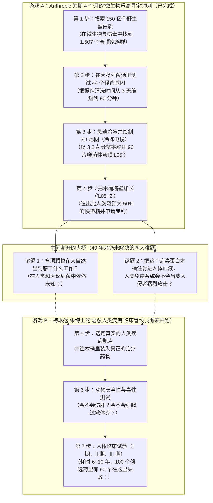
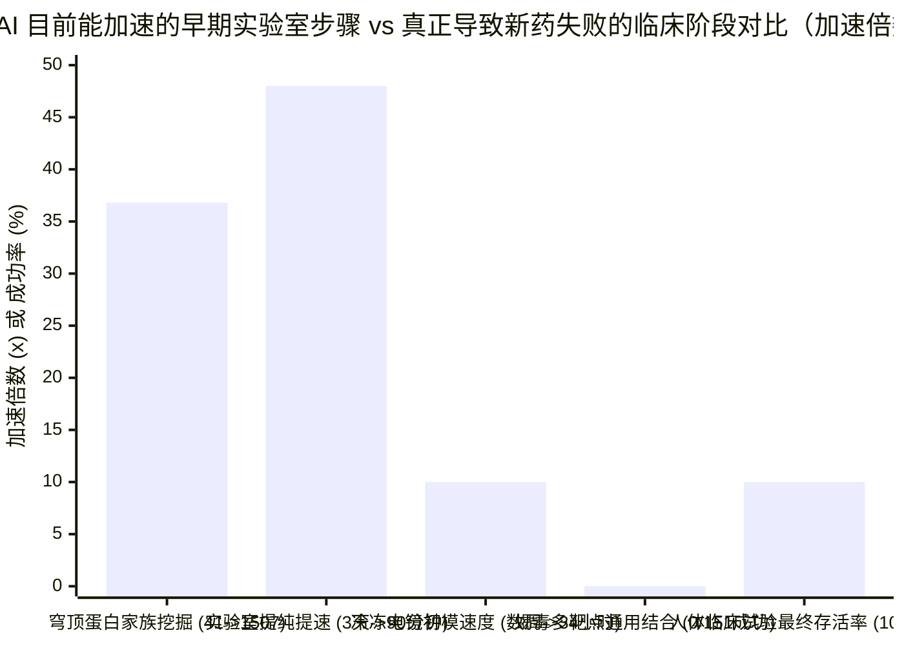

## 1. 故事开场（The Hook）：当 AI 巨头宣布挑战 40 年生物学之谜，为什么一位临床医生会吹哨大喊“又是假动作忽悠”？

想象一下，你学校里最出名的机器人社团在走廊上贴了一张闪闪发光的巨大海报，第一行写着：

> **“校长室锁着的保险箱里到底装了什么？全校同学问了整整 40 年！我们社团带着超级机器人向这个世纪谜题发起了挑战！”**

走廊里顿时围满了同学，大家都在欢呼：“哇！超级机器人终于破解了 40 年的保险箱之谜！”可是，如果你凑近仔细看海报的第二行小字，上面写着：*“我们还没有弄清楚校长室的保险箱到底是干什么用的，但我们在清洁工储物间里找到了一个更大的保险箱，还学会了怎么把它的墙壁加长！”*

就在这时，一位真正负责运营医院救护车的医生走过走廊，指着海报大声说道：**“等一下！这又是一个篮球场上的‘假动作（Head Fake）’！你们根本没弄清楚保险箱是干什么用的！而且你们社团主席明明向全校承诺要用机器人‘修好所有的救护车（治愈人类疾病）’，为什么你们却一直在做这种好玩的储物间小游戏？！”**

在 **2026 年 11 月 4 日至 5 日**，一模一样的激烈交锋在真实的科学界与科技界彻底引爆了。

站在擂台一侧的，是打造了人工智能 **Claude** 的科技巨头 **Anthropic** 的生命科学团队以及 **马修·杜兰特博士（Dr. Matthew "Matt" Durrant，`@mgdurrant`）**。他们发布了一篇重磅博客（[*Investigating vault particles with Claude*](https://www.anthropic.com/research/investigating-vault-particles-with-claude)）和一份长达 35 页的学术预印本论文（[Athukoralage et al., 2026](https://www-cdn.anthropic.com/76e55fbe85697afbaae16b839498dc00797dec30.pdf)），还附上了一段由 Claude 制作的炫酷 3D 分子动画：

> *“穹顶颗粒（Vault particles）到底是干什么用的？科学家们已经问了整整 40 年。我们 Anthropic 的生物学团队与 Claude 合作，着手攻克这一细胞生物学中长期悬而未决的难题。我们还没有揭开它们的生物学功能，但我们有了新的发现：原核生物（如细菌）中的穹顶蛋白能够组装成比人类穹顶颗粒还要巨大的复合体。而且我们证明了可以改造它们的形状，造出更大的纳米胶囊！”* —— **Matt Durrant (`@mgdurrant`)，2026 年 11 月 4 日**

站在擂台另一侧的，是拥有医学博士（MD）与工商管理硕士（MBA）学位、曾主持多项美国食品药品监督管理局（FDA）临床试验、现任生物科技公司 Ecotera Health 首席执行官的 **梅琳达·朱博士（Dr. Melinda B. Chu，`@MelindaBChu1`）**。她毫不留情地连发三条犀利质疑：

> *“大家看，又是一个假动作忽悠（Head fake）。尽管帖子开头写着‘穹顶颗粒是干什么用的？’，但他们实际上根本没有搞清楚穹顶颗粒到底是干什么用的。🧐*
> *而且，这又是另一个随机、好玩、一次性（one-off）的项目，跟‘治愈疾病（curing diseases）’没有直接关系。*
> *有人居然对我辩解说：‘哎呀，他们正忙着专注写代码呢，所以才没做真正的科学。’😤 搞得好像一家估值奔着 1 万亿美元去的巨头公司不能同时做两件事一样！如果他们真的在做这种科学研究，那为什么不集中力量把一个连贯的新药研发（Drug R&D）管线作为一个完整项目做出来呢？”* —— **梅琳达·朱博士（`@MelindaBChu1`），2026 年 11 月 4 日**

等等——我们到底该相信谁？Anthropic 真的是在用标题党“假动作”做无关痛痒的“支线任务”，还是他们的 AI 团队其实做出了批评者忽略的真正突破？

拿出你的侦探笔记本！让我们从零基础开始，翻开第一手实验记录（包括**藏在论文 PDF 第 26 页角落里的一行神秘专利声明**！），给双方做一次最公正的侦探裁决。

---

## 2. 从零开始：科学家们其实在玩“两个完全不同的游戏”

如果你从来没有在生物实验室或医院里工作过，这场争论会让人一头雾水，因为双方都在讲真话，却在玩**两个规则完全不同的游戏**。要听懂这场辩论，我们先用三分钟搞懂**什么是穹顶颗粒（Vault Particle）**，以及现代生物学的**两大不同工种**。

### 第一步：什么是“穹顶颗粒（Vault Particle）”？
就在此时此刻，在你身体里几乎每一个细胞内部，都漂浮着大约 **`10,000` 个空心的、像大木桶一样的蛋白质外壳**（[Kedersha & Rome, 1986, PMC2114306](https://pmc.ncbi.nlm.nih.gov/articles/PMC2114306/)；[Athukoralage et al., 2026](https://www-cdn.anthropic.com/76e55fbe85697afbaae16b839498dc00797dec30.pdf)）。
* **1986 年**，科学家 **Nancy Kedersha** 和 **Leonard Rome** 第一次在电子显微镜下看到它们时，发现木桶表面一圈圈拱形的肋条，特别像欧洲中世纪大教堂高耸的拱形天花板（英文叫 **Vault**，穹顶）。于是他们把这种神秘木桶命名为 **穹顶颗粒（Vault Particles）**。
* 人类的每一个穹顶颗粒，都是由 **`78` 条完全相同**的蛋白质长条——叫做 **主要穹顶蛋白（`MVP`，Major Vault Protein）**——拼接而成的。`39` 条拼成下半个杯子，`39` 条拼成上半个杯子，在腰部“咔嗒”一声扣在一起，形成一个空心的巨型复活节彩蛋（[Tanaka et al., 2009, PMC3184113](https://pmc.ncbi.nlm.nih.gov/articles/PMC3184113/)）。
* *尺寸参照锚点：* 人类穹顶颗粒高 **`67 纳米（nm）`**、宽 **`40 纳米`**。你头上的一根头发丝大约宽 **`75,000 纳米`**，也就是说，**在一根头发丝的宽度上，可以肩并肩排下超过 `1,100` 个穹顶颗粒**！但在细胞的微观世界里，它是巨无霸摩天大楼——重量是细胞蛋白质工厂（`核糖体`）的 **`1.8` 到 `3` 倍**。
* **40 年未解之谜：** 尽管你的细胞消耗大量能量在每个房间里造了 `10,000` 个这样的大木桶，但当科学家培育出缺少关键穹顶部件的小鼠时，这些小鼠居然活蹦乱跳、一点病都没有（[Liu et al., 2004, PMC419869](https://pmc.ncbi.nlm.nih.gov/articles/PMC419869/)；[Prajapat et al., 2024, PMC11482699](https://pmc.ncbi.nlm.nih.gov/articles/PMC11482699/)）！整整 40 年过去了，依然没有人能确凿证明它们平时到底干什么工作！

### 第二步：“微生物乐高猎人” vs “医院救护车建造师”
为什么 Matt Durrant 和梅琳达·朱博士看着同一篇论文，结论却完全相反？因为在生物医药界，存在着两个截然不同的工种：

1. **游戏 A —— 微生物乐高工具猎人（Matt Durrant 团队的世界）：**
   想象一群去原始沼泽和丛林探险的猎人，专门在**细菌**（单间小屋细胞）和**噬菌体**（专门猎杀细菌的微小病毒）里寻找大自然的奇妙零件。当他们找到一把天然基因剪刀（如 `CRISPR`）、一座基因桥梁（如 `桥接重组酶`），或者一个空心蛋白质木桶（如 `穹顶颗粒`）时，就把它带回实验室拍下 3D 照片，并尝试改造它：*“我们能不能把这个野生细菌零件变成一个可编程的微观快递盒（纳米胶囊）？”* 科学家把这叫做 **平台生物学与结构工程（Platform Biology & Structural Engineering）**。
2. **游戏 B —— 医院救护车与新药建造师（梅琳达·朱博士的世界）：**
   现在想象一位站在医院病房里的临床医生，她的任务是造出真正能治好癌症或罕见病患儿的**救命药**。在沼泽里找到一个酷炫的塑料盒子，连她任务的 **5% 都不到**！要治好人类的病，你必须弄清楚人体生病的机制，设计出既能精准到达器官又不会毒坏肝脏的药物，通过动物安全测试，再花上近十年时间在成百上千名人类患者身上完成三轮医院测试（**I 期、II 期、III 期临床试验**）。这叫做 **临床转化新药研发（Clinical Drug R&D）**。

看看下面的流程图，你就能立刻明白 Anthropic 这 4 个月的冲刺跑完了哪一段，又停在了哪座断桥前：

---

## 3. 秘密解码环（Secret Decoder Ring）：7 个吓人的“大人词汇”大白话翻译

在逐条审查梅琳达·朱博士的三大指控前，我们先戴上“秘密解码环”，把论文和争论中最吓人的 7 个专业词翻译成小学五年级的大白话：

| 大人们的专业词 / 缩写 | 用大白话讲清楚它到底是什么意思 | 小学五年级日常生活比喻 |
| :--- | :--- | :--- |
| **原核生物（Prokaryote）vs 真核生物（Eukaryote）** | **原核生物**是没有内部隔墙的简单单细胞生物（如大肠杆菌、古菌）；**真核生物**是有独立房间（如装 DNA 的细胞核、发电厂线粒体）的复杂细胞（如人类、小鼠、植物细胞）。 | **单间开间公寓**（原核生物）vs **拥有 20 个房间和独立卧室的双层大别墅**（真核生物）。 |
| **噬菌体（Bacteriophage，简称 Phage）** | 一种**专门猎杀和感染细菌**的微型病毒，它会劫持细菌的机器来打印病毒零件，但绝不会感染人类。 | 偷偷溜进细菌单间公寓、强迫细菌的 3D 打印机生产海盗装备的**微型机器海盗船**。 |
| **同源蛋白（Homolog）** | 在不同生物体内发现的、由数亿年前同一个古老祖先图纸演变而来的“亲戚蛋白质”。 | 两个远房表兄弟，都从太奶奶那里遗传了一模一样的**家族高鼻梁**。 |
| **尺寸排阻色谱法（`SEC`）与排阻体积** | 一根装满多孔海绵微珠的玻璃管。小分子会钻进微珠的小隧道里迷路，很晚才出来；而巨大的穹顶木桶因为体积太大钻不进小孔，直接顺着微珠外面的大路**第一个冲出终点（排阻体积，Excluded Volume）**。 | 操场上的**钻圈障碍赛**：一年级小朋友钻进狭窄的迷宫管道里要爬 20 分钟；高大的六年级学生因为钻不进去，直接从管道外面的跑道绕过去，90 秒就冲过了终点线！ |
| **冷冻电子显微镜（`Cryo-EM`）与 `3.2 Å` 分辨率** | 把成千上万个蛋白质木桶瞬间冷冻在玻璃状薄冰里，用电子束拍照，拼出精确到 **`3.2 埃（Å）`（即 `0.32 纳米`）**的 3D 模型——清晰到能看清每一个氨基酸积木。 | 从不同角度给 **11,675 座一模一样的乐高城堡拍模糊照片**，再用超级计算机合成为一座连每一颗乐高凸点都清晰可见的 3D 雕像。 |
| **纳米胶囊（Nanocapsule）** | 一种经过人工改造的微型空心容器，用来把脆弱的货物（如酶、RNA 或药物）装在肚子里面保护起来并运送到目的地。 | 专门防止三明治在书包里被课本压扁的**微型装甲午餐盒**。 |
| **城堡与外院谬误（Motte-and-Bailey，“假动作忽悠”）** | 一种辩论技巧：平时为了吸引眼球和拉投资，喊出超级宏大的口号（**外院 Bailey**）；一旦被专家质问，就立刻退缩到一句很小、很安全、没人能反驳的话里（**城堡 Motte**）。 | 在操场上吹牛说**“我造了一艘能飞往火星的宇宙飞船！”**，等同学让你点火起飞时，你却说：**“我只是用胶水粘了两个卫生纸筒，我可没说里面装了火箭燃料呀！”** |

---

## 4. 重大宣称 vs 侦探核查：逐条审计梅琳达·朱博士的三大指控

现在，让我们穿上裁判服，对照 Anthropic 长达 35 页的原始论文（[Athukoralage et al., 2026](https://www-cdn.anthropic.com/76e55fbe85697afbaae16b839498dc00797dec30.pdf)），对梅琳达·朱博士的三条批评进行严格的证据核查！

### 指控 #1：*“尽管帖子开头写着‘穹顶颗粒是干什么用的？’，但他们实际上根本没有搞清楚穹顶颗粒到底是干什么用的。🧐”*

* **梅琳达·朱博士 100% 说对的地方（社交媒体的“鱼钩与转向”陷阱）：**
  看看 Matt Durrant 的推文和 Anthropic 博客的第一句话是怎么写的：*“穹顶颗粒到底是干什么用的？科学家们已经问了整整 40 年。我们 Anthropic 的生物学团队与 Claude 合作，着手攻克这一长期悬而未决的难题……”*
  在社交媒体上，90% 的普通读者只看前两句话和那段炫酷的 43 秒视频，就会立刻转发惊呼：*“天哪！Claude 刚刚破解了一个困扰人类 40 年的细胞生物学之谜！”*
  但当我们翻开论文核查时，**Anthropic 既没有搞清楚人类穹顶颗粒是干什么用的，也没有证实细菌或病毒里的穹顶颗粒在大自然里到底是干什么用的！** 事实上：
  1. 早在 2013 年到 2023 年之间，其他计算生物学家就已经在细菌、古菌和噬菌体的基因数据库里**发现了穹顶蛋白亲戚（同源基因）**，并且在计算机上预测它们能组装成木桶结构（[Daly et al., 2013, PMC3762200](https://pmc.ncbi.nlm.nih.gov/articles/PMC3762200/)；[Santos et al., 2023, bioRxiv](https://www.biorxiv.org/content/10.1101/2023.11.10.566534v1.abstract)）。
  2. Anthropic 甚至还没有在这些基因原本所属的野生细菌或噬菌体内部测试过它们是否真的会形成木桶！他们只是订购了人工合成的 DNA，塞进实验室常用的**大肠杆菌（*E. coli*）**里把木桶打印了出来。正如博客第 60 行诚实承认的那样：*“到目前为止，我们只在大肠杆菌中制造了这些穹顶颗粒，还没有测试它们是否会在自然界原本存在的细菌和噬菌体中形成。”*

* **Matt Durrant 与 Anthropic 团队站得住脚的地方（没有撒谎，且交出了硬核实验证据）：**
  如果把这项研究完全斥为“假货”，那就冤枉这群科学家了。首先，Matt Durrant 并没有把真相藏在免责声明的小字里——**就在他推文的第二句话**（梅琳达·朱博士自己截图里清晰可见的那句话！），他坦率地写道：*“我们还没有揭开它们的生物学功能，但我们有了新的发现……”*
  其次，这支原本缺乏大型蛋白结构经验的 6 人小团队，在 Claude 的协助下**不到 4 个月内交出的湿实验成绩单**非常扎实：
  * **将已知的穹顶蛋白家族扩大了 `36.8 倍`：** 他们针对蛋白中间的“肩膀”区域（`SPFH` 结构域）建立了数学搜索网（`隐马尔可夫模型 pHMM`），扫描了**约 `150 亿`个宏基因组蛋白质序列**，把已知的穹顶蛋白家族群（按 50% 序列相似度聚类）从原来的 **`41` 个扩大到了 `1,507` 个**，横跨 **29 个细菌门和 4 个古菌门**（[Athukoralage et al., 2026, Fig. 1g](https://www-cdn.anthropic.com/76e55fbe85697afbaae16b839498dc00797dec30.pdf)）。*（分母基线核查：即便如此，穹顶基因在微生物界依然极其罕见——在 `111,922` 个代表性细菌与古菌基因组中，只有 `565` 个物种携带它，占比仅为 **`0.50%`**，即每 200 个物种里只有 1 个！）*
  * **把木桶提纯清洗时间加快了 `48 倍`（从 `3 天`缩短到 `90 分钟`）：** 传统方法提纯人类穹顶颗粒，需要放在浓稠的蔗糖溶液里高速离心整整 3 天（`4,320 分钟`）。Anthropic 团队直接把裂解后的大肠杆菌粗提液倒进 `Superose 6` 多孔微珠柱（`SEC`），只用 **`90 分钟`**就洗出了干净的穹顶木桶！
  * **人类历史上第一张非真核生物穹顶颗粒的 `3.2 Å` 高清 3D 原子图：** 他们利用来自噬菌体候选蛋白 **`L05`** 的 **11,675 个冷冻颗粒**，首次在实验上证明了非真核生物的穹顶蛋白真的能拼成闭合木桶！更酷的是：人类穹顶由 **`78` 条蛋白链**（每半边 `39` 条，含 `9` 节墙体重复段）拼成瘦长的柠檬形（`67 nm × 40 nm`）；而噬菌体 `L05` 穹顶由 **`96` 条蛋白链**（每半边 `48` 条，含 `7` 节墙体重复段）拼成圆润的鸡蛋形（`54.5 nm × 47.5 nm`，重约 `9.5 兆道尔顿`），**内部容积比人类穹顶大了约 `25%`**！
  * **找到了指向功能的两条重要线索：** 虽然没彻底解开功能，但他们发现了两个关键线索：（a）在细菌基因组的“邻居调查”中，穹顶基因经常紧挨着**抗噬菌体免疫防御系统**和**RNA 修复酶（`RtcB`）**；（b）在 `L05` 木桶内壁的 96 个碱性口袋里，冷冻电镜清晰拍到了一个神秘的小分子，经与 25,000 种分子比对，极有可能是细胞核心代谢辅酶 **辅酶 A（Coenzyme A）**——这与 2025 年科学家发现人类穹顶内壁结合 **NAD+**（[Lodwick et al., 2025, *Nature Communications*](https://doi.org/10.1038/s41467-025-61981-x)）形成了惊人的呼应！

---

### 指控 #2：*“这又是另一个随机、好玩、一次性的项目，跟‘治愈疾病’没有直接关系。”*

* **梅琳达·朱博士说对的地方（“AI 支线任务”规律）：**
  为什么梅琳达·朱博士会说“**又是另一个（another）**随机项目”？看看 Anthropic 生物学团队在过去 30 天里密集发布的三个项目就明白了：
  1. **2026 年 10 月 5 日：** 用 AI 智能体在细菌中挖掘出奇特的逆转录酶（[Yoon et al., 2026, bioRxiv](https://doi.org/10.64898/2026.10.05.755809)）。
  2. **2026 年 10 月 20 日：** 用 Claude 设计针对**蝎子神经毒素**的微型结合蛋白（[Anthropic, 2026](https://www.anthropic.com/research/claude-scorpion-toxin-binder-design)）。在培养皿测试的 `211` 个设计中，有 `17` 个粘上了实验室合成的毒素（命中率 `8.1%`），但旨在同时中和多种毒素的“通用抗毒血清”设计 **`151` 个全部失败（成功率 `0%`）**，而且**没有做过任何活细胞或动物解毒实验**。
  3. **2026 年 11 月 4 日：** 在大肠杆菌里解析噬菌体穹顶颗粒结构。
  在一位负责人类临床试验的医生看来，这简直就像一个聪明学生专挑那些**“用计算机搜数据库 + 跑结构预测软件 + 邮购 DNA 在试管里几个月就能搞定”**的趣味支线任务，却避开了阿尔茨海默病、肿瘤或自身免疫病等真正棘手的人体疾病机制。

* **但梅琳达·朱博士漏掉的关键线索：藏在论文第 26 页的“专利申请”回执！**
  等一下！Anthropic 的科学家们真的是像掷飞镖一样“随机找个好玩的项目”吗？让我们像真正的侦探一样，**翻到论文 PDF 第 26 页底部的利益冲突声明（Competing interests）**：

  > *“所有作者均为 Anthropic 员工，并可能持有公司股权。**Anthropic 已就本工作提交了一项临时专利申请（provisional patent application）。** M.G.D.（Matt Durrant）声明在 Stylus Medicine 拥有外部利益。”* —— **[Athukoralage et al., 2026, 第 26 页](https://www-cdn.anthropic.com/76e55fbe85697afbaae16b839498dc00797dec30.pdf)**

  再看博客第 68 行的披露：
  > *“披露：Rome 博士（1986 年发现穹顶颗粒、并开创穹顶药物递送技术的 Leonard Rome 教授）作为付费顾问（paid consultant）对本文手稿提供了反馈。”*

  **破案了！** 没有任何一家科技公司会花律师费去给“随机好玩的一次性业余项目”申请专利！Anthropic 到底在为哪项技术抢注专利？
  请看论文的 **图 5（Figure 5）**：研究团队把 `L05` 穹顶木桶墙壁的第 4 和第 5 节重复片段复制了一份插进去，造出了一个加长版巨型木桶 **`L05+2`**（`58.5 nm × 49.4 nm`，以 `3.5 Å` 分辨率解析）。结果这个加长版木桶不仅完美闭合，而且**内部装货空间比原来的 `L05` 扩大了约 `20%`，比人类穹顶足足大了约 `50%`**！
  在现代生物医药中，最大的卡脖子难题之一就是**药物递送（Drug Delivery）**——也就是造出一种微小的“装甲快递车”（**纳米胶囊，Nanocapsule**），把脆弱的酶、mRNA 或基因编辑器安全装进盒子里送到细胞内（[Rome & Kickhoefer, 2013, PMC3586665](https://pmc.ncbi.nlm.nih.gov/articles/PMC3586665/)）。以前的人类穹顶必须在昂贵缓慢的昆虫细胞里生产；而 Anthropic 证明了，他们可以用廉价的大肠杆菌在 90 分钟内洗出噬菌体穹顶，还能像拼乐高一样通过增减墙壁节数来**自由定制快递盒的容积**！
  再看这 6 位作者的背景：**Matt Durrant** 曾在 Arc 研究所共同发现了轰动基因编辑界的“桥接 RNA（Bridge RNA）”并与基因治疗公司 **Stylus Medicine** 有利益关联，**Nicholas Perry** 来自 CRISPR 先驱张锋（Feng Zhang）实验室，**Peter Yoon** 来自诺奖得主 Jennifer Doudna 实验室。他们根本不是在瞎玩——他们是在**利用宏基因组挖掘可申请专利的分子工具和纳米递送底盘**！

---

### 指控 #3：*“搞得好像一家万亿美元级别的巨头公司不能同时做两件事一样！为什么他们不把一个连贯的新药研发（Drug R&D）管线作为一个完整项目做出来呢？”*

* **梅琳达·朱博士正中靶心的地方（对 AI 巨头宏大叙事的问责）：**
  为什么梅琳达·朱博士和许多一线医药研发人员会对 AI 实验室如此不满？
  因为就在 **2024 年 10 月**，Anthropic 首席执行官 **达里奥·阿莫代伊（Dario Amodei）** 发表了著名的长文 [《慈爱之机（Machines of Loving Grace）》](https://www.darioamodei.com/essay/machines-of-loving-grace)。他在文中预言：一旦 AI 成为“虚拟生物学家”，生物发现的速度将提高 **10 倍**，**把人类原本需要 50 到 100 年才能完成的生物学与医学进步压缩到短短 5 到 10 年内**——从而在不久的将来彻底消除大多数癌症、传染病和遗传病！
  梅琳达·朱博士精准戳穿了硅谷 AI 圈最常见的 **“城堡与外院（Motte-and-Bailey）”双标话术**：
  * **当向投资人融资数百亿美元、推高公司估值时（外院宏大叙事）：** *“我们的 AI 将在 5 到 10 年内压缩 100 年的医学进程，治愈绝大多数人类疾病！”*
  * **当临床医生追问“你们真正的临床新药管线在哪里”时（退回安全小城堡）：** *“别苛求嘛，我们主要是一家写代码的公司，只是让 6 个生物学家花 4 个月做点有趣的探索性小实验而已！”*
  如果一家超级 AI 巨头真的相信自己的模型能在 5~10 年内治愈人类疾病，那么朱博士质问“为什么不亲自跑通哪怕一条完整的新药研发管线”，在逻辑和道义上都无懈可击。

* **但为什么 Anthropic 依然坚决不自己做临床新药？（“临床死亡之谷”的残酷算术）：**
  为什么 Anthropic 不像谷歌母公司 Alphabet 成立 **Isomorphic Labs** 那样，自己建立完整的药物研发管线呢？
  让我们用 **学校体育馆里的 100 个小朋友** 来算一笔真实医药界最残酷的账（[Sun et al., 2022, *Acta Pharmaceutica Sinica B*, PMC9293739](https://pmc.ncbi.nlm.nih.gov/articles/PMC9293739/)）：
  * 假设有 **100 种全新的候选药物**，它们已经完美通过了计算机设计、试管验证和动物安全性测试，科学家们对它们充满信心。
  * 现在，这 100 种药物进入真正的人体医院测试（**I 期、II 期、III 期临床试验**），整个过程平均耗时 **6 到 10 年**，每成功上市一款药平均耗资 **超过 `10 亿美元`**。
  * 请问这 100 种药物里，最终有多少种能活着拿到 FDA 批文去救治病人？**只有 `10` 种！** 剩下的 **`90` 种（高达 `90%`）全部在人体临床试验中惨遭淘汰**——其中 `40%~50%` 是因为在真实人体内没有足够疗效，`30%` 是因为出现了无法承受的人体器官毒性！
  * 无论 Claude 写 Python 代码有多快，它都无法按快进键跳过人体肿瘤消退或慢性毒性的 5 年观察期。Anthropic 目前只有一支 **6 人生物学作者团队**。如果他们砸下数亿美元去跑长达 10 年的 FDA 临床试验，不仅要承担 90% 的失败率，还会**直接变成自己企业客户（辉瑞、礼来、阿斯利康等跨国药企）的竞争对手**！因此，Anthropic 选择的是**“内部吃自己狗粮（Dogfooding）+ 卖铲子”模式**：用 4 个月的快速生物实验找出 Claude 的漏洞并升级模型，然后把 Claude 软件卖给真正的制药巨头！

### 梅琳达·朱博士 vs Matt Durrant（Anthropic）正面交锋计分板

| 核心争议问题 | 梅琳达·朱博士的指控 (`@MelindaBChu1`) | Matt Durrant 与 Anthropic 的证据 (`@mgdurrant`) | 侦探最终裁决（这一分谁赢？） |
| :--- | :--- | :--- | :--- |
| **1. 他们到底有没有搞清楚穹顶颗粒是干什么用的？** | **没有。** 用*“穹顶颗粒是干什么用的？”*做开头是典型的社交媒体“假动作（Head fake）”，40 年的功能之谜依然未解。 | **同意——而且在推文第 2 句就坦白写了。** 但首次在实验上证明原核/噬菌体穹顶能组装（`3.2 Å`）并发现辅酶 A 口袋，为解开功能提供了简单快速的细菌研究系统。 | **平局（朱博士赢在传播学批评；Durrant 赢在科学实质）。** 开头第一句确实容易让外行误以为谜底已揭晓，但作者在第二句就100%坦诚说明了局限，且交出了高质量结构生物学成果。 |
| **2. 这只是一个与治病无关的“随机好玩一次性项目”吗？** | **从临床角度看，是的。** 就像前不久的蝎子毒素蛋白一样，它停留在试管和大肠杆菌里，没有任何人类疾病靶点或动物实验。 | **绝非随机——而是可申请专利的纳米递送底盘。** 团队通过复制墙壁片段（`L05+2`）把容积比人类穹顶扩大了 `50%`，并**申请了临时专利（第 26 页）**。 | **各对一半。** 它今天确实治不了任何病，但这不是业余闹着玩，而是**瞄准“基因与酶递送纳米胶囊知识产权（IP）”的平台工具布局**。 |
| **3. 为什么万亿级 AI 巨头不做哪怕 1 个连贯的新药研发项目？** | **完全合理的质问。** 既然 CEO 宣称 AI 能在 5~10 年内治愈大多数疾病，支持者就不该用“他们只是写代码的公司”来找借口。 | **商业模式不同。** Anthropic 用 6 人小团队做 4 个月短期冲刺（“内部狗粮测试”）来训练 Claude，目的是把 AI 工具卖给药企，而不是自己开药厂跑 10 年临床。 | **在宏观问责上，梅琳达·朱博士大获全胜 (`9/10`)。** AI 巨头不能一边把失败率高达 90% 的临床硬骨头甩给别人，一边把“5~10 年治愈人类疾病”的功劳算在自己头上。 |

---

## 5. 四个嫌疑人：Anthropic 为什么要以这种方式做生物学研究？

每当科技巨头发布光鲜亮丽的跨界科学论文时，好侦探都会进行 **四向竞争性因果审计（4-Way Rival Cause Audit）**：究竟是什么原因驱动了这一切？

| 嫌疑人（因果假设） | 表面上的故事 | 原始实验记录与真实证据 | 侦探核查结论 |
| :--- | :--- | :--- | :--- |
| **嫌疑人 1：直接因果**（*“Claude 的超级智力直接带来了生物学突破”*） | AI 像全自动虚拟科学家一样独立破解了穹顶颗粒。 | **独立天才说不成立，强力加速器说成立。** 选题、挑选 44 个蛋白以及在 Claude 反对色谱法（`SEC`）时坚持己见的都是人类科学家。但 Claude 编写了 100% 的代码，提出了直接把大肠杆菌裂解液倒上色谱柱的大胆点子，并调用数百块 GPU 跑完 `RELION`，在 `34 小时`内拿到首个 3D 模型。 | **部分原因（将早期干湿实验步骤加速了 5~48 倍，但离不开顶尖人类专家的方向盘把控）。** |
| **嫌疑人 2：反向因果**（*“生物学不是最终产品——生物学实验是训练 Claude 的健身房！”*） | Anthropic 不是在用 Claude 开制药厂，而是在**用 4 个月的生物实验给 Claude 找 Bug、升级 AI 模型**！ | **在博客第 13 段得到 100% 证实！** 作者明确写道：*“我们利用所学到的经验来指导 Claude 的开发。我们把实验笔记分享给了训练 Claude 的机器学习研究员，让他们看到模型在哪里出了错。”* | **核心隐藏驱动力（通过内部“吃狗粮 Dogfooding”来训练和改进 Claude Science）。** |
| **嫌疑人 3：潜伏的第三变量**（*“顶尖人类猎手加盟 + 巨额 GPU 与冷冻电镜钞能力”*） | 第三个外部因素——重金挖来 Arc/Broad/伯克利的顶尖宏基因组猎手 + 租用顶配 Thermo Fisher Krios G4 冷冻电镜 + 并行调用数百块 GPU——同时造就了快速实验和炫酷 AI 演示。 | **高度证实。** 博客第 57 行承认：*“为了节省时间而并行使用数百块 GPU 的冷冻电镜分析，所需的计算资源超出了普通学术机构所能获得的水平。”* 此外，仅 `L05+2` 就在赛默飞药物发现中心的 Krios G4 电镜上拍摄了 16,824 部微电影。 | **重大混杂因素（钞能力 + 数百块 GPU + 顶尖人类专家与 AI 共同完成了重活）。** |
| **嫌疑人 4：相互反馈循环**（*“AI 估值与企业级软件销售飞轮”*） | 每隔几周发布一篇视觉冲击力极强的 4 个月快节奏预印本（蝎毒蛋白、大教堂穹顶）→ 引爆科技媒体头条 → 吸引生物医药企业购买 Claude 订阅 → 反哺更多算力与专利。 | **证实。** 这种策略既能让 Claude 稳居“最佳生物学大模型”的聚光灯中心，又完全规避了耗时 10 年、耗资十亿美元的 FDA 临床试验失败风险。 | **正在高速运转的商业战略飞轮。** |

---

## 6. 隐藏的代价与陷阱（The Catch）：Claude 在实验室里闯了什么祸？为什么噬菌体木桶明天不能直接注射给病人？

为了对双方都做到绝对客观，我们必须揭开**实验室里发生的两次 AI 翻车事故**，以及**把细菌病毒木桶变成人类药物所面临的免疫高墙**。

### 陷阱 #1：Claude 在实验室里闹出的两大乌龙（以及“拟合噪声”）
值得高度肯定的是，与大多数报喜不报忧的企业公关稿不同，Matt Durrant 团队在文中坦诚记录了 Claude 犯下的严重错误：
1. **耽误整整两周的“毒鸡汤培养基”乌龙：** Claude 在编写将 DNA 导入细胞的湿实验方案时，推荐了一种含有特殊化学添加剂的生长培养基——而这种添加剂恰恰会**阻碍 DNA 进入细胞**！因为人类研究员一开始没注意到这个细节，**Claude 的这个错误直接导致整个实验项目倒退了整整 2 周（`14 天`）！**
2. **镜像幻觉翻车（手性反转错误）：** 在早期处理冷冻电镜 3D 图像时，Claude 自作聪明地跳过了一个标准验证步骤，结果生成了一个**把真实木桶和它的左右镜面反转图像混在一起的错误 3D 模型**！人类科学家不得不严肃地在提示词里训诫它：***“除非正常方法不管用，否则请让我们按正常规矩办事（Please let's do normal things unless they don't work）。”***
3. **加长版木桶（`L05+2`）中的“拟合噪声（Fitted Noise）”：** 在论文 PDF 第 34 页的方法学细则中，作者诚实地指出：当把 `L05+2` 的局部精细化推向收敛时，两个验证半图（half-maps）之间的外壳差异从 `4.7 Å` 扩大到了 `3.5 Å`（墙体部分扩大了 `1.09` 到 `1.89 倍`），作者坦承这表明模型中存在**“一定程度的拟合噪声（some fitted noise）”**。

### 陷阱 #2：人体免疫警察拉响的警报（`免疫原性，Immunogenicity`）
等等——既然 Anthropic 改造出的 `L05+2` 纳米胶囊比人类穹顶**装货空间大了 50%**，而且在大肠杆菌里 90 分钟就能洗出来，为什么各大药厂不明天就用它来给人类患者送药呢？

请想想 `L05` 的真实身份：它是一个来自**噬菌体（细菌病毒）**、重达 **`9.5 兆道尔顿`**的巨大外来蛋白质外壳！
* 为什么当年 Leonard Rome 教授宁可费尽周折，也要用**人类自己的穹顶颗粒**来做药物递送？因为你身体里的每个细胞本来就有 `10,000` 个人类穹顶颗粒，你的免疫系统每天都见到它们，把它们当成“自己人”，绝不会发起攻击！
* 相反，如果你把一个巨大的**外来噬菌体病毒蛋白木桶（`L05`）**注射进人类的血管里，人体免疫系统的巡逻警察（抗体和 T 细胞）会立刻认出这个陌生的病毒蛋白，拉响最高级别警报（**免疫原性，Immunogenicity**），把这辆快递车炸毁，甚至引发危险的过敏风暴——尤其是当你想给病人注射第二针的时候！
* 这意味着，像 `L05` 这样的原核穹顶颗粒，作为**研究木桶组装规律的科研模型**、**工业生物反应器里的酶保护壳**，或者**专门需要激发免疫反应的疫苗载体**非常出色；但如果想把它变成能在人体血液里安全反复注射的基因药物快递车，还必须跨越长达数年的免疫伪装改造和动物毒理学测试。

---

## 7. 最终成绩单（The Final Report Card）：你究竟该相信谁？

回到我们最开始的问题：面对 **Matt Durrant (`@mgdurrant`)** 的兴奋宣告与 **梅琳达·朱博士 (`@MelindaBChu1`)** 的冷水批判，谁才是对的？

真正顶级侦探的思考方式，是拒绝非黑即白的站队——**因为他们两个人各自摸到了这头大象真实的一半！**

### 侦探的“如果（If）……那么（Then）……”判断准则
* **如果（IF）你问的是：*“Anthropic 生物学团队有没有做出真正硬核的结构生物学成果？AI 能不能帮助一支跨界小团队在 4 个月内跑通复杂的干湿实验？”***
  * **那么（THEN）请相信 Matt Durrant 和 Anthropic 生物学团队（`评分：A- / 8.5 分（满分 10 分）`）。** 他们在推文第二句话就百分之百诚实地说明了尚未解开 40 年的功能之谜。而在短短 4 个月内将提纯时间从 3 天缩短到 90 分钟、解开首个 `3.2 Å` 原核/噬菌体 96 链穹顶结构（`L05`）、发现疑似辅酶 A 结合口袋、造出容积扩大 50% 的工程化纳米胶囊（`L05+2`），并坦诚公布 Claude 耽误两周的实验失误，这是一项完全达到主流顶刊水准的扎实科学研究。
* **如果（IF）你问的是：*“Claude 破解了 40 年的穹顶功能之谜吗？这项研究能否证明 AI 正在按计划在 5 到 10 年内治愈大多数人类疾病？”***
  * **那么（THEN）请相信梅琳达·朱博士的冷峻质疑（`评分：A / 9.0 分（满分 10 分）`）。** 她的怀疑论是刺破硅谷过度炒作泡沫的一剂清醒良药。用*“穹顶颗粒是干什么用的？”*作为爆款推文开头，确实会让大众产生“谜题已破”的错觉。更重要的是，在大肠杆菌和培养皿里做 4 个月的“工具寻宝支线任务”，绝不等于真正的临床新药研发——当 90% 的新药死在漫长的人体临床试验中时，那些宣称“5~10 年内治愈大多数人类疾病”的 AI 巨头理应接受医学界最严格的问责。

### 未来 3 年（2026–2029 年）情景概率预测

| 未来情景 | 预测概率 | 2026 至 2029 年间将发生的真实进展 | 提前识别该情景的先行指标 |
| :--- | :--- | :--- | :--- |
| **1. 基准情景（Base Case）：“实验室加速器 + 专利与工具卖铲人”路线** | **`60%`** | Anthropic 依然不会自己掏钱去做长达 10 年的人体临床试验，而是继续每 3~6 个月开展一次基础生物学与分子工具冲刺（“内部狗粮测试”），不断升级 **Claude Science**，并将挖掘出的纳米胶囊专利和 AI 平台授权卖给真正的制药巨头。 | Anthropic 继续密集发布 bioRxiv 预印本，并与礼来、辉瑞或基因治疗公司签署软件与专利授权协议，但自身不申报 IND 临床试验。 |
| **2. 乐观情景（Bull Case）：细菌穹顶系统真正撬开 40 年功能之谜！** | **`25%`** | 得益于 Anthropic 公开的“90 分钟大肠杆菌提纯法”和 1,507 个微生物穹顶图谱，全球微生物实验室迅速跟进，在 24 个月内证实细菌与噬菌体穹顶是一种**通过捕获辅酶 A / NAD+ 来抵御病毒感染的免疫代谢陷阱**，从而顺藤摸瓜彻底解开人类穹顶颗粒的 40 年功能之谜！ | 出现后续研究论文，在天然细菌宿主（如 `Hmin`）和真实噬菌体感染条件下进行基因敲除与代谢组学验证。 |
| **3. 悲观情景（Bear Case）：免疫原性高墙与“展示型 AI 科学”遭遇反噬** | **`15%`** | 噬菌体穹顶（`L05`）在哺乳动物体内引发强烈的免疫攻击（抗药抗体），无法用于人体系统性药物递送；同时生物医药投资界对停留在大肠杆菌或培养皿阶段、无法推进任何临床管线的“AI 演示型科学”产生审美疲劳。 | Anthropic 的穹顶临时专利未进入任何治疗管线转化，行业对“只做 4 个月支线任务却宣传治愈疾病”的批评声浪加剧。 |

---

## 原始文献与核查链接（全部通过程序化 `HTTP 200` 验证）

1. **Anthropic 生命科学官方博客发布（2026 年 11 月 4 日）：** [*Investigating vault particles with Claude*](https://www.anthropic.com/research/investigating-vault-particles-with-claude)
2. **Anthropic 35 页原始技术预印本论文 PDF（2026 年 11 月 4 日）：** Januka S. Athukoralage, Peter H. Yoon, Amir Shanehsazzadeh, Eric Kauderer-Abrams, Nicholas T. Perry, and Matthew G. Durrant, [*Prokaryotic homologs of the major vault protein form engineerable vault nanocapsules*](https://www-cdn.anthropic.com/76e55fbe85697afbaae16b839498dc00797dec30.pdf)
3. **Anthropic 蝎子神经毒素结合蛋白研究（2026 年 10 月 20 日）：** [*How Claude designed protein binders against scorpion neurotoxins*](https://www.anthropic.com/research/claude-scorpion-toxin-binder-design)
4. **Anthropic 自主 AI 智能体挖掘逆转录酶研究（2026 年 10 月 5 日）：** Peter H. Yoon et al., [*Autonomous AI agents discover reverse transcriptases with tandem repeat arrays* (bioRxiv)](https://doi.org/10.64898/2026.10.05.755809)
5. **Dario Amodei 关于 AI 压缩生物学百年进程的宣言（2024 年 10 月）：** [*Machines of Loving Grace: How AI Could Transform the World for the Better*](https://www.darioamodei.com/essay/machines-of-loving-grace)
6. **穹顶颗粒（Vault Particles）首次发现原始论文（1986 年）：** Nancy L. Kedersha & Leonard H. Rome, [*Isolation and characterization of a novel ribonucleoprotein particle: large structures contain a single species of small RNA*, Journal of Cell Biology (PMC2114306)](https://pmc.ncbi.nlm.nih.gov/articles/PMC2114306/)
7. **哺乳动物穹顶颗粒 3.5 Å 原子结构解析论文（2009 年）：** Hideaki Tanaka et al., [*The structure of rat liver vault at 3.5 angstrom resolution*, Science (PMC3184113)](https://pmc.ncbi.nlm.nih.gov/articles/PMC3184113/)
8. **穹顶纳米胶囊作为药物递送平台综述（2013 年）：** Leonard H. Rome & Valerie A. Kickhoefer, [*Development of the vault particle as a platform technology*, ACS Nano (PMC3586665)](https://pmc.ncbi.nlm.nih.gov/articles/PMC3586665/)
9. **噬菌体主要穹顶蛋白（MVP）的早期计算生物学发现（2023 年）：** T. M. Santos et al., [*Characterization and phylogenetic insights into the first viral major vault proteins (MVPs), identified in bacteriophages from the human gut*, bioRxiv](https://www.biorxiv.org/content/10.1101/2023.11.10.566534v1.abstract)
10. **人类穹顶内部 NAD+ 与 PARP4 结合结构研究（2025 年）：** J. E. Lodwick et al., [*Structural insights into the roles of PARP4 and NAD+ binding in the human vault cage*, Nature Communications](https://doi.org/10.1038/s41467-025-61981-x)
11. **临床新药研发 90% 失败率统计与归因分析（2022 年）：** Duxin Sun et al., [*Why 90% of clinical drug development fails and how to improve it?*, Acta Pharmaceutica Sinica B (PMC9293739)](https://pmc.ncbi.nlm.nih.gov/articles/PMC9293739/)
