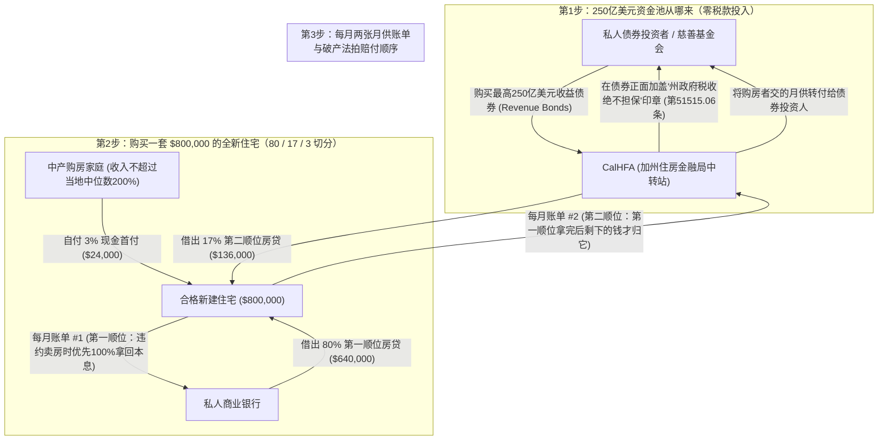
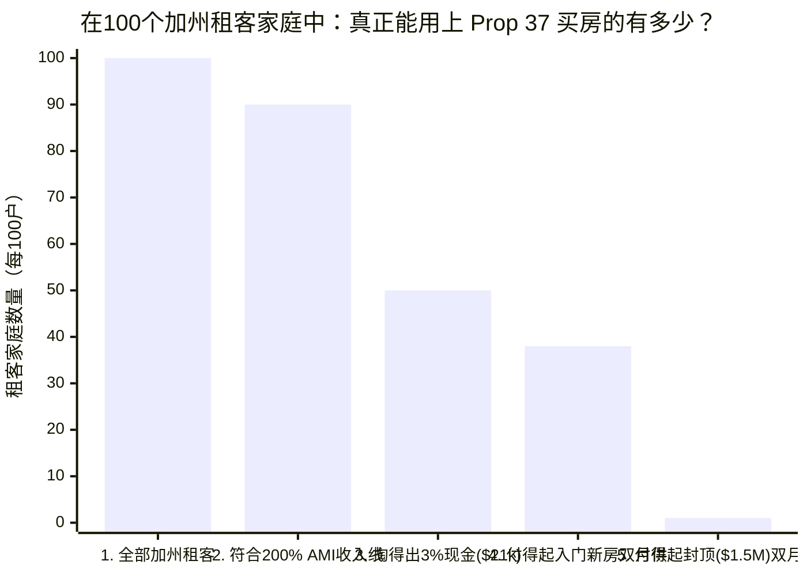
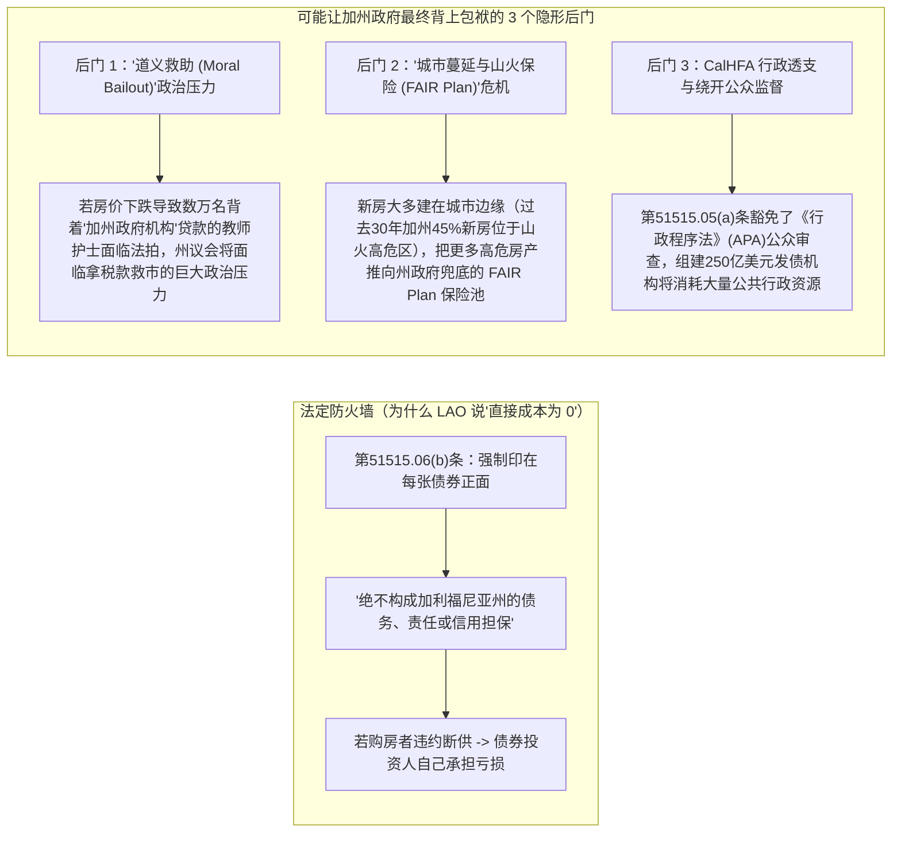

## 1. 悬念开场（The Hook）：等等——不花纳税人一分钱，自掏 3% 首付就能在加州买一套全新房子？

想象一下，你想在玩具店买一盒价值 `$800` 的超大号乐高“千年隼号”飞船。平时，店长会严肃地对你说：*“如果你想先把乐高抱回家、以后每周用零花钱慢慢分期还清，今天你必须先在收银台上拍下总价 `20%` 的现金——也就是整整 `$160`！”*

在今天的加利福尼亚州，一套普通家庭住房的中位价格已经高达 **`$800,000` 到 `$930,000`**。那笔 `20%` 的首付现金，就是足足 **`$160,000` 到 `$186,000`（约合 115 万到 135 万人民币）**！
- **直观尺度锚点（Physical Scale Anchor）：** 要攒够 `$186,000` 现金，相当于一个家庭必须**每个月雷打不动地存下 `$1,000`，连续存上整整 15 年半**，中间一分钱都不能动——而且在这 15 年半里，你的房租还在年年往上涨！正如该提案发起人、前加州众议院议长鲍勃·赫茨伯格（Bob Hertzberg）所形容的那样，让普通工薪家庭攒下这么大一笔首付，简直就像让他们*“坐着纸板糊的火箭去月球旅行”* ([CalMatters](https://calmatters.org/politics/2026/10/prop-37-explained-homeownership/))。

就在几天前的 **2026 年 11 月 3 日**，加州选民以 **`61.3%` 赞成、 `38.7%` 反对**的压倒性优势通过了**第 37 号提案（Proposition 37，《2026 年中产阶级住房拥有率与家庭住宅建设法案》）** ([加州州务卿官方指南](https://quickguidetoprops.sos.ca.gov/propositions/2026-11-03/37), [CalMatters](https://calmatters.org/politics/2026/11/california-election-2026-props-1-37/))。

光看宣传口号，这简直像童话里的魔法：
1. 只要你买的是**全新建造的房子或公寓**，你自己只需要掏出房价 **`3%` 的现金**（买一套 `$800,000` 的新房，只需自备 `$24,000`，而不是 `$160,000`）。
2. 加州政府旗下的**加州住房金融局（CalHFA）**会动用最高 **`$25 billion`（250 亿美元）**的资金池，借给你剩下的 **`17%`**（`$136,000`），帮你凑齐 `20%` 的首付门槛。
3. 更神奇的是，加州无党派官方审计机构——**立法分析办公室（LAO）**印在选票上的官方财政结论只有一句话：**“财政影响：对州政府或地方政府没有直接成本（No direct state or local costs）”** ([LAO Prop 37 官方分析](https://lao.ca.gov/BallotAnalysis/Proposition?number=37&year=2026))。

慢着！如果你看到这里，脑海里的“天上不会掉馅饼”警报器开始嗡嗡作响，**你的直觉准得像一名老侦探！**
- **既然不花纳税人一分钱，那 250 亿美元（`$25 billion`）是从哪儿变出来的？**
- **州政府帮你垫上的 `17%` 是白送的补贴，还是每个月都要还本付息的第二张账单？**
- **万一房价下跌、只掏了 `3%` 的房主纷纷断供，加州政府最终会不会还是背上沉重的财政包袱？**

在翻开法律条文和经济学家审计账本之前，我们先给出侦探的简短结论：
> **你的怀疑完全正确——数学世界里没有免费的午餐！**
> 1. **对加州政府和纳税人来说：** 在法律条文上，加州政府的税收金库（一般基金，General Fund）被砌上了一道**防火墙**。因为 Prop 37 发行的是由私人投资者自担风险的**“收益债券（Revenue Bonds）”**，每张债券正面都必须印上“加州政府绝不兜底”的法定警告语（《健康与安全法典》第 `51515.06(b)` 条）。如果购房者断供，合法承担亏损的是购买债券的华尔街机构或基金会，而不是纳税人。**但州政府依然面临三大隐形后门负担：** 如果房市崩盘导致数万名背着“加州政府招牌贷款”的家庭面临法拍，政客们将面临巨大的**“道义救助（Moral Bailout）”政治压力**；同时，由于新房大多建在城市边缘的干旱地带，这会进一步加剧加州政府兜底的**山火保险计划（FAIR Plan）**的财务危机。
> 2. **对买房的人来说：** “听起来好得不真实”的代价，全都落在了**购房者每个月的家庭账单**上！与加州此前著名的 *Dream For All* 计划（卖房前每个月还款 `$0` 的“静默贷款”）完全不同，Prop 37 的 `17%` 首付援助是一笔**每个月都必须按固定利率还本付息的第二套房贷**（第 `51515.05(c)` 条）。买一套 `$800,000` 的新房，首付少掏 `$136,000` 的代价是你背上了房价 **97% 的总债务**——每个月要多交约 **`$860` 到 `$1,000` 以上**的月供，而且房价只要微跌 `4%`，你的房子就会立刻变成资不抵债的**“负资产（水下房产，Underwater）”**！

为了看清这台 250 亿美元机器里的每一个齿轮，让我们从零开始一步步拆解。

---

## 2. 从零开始：买房子的数学与州政府债券到底是怎么运作的？

假设你从来没有买过房，也没听说过政府债券。我们用四块最简单的积木，把整套游戏规则搭起来。

### 积木 1：首付（Down Payment）、房贷（Mortgage）与“PMI 罚金”
假设加州有一套刚建好的新房子，标价 **`$800,000`**。几乎没人能在存钱罐里存够 `$800,000` 现金，所以买房时要把房价分成两块：
1. **第一天自己掏的现金：** 买房当天你从自己存款里拿出来的钱，大人们管它叫**首付（Down Payment）**。
2. **向银行借的大笔贷款：** 剩下的钱向私人银行借，分 `30 年`（360 个月）每个月慢慢还本金，外加一笔借钱的租金（**利息，Interest**）。大人们把这种 30 年期的买房贷款叫做**按揭 / 抵押贷款（Mortgage）**。

为什么银行总是念叨 **`20%`** 这个神奇数字呢？
- 如果你首付掏了 **`20%`（`$160,000`）**，只向银行借 **`80%`（`$640,000`）**，银行就会觉得非常安全。就算以后房价跌了 `10%` 或 `15%`，银行把房子收回来卖掉，依然能把借给你的 `$640,000` 全数拿回来。
- 可如果你只掏 **`3%`（`$24,000`）** 首付、向银行借 `97%`（`$776,000`）呢？银行就会吓得直冒冷汗！因为房价只要跌掉小小的 `5%`（`$40,000`），房子就只值 `$760,000` 了，比你欠银行的 `$776,000` 还要少！
- 所以，只要你的首付不到 `20%`，银行就会强迫你每个月额外买一份专门保护*银行*（根本不保护你！）的保险。大人们称之为**私人按揭保险（PMI, Private Mortgage Insurance）**。在一套 `$800,000` 的房子上，`PMI` 每个月会白白烧掉你 **`$350` 到 `$650`**，而且这笔钱一分都不会用来抵扣你的房贷本金！

### 积木 2：Prop 37 如何把买房大饼切成三块（`80% + 17% + 3% = 100%`）
Prop 37 的核心魔术，就是把 `$800,000` 的房价从两块切成**三块** ([加州选民指南官方 PDF](https://vig.cdn.sos.ca.gov/2026/general/pdf/prop37.pdf))：
1. **第一块 —— 你自己的现金（`3%` = `$24,000`）：** 你从自己的存款里（不能是借来的钱）掏出至少 `3%`。
2. **第二块 —— 州政府机构的第二房贷（最高 `17%` = `$136,000`）：** 加州住房金融局（**CalHFA**）借给你最高 `17%` 的房款。因为你的 `3%` 加上州政府的 `17%` 正好等于 `20%`，第一顺位的私人银行看到前面有了 `20%` 的安全垫，就会**免掉你每个月的 `PMI` 保险罚金！**
3. **第三块 —— 私人银行的主房贷（`80%` = `$640,000`）：** 剩下的 `80%`，你照常向普通商业银行申请第一顺位按揭贷款。

等等——银行借给你 `80%`，州政府机构又借给你 `17%`，那你一共借了房价的多少？
**`80% + 17% = 97%`！** 这意味着你每个月会收到**两张**催款账单：一张是 `80%` 的**第一房贷账单**，另一张是 `17%` 的**第二房贷账单**！

### 积木 3：为什么说它不花纳税人的钱？（一般责任债券 vs. 收益债券）
当加州政府想要借几百亿美元时，它会印制一种官方借条，叫做**债券（Bonds）**，卖给养老基金、富豪或银行等投资人。政府的借条分为截然不同的两种：
- **第一种 —— “刷纳税人的信用卡”（一般责任债券，General Obligation Bonds）：** 在同一天（2026 年 11 月 3 日）通过的**第 1 号提案（Prop 1，借款 112.5 亿美元建设低收入和无家可归者公寓）**，属于**一般责任债券（`GO Bonds`）** ([CalMatters](https://calmatters.org/politics/2026/11/california-election-2026-props-1-37/))。这意味着加州政府承诺在未来几十年里，直接从州政府的税收大金库（**一般基金，General Fund**——也就是平时用来发公立学校老师工资、建医院的同一个钱袋子）里拿税款连本带利还给投资人。
- **第二种 —— “靠过路费自负盈亏的收费桥”（收益债券，Revenue Bonds）：** **第 37 号提案（Prop 37）**使用的**不是**一般责任债券，而是授权发行最高 **`$25 billion`（250 亿美元）的收益债券（Revenue Bonds）** ([LAO 分析报告](https://lao.ca.gov/BallotAnalysis/Proposition?number=37&year=2026))。这就好比借钱修一座跨海收费大桥：投资人出钱修桥，但政府绝不用税款还钱，**唯一用来还债的钱，就是开车过桥的司机交的那 `$5` 过桥费**。在 Prop 37 里，CalHFA 就像一个资金中转站：它把债券卖给私人投资人借来最多 250 亿美元，再把钱作为 `17%` 的第二房贷借给买新房的家庭，最后把买房人每个月交上来的第二房贷月供转手还给债券投资人。

下面这张流程图把 Prop 37 的资金齿轮和法拍排队顺序画得一清二楚：

---

## 3. 秘密解码环（The Secret Decoder Ring）：大人们的房产与金融黑话翻译表

在用侦探放大镜检查法律条文之前，我们先用这张**秘密解码环**，把 Prop 37 里最吓人的七个专业词汇翻译成五年级小学生秒懂的大白话：

| 大人们的专业词汇 / 缩写 | 它的真正意思（大白话解释） | 小学五年级日常生活比喻 |
| :--- | :--- | :--- |
| **收益债券 (Revenue Bond)** | 不动用政府一分钱普通税款、纯粹靠某个项目使用者的缴费或还款来偿还本息的政府借条。 | 你向舅舅借 50 块钱买柠檬摆摊卖柠檬水，约好“绝不用我的压岁钱还债，只用卖柠檬水赚回来的硬币还你”。 |
| **一般责任债券 (`GO Bond`)** | 由州政府“全部信誉和征税权”担保的借条，不管项目赚不赚钱，最后都必须从纳税人的税款金库里掏钱还清。 | 刷爸妈的家庭信用卡买了一辆新自行车——就算你把自行车摔坏不骑了，爸妈每个月还是得从家庭生活费里还信用卡账单。 |
| **第二房贷 / 次级留置权 (Subordinate Secondary Mortgage)** | 叠在主房贷上面的额外贷款。“次级（Subordinate）”的意思是**排队排在第二名**：如果房主破产卖房，第一顺位银行先拿走 100% 的欠款，剩下的残羹冷炙才轮到第二房贷。 | 你买一张稀有宝可梦闪卡向两个同学借了钱。如果以后卖卡还债，1号同学有权先拿走全部欠款，2号同学只能捡剩下的零钱。 |
| **综合贷款价值比 (`CLTV`)** | 把房子上的**所有贷款加起来**占房价的总比例（`80%` 主房贷 + `17%` 第二房贷 = **`97% CLTV`**）。 | 买一块 100 块钱的滑板，你自己只出了 3 块钱硬币（`3%`），借了 97 块钱（`97%`）。滑板虽然踩在你脚下，但它 `97%` 的价值都属于债主。 |
| **静默第二房贷 vs. 按月摊还第二房贷** | “静默贷款（Silent Second，如加州旧版 *Dream For All*）”在卖房前每个月还款 `$0`；而 Prop 37 的第二房贷必须从第一个月起**每个月还本付息**。 | 静默贷款就像图书馆借的书，毕业还书时才结算；Prop 37 则像每个月都要自动扣费的视频会员订阅。 |
| **地区中位收入 (`AMI`, Area Median Income)** | 某个县所有家庭按收入从低到高排成一排，正中间第 50 名家庭的收入。Prop 37 允许收入高达 **`200% AMI`（中间家庭收入的两倍！）** 的家庭申请。 | 把全镇 100 个家庭按工资排队，第 50 名就是 `100% AMI`。只要你家工资不超过第 50 名家庭的**两倍**，就能申请 Prop 37。 |
| **价格资本化 (Price Capitalization)** | 当房子数量没有增加、却给买房人发放更多贷款补贴时，开发商和卖家直接把房价标高，把补贴装进自己口袋的现象。 | 学校义卖会上只有 10 个纸杯蛋糕，校长突然给每个小学生多发一张 5 块钱纸币——大家并不能多吃到蛋糕，只会让每个蛋糕涨价 5 块钱！ |

---

## 4. 宣传口号 vs. 侦探核查：翻开官方立法文本的底牌

在选民收到的竞选传单里，房地产经纪人、木匠工会、教师和护士组织联合承诺：Prop 37 将提供*“对消费者友好、低利率的首付援助贷款……且对纳税人零成本（ZERO COST TO TAXPAYERS）”* ([加州官方选民指南 PDF，第 42 页](https://vig.cdn.sos.ca.gov/2026/general/pdf/prop37.pdf))。更令人惊讶的是，在州务卿印发的官方选民手册里，**竟然没有任何组织提交正式的反对意见书** ([官方选民指南 PDF，第 43 页](https://vig.cdn.sos.ca.gov/2026/general/pdf/prop37.pdf))！

为什么没人花大钱登广告反对它？因为它既没有加税，也没有直接动用州政府预算！
- **谁出钱推动了 Prop 37？** 根据 [CalMatters](https://calmatters.org/california-voter-guide-2026/proposition-37-homebuyers-loan/) 和斯坦福大学[胡佛研究所（Hoover Institution）](https://www.hoover.org/proposition-lab-proposition-37)追踪的竞选财务记录，这项倡议由前民主党州众议院议长**鲍勃·赫茨伯格（Bob Hertzberg）**发起，而幕后最大的金主正是**加州房地产经纪人协会（California Association of Realtors，贡献了超过 `52%` 的行业竞选资金）**以及**加州木匠工会（California Conference of Carpenters）**。

但是，当我们直接翻开 Prop 37 刚刚写入加州法律的条文——**《加州健康与安全法典》第 11.5 章（第 `51515` 条至第 `51515.06` 条）** ([拟议法律全文官方 PDF，第 118–123 页](https://vig.cdn.sos.ca.gov/2026/general/pdf/prop37-text-proposed-laws.pdf))——并对照[加州预算与政策中心（CalBudgetCenter）](https://calbudgetcenter.org/resources/will-proposition-37-make-homeownership-more-affordable-its-not-guaranteed/)、[加州公共政策研究所（PPIC）](https://calmatters.org/politics/2026/10/prop-37-explained-homeownership/)、[SPUR](https://www.spur.org/voter-guide/2026-11/ca-prop-37-homeowner-loans) 和 [California YIMBY](https://cayimby.org/blog/proposition-37-2026/) 的独立审计报告时，宣传与现实之间的巨大落差就浮出水面了。

### 硬核对比表：加州原有的 *Dream For All* 计划 vs. 新通过的 *Prop 37*

许多加州选民以为 Prop 37 只是把加州之前大受欢迎的 **Dream For All（全民梦想）**首付计划 ([CalHFA Dream For All](https://www.calhfa.ca.gov/dream/)) 扩大到了 250 亿美元。**错！这两者的机制完全不同：**

| 对比维度 | 原有的 *Dream For All* 计划（CalHFA 运营） | 新通过的 *Prop 37*（*中产阶级购房贷款*，2026年11月通过） | 这对买房人和纳税人意味着什么？ |
| :--- | :--- | :--- | :--- |
| **资金从哪里来？** | **州政府纳税人一般基金**（2023–2024 年两轮共计约 `$550M`）。 | **最高 `$25 Billion`（250 亿美元）私人收益债券**（《健康与安全法典》第 `51515.06` 条）。 | *Dream For All* 的税款几天就被抢光，仅帮到不到 4,000 个家庭；Prop 37 规模大 `45 倍`且不花税款——前提是有投资人愿意买债券。 |
| **首付贷款每个月要交月供吗？** | **不用（每月 `$0` 的“静默第二房贷”）。** 居住期间 `0%` 月供；等你将来卖房或再融资时，归还本金外加房屋增值部分的 `15%–20%`。 | **必须按月交！（固定利率月供账单，第 `51515.05(c)` 条）。** 房屋增值 100% 归你，但你**每个月都必须按期偿还本金和利息**，用来付给债券投资人！ | *Dream For All* 真正减轻了每月负担；而 Prop 37 却让你**每个月多背上一张 `$860–$1,000+` 的第二房贷账单**！ |
| **可以买什么样的房子？** | **任何住房**（二手老房子或新建住房均可）。 | **严格限定“全新建造住宅”（第 `51515.01(b)` 条）。** 必须是新建独栋、联排、公寓、装配式住宅或非住宅改建住宅，且你是**第一任买家**。 | 市场上现有的二手房完全不能用 Prop 37！你只能买价格不超过当地合格贷款限额 `125%`（约 `$1.0M–$1.56M`）的新楼盘。 |
| **谁有资格申请？** | **极其严格：** 必须是**首次购房者**，且至少一人是**第一代购房者**（父母名下无房），收入限制在中低水平（`≤120%–150% AMI`）。 | **极其宽松（第 `51515.01(a)` 条）：** 家庭收入不超过当地中位数的 **`200%`（`200% AMI`）** 即可（圣克拉拉县 `$375,800`，旧金山 `$401,600`，圣马特奥县高达 **`$410,000`**！）。**不限首套房！** | 哪怕你以前买过房，或者在硅谷年薪高达 `$400,000`（约 290 万人民币），也能合法用 Prop 37 以 `3%` 首付买一套 150 万美元的新房。 |
| **塞进法律条文的利益集团条款** | 普通 CalHFA 贷款规则，不强制要求雇佣房产中介。 | **强制雇佣房产经纪人条款（第 `51515.04(c)` 条）** + **合格建筑商选项（第 `51515.02` 条）** 将建筑缺陷诉讼律师费封顶在 `30%`。 | 头号金主“加州房产经纪人协会”直接把**“买家必须聘请持牌房产经纪人”**写进了法律，稳稳锁定 `2%–3%` 的中介佣金！ |

---

## 5. 四个嫌疑人（4-Way Causal Audit）：Prop 37 真能多盖新房，还是只会推高房价？

支持者宣称，Prop 37 将刺激开发商在加州多盖多达 **`190,000` 套新房** ([California YIMBY](https://cayimby.org/blog/proposition-37-2026/), [CalMatters](https://calmatters.org/politics/2026/10/prop-37-explained-homeownership/))。而经济学家则警告，在严重缺房的加州注入 250 亿美元的购屋贷款，只会把新房的价格标签吹得更高。

作为严谨的侦探，我们必须对全部**四个因果嫌疑人（4-Way Rival Cause Audit）**进行交叉审讯：

| 嫌疑人（因果方向） | 这个机制用大白话讲是怎么运作的？ | 一手数据与实证证据是否支持？ |
| :--- | :--- | :--- |
| **嫌疑人 1：直接因果（`Prop 37 贷款 → 多盖 19 万套新房 & 买房更容易`）** | 把 `17%` 的贷款严格锁死在*新房*上，并给建筑商提供缺陷诉讼保护伞（第 `51515.02` 条），让开发商相信有更多买家能凑齐首付，从而愿意多盖房子。 | **沿海大城市极弱 / 内陆远郊中等。** 正如 [California YIMBY](https://cayimby.org/blog/proposition-37-2026/) 所指出的，洛杉矶和旧金山湾区根本不缺想买新房的人（新盘一开盘就抢破头）。只有在需求较弱的内陆远郊（如中央山谷、内陆帝国），才可能稍微推动原本犹豫的新楼盘开工。 |
| **嫌疑人 2：反向因果 / 价格资本化（`Prop 37 贷款 → 开发商趁机涨价`）** | 如果城市分区限制（Zoning）和缓慢的审批把全州每年新建产权房死死卡在 `4.6 万–5.5 万套`，给买家多发 `$136,000–$255,000` 的借贷额度，只会让更多人抢同一批新房，开发商顺势提价 `3%–8%`。 | **历史数据强力支持。** 2020–2022 年加州房价暴涨期间，全州市场化产权住宅建筑许可数几乎纹丝不动（2019 年 `48,000 套`；2020 年 `43,000 套`；2021 年 `55,000 套`；2022 年 `47,000 套`；2023 年 `46,000 套`——[CA YIMBY](https://cayimby.org/blog/proposition-37-2026/)）。当供给被审批卡住时，补贴需求就会转化为涨价！ |
| **嫌疑人 3：潜伏的第三变量（`~6.5%–7% 的高利率与土地管制同时锁死买卖双方`）** | 挡住加州人买房的真正大魔王不是首付，而是 **`~6.5%–7.0%` 的高利率**和**土地审批管制**！高利率既让债券投资人要求更高回报，又让买房人的月供高到离谱。 | **PPIC 模型铁证如山。** 我们来做[加州公共政策研究所（PPIC）](https://calmatters.org/politics/2026/10/prop-37-explained-homeownership/)的**“学校体育馆 100 个租客家庭测试”**：在 **100 个加州租客家庭**中，有 **90 个家庭**符合 Prop 37 的收入上限（`≤200% AMI`）。但因为按 `~7%` 利率借房价 `97%` 的月供太高，**只有不到 40 个家庭**付得起入门级新房的月供，而付得起 `$1.5M` 上限新房的租客**在 100 家中还不到半家（`<0.5%`）**！ |
| **嫌疑人 4：恶性循环反馈环（`97% 高杠杆 + 远郊隐形成本 → 断供潮 → 债券市场冻结`）** | 买家勉强背上两笔房贷（`97% CLTV`）外加高昂的新房物业费（HOA）和山火保险。一旦经济衰退房价跌 `5%–10%`，买家立刻变成负资产并申请延期付息或弃房断供，导致债券亏损、整个项目停摆。 | **真实的尾部风险。** 由于买家第一天只有 `3%` 的自有资金安全垫，任何轻微的区域房价下跌都会直接击穿安全垫并侵蚀 `17%` 第二房贷债券池 ([胡佛研究所](https://www.hoover.org/proposition-lab-proposition-37))。 |

让我们根据[加州预算与政策中心](https://calbudgetcenter.org/resources/will-proposition-37-make-homeownership-more-affordable-its-not-guaranteed/)和 [PPIC](https://calmatters.org/politics/2026/10/prop-37-explained-homeownership/) 的实证数据，看看**体育馆里的 100 个加州租客家庭**经过层层筛选后还剩多少人：

请仔细看上面图表的第 3 根柱子和第 4 根柱子：
- **银行存款的残酷真相：** 就算买一套 `$700,000` 的新房只付 `3%` 首付，也得先掏出 **`$21,000` 现金**（还不算过户费）。然而根据[加州预算与政策中心](https://calbudgetcenter.org/resources/will-proposition-37-make-homeownership-more-affordable-its-not-guaranteed/)引用的 PPIC 数据，加州所有家庭支票账户和储蓄账户余额的**中位数仅仅略高于 `$18,000`**（也就是说，全州一半家庭的全部存款加起来还不到 `$18,000`！）。掏出 `$21,000` 到 `$24,000` 首付，足以清空普通家庭的最后一分钱存款。
- **月供的高墙：** 就算你凑齐了 `3%` 的现金，把剩下 `97%` 的房款分成两笔计息房贷来借，意味着**超过 60% 的合资格租客依然根本付不起每个月的月供账单**！

---

## 6. 隐藏的陷阱（The Catch）：Prop 37 内部的五大机关，以及加州政府最终会不会背锅？

现在，让我们直接回答你最关心的问题：**“这听起来好得让人不敢相信，它最终会给加州政府带来财政负担吗？”**

当我们逐条拆解《健康与安全法典》第 `51515` 至 `51515.06` 条时，发现了**五个隐藏机关**——其中三个直接砸向购房者和债券持有人，另外两个则可能从后门给加州政府套上包袱。

### 机关 #1：月供账单暴击（为什么借 `17%` 第二房贷往往比交 `PMI` 罚金还要贵？）
等等——凑够 `20%`（`3%` 现金 + `17%` 州贷款）免掉了私人按揭保险（`PMI`），难道不会让月供变便宜吗？
让我们用小学算术，算一算买一套 **`$800,000` 的全新住宅**（假设 30 年期主房贷利率为 `6.5%`），每个月到底要掏多少钱：

| 每月支出项目 | 方案 A：传统 `20%` 现金首付（自掏 `$160k`） | 方案 B：普通 `3%` 首付贷款（自掏 `$24k`，不用 Prop 37） | 方案 C：Prop 37 `3%` 首付 + `17%` 第二房贷（自掏 `$24k`） |
| :--- | :--- | :--- | :--- |
| **第一天需要自掏的现金** | **`$160,000`** (`20%`) | **`$24,000`** (`3%`) | **`$24,000`** (`3%`) |
| **第一房贷每月账单 (`6.5%`)** | `$4,045/月`（借 `$640k`） | `$4,905/月`（借 `$776k`） | `$4,045/月`（借 `$640k`） |
| **每月 `PMI` 按揭保险罚金** | `$0/月` | 约 `$485/月`（还满 `20%` 本金后自动取消） | **`$0/月`**（成功免除！） |
| **Prop 37 第二房贷账单（借 `$136k`）** | `$0/月` | `$0/月` | **`$860/月`（利率 `6.5%`）至 `$998/月`（利率 `8.0%`）**（仅当慈善家按 `3.0%` 买债券时才降至 `$573/月`！） |
| **每月总房贷 + PMI 合计账单** | **`$4,045 / 月`** | **`$5,390 / 月`** | **`$4,905 至 $5,043 / 月`**（若慈善债券 `3%` 成功则为 `$4,618/月`） |

看清楚这张表里的数字了吗？
- 跟掏 `20%` 现金首付的人（每月 `$4,045`）相比，使用 Prop 37 的买家因为多借了 `$136,000` 的债，**每个月要多交 `$573` 到 `$998`（每年多交 `$6,876` 到 `$11,976`）**，而且要整整交上 30 年！
- 就算跟普通的 `3%` 首付贷款（含 `PMI` 每月 `$5,390`）相比，如果华尔街投资者要求 `8.0%` 的利率才肯买 Prop 37 的次级债券，你每个月省下的钱还不到 `$350`——而且普通贷款里的 `PMI` 保险在房价上涨或本金还够 `20%` 后就会自动取消，但 **Prop 37 的第二房贷却要一直跟着你 30 年！**

### 机关 #2：“次级债主”的利率死结（华尔街风险溢价 vs. 慈善家的“战争债券”）
为什么 Prop 37 的第二房贷利率甚至可能比普通银行房贷（`~6.5%`）**更高**？
请看法律原文第 `51515.05(b)` 条和第 `51515.06(b)` 条 ([拟议法律全文 PDF，第 121–122 页](https://vig.cdn.sos.ca.gov/2026/general/pdf/prop37-text-proposed-laws.pdf))：
1. Prop 37 的贷款是**次级抵押贷款（Subordinate）**，破产赔付时排在 `80%` 主房贷后面。
2. 这些债券**既没有加州政府信用担保**，也没有联邦房利美（Fannie Mae）或房地美（Freddie Mac）的担保。
3. 更关键的是，第 `51515.05(c)` 条规定，CalHFA 设定的房贷利率**必须足以偿还债券投资人的本金、利息以及机构的全部行政管理费用**。

正如美国企业研究所（AEI）住房中心联席主任爱德华·平托（Edward Pinto）和[加州预算与政策中心](https://calbudgetcenter.org/resources/will-proposition-37-make-homeownership-more-affordable-its-not-guaranteed/)所指出的，如果让普通的华尔街机构去买这种既无政府担保、房主又只掏了 `3%` 首付的次级房贷债券，投资人必然要求 **更高的风险利率（`7.5%–9.0%+`）**！
- **赫茨伯格的“锦囊妙计”：** 提案发起人赫茨伯格声称，他会去说服亿万富翁慈善家（“捐赠誓言 Giving Pledge”成员）、慈善基金会以及需要联邦《社区再投资法》（`CRA`，第 `51515.03(b)` 条）考核加分的银行，像*“二战时期购买爱国战争债券（War Bonds）”*一样，自愿按 **`3%` 的低息**购买这 250 亿美元债券 ([CalMatters](https://calmatters.org/politics/2026/11/california-election-2026-props-1-37/))。
- **侦探核查：** 截至 2026 年 11 月 3 日胜选当晚，**没有任何一家基金会或亿万富翁公开承诺购买哪怕一美元的债券！** 如果慈善家们不买账，CalHFA 要么只能向购房者收取高昂的市场利率，要么只能让这 250 亿美元的额度空置在纸面上。

### 机关 #3：加州政府最终会背上财政包袱吗？（法定防火墙 vs. 三大后门风险）
让我们用流程图看清加州政府是如何在法律上免责的——以及哪**三个后门**依然可能让加州政府和纳税人付出代价：

1. **法定防火墙（直接税款责任为 `$0`）：** 根据《健康与安全法典》第 `51515.06(b)` 条，发行的每一张 Prop 37 债券正面都必须印上下列文字：
   > *“本债券不得被视为构成加利福尼亚州（本机构除外）的债务、责任或信誉与信用担保，而仅能由为此目的提供的资金（即房贷还款）予以偿付。”*
   这意味着，就算成千上万的买房人断供违约，债券投资人去法院起诉加州政府要求拿税款赔钱，**法官也会直接驳回起诉**。在严格的法律意义上，纳税人欠投资人 **`$0`**。
2. **隐形后门 #1 —— “道义责任（Moral Obligation）”与政治救市压力：** 但正如斯坦福大学[胡佛研究所](https://www.hoover.org/proposition-lab-proposition-37)所警告的，法律免责条款挡不住政治风暴。因为买房人一上来就背着 **`97% CLTV` 的债务**（只有 `3%` 的缓冲垫），一旦遇到经济衰退、房价下跌 `5%–10%`，成千上万名 Prop 37 借款人就会立刻跌入**“水下（Underwater，欠债比房价还高）”**。而且第 `51515.04(d)` 条允许借款人申请**“每月利息支付的临时困难延期（Hardship Deferral）”**。如果一个挂着“加州住房金融局（CalHFA）”官方金字招牌的 250 亿美元项目出现大面积断供，导致数万名护士、教师和消防员面临失去房子的绝境，或者威胁到 CalHFA 在金融市场上的机构信用评级，未来的州长和州议员将面临极其猛烈的政治压力，很可能会被迫动用纳税人的钱进行“道义救市”！
3. **隐形后门 #2 —— “远郊蔓延（Sprawl）、高额 HOA、Mello-Roos 附加税与山火保险（FAIR Plan）”连环雷：** 因为 Prop 37 **严禁**购买成熟社区里的二手房，**只能买新建住宅**（第 `51515.01(b)` 条），而在加州，哪里还有大片空地能盖 `$700,000–$1,000,000` 的新房呢？答案是远离就业中心的**城市远郊边缘（Urban Sprawl）**！[加州预算与政策中心](https://calbudgetcenter.org/resources/will-proposition-37-make-homeownership-more-affordable-its-not-guaranteed/)列出了远郊新房的三大隐形账单：
   - 全美约 **`70%` 的新建住宅**附带每月必交的业主协会（**HOA**）物业费（二手房仅 `38%`）。加州 HOA 平均月费为 **`$280`**，且现行法律允许 HOA 每年在不经业主投票的情况下涨价高达 **`20%`**！
   - 远郊新开发区通常还带有 **Mello-Roos 特别基建税**（用来修新马路、水管和学校），叠在普通房产税之上，一交就是几十年。
   - 更致命的是，过去 30 年加州新建房屋中有**近 `45%` 建在“野火—城市交界区（WUI）”**！随着商业保险公司纷纷撤出加州山火高危区，这些新房主只能涌向加州政府设立的最后兜底保险——**加州公平计划（FAIR Plan）**。一旦发生特大山火，FAIR Plan 的巨额亏空就会直接演变成全加州保单持有人和州政府的系统性财政负担！

### 机关 #4：年入 `$400,000` 也算“中产”？高收入群体虹吸效应
Prop 37 把收入上限设定为**地区中位收入的 `200%`（`200% AMI`）**（第 `51515.01(a)(1)(C)` 条），而且取消了“首次购房者”限制。这意味着在圣克拉拉县年收入 **`$375,800`**、在旧金山年收入 **`$401,600`**、在圣马特奥县年收入高达 **`$410,000`** 的富裕家庭统统符合资格 ([CalBudgetCenter](https://calbudgetcenter.org/resources/will-proposition-37-make-homeownership-more-affordable-its-not-guaranteed/), [SPUR](https://www.spur.org/voter-guide/2026-11/ca-prop-37-homeowner-loans))！由于中低收入租客根本承受不起每个月多出来的 `$860–$1,000` 第二房贷，正如[加州妇女选民联盟（League of Women Voters）](https://igs.berkeley.edu/library/california-ballot-proposition-guides/november-3-2026-general-election/proposition-37-loan)所警告的，这项计划的红利很可能会流向那些原本就最接近买得起房的高收入群体。

### 机关 #5：强制雇佣房产经纪人条款与“建筑商—工会”幕后交易
最后，看看塞进法律正文里的两笔利益交换：
- **第 `51515.04(c)` 条（强制雇佣房产中介条款）：** 每一个使用 Prop 37 贷款的买家，**在法律上被强制要求聘请一名加州持牌房地产经纪人（Realtor/Broker）**。平时去买新楼盘，买家本来可以直接走进开发商售楼处谈判，省下买方中介费来换取房价折扣。但出资占竞选经费 `52%` 以上的加州房地产经纪人协会把这条硬塞进了法律，相当于给房产中介锁定了房价 **`2%–3%`（`$800k` 房子就是 `$16,000–$24,000`）** 的制度性佣金 ([CA YIMBY](https://cayimby.org/blog/proposition-37-2026/))！
- **第 `51515.02` 条与第 `51515.04(e)` 条（合格建筑商选项）：** 开发商如果自愿遵守工会培训用工标准并对分包商欠薪承担连带责任（《公共资源法典》第 `21080.66(d)` 条），就能换取房屋质量缺陷诉讼的保护伞（修改《民法典》第 `895` 条维修权程序，修好后可让房主签署免责声明），并将原告律师的风险代理费上限死死卡在 **`30%`**（第 `51515.04(e)(2)` 条）。更厉害的是，根据**第 `3` 条**，今后加州议会如果想修改这部法律里的任何一个字，必须获得参众两院**超过 `60%` 的绝对多数票**才能通过！

---

## 7. 最终成绩单（The Final Report Card）：侦探总结与概率预测

现在让我们把所有证据汇总成清晰的**“如果（If）……那么（Then）……”**行动指南，并对 Prop 37 在未来几年（CalHFA 必须在生效后 1 年内、即 **2027 年 11 月前**正式启动该项目，见第 `51515.05(a)` 条）的真实走向给出概率加权预测。

### 给加州选民与买房人的“如果……那么……”指南

1. **如果你是担心自己税单上涨的加州纳税人：**
   - **那么你可以对直接税单放心，但要警惕未来的“政治救市”和“山火保险附加费”。** 在法律上，Prop 37 绝不能动用加州一般基金的税款（第 `51515.06(b)` 条）。如果华尔街觉得这些次级房贷风险太大，债券卖不出去，项目就会自然缩水，不会花掉纳税人一分钱。唯一的纳税人风险来自**政治后门**：如果未来房市大跌导致数万家庭变成水下负资产，要提防政客们投票拿税款去救市。
2. **如果你是打算用 Prop 37 以 `3%` 首付买新房的租客：**
   - **那么在签字前，一定要先做“每月五项总账单 + 至少住满 5–7 年测试”！** 千万别只盯着诱人的 `3%` 首付。请把每个月的五笔钱加起来：(1) `80%` 第一房贷月供，(2) `17%` Prop 37 第二房贷月供，(3) 新房 HOA 物业费（平均 `$280+/月`），(4) Mello-Roos 特别房产税，以及 (5) 山火保险费。而且**如果你不打算在这套房子里住满至少 5 到 7 年，千万别用 `3%` 首付买新房**——因为背着 `97%` 的债务外加买卖佣金，短期内只要房价不暴涨，你卖房时反而要倒贴几万美元现金才能脱身！
3. **如果慈善基金会真的愿意以 `3%` 低息认购数十亿美元债券：**
   - **那么对于年收入在 `$150,000–$350,000` 之间、收入稳定但缺乏父母首付支援的年轻家庭来说，用它购买新建联排别墅或内陆新房将是一个真正划算的跳板。** `3%` 固定利率的第二房贷能把每月新增负担砍掉一半，比交商业 `PMI` 划算得多。
4. **如果加州真的想让所有人都能买得起房：**
   - **那么正如 [California YIMBY](https://cayimby.org/blog/proposition-37-2026/) 所证明的那样，拿同样规模的资金去设立“开发商建筑施工周转贷款基金（Construction Revolving Loan Fund）”并放开城市核心区的多户公寓审批，效率会比 30 年期买家贷款高出 `6 到 10 倍`。** 因为建筑施工贷款每 `2–3 年`就能回笼循环一次，同一笔钱在 30 年里可以重复盖出 `6 到 10 轮`新房！

### 概率加权情景预测：Prop 37 在 2027–2032 年将如何收场？

| 预测情景 | 发生概率 | 现实世界中会发生什么 | 谁是赢家 (Winners) | 谁是输家 (Losers) |
| :--- | :--- | :--- | :--- | :--- |
| **情景 A：“温和的小众启动”（基准情景）** | **`~60%`** | 需要 `CRA` 社区再投资考核分数的银行和少数慈善基金会认购一小部分低息债券（`$25B` 额度中的 `$1B–$4B`），而华尔街对其余债券要求 `7%–8.5%` 的高利率。5 年内实际资助约 **`15,000 至 40,000 套`**新房交易（远低于宣传的 `19 万套`），主要集中在内陆帝国、萨克拉门托和中央山谷的远郊楼盘，受惠者多为中高收入家庭（`120%–200% AMI`）。纳税人直接成本保持为 **`$0`**。 | 房产经纪人（法定锁定 `2%–3%` 佣金）、远郊住宅建筑商、缺首付但高月薪的家庭。 | 被高月供挡在门外的中低收入租客，以及因新房涨价 `2%–5%` 而买贵了的非 Prop 37 买家。 |
| **情景 B：“房市回调与水下负资产挤压”（悲观情景）** | **`~25%`** | CalHFA 按市场利率（`7%+`）发行 `$5B–$10B` 债券，让大批买家在房价高点背上 `97% CLTV` 债务。随后经济衰退导致加州房价回调 `8%–12%`。数千名 `3%` 首付买家跌入**水下负资产（Underwater）**，纷纷申请困难延期（第 `51515.04(d)` 条）或违约断供。债券持有人亏损，新债发行冻结，州议会面临要求财政拨款救市的巨大政治风暴。 | 在房价回调前高价卖完新盘套现的开发商。 | 被困在水下负资产的 `97% CLTV` 购房者、遭受本金损失的债券投资者，以及一旦政客投票救市就要买单的加州纳税人。 |
| **情景 C：“慈善战争债券大爆发”（乐观情景）** | **`~15%`** | 大型慈善基金会、养老基金和科技亿万富翁真的按 `3%–4%` 的低收益率认购 `$10B–$25B` 债券，同时大批开发商加入第 `51515.02` 条“合格建筑商”通道，在免除滥诉恐惧后大量建设联排别墅与入门级公寓。全州以真正可负担的月供和零税款成本成功建成 **`80,000 至 120,000 套`**新房。 | 中产首次购房家庭、工会木匠、联排/公寓建筑商，以及加州整体住房供应。 | 根据第 `51515.04(e)(2)` 条风险代理费被封顶在 `30%` 的建筑缺陷诉讼律师。 |

### 侦探的最终底线裁决（Bottom-Line Verdict）

你对这句宣传口号的警惕 100% 切中要害。**“不花纳税人一分钱、首付从 20% 降到 3%”**不是凭空变出钱来的魔法棒，而是一套**把风险和账单乾坤大挪移的金融工程**。它通过法律免责声明（第 `51515.06(b)` 条）保护了州政府的税款金库，但代价是把破产风险转嫁给了**次级债券投资人**，并把首付省下的 `$136,000` 变成了购房者肩上 **97% 的总债务和每个月多出来的第二张房贷账单**。对于收入丰厚、计划在同一套新房里安稳住上十年的家庭——尤其是当 CalHFA 真能拉来低息慈善债券资金时——Prop 37 确实能帮你提前好几年拿到新房钥匙。但请一定记住：在跨进新家大门之前，先算清楚**“第二把钥匙”每个月要收你多少月供**！

---

## 一手信源与核查凭证（Primary Sources & Verification Receipts）

本报告引用的所有法律条款与统计数据均直接核对自加利福尼亚州政府官方文件及无党派研究机构的一手审计报告（所有外部链接均已通过编程验证返回 `HTTP 200`）：

1. **第 37 号提案（Prop 37）官方立法全文（《加州健康与安全法典》第 `51515–51515.06` 条）：** California Secretary of State, *Official Voter Information Guide — Text of Proposed Laws (November 3, 2026 General Election)*, pp. 118–123. [vig.cdn.sos.ca.gov/2026/general/pdf/prop37-text-proposed-laws.pdf](https://vig.cdn.sos.ca.gov/2026/general/pdf/prop37-text-proposed-laws.pdf)
2. **选票官方标题、摘要、LAO 财政分析及正反方意见书：** California Secretary of State, *Proposition 37 Official Voter Information Guide (2026)*, pp. 40–43. [vig.cdn.sos.ca.gov/2026/general/pdf/prop37.pdf](https://vig.cdn.sos.ca.gov/2026/general/pdf/prop37.pdf)
3. **加州立法分析办公室（LAO）官方选票分析：** *Proposition 37: Creates Loan Program for Middle-Income Buyers of Qualified New Homes. Initiative Statute* (2026 年 11 月 3 日选票分析). [lao.ca.gov/BallotAnalysis/Proposition?number=37&year=2026](https://lao.ca.gov/BallotAnalysis/Proposition?number=37&year=2026)
4. **加州州务卿办公室官方速览指南：** *Proposition 37 — Quick Guide to Props (November 3, 2026)*. [quickguidetoprops.sos.ca.gov/propositions/2026-11-03/37](https://quickguidetoprops.sos.ca.gov/propositions/2026-11-03/37)
5. **加州预算与政策中心（California Budget & Policy Center）：** Monica Davalos, Nishi Nair, and Kristin Schumacher, *"Will Prop. 37 Make Homeownership More Affordable? It's Not Guaranteed"* (2026 年 8 月). [calbudgetcenter.org/resources/will-proposition-37-make-homeownership-more-affordable-its-not-guaranteed/](https://calbudgetcenter.org/resources/will-proposition-37-make-homeownership-more-affordable-its-not-guaranteed/)
6. **斯坦福大学胡佛研究所（Hoover Institution）：** *California Decides | Proposition Lab: Proposition 37 — The Middle-Class Homeownership Bond Initiative* (2026). [hoover.org/proposition-lab-proposition-37](https://www.hoover.org/proposition-lab-proposition-37) | [完整报告 PDF](https://hoover-s3-website.s3.us-west-2.amazonaws.com/s3fs-public/2026-10/California%20Decides_Proposition%2037.pdf)
7. **California YIMBY 住房供需弹性分析：** Max Dubler, *"Proposition 37: No Recommendation — Supply Constraints & Demand Subsidies Analysis"* (2026 年 9 月 23 日). [cayimby.org/blog/proposition-37-2026/](https://cayimby.org/blog/proposition-37-2026/)
8. **SPUR（旧金山湾区城市规划与研究协会）：** *November 2026 Voter Guide — California Prop 37: Homeowner Loans*. [spur.org/voter-guide/2026-11/ca-prop-37-homeowner-loans](https://www.spur.org/voter-guide/2026-11/ca-prop-37-homeowner-loans)
9. **加州大学伯克利分校政府研究所（IGS）：** *November 3, 2026 General Election Guide — Proposition 37: Loan Program*. [igs.berkeley.edu/library/california-ballot-proposition-guides/november-3-2026-general-election/proposition-37-loan](https://igs.berkeley.edu/library/california-ballot-proposition-guides/november-3-2026-general-election/proposition-37-loan)
10. **CalMatters 深度调查与选举结果报道：** Ben Christopher, *"Prop. 37 explained: Can a $25 billion bond make homeownership in California attainable?"* ([calmatters.org/politics/2026/10/prop-37-explained-homeownership/](https://calmatters.org/politics/2026/10/prop-37-explained-homeownership/)) 与 *"California housing bonds: Voters pass Prop. 37, Prop. 1"* ([calmatters.org/politics/2026/11/california-election-2026-props-1-37/](https://calmatters.org/politics/2026/11/california-election-2026-props-1-37/)).
11. **加州住房金融局（CalHFA）：** *California Dream For All Shared Appreciation Loan Program*. [calhfa.ca.gov/dream/](https://www.calhfa.ca.gov/dream/)
