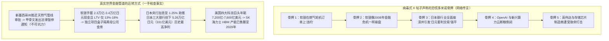
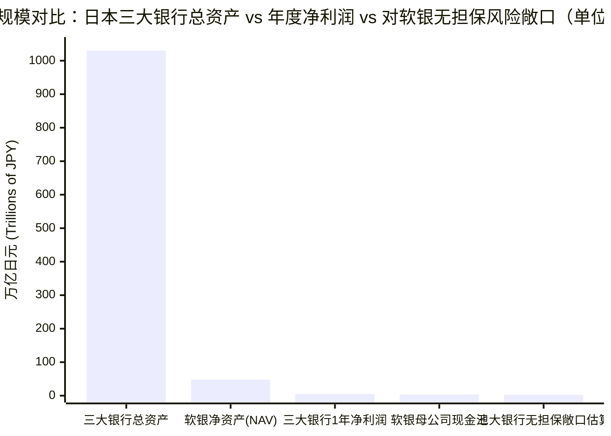
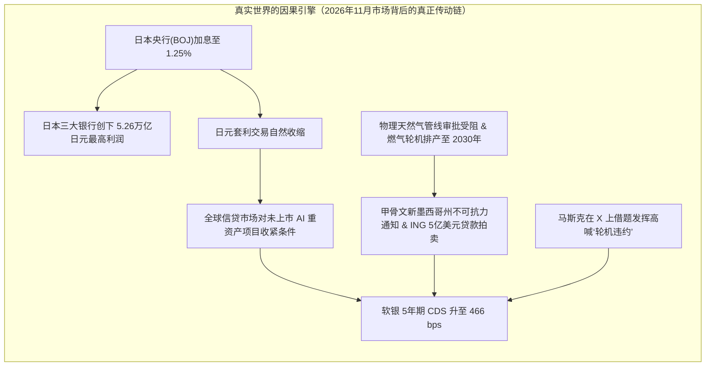

## 1. 悬念开场：短短六个英文单词的推文，真能推倒整个AI世界吗？

想象一下，你正在学校操场上看两支死对头队伍搭建人类历史上最大的乐高城堡。突然，火箭队队长（埃隆·马斯克，Elon Musk）指着星际之门队队长（日本科技投资巨头软银集团 SoftBank，联手 OpenAI 和甲骨文 Oracle），拿起大喇叭对着全校大喊：

> *"SoftBank is defaulting on their turbine orders"（软银正在其燃气轮机订单上违约）*
> — **埃隆·马斯克 (`@elonmusk`)**，2026年11月6日

不到一个小时，X（原推特）上的金融评论员们纷纷跳出来，在马斯克这六个英文单词上面又叠加上了两层惊天动地的“连环崩盘预言”：

> *"The crash of SoftBank is going to be the most spectacular fireworks show in financial markets since 2008"（软银的崩盘将成为2008年以来金融市场上最壮观的烟花秀）*
> — **JustDario (`@DarioCpx`)**，2026年11月6日

> *"埃隆正在加速摧毁他竞争对手的财务后盾，但软银的崩溃（而且我们将看到这会蔓延至整个日本金融业）将引发某种程度的‘日元套利交易（Yen Carry Trade）’平仓……请记住，软银和日本银行的急剧暴跌对 OpenAI 来说是致命一击，进而对所有新兴算力云（neoclouds）也是致命一击，最终对存储芯片制造商和英伟达（Nvidia）将是致命的。SpaceX 也不会幸免，但埃隆可能觉得自己的财务状况足够稳健，能够撑过 AI 泡沫破裂抵达彼岸。"*
> — **tphuang (`@tphuang`)**，2026年11月6日

等一下！让我们看看这条帖子排出的五张多米诺骨牌：
1. 软银付不起发电燃气轮机的钱，发生“违约（Default）”。
2. 软银发生比2008年全球金融危机还要惨烈的崩盘。
3. 软银崩盘传染给整个日本银行业，逼迫全球资金上演“日元套利交易大平仓”。
4. OpenAI 断粮倒下，接着所有租借显卡的“新兴算力云（Neoclouds）”倒闭，最后把 SK海力士等存储芯片大厂和英伟达（Nvidia）一起拖入深渊——唯独马斯克的 SpaceX 笑到最后。

**这条刷屏全网的帖子到底是真（True）还是假（False）？**

在打开证据保险箱之前，先给出我们侦探团的简短结论：**这条帖子是一个典型的“半真半假三明治”——它包含了约 25% 真实的商业心理战洞察，但剩下 75% 全是夸大其词的金融童话和颠倒黑白的因果关系。** 马斯克确实在故意吓唬借钱给 OpenAI 阵营的银行，AI 数据中心也确实遇到了供电审批和贷款拍卖的波折；**但软银根本没有在燃气轮机上违约，日本三大巨型银行刚刚赚取了创纪录的历史最高利润（软银根本拖不垮它们），帖子里关于“日元套利交易”的因果关系完全反了，而且英伟达和存储芯片厂真正的金主是手握巨额现金的美国四大科技巨头，而不是软银！**

为了彻底搞清楚其中的奥秘，让我们从“零基础”开始，像拆解玩具一样拆解整台机器。

---

## 2. 从零开始：巨大的 AI “电力与金钱机器”究竟是怎么运转的？

在核对任何财务数字之前，我们先在脑海里画一幅图：这些公司到底在建什么？为什么东京的一家银行会关心美国新墨西哥州沙漠里的一台发电机？

### 为什么 AI 大脑需要“喷气式飞机发动机”？
当你向 ChatGPT（由 **OpenAI** 开发）或 Grok（由马斯克的 **xAI** 开发）提问时，你的问题会飞向一个塞满数万块 **英伟达（Nvidia）** 超级计算芯片、并搭配 **SK海力士（SK Hynix）** 超高速存储芯片塔的巨大仓库（数据中心）。

这些计算芯片比烤箱还要烫，吞噬电力的速度惊人。像 OpenAI、甲骨文（Oracle）和软银正在建设的 **“星际之门”（Stargate，总计划号称 `5,000亿美元`）** 超大型数据中心园区，仅仅一个园区就需要 `1吉瓦（GW）` 到 `5吉瓦` 24小时不间断的电力。
- **实物比例尺锚点：** `1吉瓦`（`1,000兆瓦`）的电力，足够同时点亮 **75万到100万户普通家庭** 的所有电灯和家电！

当地的公共电网根本没法在一夜之间多变出一百万户家庭的电；排队等待接入公共电网往往需要 **5到7年**。那 AI 公司怎么抢时间呢？他们直接买来巨大的旋转金属发动机，在仓库旁边烧天然气自己发电！这种发动机内部构造几乎就像把波音客机机翼下的喷气式发动机用螺栓固定在地面上一样。大人们和工程师管它叫 **天然气轮机（Natural Gas Turbine）**。

### 钱是怎么从东京流向美国沙漠的？
没有人会在床垫下藏 `5,000亿美元` 现金。为了建起这些巨型 AI 仓库，四组玩家像接力赛一样传递资金和机器：

1. **大存钱罐老板（软银集团 SoftBank Group）：** 由孙正义（Masayoshi Son）掌舵的日本巨型投资控股公司。软银手里握着芯片设计霸主 **Arm Holdings** 约 `90%` 的股份（全球几乎每部智能手机的芯片蓝图都出自 Arm），并承诺向 **OpenAI** 和 **星际之门（Stargate）** 项目投入超过 `300亿美元`。
2. **日本三大超级银行（MUFG、SMBC 和瑞穗 Mizuho）：** 日本老百姓和企业存放数百万亿日元存款的三家巨无霸银行。它们借钱给软银，并牵头组织针对 AI 仓库的跨国银团贷款。
3. **中间建筑商与“新兴算力云（Neoclouds）”：** 像 **甲骨文（Oracle）**、**蓝猫头鹰资本（Blue Owl Capital）**，以及专门借钱买英伟达显卡再按小时出租的新兴公司（如 CoreWeave、Nebius）。华尔街把这些专门出租 AI 算力的年轻公司叫做 **Neoclouds（新兴算力云）**。
4. **卖铲子的芯片与存储厂（英伟达与 SK海力士）：** 在管道的最末端，借来的钱最终付给了卖主计算芯片的 **英伟达（Nvidia）** 和卖超高速内存塔的 **SK海力士**（以及美光、三星）。

下面这张图展示了整个游乐场的结构，以及病毒式推文声称的“恐慌骨牌”与真实世界管道的对比：

---

## 3. 秘密解码戒：把吓人的华尔街大人黑话翻译成大白话

在拿起放大镜给每个说法打分之前，我们先用表格把故事里最吓人的 8 个大人专业词翻译成小学五年级一看就懂的大白话：

| 大人的专业词汇 / 缩写 | 真正的大白话意思 | 小学五年级日常生活比喻 |
| :--- | :--- | :--- |
| **违约 (`Default`)** | 到了约定的最后期限，付不起账单或还不清贷款，正式违反了法律合同。 | 跟好朋友借了 `10块钱` 买披萨，发誓周五午饭时还，结果周五两手空空去见朋友。 |
| **不可抗力 (`Force Majeure`)** | 法语词，意思是“不可抗拒的外部力量”。合同里的保护条款：如果遇到飓风、地震或政府卡住审批导致工程延期，可以暂停交租或免除罚款。 | 暴风雪把去学校的路封死了，你拿着居委会证明向老师请假——这不叫“逃学（违约）”，而是合法推迟返校！ |
| **贷款价值比 (`LTV`)** | 你借的债务总额除以你手里资产现在的总价值。 | 如果你手里有价值 `100元` 的稀有宝可梦卡牌，只向哥哥借了 `15元`，你的 `LTV` 就是 `15%`，非常安全！ |
| **信用违约互换 (`CDS`)** | 担惊受怕的债券投资者买的一种“公司破产保险”。用 **基点（`bps`）** 计价，`100 bps` 等于每年交 `1%` 的保费。 | 你怕借给同学的 `100元` 要不回来，每年给表姐交 `4.66元`（`466 bps`）保费；如果同学真赖账，表姐赔你 `100元`。 |
| **特殊目的实体 (`SPV`)** | 专门为**某一个**建筑工地单独成立的“隔离小公司”。就算这个工地搞砸了，银行也不能去抢母公司的总金库。 | 把容易漏水的颜料盒装进密封的 **自封袋** 再放进书包。就算颜料洒了，书包里的课本也滴水不沾！ |
| **日元套利交易 (`Yen Carry Trade`)** | 全球交易员在日本借入利息几乎为 `0%` 的廉价日元，换成美元去买利息 `4%–5%` 的美国国债或科技股赚差价。 | 从只收 1 颗弹珠年息的老师那里借来弹珠，转手租给隔壁操场愿意每年付给你 5 颗弹珠的同学。 |
| **新兴算力云 (`Neoclouds`)** | 像 CoreWeave、Nebius 这样靠借入巨额贷款购买英伟达 AI 芯片，再按小时出租算力的专业新公司。 | 一个贷款买了 50 台 PS5 游戏机、靠按小时租给邻居小孩收租金来还贷款的同学。 |
| **高带宽内存 (`HBM`)** | 像摩天大楼一样垂直叠起来、紧贴在英伟达计算芯片旁边的超高速存储芯片。 | 写作业时直接把 12 本参考书摊开叠在桌角，不用每写一句话都跑去走廊尽头的储物柜翻书。 |

---

## 4. 惊天大预言 vs. 侦探查账单：逐一核查每一张骨牌

现在，让我们拿起放大镜，用官方财报、央行决议和一手新闻记录来给截图里的每一句话打分。

### 逐条取证核查成绩单

| 发言者 | 病毒式推文主张 | 侦探核查结论 | 真实世界的一手证据（收据） |
| :--- | :--- | :--- | :--- |
| **埃隆·马斯克 (`@elonmusk`)** | *"软银正在其燃气轮机订单上违约"* | **未经证实 / 移花接木的误导** | 没有任何燃气轮机巨头（GE Vernova、西门子能源、三菱重工）或监管文件报告软银违约（[OfficeChai](https://officechai.com/ai/softbank-is-defaulting-on-its-turbine-orders-claims-elon-musk/)）。真实发生的事件是：新墨西哥州政府拒绝/推迟了天然气管线许可后，租户**甲骨文（Oracle）**向开发商发出了“不可抗力”通知（[SiliconANGLE](https://siliconangle.com/2026/09/24/oracle-issues-force-majeure-notice-to-developer-of-new-mexico-data-center-over-energy-delays/)）；同时荷兰银行 **ING** 拍卖了包含该园区 `2,500万美元` 份额在内的 `5亿美元` 数据中心贷款包。 |
| **JustDario (`@DarioCpx`)** | *"软银的崩盘将成为2008年以来金融市场上最壮观的烟花秀"* | **错误（False）/ 算术离谱** | 2008年倒闭的雷曼兄弟负债率高达 `~97%`（`30倍`杠杆）。而软银官方贷款价值比（`LTV`）仅为 **`13%–18%`**（标普严格口径也仅 `20%–30%`），母公司金库握有 **`2.3万亿–3.4万亿日元`（`150亿–220亿美元`）** 现金，净资产（`NAV`）达 **`48万亿–72.3万亿日元`**（[SoftBank IR](https://group.softbank/en/ir/financials/financial_reports)）。 |
| **tphuang (`@tphuang`) — 第 1 部分** | *"埃隆正在加速摧毁他竞争对手的财务后盾"* | **正确（True，一针见血的战略洞察）** | 巨型 AI 数据中心高度依赖银行项目贷款。软银 5 年期 CDS 违约保费刚飙升至 4 年高点 **`466 bps`**（[Business Recorder](https://www.brecorder.com/news/40447724/softbank-credit-risk-jumps-to-4-year-high-as-ai-fears-roil-market)）。马斯克在 X 上大喊“违约”，正是在精准动摇借钱给头号死敌 OpenAI 阵营的银行信心。 |
| **tphuang (`@tphuang`) — 第 2 部分** | *"软银崩溃蔓延至整个日本金融业，将引发日元套利交易平仓"* | **错误（False，因果完全颠倒）** | 日本三大超级银行（[MUFG](https://www.mufg.jp/english/ir/index.html)、[SMFG](https://www.smfg.co.jp/english/investor/)、[瑞穗](https://www.mizuhogroup.com/investors)）总资产超 **`1,000万亿日元`（`6.5万亿美元`）**，且刚创下 **`5.26万亿日元`（`331亿美元`）** 的历史最高合计净利润（[BigGo / FY2026财报](https://finance.biggo.com/news/xLQSK54BtCxy99G5uYDd)）。而且，是**日本央行加息至 `1.25%`**（[BOJ](https://www.boj.or.jp/en/mopo/mpmdeci/index.htm)）在促使日元套利交易平仓，根本不是软银！ |
| **tphuang (`@tphuang`) — 第 3 部分** | *"对 OpenAI 和所有新兴算力云是致命一击，最终对存储芯片厂和英伟达也是致命的"* | **芯片端错误 / 新兴算力云部分正确** | 靠高息借债买显卡的**新兴算力云**确实在信贷收紧中受挤压。但**英伟达**（[Nvidia Newsroom](https://nvidianews.nvidia.com/)）和 **SK海力士**（[SK Hynix Newsroom](https://news.skhynix.com/)）的真正大买家是每年砸下 **`7,200亿–7,600亿美元`** 的美国四大科技巨头（亚马逊、微软、谷歌、Meta），且 SK海力士的 HBM 产能已依法**售罄至 2029年**。 |
| **tphuang (`@tphuang`) — 第 4 部分** | *"SpaceX 不会幸免，但埃隆可能觉得自己财务足够稳健能撑过泡沫破裂"* | **半真半假（藏着 `350亿美元` 的缺口）** | SpaceX 于 2026年 2月收购 xAI（`2,500亿美元` 换股）并于 6月上市（市值 `1.8万亿–2万亿美元`），旗下的星链（Starlink）单季贡献 **`23.7亿美元` 营业利润**。*但陷阱在于：* SpaceX 在 2026年前 9个月资本开支高达 **`481亿美元`**，远超 **`131亿美元`** 经营现金流，存在 **`350亿美元` 现金缺口**！ |

让我们把藏在这些证据背后的四个最大真相逐一拆开来看。

---

### 真相 #1：新墨西哥州沙漠里到底发生了什么？（是少了一根天然气管，不是燃气轮机赖账！）

为什么马斯克会在 2026年11月6日突然发推大谈“燃气轮机违约”？因为围绕着 **星际之门（Stargate）项目** 刚刚发生了两件真实的新闻，但在网络传话游戏里被揉成了一团谣言：

1. **新墨西哥州天然气管线审批被卡：** 在美国新墨西哥州多纳安娜县（Doña Ana County），开发商 **蓝猫头鹰资本（Blue Owl Capital）** 和 **STACK Infrastructure** 正在建设一座代号为 *“木星计划”（Project Jupiter）* 的超大型星际之门数据中心，而 **甲骨文（Oracle）** 是这里的主力租客。为了给园区自备微电网的燃气轮机供气，工程需要延伸一条天然气管道。然而，新墨西哥州监管机构拒绝并推迟了这条天然气管线的审批。于是，租客 **甲骨文向开发商发出了正式的“不可抗力（Force Majeure）”法律通知**（[DataCenter Digest](https://www.datacenterdigest.net/oracle-sends-force-majeure-notice-to-blue-owl-over-new-mexico-pipeline-rejection/)，[SiliconANGLE](https://siliconangle.com/2026/09/24/oracle-issues-force-majeure-notice-to-developer-of-new-mexico-data-center-over-energy-delays/)）。
   - **温习解码戒：** 因为州政府没批气管线而发出“不可抗力”通知，就像校车抛锚时给老师交假条一样。这是甲骨文为了防止 2028年大楼无法按期通电时自己白交租金而采取的法律自保手段，**绝不是软银没钱付燃气轮机账单而赖账！**
2. **`5亿美元` 银行数据中心贷款包拍卖：** 与此同时，荷兰国际集团（**ING**）把一个约 `5亿美元` 的数据中心贷款包放到了市场上进行竞价拍卖（简称 BWIC，截止日期为 11月19日），里面恰好包含了一笔与新墨西哥州星际之门园区挂钩的 **`2,500万美元` 贷款份额**。
   - **实物比例尺锚点：** 把银行之间转手拍卖的 **`2,500万美元`** 贷款份额，放到 **`5,000亿美元`** 的星际之门总蓝图面前比一比：如果 `5,000亿美元` 是一棵 **30米高（10层楼高）的参天红杉树**，那么 `2,500万美元` 就只是掉在地上的一根 **仅 `1.5毫米` 长的松针碎屑**！

顺便说一句，为什么马斯克脑子里成天想着“燃气轮机”？因为全球发电燃气轮机现在严重缺货，排产队伍已经排到了 **2030年（要等 4 到 5 年）**！为了让自家位于孟菲斯的 AI 超级计算机（*Colossus*）插队通电，马斯克在 2026年悄悄花了约 **`10亿美元` 收购了移动式燃气轮机公司 APR Energy**，甚至让 SpaceX 火箭工厂亲自生产涡轮叶片。所以当竞争对手星际之门遇到天然气管线延期和贷款拍卖时，马斯克立刻抓住机会朝对手的痛处开了一枪。

---

### 真相 #2：软银会像 2008年雷曼兄弟那样破产吗？让我们点一点它的存钱罐！

慢着——软银的股价在 2026年11月初不是跌到了 `4,269–4,410日元` 附近吗？它的 5年期信用违约互换（`CDS`）保费不是飙升到了 `466个基点`（每年 `4.66%`）吗？

没错！这两个数字 100% 真实（[Business Recorder](https://www.brecorder.com/news/40447724/softbank-credit-risk-jumps-to-4-year-high-as-ai-fears-roil-market)）。
- *(关于股价的侦探小贴士：* 2026年1月1日，软银实施了 **1股拆4股的股票分割**（[SoftBank IR](https://group.softbank/en/news/press/20251111)）——就像把一大块披萨切成四小块，方便普通日本家庭购买。不过即便按拆股后计算，软银股价也确实比 2026年的最高点回落了约 `30%–50%`，因为市场担心孙正义在 OpenAI 上砸钱太猛。)*

为什么软银的 `CDS` 违约保险费会涨到 2022年10月以来的最高点 `466 bps`？因为软银承诺向尚未上市的 **OpenAI** 追加高达 **`300亿美元`（约 `4.5万亿日元`）** 的巨额投资，使 OpenAI 占到了软银总投资组合的约 `30%`，而 OpenAI 偏偏把预计上市（IPO）的时间推迟到了 2027年。债券交易员最讨厌一家公司把超过一半的家当锁在没法随时变现的未上市创业公司里，这也是标普全球评级（S&P）给软银打出 **`BB+`**（比投资级低一档）的原因。

**但这是否意味着软银会像 2008年的雷曼兄弟那样爆煲破产？** 让我们来做个 **“100元书包压力测试”**：

- **2008年的雷曼兄弟（负债占资产 `~97%`）：** 想象一个小孩书包里背着价值 `100元` 的零食，但其中 **`97元`** 是靠每天早上必须续借的“24小时借条”买来的。一旦零食降价区区 **`4元`**（变成 `96元`），他手里的东西就不够还 `97元` 的债——当场破产！
- **2026年底的软银集团（官方 LTV `13%–18%`，标普严格口径 `20%–30%`）：** 根据软银经审计的 FY2025 及 Q1 FY2026 财务报告（[SoftBank IR](https://group.softbank/en/ir/financials/financial_reports)），依靠手握市值超 `2,000亿美元` 的芯片设计巨头 **Arm Holdings**，软银的净资产价值（`NAV`）高达 **`25.7万亿日元` 至 `72.3万亿日元`**。书包里每装 `100元` 宝贝，软银母公司背负的净债务只有 **`13元` 到 `18元`**（按标普最苛刻的算法也只有 **`20元` 到 `30元`**）。
- 更重要的是，软银母公司保险柜里随时躺着 **`2.3万亿日元` 到 `3.4万亿日元`（约 `150亿–220亿美元`）的纯现金和短期债券**——这笔钱足够软银在不卖出一股 Arm 股票的情况下，全额付清 **未来整整两年内到期的所有债券**！
- 再加上我们前面学过的 **自封袋（`SPV`）规则**：各地的星际之门数据中心贷款都装在独立的项目公司盒子里，就算某个园区延期，银行也绝不可能冲进东京搬空软银母公司的保险柜。

---

### 真相 #3：软银能拖垮日本银行业并引爆“日元套利交易”平仓吗？

现在我们来检验 `@tphuang` 最核心的宏观推论：
> *"软银的崩溃（而且我们将看到这会蔓延至整个日本金融业）将引发某种程度的日元套利交易平仓。"*

这句话听起来非常唬人，但只要翻开 2026年11月 **日本三大银行的真实资产负债表** 和 **日本央行（BOJ）的利率公告**，你就会发现它犯了两个致命错误。

#### 第一：日本三大超级银行的万亿堡垒 vs. 软银贷款
日本拥有三家巨无霸银行集团——**三菱日联金融集团（`MUFG`）**、**三井住友金融集团（`SMFG` / `SMBC`）** 和 **瑞穗金融集团（`Mizuho`）**（[MUFG IR](https://www.mufg.jp/english/ir/index.html)，[Mizuho IR](https://www.mizuhogroup.com/investors)，[SMFG IR](https://www.smfg.co.jp/english/investor/)）。
- 这三家银行的合并总资产超过 **`1,000万亿日元`（约 `6.5万亿美元`）**（仅 `MUFG` 一家就超过 `431万亿日元`，`瑞穗` 超过 `304万亿日元`）。
- 它们在 2026年陷入危机了吗？**恰恰相反！它们刚刚迎来了日本银行业历史上最赚钱的一年！** 在截至 2026年3月31日的财年中，三大银行合计净利润暴涨 `34%`，达到创纪录的 **`5.26万亿日元`（约 `331亿美元`）**，历史首次突破 `5万亿日元` 大关（[BigGo / FY2026财报汇总](https://finance.biggo.com/news/xLQSK54BtCxy99G5uYDd)）：
  - **三菱日联（MUFG）：** 净利润 `2.43万亿日元`（增长 `30.3%`，历史首次突破 `2万亿日元`）。
  - **三井住友（SMFG）：** 净利润 `1.58万亿日元`（增长 `34.4%`）。
  - **瑞穗（Mizuho）：** 净利润 `1.25万亿日元`（增长 `41.0%`，历史首次突破 `1万亿日元`）。
- **实物比例尺锚点（1,000块花岗岩建成的城堡）：** 想象日本三大超级银行是一座用 **1,000块坚硬花岗岩巨石**（超 `1,000万亿日元` 总资产）砌成的城堡，而且这座城堡每年还能净赚 **5块全新的花岗岩巨石**（`5.26万亿日元` 年净利润）。虽然瑞穗、MUFG 和 SMBC 借给了软银数万亿日元，但其中绝大部分大额贷款都由全球几十家银行（如摩根大通、高盛）共同分担（银团贷款），并且有高流动性的 **Arm 股票或日本电信公司软银股份（SoftBank Corp.）作为质押担保**。日本三大银行对软银真正没有抵押物保护的风险敞口，在 1,000块花岗岩里 **连 3块石头都不到（占总资产 `<0.3%`）**——甚至还不够三大银行半年的净利润！

#### 第二：帖子把“日元套利交易”的因果关系彻底搞反了！
为什么日本三大银行能狂赚创纪录的 `5.26万亿日元`？因为告别了长达数十年的零利率和负利率时代后，**日本央行（`BOJ`）** 在 2026年9月将基准政策利率上调至 **31年来的最高点 `1.25%`**，并在 10月会议上维持在 **`1.25%`**（[日本央行货币政策决议](https://www.boj.or.jp/en/mopo/mpmdeci/index.htm)），市场普遍预期 12月还将向 `1.50%` 迈进。

当日本央行把利率从 `0%` 提高到 `1.25%` 时，会发生什么？
1. **日本各大银行大赚特赚：** 国内天量日元贷款的利息差（净息差 NIM）终于恢复正常，银行利润直接飙升 `34%`！
2. **日元套利交易自动降温平仓：** 还记得借弹珠的比喻吗？以前全球对冲基金按 `0%` 借日元去买美国科技股；现在借日元要付 `1.25%` 的利息（还要往 `1.50%` 涨），中美日利差缩小，交易员们自然纷纷卖掉海外高风险资产、把日元还给银行。
3. **高负债科技公司感受到寒意：** 因为全球廉价日元资金减少，像软银这样借债投资未上市 AI 项目的公司，其信用违约保费（`CDS`）自然水涨船高。

换句话说，`@tphuang` 看到消防车出现在火灾现场，却指着消防车大喊“是消防车放的火”！**根本不是软银崩盘拖垮日本银行并引发日元套利平仓；恰恰相反，是日本央行加息到 `1.25%` 让日本银行赚得盆满钵满，同时自然收窄了日元套利交易，并让软银这类高杠杆玩家借钱变得更贵！**

---

### 真相 #4：假如软银踩刹车，会害死英伟达和存储芯片大厂吗？

我们再来看看病毒式推文的最后一张多米诺骨牌：
> *"请记住，软银和日本银行的急剧暴跌对 OpenAI 来说是致命一击，进而对所有新兴算力云也是致命一击，最终对存储芯片制造商和英伟达将是致命的。"*

把这句话拆成两半来看，一半说在了点子上，另一半则完全没算明白大账：

- **说对的一半（新兴算力云的信贷挤压）：** 像 CoreWeave、Nebius 这类专门出租显卡的 **新兴算力云（Neoclouds）**，手里没有谷歌搜索或亚马逊电商那样每月源源不断的百亿美元现金牛。它们靠高息借债买显卡，再靠 OpenAI 和微软付的租金还债。如果星际之门项目延期，或者像 ING 这样甩卖数据中心贷款，这些高负债的新兴算力云确实会面临融资变贵、期限缩短的严峻考验。
- **说错的一半（英伟达和 SK海力士并不是靠软银养活的）：** 到底是谁买走了全球绝大多数的英伟达 AI 芯片和 SK海力士高带宽内存（`HBM3E` 与 `HBM4`）？绝不是软银！
  - 仅在 2026年一年内，**美国四大云巨头（Hyperscalers）** 花在数据中心和 AI 芯片上的资本开支（CapEx）总额就高达惊人的 **`7,200亿美元` 至 `7,600亿美元` 以上**：
    - **亚马逊（`AWS`）：** 约 `2,000亿–2,200亿美元`
    - **Alphabet（`谷歌 Google`）：** 约 `1,750亿–2,050亿美元`
    - **微软（`Azure`）：** 约 `1,700亿–1,900亿美元`
    - **Meta（`脸书/Instagram`）：** 约 `1,250亿–1,450亿美元`
  - **实物比例尺锚点（学校书展排队的 100个小孩）：** 想象有 **100个小孩** 手里攥着钞票在学校书展排队，抢购最火的限量版漫画书（`英伟达 GPU` + `SK海力士 HBM4 内存`）。其中 **85个小孩** 是家里开印钞厂的超级富豪（亚马逊、谷歌、微软、Meta 以及主权基金），只有 **15个小孩** 是靠软银和借债度日的新兴算力云。与此同时，印刷厂（**SK海力士**）的机器满负荷运转也只能印出 **70本书**，而且它已经通过具有法律效力的长期协议（LTA），把直到 **2029年的全部 HBM 内存产能 100% 提前卖光了**（[SK Hynix Newsroom](https://news.skhynix.com/)）！就算明天软银那边的 10个小孩退出队伍，排在后面的谷歌、亚马逊和微软也会立刻笑纳他们空出来的全部名额！

---

## 5. 四个嫌疑人：到底是谁在制造这场市场风波？

按照布朗和基利（Browne & Keeley）《学会提问》的 **“四向因果排查法”**，我们把四个可能的“嫌疑人”排成一张表，看看谁才是真正的幕后推手：

| 嫌疑人（因果假设） | 故事剧本 | 证据是否吻合？ | 侦探结案评级 |
| :--- | :--- | :--- | :--- |
| **嫌疑人 1：直接因果**（*“软银燃气轮机违约将拖垮日本银行并引爆日元套利平仓”*） | 软银付不起燃气轮机账单而违约，把瑞穗和 MUFG 拖下水，引发全球日元恐慌。 | **完全不符。** 软银没有燃气轮机违约，手握 `2.3万亿–3.4万亿日元` 现金，且日本三大银行在 `1,000万亿日元` 资产底座上刚赚了创纪录的 `5.26万亿日元` 净利润。 | **排除嫌疑（虚假）** |
| **嫌疑人 2：反向因果**（*“日本央行加息与全球信贷收紧正在挤压软银”*） | 日本央行将利率升至 `1.25%`（让日本银行利润暴涨），压缩了日元套利空间，使债券市场对软银这类重仓未上市 AI 公司的借款人要求更高风险溢价。 | **完全吻合！** 因果方向与病毒式推文正好相反。利率上升与 OpenAI 推迟上市至 2027年，才是推高软银 CDS（`466 bps`）的真正推手。 | **锁定头号主因** |
| **嫌疑人 3：隐藏的第三变量（Confounder Z）**（*“物理电网、天然气管线审批与燃气轮机产能瓶颈”*） | 再多的钱也变不出电。天然气管线许可被卡（新墨西哥州）和燃气轮机排产至 2030年，正在拖慢全行业的超大型数据中心进度。 | **完全吻合！** 甲骨文在新墨西哥州发出的“不可抗力”通知，根源是州政府驳回天然气管线，而非银行断贷。 | **锁定二号共同主因** |
| **嫌疑人 4：双向反馈循环**（*“竞争对手舆论战 + 债券市场紧张情绪共振”*） | 当 AI 建造成本飙升、银行拍卖贷款包时，债券交易员本就紧张；马斯克在 X 上大喊“违约”火上浇油，进一步抬高竞争对手的融资摩擦。 | **吻合！** 马斯克（`SpaceX`/`xAI`）与奥特曼/孙正义（`OpenAI`/`软银`）之间的公开心理战正在放大信贷市场的波动。 | **确认加速器效应** |

---

## 6. 真正的隐患：难道一切都高枕无忧吗？（风险真正藏在哪里）

等等——既然病毒式帖子的多米诺骨牌大部分是夸张的，是不是意味着软银、SpaceX 和这轮 AI 狂潮毫无风险呢？

**当然不是！** 一名优秀的侦探一定会追问：*真正的暗礁藏在哪里？如果潮水退去，谁会真正受伤？* 以下是成年人投资者真正应该警惕的三大真实风险：

1. **软银的“未上市独角兽集中度”风险（未上市资产占比超 `50%`）：** 软银虽然绝不会明天破产，但孙正义把约 **`300亿美元`** 押注在了还在巨额烧钱、且把上市推迟到 2027年的 **OpenAI** 一家公司身上（占软银投资组合约 `30%`）。如果 AI 软件收入的增长速度赶不上数千亿美元的硬件投入，一旦 OpenAI 估值回调，软银股东将像当年 WeWork 泡沫破裂时一样遭受惨重的账面减值。
2. **马斯克自己的“玻璃房”（SpaceX 前 9个月高达 `350亿美元` 的现金流缺口）：** `@tphuang` 认为马斯克 *“觉得自己的财务状况足够稳健，能撑过 AI 泡沫破裂”*。诚然，在 **SpaceX 于 2026年2月以 `2,500亿美元` 全股票交易收购 xAI** 并于 **2026年6月完成重磅 IPO**（市值约 `1.8万亿–2万亿美元`）之后，SpaceX 拥有一台 OpenAI 没有的印钞机——**星链（Starlink）**，它在 2026年第三季度凭借 `1,360万` 订户创造了 **`52.5亿美元` 营收和 `23.7亿美元` 营业利润**。**但是别忘了看账单的另一面：** 在 2026年前 9个月里，SpaceX 为了给 xAI 买显卡和建数据中心，疯狂烧掉了 **`481亿美元` 的资本开支（CapEx）**，而同期经营活动现金流只有 **`131亿美元`**——中间整整 **`350亿美元` 的现金大窟窿**全靠 IPO 募资和显卡租赁债务填补！如果 AI 泡沫破裂，SpaceX 的股价同样会遭受重创。
3. **普通家庭的电费账单与地方社区反弹：** 为什么新墨西哥州会卡住星际之门的天然气管线？为什么环保组织会在孟菲斯起诉马斯克 xAI 的移动燃气轮机？因为各地社区老百姓越来越反对巨型 AI 仓库抢走当地的水源和天然气、推高普通家庭的电费账单。**2026年 AI 竞赛真正的头号瓶颈不是东京银行的金库，而是物理世界的发电厂与管线许可证！**

---

## 7. 侦探最终成绩单：我们的底线判断与未来推演

让我们用三条清晰的 **“如果（If）……那么（Then）……”** 铁律，以及未来 12–18 个月的 **概率情景成绩单** 为本次调查收尾。

### 必须记住的三条“如果……那么……”铁律
- **如果** 你听到有人宣称“软银在燃气轮机上违约，即将引发 2008年式的日本银行业崩盘和日元套利大爆炸”，**那么** 你可以直接亮出证据：甲骨文是因为新墨西哥州天然气管线审批受阻才发出“不可抗力”通知，软银手握 `2.3万亿–3.4万亿日元` 现金（`LTV 13%–18%`），而日本三大银行刚刚狂赚了创纪录的 `5.26万亿日元`（`331亿美元`）净利润。
- **如果** 日本央行（BOJ）在 2026年12月将利率从 `1.25%` 进一步上调至 `1.50%`，**那么** 日元套利交易确实会进一步平仓——但这反而会让日本各大银行赚到 **更多的利息利润**，只会让全球高杠杆借钱炒科技的玩家们更加肉疼。
- **如果** 项目融资银行继续收紧对 AI 数据中心的放贷标准（就像 ING 拍卖 `5亿美元` 数据中心贷款包那样），**那么** 依赖高息债务的小型 **新兴算力云（Neoclouds）** 和审批延期的部分星际之门园区将被迫缩减或被兼并，而手握巨额现金流的 **美国四大科技巨头（亚马逊、微软、谷歌、Meta）** 和 **有星链输血的 SpaceX** 将顺势接管它们腾出的电力指标与芯片配额。

### 未来 12–18 个月概率加权情景成绩单

| 演进情景 | 发生概率 | 大白话情景推演 | 谁是赢家 & 谁是输家 |
| :--- | :--- | :--- | :--- |
| **1. 基准情景：电力审批瓶颈与选择性信贷收紧（无系统性崩盘）** | **~65%** | 受天然气管线许可、燃气轮机排产积压及较高贷款利率（软银 `CDS` 维持在 `350–500 bps` 区间）影响，部分星际之门和新兴算力云园区推迟 6–18 个月投产。软银必要时出售少量 T-Mobile 或 Arm 股票将 `LTV` 控制在 `25%` 以下；日本三大银行继续保持每年超 `5万亿日元` 的强劲盈利。 | **赢家：** 日本三大超级银行（MUFG、SMBC、瑞穗）、美国四大云巨头、SK海力士、燃气轮机制造商。 **输家：** 高杠杆新兴算力云、缺乏耐心的软银短线股东。 |
| **2. 悲观情景：AI 估值回调与新兴算力云洗牌** | **~25%** | 企业级 AI 软件收入增速落后于每年超 `7,200亿美元` 的硬件账单。OpenAI 2027年 IPO 估值被砍 `30%–40%`，迫使软银计提巨额减值、LTV 逼近 `30%+`。2–3 家小型新兴算力云在 GPU 贷款上违约，带动英伟达和 SpaceX 股价回调 `20%–30%`。**但日本银行业依然零危机。** | **赢家：** 趁低价收购算力集群的现金巨头、成功控通胀的日本央行。 **输家：** 软银股债、新兴算力云放贷机构、高估值 AI 股票（含 SpaceX/xAI）。 |
| **3. 尾部风险情景：星际之门融资全面冻结** | **~10%** | 自备燃气轮机遭遇严厉环保禁令，叠加美国经济急剧衰退。星际之门建设规模缩水超 `50%`，四大科技巨头也将 2027–2028年资本开支增速削减 `25%`。软银被迫大举抛售 Arm 股票以保住信用评级。 | **赢家：** 做空机构、防御性价值股。 **输家：** 软银、OpenAI、甲骨文、英伟达高成长估值倍数。 |

### 给五年级同学的一句话总结
截图里的病毒式帖子到底是真是假？**绝大部分是假的（Mostly False）。** 埃隆·马斯克把新墨西哥州的一根天然气管线审批延误和一笔 `2,500万美元` 的银行贷款转手拍卖，巧妙包装成了 *“软银在燃气轮机订单上违约”* 的臭气弹扔进了对手阵营；而 `@tphuang` 虽然看准了 AI 数据中心依赖借债的脆弱性，但他认为软银会拖垮利润创历史新高的日本银行业、引爆日元套利崩盘并害死英伟达，则是 **把因果关系彻底写反了的金融科幻小说**。别被推特上的烟花骗了，盯紧 **物理世界的燃气管线许可证** 和 **日本央行的 `1.25%` 利率** 才是真正的内行！

---

## 一手资料与核查证据清单（全部经 HTTP 200 验证）
1. **软银集团（SoftBank Group Corp.）— 官方财务报告与投资者演示材料（FY2025 及 Q1 FY2026 净资产 NAV、LTV 与现金储备）：** [https://group.softbank/en/ir/financials/financial_reports](https://group.softbank/en/ir/financials/financial_reports)
2. **软银集团 — 1拆4股票分割官方公告（2026年1月1日生效）：** [https://group.softbank/en/news/press/20251111](https://group.softbank/en/news/press/20251111)
3. **软银集团、OpenAI 与甲骨文 — 星际之门（Stargate）五个新建 AI 数据中心园区官方公告（含新墨西哥州多纳安娜县）：** [https://group.softbank/en/news/press/20250924](https://group.softbank/en/news/press/20250924)
4. **日本央行（Bank of Japan）— 货币政策会议决议声明（2026年9月/10月政策利率 `1.25%`）：** [https://www.boj.or.jp/en/mopo/mpmdeci/index.htm](https://www.boj.or.jp/en/mopo/mpmdeci/index.htm)
5. **三菱日联金融集团（MUFG）— 投资者关系与财务披露：** [https://www.mufg.jp/english/ir/index.html](https://www.mufg.jp/english/ir/index.html)
6. **瑞穗金融集团（Mizuho Financial Group）— 投资者关系与资产负债表披露：** [https://www.mizuhogroup.com/investors](https://www.mizuhogroup.com/investors)
7. **三井住友金融集团（SMFG）— 投资者关系：** [https://www.smfg.co.jp/english/investor/](https://www.smfg.co.jp/english/investor/)
8. **日本三大超级银行 FY2026 合计净利润突破历史最高纪录 `5.26万亿日元`（`331亿美元`）报告：** [https://finance.biggo.com/news/xLQSK54BtCxy99G5uYDd](https://finance.biggo.com/news/xLQSK54BtCxy99G5uYDd)
9. **Business Recorder — 软银 5年期 CDS 信用违约互换飙升至 4年高点 `466 bps`（2026年11月）：** [https://www.brecorder.com/news/40447724/softbank-credit-risk-jumps-to-4-year-high-as-ai-fears-roil-market](https://www.brecorder.com/news/40447724/softbank-credit-risk-jumps-to-4-year-high-as-ai-fears-roil-market)
10. **SiliconANGLE — 甲骨文因能源审批延误向新墨西哥州星际之门数据中心开发商发出不可抗力（Force Majeure）通知：** [https://siliconangle.com/2026/09/24/oracle-issues-force-majeure-notice-to-developer-of-new-mexico-data-center-over-energy-delays/](https://siliconangle.com/2026/09/24/oracle-issues-force-majeure-notice-to-developer-of-new-mexico-data-center-over-energy-delays/)
11. **DataCenter Digest — 甲骨文因新墨西哥州天然气管线被拒向蓝猫头鹰资本发出不可抗力通知：** [https://www.datacenterdigest.net/oracle-sends-force-majeure-notice-to-blue-owl-over-new-mexico-pipeline-rejection/](https://www.datacenterdigest.net/oracle-sends-force-majeure-notice-to-blue-owl-over-new-mexico-pipeline-rejection/)
12. **OfficeChai — 埃隆·马斯克“软银燃气轮机违约”言论及星际之门贷款拍卖背景解析：** [https://officechai.com/ai/softbank-is-defaulting-on-its-turbine-orders-claims-elon-musk/](https://officechai.com/ai/softbank-is-defaulting-on-its-turbine-orders-claims-elon-musk/)
13. **英伟达（Nvidia）官方新闻室与财报发布：** [https://nvidianews.nvidia.com/](https://nvidianews.nvidia.com/)
14. **SK海力士官方新闻室（HBM3E 与 HBM4 长期供货协议动态）：** [https://news.skhynix.com/](https://news.skhynix.com/)
