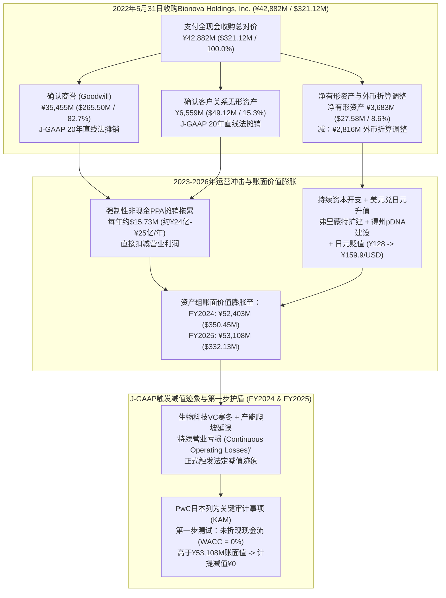
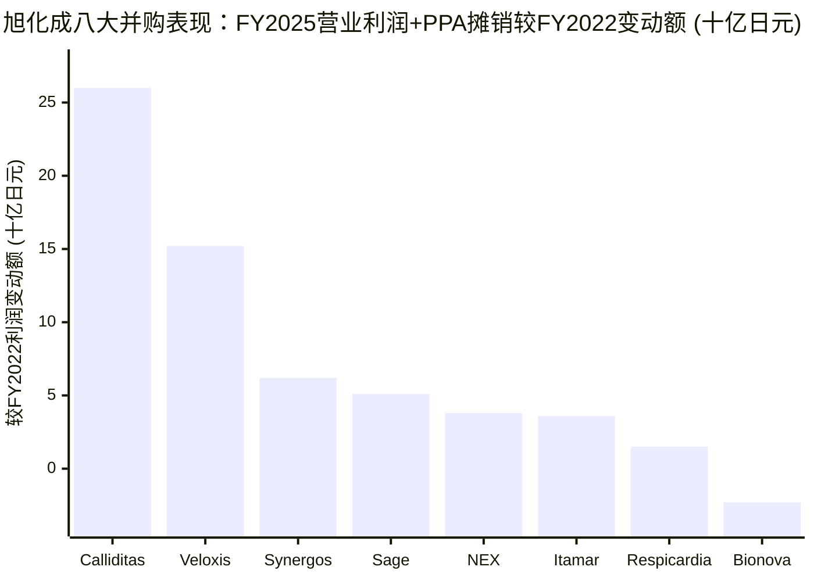
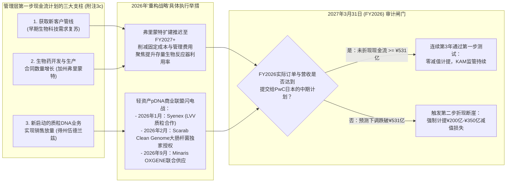

当一家全资非上市子公司隐藏在跨国企业集团合并财务报表的高墙之后运行时，关于其经营困境的传闻往往在母公司董事会之外的任何人看到其独立损益表（P&L）之前很久就已经在行业内发酵。对于**Bionova Scientific, LLC**——这家总部位于美国加利福尼亚州弗里蒙特（Fremont）、由日本东京综合化工与医疗健康巨头**旭化成株式会社（Asahi Kasei Corporation，`TSE: 3407`）**在2022年5月后疫情生物工艺泡沫最高峰时期收购的生物药合同开发与生产组织（CDMO）——关于其生物反应器产能利用率不足、生物科技初创企业订单低迷以及东京总部收紧管控的传闻，近期在从旧金山湾区到得克萨斯州伍德兰兹（The Woodlands）的生物制造走廊中愈演愈烈。

由于Bionova作为非上市子公司隶属于旭化成的医疗健康（Healthcare）板块，它并不向美国证券交易委员会（SEC）单独披露利润表。然而，通过对旭化成经审计的日本公认会计原则（`J-GAAP`）合并财务报表（`FY2022`至`FY2025`，截至2026年3月31日）、季度业绩补充材料（`Q1 FY2025`至`H1 FY2026`，截至2026年9月30日）、管理层简报演示文稿以及机构投资者问答（Q&A）实录的全面法务会计挖掘与交叉核验，我们证实：**市场传闻不仅属实，而且已被正式记录在审计报表附注中，并连续两个财年被旭化成的独立审计师普华永道日本（`PricewaterhouseCoopers Japan LLC`，简称`PwC Japan`）列为合并报表层面的“关键审计事项”（`KAM, Key Audit Matter`）。**

与此同时，第一手原始披露文件的交叉验证还揭开了二手新闻报道与第三方商业数据库所遗漏的四个核心结构性真相：

1. **隐藏的收购价格分摊（`PPA`）真相：** 尽管当年行业媒体将2022年5月的收购条款报道为“未披露（undisclosed）”，且部分外部评论猜测交易金额高达4.73亿美元，但**旭化成经审计的FY2022合并财务报表附注16(a)**（[2303statements.pdf](https://www.asahi-kasei.com/content/dam/asahi-kasei/us/en/ir/library/financial-briefing/pdf/2303statements.pdf)，第44–45页）明确披露：旭化成以**428.82亿日元（折合3.2112亿美元）**的全现金对价收购了Bionova Holdings, Inc. 100%的股权。在这笔收购价中，**354.55亿日元（2.6550亿美元，占82.7%）被确认为商誉（Goodwill）**，**65.59亿日元（4,912万美元，占15.3%）被确认为客户关系无形资产（Customer Relationships）**——这意味着**整个收购价格的98.0%（`420.14亿日元`）由需要按年摊销的无形账面溢价构成**，而实际收购的**净有形资产（Net Tangible Assets）仅有36.83亿日元（约合2,758万美元，仅占收购价的8.6%）**。
2. **连续两年（`FY2024`与`FY2025`）触发正式减值迹象：** 在**FY2024经审计报表附注3(c)**（[2503statements.pdf](https://www.asahi-kasei.com/content/dam/asahi-kasei/us/en/ir/library/financial-briefing/pdf/2503statements.pdf)，第15页）和**FY2025经审计报表附注3(c)**（[2603statements.pdf](https://www.asahi-kasei.com/content/dam/asahi-kasei/us/en/ir/library/financial-briefing/pdf/2603statements.pdf)，第14页，审计报告签署于2026年6月24日）中，旭化成均正式披露：受外汇折算与资本开支推动，账面价值已膨胀至**531.08亿日元（3.3213亿美元）**的Bionova资产组，因***“主要受流向生物科技初创企业的融资减少导致需求低迷等因素影响，录得持续营业亏损（continuous operating losses），从而识别出减值迹象（impairment indicators）”***。
3. **日本会计准则（J-GAAP）的“未折现现金流”护盾：** 如果旭化成采用国际财务报告准则（`IFRS IAS 36`）或美国公认会计原则（`US GAAP ASC 350`），将531亿日元的账面价值与按`8%–10%`加权平均资本成本（`WACC`）**折现后的现值**直接对比，几乎必然会立即触发巨额减值损失。然而，根据日本会计准则（`ASBJ企业会计准则适用指针第6号`）的“第一步（减值确认判定）”规则，只要剩余回收期内**未折现（undiscounted，即`WACC = 0%`）未来现金流总额**高于账面价值，企业即可免于计提减值。管理层正是通过提交一份假设单克隆抗体（`mAb`）订单大幅反弹及得州新建质粒DNA（`pDNA`）工厂商业化放量的内部中期经营计划，才惊险跨过了第一步测试门槛。
4. **2026年4月至11月从“产能扩张”向“推迟投资、削减固定成本与战略重构”的官方转向：** 在**2026年4月15日管理层简报的第16页幻灯片**（[e260415en.pdf](https://www.asahi-kasei.com/content/dam/asahi-kasei/us/en/ir/library/initiative/pdf/e260415en.pdf)）中，管理层公布了一张追踪FY2022以来8起重大并购交易利润增长（营业利润+PPA摊销变动额）的柱状图。**在全部8起并购中，Bionova是唯一一家在FY2023、FY2024和FY2025连续三年利润变动均为负值的标的公司。** 与此同时，管理层删去了2025年秋季综合报告中所谓Bionova*“正处于复苏轨道并扩大产能以满足未来需求”*的表述，取而代之的是明确披露***“正在实施投资推迟与固定成本削减（investment deferrals and fixed-cost reductions）”***（[e260415en.pdf](https://www.asahi-kasei.com/content/dam/asahi-kasei/us/en/ir/library/initiative/pdf/e260415en.pdf)，第16、44页）以及***“强化Bionova（CDMO）的基础体质并重构战略（Strengthening the fundamentals and reconfiguring the strategy of Bionova）”***（[2603supplement.pdf](https://www.asahi-kasei.com/content/dam/asahi-kasei/us/en/ir/library/financial-briefing/pdf/2603supplement.pdf)，第27页；[2606supplement.pdf](https://www.asahi-kasei.com/content/dam/asahi-kasei/us/en/ir/library/financial-briefing/pdf/2606supplement.pdf)，第25页；[2609supplement.pdf](https://www.asahi-kasei.com/content/dam/asahi-kasei/us/en/ir/library/financial-briefing/pdf/2609supplement.pdf)，第30页）。

---

## 1. 核心议题分类与可证伪性（Falsifiability）标准

为了将可核实的会计机制与市场传言严格区分开来，我们将本次调查拆解为两个截然不同的分析维度：

* **描述性审计（Descriptive Audit —— 经验事实核查）：** 旭化成在2022年5月收购Bionova Scientific时究竟支付了多少对价？在日本会计准则（`J-GAAP`）下，Bionova的资产负债表结构如何？究竟是哪些具体的运营与会计触发因素导致PwC日本将Bionova高达**524亿日元（`FY2024`）**和**531亿日元（`FY2025`）**的资产组列为关键审计事项（`KAM`）？在2025年4月至2026年11月期间，东京总部已经执行了哪些具体的实体分拆与资本开支（Capex）延期？
* **规范性审计（Prescriptive Audit —— 远期风险与估值研判）：** Bionova重新配置的战略——以削减固定成本、推迟加州弗里蒙特商业化生物反应器扩建，以及2026年密集签署的三项质粒DNA商业联盟（`Syenex`、`Scarab Genomics`、`Minaris`）为核心——能否产生足够的可核实订单积压，从而通过PwC日本在**2027年3月31日（`FY2026`）**年度审计中对*历史商业计划与实际业绩对比*的严苛核查？抑或旭化成正不可避免地走向一场类似于FY2022美国电池隔膜子公司**Polypore International, LLC高达1,863.76亿日元（约合14亿美元）减值计提**的强制性商誉与固定资产减值清算？

### 认识论可证伪性（Falsifiability）条件

如果未来的第一手官方披露文件证实以下任何一项成立，则本报告关于Bionova在2027年3月31日（`FY2026`）或2028年3月31日（`FY2027`）财年结算时面临高度结构性减值风险的结论将被**证伪（推翻）**：
1. Bionova在扣除每年约**24亿至26亿日元（约合1,573万美元）**的J-GAAP商誉及客户关系无形资产摊销**之后**，实现独立口径营业利润转正，从而在2027年6月发布的FY2026合并财务报表附注3(c)中正式消除“持续营业亏损”这一减值触发因素。
2. `旭化成生命科学株式会社（Asahi Kasei Life Science Corp.）`披露的持续两位数营收增长被证实主要源自**弗里蒙特与得州CDMO基地的产能利用率跃升**，而非除病毒滤器（`Planova`）或生物安全性检测服务（`ViruSure` / `Bionique`）的强劲需求。
3. 独立审计师PwC日本在其审计报告的关键审计事项（`KAM`）部分正式移除对Bionova Scientific, LLC固定资产及商誉估值的重点审计预警。

---

## 2. 一手信源对质矩阵：公开扩张叙事 vs. 审计附注与简报现实

将公开新闻稿、商业数据库估算及早期综合报告的宣传口径，与旭化成经审计的财务报表附注及2026年4月至11月投资者补充材料进行逐项对质，可以清晰看到两者之间的巨大鸿沟。

| 分析维度 | 公开并购叙事与二手机构估算（2022年–2025年秋季） | 审计报表附注、PwC关键审计事项（KAM）与投资者简报真相（2025年6月–2026年11月） | 经核验的一手原始披露文件 |
| :--- | :--- | :--- | :--- |
| **2022年5月收购价格与资产构成** | 行业媒体报道收购价格“未披露”；部分外部博客猜测交易额达“4.73亿美元”，并假定其拥有庞大的有形生物反应器重资产。 | 实际全现金收购价为**428.82亿日元（3.2112亿美元）**。其中**98.0%（`420.14亿日元`）**被分摊至**商誉（`354.55亿日元`）**和**客户关系无形资产（`65.59亿日元`）**；实际净有形资产仅为**36.83亿日元（约合2,758万美元）**。 | [FY2022经审计合并报表（`2303statements.pdf`，附注16(a)，第44–45页）](https://www.asahi-kasei.com/content/dam/asahi-kasei/us/en/ir/library/financial-briefing/pdf/2303statements.pdf) |
| **独立营收规模 vs. 分部合并口径** | 第三方商业数据库（`PitchBook`、`LeadIQ`等）估算Bionova独立年营收为**5,000万–1亿美元**（员工约140–220人）；外部观察者常将其与生命科学分部总营收混淆。 | 被并入`旭化成生命科学株式会社`分部（剥离血液净化与诊断业务后的持续经营口径：`FY2025`实际营收**554亿日元 / 约3.67亿美元**；`FY2026`预测**670亿日元 / 约4.32亿美元**），由高毛利的**Planova（普乐诺瓦）**除病毒滤器利润掩盖Bionova的经营亏损。 | [FY2025业绩补充材料（`2603supplement.pdf`，第41页）](https://www.asahi-kasei.com/content/dam/asahi-kasei/us/en/ir/library/financial-briefing/pdf/2603supplement.pdf)及[H1 FY2026补充材料（`2609supplement.pdf`，第42页）](https://www.asahi-kasei.com/content/dam/asahi-kasei/us/en/ir/library/financial-briefing/pdf/2609supplement.pdf) |
| **收购后利润轨迹（FY2022–FY2025）** | 2025年秋季发布的《旭化成报告2025》称其*“经营环境目前已步入复苏轨道，正在扩大产能以满足未来增长的需求”*。 | 2026年4月管理层简报披露：自FY2022以来，Bionova的营业利润+PPA摊销变动额**连续3年为负值（`约-20亿至-25亿日元`）**——是近期8起重大并购中**唯一处于负值区间**的项目。 | [2026年4月15日管理层简报（`e260415en.pdf`，第16页）](https://www.asahi-kasei.com/content/dam/asahi-kasei/us/en/ir/library/initiative/pdf/e260415en.pdf)对比[2025综合报告（`25en.pdf`，第39页）](https://www.asahi-kasei.com/content/dam/asahi-kasei/us/en/ir/library/asahikasei-report/pdf/25en.pdf) |
| **减值迹象状态与审计师监管** | Bionova官方新闻稿或得州pDNA工厂剪彩报道中对减值迹象或审计师警告只字未提。 | 因*“持续营业亏损”*，在**FY2024（账面值`524.03亿日元`）和FY2025（`531.08亿日元` / `3.3213亿美元`）连续两年触发正式减值迹象**；连续两年被**PwC日本列为关键审计事项（`KAM`）**。 | [FY2024审计报表（`2503statements.pdf`，第4–6、15页）](https://www.asahi-kasei.com/content/dam/asahi-kasei/us/en/ir/library/financial-briefing/pdf/2503statements.pdf)及[FY2025审计报表（`2603statements.pdf`，第4–5、14页）](https://www.asahi-kasei.com/content/dam/asahi-kasei/us/en/ir/library/financial-briefing/pdf/2603statements.pdf) |
| **资本开支（Capex）执行与战略姿态** | 对外宣传为横跨加州弗里蒙特（生物药）与得州伍德兰兹（质粒DNA）的多基地高速扩张。 | 2026年5月至11月官方战略要点改为***“强化Bionova（CDMO）的基础体质并重构战略”***；弗里蒙特扩建完工期从`FY2025及以后`推迟至`FY2027及以后`，得州GMP级pDNA从`FY2025及以后`推迟至`FY2026及以后`，并明确实施***“投资推迟与固定成本削减”***。 | [2026年4月15日管理层简报（`e260415en.pdf`，第44页）](https://www.asahi-kasei.com/content/dam/asahi-kasei/us/en/ir/library/initiative/pdf/e260415en.pdf)及[H1 FY2026补充材料（`2609supplement.pdf`，第30、49页）](https://www.asahi-kasei.com/content/dam/asahi-kasei/us/en/ir/library/financial-briefing/pdf/2609supplement.pdf) |

---

## 3. 2022年5月收购价格分摊（PPA）法务拆解：一家净有形资产仅2,758万美元的工厂如何变成531亿日元的资产负债表重担

要理解为什么Bionova Scientific会连续四年录得营业亏损并连续两年触发J-GAAP正式减值迹象，分析师不能只看2026年，而必须回到**2022年5月31日**——即旭化成医疗株式会社（`Asahi Kasei Medical Co., Ltd.`）完成收购Bionova Scientific唯一母公司**Bionova Holdings, Inc.**（特拉华州注册，首席执行官Darren Head）100%表决权股份的那一天（[旭化成官方新闻稿`e220601`](https://www.asahi-kasei.com/news/2022/e220601)）。

在2022年4月至5月期间，流向早期生物科技和细胞与基因治疗（CGT）初创企业的风险投资（VC）仍在延续2020–2021年零利率泡沫的余温。由于临床前及I/II期新兴生物制药公司迫切需要锁定哺乳动物细胞培养（`CHO`）生物反应器产能，生物药CDMO在并购市场上享受着极高的稀缺性溢价。

当旭化成发布其**FY2022详细合并财务报表**（截至2023年3月31日财年；[2303statements.pdf](https://www.asahi-kasei.com/content/dam/asahi-kasei/us/en/ir/library/financial-briefing/pdf/2303statements.pdf)）时，**附注16(a)（*企业合并 —— 收购Bionova Holdings, Inc.*，第44–45页）**以及**合并现金流量表附注（第22页）**完整披露了这笔交易的解剖结构：

| 收购价格分摊（`PPA`）明细项目（截至2022年5月31日） | 经审计日元金额（`百万日元`） | 经审计美元折算额（`千美元`） | 占总收购价比例（`%`） | J-GAAP会计处理与摊销期限 |
| :--- | :--- | :--- | :--- | :--- |
| **现金收购总对价（Total Cash Consideration）** | **¥42,882M** | **$321,117K ($321.12M)** | **100.0%** | 全额现金支付（另加计入销售及管理费用的¥534M / $4.00M顾问费） |
| 减：交割时Bionova账面持有的现金及存款 | (¥341M) | ($2,555K) | (0.8%) | 取得子公司支付的现金净流出 = **¥42,541M ($318.56M)** |
| **取得的流动资产（Current Assets）** | ¥1,543M | $11,555K | 3.6% | 营运资金（现金、应收账款、存货等） |
| **取得的非流动资产合计（Noncurrent Assets）** | ¥13,246M | $99,191K | 30.9% | 包含有形固定资产（PP&E）及可辨认无形资产 |
| — *其中：可辨认客户相关无形资产（Customer Relationships）* | **¥6,559M** | **$49,116K ($49.12M)** | **15.3%** | 按**20年直线法摊销**（按收购汇率计算每年约¥328M） |
| — *其中：有形固定资产（PP&E）及其他非流动资产* | ¥6,687M | $50,075K ($50.08M) | 15.6% | 弗里蒙特基地的生物反应器、实验室设备及使用权租赁资产 |
| **取得的可辨认资产总额** | **¥14,789M** | **$110,746K ($110.75M)** | **34.5%** | 扣除负债前的可辨认资产总额 |
| **承担的流动负债（Current Liabilities）** | (¥1,491M) | ($11,165K) | (3.5%) | 应付账款、预提费用、递延收入等 |
| **承担的非流动负债（Noncurrent Liabilities）** | (¥3,056M) | ($22,885K) | (7.1%) | 长期租赁负债及递延所得税负债 |
| **承担的负债总额** | **(¥4,547M)** | **($34,050K / -$34.05M)** | **(10.6%)** | 交割时承担的负债合计 |
| **可辨认净资产（未计商誉前的账面净资产）** | **¥10,242M** | **$76,696K ($76.70M)** | **23.9%** | 包含¥6,559M（$49.12M）的客户关系无形资产 |
| **实际取得的净有形资产（剔除客户无形资产后）** | **¥3,683M** | **$27,580K ($27.58M)** | **8.6%** | **实际收购的物理净资产底座（`¥10,242M - ¥6,559M`）** |
| 收购价格分摊时的外币报表折算差额 | (¥2,816M) | ($21,084K) | (6.6%) | 交割日与PPA最终确认日之间的汇率折算调整 |
| **收购确认的商誉（Goodwill）** | **¥35,455M** | **$265,501K ($265.50M)** | **82.7%** | 按**20年直线法摊销**（按收购汇率计算每年约¥1,773M） |
| **商誉 + 客户无形资产合计负担** | **¥42,014M** | **$314,617K ($314.62M)** | **98.0%** | **高达收购价98.0%的资金沉淀为20年摊销的无形账面资产** |

请仔细审视上表的最后两行。在旭化成为收购Bionova Holdings汇出的**428.82亿日元（3.2112亿美元）**真金白银中，扣除负债和无形客户名单后，**真正代表物理设备的净有形资产（Net Tangible Assets）仅有36.83亿日元（2,758万美元），仅占总收购价的8.6%！** 其余高达**420.14亿日元（3.1462亿美元）——占总收购价整整98.0%的金额——全部被计入了商誉（`354.55亿日元`）和客户关系无形资产（`65.59亿日元`）**。

甚至在2022年7月1日至2023年3月31日的首个9个月并表期（`FY2022`）内，附注16(a)（第45页）记录显示，Bionova仅贡献了**54.00亿日元（4,044万美元）**的营业收入，同时录得**6.58亿日元（-493万美元）的营业亏损**——当时管理层认为这一初期亏损“无关紧要”，并假定一旦商业化规模生物反应器车间和质粒DNA产线投产，业绩很快就会扭亏为盈。

### 为什么日本会计准则（J-GAAP）会将高溢价并购直接变成“营业利润陷阱”？

在美国会计准则（`US GAAP ASC 350`）和国际财务报告准则（`IFRS IAS 36`）下，商誉不进行日常摊销，企业只需摊销有限寿命的客户无形资产，并对商誉进行年度减值测试。然而，在**日本公认会计原则（`ASBJ企业会计准则第21号`）**下，商誉必须在不超过**20年**的期限内按直线法强制摊销，且该笔摊销费用直接计入利润表的**营业利润（`営業利益`）**扣除项！

更重要的是，由于Bionova是以美元（`USD`）为记账本位币的美国子公司，其美元商誉（初始原值约`2.655亿美元`）和美元客户关系无形资产（初始原值约`4,912万美元`）在每个报告期都会按当期汇率折算为日元。随着日元汇率从2022年5月的约`128日元/美元`贬值至FY2024–FY2025期间的`150–160日元/美元`，Bionova资产组的日元账面价值及其每年的日元摊销负担同步膨胀：

$$\text{年度J-GAAP PPA摊销额 (日元)} = \left(\frac{\text{USD } 265.50\text{M 商誉}}{20\text{年}} + \frac{\text{USD } 49.12\text{M 客户无形资产}}{20\text{年}}\right) \times \text{汇率}_{\text{JPY/USD}} = \text{USD } 15.73\text{M/年} \times \text{汇率}_{\text{JPY/USD}}$$

在`150–160日元/美元`的汇率水平下，**仅非现金PPA并购摊销一项，Bionova每年就背负着23.6亿至25.2亿日元（约合1,573万美元）的刚性扣减**，此外还要加上弗里蒙特生物反应器和得州质粒工厂的固定资产折旧。换言之，在Bionova支付任何一名生物工艺工程师的薪水或购买哪怕一升细胞培养基之前，它每年必须先产生近**1,600万美元的正向EBITDA**，才能勉强在J-GAAP营业利润线上达到盈亏平衡！

---

## 4. 语义精确度与替代测试（Substitution Test）：破译东京总部的会计委婉语

在日本上市公司的法定披露文件中，管理层和外部审计师使用高度标准化的法律与会计术语。这些表述在外行读者看来平淡无奇，但在日本《金融商品交易法》（`FIEA`）和日本企业会计准则委员会（`ASBJ`）规则下却具有极其严格的法定含义。运用Browne与Keeley的**歧义消除与替代测试**，我们将旭化成FY2024–FY2026财报中的三句核心委婉语替换为其真实的法务会计含义：

1. ***“在Bionova Scientific, LLC的资产组中识别出减值迹象（Impairment indicators were identified within Bionova Scientific, LLC's asset group）”***（[2503statements.pdf](https://www.asahi-kasei.com/content/dam/asahi-kasei/us/en/ir/library/financial-briefing/pdf/2503statements.pdf)，第15页；[2603statements.pdf](https://www.asahi-kasei.com/content/dam/asahi-kasei/us/en/ir/library/financial-briefing/pdf/2603statements.pdf)，第14页）：
   * **法定会计含义（`ASBJ企业会计准则适用指针第6号第12条`）：** 在日本会计准则下，“减值迹象（`減損の兆候`）”绝非主观判断。当一个资产组录得**连续两个财年营业亏损**（或经营现金流为负且实际业绩严重偏离收购时的商业计划）时，必须强制触发减值迹象。由于Bionova在`FY2022`（-6.58亿日元）、`FY2023`、`FY2024`和`FY2025`并表后的**全部四个财年均录得营业亏损**，它在FY2024和FY2025连续两年被强制推入第一步减值确认测试。
2. ***“由于未折现未来现金流总额超过资产账面价值，未确认减值损失（No impairment loss was recognized since the total amount of undiscounted future cash flows exceeded the carrying amount of the assets）”***（[2603statements.pdf](https://www.asahi-kasei.com/content/dam/asahi-kasei/us/en/ir/library/financial-briefing/pdf/2603statements.pdf)，第14页）：
   * **法定会计含义（`固定资产减值会计准则第二部分 2(1)`）：** 与一旦*折现现值*（可收回金额）低于账面价值就立即计提减值的IFRS（`IAS 36`）不同，J-GAAP设置了一个两步走闸门。在**第一步（减值确认测试）**中，企业将资产组剩余回收期内（包含商誉时最长可达**20年**）的名义未来现金流按**零折现率（`WACC = 0%`）简单相加**。只有当这个未折现总和跌破`531.08亿日元`时，企业才会坠入**第二步（减值计量测试）**，此时未来现金流将立即按`WACC`（`约8%–10%`）进行折现，瞬间引发断崖式的巨额减值计提。
3. ***“强化Bionova（CDMO）的基础体质并重构战略（Strengthening the fundamentals and reconfiguring the strategy of Bionova）”***（[2603supplement.pdf](https://www.asahi-kasei.com/content/dam/asahi-kasei/us/en/ir/library/financial-briefing/pdf/2603supplement.pdf)，第27页；[2606supplement.pdf](https://www.asahi-kasei.com/content/dam/asahi-kasei/us/en/ir/library/financial-briefing/pdf/2606supplement.pdf)，第25页；[2609supplement.pdf](https://www.asahi-kasei.com/content/dam/asahi-kasei/us/en/ir/library/financial-briefing/pdf/2609supplement.pdf)，第30页）：
   * **法务会计替代（`e260415en.pdf`，第16及44页）：** 我们完全不必猜测“强化基础体质并重构战略”在业务层面意味着什么，因为旭化成在2026年4月15日管理层简报的第44页给出了明确定义：***“由于生物科技行业长期低迷，营收疲软持续；在致力于扩大质粒销售的同时，正在实施投资推迟（investment deferrals）与固定成本削减（fixed-cost reductions）。”*** 用通俗的话说：叫停加州弗里蒙特的资本扩建、砍掉冗余固定开支，并紧急签署轻资产质粒DNA合作协议以填补得州工厂闲置的洁净室。

---

## 5. 审计师显微镜下的两年：深度剖析附注3(c)、PwC日本关键审计事项（KAM）与“第一步断崖”

让我们逐字核查旭化成**FY2024**（截至2025年3月31日）与**FY2025**（截至2026年3月31日）详细合并财务报表中的原文披露，以及PwC日本的独立审计师报告。

### 附注3(c)的演变（`重要会计估计 —— Bionova Scientific, LLC固定资产的估值`）

在**FY2024（[2503statements.pdf](https://www.asahi-kasei.com/content/dam/asahi-kasei/us/en/ir/library/financial-briefing/pdf/2503statements.pdf)，第15页）**和**FY2025（[2603statements.pdf](https://www.asahi-kasei.com/content/dam/asahi-kasei/us/en/ir/library/financial-briefing/pdf/2603statements.pdf)，第14页）**中，在整个总资产达4.1万亿日元的旭化成集团内，Bionova Scientific是仅有的三家因固定资产及商誉估值风险而被单独列示**“重要会计估计（Significant Accounting Estimate）”**专项预警的子公司之一（另外两家分别是附注3(b)的美国电池隔膜子公司**Polypore International, LLC**和附注3(a)的欧洲制药并购标的**Calliditas Therapeutics AB**）：

| 经审计披露指标 | FY2024合并财务报表（截至2025年3月31日） | FY2025合并财务报表（截至2026年3月31日） | 同比变动与法务会计意义 |
| :--- | :--- | :--- | :--- |
| **Bionova资产组账面价值（日元）** | **524.03亿日元（¥52,403M）** | **531.08亿日元（¥53,108M）** | 尽管经历了12个月的折旧与PPA摊销，受得州/加州资本开支及美元兑日元升值推动，日元账面值反而**增加7.05亿日元（+1.3%）** |
| **折算美元账面价值（USD）** | **$350,451K（3.5045亿美元）**（按~¥149.53/USD折算） | **$332,133K（3.3213亿美元）**（按~¥159.90/USD折算） | 摊销带来的美元账面净减少被新增资本开支部分抵消，净减少**1,832万美元（-5.2%）** |
| **占旭化成合并总资产比例** | 占合并总资产**约1.0%** | 占合并总资产**1.3%** | 相对于集团总资产的风险敞口集中度上升30个基点 |
| **触发减值迹象的法定原因** | *“主要受流向生物科技初创企业的资金减少导致需求低迷等因素影响，录得持续营业亏损，显示存在潜在减值迹象”* | *“主要受流向生物科技初创企业的资金减少导致需求低迷影响，Bionova因录得持续营业亏损而识别出减值迹象”* | 连续第二年在经审计报表中承认“持续营业亏损” |
| **管理层商业计划的三大核心假设** | 1. 未来获取新客户管线；2. 生物药开发与生产合同数量增长；3. 新启动的质粒DNA业务实现销售 | 1. 未来获取新客户管线；2. 生物药开发与生产合同数量增长；3. 新启动的质粒DNA业务实现销售 | 连续两年向PwC日本提交完全相同的三大业绩反转假设 |
| **经审计的第一步测试结果** | *“由于未折现未来现金流总额超过账面价值，未确认减值损失。”* | *“由于未折现未来现金流总额超过资产账面价值，本合并财年末未确认任何减值损失。”* | 完全依赖J-GAAP第一步未折现加总（`WACC = 0%`）免于减值计提 |

### PwC日本在关键审计事项（`KAM`）中写下的铁证

**2026年6月24日**，**普华永道日本（`PricewaterhouseCoopers Japan LLC`）**的签字注册会计师**高田健介（Kensuke Koda）、五代英纪（Hideki Godai）、新田真树（Masaki Nitta）**签署了旭化成FY2025合并财务报表的独立审计师报告（[2603statements.pdf](https://www.asahi-kasei.com/content/dam/asahi-kasei/us/en/ir/library/financial-briefing/pdf/2603statements.pdf)，第4–5页）。在解释为何将Bionova高达531.08亿日元的资产组列为关键审计事项时，PwC日本明确写道：

> *“我们认定评估是否应对Bionova的固定资产确认减值损失属于关键审计事项，原因如下：未来现金流系基于管理层编制的商业计划进行估计，而其关键假设——例如未来新客户管线的获取、生物药开发与生产合同数量的增长，以及新启动的质粒DNA业务的销售——可能受到未来市场趋势的影响，涉及**高度估计不确定性（high estimation uncertainty）**，并需要**重大的管理层判断（significant management judgment）**。”*

最关键的是PwC日本执行的**审计程序 (2)**（[2603statements.pdf](https://www.asahi-kasei.com/content/dam/asahi-kasei/us/en/ir/library/financial-briefing/pdf/2603statements.pdf)，第4页）：

> ***“此外，我们将历史商业计划与实际业绩进行了对比，对于实际业绩未达商业计划的情况（where actual results fell short of the business plans），我们评估了导致该等未达标的原因，并审视了这些原因是否已在编制下一合并财年及后续年度的商业计划时得到适当反映。”***

这句话正是整份审计报告中的确凿铁证（Smoking Gun）。PwC日本正式证实了Bionova在过往期间**“实际业绩未达商业计划”**，并且审计师已强制要求管理层论证：为何过去的业绩不达标不会令FY2026及以后的预测失效。

### J-GAAP“第一步断崖（Step 1 Cliff）”的数学证明（`WACC = 0%` vs. `WACC = 9%`）

为什么J-GAAP的两步法减值架构会对一家账面价值高达531亿日元（`3.3213亿美元`）的重资产CDMO造成“全有或全无的断崖效应”？

设截至2026年3月31日Bionova资产组（含商誉）的账面价值为 `C_book = 531.1亿日元`，并设在剩余回收期 `T = 16年`（自2022年5月收购起20年商誉摊销期的剩余年限）内第 `t` 年预测的息税前经营现金流为 `CF_t`。

在**J-GAAP第一步（减值确认测试）**下，当且仅当满足以下不等式时，无需确认任何减值损失：

$$\text{CF}_{\text{Step 1 (未折现总和)}} = \sum_{t=1}^{16} \text{CF}_t \ge 531.1\text{亿日元}$$

假设管理层提交了一份“曲棍球棒式（Hockey-Stick）”中期经营计划：第1年现金流盈亏平衡（`0.0亿日元`），第2–4年逐步爬坡（`15亿日元`、`25亿日元`、`35亿日元`），并在第5–16年的12年间每年产生`40亿日元`（约合2,500万–2,600万美元/年）的稳态自由现金流（`12年 × 40亿日元 = 480亿日元`）。

* **第一步未折现现金流总和（`WACC = 0%`）：**

$$\sum_{t=1}^{16} \text{CF}_t = 0.0 + 15.0 + 25.0 + 35.0 + (12 \times 40.0) = 555.0\text{亿日元} > 531.1\text{亿日元}$$

由于`555.0亿日元`以微弱的`4.5%`缓冲垫（`23.9亿日元`）高于账面值`531.1亿日元`，**第一步测试通过，资产负债表确认的减值损失恰好为0日元。**

现在假设在即将到来的`FY2026`（截至2027年3月31日）结算中，实际订单比计划仅仅低了10%，迫使PwC日本将远期稳态现金流预测下调10%（从`每年40亿日元`降至`每年36亿日元`）：

* **修正后的第一步未折现现金流总和（`WACC = 0%`）：**

$$\sum_{t=1}^{16} \text{CF}_t^{\text{修正}} = 0.0 + 13.5 + 22.5 + 31.5 + (12 \times 36.0) = 499.5\text{亿日元} < 531.1\text{亿日元}$$

一旦未折现总和跌破`531.1亿日元`哪怕1日元，**第一步测试即告失败**。根据J-GAAP（`固定资产减值会计准则第二部分 2(2)`），此时应计提的减值损失**绝不是**简单的差额`531.1亿 - 499.5亿 = 31.6亿日元`。相反，企业会立即坠入**第二步（减值计量测试）**，必须按生物药CDMO行业折现率 `r = 9.0%` 计算的**折现现值（`可收回金额`）**一次性核减账面价值：

$$\text{PV}_{\text{Step 2}} = \sum_{t=1}^{16} \frac{\text{CF}_t^{\text{修正}}}{(1 + 0.09)^t} \approx 234.0\text{亿日元}$$

$$\text{强制计提的J-GAAP第二步减值损失} = C_{\text{book}} - \text{PV}_{\text{Step 2}} = 531.1\text{亿日元} - 234.0\text{亿日元} = 297.1\text{亿日元}\; (\approx \text{USD } 186\text{M})$$

**未折现现金流假设仅仅下调10%，就会瞬间触发高达账面价值56%（`约297亿日元`）的资产负债表断崖式减记**，因为一旦跌破第一步门槛，折现率会在一夜之间从`0%`切换为`9%`！

### 就在Bionova上方两段（附注3(b)）的Polypore前车之鉴

如果有人认为日本大型财团可以无限期推迟第一步商誉减值测试的暴雷，只需阅读**旭化成FY2024和FY2025合并财务报表同一页（第14页）紧挨在Bionova上方的附注3(b)**（[2603statements.pdf](https://www.asahi-kasei.com/content/dam/asahi-kasei/us/en/ir/library/financial-briefing/pdf/2603statements.pdf)）：

> *“附注3(b) Polypore International, LLC固定资产的估值：……在2022财年，受美国通胀加剧、地缘政治风险上升以及汽车减产等背景影响，Polypore所处的经营环境恶化……因此，在对未来商业计划进行重新审视后，对商誉、其他无形资产以及物业、厂房和设备确认了**1,863.76亿日元的减值损失**。”*

当美国子公司Polypore的中期预测在FY2022未能通过PwC日本的“历史计划与实际业绩对比核查”时，旭化成被迫一次性计提了**1,863.8亿日元（约合14亿美元）的巨额减值损失**。此外，即便在FY2025，旭化成也在其他化工和医疗资产上计提了**209.72亿日元（1.3116亿美元）的合并减值损失**（[2603statements.pdf](https://www.asahi-kasei.com/content/dam/asahi-kasei/us/en/ir/library/financial-briefing/pdf/2603statements.pdf)，第20页）。一旦未折现现金流缓冲垫耗尽，PwC日本对旭化成美国并购标的的审计绝不手软。

---

## 6. 东京机构投资者的质询与2026年4月并购记分牌铁证

### 财报电话会问答实录的法务核查（`2025年7月31日`）

在2025年6月年度有价证券报告书（`有価証券報告書`）首次将Bionova列为KAM之后，东京的机构股票分析师立刻嗅到了风险。在**2025年7月31日举行的旭化成FY2025第一季度业绩简报问答会（Q&A）**（[2506summary.pdf](https://www.asahi-kasei.com/content/dam/asahi-kasei/us/en/ir/library/financial-briefing/pdf/2506summary.pdf)，第2页）上，一位机构分析师开门见山地向管理层质询了Bionova的减值风险。

*（法务归属勘误说明：部分二手市场评论常将旭化成首席财务官（CFO）**堀江俊保（Toshiyasu Horie）**与负责医疗健康板块的专务执行役员**中野诚二（Seiji Nakano）**的姓名混淆，误称为“CFO Toshiyasu Nakano”。官方Q1 FY2025问答纪要[2506summary.pdf](https://www.asahi-kasei.com/content/dam/asahi-kasei/us/en/ir/library/financial-briefing/pdf/2506summary.pdf)第1–2页证实，堀江俊保与中野诚二当天均出席了电话会，并在第2页`Healthcare: Pharmaceuticals & Life Science`环节由**中野诚二（Seiji Nakano）**直接回答了关于Bionova减值风险的提问。）*

以下是官方投资者问答纪要中的逐字实录：

> **分析师提问：** *“您如何看待与Bionova Scientific, LLC相关的减值风险？（How do you see the risk of impairment related to Bionova Scientific, LLC?）”*
>
> **中野诚二（医疗健康板块专务执行役员）：** *“在目前阶段，我们预计不会发生任何减值。我们将继续审视我们的中期计划，并与我们的会计师进行适当的核验。（At this point, we do not anticipate any impairment. We will continue to review our medium-term plans and conduct appropriate verification with our accountants.）”*

请注意这一极其谨慎的措辞：中野并**没有**说Bionova已经扭亏为盈，也没有说在手订单已经消除了风险。他明确表示管理层将*“继续审视中期计划并与会计师进行适当核验”*——这正是11个月后（2026年6月24日）PwC日本在审计报告中再次重点预警的第一步商业计划核验程序。

### 2026年4月15日管理层简报第16页幻灯片上的确凿铁证

关于Bionova独立经营表现最具杀伤力的定量披露，出现在**2026年4月15日旭化成管理层简报**（*中期经营计划2025–2027“Trailblaze Together”更新汇报*，[e260415en.pdf](https://www.asahi-kasei.com/content/dam/asahi-kasei/us/en/ir/library/initiative/pdf/e260415en.pdf)）的**第16页幻灯片**上。

在一张题为**“近期重大并购的利润增长（较FY2022的营业利润+PPA摊销变动额）”**的柱状图中，管理层列出了8起重大并购标的——**Calliditas**（制药）、**Veloxis**（制药）、**Synergos**（住宅）、**Sage**（材料）、**NEX**（住宅）、**Itamar**（重症监护）、**Bionova**（生命科学）和**Respicardia**（重症监护）——在`FY2023实际`、`FY2024实际`和`FY2025预测`三年的累计利润进展。

由于该指标衡量的是**营业利润加上PPA摊销额（`Operating Income + PPA Amortization`，即剔除并购商誉/无形资产摊销前的EBITDA类经营利润）**相对于FY2022的变化，它彻底排除了“非现金J-GAAP商誉摊销拖累”的借口。即便在加回PPA摊销的口径下，**Bionova依然是全部8起并购中唯一一家在每一年（`FY2023`、`FY2024`和`FY2025`）利润变动均为负值的企业**：

更具揭示意义的是**2025年秋季发布的《旭化成报告2025》第39页**（[25en.pdf](https://www.asahi-kasei.com/content/dam/asahi-kasei/us/en/ir/library/asahikasei-report/pdf/25en.pdf)）与**2026年4月15日管理层简报第16页及第44页**（[e260415en.pdf](https://www.asahi-kasei.com/content/dam/asahi-kasei/us/en/ir/library/initiative/pdf/e260415en.pdf)）之间的文本删改对比（Redline）：

* **2025年秋季（《旭化成报告2025》，第39页）：**
  > *“Bionova Scientific, LLC受到了经营环境变化的重大影响，目前经营环境正处于复苏轨道，并且正在扩大产能以满足未来增长的需求。”*
* **2026年4月15日（《管理层简报》，第16页）：**
  > *“受风险投资融资停滞影响，来自生物科技初创企业的订单一直低迷；虽见到复苏迹象，**但已采取推迟投资和削减成本等措施以改善业绩。**”*
* **2026年4月15日（《管理层简报》，第44页 —— `强化CDMO业务（Bionova）的举措`）：**
  > *“由于生物科技行业长期低迷，营收疲软持续；在专注于扩大质粒销售的同时，**正在实施投资推迟（investment deferrals）与固定成本削减（fixed-cost reductions）。**”*

---

## 7. 业务分部定量拆解与资本开支（Capex）延期审计

为什么第三方商业数据库（`PitchBook`、`LeadIQ`、`ZoomInfo`）估算Bionova的独立年营收在**5,000万–1亿美元**区间，而外部观察者却很难将其与旭化成的分部报表数据直接对应？原因在于旭化成于**2025年4月至7月**重组了医疗健康板块的报告架构：剥离并出售了**血液净化业务（Blood Purification，2025年4月交割）**和**诊断业务（Diagnostics，2025年7月交割）**，并将保留下来的生物工艺业务（`Planova`除病毒滤器、`BioOptimal`微滤器、大型层析设备）、生物安全性检测CRO（`ViruSure`、`Bionique`）以及生物药CDMO（`Bionova Scientific`）装入了一家于2025年4月1日新成立的独立法人实体：**旭化成生命科学株式会社（Asahi Kasei Life Science Corp.）**（[官方新闻稿`e250401`](https://www.asahi-kasei.com/news/2025/e250401)）。

### `生命科学（Life Science）`子分部数据拆解（`FY2023` – `FY2026预测`）

通过交叉核对[2503supplement.pdf](https://www.asahi-kasei.com/content/dam/asahi-kasei/us/en/ir/library/financial-briefing/pdf/2503supplement.pdf)（第37页）、[2603supplement.pdf](https://www.asahi-kasei.com/content/dam/asahi-kasei/us/en/ir/library/financial-briefing/pdf/2603supplement.pdf)（第41页）以及2026年11月发布的H1 FY2026半年报补充材料[2609supplement.pdf](https://www.asahi-kasei.com/content/dam/asahi-kasei/us/en/ir/library/financial-briefing/pdf/2609supplement.pdf)（第42页），我们可以精确还原`Life Science`子分部的营收与营业利润演变：

| 医疗健康子分部财务指标（`十亿日元`） | FY2023实际（剥离前原口径） | FY2024实际（剥离前原口径） | FY2024实际（剥离后持续经营口径） | FY2025实际（截至2026年3月31日） | H1 FY2026半年实际（截至2026年9月30日） | FY2026全年修正预测（2026年11月上调） |
| :--- | :--- | :--- | :--- | :--- | :--- | :--- |
| **医药与生命科学合计净销售额** | ¥216.2B | ¥246.0B | ¥208.1B（持续经营） | **¥237.7B** | **¥128.8B** | **¥255.0B** |
| — *医药（Pharmaceuticals）子分部净销售额* | ¥123.6B | ¥153.1B | ¥153.1B | **¥182.3B** | **¥92.9B** | **¥188.0B** |
| — ***生命科学（Life Science）子分部净销售额*** | **¥92.6B**（含血液净化/诊断） | **¥93.0B**（含血液净化/诊断） | **¥55.0B**（生物工艺+CRO+Bionova） | **¥55.4B (~$367M)** | **¥36.0B (~$232M)**（同比增长+28.4%） | **¥67.0B (~$432M)**（同比增长+20.9%） |
| **医药与生命科学合计营业利润** | ¥7.0B | ¥26.5B | ¥26.5B | **¥40.4B** | **¥27.8B** | **¥40.0B** |
| **估算Bionova独立营收贡献** | ~¥6.0B–¥7.5B (~$42M–$52M) | ~¥6.5B–¥8.0B (~$43M–$53M) | ~¥6.5B–¥8.0B (~$43M–$53M) | **~¥7.0B–¥8.5B (~$45M–$55M)** | ~¥3.8B–¥4.5B (~$25M–$29M) | **~¥8.0B–¥10.0B (~$52M–$65M)** |
| **Bionova独立营业利润（J-GAAP，扣除PPA后）** | **负值（营业亏损）** | **负值（亏损；触发KAM）** | **负值（亏损；触发KAM）** | **负值（亏损；触发KAM）** | **负值 / 接近盈亏平衡** | **依靠削减成本力争收窄亏损** |

请仔细观察`Life Science`子分部内部的显著分化：
1. 在**FY2025**（截至2026年3月31日），持续经营口径的`Life Science`净销售额（包含`Planova`中空纤维除病毒滤器、生物工艺设备、`ViruSure`/`Bionique`生物安全检测以及`Bionova Scientific`）几乎陷入停滞——仅从上年的`550亿日元`微增**+0.7%至554亿日元（约合3.67亿美元）**。
2. 而在**H1 FY2026**（截至2026年9月30日的六个月；[2609supplement.pdf](https://www.asahi-kasei.com/content/dam/asahi-kasei/us/en/ir/library/financial-briefing/pdf/2609supplement.pdf)，第42页），`Life Science`净销售额同比暴涨**+28.4%至360亿日元**，促使旭化成将FY2026全年`Life Science`销售预测上调至**670亿日元（约合4.32亿美元）**。
3. **究竟是谁推动了FY2026生命科学分部的业绩飙升？** 绝不是Bionova。在Q1 FY2026财报电话会问答纪要（[2606summary.pdf](https://www.asahi-kasei.com/content/dam/asahi-kasei/us/en/ir/library/financial-briefing/pdf/2606summary.pdf)，第2页，2026年7月31日）中，医疗健康板块高管明确解释称，强劲增长源自**Planova™除病毒滤器**（尤其是新商业化的下一代纤维素膜滤器**Planova™ FG1**以及商业化生物药生产耗材），而在[2606supplement.pdf](https://www.asahi-kasei.com/content/dam/asahi-kasei/us/en/ir/library/financial-briefing/pdf/2606supplement.pdf)第25页和[2609supplement.pdf](https://www.asahi-kasei.com/content/dam/asahi-kasei/us/en/ir/library/financial-briefing/pdf/2609supplement.pdf)第30页上，Bionova依然被单独列在整改要点之下：**`Strengthening the fundamentals and reconfiguring the strategy of Bionova (CDMO)`**。

### 资本开支（Capex）延期记分牌：加州与得州项目完工推迟的书面铁证

在每一季度的财务补充材料中，旭化成都会披露一张题为**“重大在建投资项目（`Major Investments — Capital expenditure Projects in Progress`）”**的表格。追踪**2025年5月（`2503supplement.pdf`，第43页）**、**2026年5月（`2603supplement.pdf`，第48页）**和**2026年11月（`2609supplement.pdf`，第49页）**三个时间点上Bionova的两个在建项目，可以为2026年4月简报第44页提到的“投资推迟（investment deferrals）”提供无可辩驳的书面铁证：

| 在建资本开支（Capex）项目名称 | 2025年5月披露（`2503supplement.pdf`，第43页） | 2026年5月披露（`2603supplement.pdf`，第48页） | 2026年11月披露（`2609supplement.pdf`，第49页） | 法务工期延误（Slippage）诊断 |
| :--- | :--- | :--- | :--- | :--- |
| **生物药CDMO Bionova产能扩建项目（美国加利福尼亚州弗里蒙特）** | *“预计完工时间：**FY 2025及以后**（To be completed in FY 2025 or later）”* | *“预计完工时间：**FY 2027及以后**（To be completed in FY 2027 or later）”* | *“预计完工时间：**FY 2027及以后**（To be completed in FY 2027 or later）”* | **工期推迟2年以上：** 明确推迟弗里蒙特基地的商业化哺乳动物生物反应器扩建，以避免在产能利用率不足的工厂上叠加新的固定折旧负担。 |
| **生物药CDMO Bionova新建质粒DNA生产设施项目（美国得克萨斯州伍德兰兹 — 2635 Technology Forest Blvd，约10,000平方英尺）** | *“工艺开发（PD）：预计2025年上半年完工；GMP生产：预计**FY 2025及以后**完工”* | *“工艺开发（PD）：已于2025年上半年完工；GMP生产：预计**FY 2026及以后**完工”* | *“工艺开发（PD）：已于2025年上半年完工；GMP生产：预计**FY 2026及以后**完工”* | **GMP投产推迟1年以上：** 尽管非GMP工艺开发车间已于2025年上半年启用，但真正产生高毛利收入的cGMP商业化生产验证从FY2025推迟到了FY2026及以后。 |

---

## 8. 四维因果审计（4-Way Causal Audit）：为何Planova滤器蓬勃发展而Bionova却深陷泥潭？

为什么在同一个母公司事业部内，**Planova™**除病毒滤器创下历史销售新高，而Bionova Scientific却连续四年录得营业亏损？运用Browne与Keeley框架第9章的四维因果拆解模型，我们对四条因果路径进行全面评估：

| 因果路径（Causal Pathway） | 机制假说 | 基于一手信源的实证依据 | 赋予解释权重 |
| :--- | :--- | :--- | :--- |
| **1. 直接因果（`X → Y`）** | **早期生物科技VC融资寒冬 → 临床前/I期CDMO订单枯竭：** Bionova弗里蒙特基地的存量客户高度集中于需要工艺开发（`PD`）和早期临床（`Phase I/II`）`CHO`批次的非上市生物科技初创公司。当2022–2025年A/B轮生物科技VC融资萎缩时，新药研发企业纷纷搁置二线/三线管线，直接切断了Bionova的前端开发合同来源。 | 旭化成附注3(c)（`2503statements.pdf`、`2603statements.pdf`）明确将亏损归因于*“流向生物科技初创企业的资金减少导致需求低迷”*。相比之下，`Planova`主要销往**临床III期及已上市商业化血制品/单抗生产流程**，其需求随商业化药品产量稳步增长，不受早期VC融资波动影响。 | **45%（核心周期性驱动因素）** |
| **2. 反向因果（`Y → X`）** | **临床级小规模产能局限与缺乏商业化（Phase III/BLA）履历 → 无法赢取大型药企订单：** 并非单纯是宏观市场疲软导致Bionova利用率低下，而是Bionova原本作为一家临床级（`500L–2,000L`一次性生物反应器）精品CDMO的产能配置，使其无法承接当前火热的后期商业化生物药外包浪潮（如商业化ADC、双抗及重磅炸弹药物）。 | 当旭化成将弗里蒙特商业化扩建项目从`FY2025`推迟至`FY2027及以后`（`2603supplement.pdf`，第48页）时，实际上将Bionova排除在了近期商业化规模招标（RFP）之外，进一步固化了其对高波动早期生物科技公司的依赖。 | **20%（结构性能力约束）** |
| **3. 潜在第三变量（`混杂因素 Z`）** | **2021–2022年周期顶点并购估值 + 全行业pDNA/生物反应器产能过剩（`Z`）：** 2021年的全球零利率流动性同时导致了两个后果：(a) 旭化成在2022年5月支付了`428.8亿日元`（`98%`为商誉和无形资产）的天价；(b) 数十家竞争对手CDMO（`Catalent`、`Charles River/Cobra`、`Lonza`、`药明生物`、`Aldevron/Danaher`、`Forge Biologics`）同时大举扩建一次性生物反应器和质粒DNA产能——在Bionova于2025年切入得州pDNA市场时恰好形成严重的结构性供过于求。 | 即便生物科技VC融资恢复至2019年正常水平，Bionova在与北美各地闲置pDNA洁净室打价格战的同时，每年仍必须消化`约1,573万美元`（`约24亿–25亿日元`）的2022年泡沫期PPA摊销成本。 | **25%（底层会计与产能过剩混杂因素）** |
| **4. 双向反馈循环（`X ↔ Y`）** | **减值监管（KAM） → 推迟资本开支与削减固定成本 → 商业化就绪延误 → 管线转化放缓：** 为了保护自由现金流并安抚审计师PwC日本，东京总部下令实施*“投资推迟与固定成本削减”*（`e260415en.pdf`，第44页）。然而，推迟弗里蒙特扩建和削减管理费用放慢了GMP放大进度，反过来又压低了管理层在第一步测试中所能预测的中期现金流上限。 | 官方战略表述从*“扩大Bionova订单”*（`2503supplement.pdf`，第27页）向*“强化基础体质并重构战略”*（`2603supplement.pdf`，第27页）的转变，与弗里蒙特项目推迟两年同时发生，直接证实了这一负向循环。 | **10%（自我强化的运营陷阱）** |

---

## 9. 结构性风险隔离（Ring-Fencing）与2026年质粒DNA联盟闪电战

### 为什么2025年4月1日分拆成立`旭化成生命科学株式会社`至关重要？

**2025年4月1日**，旭化成在其医疗健康板块内部实施了一项重大的公司架构重组：将生物工艺（`Planova`、`BioOptimal`、层析设备）、生物安全性检测（`ViruSure`、`Bionique`）以及生物药CDMO（`Bionova Scientific`）业务从**旭化成医疗株式会社（Asahi Kasei Medical Co., Ltd.）**（该公司同期剥离了血液透析/血浆置换等血液净化业务）中分拆出来，装入一家新注册成立的全资运营子公司——由社长**四宫健（Ken Shinomiya）**掌舵的**旭化成生命科学株式会社（Asahi Kasei Life Science Corp.）**（[官方新闻稿`e250401`](https://www.asahi-kasei.com/news/2025/e250401)）。

从战略与法律架构来看，这一分拆同时实现了两个核心目标：
1. **分部报告层面的利润率掩护（Margin Masking）：** 通过将亏损的美国CDMO业务Bionova与高利润、高现金流的**Planova™**除病毒滤器业务捆绑在同一个子分部（`Life Science`，FY2025营收**554亿日元**，FY2026预测**670亿日元**）内，旭化成向外部股票投资者展示了一个盈利且高增长的`生命科学`业务伞，同时避免了Bionova的独立亏损作为单独报告分部暴露在公众视野中。
2. **法人实体与资产负债表风险隔离（Ring-Fencing）：** 将生物工艺和CDMO子公司划入独立的法人控股架构（`Asahi Kasei Life Science Corp.`），在资本配置、债务担保以及未来潜在的合资（JV）/重组选项上，将其与旭化成医疗健康板块的两颗皇冠明珠——**卓尔医学（`ZOLL Medical`，重症监护板块，FY2025营收`3,485亿日元`，营业利润`448亿日元`）**和**旭化成制药 / Veloxis / Calliditas（医药板块，FY2025营收`1,823亿日元`）**——干净利落地隔离开来。但必须强调的是，**法人架构分拆并不能在J-GAAP减值测试中将Bionova的资产组与Planova合并计算**：正如附注3(c)所证实的，PwC日本依然将**Bionova Scientific, LLC（`531.08亿日元`）作为一个独立的现金流产生资产组（Asset Group）进行单独减值审计！**

### 2026年质粒DNA商业联盟闪电战：在不追加重资产投入的前提下填满得州工厂

由于附注3(c)明确将**“新启动的质粒DNA业务的销售（sales of the newly launched plasmid DNA business）”**列为维持Bionova未折现现金流高于`531.08亿日元`的三大强制性假设之一，Bionova管理层在2026年前九个月内密集签署了三项轻资产（Capital-light）商业与技术授权合作，旨在将外部客户需求迅速导入其位于**得克萨斯州伍德兰兹的10,000平方英尺新工厂（`2635 Technology Forest Blvd`）**：

1. **Syenex战略联盟（2026年1月8日）：** Bionova与慢病毒载体（`LVV`）平台开发商**Syenex**达成战略合作，成为使用Syenex包膜质粒（envelope plasmid）和生产细胞系技术的细胞与基因治疗开发商的优选质粒DNA生产合作伙伴（[Bionova官方新闻稿，2026年1月8日](https://bionovascientific.com/2026/01/08/bionova-scientific-and-syenex-forge-strategic-alliance-to-expand-access-to-high-quality-plasmid-dna-for-advanced-therapies/)）。
2. **Scarab Genomics独家授权合作伙伴关系（2026年2月4日）：** Bionova获得了**Scarab Genomics旗下Clean Genome®大肠杆菌（*E. coli*）**发酵菌株在CDMO质粒生产领域的独家授权（该菌株删除了约15%的非必需细菌基因组序列及插入序列移动元件，从而大幅提升质粒产率与遗传稳定性）（[Bionova官方新闻稿，2026年2月4日](https://bionovascientific.com/2026/02/04/scarab-genomics-and-bionova-enter-exclusive-licensing-partnership-to-advance-high-efficiency-plasmid-dna-production/)）。
3. **Minaris Advanced Therapies联合供应合作（2026年9月9日）：** Bionova与细胞和基因治疗CDMO企业**Minaris Advanced Therapies**达成合作，将Minaris的`OXGENE™`质粒设计/优化系统与Bionova得州基地的HQD及cGMP质粒DNA生产能力深度绑定，向CGT客户提供一体化供应（[Bionova官方新闻稿，2026年9月9日](https://bionovascientific.com/2026/09/09/bionova-scientific-and-minaris-announce-partnership-to-accelerate-plasmid-dna-supply-for-cell-and-gene-therapy-manufacturing/)）。

---

## 10. 负面视角（Negative View）、分配效应与全球CDMO“墓地审计”

为了贯彻Browne与Keeley框架第11章的要求，我们必须审视企业演示文稿选择回避的问题：**谁在为Bionova的战略重构买单？那些在2021–2022年做出同样豪赌的同行CDMO最终命运如何？**

### 分配效应（Distributional Impact）：在“推迟投资与削减固定成本”中谁是受损者？

1. **Bionova Scientific一线员工与工艺工程师（加州弗里蒙特与得州伍德兰兹）：** 当母公司财团在官方简报中明确承诺实施***“投资推迟与固定成本削减”***（[e260415en.pdf](https://www.asahi-kasei.com/content/dam/asahi-kasei/us/en/ir/library/initiative/pdf/e260415en.pdf)，第44页）并将重大产能扩建推迟两年（`FY2025`推迟至`FY2027+`）时，首当其冲承受运营压力的正是面临招聘冻结、班次整合以及工程建设延期的基地员工。
2. **临床前及I/II期生物科技客户：** 那些在2022–2024年选择Bionova、原本指望其弗里蒙特商业化哺乳动物细胞培养车间在2025年如期建成以实现内部无缝放大生产的早期新药研发客户，如今面对被推迟至`FY2027及以后`的商业化时间表，一旦分子快速推进至关键性临床试验，就不得不考虑向其他大型CDMO进行后期技术转移（Tech Transfer）。
3. **旭化成全体股东：** 股东们在2022年5月承担了**428.82亿日元（3.2112亿美元）**的现金流出——其中**98%的价格买成了商誉和客户无形资产**——外加随后数千万美元的资本开支，换来的却是一项连续四年拉低集团投入资本回报率（`ROIC`）、并在资产负债表上沉淀了**531.08亿日元**账面风险的资产。

### 2021–2026年生物药与质粒DNA CDMO“墓地与幸存者偏差审计”

Bionova的困境绝非孤立个案，而是**2021–2022年生物工艺与基因治疗CDMO周期顶点并购陷阱**的教科书级样本。在全球CDMO行业中，凡是在2021–2022年以`15–25倍`市销率（或`80%–98%`商誉/无形资产占比）收购精品生物药及质粒/病毒载体CDMO的买家，在2023年至2026年间几乎无一例外地遭遇了惨重的资产负债表减记：

* **查尔斯河实验室（`Charles River Laboratories, CRL`）—— 收购Cobra Biologics与Cognate BioServices（`2021年`）：** 查尔斯河在2021年3月斥资8.75亿美元收购Cognate，并斥资1.7亿美元收购质粒/病毒载体CDMO企业Cobra Biologics。随着细胞与基因治疗风险投资枯竭以及质粒DNA产能利用率暴跌，查尔斯河在其CDMO业务上计提了巨额商誉与资产减值损失，并启动了对低利用率CDMO基地的关闭与战略审查。
* **康泰伦特（`Catalent`，后被Novo Holdings收购）：** Catalent在2021–2022年对基因治疗和生物药工厂（`Paragon`、`MaSTherCell`及Bloomington扩建）的激进并购与扩产，迎头撞上后疫情时代需求正常化与固定成本膨胀，在被收购前经历了多次业绩指引下调与商誉减值。
* **丹纳赫（`Danaher`，2021年8月以`96亿美元`收购`Aldevron`）：** 即便是全球质粒DNA领域的绝对霸主Aldevron（位于北达科他州法戈），在2023–2025年生物科技融资寒冬及基因治疗客户消化疫情期间质粒库存的过程中，也不得不大幅下调收购时的增长预期。
* **旭化成自身的内部先例（`Polypore International, LLC`）：** 旭化成当年以22亿美元（约2,600亿日元）收购Polypore并背负巨额商誉，直到美国成本飙升与需求变化迫使旭化成在**FY2022一次性确认了高达1,863.76亿日元（约合14亿美元）的商誉及固定资产减值损失**（[2603statements.pdf](https://www.asahi-kasei.com/content/dam/asahi-kasei/us/en/ir/library/financial-briefing/pdf/2603statements.pdf)，附注3(b)，第14页）。

---

## 11. 灰度思维（“If-Clauses”）与法务审计终极裁决：我们的真实判断

### 条件化战略综合（“If-Clauses”）

我们拒绝非黑即白的二元论——既不认同Bionova“即将破产倒闭”（错误，因为有旭化成庞大的合并资产负债表与`Planova`充沛的现金流托底），也不认同“既然FY2025没有计提减值就说明一切安好”（错误，因为J-GAAP第一步未折现护盾的数学缓冲垫已薄如蝉翼）。基于实证证据，我们确立三条操作性条件判断（**If-Clauses**）：

* **如果（If）Bionova在2026年签署的三项质粒DNA联盟（`Syenex`、`Scarab Genomics`、`Minaris`）能在FY2026第四季度（2027年1–3月）前转化为具约束力的cGMP多批次供应合同，且固定成本削减能将其独立营业亏损收窄至少50%**，那么管理层将在2027年5–6月向PwC日本提交足够的数据支撑以捍卫其16年期未折现现金流模型，从而在不计提资产负债表减值的情况下连续第三年惊险度过KAM审计周期。
* **如果（If）美国临床前/I期单抗及细胞与基因治疗订单转化速度继续低于FY2025中期计划所内嵌的陡峭爬坡曲线**，那么PwC日本强制执行的*历史计划与实际业绩对比核查*（`审计程序2`）将在2027年3月31日财年结算时迫使管理层下调远期现金流假设——一旦未折现现金流总和跌破**531.08亿日元**红线，将立即触发**200亿至350亿日元（1.3亿–2.25亿美元）的J-GAAP第二步折现减值计提**。
* **如果（If）在FY2026或FY2027正式确认第二步商誉及固定资产减值损失**，那么极具讽刺意味的是，**Bionova随后报告的J-GAAP营业利润将立即每年改善约18亿至25亿日元（1,200万–1,600万美元）**——因为一次性出清2022年并购留下的商誉和客户无形资产泡沫，将彻底免除自2022年5月以来一直将Bionova死死钉在会计营业亏损泥潭中的20年直线法PPA摊销负担。

### 法务审计终极裁决：2027年3月31日（`FY2026`）财年审计概率加权情景推演

| 情景路径与认识论概率 | 2027年3月31日（`FY2026`）审计结算时的触发机制 | 会计与资产负债表影响（`旭化成合并报表`） | Bionova Scientific的业务与运营后果 |
| :--- | :--- | :--- | :--- |
| **情景 A：强制计提J-GAAP第二步商誉与固定资产减值（`55% 概率 —— 基准 / 最可能情景`）** | Bionova的FY2026实际营收/EBITDA未达2026年6月提交给PwC日本的反转轨迹；审计师对中期现金流预测施以`10%–20%`的折扣削减（Haircut），导致未折现现金流跌破**531.1亿日元**门槛。 | 对Bionova商誉、客户无形资产及PP&E计提**200亿–350亿日元（1.3亿–2.25亿美元）的一次性特别减值损失**；同步消除未来每年`约18亿–23亿日元`的PPA摊销拖累。 | 加速将Bionova整合进`旭化成生命科学株式会社`；永久取消或大幅缩减已推迟的弗里蒙特扩建计划；业务重心收缩至高难度表达蛋白及得州合作型pDNA细分市场。 |
| **情景 B：依靠削减成本与pDNA在手订单连续第3年“擦边通过”第一步测试（`30% 概率 —— 勉强维持情景`）** | 弗里蒙特基地的固定成本削减加上2026年`Scarab` / `Minaris` / `Syenex` pDNA合作的初期合同进展，使管理层得以证明边际改善；16年未折现现金流总和维持在高于**531.1亿日元**仅`1%–5%`的微弱区间。 | **FY2026减值损失为0日元**，但附注3(c)预警保留，且**PwC日本在2027年6月连续第三年将其列为KAM**；将终极摊牌推迟至2028年3月31日（`FY2027`）。 | 延续严厉的资本开支紧缩（*“推迟投资与削减固定成本”*）；在弗里蒙特与伍德兰兹维持严格的人员编制与费用管控，等待生物科技VC行业全面复苏。 |
| **情景 C：实现真正的运营反转并消除减值迹象（`15% 概率 —— 乐观牛市情景`）** | 美国A/B轮生物科技融资强劲反弹且pDNA产能利用率快速拉升，推动Bionova独立年营收突破`8,500万–1亿美元`，并在扣除每年`约1,573万美元`的PPA摊销后实现J-GAAP营业利润转正。 | 附注3(c)下的减值迹象正式消除；PwC日本在FY2027审计报告中将Bionova移出KAM名单。 | 重新批准启动目前被推迟至`FY2027+`的弗里蒙特商业化生物反应器扩建工程，并扩建得州pDNA洁净室车间。 |

### 核心底线立场（Bottom-Line Stance）

围绕Bionova Scientific的行业传闻完全植根于经审计的硬核财务事实，而造成这一困局的结构性元凶就写在**旭化成FY2022财务报表附注16(a)**的阳光之下：2022年5月，旭化成斥资**428.82亿日元（3.2112亿美元）**收购了一家**净有形资产仅有36.83亿日元（2,758万美元）**的临床级CDMO，将**高达收购价98.0%的资金（`420.14亿日元`）沉淀在了需要按20年摊销的商誉和客户关系无形资产中**。

当后疫情时代的生物科技风险投资寒冬迎头撞上这笔**每年约1,573万美元（`约24亿–25亿日元/年`）的非现金J-GAAP摊销重担**时，Bionova陷入了连续四年的营业亏损——成为**2026年4月管理层简报第16页上旭化成八大并购标的中唯一处于负利润增长区间的项目**。在过去连续两个财年（`FY2024`与`FY2025`）中，旭化成完全依靠**日本会计准则第一步未折现现金流规则（`WACC = 0%`）**才勉强避免了对Bionova高达**531.08亿日元（3.3213亿美元）**资产组的账面减记。随着弗里蒙特产能扩建被正式推迟至`FY2027及以后`、固定成本削减全面展开，以及PwC日本在审计程序中明确将历史计划未达标情况与实际业绩挂钩核查，Bionova正站在会计悬崖的边缘：中期产能利用率假设哪怕出现温和下调，都将触发J-GAAP第二步折现断崖，迫使旭化成计提**200亿至350亿日元（1.3亿–2.25亿美元）**的资产负债表减值，从而彻底出清2022年泡沫时期的并购溢价。

---

## 一手原始披露文件与可核验链接索引

1. **旭化成株式会社 —— FY2022详细合并财务报表（截至2023年3月31日）：** 附注16(a)（*企业合并 —— 收购Bionova Holdings, Inc.*，第44–45页）及合并现金流量表附注（第22页）。[https://www.asahi-kasei.com/content/dam/asahi-kasei/us/en/ir/library/financial-briefing/pdf/2303statements.pdf](https://www.asahi-kasei.com/content/dam/asahi-kasei/us/en/ir/library/financial-briefing/pdf/2303statements.pdf)
2. **旭化成株式会社 —— FY2023详细合并财务报表（截至2024年3月31日）：** [https://www.asahi-kasei.com/content/dam/asahi-kasei/us/en/ir/library/financial-briefing/pdf/2403statements.pdf](https://www.asahi-kasei.com/content/dam/asahi-kasei/us/en/ir/library/financial-briefing/pdf/2403statements.pdf)
3. **旭化成株式会社 —— FY2024详细合并财务报表（截至2025年3月31日）：** 独立审计师报告（`PwC日本关于Bionova Scientific, LLC的关键审计事项KAM`，第4–6页）及附注3(c)（*Bionova Scientific, LLC固定资产估值 —— 账面价值524.03亿日元*，第15页）。[https://www.asahi-kasei.com/content/dam/asahi-kasei/us/en/ir/library/financial-briefing/pdf/2503statements.pdf](https://www.asahi-kasei.com/content/dam/asahi-kasei/us/en/ir/library/financial-briefing/pdf/2503statements.pdf)
4. **旭化成株式会社 —— FY2025详细合并财务报表（截至2026年3月31日；审计报告签署于2026年6月24日）：** 独立审计师报告（`PwC日本关于Bionova Scientific, LLC的关键审计事项KAM`，第4–5页）、附注3(b)（*Polypore 1,863.76亿日元减值损失*，第14页）及附注3(c)（*Bionova Scientific, LLC固定资产估值 —— 账面价值531.08亿日元 / 332,133千美元*，第14页）。[https://www.asahi-kasei.com/content/dam/asahi-kasei/us/en/ir/library/financial-briefing/pdf/2603statements.pdf](https://www.asahi-kasei.com/content/dam/asahi-kasei/us/en/ir/library/financial-briefing/pdf/2603statements.pdf)
5. **旭化成株式会社 —— 中期经营计划2025–2027“Trailblaze Together”管理层简报（2026年4月15日）：** 第16页幻灯片（*近期重大并购的利润增长 —— Bionova营业利润+PPA摊销变动*）及第44页幻灯片（*强化CDMO业务（Bionova）的举措：推迟投资与削减固定成本*）。[https://www.asahi-kasei.com/content/dam/asahi-kasei/us/en/ir/library/initiative/pdf/e260415en.pdf](https://www.asahi-kasei.com/content/dam/asahi-kasei/us/en/ir/library/initiative/pdf/e260415en.pdf)
6. **旭化成株式会社 —— Q1 FY2025业绩简报问答纪要（2025年7月31日）：** 中野诚二（医疗健康板块专务执行役员）关于Bionova减值风险的问答实录（第2页）。[https://www.asahi-kasei.com/content/dam/asahi-kasei/us/en/ir/library/financial-briefing/pdf/2506summary.pdf](https://www.asahi-kasei.com/content/dam/asahi-kasei/us/en/ir/library/financial-briefing/pdf/2506summary.pdf)
7. **旭化成株式会社 —— 合并业绩季度补充材料（`FY2024`至`H1 FY2026`）：**
   * `FY2024业绩补充材料`（2025年5月，第27、37、43页）：[https://www.asahi-kasei.com/content/dam/asahi-kasei/us/en/ir/library/financial-briefing/pdf/2503supplement.pdf](https://www.asahi-kasei.com/content/dam/asahi-kasei/us/en/ir/library/financial-briefing/pdf/2503supplement.pdf)
   * `FY2025业绩补充材料`（2026年5月，第27、41、48页）：[https://www.asahi-kasei.com/content/dam/asahi-kasei/us/en/ir/library/financial-briefing/pdf/2603supplement.pdf](https://www.asahi-kasei.com/content/dam/asahi-kasei/us/en/ir/library/financial-briefing/pdf/2603supplement.pdf)
   * `Q1 FY2026补充材料及问答纪要`（2026年7月31日）：[https://www.asahi-kasei.com/content/dam/asahi-kasei/us/en/ir/library/financial-briefing/pdf/2606supplement.pdf](https://www.asahi-kasei.com/content/dam/asahi-kasei/us/en/ir/library/financial-briefing/pdf/2606supplement.pdf) | [https://www.asahi-kasei.com/content/dam/asahi-kasei/us/en/ir/library/financial-briefing/pdf/2606summary.pdf](https://www.asahi-kasei.com/content/dam/asahi-kasei/us/en/ir/library/financial-briefing/pdf/2606summary.pdf)
   * `H1 FY2026半年报补充材料`（2026年11月，第30、42、49页）：[https://www.asahi-kasei.com/content/dam/asahi-kasei/us/en/ir/library/financial-briefing/pdf/2609supplement.pdf](https://www.asahi-kasei.com/content/dam/asahi-kasei/us/en/ir/library/financial-briefing/pdf/2609supplement.pdf)
8. **《旭化成报告2025》（综合报告，2025年秋季）：** 并购后进展追踪表（第38–39页）及医疗健康战略（第43页）。[https://www.asahi-kasei.com/content/dam/asahi-kasei/us/en/ir/library/asahikasei-report/pdf/25en.pdf](https://www.asahi-kasei.com/content/dam/asahi-kasei/us/en/ir/library/asahikasei-report/pdf/25en.pdf)
9. **公司重组与商业合作官方公告（`2022–2026`）：**
   * 完成收购美国生物药CDMO企业Bionova Scientific（2022年6月1日）：[https://www.asahi-kasei.com/news/2022/e220601](https://www.asahi-kasei.com/news/2022/e220601)
   * 旭化成生命科学株式会社（`Asahi Kasei Life Science Corp.`）正式开业运营（2025年4月1日）：[https://www.asahi-kasei.com/news/2025/e250401](https://www.asahi-kasei.com/news/2025/e250401)
   * Bionova Scientific与Syenex质粒DNA战略联盟公告（2026年1月8日）：[https://bionovascientific.com/2026/01/08/bionova-scientific-and-syenex-forge-strategic-alliance-to-expand-access-to-high-quality-plasmid-dna-for-advanced-therapies/](https://bionovascientific.com/2026/01/08/bionova-scientific-and-syenex-forge-strategic-alliance-to-expand-access-to-high-quality-plasmid-dna-for-advanced-therapies/)
   * Scarab Genomics与Bionova独家Clean Genome®大肠杆菌授权合作公告（2026年2月4日）：[https://bionovascientific.com/2026/02/04/scarab-genomics-and-bionova-enter-exclusive-licensing-partnership-to-advance-high-efficiency-plasmid-dna-production/](https://bionovascientific.com/2026/02/04/scarab-genomics-and-bionova-enter-exclusive-licensing-partnership-to-advance-high-efficiency-plasmid-dna-production/)
   * Bionova Scientific与Minaris Advanced Therapies质粒DNA联合供应合作公告（2026年9月9日）：[https://bionovascientific.com/2026/09/09/bionova-scientific-and-minaris-announce-partnership-to-accelerate-plasmid-dna-supply-for-cell-and-gene-therapy-manufacturing/](https://bionovascientific.com/2026/09/09/bionova-scientific-and-minaris-announce-partnership-to-accelerate-plasmid-dna-supply-for-cell-and-gene-therapy-manufacturing/)
