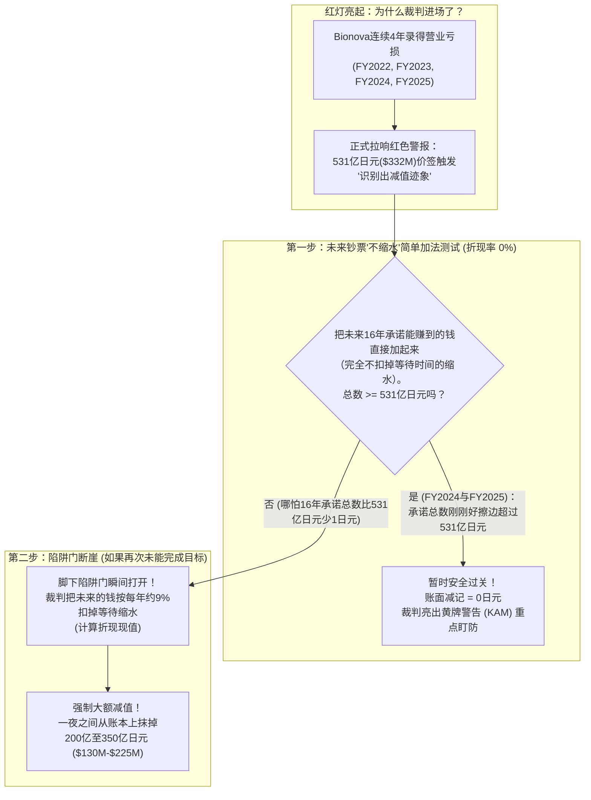
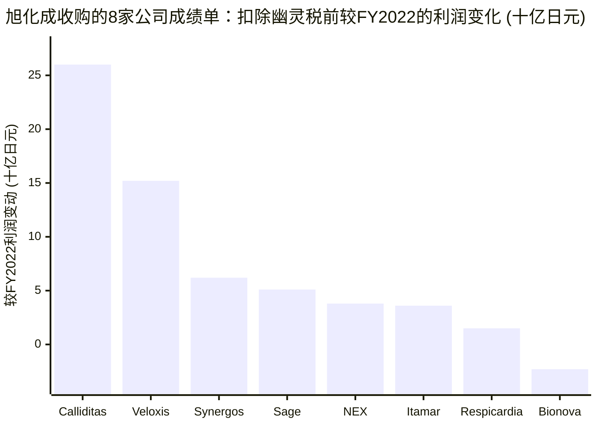
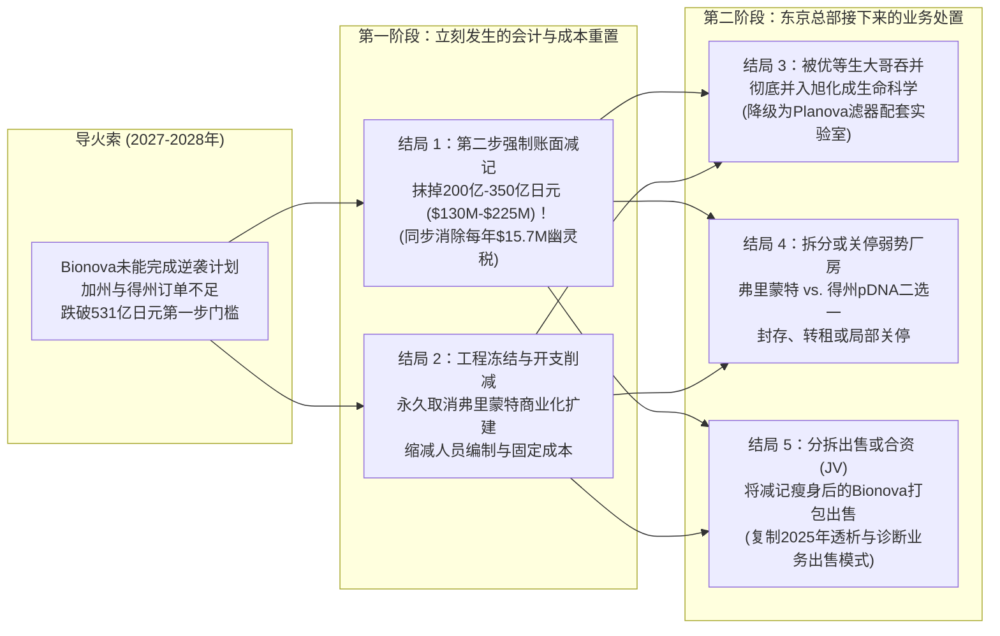

## 1. 侦探的第一个问题：当一家花3.21亿美元买下的“定制制药厨房”连年亏钱时会发生什么？

想象一下：爸爸妈妈给了你**3.21亿美元（约合人民币23亿元）**——这笔钱足够买下**1,000多辆崭新的黄色校车**——让你去买下美国加利福尼亚州最酷的一家“定制蛋糕烘焙坊”。

当你付完钱、兴冲冲地推开烘焙坊大门时，却发现了一个惊人的秘密：店里真正的烤箱、冰箱和搅拌机加在一起，只值**2,758万美元（大约86辆校车的钱）**！而剩下的**3.1462亿美元**——也就是你每付出去**100美元里就有整整98美元**——根本不是机器设备的钱，而是一张贴在收据上的巨额“人气贴纸（商誉）”，因为当年买店的时候，店门口排满了拿着零花钱准备订做生日蛋糕的邻居小朋友！

没想到刚买下不久，邻居小朋友们的零花钱罐就见底了。店门口排队的长龙一夜消失。整整**连续四年**，你这家昂贵的烘焙坊年年亏钱。更糟糕的是，穿着西装的独立规则裁判（会计审计师）**连续两年**举着黄色警告牌找上门来，严肃地警告所有人：*“如果这家烘焙坊不能尽快赚到大钱，店主人就必须亲手撕掉那张3.1462亿美元的‘人气贴纸’，向全世界承认这笔钱已经打水漂了！”*

这可不是编出来的睡前故事。它正是眼下发生在日本综合化工与医疗巨头**旭化成株式会社（`Asahi Kasei Corporation`，东京证券交易所代码`3407`，总资产超过260亿美元）**与美国生物药代工厂**Bionova Scientific, LLC**之间的真实大戏——2022年5月31日，旭化成花了整整**428.82亿日元（3.2112亿美元）**现金买下了这家位于加州弗里蒙特（Fremont）和得州伍德兰兹（The Woodlands）的定制药物工厂（[FY2022经审计合并财务报表，附注16(a)，第44–45页](https://www.asahi-kasei.com/content/dam/asahi-kasei/us/en/ir/library/financial-briefing/pdf/2303statements.pdf)）。

在**2025年6月**和**2026年6月**，旭化成的外部会计裁判——**普华永道日本（`PwC Japan`）**——连续两年对Bionova亮起了名为**关键审计事项（`KAM, Key Audit Matter`）**的最高级别黄牌预警（[FY2025审计报表，第4–5、14页](https://www.asahi-kasei.com/content/dam/asahi-kasei/us/en/ir/library/financial-briefing/pdf/2603statements.pdf)）。到了**2026年4月至11月**，旭化成更是正式删掉了把Bionova称为“扩张期”的宣传词，把战略演示文稿上的标题改成了：***“强化Bionova（CDMO）的基础体质并重构战略”***（[H1 FY2026半年报补充材料，第30页](https://www.asahi-kasei.com/content/dam/asahi-kasei/us/en/ir/library/financial-briefing/pdf/2609supplement.pdf)）。

这就引出了我们今天最核心的侦探问题：**如果Bionova Scientific没能及时扭转局面，接下来究竟会发生什么？** 它会立刻破产关门吗？裁判会强制砍掉它的账面价值吗？东京总部会关停厂房、把它吞并进更大的部门，还是干脆把它卖掉？

拿起你的侦探放大镜。我们要从零开始把这台商业机器的每一个齿轮拆开讲清楚——让一名小学五年级学生也能像华尔街顶级分析师一样，精准推演出**五种可能的真实结局**。

---

## 2. 从零开始拼图：巨型汤罐、3.14亿美元的“人气贴纸”与16年加法魔术

要想看懂翻车后会发生什么，我们先要拼好三块最基础的积木：**Bionova究竟是做什么的**、**为什么它年年亏钱**，以及**至今保护它没被罚分的那个会计加法魔术**。

### 第一块积木：什么是“出租给别人的专业制药厨房”？（`CDMO`）

假设有一群聪明的科学家发明了一种治疗癌症或罕见遗传病的新药配方。在实验室桌子上用小试管调配几滴药水并不难。

但是慢着——怎样才能生产出**10,000瓶**一尘不染、绝对安全、可以注射进医院病人体内的药水呢？自己盖一座无菌制药工厂需要花几千万美元，还要花好几年时间通过政府的安全检查。小型生物科技初创公司既没那么多钱，也没那么多时间。

于是，它们选择**租用一座巨型专业制药厨房**，付钱请里面的专业厨师帮自己熬制药水！大人们把这种专门帮别人开发和生产药物的出租厨房叫做**CDMO**（**合同开发与生产组织**）。

Bionova Scientific在美国经营着两座不同的制药厨房：
1. **加利福尼亚州弗里蒙特（Fremont）厨房（抗体浓汤大罐）：** 用高达`2,000升`（差不多能装下**5,600罐可乐**）的巨型培养罐饲养活体细胞，像熬制高级浓汤一样生产复杂的蛋白质药物——**单克隆抗体**。
2. **得克萨斯州伍德兰兹（The Woodlands）厨房（基因说明书小圆环）：** 一座占地**10,000平方英尺**（大约相当于**两个标准篮球场**）的新厂房，专门用无害的大肠杆菌生产一种名叫**质粒DNA（`pDNA`）**的微型环形基因密码，卖给其他公司作为基因疗法的原材料。

### 第二块积木：3.146亿美元的“人气贴纸”（`商誉`）与每年的“幽灵税”

2022年5月31日，当旭化成掏出**428.82亿日元（3.2112亿美元）**买下Bionova时，为什么扣除债务后，店里真正的机器和设备（`净有形资产`）只值区区**36.83亿日元（2,758万美元）**呢？

因为在2021年和2022年初，生物科技初创公司手里塞满了风险投资人给的钞票，大家都在拼命抢租制药厨房里的炉灶。旭化成为Bionova未来的“超高人气”和“老客户名单”支付了天价溢价。会计师把这笔多出来的**3.1462亿美元（`420.14亿日元`，占总收购价的98.0%）**放进了旭化成账本上的两个隐形抽屉里（[FY2022审计报表，附注16(a)，第44页](https://www.asahi-kasei.com/content/dam/asahi-kasei/us/en/ir/library/financial-briefing/pdf/2303statements.pdf)）：
* **客户关系无形资产（`Customer Relationships`）：** **65.59亿日元（4,912万美元）**，代表原有客户名单的价值。
* **商誉（`Goodwill`）：** **354.55亿日元（2.6550亿美元）**，代表纯粹多付的“人气贴纸”。

真正的陷阱就在这里：根据**日本会计准则（`J-GAAP`）**，你不可以把这张3.1462亿美元的人气贴纸静静地放在架子上不管。你必须把它**平均切成20份**，每年拿出一份（`$314.62M ÷ 20年 = 每年1,573万美元`，折合日元**每年约24亿至25亿日元**），直接从Bionova当年的营业利润成绩单里扣掉！

你可以把这笔**每年1,573万美元（相当于每年50辆校车的钱）**想象成一笔**“幽灵税”（`PPA并购摊销`）**。哪怕Bionova从客户那里收到的钱足够付清科学家的工资、电费和房租，只要它每年没能多赚出**1,573万美元以上**的额外利润，它在官方成绩单上就依然是**“营业亏损”**！当2023年、2024年和2025年生物科技初创公司没钱下单时，Bionova根本交不起这笔幽灵税，结果录下了**连续四年（`FY2022`至`FY2025`）的营业亏损**。

### 第三块积木：16年未来钞票“不缩水”加法规则（`J-GAAP第一步测试`）

截至2026年3月31日（`FY2025`），加上在加州和得州新添置的设备，以及日元贬值带来的汇率换算，Bionova在旭化成资产负债表上的总价签（`账面价值`）已经膨胀到了**531.08亿日元（3.3213亿美元）**（[FY2025审计报表，附注3(c)，第14页](https://www.asahi-kasei.com/content/dam/asahi-kasei/us/en/ir/library/financial-briefing/pdf/2603statements.pdf)）。

因为Bionova连年亏钱，日本会计规则自动拉响了名为**减值迹象（`減損の兆候`）**的红色警报，迫使旭化成在独立裁判**PwC日本**的监督下参加一场**两步走考试**：

---

## 3. 秘密解码戒指：把大人们的会计与生物医药黑话翻译成大白话

在揭晓Bionova如果不能翻身会迎来的五种结局之前，先戴上这枚**秘密解码戒指**，这样财报里任何一个吓人的专业词汇都休想难倒你：

| 大人们的专业词汇 / 缩写 | 用大白话讲到底是什么意思？ | 小学五年级日常比喻 |
| :--- | :--- | :--- |
| **CDMO（合同开发与生产组织）** | 把自己的无菌实验室和巨型发酵罐租出去，帮其他医药公司研发和熬制药水的代工企业。 | 一家拥有超大烤箱的专业烘焙工厂，专门帮没有烤箱的小饼干品牌代烤并包装曲奇饼。 |
| **商誉（`Goodwill`）与PPA摊销** | 买公司时比实际机器设备多付的“人气溢价”（`商誉`）；日本规则要求把它分成20份，每年从利润里扣掉一份（`PPA摊销`）。 | 花100元买了一盒零件只值10元的热门乐高套装，结果爸妈规定接下来20年每年都要从你的零花钱成绩单里扣掉4.5元。 |
| **减值迹象（`Impairment Indicator`）** | 当一家子公司连续两年或更久亏钱时，日本会计规则强制拉响的危险警报器。 | 因为厨房连续两年端出来的全都是烤焦的面包，走廊天花板上的烟雾报警器开始滴滴乱叫。 |
| **关键审计事项（`KAM, Key Audit Matter`）** | 独立会计裁判（`PwC日本`）在年报最前面专门画出的红色方框，告诉投资人：*“这是全公司最危险的数字之一，我们正拿着放大镜盯着它。”* | 校长用红笔把你成绩单上的某一科圈起来，并在旁边写上：*“本学期重点盯防这门课的分数。”* |
| **未折现 vs. 折现现金流（`第一步 vs. 第二步`）** | *未折现（`第一步`）*把15年后承诺给你的10元钱当成今天的10元钱来算。*折现（`第二步`）*则会把未来的钱大幅缩小，因为苦等15年既有风险又损失了利息。 | *未折现*认为“2041年给你10个冰淇淋”的承诺等于今天的10个冰淇淋；*折现*认为15年后的承诺在今天只值大约2个冰淇淋。 |
| **资产减记 / 减值损失（`Write-Down / Impairment Loss`）** | 当裁判强制公司用黑笔划掉账本上虚高的资产价签，并把划掉的金额一次性记作巨额亏损。 | 用黑马克笔划掉玩具箱上“3.32亿美元”的贴纸，改成“1.3亿美元”，并在成绩单上记一次“-2.02亿美元”的大罚分。 |
| **业务分拆 / 风险隔离（`Carve-Out / Ring-Fencing`）** | 把出问题的业务搬进一个单独的法律盒子里，防止它把麻烦传染给其他赚钱的好部门，同时也方便以后找合伙人或卖掉它。 | 把客厅里冒烟的化学实验套装搬进后院一个带独立门锁的小工具房里。 |

---

## 4. 公司的承诺 vs. 侦探核查：为什么“第一步陷阱门”已经近在咫尺？

2025年7月，当一位东京投资人直接问旭化成医疗健康高管**中野诚二（Seiji Nakano）**“Bionova有没有减值风险”时，中野是这样回答的（[Q1 FY2025问答纪要，第2页](https://www.asahi-kasei.com/content/dam/asahi-kasei/us/en/ir/library/financial-briefing/pdf/2506summary.pdf)）：

> *“在目前阶段，我们预计不会发生任何减值。我们将继续审视我们的中期计划，并与我们的会计师进行适当的核验。”*

为什么PwC日本的裁判在**2025年6月（`FY2024`）**和**2026年6月（`FY2025`）**连续两次放行，允许旭化成在不减记的情况下通过`第一步`测试呢？因为旭化成管理层向PwC日本交上了一份承诺实现“三大逆袭”的多年期商业计划书（[FY2025审计报表，附注3(c)，第14页](https://www.asahi-kasei.com/content/dam/asahi-kasei/us/en/ir/library/financial-briefing/pdf/2603statements.pdf)）：
1. Bionova未来将吸引大批新的生物科技初创公司管线订单；
2. 加州弗里蒙特工厂的抗体开发与生产合同将快速增长；
3. 得州新建成的质粒DNA（`pDNA`）厨房将带来源源不断的新增销售。

### 侦探放大镜在2026年官方文件里找到的三条铁证

当我们翻开旭化成在**2026年4月15日**（[管理层简报`e260415en.pdf`](https://www.asahi-kasei.com/content/dam/asahi-kasei/us/en/ir/library/initiative/pdf/e260415en.pdf)）和**2026年11月**（[半年报补充材料`2609supplement.pdf`](https://www.asahi-kasei.com/content/dam/asahi-kasei/us/en/ir/library/financial-briefing/pdf/2609supplement.pdf)）发布的官方文件时，就能明白为什么这份逆袭承诺的时间不多了：

* **线索 #1 —— 在旭化成买下的8家公司里，只有Bionova一家在倒退：** 在2026年4月15日简报的第16页幻灯片上，旭化成晒出了它近年来收购的**8家公司**（`Calliditas`、`Veloxis`、`Synergos`、`Sage`、`NEX`、`Itamar`、`Respicardia`和`Bionova`）的成绩单。就算把每年的幽灵税（`PPA摊销`）加回去，**8家公司里有7家都比FY2022赚到了更多的钱——唯独Bionova一家连续三年趴在零线以下（`约-23亿日元`）！**
* **线索 #2 —— PwC日本已经开始严查“历史承诺 vs. 真实考分”：** 在FY2025审计报告第4页（[2603statements.pdf](https://www.asahi-kasei.com/content/dam/asahi-kasei/us/en/ir/library/financial-briefing/pdf/2603statements.pdf)）中，PwC日本明确写下：***“我们将历史商业计划与实际业绩进行了对比，对于实际业绩未达商业计划的情况，评估了导致未达标的原因。”*** 翻译成大白话：如果你连续两年向老师保证*“下学期我一定考100分”*，结果每次都只考50分，到了第三年，老师就再也不会相信你的保证了！
* **线索 #3 —— 旭化成在另一家美国子公司身上已经挨过一次超级大减记：** 就在同一份报告第14页紧挨着Bionova的上方（`附注3(b)`），记录着旭化成的美国电池隔膜子公司**Polypore International, LLC**的前车之鉴：当Polypore在FY2022没能完成商业计划时，裁判逼迫旭化成一次性抹掉了**1,863.76亿日元（约合14亿美元——相当于4,600辆校车的价值！）**！

---

## 5. 五种可能的结局：如果Bionova没能及时翻身，接下来会发生什么？

假设时间来到了旭化成当前财年的截止日**2027年3月31日（`FY2026`）**——或者下一财年截止日**2028年3月31日（`FY2027`）**——而Bionova在加州和得州的制药厨房依然没有装满足够多的付费订单。

首先，我们要打破一个误区：**Bionova绝不会像街边小店那样明天早上突然没钱交电费而破产倒闭**，因为它的日本母公司旭化成坐拥**4.1万亿日元（超过260亿美元）**的庞大资产。相反，当一家跨国大集团旗下的美国子公司迟迟无法完成逆袭目标时，现实世界里会像多米诺骨牌一样依次发生以下**五种具体结局**！

### 结局 #1：“第二步陷阱门”打开 —— 强制计提200亿–350亿日元（1.3亿–2.25亿美元）账面减值（以及神奇的利润反转悖论！）

如果Bionova今年再次未能完成营收和利润目标，PwC日本的裁判就会对旭化成管理层说：*“你们不能再假定Bionova未来16年能神奇地赚回超过531亿日元了。把预测数字往下调！”*

来看看只要把预测数字往下砍掉**10%**，数学断崖会有多么惊人：
* **下调前（`第一步通过`）：** 假设管理层原本承诺Bionova在未来16年总共能赚回**555亿日元**（第1年`0日元`，第5–16年每年赚`40亿日元`）。因为`555亿日元`高于`531亿日元`的账面价签，减值损失是**0日元**。
* **下调10%后（`第一步失败 -> 第二步陷阱门打开`）：** 如果PwC日本把这个预测仅仅下调**10%**（从`555亿日元`降到`499.5亿日元`），总和就跌破了`531亿日元`。根据日本规则，这时候可不是只扣掉差额（`531亿 - 499.5亿 = 31.5亿日元`）！相反，公司会立刻掉进**第二步陷阱门**：未来每一年能赚到的钱都要按**每年约9%**的速度缩水（`WACC折现`）！把`499.5亿日元`在16年里按每年`9%`缩水后，它在今天的真实价值只剩下大约**234亿日元**。
* **超级黑板擦登场：** 旭化成必须立刻从账本上抹掉**约297亿日元（约1.86亿美元）**——通常在**200亿至350亿日元（1.3亿至2.25亿美元）**之间——并把它作为一次性**特别减值损失**公之于众！

**慢着——这里会出现会计学里最神奇的“反转悖论”！**
在挨了这记痛彻心扉的巨额减记**之后**，Bionova随后几年的年度营业利润成绩单会变成什么样？**它反而会在一夜之间变得好看得多！**
为什么？因为把2022年留下的商誉和客户无形资产泡沫一次性擦掉之后，**每年高达1,573万美元（`约24亿–25亿日元/年`）的“幽灵税”（`PPA摊销`）也跟着一起消失了！** 一旦那张沉重的“人气贴纸”被撕掉扔进垃圾桶，Bionova就再也不用每年为它交1,573万美元的份子钱了——这意味着哪怕订单没有大幅暴涨，Bionova也能轻装上阵，在账面上轻松实现盈亏平衡！

### 结局 #2：“缩骨求生” —— 永久取消加州扩建工程与大砍日常开支

其实，甚至在正式划掉账面价值之前，母公司就会先通过冻结新工程和削减日常开支来止血。事实上，旭化成在2026年就已经启动了**结局 #2的第一阶段**：
* 在2026年4月15日简报的第44页幻灯片（[e260415en.pdf](https://www.asahi-kasei.com/content/dam/asahi-kasei/us/en/ir/library/initiative/pdf/e260415en.pdf)）上，东京总部正式下令实施***“投资推迟与固定成本削减（investment deferrals and fixed-cost reductions）”***。
* 在2026年11月的在建工程表（[2609supplement.pdf，第49页](https://www.asahi-kasei.com/content/dam/asahi-kasei/us/en/ir/library/financial-briefing/pdf/2609supplement.pdf)）中，旭化成把**Bionova加州弗里蒙特工厂产能扩建**的完工时间从原本的`FY2025及以后`一口气推迟了两年多，改成了**`FY2027及以后`**；同时把**得州GMP级质粒DNA**完工时间也从`FY2025`推迟到了**`FY2026及以后`**。

**如果Bionova接下来还是不能翻身：**
1. 目前被推迟到`FY2027及以后`的弗里蒙特商业化扩建工程将被**永久取消**，因为旧罐子还没装满，绝不可能再花大钱去造新罐子来增加折旧费。
2. “固定成本削减”将升级为加州和得州基地的**人员缩编、班次合并与行政费用大砍刀**，把Bionova变成一家规模更小、只接高难度小众订单的精品作坊。

### 结局 #3：“被优等生大哥吞并” —— 失去独立权，彻底沦为`旭化成生命科学`的配套实验室

目前，Bionova被装在一家于2025年4月1日新成立的母公司下属企业里，名叫**旭化成生命科学株式会社（`Asahi Kasei Life Science Corp.`）**（[官方新闻稿`e250401`](https://www.asahi-kasei.com/news/2025/e250401)）。在同一个屋檐下，住着Bionova那位超级能赚钱的优等生大哥：**Planova™（普乐诺瓦）**，它生产在制药过程中专门过滤病毒的超精密中空纤维滤器。

当Bionova在2025年和2026年苦苦挣扎时，大哥**Planova**却在疯狂赚钱，带动整个`生命科学`分部的销售额从FY2025的**554亿日元（约3.67亿美元）**大涨至FY2026预测的**670亿日元（约4.32亿美元）**（[2609supplement.pdf，第42页](https://www.asahi-kasei.com/content/dam/asahi-kasei/us/en/ir/library/financial-briefing/pdf/2609supplement.pdf)）。

**如果Bionova无法作为一家独立的CDMO长大成人：**
* 东京总部可以收回Bionova的独立扩张预算，撤销独立的美国高管架构，把它的销售、财务和工程团队直接并入**旭化成生命科学株式会社**统一指挥。
* Bionova将不再尝试去跟Lonza或药明生物等CDMO巨头正面硬碰硬，而是降级为一座小型的**“测试厨房与技术支持实验室”**，主要任务变成帮客户测试工艺，从而顺带推销更多旭化成高利润的`Planova`除病毒滤器和`ViruSure` / `Bionique`生物安全检测服务。

### 结局 #4：“拆分玩具箱” —— 关停或转租表现较差的那座工厂（`加州弗里蒙特 vs. 得州伍德兰兹`）

别忘了，Bionova手里其实是两门完全不同的生意：**加州的抗体浓汤罐（`弗里蒙特`）**和**得州的质粒DNA小圆环（`伍德兰兹`）**。
2026年，Bionova一口气签了三个救火合作协议（1月联手`Syenex`，2月拿下`Scarab Genomics`大肠杆菌独家授权，9月联手`Minaris`），拼命想在不花大钱扩建的前提下把得州质粒DNA工厂填满。

**如果一座工厂活过来了，另一座却一直半空着怎么办？**
看看竞争对手**查尔斯河实验室（`Charles River Laboratories, CRL`）**的例子就知道了：它在2021年泡沫最高点花了超过10亿美元买下两家CDMO工厂（**Cobra Biologics**和**Cognate BioServices**）。当基因治疗订单枯竭后，查尔斯河不仅计提了大额减值，而且果断**关闭或退出了表现不佳的CDMO厂房**，绝不傻乎乎地为半空的洁净室一直交房租和电费。如果得州pDNA业务起不来（或者加州老厂房一直吃不饱），旭化成同样可以封存（Mothball）、转租（Sublease）或单独卖掉拖后腿的那座厂房。

### 结局 #5：“把后院工具房打包卖掉” —— 组建合资公司（JV）或折价甩卖（Divestiture）

旭化成会卖掉达不到利润目标的医疗健康业务吗？**当然会——他们仅在2025年就干过两次！**
* **2025年4月**，旭化成将利润率偏低的**血液净化（人工肾透析）业务**分拆并卖给了外部买家（[2603supplement.pdf，第41页](https://www.asahi-kasei.com/content/dam/asahi-kasei/us/en/ir/library/financial-briefing/pdf/2603supplement.pdf)）。
* **2025年7月**，旭化成又将**诊断试剂（Diagnostics）业务**分拆并卖掉了。

再看看旭化成在**2025年4月1日**做的另一个关键动作：它把Bionova从原来的`旭化成医疗`里搬出来，装进了独立的`旭化成生命科学`法人盒子里，从而把Bionova与集团最赚钱的两颗皇冠明珠——**卓尔医学（`ZOLL Medical`，重症监护板块，年营业利润高达`448亿日元`）**和**医药（Pharmaceuticals）板块**——彻底隔离开来（`风险隔离 Ring-Fencing`）。

在今天，没有任何买家愿意花虚高的**531亿日元（3.32亿美元）**账面价去接盘Bionova。**但是一旦结局 #1（200亿–350亿日元减记）先把2022年的商誉泡沫擦掉**，Bionova的账面价值就会降回到真实机器设备的价值附近（`约8,000万–1.2亿美元`）。到那时，旭化成就可以在不产生二次亏损的情况下，轻松地把Bionova卖给私募股权基金（PE）或大型CDMO同行，或者拉入外部股东成立合资公司（JV）！

---

## 6. 隐藏的代价：为什么Bionova翻身这么难？谁会真正受伤？

一名优秀的侦探不仅要查清结局，还要审讯阻碍翻身的**四名嫌疑犯**，并看看当大公司重构战略时**究竟是谁在承担代价**。

### 阻碍Bionova逆袭的四名嫌疑犯

| 嫌疑犯 | 它是如何挡住Bionova翻身之路的？ | 官方一手披露铁证 |
| :--- | :--- | :--- |
| **嫌疑犯 #1：初创公司零花钱罐干涸（占问题的45%）** | Bionova的主要客户是测试新药的小型生物科技初创公司。当2022–2025年风投机构不再轻易给初创公司发钱时，这些小公司纷纷砍掉或暂停了实验室订单。 | 旭化成附注3(c)明确将亏损归咎于*“流向生物科技初创企业的资金减少导致需求低迷”*。 |
| **嫌疑犯 #2：“锅太小装不下大鱼”陷阱（占问题的20%）** | 辉瑞、礼来等跨国大药企虽然花几十亿美元找人代工上市好药，但它们需要**10,000升至20,000升**的超大培养罐。Bionova弗里蒙特的罐子（`最大2,000升`）只适合做早期小批量临床测试，而扩建工程被推迟到`FY2027+`直接锁死了它接商业化大单的通道。 | [H1 FY2026补充材料，第49页](https://www.asahi-kasei.com/content/dam/asahi-kasei/us/en/ir/library/financial-briefing/pdf/2609supplement.pdf)证实弗里蒙特扩建完工期已被推迟至`FY2027及以后`。 |
| **嫌疑犯 #3：全美国盖了太多闲置厨房（占问题的25%）** | 在2021–2022年大繁荣时期，几十家CDMO同行（`Catalent`、`Charles River`、`Aldevron`、`Lonza`、`Forge`）同时新建了大批抗体和质粒DNA厂房。现在厨房太多、客人太少，大家只能降价抢单。 | 连全球质粒霸主`Aldevron`（被丹纳赫以96亿美元收购）都在疫情后因客户消化库存而遭遇业绩增长急刹车。 |
| **嫌疑犯 #4：越节食跑得越慢的死循环（占问题的10%）** | 为了省钱并让审计师PwC日本满意，东京总部下令*“推迟投资并削减固定成本”*。但冻结新设备投入和砍预算，反过来又让Bionova更难抢到新客户！ | [2026年4月15日管理层简报，第44页](https://www.asahi-kasei.com/content/dam/asahi-kasei/us/en/ir/library/initiative/pdf/e260415en.pdf)把营收疲软与推迟投资、削减固定成本直接绑在了一起。 |

### 如果Bionova没能及时翻身，谁会真正受伤？

1. **加州弗里蒙特与得州基地的工程师、科学家与技术员：** 当东京的高管在幻灯片上轻轻写下*“投资推迟与固定成本削减”*这几个礼貌的字眼时，在现实生活里真正承受冲击的是加州和得州的140至200名员工——在结局 #2、#4和#5下，他们将面对招聘冻结、预算收紧、扩建车间取消甚至裁员。
2. **原本指望使用更大培养罐的早期生物科技客户：** 那些在2023年把新药交给Bionova、原以为弗里蒙特会在2025年建好商业化大罐子的初创公司，如今看到工程被推迟到`FY2027及以后`。如果它们的药物早期测试很成功，进入III期临床时就不得不把药方搬家（技术转移）到其他更大的CDMO去。
3. **旭化成股东与当年拍板收购的高管：** 在2022年泡沫最顶点拍板花**3.2112亿美元（其中`98%`是商誉和无形资产贴纸）**买下Bionova的管理层，一旦被PwC日本强制要求计提**200亿–350亿日元减值**，将面临一张极其难看的公开成绩单——尽管擦掉幽灵税后未来的利润表反而会变轻松。

---

## 7. 侦探的最终成绩单：我们的“如果……那么……”法则与体育馆100人概率表

让我们把所有线索浓缩成三条一目了然的**“如果……那么……”**法则，以及一张用**学校体育馆里的100名小朋友**就能数清楚的终极概率表：

* **如果（IF）** Bionova在2026年签署的三项得州质粒DNA合作（`Syenex`、`Scarab Genomics`和`Minaris`）能在**2027年3月31日**之前转化为真正收钱的GMP生产合同，**并且**削减成本能让弗里蒙特的亏损减少一半以上，**那么（THEN）**旭化成将连续第三年擦边通过`第一步`16年加法测试（`结局 #2 + #3`：继续过紧日子并被`旭化成生命科学`严加看管，但2027年6月不用计提账面减记）。
* **如果（IF）** 弗里蒙特和得州的订单在`FY2026`（截至2027年3月31日）再次达不到管理层的逆袭承诺，**那么（THEN）** PwC日本将强制要求旭化成把16年未来现金预测下调到**531亿日元**以下，直接踩开`第二步`陷阱门（`结局 #1 + #2`：**强制计提200亿至350亿日元 / 1.3亿–2.25亿美元减值损失**、永久取消弗里蒙特扩建，同时彻底消灭每年1,573万美元的幽灵税）。
* **如果（IF）** 哪怕在巨额减记帮它消灭了幽灵税**之后**，Bionova依然无法靠自己赚钱，**那么（THEN）**东京总部就会按下`结局 #4`或`结局 #5`的按钮——关停/转租闲置洁净室，或者像2025年卖掉透析和诊断业务一样，把减记瘦身后的Bionova卖给私募基金或同行CDMO。

### 学校体育馆100名小朋友概率记分牌（未来12至24个月：FY2026–FY2027）

想象学校体育馆里站着**100名小朋友**，每一名小朋友代表Bionova Scientific在未来1到2年里**100种可能的未来之一**：

| 结局路径 | 100名小朋友里占几个？（`概率`） | 旭化成账本（资产负债表）上会发生什么？ | 加州与得州厂房内部会发生什么？ |
| :--- | :--- | :--- | :--- |
| **路径 A：踩开陷阱门大额减记 + 永久缩编合并（`结局 #1、#2与#3组合`）** | **100人里有55人（`55% —— 最可能结局`）** | PwC日本强制要求计提**200亿–350亿日元（$130M–$225M）第二步减值损失**；每年`$15.73M`的幽灵税同步清零。 | 已推迟的弗里蒙特商业化扩建被永久取消或大幅缩水；Bionova被紧紧收编在`旭化成生命科学`麾下，变成一家精简的小众实验室。 |
| **路径 B：靠砍成本与pDNA早期订单连续第3年“擦边过关”（`结局 #2与#3，暂不减记`）** | **100人里有20人（`20% —— 勉强维持`）** | 砍成本加上得州pDNA初期合同让16年承诺总额维持在比`531亿日元`高`1%–5%`的微弱水平；**FY2026减记0日元**，但PwC连续第3年挂出黄牌`KAM`警告。 | 严格的冻结招聘与削减开支继续执行；员工在东京总部严苛的预算盯防下工作，苦等生物科技初创行业全面复苏。 |
| **路径 C：减记瘦身之后关停厂房或分拆甩卖（`结局 #1之后触发#4或#5`）** | **100人里有10人（`10% —— 关停或出售退出`）** | 在计提`200亿–350亿日元`减值把Bionova账面价值降下来之后，东京总部认定CDMO代工波动太大、不值得继续投入。 | 旭化成转租/关停较弱的一处基地，或者像2025年4月/7月卖掉透析和诊断业务一样，把Bionova卖给私募基金或大型CDMO。 |
| **路径 D：真正的超级逆袭惊喜（`全面翻身`）** | **100人里有15人（`15% —— 最佳惊喜结局`）** | 生物科技初创融资大幅反弹，`Scarab` / `Minaris` / `Syenex`合作订单排满得州与加州车间；扣除幽灵税后依然实现真正的营业利润盈利！ | PwC日本摘掉`KAM`黄牌警告；东京总部解冻被推迟至`FY2027+`的弗里蒙特扩建工程，并扩建更多洁净室。 |

---

## 一手原始披露文件与侦探证据索引

1. **旭化成株式会社 —— FY2022详细合并财务报表（截至2023年3月31日）：** 附注16(a)（*收购Bionova Holdings, Inc. —— 428.82亿日元现金价、354.55亿日元商誉、65.59亿日元客户无形资产*，第44–45页）。[https://www.asahi-kasei.com/content/dam/asahi-kasei/us/en/ir/library/financial-briefing/pdf/2303statements.pdf](https://www.asahi-kasei.com/content/dam/asahi-kasei/us/en/ir/library/financial-briefing/pdf/2303statements.pdf)
2. **旭化成株式会社 —— FY2024详细合并财务报表（截至2025年3月31日）：** PwC日本KAM及附注3(c)（*524.03亿日元账面价值与减值迹象*，第4–6、15页）。[https://www.asahi-kasei.com/content/dam/asahi-kasei/us/en/ir/library/financial-briefing/pdf/2503statements.pdf](https://www.asahi-kasei.com/content/dam/asahi-kasei/us/en/ir/library/financial-briefing/pdf/2503statements.pdf)
3. **旭化成株式会社 —— FY2025详细合并财务报表（截至2026年3月31日；2026年6月24日签署）：** PwC日本KAM（`历史计划与实际业绩对比核查`，第4–5页）、附注3(b)（*Polypore 1,863.76亿日元减值*，第14页）及附注3(c)（*Bionova 531.08亿日元 / 3.3213亿美元账面价值*，第14页）。[https://www.asahi-kasei.com/content/dam/asahi-kasei/us/en/ir/library/financial-briefing/pdf/2603statements.pdf](https://www.asahi-kasei.com/content/dam/asahi-kasei/us/en/ir/library/financial-briefing/pdf/2603statements.pdf)
4. **旭化成株式会社 —— 中期经营计划“Trailblaze Together”管理层简报（2026年4月15日）：** 第16页幻灯片（*8起并购利润对比图*）及第44页幻灯片（*Bionova推迟投资与削减固定成本*）。[https://www.asahi-kasei.com/content/dam/asahi-kasei/us/en/ir/library/initiative/pdf/e260415en.pdf](https://www.asahi-kasei.com/content/dam/asahi-kasei/us/en/ir/library/initiative/pdf/e260415en.pdf)
5. **旭化成株式会社 —— 业绩补充材料与问答纪要（`2025–2026`）：**
   * `Q1 FY2025问答纪要`（2025年7月31日，第2页）：[https://www.asahi-kasei.com/content/dam/asahi-kasei/us/en/ir/library/financial-briefing/pdf/2506summary.pdf](https://www.asahi-kasei.com/content/dam/asahi-kasei/us/en/ir/library/financial-briefing/pdf/2506summary.pdf)
   * `FY2025业绩补充材料`（2026年5月，第27、41、48页）：[https://www.asahi-kasei.com/content/dam/asahi-kasei/us/en/ir/library/financial-briefing/pdf/2603supplement.pdf](https://www.asahi-kasei.com/content/dam/asahi-kasei/us/en/ir/library/financial-briefing/pdf/2603supplement.pdf)
   * `H1 FY2026半年报补充材料`（2026年11月，第30、42、49页）：[https://www.asahi-kasei.com/content/dam/asahi-kasei/us/en/ir/library/financial-briefing/pdf/2609supplement.pdf](https://www.asahi-kasei.com/content/dam/asahi-kasei/us/en/ir/library/financial-briefing/pdf/2609supplement.pdf)
6. **公司重组与2026年质粒DNA合作伙伴官方公告：**
   * 旭化成生命科学株式会社正式运营（2025年4月1日）：[https://www.asahi-kasei.com/news/2025/e250401](https://www.asahi-kasei.com/news/2025/e250401)
   * Syenex战略联盟（2026年1月8日）：[https://bionovascientific.com/2026/01/08/bionova-scientific-and-syenex-forge-strategic-alliance-to-expand-access-to-high-quality-plasmid-dna-for-advanced-therapies/](https://bionovascientific.com/2026/01/08/bionova-scientific-and-syenex-forge-strategic-alliance-to-expand-access-to-high-quality-plasmid-dna-for-advanced-therapies/)
   * Scarab Genomics独家授权合作（2026年2月4日）：[https://bionovascientific.com/2026/02/04/scarab-genomics-and-bionova-enter-exclusive-licensing-partnership-to-advance-high-efficiency-plasmid-dna-production/](https://bionovascientific.com/2026/02/04/scarab-genomics-and-bionova-enter-exclusive-licensing-partnership-to-advance-high-efficiency-plasmid-dna-production/)
   * Minaris联合供应合作（2026年9月9日）：[https://bionovascientific.com/2026/09/09/bionova-scientific-and-minaris-announce-partnership-to-accelerate-plasmid-dna-supply-for-cell-and-gene-therapy-manufacturing/](https://bionovascientific.com/2026/09/09/bionova-scientific-and-minaris-announce-partnership-to-accelerate-plasmid-dna-supply-for-cell-and-gene-therapy-manufacturing/)
