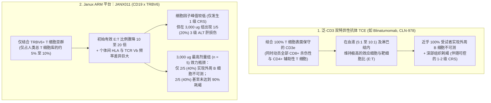
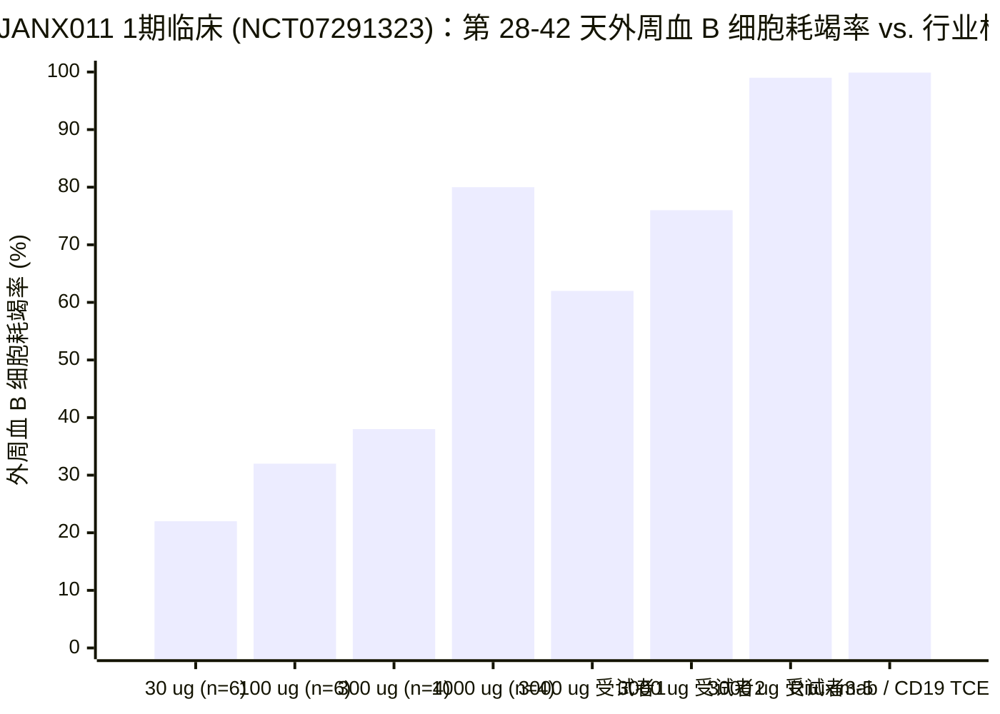
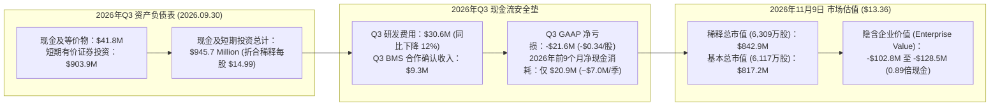

## 执行摘要与议题分类 (Issue Classification)

2026 年 11 月 9 日早盘前，**Janux Therapeutics, Inc.**（`NASDAQ: JANX`）公布了其 1 期单次递增剂量（`SAD`）临床试验（[NCT07291323](https://clinicaltrials.gov/study/NCT07291323)，代号 `ARMV-011-001`）的初步人体数据。该试验在 **25 名健康成年志愿者**中评估了 **JANX011**——一款靶向 CD19 的**适应性免疫应答调节剂（`ARM`）**双特异性 T 细胞衔接器（`TCE`），其独特之处在于选择性结合 T 细胞受体 β 链可变区 **TRBV6** 结构域，而非传统的泛 `CD3`。公司新闻稿标题充满了报喜色彩：单次 **3,000 µg（`3.0 mg`）**皮下注射（`SC`）在“多数受试者（a majority of participants）”中实现了持续至第 42 天的 `>90%` 外周血 B 细胞耗竭，且细胞因子释放综合征（`CRS`）全部限制在轻微的 **1 级（Grade 1）**，未发生任何剂量限制性毒性（`DLT`）。

然而开盘仅数小时，机构投资者便大举抛售 `JANX`，导致股价从前一交易日收盘价 **$17.63** 暴跌 **24.22%（-$4.27）** 至 **$13.36**（盘中一度触及 **$12.43** 低点）。单日暴跌抹去了约 **2.69 亿美元**市值，使 Janux 按 `6,309 万股`稀释总股本计算的经济市值（**8.429 亿美元**）比其截至 2026 年第三季度末的 **9.457 亿美元账面现金及有价证券**（合每股 **$14.99**）还要低出 **1.028 亿美元**，跌入深度负企业价值（Negative EV）区间。

正如生物科技投资人 Jing Liang（`@AppleHelix`）在 2026 年 11 月 9 日针对 `JANX011` 演示幻灯片所发表的精辟评论：

> *“我认为市场对 `JANX` 数据的质疑在于，它并未证明自己在 B 细胞耗竭方面优于其他双抗（`TCE`）。单次剂量的利妥昔单抗（Rituximab）就能实现同样的外周 B 细胞耗竭（尽管使用剂量较高）。”*

运用 **Browne & Keeley 批判性思维框架**，我们将今日 25% 的暴跌拆解为两个截然不同的分析议题：

1. **描述性与机制性议题（免疫学事实）：** 将 T 细胞招募限制在仅占人类总 T 细胞库 **约 5%–10% 的 `TRBV6` 阳性 T 细胞亚群**，是否严重削弱了实现均一、彻底 B 细胞清除所需的局部效应细胞与靶细胞（`E:T`）化学计量比——从而直接解释了为何在最高剂量 `3,000 µg` 组中**5 名健康志愿者仅有 2 名（40%）**达到外周血 B 细胞不可测（Undetectable）水平？
2. **规范性与估值议题（资本配置）：** 当一家账面握有 **9.457 亿美元现金**、单季获得 **930 万美元**百时美施贵宝（`BMS`）合作收入、且**每季度净现金消耗仅约 700 万美元**（2026 年前 9 个月总现金仅减少 `$20.9M`）的公司跌至 **$13.36**（`0.89 倍现金`，企业价值 `-$102.8M`）时，市场究竟是在理性定价一个存在缺陷的平台，还是过度折价了其前列腺癌核心管线 `JANX007`（`PSMA-TRACTr`）与现金资产？

### 可证伪性标准 (Falsifiability Criteria)

* **何种证据将证伪对 `JANX011` 的看空逻辑：** 如果在 2027 年启动的自身免疫患者（`ITP` 与 `RA`）临床试验中，`JANX011` 通过阶梯递增（Step-up）或重复皮下给药（如 `第 1 天 + 第 8 天`）在 **100% 的受试者中实现外周血 B 细胞不可测**，并在淋巴结/滑膜活检中证实 `>95%` 的深部组织 B 细胞耗竭，同时保持 `0%` 的 ≥ 2 级 CRS 和 `0%` 的复发性 3 级转氨酶（`ALT/AST`）升高。
* **何种证据将证伪对 `JANX011` 的看多逻辑：** 如果提高剂量或重复给药仍无法消除 `40%` 的不完全耗竭人群（因患者间基线细胞毒性 `CD8+ TRBV6+` T 细胞频率存在个体差异），或者随着 `TRBV6+` T 细胞克隆扩增而诱发剂量限制性的 3 级以上 `ALT/AST` 肝毒性及 2 级以上 CRS。

---

## 一手信源交叉质询：新闻稿报喜头条 vs. 幻灯片个体折线图真相

将 Janux 2026 年 11 月 9 日公布的演示幻灯片图表（`DOSE RESPONSE AND PERSISTENCE` 与 `3,000 µg | 2/5 subjects with undetectable`）、[NCT07291323](https://clinicaltrials.gov/study/NCT07291323) 临床方案以及 2026 年 Q3 Form 10-Q 财报（11 月 5 日披露）进行法证式比对，可以清晰看到公关辞令与底层临床数据之间的五处严重背离：

| 审计维度 | 新闻稿公关头条口径 (2026 年 11 月 9 日) | 演示幻灯片个体折线图、临床方案与财报真相 |
| :--- | :--- | :--- |
| **`3,000 µg (3.0 mg)` 最高剂量组的 B 细胞耗竭深度 (`n = 5`)** | *“单次 3 mg 皮下给药在多数受试者中实现了 >90% 的外周 B 细胞耗竭，达到不可测的外周 B 细胞水平。”* | 在右侧 `3,000 µg`（`n = 5`）个体折线图中，**所谓“多数（a majority）”实为 5 人中的 3 人（`60%`）**达到 `>90%` 耗竭，而**真正达到外周 B 细胞不可测（Undetectable）水平的仅有 5 人中的 2 人（`40%`）**。受试者 1（`蓝色圆点`）在第 2 天反弹至 `-15%`，直至第 28 天一直停滞在 **`-55% 至 -65%`**（连 70% 耗竭都未达到）；受试者 2（`紫色倒三角`）在第 3 天触及 `-88%` 后，到第 28 天已反弹至 **`-75%`**。 |
| **3 mg 以下剂量组的持久性 (`30 µg` 至 `1,000 µg`, `n = 20`)** | *“持久的药理学效应：在 25 名健康志愿者中维持长达第 42 天的剂量依赖性 B 细胞耗竭。”* | 在左侧剂量-反应均值图（`n = 25`）中，`30 µg (n = 6)` 和 `100 µg (n = 6)` 在第 14 天即反弹至 `-20%` 至 `-30%`；`300 µg (n = 4)` 在第 3–7 天触及 `-90%`，但**到第 42 天大幅反弹至 `-35%`**；`1,000 µg (n = 4)` 在第 7 天触及 `-90%` 后，**到第 42 天亦回升至 `-80%`**。 |
| **外周血（占全身 B 细胞 `<2%`）vs. 淋巴结深部组织标杆** | 将健康志愿者外周血 B 细胞下降包装为自身免疫病“同类最佳（Best-in-class）”疾病修饰潜力的证明。 | 外周血中的 B 细胞仅占**人体总 B 细胞的 `2%` 不到**。正如连续人体淋巴结活检研究（`Tur & Schett et al., ARD 2025`，[PMID: 39874224](https://pubmed.ncbi.nlm.nih.gov/39874224/) 与 [PMID: 40651933](https://pubmed.ncbi.nlm.nih.gov/40651933/)）所证实，哪怕是老牌**利妥昔单抗（`anti-CD20`）也能在几乎 100% 的患者中实现外周血 B 细胞完全清零**，但仍在淋巴结内残留 `14%` 的 B 细胞和完整的滤泡树突状细胞网络，从而导致疾病复发。 |
| **`3,000 µg` 剂量下的转氨酶（`ALT`）安全天花板** | *“安全性良好，未发生严重不良事件（SAE）或剂量限制性毒性（DLT），CRS 均为 1 级。”* | 在 `3,000 µg`（`n = 5`）最高剂量组中，**5 名健康志愿者中有 1 人（`20%`）出现了 3 级 ALT 肝酶升高**，并伴随 2 级 ALT/AST 升高。在未服用任何肝毒性背景药物的健康人中出现 `20%` 的 3 级 ALT 信号，严重限制了单次皮下剂量向 `3 mg` 以上的直接爬坡。 |
| **自身免疫适应症选择与临床推进时间表** | *“计划于 2027 年上半年启动免疫性血小板减少症（ITP）患者试验，2027 年下半年启动类风湿关节炎（RA）试验。”* | 2027 年上半年首选 `ITP`（一种利妥昔单抗本就有效的血管内/脾脏自身抗体疾病）并将 `RA` 推迟至 **2027 年下半年**，避开了对深部组织清零要求极高的系统性红斑狼疮（`SLE`/`LN`）与系统性硬化症（`SSc`），且在时间进度上落后于泛 CD3/CD19 及 BCMA 双抗竞品（`CLN-978`、`blinatumomab` [[PMID: 38671240](https://pubmed.ncbi.nlm.nih.gov/38671240/)]、`teclistamab` [[PMID: 39231353](https://pubmed.ncbi.nlm.nih.gov/39231353/)]）达 **18 至 30 个月**。 |

---

## 歧义消除与平台成熟度审计 (Ambiguity & Maturity Audit)

### 核心企业话术的替换测试 (Substitution Test)

* **“在多数受试者中实现 >90% 耗竭 (Achieved >90% Depletion in a Majority of Participants)”：** 在临床公关语言中，“多数（a majority）”听起来像是绝大多数受试者都获得了深度缓解。将 **Browne & Keeley 替换测试**代入一个 5 人队列（`n = 5`）：“多数”在数学上仅仅是 **`5 人中的 3 人（60%）`**，这意味着 **`5 人中有 2 人（40%）连外周血 90% 的 B 细胞耗竭都未能达到`**，且 **`5 人中有 3 人（60%）未能达到外周血 B 细胞不可测水平`**。当单次静脉输注仿制药利妥昔单抗就能在近乎 `100%` 的受试者中实现外周血 B 细胞不可测（`>99%` 耗竭，[PMID: 39874224](https://pubmed.ncbi.nlm.nih.gov/39874224/)）时，在 `3,000 µg` 最高剂量下仅录得 `40%`（`2/5`）的外周血清零率，暴露出的是效力瓶颈而非技术突破。
* **“健康志愿者中展现的差异化起始特征”：** 代入 [NCT07291323](https://clinicaltrials.gov/study/NCT07291323) 的入组标准：健康志愿者（`18–65 岁`）基线 B 细胞计数正常、淋巴结无炎症肿大、`BAFF/BLyS` 存活因子处于正常基线，且 T 细胞未受免疫抑制剂耗竭。而在活动性自身免疫病患者（`SLE`、`RA`、`SSc`）体内，生发中心的 B 细胞存活因子（`BAFF`、`APRIL`、`IL-6`、`IL-21`）高度上调，且患者 T 细胞常因长期服用激素和 DMARDs 而出现淋巴细胞减少或功能钝化。一个**在 60% 的健康志愿者体内都无法清零外周血 B 细胞**的剂量（`3,000 µg`），进入充满抗凋亡信号的类风湿滑膜或狼疮淋巴结后将面临更严峻的阻力。

### 四级管线与临床成熟度计分卡

| 管线项目与平台 | 靶点与机制 | 适应症与临床试验编号 | 临床阶段与进展状态 (2026 年 11 月) | 证据等级与法证状态 |
| :--- | :--- | :--- | :--- | :--- |
| **JANX011**（`ARM` 平台） | `CD19 × TRBV6`（非掩蔽双抗；选择性结合 `TRBV6+` T 细胞亚群） | 健康成人志愿者（`FIH`）— [NCT07291323](https://clinicaltrials.gov/study/NCT07291323)（计划 2027 上半年进军 `ITP`，下半年 `RA`） | 1 期 SAD（`30 µg` 至 `3,000 µg` SC 已给药 `25 人`；目标 `N = 60`） | **第 2 级（仅健康人数据）：** `3,000 µg` 组 `3/5`（`60%`）耗竭 `>90%`，**仅 `2/5`（`40%`）外周 B 细胞不可测**；≥ 2 级 CRS 为 `0%`；`1/5`（`20%`）出现 3 级 ALT；**迄今尚未给药任何自身免疫病患者**。 |
| **JANX007**（`TRACTr` 平台） | `PSMA × CD3`（肿瘤蛋白酶可切割掩蔽型 TCE） | 转移性去势抵抗性前列腺癌（`mCRPC`）— [NCT05519449](https://clinicaltrials.gov/study/NCT05519449) | 1b 期扩展队列（2022 年 9 月启动；目标 `N = 272`；预计主要完成时间 `2027 年 7 月`） | **第 2 级（1b 期剂量优化旷日持久）：** 早期 1a 期 PSA50/PSA90 应答率优异，但在未接受过紫杉烷化疗（`Taxane-naive`）扩展组及达罗他胺联用组中的剂量/给药频率优化已耗时逾 4 年，推迟了 3 期关键试验启动。 |
| **JANX013 + JANX007**（`TRACIr + TRACTr`） | `PSMA × CD28` 共刺激双抗 + `PSMA × CD3` | `mCRPC` 联合疗法 — [NCT07813637](https://clinicaltrials.gov/study/NCT07813637) | 1 期招募中（2026 年启动） | **第 1/2 级（早期 1 期联用）：** 测试加入掩蔽型 `CD28` 共刺激信号能否延长 `JANX007` 在 mCRPC 中的缓解持久性。 |
| **JANX014**（`TRACTr` 平台） | 新一代 `PSMA × CD3` 掩蔽型 TCE | `mCRPC` — [NCT07545811](https://clinicaltrials.gov/study/NCT07545811) | 1 期招募中 | **第 1/2 级（早期 1 期）：** 备份/迭代 PSMA 管线。 |
| **JANX008**（`TRACTr` 平台） | `EGFR × CD3`（肿瘤蛋白酶可切割掩蔽型 TCE） | 晚期实体瘤（`CRC`、`NSCLC`、`SCCHN`、`RCC`）— [NCT05783622](https://clinicaltrials.gov/study/NCT05783622) | 1 期（预计 `N = 130`，停止招募） | **第 2 级 — 已终止（2026 年 4 月）：** 因未能在实体瘤中确立具有竞争力的治疗窗口，已于 2026 年第二季度正式终止开发。 |

---

## 机制解构：TRBV6 效应细胞与靶细胞比 (`E:T`) 的化学计量学陷阱

为什么 Janux 将 `JANX011` 设计为结合 **TRBV6**（T 细胞受体 β 链可变区第 6 家族）而非泛 **CD3ε**？为什么恰恰是这一工程妥协导致了令市场失望的 `2/5` 不完全 B 细胞清零率？

在肿瘤管线（`JANX007`）中，Janux 依赖的是 **TRACTr** 平台：即在泛 `CD3` 双抗上加装一层多肽掩蔽罩（Mask），仅在实体瘤微环境中被高表达的肿瘤蛋白酶切割激活。然而，**你无法用肿瘤蛋白酶掩蔽罩去杀伤自身免疫病患者血液、脾脏和淋巴结中的 B 细胞**，因为循环 B 细胞和正常淋巴结并不高表达肿瘤基质金属蛋白酶！

在被迫放弃蛋白酶掩蔽罩后，Janux 为了避免泛 `CD3` 双抗引发的系统性细胞因子风暴（`CRS`），设计了 **ARM（`Adaptive Immune Response Modulator`）** 平台（`JANX011`）：不再通过 `CD3ε` 激活 `100%` 的 T 细胞，而是仅招募 TCR β 链使用 **`TRBV6` 基因家族**的 T 细胞亚群：

### 化学计量学形式化证明：为何低 10–20 倍的 `E:T` 比例难以穿透深部淋巴组织？

设特定生理腔室（外周血 vs. 次级淋巴器官滤泡）内的靶向 `CD19+` B 细胞浓度为 `B₀`，局部总 T 细胞浓度为 `T_total`。在药物浓度 `C` 下，由双抗（`TCE`）介导的瞬时 B 细胞杀伤速率 `dB/dt` 取决于三元复合物（`T 细胞 – 药物 – B 细胞`）形成率 `θ(C) ∈ [0, 1]` 以及具备溶细胞活性的效应 T 细胞比例 `f_eff`：

$$\frac{dB}{dt} = -k_{\text{kill}} \cdot \theta(C) \cdot \left(\frac{f_{\text{eff}} \cdot T_{\text{total}}}{B_0}\right) \cdot B(t)$$

其中，`E:T_effective = (f_eff · T_total) / B₀` 即为局部腔室的**有效效应细胞与靶细胞比（Effective Effector-to-Target Ratio）**。

请看当你从泛 `CD3ε` 结合（`f_eff = 1.0`）切换为 **`TRBV6` 亚群结合**（`f_eff = f_TRBV6 · f_CD8_EM ≈ 0.02 至 0.08`）时，不同解剖腔室内的 `E:T_effective` 是如何坍塌的：

1. **在外周血腔室（占全身总 B 细胞的 `<2%`）：**
   * 在健康成人体内，循环 T 细胞数量约为 B 细胞的 `5:1` 至 `8:1`。
   * **泛 CD3 双抗**动员 `100%` 的 T 细胞，拥有高达 `E:T_blood ≈ 5:1 至 8:1` 的绝对优势，数小时内即可清除 `>99%` 的循环 B 细胞（[PMID: 38671240](https://pubmed.ncbi.nlm.nih.gov/38671240/)、[PMID: 40651933](https://pubmed.ncbi.nlm.nih.gov/40651933/)）。
   * **`JANX011`（`TRBV6` 限制型）**仅结合 `~5%–10%` 的 T 细胞，直接将 `E:T_blood` **压缩了 10 至 20 倍**，降至 `~0.25:1 至 0.8:1`。更致命的是，与人人 100% 表达的 `CD3ε` 不同，每个人的 `TRBV6+` T 细胞比例及其内部真正携带颗粒酶 B（Granzyme B）/穿孔素的 **`CD8+` 效应记忆 T 细胞（`T_EM`）占比，受个体 HLA 单倍型和既往病毒感染史影响，在健康人群中存在 3 至 5 倍的天然差异**！如果某位受试者的 `TRBV6+` T 细胞库主要由初始型（Naive）`CD4+` T 细胞而非杀伤性 `CD8+ T_EM` 细胞组成，即便注射饱和剂量的 `3,000 µg` `JANX011`，其外周血 B 细胞耗竭也会卡在 **`-60%` 至 `-75%`**——这完美解释了为何 `3,000 µg` 组 5 名健康人中有 2 人未能达到 `90%` 耗竭！
2. **在淋巴结滤泡与发炎滑膜深处（占全身总 B 细胞的 `>98%`）：**
   * 在淋巴结、脾脏和类风湿滑膜的 B 细胞滤泡（Follicle）内部，`CD19+` B 细胞高度密集，其数量反过来超过浸润的 `CD8+` T 细胞达 `10:1` 至 `50:1`（`E:T_total ≈ 0.02:1 至 0.1:1`）。
   * 正如 `Tur & Schett et al.` 在 *Annals of the Rheumatic Diseases*（2025 年 12 月，[PMID: 40651933](https://pubmed.ncbi.nlm.nih.gov/40651933/)）发表的连续人体腹股沟淋巴结活检研究所证实，即便是**在外周血中实现 100% B 细胞彻底清零**的蛋白类药物（利妥昔单抗、奥妥珠单抗及低剂量博纳吐单抗），在 **12 名患者中仍有 11 人（`91.7%`）未能摧毁淋巴结滤泡结构并残留 B 细胞**，进而引发疾病复发。
   * 如果像 `JANX011` 这样只招募 `~5%–10%` 的 `TRBV6+` T 细胞，淋巴结 B 细胞滤泡内的有效 `E:T_node` 将跌至 **`≈ 0.001:1 至 0.008:1`（即每 125 至 1,000 个 B 细胞才分到 1 个效应 T 细胞）**！一款在 `3,000 µg` 剂量下连 `3/5`（`60%`）健康志愿者的**外周血** B 细胞都无法清零的药物，想要清空效应细胞极度匮乏的**淋巴结生发中心**，在化学计量学上无异于缘木求鱼。

---

## 强制性四向因果审计：为何 `JANX` 在 2026 年 11 月 9 日暴跌 24.22%？

遵循 **Browne & Keeley 第 9 章（竞争性原因分析）**，我们对今日 `JANX` 暴跌 24.22% 至 **$13.36** 的四条因果路径进行权重拆解：

| 因果假设 (Causal Hypothesis) | 因果方向 | 机制传导路径 | 实证依据与法证权重 |
| :--- | :--- | :--- | :--- |
| **1. 直接临床数据不及预期 (`JANX011` 效力不足与个体差异)** | `仅 2/5 外周 B 细胞不可测 + 1/5 3级 ALT → 机构抛售` | 机构投资者审视 `3,000 µg`（`n = 5`）个体折线图后发现，仅 `2/5`（`40%`）达到外周 B 细胞不可测，同时 `1/5`（`20%`）出现 3 级 ALT 肝酶升高，直接动摇了 `TRBV6`（`ARM`）平台优于泛 `CD3` 双抗或利妥昔单抗的核心假设。 | **第一主因（权重：~55%）：** 直接解释了 11 月 9 日早盘 `JANX011` 幻灯片发布后瞬间的跳空暴跌。 |
| **2. 竞争标杆大幅抬升 (`Confounder Z`)** | `ACR 2026 竞品 TCE 与 CAR-T 患者数据 → 市场准入门槛提高` | 2026 年 11 月恰逢 **ACR Convergence 2026** 年会，众多泛 CD3 双抗（`CLN-978`、`blinatumomab`、`teclistamab`）和 `CD19` CAR-T 展示了深度、持久的*患者*缓解数据。在此背景下交出一份不完全的健康人血液耗竭数据，并将 `ITP`/`RA` 启动时间定在 **2027 年**，凸显了 Janux 落后竞品 2 年以上的代差。 | **核心外部混杂因素（权重：~25%）：** 在 2024 年，“1 级 CRS + B 细胞下降”即可引爆股价；但在 2026 年 11 月，自身免疫双抗的及格线已是 **100% 外周清零 + 患者深部组织重置**。 |
| **3. 平台信任度累积折损 (`JANX008` 终止与 `JANX007` 拖延)** | `前期肿瘤管线受挫 → 市场不再给予 ARM 平台溢价` | Janux 于 **2026 年 4 月正式终止了 `JANX008`（`EGFR-TRACTr`）**（[NCT05783622](https://clinicaltrials.gov/study/NCT05783622)），且核心资产 `JANX007`（`PSMA-TRACTr`，[NCT05519449](https://clinicaltrials.gov/study/NCT05519449)）在 1/1b 期剂量优化中已耗费逾四年仍未启动 3 期注册试验。 | **背景乘数效应（权重：~15%）：** 尽管 `JANX011`（非掩蔽 `ARM`）与 `JANX007`（掩蔽型 `TRACTr`）分子结构不同，但接连受挫消磨了市场对管理层蛋白质工程设计能力的信仰溢价。 |
| **4. 双向反馈回路 (`负企业价值陷阱动力学`)** | `跌破现金价 ↔ 担忧管理层低效消耗现金的量化抛盘` | 一旦生物科技股跌破每股现金价值（`$13.36` vs. `$14.99/股`现金），量化与通用基金往往因担心管理层在未来 5 年将 `$945.7M` 现金耗费在缺乏竞争力的早期管线（`JANX011`、`JANX013`、`JANX014`）上而触发止损抛盘。 | **次要放大器（权重：~5%）：** 加剧了盘中动量抛压，但受制于 Janux 极低的每季度 `~$7.0M` 净烧钱率，实际现金侵蚀极慢。 |

---

## 财务法证审计：9.457 亿美元现金堡垒 vs. 8.429 亿美元市值

在此，我们揭示 **Janux (`NASDAQ: JANX`)** 与常规跌破现金生物科技股（如每季度烧掉 `$27.2M` 的 Nkarta）之间**最本质的财务差异**：绝大多数跌破现金的生物科技股之所以存在折价，是因为它们每季度消耗 3,000 万至 5,000 万美元，现金储备在迅速蒸发；而 **Janux 拥有中型生物科技股中最庞大的现金储备之一和最低的净现金消耗率（Net Cash Burn）**。

让我们核查 Janux 于 2026 年 11 月 5 日披露的 **2026 年第三季度 Form 10-Q 财报**（截至 2026 年 9 月 30 日）的精确数据：

### 核心财务与估值指标对照表（截至 2026 年 11 月 9 日）

| 财务指标 | 2026 年 Q3 财报一手数据 (截至 2026 年 9 月 30 日) | 按 **$13.36** 股价折算的每股价值与估值影响 |
| :--- | :--- | :--- |
| **现金、现金等价物及短期投资总计** | **9.457 亿美元 ($945.7M)**（含 `$41.8M` 现金 + `$903.9M` 短期有价证券；对比 2025 年 12 月 31 日为 `$966.6M`） | 按经济稀释股本（`6,309 万股`）计为 **每股 $14.99** / 按基本普通股（`6,117 万股`）计为 **每股 $15.46** |
| **2026 年前 9 个月净现金消耗 (`2025.12.31 → 2026.09.30`)** | 3 个季度累计仅减少 **2,090 万美元 ($20.9M)**（**平均每季度净现金消耗仅约 697 万美元**） | `$945.7M` 现金产生的利息收入（`每季约 $10M–$11M`）+ **BMS 合作收入（Q3 单季 `$9.3M`）**抵消了 `60% 以上`的总营业费用！ |
| **2026 年 Q3 研发费用与净亏损** | 研发费用 = **3,060 万美元**（较 2025 年 Q3 的 `$34.6M` 下降 12%）；Q3 GAAP 净亏损 = **2,160 万美元**（`-$0.34/股`） | 极低的季度净现金流失赋予 Janux **长达 8 至 10 年以上的资金跑道**（尚未计入未来潜在的 BMS 里程碑付款）。 |
| **`$13.36` 股价下的总市值与企业价值 (`EV`)** | 稀释总市值 **8.429 亿美元**（`63,089,950 股`）/ 基本总市值 **8.172 亿美元**（`6,117 万股`） | **企业价值 (`EV`) = `-1.028 亿美元`（`0.89 倍现金`）** —— 市场相当于给 `JANX007`、`JANX011`、`JANX013`、`JANX014` 及 BMS 合作关系整体打出了 **`-1.03 亿美元`的负估值**。 |

---

## “负面视角”与遗漏信息审计 (The Negative View & Omitted Information)

遵循 **Browne & Keeley 第 11 章（负面视角与遗漏的信息）**，我们追问今日 `JANX011` 披露中隐去的四项关键信息：

1. **为何 `3,000 µg` 组 5 人中仅有 2 人达到不可测水平？（缺失基线 `TRBV6+` T 细胞表型分型数据）：**
   * Janux 宣称药效学（`PD`）数据证实了“集中在靶向 `TRBV6` 表达 T 细胞亚群中的剂量反应性激活”。然而幻灯片却隐去了最核心的关联分析：**在 `3,000 µg` 剂量下未能完全耗竭的 2 名受试者（受试者 1 停滞在 `-60%`，受试者 2 反弹至 `-75%`），究竟是因为他们体内基线杀伤性 `CD8+ TRBV6+` 效应 T 细胞比例天生偏低，还是因为在第 3 天后产生了中和性的抗药抗体（`ADA`）？**
   * 如果是因为普通人群中有 `40%` 的个体基线 `CD8+ TRBV6+` 频率不足，那么未来每一名自身免疫患者在用药前都必须先接受流式细胞术伴随诊断筛查！
   * 反之，如果受试者 1、受试者 2 以及 `300 µg`/`1,000 µg` 队列在第 14–28 天的反弹是由**早期抗药抗体（`ADA`）**所致（这正是 2025 年初导致 IGM Biosciences 的 `imvotamab` 在自身免疫病中折戟沉沙的核心原因），那么在 `ITP` 和 `RA` 患者中进行重复给药将面临快速的疗效丧失。
2. **健康志愿者中出现的 3 级 `ALT` 肝毒性信号（`3,000 µg` 组 `1/5`）：**
   * 在一名未服用任何合并用药的健康成年志愿者体内，单次皮下注射 `3.0 mg` 即引发 **3 级 `ALT` 升高（`>5 至 20 倍正常值上限 ULN`）**绝非小事。为什么 `CD19 × TRBV6` 双抗会引起转氨酶飙升？因为肝血窦（Hepatic sinusoids）中驻留着大量 `TRBV6+` T 细胞和负责清除裂解 B 细胞碎片及免疫复合物的库普弗细胞（Kupffer cells）。在常规服用肝毒性药物**甲氨蝶呤（Methotrexate）**或**来氟米特（Leflunomide）**的类风湿关节炎（`RA`）患者中，`20%` 的 3 级 `ALT` 发生率极易触发监管临床暂停（Clinical hold），或迫使公司采用繁琐的阶梯递增给药（事实上，[NCT07291323](https://clinicaltrials.gov/study/NCT07291323) 的官方方案标题中早已埋下了 `"With Optional Step-Up Dosing"` 的伏笔！）。
3. **零组织或淋巴结 B 细胞耗竭证据：**
   * 与 `Tur & Schett et al.`（[PMID: 40651933](https://pubmed.ncbi.nlm.nih.gov/40651933/)）不同，健康志愿者试验无法进行腹股沟淋巴结或滑膜活检。在外周血中尚且有 `60%`（`3/5`）受试者未能达到不可测水平，没有任何证据表明 `JANX011` 能穿透致密的淋巴结滤泡。
4. **“低 CRS 温和型双抗”的前车之鉴（`Imvotamab` 墓地审计）：**
   * 机构投资者对自身免疫领域“低 CRS 温和型 T 细胞衔接器”的失败记忆犹新——最典型的案例正是 **IGM Biosciences（`imvotamab`，IgM `CD20 × CD3`）**。该药同样以“仅 1 级 CRS”为卖点，却在类风湿关节炎和狼疮患者中因无法实现一致的深度 B 细胞耗竭而于 2025 年 1 月彻底终止。每当一款 TCE 为了消除 2 级 CRS 而阉割效应 T 细胞招募强度时，它都面临沦为“昂贵且不稳定版利妥昔单抗”的风险。

---

## 灰度思维综合与概率加权法证裁决 (Grey Thinking & Verdict)

拒绝非黑即白的二元思维，我们通过条件 **If-从句（If-Clauses）**对 **Janux Therapeutics (`NASDAQ: JANX`)** 的科学成色与资本市场定价进行综合裁决：

* **如果（If）** 我们仅从临床与免疫学机制角度孤立评估今日公布的 **`JANX011`（`CD19 × TRBV6` ARM）**数据，**那么（Then）** 市场的强烈质疑在**科学上是完全成立的**：在 `3,000 µg` 最高剂量下仍有 `3/5`（`60%`）的健康志愿者外周血 B 细胞未能清零、伴随 `1/5`（`20%`）的 3 级 `ALT` 肝酶升高，以及推迟至 2027 年的 `ITP`/`RA` 临床时间表，使 `JANX011` 在与泛 CD3 双抗（`CLN-978`、`blinatumomab`、`teclistamab`）和新一代 Fc 工程化抗 CD19/CD20 单抗（`obinutuzumab` [[PMID: 40651933](https://pubmed.ncbi.nlm.nih.gov/40651933/)]、`obexelimab`）的竞争中处于明显下风。
* **然而，如果（If）** 我们将暴跌至 **$13.36 的 `JANX` 股价（稀释市值 `$842.9M`）**与其 **9.457 亿美元账面现金（每股 `$14.99`）**及**每季度仅约 700 万美元的净现金消耗率**对照评估，**那么（Then）** 今日单日 `-24.22%`（蒸发 `2.69 亿美元`市值）的抛售则构成了**典型的负企业价值（`-$102.8M EV`）过度反应**：市场不仅将 `JANX011` 的估值直接归零，还顺带给 Janux 整个**前列腺癌 PSMA-TRACTr 核心管线（处于 1b 期未化疗 mCRPC 扩展及达罗他胺联用阶段的 `JANX007` [NCT05519449](https://clinicaltrials.gov/study/NCT05519449)、`JANX013` 联用 [NCT07813637](https://clinicaltrials.gov/study/NCT07813637)、`JANX014` [NCT07545811](https://clinicaltrials.gov/study/NCT07545811)）**以及持续贡献收入的**百时美施贵宝（`BMS`）合作项目**（仅 Q3 单季即确认 `$9.3M` 收入）赋予了 **`-1.03 亿美元`的负价值**。

### 概率加权情景推演（未来 12 个月维度）

| 情景假设 | 发生概率 | 机制、临床与财务触发条件 | 隐含估值与目标股价区间 |
| :--- | :--- | :--- | :--- |
| **基准情景 (Base Case)：现金底部的均值回归与 `JANX007` 前列腺癌重新聚焦** | **55%** | `JANX011` 降级为次要观察资产，于 2027 年上半年通过阶梯给药进入 `ITP`；极低的 `~$7M/季` 净烧钱率使公司在 2027 年底仍保留 `>$915M`（`~$14.50/股`）现金；`JANX007` 1b 期未化疗 mCRPC 持久性数据更新推动企业价值回归正值。 | 从负 EV 修复至 **账面现金的 1.05x–1.30x（`$15.75 – $19.50/股`）**。 |
| **乐观情景 (Bull Case)：`JANX007` 明确 3 期路径/大药企合作 + `JANX011` 阶梯给药挽救** | **25%** | `JANX007` + 达罗他胺联用组（[NCT05519449](https://clinicaltrials.gov/study/NCT05519449)）在未化疗 mCRPC 中交出同类最佳的持久 PSA90/rPFS 数据，启动注册 3 期或达成重磅授权；`JANX011` 双剂阶梯给药在不引发 3 级 `ALT` 的前提下实现 `100%` B 细胞清零。 | 重估至 **账面现金的 1.50x–2.00x（`$22.50 – $30.00/股`）**。 |
| **悲观情景 (Bear Case)：`JANX007` 缓解持久性下滑 + `JANX011` 肝毒性/ADA 停滞** | **20%** | `JANX011` 阶梯给药仍触发复发性 3 级 `ALT` 或中和性抗药抗体（`ADA`）；`JANX007` 扩展队列缓解持续时间（`DOR`）缩短；缺乏 3 期能见度导致长期折价于现金。 | 徘徊于 **账面现金的 0.70x–0.85x（`$10.50 – $12.75/股`）**。 |

### 最终法证裁决 ("What We Actually Think")

1. **关于 `JANX011`（免疫学机制裁决）：** 批评者（`@AppleHelix`）一针见血。外周血 B 细胞耗竭是自身免疫学中最容易跨越的最低门槛——连仿制药利妥昔单抗都能在近乎 `100%` 的患者中轻松过关（[PMID: 39874224](https://pubmed.ncbi.nlm.nih.gov/39874224/)）。`JANX011` 在 `3,000 µg` 最高单次剂量下仍让 **5 名健康志愿者中的 3 人（`60%`）残留可检测的外周 B 细胞**（其中 2 人甚至未达 `90%` 耗竭），且在 **5 人中的 1 人（`20%`）体内诱发 3 级 `ALT` 肝酶升高**，直接暴露了仅招募 `~5%–10%` `TRBV6+` T 细胞亚群所付出的化学计量学效力代价。
2. **关于 $13.36 的 `JANX` 股票（资产负债表算术裁决）：** 然而，对于一家凭借利息收入和每季 `$9.3M` BMS 合作收入将**每季度净现金消耗控制在约 700 万美元**（前 9 个月仅消耗 `$20.9M`）的公司而言，单日抹去 **2.69 亿美元市值**将其砸至 **$13.36**（稀释市值 `$842.9M` vs. **账面现金 `$945.7M`**，即 **`-$102.8M` 负企业价值**），是对**资产负债表与 `JANX007` 的定价错杀**。即便投资者将 `JANX011` 的价值**完全计提为零（$0）**，以 **$13.36** 的价格买入每股 `$14.99` 几乎不融化的净现金外加处于 1b 期扩展阶段的 `JANX007`（`PSMA-TRACTr`）与 BMS 合作权益，相比高烧钱率的负 EV 生物科技股仍具备极佳的下行安全垫与风险收益不对称性。

---

## 一手信源与可验证参考文献

1. **ClinicalTrials.gov ([NCT07291323](https://clinicaltrials.gov/study/NCT07291323))：** *A Phase 1, Open-Label Study to Investigate the Safety, Tolerability, Pharmacokinetics, and Pharmacodynamics of Single Ascending Doses of JANX011 With Optional Step-Up Dosing in Healthy Adult Volunteers (`ARMV-011-001`).* 申办方：Janux Therapeutics, Inc.
2. **ClinicalTrials.gov ([NCT05519449](https://clinicaltrials.gov/study/NCT05519449))、([NCT07813637](https://clinicaltrials.gov/study/NCT07813637))、([NCT07545811](https://clinicaltrials.gov/study/NCT07545811)) 与 ([NCT05783622](https://clinicaltrials.gov/study/NCT05783622))：** `JANX007`（`ENGAGER-PSMA-01`）、`JANX013 + JANX007`、`JANX014` 治疗 mCRPC 的 1/1b 期临床试验，以及已终止的 `JANX008`（`EGFR-008-001`）1 期试验。申办方：Janux Therapeutics, Inc.
3. **Janux Therapeutics 官方披露与 SEC 财报：** [januxrx.com](https://www.januxrx.com/) — 2026 年 11 月 9 日 `JANX011` 1 期健康志愿者（`N = 25`）临床数据演示文稿及 2026 年第三季度 Form 10-Q 财报（截至 2026 年 9 月 30 日，11 月 5 日发布）。
4. **Tur C, Eckstein M, Bucci L, et al. (Schett G, Raimondo MG).** *Effects of different B-cell-depleting strategies on the lymphatic tissue.* **Annals of the Rheumatic Diseases** (2025 Dec). [PMID: 40651933](https://pubmed.ncbi.nlm.nih.gov/40651933/).
5. **Tur C, Eckstein M, Velden J, et al. (Schett G, Raimondo MG).** *CD19-CAR T-cell therapy induces deep tissue depletion of B cells.* **Annals of the Rheumatic Diseases** (2025 Jan). [PMID: 39874224](https://pubmed.ncbi.nlm.nih.gov/39874224/).
6. **Bucci L, Hagen M, Rothe T, et al. (Schett G, Grieshaber-Bouyer R).** *Bispecific T cell engager therapy for refractory rheumatoid arthritis.* **Nature Medicine** (2024 Jun); 30(6):1593–1601. [PMID: 38671240](https://pubmed.ncbi.nlm.nih.gov/38671240/).
7. **Hagen M, Bucci L, Böltz S, et al. (Schett G, Grieshaber-Bouyer R).** *BCMA-Targeted T-Cell-Engager Therapy for Autoimmune Disease.* **The New England Journal of Medicine** (2024 Sep 5); 391(9):867–869. [PMID: 39231353](https://pubmed.ncbi.nlm.nih.gov/39231353/).
