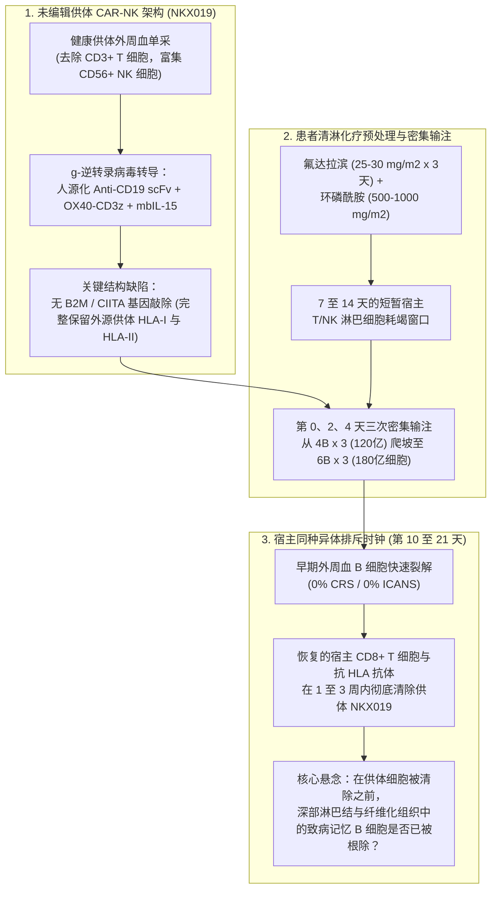
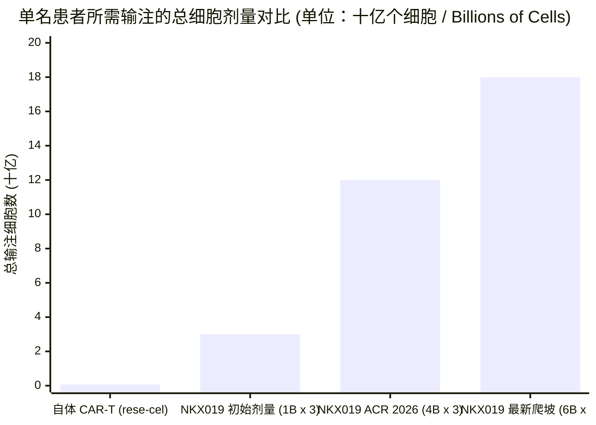
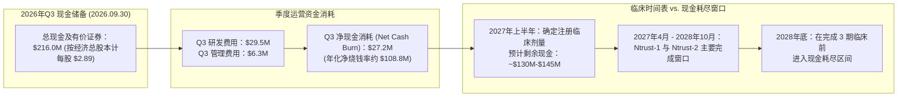

## 执行摘要与议题分类 (Issue Classification)

2026 年 11 月 9 日，通用型（Allogeneic）CAR-NK 细胞疗法开发商 **Nkarta, Inc.**（`NASDAQ: NKTX`）股价收于 **$1.34**，较 2026 年 7 月高点（**$3.72**）在过去六个月内累计暴跌 **58.02%（-$1.85）**，盘中更触及 **$1.13** 的 52 周历史新低。表面上看，这一抛售显得颇为反常：就在几天前于奥兰多举行的 **2026 年美国风湿病学会年会（ACR Convergence 2026）**上，Nkarta 刚刚公布了其现货型（Off-the-shelf）靶向 CD19 CAR-NK 细胞疗法 **NKX019** 在重度自身免疫性疾病 1/2 期临床（**Ntrust** 项目）中的“亮眼”初步数据；同时，公司截至 2026 年第三季度末账上握有 **2.160 亿美元（$216.0M）** 的现金及有价证券，是其表面市值（**9,562 万美元**）的两倍以上。

为何机构投资者在面对“积极”的自身免疫 CAR-NK 数据和深度负企业价值（Negative EV）时，反而将 `NKTX` 砸至历史最低点？运用 **Browne & Keeley 批判性思维框架**，我们将这一悖论拆解为两个核心议题：

1. **描述性与机制性议题（经验事实）：** 在剥离输注前数日所给予的高强度**氟达拉滨 + 环磷酰胺（`Flu/Cy`）**清淋化疗本身的免疫抑制作用后，单周期三次输注未经基因编辑（无 HLA 敲除）的健康供体 CAR-NK 细胞（`NKX019`），能否在自身免疫性疾病患者体内实现持久、免于免疫抑制剂（Drug-free）的深层组织 B 细胞重置与长期临床缓解？
2. **规范性与估值议题（资本配置）：** 按计入预融资认股权证（Pre-funded warrants）后的 `7,464 万股`经济总股本计算，Nkarta 每股 **$2.89** 的账面现金（**2.160 亿美元**）在 **$1.34** 的股价下究竟是不是真正的安全边际？公司高达每季度 **2,720 万至 3,330 万美元的现金消耗率（Cash Burn）**，是否会在 **2027 年上半年（1H 2027）**确定注册性临床剂量并完成 2/3 期关键试验之前耗尽账面资金？

### 可证伪性标准 (Falsifiability Criteria)

为避免确认偏误，我们预先确立双向可证伪性阈值：

* **何种证据将证伪看空逻辑（Bearish Thesis）：** 如果 Nkarta 在 12 个月随访节点证明，所有入组队列（`N ≥ 40`）中 `≥ 70%` 的系统性硬化症（`SSc`）、特发性炎性肌病（`IIM`）和狼疮性肾炎（`LN`）患者在 B 细胞重建后仍维持无激素、无免疫抑制剂的临床缓解（媲美自体 CD19 CAR-T 长达 1 至 2 年的持久性 [`PMID: 38381673`]），且三剂疗程的总生产成本（`COGS`）控制在 `$15,000` 以下。
* **何种证据将证伪看多逻辑（Bullish Thesis）：** 如果患者在超过第 90 天（`3 个月`）、即 `Flu/Cy` 清淋化疗的短暂抗炎效应消退后，迅速出现致病性记忆 B 细胞克隆反弹与临床复发；或者将剂量推高至**单次 60 亿细胞（第 0、2、4 天共输注 180 亿细胞）**引发剂量限制性毒性（DLT）、抗 HLA 同种异体免疫致敏（Allo-immunization），抑或因单名患者耗尽整批供体生产良率而彻底摧毁“现货型”细胞疗法的成本优势。

---

## 一手信源交叉质询：企业公关头条 vs. 临床方案与财报真相

通过对 Nkarta 官方网站（[nkartatx.com](https://nkartatx.com/) 与 [ntruststudy.com](https://ntruststudy.com/)）、ClinicalTrials.gov 注册的四项临床方案（[NCT06557265](https://clinicaltrials.gov/study/NCT06557265)、[NCT06733935](https://clinicaltrials.gov/study/NCT06733935)、[NCT05020678](https://clinicaltrials.gov/study/NCT05020678)、[NCT04623944](https://clinicaltrials.gov/study/NCT04623944)）以及 2026 年第三季度 Form 10-Q 财报进行法证式比对，我们发现了公关宣传与临床底层事实之间的五处结构性断层：

| 审计维度 | 企业公关头条与投资者路演口径 | 一手监管文件、临床方案与真实临床数据 |
| :--- | :--- | :--- |
| **ACR 2026 总入组人数 vs. 精选疗效子集** | 高调宣称肌病（`IIM`）达到 **83% (5/6)** 缓解率，系统性硬化症（`SSc`）达到 **86% (6/7)** `rCRISS-25` 应答（`mRSS` 皮肤评分中位下降 `-15 分`）。 | 截至 2026 年 9 月 18 日数据截点，共有 **40 名患者**横跨 5 个自身免疫适应症（`IIM`、`SSc`、`LN`、`AAV`、`pMN`）接受治疗，但头条疗效表仅筛选了在 `40 亿细胞/剂 × 3 剂`高剂量组且随访 `≥ 3 个月`的 **13 名患者（仅占 32.5%）**。其余 **27 名患者（67.5%）**——包括最早启动的旗舰试验 [NCT06557265](https://clinicaltrials.gov/study/NCT06557265)（`Ntrust-1`）狼疮性肾炎队列及低剂量队列——的具体疗效数据均未在头条表格中披露。 |
| **第 90 天随访窗口 vs. `Flu/Cy` 化疗混杂效应** | 将第 90 天的皮肤硬化（`mRSS`）和肌力（`TIS`）改善完全归功于 `NKX019` 介导的“免疫重置”。 | 头条疗效子集中的每一名患者在输注前均接受了**氟达拉滨（`25–30 mg/m²/日 × 3 天`）+ 环磷酰胺（`500–1,000 mg/m²`）**清淋化疗（`Flu/Cy`）。静脉注射高剂量环磷酰胺本身就是重度 `SSc` 和难治性 `IIM` 的标准诱导治疗药物，单药即可在 60 至 90 天内产生显著的淋巴细胞耗竭与临床症状改善。 |
| **同种异体排斥与剂量爬坡死循环** | 将 `NKX019` 宣传为通过膜结合型 IL-15（`mbIL-15`）增强持久性的便捷“按需现货型”疗法。 | 与 CRISPR 基因编辑隐形 CAR-T/NK 不同，`NKX019` **没有任何 HLA I/II 类分子敲除或免疫逃逸编辑**。由于宿主恢复的 T/NK 细胞会在 `7–14 天`内排斥并清除未编辑的供体细胞，Nkarta 被迫将三剂给药时间表从 `第 0、7、14 天`极限压缩至 **`第 0、2、4 天`**，并将单患者总细胞剂量从 `30 亿`（`1B × 3`）提升至 `120 亿`（`4B × 3`），如今进一步爬坡至 **`180 亿细胞`（`6B × 3`）**，导致注册性剂量选择推迟至 **2027 年上半年**。 |
| **肿瘤管线墓地（`NKX101` 与 `NKX019` 淋巴瘤）** | 将自身免疫适应症包装为成熟 CAR-NK 平台的自然拓展。 | Nkarta 转向自身免疫疾病的根本原因是肿瘤管线受挫：针对 AML/MDS 的 `NKX101`（[NCT04623944](https://clinicaltrials.gov/study/NCT04623944)，`N = 61`）和针对 B 细胞淋巴瘤的 `NKX019`（[NCT05020678](https://clinicaltrials.gov/study/NCT05020678)，`N = 150`）均因体内持久性短暂及第 3 个月后高复发率而被迫终止或降级，并伴随裁员重组。 |
| **现金跑道与真实股本核算** | 强调账面拥有 **2.160 亿美元**现金（截至 `2026 年 9 月 30 日`），对应 `7,170 万股`普通股（市值 `9,562 万美元`），宣称现金跑道可支撑“进入 2029 年”。 | 2026 年 Q3 Form 10-Q 显示，计入 `3,000,031 份`行权价仅 `$0.0001` 的预融资认股权证后，加权平均股本为 **`74,637,689 股`**（真实市值 **$100.0M**）；Q3 单季营业费用达 **$35.8M**（研发 `$29.5M` + 管理 `$6.3M`），单季净亏损 **$33.3M**，单季净现金消耗 **$27.2M**（年化烧钱率 `~$108.8M/年`）。按当前烧钱速度计算，现金仅够维持约 2.0 年（至 **2028 年底**），恰在 3 期试验完成前耗尽。 |

---

## 歧义消除与临床成熟度审计 (Ambiguity & Maturity Audit)

### 核心宣传话术的替换测试 (Substitution Test)

* **“现货型便利性 (Off-the-Shelf Convenience)”：** 当普通投资者听到“现货型”时，脑海中浮现的是像修美乐（Humira）那样的皮下注射笔或简单的门诊抗体输液。然而，将 [NCT06733935](https://clinicaltrials.gov/study/NCT06733935)（`Ntrust-2`）方案中的真实临床流程代入（**Browne & Keeley 替换测试**）：“现货型 `NKX019` 治疗”实际上意味着**患者必须先连续 3 天接受细胞毒性抗癌药氟达拉滨与环磷酰胺（`第 -5 至 -3 天`）静脉化疗，随后在第 0、2、4 天分三次在医院解冻并静脉输注每次 40 亿至 60 亿个液氮深冷保存的供体 NK 细胞（总计 120 亿至 180 亿个外源细胞），并接受抗 HLA 抗体与抗 NKX019 抗体的长期免疫原性监测**。与真正无需清淋化疗的现货型皮下注射双特异性 T 细胞衔接器（`TCE`，如 `teclistamab`、`CLN-978` 或 `obexelimab`）相比，`NKX019` 依然背负着清淋化疗毒性和多日细胞解冻输注的沉重负担。
* **“市值不到账面现金的一半”：** 代入 2026 年 Q3 财报数据：按 `7,464 万股`经济总股本与 `$1.34` 股价计算，Nkarta 的真实市值为 **1.000 亿美元**。虽然截至 2026 年 9 月 30 日的现金为 **2.160 亿美元**（每股 `$2.89`），但仅 2026 年 Q3 单季就烧掉了 **2,720 万美元**（每股每季消耗 `$0.36`）。等到 **2027 年上半年**确定注册剂量时（距离 2026 年 9 月底 3 个季度），累计 `8,000 万至 9,000 万美元`的现金消耗将使账面现金缩水至 `1.26 亿至 1.36 亿美元`（每股 `~$1.70–$1.82`），而彼时甚至还没有一名 3 期临床患者完成给药。

### 四级临床成熟度计分卡 (4-Tier Clinical Maturity Scorecard)

| 管线资产与靶点 | 适应症与临床试验编号 | 临床阶段与目标入组规模 | 已披露疗效与持久性状态 | 证据等级 (Evidence Tier) |
| :--- | :--- | :--- | :--- | :--- |
| **NKX019**（`CD19 CAR + mbIL-15` 未编辑供体 NK） | 系统性硬化症（`SSc`）与炎性肌病（`IIM`）— [NCT06733935](https://clinicaltrials.gov/study/NCT06733935) (`Ntrust-2`) | 1/2 期开放标签（目标 `N = 240`；全项目已给药 `40 例`） | 在 `4B × 3` 剂量组随访 **第 90 天（`≥ 3 个月`）**的 `13 例`患者中，肌病 `5/6`（`83%`）达到 TIS 应答，系统性硬化症 `6/7`（`86%`）达到 `rCRISS-25`（`mRSS` 中位下降 `-15 分`）；目前正向 `6B × 3`（`180 亿细胞`）爬坡。 | **第 2 级 (Tier 2)**（无对照小样本子集；3 个月短期窗口受 `Flu/Cy` 严重混杂） |
| **NKX019**（`CD19 CAR + mbIL-15` 未编辑供体 NK） | 狼疮性肾炎（`LN`）与原发性膜性肾病（`pMN`）— [NCT06557265](https://clinicaltrials.gov/study/NCT06557265) (`Ntrust-1`) | 1/2 期开放标签（目标 `N = 120`，2024 年 6 月启动） | 纳入 `40 例`安全性汇总池（`0%` CRS/ICANS），但在 ACR 2026 头条疗效表中**未披露该队列的具体缓解率（`CRR`）**。 | **第 3 级 (Tier 3)**（仅披露安全性；公开疗效未验证） |
| **NKX019**（`CD19 CAR + mbIL-15` 未编辑供体 NK） | 复发/难治性 B 细胞恶性肿瘤（`NHL`）— [NCT05020678](https://clinicaltrials.gov/study/NCT05020678) | 1 期（`N = 150`，停止招募） | 虽观察到初步完全缓解（CR），但因未编辑供体 NK 细胞体内持久性有限、复发率高，需重复给药，**肿瘤方向已被降级搁置**。 | **第 2 级 — 已搁置** |
| **NKX101**（`NKG2D CAR + mbIL-15` 未编辑供体 NK） | 复发/难治性 `AML` 与 `MDS` — [NCT04623944](https://clinicaltrials.gov/study/NCT04623944) | 1 期（`N = 61`，停止招募） | 早期小队列缓解未能在扩展队列中维持，因持久性不足**正式终止开发**。 | **第 2 级 — 已终止** |

---

## 机制架构与第 90 天临床应答的四向因果审计

为了理解为何 Nkarta 的临床设计陷入了与宿主免疫排斥赛跑的泥潭，我们绘制了 `NKX019` 的细胞架构、清淋预处理与宿主排斥时间窗示意图：

### 强制性四向因果审计 (4-Way Causal Audit)：第 90 天的疗效究竟源自何处？

当 Nkarta 报告 `7 例中 6 例`（`86%`）系统性硬化症患者达到 `rCRISS-25` 应答（`mRSS` 皮肤评分中位下降 `-15 分`）以及 `6 例中 5 例`（`83%`）肌病患者在 `≥ 3 个月`达到 `TIS` 改善时，根据 **Browne & Keeley 第 9 章（竞争性原因分析）**，我们必须在将其归功于 `NKX019` 之前检验全部四种因果路径：

| 因果假设 (Causal Hypothesis) | 因果方向 | 机制路径 | 实证支持度与法证裁决 |
| :--- | :--- | :--- | :--- |
| **1. 直接因果 (Direct Causation)** | `NKX019 → B 细胞重置 → 临床缓解` | 输注的 `120 亿`个 `NKX019` 细胞在前 14 天内裂解外周血及次级淋巴器官中的 `CD19+` B 细胞，重置自身免疫谱系。 | **部分贡献（短期外周血清除属实，长期深部组织重置未证实）：** 外周 B 细胞耗竭确实迅速发生，且经过免疫逃逸编辑或双靶点设计的学术界 CAR-NK（`PMID: 40562027`、`PMID: 41240964`）曾展示出 6 至 12 个月的活性。但第 90 天时间窗过短，不足以证明深部淋巴结记忆 B 细胞已被根除。 |
| **2. 潜伏第三变量 (`Confounder Z`)** | `Flu/Cy 清淋化疗 → 同时导致 B 细胞减少与第 90 天症状改善` | 头条子集中的每名患者均接受了**氟达拉滨 + 环磷酰胺（`Flu/Cy`）**以及方案允许的基线糖皮质激素（`NCT06733935` 允许泼尼松 `≤ 20 mg/日`）。高剂量静脉环磷酰胺（`500–1,000 mg/m²`）本身就是指南推荐的重度 `SSc` 皮肤/肺纤维化和难治性肌病的标准诱导治疗药物，单独使用即可在 60 至 90 天内杀伤增殖淋巴细胞并降低 `mRSS` 和 `TIS` 评分。 | **第 90 天节点的强混杂因素：** 在缺乏 `Flu/Cy` 单药对照臂或 `≥ 12 个月`无免疫抑制剂随访数据（待 `Flu/Cy` 药效彻底消退）的情况下，科学上无法区分第 90 天 `-15 分`的 `mRSS` 下降究竟有多少来自 `Flu/Cy` 化疗，又有多少来自 `NKX019`。值得注意的是，Nkarta 的环磷酰胺（`Cy`）单药预处理队列数据并未在头条疗效表中展示。 |
| **3. 样本筛选与报告偏倚 (`Funnel Attrition`)** | `队列漏斗筛选 (40 例 → 13 例) → 推高表面应答率` | 在横跨 5 个适应症和多个剂量组（`1B`、`1.5B`、`4B` 细胞/剂）接受治疗的 **40 名患者**中，头条疗效表仅单列了 `4B × 3` 剂量组随访 `≥ 3 个月`的 **13 名患者**（`6 例 IIM`，`7 例 SSc`）。 | **分母扭曲风险极高：** 剔除 `40 例中的 27 例`受试者（**67.5%**）——包括低剂量组以及早 5 个月启动的 `Ntrust-1` 狼疮性肾炎（[NCT06557265](https://clinicaltrials.gov/study/NCT06557265)）队列——构成了典型的事后亚组筛选。此外，`mRSS` 是研究者徒手捏皮肤的半主观评分，在开放标签（Open-label）试验中极易受到研究者预期偏倚的影响。 |
| **4. 双向反馈回路 (`同种异体清除 ↔ 剂量爬坡`)** | `宿主快速排斥清除 ↔ 给药间隔压缩及 180 亿细胞超量爬坡` | 由于未编辑的供体 `NKX019` 细胞在 `1–2 周`内即被宿主免疫系统清除，`1B × 3`（`30 亿`）剂量组织穿透力不足，迫使公司爬坡至 `4B × 3`（`120 亿`），如今更在 **`第 0、2、4 天`内强行灌注 `6B × 3`（`180 亿细胞`）**。 | **被试验方案变更直接证实：** 如果 `120 亿细胞`（`4B × 3`）真的已经实现了彻底、持久的深部组织 B 细胞根除，Nkarta 大可立即锁定 2 期注册剂量，而绝不会将细胞剂量再提高 50% 至 **`180 亿细胞`**并将注册剂量确定时间推迟至 **2027 年上半年**。 |

---

## 统计与化学计量学解构：200 倍细胞质量惩罚与生产成本 (COGS) 悖论

为什么 Cabaletta Bio 的自体 CD19 CAR-T **rese-cel (`CABA-201`)** 或 Erlangen 大学团队（`Müller & Schett et al., NEJM 2024`，[PMID: 38381673](https://pubmed.ncbi.nlm.nih.gov/38381673/)）仅需**单次输注 `1 × 10⁶ 细胞/kg`（70 kg 成人约 `7,000 万个细胞`）**就能实现长达 1 至 2 年的无药缓解，而 Nkarta 的 `NKX019` 却需要分三次输注 **120 亿至 180 亿个细胞**（**细胞数量高出 171 倍至 257 倍**）？

答案在于自体活体 T 细胞的**体内指数级扩增药代动力学（`PK`）**与未编辑供体 NK 细胞**不扩增且遭宿主排斥的药代动力学**之间的本质差异。我们将时间 `t ∈ [0, T]` 内靶组织中有效效应细胞暴露量（`AUC_tissue`）形式化表示为：

$$AUC_{\text{tissue}} = \int_{0}^{T} D_0 \cdot f_{\text{homing}} \cdot \exp\big((r_{\text{prolif}} - k_{\text{allo}} - k_{\text{apoptosis}}) \cdot t\big) \, dt$$

其中，`D₀` 为初始输注细胞剂量，`f_homing` 为穿过血管内皮归巢（Homing）至纤维化皮肤、肌肉及深部淋巴结的细胞比例，`r_prolif` 为抗原驱动的体内克隆扩增速率，`k_allo` 为宿主同种异体免疫排斥清除速率。

* **自体 CD19 CAR-T（`rese-cel` / Schett CAR-T）：** 由于使用的是患者自身的 T 细胞，宿主同种异体排斥为零（`k_allo = 0`）。遇到体内 `CD19+` B 细胞后，`4-1BB` 或 `CD28` 共刺激信号在 `10–14 天`内驱动爆发式克隆增殖（`r_prolif ≫ k_apoptosis`），使最初输注的 `7,000 万个细胞`在患者淋巴结内部自我扩增 **100 至 1,000 倍**，并维持长达 **`112 ± 47 天`** 的完全外周 B 细胞再生障碍（[PMID: 38381673](https://pubmed.ncbi.nlm.nih.gov/38381673/)）。
* **未编辑通用型 CAR-NK（`NKX019`）：** 成熟外周血 NK 细胞的体内增殖潜力远逊于 T 细胞，缺乏内源性 TCR 存活信号，且表面完整携带外源供体 HLA 抗原（当第 7–10 天宿主淋巴细胞开始恢复时，`k_allo ≫ r_prolif`）。因此，`NKX019` 的作用模式更像是一记**超大剂量生物制剂推注（Bolus）**，而非自我增殖的活体药物：为了在宿主免疫系统将其摧毁之前让足够多的细胞渗透进硬化症皮肤或发炎肌肉，Nkarta 必须在 96 小时窗口（`第 0、2、4 天`）内向患者血液倾泻 **120 亿至 180 亿个细胞**。

### 生产批次良率与销售成本 (COGS) 的两难死结

通用型 CAR-NK 相对于自体 CAR-T 的核心商业逻辑在于规模化制造：单次健康供体白细胞单采本应生产出 **100 至 300 人份的现货剂量**，从而将单患者生产成本（`COGS`）压低至 `<$10,000`。

然而，当单名患者所需的总细胞量从最初的 `30 亿细胞`（`1B × 3`）暴增 6 倍至 **`180 亿细胞`（`6B × 3`）**时，这一经济模型便遭遇反噬：

1. **单批次可供应患者数缩水 6 倍：** 原本按 `30 亿细胞/人`可供应 **60 名患者**的生物反应器收获批次，按 `180 亿细胞/人`计算仅能供应 **10 名患者**（扣除冻存超量灌装与质控留样后更少）。
2. **3 倍的深冷物流与医院解冻负担：** 在第 0 天输注 `60 亿细胞`、第 2 天输注 `60 亿细胞`、第 4 天输注 `60 亿细胞`，意味着每名患者需要经历**三次独立的液氮气相冷链运输、储存、床旁解冻与多袋静脉输注**。
3. **宿主抗 HLA 同种异体致敏风险（[NCT06733935](https://clinicaltrials.gov/study/NCT06733935) 次要终点 #331）：** 向自身免疫患者体内分三次灌注 `180 亿`个未经编辑、携带外源 HLA 的供体细胞，极易诱导宿主产生**供体特异性抗 HLA 抗体（`DSA`）**。对于未来可能需要肾移植或肺移植的年轻狼疮性肾炎（`LN`）或系统性硬化症（`SSc`）患者而言，诱发广泛的抗 HLA 致敏不仅会封死后续重复给药（Retreatment）的空间，更会构成严重的器官移植配型隐患。

---

## ACR Convergence 2026 竞争格局：上下夹击的“三明治”困境

`NKTX` 在 ACR Convergence 2026 期间遭遇惨烈抛售，很大程度上是因为同场会议上竞争对手公布的数据对 `NKX019` 形成了上下夹击：上方有**已证实 1–2 年无药缓解的单次输注 CAR-T 及基因编辑隐形 CAR**，下方则有**完全无需清淋化疗的皮下注射双特异性抗体（`TCE`）**。

| 治疗模态与资产 | 开发商 | 是否需要清淋化疗 | 总给药方案 | 临床成熟度与 ACR 2026 标杆数据 | 相对 `NKX019` 的结构性优势 |
| :--- | :--- | :--- | :--- | :--- | :--- |
| **自体 CD19 CAR-T (`rese-cel / CABA-201`)** | Cabaletta Bio (`CABA`) | 需要 `Flu/Cy`（单周期） | **单次输注**（`1 × 10⁶ 细胞/kg` ≈ `0.07B` 细胞） | 已给药 `>70 例`；**证实 1 至 2 年持久无药缓解**：皮肌炎 1 年应答率 `6/6`（`100%`）；`SSc` 1 年 `rCRISS-50` 达 `5/7`（`71%`）且用力肺活量（`FVC`）提升 `+9%`；`LN` 达 `100%` DORIS 缓解并经重复肾活检证实深部组织 B 细胞清除；肌病注册试验进行中（目标 2028 年递交 `BLA`）。 | 单次输注即具备 **4 至 8 倍更长的随访验证（`1–2 年` vs. `3 个月`）**及活检证实的深部组织 B 细胞重置。 |
| **CRISPR 基因编辑通用型 CAR-T (`zugo-cel / CTX112`)** | CRISPR Therapeutics (`CRSP`) | 需要 `Flu/Cy` | **单次输注**（`~0.1B–0.3B` 细胞） | 敲除 `TRAC`、`B2M`、`TGFBR2` 以逃避宿主排斥并抵抗 T 细胞耗竭；单次输注即可实现体内扩增与深度 B 细胞耗竭。 | **工程化免疫逃逸编辑（`B2M` KO）**无需靠 3 次输注 `180 亿细胞`来硬抗宿主排斥。 |
| **iPSC 衍生基因编辑双靶点 CAR-NK (`QN-139b`)** | 学术界 / 启函生物 (`PMID: 40562027`) | 需要 `Flu/Cy` | 克隆性 iPSC 主细胞库（`CD19/BCMA` 双 CAR + 低免疫原性编辑） | 发表于 *Cell*（2025 年 8 月，[PMID: 40562027](https://pubmed.ncbi.nlm.nih.gov/40562027/)）：通过低免疫反应基因编辑及 `CD19 + BCMA` 双靶点设计，在 6 个月随访中逆转皮肤纤维化并清除长寿命浆细胞自身抗体。 | **克隆均一性 + `BCMA` 浆细胞覆盖 + 免疫逃逸编辑**，同时解决持久性短与 `CD19 阴性`浆细胞残留两大痛点。 |
| **现货型双特异性 T 细胞衔接器 (`TCE`: `CLN-978`, `teclistamab`)** | Cullinan / 强生 / 安进 / Zenas | **完全无需（0% `Flu/Cy` 化疗）** | 门诊皮下注射（SC）或普通静脉滴注 | **无需清淋化疗**即可在难治性自身免疫病中实现外周及组织 B 细胞/浆细胞深度耗竭；轻中度 CRS 可通过阶梯递增给药在门诊安全管理。 | **真正的现货型生物制剂：** 彻底免除 `Flu/Cy` 化疗毒性、生殖/感染风险及液氮细胞冷链物流。 |
| **未编辑供体 CD19 CAR-NK (`NKX019`)** | **Nkarta (`NKTX`)** | **需要 `Flu/Cy`**（主要疗效队列） | **3 次密集输注**（`第 0、2、4 天`每次 `4B–6B` = **总计 `120 亿–180 亿`细胞**） | `40 例`给药患者中仅展示 **第 90 天（`≥ 3 个月`）**的 `13 例`子集（`IIM 5/6`，`SSc 6/7`）；`0%` CRS/ICANS；注册剂量推迟至 **2027 年上半年**。 | 具备 `0%` CRS/ICANS 的优异早期安全性，但**被困在 `Flu/Cy` 化疗负担与第 90 天后持久性未明之间**。 |

---

## 财务法证审计：拆解 2.160 亿美元账面现金 vs. 1.000 亿美元真实市值

散户看多观点常认为，以 **$1.34**（基本市值 **9,562 万美元**）买入持有 **2.160 亿美元**现金的 `NKTX` 相当于“白送”整个 `NKX019` 管线。然而，对 2026 年第三季度财务报表（截至 2026 年 9 月 30 日）的严格审计揭示了为何机构投资者给予其账面现金如此大幅度的折价：

### 核心资产负债表与现金消耗指标（截至 2026 年 9 月 30 日）

1. **经济稀释总股本（`7,464 万股` vs. `7,170 万股`）：** 尽管行情软件显示基本普通股为 `7,170 万股`（按 `$1.34` 计市值为 `9,562 万美元`），但由于存在 **`3,000,031 份`**行权价仅 `$0.0001/股`的未行使预融资认股权证（Pre-funded warrants），Nkarta 2026 年 Q3 的加权平均基本/稀释股本分母实为 **`74,637,689 股`**。计入这部分准普通股后，`$1.34` 对应的真实经济市值为 **1.0001 亿美元（$100.01M）**。
2. **季度现金消耗（Cash Burn）轨迹：**
   * 截至 2026 年 6 月 30 日现金及有价证券：**2.432 亿美元（$243.2M）**
   * 截至 2026 年 9 月 30 日现金及有价证券：**2.160 亿美元（$216.0M）**
   * **2026 年 Q3 单季净现金消耗：** **2,720 万美元（$27.2M）**（年化消耗 **1.088 亿美元**）
   * **2026 年 Q3 GAAP 营业总费用：** **3,580 万美元**（研发费用 `$29.5M` + 管理费用 `$6.3M`；Q3 GAAP 净亏损 = **3,330 万美元**）。
3. **为何“现金跑道支撑进入 2029 年”在数学上极其吃紧：** 将 `2.160 亿美元`除以 Q3 每季度 `2,720 万美元`的净现金消耗率，得出的跑道仅为 **7.94 个季度（约 1.98 年）**，这意味着资金将在 **2028 年第三/第四季度**见底，而非 2029 年——除非公司大幅削减研发开支、放缓入组或再次裁员。然而，将 `Ntrust-1`（目标 `N = 120`）和 `Ntrust-2`（目标 `N = 240`）扩展至每名患者 **`180 亿细胞`（`6B × 3`）**的超高剂量并在 2027 年启动注册性试验，只会推高 GMP 细胞生产与临床中心成本，而非降低支出。

---

## “负面视角”审计 (The Negative View)：哪些信息被隐去？谁承担代价？

遵循 **Browne & Keeley 第 11 章（遗漏的信息与负面视角）**，我们重点追问 Nkarta 在 2026 年 11 月披露中被隐去的关键变量：

1. **消失的 27 名患者（占全部给药人群的 `67.5%`）：** 既然截至 2026 年 9 月 18 日已有 **40 名患者**接受治疗，为何头条疗效数据仅限于 `4B × 3` 剂量组的 `6 例`肌病和 `7 例`系统性硬化症（共 `13 例`）？
   * **`1.0B × 3`（`30 亿`）和 `1.5B × 3`（`45 亿`）低剂量组**在 6 至 12 个月随访时的结局如何？如果这些低剂量组患者在第 90 天 `Flu/Cy` 化疗效应消退后纷纷复发，那就直接证实了宿主快速排斥导致的陡峭剂量悬崖。
   * 比 `Ntrust-2`（2024 年 11 月启动）早了整整五个月启动的 **[NCT06557265](https://clinicaltrials.gov/study/NCT06557265)（`Ntrust-1`：狼疮性肾炎 `LN` 与原发性膜性肾病 `pMN`，2024 年 6 月启动）**入组患者的疗效究竟如何？为何启动更早的旗舰试验在 ACR 2026 头条疗效表中完全缺席？
2. **缺失的细胞药代动力学（`PK`）与 B 细胞表型重建曲线：** 在 `Müller & Schett et al.`（[PMID: 38381673](https://pubmed.ncbi.nlm.nih.gov/38381673/)）和 `Marin & Rezvani et al.`（[PMID: 38238616](https://pubmed.ncbi.nlm.nih.gov/38238616/)）的经典研究中，决定性的生物学指标是 **CAR 细胞体内持续天数**、**外周 B 细胞再生障碍持续时间（CAR-T 平均为 `112 ± 47 天`）**，以及重建归来的 B 细胞究竟是 **100% 初始型（Naive，`CD27- IgD+`）B 细胞**还是预示复发的 **`CD27+` 类别转换记忆 B 细胞**。在没有公布 6 至 12 个月 B 细胞重建表型数据的情况下，仅凭 `Flu/Cy` 化疗后第 90 天的临床评分无法证实真正的免疫重置。
3. **若 `180 亿细胞`仍无法延长持久性，谁来承担风险：** 难治性 `SSc`、`IIM`、`LN` 和 `AAV` 患者为了接受 `NKX019` 治疗，必须承受具有生殖毒性和骨髓抑制毒性的 `Flu/Cy` 化疗。如果未编辑的供体 NK 细胞在清除深部淋巴滤泡致病 B 细胞之前就被宿主排斥清除，患者将白白承受 `Flu/Cy` 化疗的近期与远期毒性，却无法换来自体 CAR-T 所能提供的数年无药缓解。

---

## 灰度思维综合与概率加权法证裁决 (Grey Thinking & Verdict)

拒绝非黑即白的二元思维，我们通过条件 **If-从句（If-Clauses）**对 **Nkarta (`NASDAQ: NKTX`)** 的临床与估值路径进行综合推演：

* **如果（If）** Nkarta 在即将到来的 **2027 年纵向随访读数（`6 至 12 个月随访`）**中证实，`4B × 3`（`120 亿`）和 `6B × 3`（`180 亿`）队列中有 `≥ 70%` 的患者在第 12 个月仍保持无激素、无免疫抑制剂的完全缓解，且去除氟达拉滨的环磷酰胺（`Cy`）单药预处理队列也能复现同等疗效——**那么（Then）** `NKX019` 在 40 名患者中展现出的 **0% CRS / 0% ICANS** 极佳安全性将在无法处理 CAR-T 神经毒性的社区风湿科中心开辟出稳固的门诊差异化生态位，推动股价向每股净现金价值（`$2.50–$3.50/股`）重估。
* **反之，如果（If）** 患者在 **第 6 至 12 个月随访**时，随着 90 天 `Flu/Cy` 化疗窗口消退而普遍出现致病记忆 B 细胞反弹与临床复发——重演此前 `NKX019` 在淋巴瘤（[NCT05020678](https://clinicaltrials.gov/study/NCT05020678)）和 `NKX101` 在 AML（[NCT04623944](https://clinicaltrials.gov/study/NCT04623944)）中第 3 个月后复发折戟的覆辙——**那么（Then）** `NKX019` 将在高端疗效端被单次输注自体 CAR-T（`rese-cel`）碾压，在便捷现货端被免化疗皮下双抗（`TCE`）取代，陷入进退维谷的结构性淘汰。

### 概率加权情景推演（未来 12 至 18 个月维度）

| 情景假设 | 发生概率 | 机制与临床触发条件 | 隐含估值与股价影响 |
| :--- | :--- | :--- | :--- |
| **基准情景 (Base Case)：第 90 天后部分复发漂移与现金持续消耗** | **55%** | 在 6–12 个月随访时，`30%–50%` 的第 90 天初步应答者因未编辑 `NKX019` 早期清除而需重新启用激素/免疫抑制剂；`180 亿`高剂量推高 `COGS`；至 2027 年中账面现金降至 `~$120M`。 | 作为长期折价于现金的细胞疗法价值陷阱，维持在 **远期现金的 0.45x–0.65x（`$0.85 – $1.35/股`）** 区间震荡。 |
| **悲观情景 (Bear Case)：高复发率、`LN` 表现不佳与管线重组** | **25%** | 推迟披露的 `Ntrust-1`（`LN`）队列及低剂量组在 `Flu/Cy` 效应消退后持久性疲软；`6B × 3`（`180 亿`）引发抗 HLA 致敏或生产批次瓶颈；2027–2028 年浮现裁员重组或合股（Reverse Split）风险。 | 跌至 **远期现金的 ~0.35x（`$0.50 – $0.80/股`）**，迫使公司寻求战略替代方案或折价并购。 |
| **乐观情景 (Bull Case)：12 个月持久无药缓解 + `Cy` 单药预处理验证** | **20%** | `120 亿–180 亿`剂量组 `≥ 70%` 的 `SSc` 与 `IIM` 患者在第 12 个月维持无药缓解及初始 B 细胞重建，且保持 `0%` CRS/ICANS；`Cy` 单药预处理成功，支撑 2027 年顺利启动 2/3 期注册试验。 | 凭借大型药企授权合作或并购预期，重估至 **现金价值的 1.0x–1.4x（`$2.50 – $4.00/股`）**。 |

### 最终法证裁决 ("What We Actually Think")

市场在过去六个月将 **Nkarta (`NKTX`) 股价腰斩 58% 至 $1.34**，绝非对账上 **2.160 亿美元**现金视而不见的非理性错杀，而是机构资金对 ACR Convergence 2026 暴露出的**三大结构性红灯**所做出的理性折价：

1. **40 例给药仅披露 13 例的疗效漏斗（披露分母仅 `32.5%`）**：隐去了其余 `27 名`受试者的数据，包括早五个月启动的 `Ntrust-1` 狼疮性肾炎试验（[NCT06557265](https://clinicaltrials.gov/study/NCT06557265)）；
2. **完全受 `Flu/Cy` 清淋化疗混杂的第 90 天短暂评估窗口**：由于环磷酰胺本身即可在 60 至 90 天内改善皮肤与肌肉炎症，仅凭 90 天数据无法证实 `NKX019` 的独立长期免疫重置能力；以及
3. **第 0、2、4 天高达 180 亿未编辑细胞（`6B × 3`）的爬坡死循环**：为了用细胞数量硬抗宿主排斥而将剂量提高 6 倍，不仅将注册剂量选择推迟至 **2027 年上半年**，更伴随着每季度 **约 2,720 万美元**的现金失血。

在 Nkarta 完整公布**全部 40 余名受试者未经筛选的疗效数据**，并证明在 `Flu/Cy` 化疗效应彻底消退后的**第 12 个月仍能维持无免疫抑制剂的持久缓解**之前，`NKTX` 依然是一个典型的**“待自证价值陷阱”（Show-Me Value Trap）**，而非深度价值便宜货。

---

## 一手信源与可验证参考文献

1. **ClinicalTrials.gov ([NCT06557265](https://clinicaltrials.gov/study/NCT06557265))：** *A Phase 1/2 Open-Label Study to Investigate the Safety and Clinical Activity of NKX019 in Participants With Autoimmune Disease (`Ntrust-1`: Lupus Nephritis and Primary Membranous Nephropathy).* 申办方：Nkarta, Inc.
2. **ClinicalTrials.gov ([NCT06733935](https://clinicaltrials.gov/study/NCT06733935))：** *A Phase 1/2 Study of NKX019 in Autoimmune Diseases (`Ntrust-2`: Systemic Sclerosis, Idiopathic Inflammatory Myopathy, ANCA-Associated Vasculitis, and Rheumatoid Arthritis).* 申办方：Nkarta, Inc.
3. **ClinicalTrials.gov ([NCT05020678](https://clinicaltrials.gov/study/NCT05020678)) 与 ([NCT04623944](https://clinicaltrials.gov/study/NCT04623944))：** `NKX019` 治疗 B 细胞恶性肿瘤 1 期临床（`N = 150`）与 `NKX101` 治疗 AML/MDS 1 期临床（`N = 61`）。申办方：Nkarta, Inc.
4. **Nkarta 企业官网与财报披露：** [nkartatx.com](https://nkartatx.com/) 与 [ntruststudy.com](https://ntruststudy.com/) — ACR Convergence 2026 口头与壁报展示（奥兰多；数据截点 2026 年 9 月 18 日）及 2026 年第三季度业绩报告（截至 2026 年 9 月 30 日的 Form 10-Q）。
5. **Müller F, Taubmann J, Bucci L, et al. (Schett G).** *CD19 CAR T-Cell Therapy in Autoimmune Disease — A Case Series with Follow-up.* **The New England Journal of Medicine** (2024 Feb 22); 390(8):687–700. [PMID: 38381673](https://pubmed.ncbi.nlm.nih.gov/38381673/).
6. **Marin D, Li Y, Basar R, et al. (Rezvani K).** *Safety, efficacy and determinants of response of allogeneic CD19-specific CAR-NK cells in CD19+ B cell malignancies.* **Nature Medicine** (2024 Mar); 30(3):772–784. [PMID: 38238616](https://pubmed.ncbi.nlm.nih.gov/38238616/).
7. **Wang X, Zhang Y, Jin Y, et al. (Xu H).** *An iPSC-derived CD19/BCMA CAR-NK therapy in a patient with systemic sclerosis.* **Cell** (2025 Aug 07). [PMID: 40562027](https://pubmed.ncbi.nlm.nih.gov/40562027/).
8. **Changhai Hospital / Naval Medical University Investigators.** *Efficacy and safety of allogeneic CD19 CAR NK-cell therapy in systemic lupus erythematosus: a case series.* **The Lancet** (2025). [PMID: 41240964](https://pubmed.ncbi.nlm.nih.gov/41240964/).
