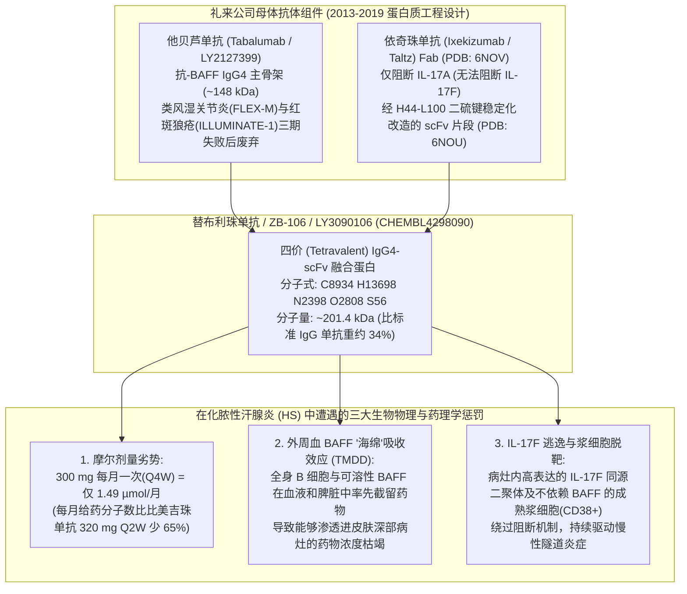
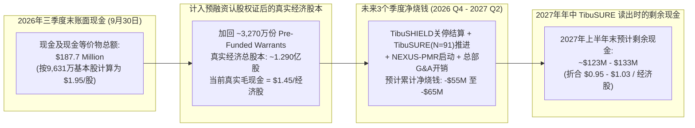

2026年11月9日早盘，纳斯达克上市免疫生物科技公司 **Zura Bio Limited（NASDAQ: ZURA）** 在单个交易日内痛失约四分之三的市值，股价从约4.15美元断崖式暴跌至1.00美元附近。引发这场崩盘的导火索是 [**TibuSHIELD (NCT06993610)**](https://clinicaltrials.gov/study/NCT06993610) 二期临床试验的顶线（topline）数据读出。这项为期16周、入组247名成年患者的研究，旨在评估Zura的核心管线药物 **替布利珠单抗（tibulizumab，ZB-106）** 治疗中重度 **化脓性汗腺炎（Hidradenitis Suppurativa，HS）** 的疗效——这是一种在皮肤深处形成剧痛脓肿（abscess）、炎性结节（inflammatory nodule）和流脓窦道/隧道（draining tunnel）的慢性致残性炎症皮肤病。

结果显示，无论是每月一次（Q4W）皮下注射150 mg还是300 mg剂量的替布利珠单抗，均未能在第16周达到总脓肿和炎性结节（AN）计数较基线百分比下降的主要终点，也未能达到 **HiSCR50** 和 **HiSCR75** 等关键次要终点。数据公布数小时内，Zura Bio宣布彻底终止替布利珠单抗在化脓性汗腺炎适应症上的开发，将投资者视线转向预计于2027年上半年读出顶线数据的系统性硬化症（Systemic Sclerosis，SSc）二期临床 [**TibuSURE (NCT06843239)**](https://clinicaltrials.gov/study/NCT06843239)，以及计划于2026年底启动的风湿性多肌痛（PMR）二期临床 **NEXUS-PMR**。

每当一项中期免疫学临床试验像这样彻底坍塌时，华尔街总会立刻出现两种截然对立的叙事：
1. **“倒霉的安慰剂暴涨（Placebo Spike）”叙事：** 管理层与多头分析师将矛头指向安慰剂组——安慰剂组患者的AN计数竟然出现了高达 **52.5%的下降**，且 **HiSCR50应答率高达45.5%**，几乎是历史三期临床安慰剂组HiSCR50应答率（约26%–34%）的两倍。在这种叙事下，药物本身是有效的，只是临床研究中心的噪音推高了安慰剂底线；而在1.00美元股价（按基本股数计算市值约9,630万美元，对比2026年三季度末账上 **1.877亿美元现金**）买入ZURA，是一笔教科书式的“破净现金盒（net-net）”套利交易。
2. **“药理学与化学计量学天花板（Mechanistic Ceiling）”叙事：** 对活性给药组原始数据的法医式审查却揭示了一个严峻得多的事实：将替布利珠单抗的剂量从每月150 mg翻倍至每月300 mg，**产生了零增量获益**——事实上，300 mg高剂量组在AN下降率（56.0% vs. 58.1%）和HiSCR50应答率（48.0% vs. 52.7%）两个核心指标上，数值表现反而比150 mg低剂量组**更差**。

为了查明真相——并判断1.00美元的Zura Bio究竟是被错杀的现金金矿，还是一个每个季度烧掉2,580万美元、靠回收跨国药企弃子维持运转的“价值陷阱”——我们必须跳过公关通稿，深入挖掘其分子工程结构、摩尔化学计量学（molar stoichiometry）、临床注册历史档案以及SEC财务报表附注。

---

## 1. 界定核心问题与可证伪性（Falsifiability）标准

在审视任何一个百分比之前，我们必须先将**描述性生物学问题（Descriptive Question）**与**规范性资本配置问题（Prescriptive Question）**剥离开来，并设定严格的证伪标准：

* **描述性问题（机制与试验物理学）：** [`NCT06993610`](https://clinicaltrials.gov/study/NCT06993610) 的失败究竟仅仅是因为研究中心噪音与“向均值回归（regression to the mean）”人为推高了第16周安慰剂应答率（AN下降52.5%；HiSCR50为45.5%），还是因为替布利珠单抗撞上了由其 **201.4 kDa庞大IgG4-scFv分子构型**、**每月一次（Q4W）摩尔剂量不足**、**仅阻断IL-17A而漏掉IL-17F** 以及 **外周血液BAFF靶点介导的药物处置（TMDD）** 共同锁死的药理学天花板？
* **规范性问题（估值与策略）：** 在股价暴跌约75%至1.00美元后，Zura Bio截至2026年9月30日的1.877亿美元现金储备，是否能在2027年上半年 [`TibuSURE (NCT06843239)`](https://clinicaltrials.gov/study/NCT06843239) 系统性硬化症数据读出前提供非对称的安全边际？抑或预融资认股权证（pre-funded warrants，合计约1.29亿股经济股数）的摊薄与每季度约2,580万美元的烧钱速度早已抹平了这一折价？
* **可证伪性条件：** 如果同时满足以下两点，“纯粹安慰剂偶然暴涨”假说即被**证伪（推翻）**：
  1. 活性治疗组在150 mg Q4W与300 mg Q4W之间表现出**平坦甚至倒挂的剂量-反应关系（inverted dose-response）**，证明在该给药方案下将药物暴露量翻倍完全无法清除更深层的病变。
  2. 即便在安慰剂应答率降至28.1%的更严苛指标 **HiSCR75** 上，替布利珠单抗的绝对应答率上限（150 mg组34.0%；300 mg组35.3%）依然显著落后于组织穿透力更强的小分子量IL-17A/F双靶点纳米抗体和口服细胞内激酶抑制剂。

---

## 2. 分子考古学：礼来（Eli Lilly）当年是如何拼装并甩卖替布利珠单抗（LY3090106）的？

要理解替布利珠单抗为何会在 [`TibuSHIELD`](https://clinicaltrials.gov/study/NCT06993610) 中折戟，首先必须搞清楚这个分子的来历。Zura Bio并不是替布利珠单抗（`ZB-106`）的原研者。它是十多年前由 **礼来公司（Eli Lilly and Company）** 以内部代号 **LY3090106** 研发的四价双特异性抗体，其完整的工程设计记录在礼来科学家2019年发表于 *mAbs* 期刊的同行评审结构生物学论文中（Benschop et al., 2019；X射线晶体结构已存入RCSB蛋白质数据库，编号为 [**PDB 6NOU**](https://www.rcsb.org/structure/6NOU) 和 [**PDB 6NOV**](https://www.rcsb.org/structure/6NOV)）。

我们可以把诺华的 **司库奇尤单抗（Cosentyx）** 或优时比（UCB）的 **比美吉珠单抗（Bimzelx）** 这类标准IgG单克隆抗体，想象成一把重约 **146至151 kDa** 的精密Y字形扳手。礼来的蛋白质工程师当年希望打造一把能够同时拧动两个免疫学螺母的双头工具：**B细胞活化因子（BAFF）** 和 **白细胞介素-17A（IL-17A）**。

为了造出这把双头工具，礼来从自家货架上取下两个现成抗体，将它们焊接在了一起：
1. **IgG4主骨架（他贝芦单抗 / Tabalumab，LY2127399）：** 作为Y字形主干，礼来选用了自家的抗BAFF IgG4单克隆抗体 **tabalumab**。极其关键的历史背景是，tabalumab本身就是大型药企自身免疫研发史上最著名的败将之一：在2013–2014年接连折戟类风湿关节炎三期临床（`FLEX-M`）和系统性红斑狼疮（SLE）三期临床（`ILLUMINATE-1`）后，礼来彻底终止了tabalumab的开发。
2. **焊接在尾部的单链片段（依奇珠单抗 / Ixekizumab，Taltz scFv）：** 在tabalumab两条重链的底端（C端），礼来通过一段富含甘氨酸的柔性肽接头（`GGGGSGGGGTGGGGS`），挂上了从自家抗IL-17A单抗 **依奇珠单抗（Taltz）** 上裁剪下来的单链可变区片段（`scFv`，[`PDB 6NOV`](https://www.rcsb.org/structure/6NOV)）。由于最初拼接出来的融合蛋白在溶液中极易发生自聚集（self-association）和化学降解，礼来工程师不得不修改互补决定区（CDR）的电荷分布，并在 `H44-L100` 位点强行打入一个人工二硫键钉书针（[`PDB 6NOU`](https://www.rcsb.org/structure/6NOU)），才勉强让它在高浓度下保持单分散状态。

请看在Zura Bio成立之前，原研方礼来是如何处置 [`LY3090106`](https://www.ebi.ac.uk/chembl/explore/compound/CHEMBL4298090) 的：
* 在2013年至2019年的六年时间里，礼来仅开展了三项小型一期临床试验，累计入组受试者仅 **105人**：[`NCT01925157`](https://clinicaltrials.gov/study/NCT01925157)（健康志愿者及类风湿关节炎患者43人）、[`NCT02614716`](https://clinicaltrials.gov/study/NCT02614716)（干燥综合征患者32人）以及 [`NCT03736772`](https://clinicaltrials.gov/study/NCT03736772)（日本及白人健康受试者30人）。
* 随后一项计划在原发性干燥综合征中开展的研究者发起二/三期临床试验（[`NCT04563195`](https://clinicaltrials.gov/study/NCT04563195)）在 **入组人数为0（N = 0）的情况下被正式撤回（Withdrawn）**。
* 2023年4月，礼来决定不再自掏腰包推进二期临床，而是将 `LY3090106` 的全球权益打包卖给了新成立的空壳平台 Zura Bio（`ZB17 LLC`），对价仅为 **580万美元首付款现金**、**500万美元技术资料交接费** 以及 **100万股A类普通股**（当时价值约425万美元）。

### 公开管线营销叙事 vs. 一手临床注册库与SEC文件事实对照

当我们将Zura Bio官网管线子页面（[`zurabio.com/pipeline/zb-106/`](https://zurabio.com/pipeline/zb-106/)、[`zb-168`](https://zurabio.com/pipeline/zb-168/)、[`zb-880`](https://zurabio.com/pipeline/zb-880/) 及其可下载的 [`系统性硬化症疾病手册PDF`](https://zurabio.com/wp-content/uploads/ZuraBio_SSc_Factsheet_Digital_FINAL.pdf)）上的宣传口径，与一手临床试验注册记录及SEC披露文件逐项对比时，浮现出清晰的事实断层：

| 审计维度 | Zura Bio 官网管线与公开市场营销口径 | 一手临床注册库、分子结构与 SEC 财报披露事实 |
| :--- | :--- | :--- |
| **替布利珠单抗 (`ZB-106`) 的出身与验证深度** | 在 [`zurabio.com/pipeline/zb-106/`](https://zurabio.com/pipeline/zb-106/) 上被宣传为*“潜在首创（first-in-class）抗IL-17与抗BAFF双拮抗剂，通过T细胞与B细胞协同克服纯抗IL-17A药物的局限”*。 | 由礼来三期失败的抗BAFF单抗（**tabalumab**）与仅抗IL-17A的scFv（**ixekizumab**，[`PDB 6NOU`](https://www.rcsb.org/structure/6NOU)）拼接而成。礼来在完成3项小型一期研究（`N = 105`）后将其搁置，[`NCT04563195`](https://clinicaltrials.gov/study/NCT04563195) 因0入组撤回，最终以合计1,080万美元现金+100万股贱卖。 |
| **每月一次 (`Q4W`) 给药便利性卖点** | 在 [`zb-106`](https://zurabio.com/pipeline/zb-106/) 页面强调：*“每月一次皮下注射方案可为患者和医护人员提供便利的给药日程。”* | 由于分子量高达 `201.4 kDa`，150 mg和300 mg `Q4W` 每月仅输送 `0.745 µmol` 和 `1.490 µmol` 药物分子——**比已获批的比美吉珠单抗 `320 mg Q2W`（`4.267 µmol/月`）少65%至83%**。就连司库奇尤单抗在 `SUNSHINE` 三期中的 `300 mg Q4W` 方案也未能达到统计学显著性（`p = 0.042`）。 |
| **BAFF 通路在化脓性汗腺炎 (HS) 中的历史先例** | 被描绘为靶向HS病灶中B细胞与BAFF浸润的全新突破性双通路疗法。 | 诺华早在二期平台试验 [`NCT03827798`](https://clinicaltrials.gov/study/NCT03827798) 队列E中就测试过强效抗BAFF-R单抗 **ianalumab（VAY736，300 mg Q4W）**，结果其sHiSCR应答率51.6%（`16/31`）甚至输给了同期招募的队列E安慰剂组 **54.5%（`6/11`）**，诺华随即**终止了ianalumab的HS开发**。 |
| **后续管线厚度 (`ZB-168` 与 `ZB-880`)** | [`zb-168`](https://zurabio.com/pipeline/zb-168/)（`crebankitug`，抗IL-7Rα）与 [`zb-880`](https://zurabio.com/pipeline/zb-880/)（`torudokimab`，抗IL-33）被展示为正在开展*“二期临床准备（Phase 2 readiness）”*的核心临床资产。 | 两者均是跨国药企多年前淘汰的旧分子（辉瑞2019年的 `PF-06342674 / RN168` 与礼来的 `LY3375880`），截至2026年11月在Zura名下**没有任何正在进行的二期临床试验**，管理层仅表示在*“监测外部催化剂”*。 |
| **现金储备与股本分母幻觉** | 新闻稿突出展示 **1.877亿美元现金**（支撑运营至2028年底）与 `96,306,411股` 基本A类普通股（1.00美元股价下名义市值约9,630万美元）。 | 2026年三季度净亏损 **2,580万美元**（每股亏损 $0.20）反推得出，计入行权价仅 $0.0001–$0.001 的 **约3,270万份预融资认股权证（pre-funded warrants）** 后，真实经济股本分母高达 **约1.290亿股**，且年化烧钱速率接近1亿美元。 |

---

## 3. 语义替换测试（Substitution Test）与管线资产成熟度审计

在生物科技投资中，模糊的宣传词汇往往掩盖了体外生化实验与临床组织药理学之间的鸿沟。让我们运用 **Browne & Keeley 的语义替换测试（Substitution Test）** 来检验围绕Zura Bio的两个核心论断：

### 语义测试 1：“双通路协同效应（Dual-Pathway Synergy: IL-17A + BAFF）”
* **严格定义（临床深部组织药理学协同）：** 单一双抗分子在临床给药剂量下，能够穿透高度纤维化的深部皮肤病灶，同时实现两个细胞因子靶点的饱和受体操纵，从而产生显著优于单靶点生物制剂的病灶清除率。
* **宽泛定义（试管内双靶点结合）：** 重组蛋白在体外ELISA实验或猴子血液中能同时结合IL-17A和可溶性BAFF，至于其中一个靶点（全身血液中的BAFF）是否会充当血液海绵截留药物、导致第二个靶点（皮肤深处的IL-17A）药物浓度不足，则一概不论。
* **替换检验结果：** 一旦将严格定义代入 `TibuSHIELD` 的逻辑链条，其推论立即崩塌。由于人体外周血、脾脏和淋巴结中的B细胞表面及血液中存在海量BAFF，替布利珠单抗表现出明显的非线性的 **靶点介导药物处置（TMDD）**。在每月仅给药一次（`Q4W`）150 mg或300 mg的稀疏方案下，全身BAFF池就像一块巨大的海绵在血液循环中率先吸干了药物，导致这个重达 `201.4 kDa` 的大分子根本没有足够的摩尔浓度扩散进入血管匮乏的HS纤维化隧道。

### 语义测试 2：“跌破一半现金的股票（1.00美元股价 vs. 1.877亿美元现金）”
* **严格定义（每股经济股本可分配清算净现金）：** 扣除临床关停费用、已签署的二期临床合同负债（`TibuSURE` 与 `NEXUS-PMR`），并除以包含预融资认股权证（行权价 $0.0001–$0.001）在内的**全部经济股本（~1.29亿股）**后的真实每股净现金。
* **宽泛定义（表面基本股数静态比率）：** 完全无视约3,270万份预融资认股权证，并假定公司从明天早上起每季度2,580万美元的烧钱速度瞬间归零，直接用2026年三季度末账面现金（1.877亿美元）除以基本A类普通股（`9,631万股` = 每股1.95美元）。
* **替换检验结果：** 在严格定义下，1.877亿美元除以约1.290亿股经济股本，对应2026年三季度末的毛现金仅为 **每股1.45美元**。再扣除到2027年上半年 `TibuSURE` 读出前两到三个季度的运营烧钱（约5,500万–6,500万美元），2027年年中的预计净现金将降至 **每股经济股本约0.95–1.03美元**——这意味着1.00美元的市场价格几乎精准锚定了其2027年年中的现金底线，绝非所谓的“五折大甩卖”！

### Zura Bio 全管线四级临床成熟度计分卡

为了客观评估Zura Bio引进的三款分子在从实验室走向商业化道路上的真实位置，我们按照严格的四级临床成熟度框架对其全部资产进行审计：

| 管线资产与代号 | 原研药企与作用机制 | 成熟度等级 (Tier 1–4) | 实证临床状态 (截至2026年11月9日) | 核心结构性瓶颈与风险 |
| :--- | :--- | :--- | :--- | :--- |
| **替布利珠单抗 (`ZB-106` / `LY3090106`) — 化脓性汗腺炎 (HS)** | 礼来；201.4 kDa 抗BAFF (tabalumab) + 抗IL-17A (ixekizumab scFv) 双抗 | **Tier 2 失败 (二期临床终止)** | 二期临床 `TibuSHIELD`（`NCT06993610`，`N = 247`）未达主要及全部次要终点；2026年11月9日终止开发。 | 300 mg（`56.0%`）劣于150 mg（`58.1%`）的倒挂剂量反应；无法阻断IL-17F；Q4W摩尔给药量严重不足。 |
| **替布利珠单抗 (`ZB-106`) — 系统性硬化症 (SSc)** | 礼来；BAFF + IL-17A 双重抑制 | **Tier 2 (待2027年上半年二期数据读出)** | 二期临床 `TibuSURE`（`NCT06843239`）已入组 `91名` 弥漫性皮肤系统性硬化症（dcSSc）患者；主要终点为第24周 `mRSS` 变化。 | `mRSS` 皮肤厚度评分极易受自发性皮肤软化（向均值回归）及背景免疫抑制剂（`MMF`）干扰，历史翻车率极高。 |
| **替布利珠单抗 (`ZB-106`) — 风湿性多肌痛 (PMR)** | 礼来；BAFF + IL-17A 双重抑制 | **Tier 1.5 (IND获批 / 尚未入组给药)** | 计划于2026年底启动二期临床 `NEXUS-PMR`；迄今为止在PMR患者中的给药人数为 **0**。 | 面临廉价口服激素及已获FDA批准的抗IL-6R单抗 sarilumab（`Kevzara`）的直接竞争。 |
| **Crebankitug (`ZB-168` / `PF-06342674` / `RN168`)** | 辉瑞 (Pfizer)；抗IL-7Rα 全人源IgG1单抗 | **Tier 1.5 (一期后搁置的药企弃子)** | 辉瑞早年1型糖尿病1/1b期临床（2019–2020）累计给药 `93人`；目前在Zura名下 **无任何在研临床试验**。 | 为保替布利珠单抗资金链，被搁置在“CMC及监管准备”阶段。 |
| **Torudokimab (`ZB-880` / `LY3375880`)** | 礼来；抗IL-33 全人源单抗 | **Tier 1.5 (一期后搁置的药企弃子)** | 礼来早年1/1b期临床累计给药 `244人`；目前在Zura名下 **无任何在研临床试验**。 | IL-33/ST2呼吸系统赛道（哮喘/COPD）巨头云集，Zura无力独自承担动辄上千人的大型呼吸科临床试验。 |

---

## 4. 定量统计学解构：盲测检验（Blinding Test）、摩尔化学计量学与诺华被遗忘的先例

让我们对 [`TibuSHIELD (NCT06993610)`](https://clinicaltrials.gov/study/NCT06993610) 的第16周数据集执行 **盲测检验（The Blinding Test）**。假设我们把安慰剂组那一列完全遮住，只看247名随机化患者中两个替布利珠单抗活性剂量组的表现：

* **替布利珠单抗 150 mg Q4W 组：** 总脓肿与炎性结节（AN）计数下降 `-58.1%` —— HiSCR50 应答率 `52.7%` —— HiSCR75 应答率 `34.0%`
* **替布利珠单抗 300 mg Q4W 组：** 总脓肿与炎性结节（AN）计数下降 `-56.0%` —— HiSCR50 应答率 `48.0%` —— HiSCR75 应答率 `35.3%`

请扪心自问：*仅凭这两行数据，唯一能够直接得出的科学结论是什么？*
将替布利珠单抗剂量从150 mg翻倍至300 mg，**AN下降幅度反而减少了2.1个百分点，HiSCR50应答率倒退了4.7个百分点**，而HiSCR75应答率仅微弱变动了+1.3个百分点（每组约82名患者中仅相差1人）。在临床药理学中，当2倍剂量递增在48%–53%（HiSCR50）区间拉出一条完全平坦甚至倒挂的曲线时，证明该药物在其作用机制和给药频率下已经撞上了**绝对疗效天花板（efficacy ceiling）**。

```mermaid
xychart-beta
    title "TibuSHIELD 二期临床 (NCT06993610) 第16周各组核心疗效结果 (%)"
    x-axis ["AN Count Reduction (%)", "HiSCR50 Response (%)", "HiSCR75 Response (%)"]
    y-axis "Percentage of Patients / Reduction (%)" 0 --> 70
    bar [52.5, 45.5, 28.1]
    bar [58.1, 52.7, 34.0]
    bar [56.0, 48.0, 35.3]
```

*(图表图例 —— 左柱：安慰剂组（Placebo）；中柱：替布利珠单抗 150 mg Q4W；右柱：替布利珠单抗 300 mg Q4W。数据来源：Zura Bio 2026年11月9日顶线数据公告及 [`NCT06993610`](https://clinicaltrials.gov/study/NCT06993610)。)*

### 为什么撞上疗效天花板？摩尔化学计量学与组织扩散方程

为什么在其他IL-17抑制剂获得成功的化脓性汗腺炎中，替布利珠单抗300 mg每月一次方案却无法拉开差距？让我们写出分子量为 `MW_drug` 的生物制剂在单次质量剂量 `D_mass`、每月给药频次 `f_mo`（Q4W为 `1`，Q2W为 `2`）下的精确 **每月摩尔给药量**（`n_monthly`）与 **标准IgG（150 kDa）等效质量剂量**（`D_IgG-equiv`）：

$$n_{\text{monthly}} = \frac{D_{\text{mass}} \cdot f_{\text{mo}}}{\text{MW}_{\text{drug}}}, \qquad D_{\text{IgG-equiv}} = D_{\text{mass}} \cdot f_{\text{mo}} \cdot \left(\frac{\text{MW}_{\text{IgG}}}{\text{MW}_{\text{drug}}}\right)$$

更进一步，在高度致密、纤维化的化脓性汗腺炎深部皮肤隧道（Hurley II期与III期病变）中，大分子蛋白的被动间质扩散系数（`D_diff`）遵循斯托克斯-爱因斯坦关系式（`D_diff ∝ MW^(-1/3)`），与其流体力学半径成反比：

$$\frac{D_{\text{diff}}(\text{Drug})}{D_{\text{diff}}(\text{Nanobody})} \approx \left(\frac{\text{MW}_{\text{Nanobody}}}{\text{MW}_{\text{Drug}}}\right)^{1/3}$$

我们将 [`Benschop et al. (2019)`](https://www.rcsb.org/structure/6NOU) 测定的替布利珠单抗真实分子量（`MW = 201.4 kDa`）代入上述方程，与已获批及处于后期临床的HS疗法进行横向对比：
1. **替布利珠单抗 150 mg Q4W（`MW = 201.4 kDa`，`f = 1次/月`）：** 每月仅输送 **0.745 µmol/月**，折算成标准150 kDa IgG抗体的等效质量剂量仅为 **111.7 mg/月**！
2. **替布利珠单抗 300 mg Q4W（`MW = 201.4 kDa`，`f = 1次/月`）：** 每月输送 **1.490 µmol/月**，折算成标准150 kDa IgG抗体的等效质量剂量为 **223.4 mg/月**。
3. **比美吉珠单抗 320 mg Q2W（`MW = 150.0 kDa`，`f = 2次/月`，`BE HEARD I & II`）：** 每月输送高达 **4.267 µmol/月**（`640 mg/月`）——摩尔浓度几乎是替布利珠单抗300 mg Q4W的 **2.9倍**、150 mg Q4W的 **5.7倍**，而且同时强效阻断 **IL-17A 和 IL-17F**！
4. **司库奇尤单抗 300 mg Q2W（`MW = 151.0 kDa`，`SUNSHINE & SUNRISE`）：** 需要在首月进行 **连续5周、每周300 mg的密集负荷给药（loading dose）**（首月高达 `1,500 mg` = **9.93 µmol**！），随后每两周给药一次（`Q2W`，**3.97 µmol/月**）。最关键的是，在 `SUNSHINE` 三期临床（`N = 541`）中，当诺华将维持给药频次降至每月一次（`300 mg Q4W`，**1.99 µmol/月**）时，**司库奇尤单抗 Q4W 组同样未能达到统计学显著性**（`41.8%` vs. 安慰剂 `33.7%`，`p = 0.042`）！
5. **Sonelokimab 120 mg（`MW = 40.0 kDa` VHH纳米抗体，`MIRA` 二期临床）：** 分子量仅为替布利珠单抗的五分之一（`40 kDa` vs. `201.4 kDa`），因此拥有 **快1.71倍的三维扩散缩放因子**（`(201.4 / 40.0)^(1/3) = 1.71`），并能借助白蛋白结合域深度渗透进富含白蛋白的发炎皮肤隧道，同时中和IL-17A与IL-17F。

### 跨试验统计学审计：诺华在 `NCT03827798` 中被遗忘的 BAFF-R 失败先例

对“HS中的BAFF假说”更具杀伤力的一手证据，隐藏在 [`ClinicalTrials.gov NCT03827798`](https://clinicaltrials.gov/study/NCT03827798)——诺华在中重度化脓性汗腺炎中开展的五队列二期平台临床试验——已公布的 `resultsSection` 数据库中。在该试验的 **队列E（Cohort E）** 中，诺华测试了靶向BAFF受体（`BAFF-R`）的强效单克隆抗体 **ianalumab（VAY736，300 mg Q4W）**。

当我们直接从 [`NCT03827798`](https://clinicaltrials.gov/study/NCT03827798) 结果模块中提取原始受试者计数时，真相令人震惊：
* **Ianalumab（`VAY736` 300 mg Q4W，队列E `OG007`）：** 31名患者中有16人（**51.6%**）在第16周达到简化版HiSCR（`sHiSCR`）。
* **队列A–D合并安慰剂组（`OG006`）：** 49名患者中有17人（**34.7%**）达到 `sHiSCR`。
* **队列A–E全部合并安慰剂组（`OG008`）：** 60名患者中有23人（**38.3%**）达到 `sHiSCR`。
* **队列E同期安慰剂组的真实表现（`OG008 减去 OG006`）：** 用队列A–E合并安慰剂（`23/60`）减去队列A–D合并安慰剂（`17/49`）即可精确算出，**在队列E自身的同期安慰剂组中，11名患者有6人（54.5%）达到了 sHiSCR**——竟然高于ianalumab活性组的 **51.6%**！即便对比被早期低安慰剂队列稀释后的合并安慰剂组（`38.3%`），ianalumab的90%可信区间（`-4.2% 至 +31.5%`）依然跨过零点，诺华随后果断终止了ianalumab在HS适应症上的开发。形成鲜明对比的是，在同一项试验的 **队列D（`OG004`）** 中，诺华的口服共价BTK小分子抑制剂 **remibrutinib（LOU064，25 mg每日两次）**——直接进入细胞内阻断B细胞、肥大细胞和嗜碱性粒细胞的激酶信号——取得了 **72.7%（`24/33`）的惊人 sHiSCR 应答率**（对比安慰剂34.7%净增+37.2个百分点，后验概率高达99.9%），并顺利推进至三期临床！

以下是化脓性汗腺炎（HS）主流临床试验的完整横向统计对比计分卡：

| 临床试验与注册号 | 药物名称与作用机制 | 分子量与给药方案 | 样本量 (`N`) | 活性组 HiSCR50 (或 sHiSCR) | 安慰剂组 HiSCR50 (或 sHiSCR) | 活性组 HiSCR75 | 安慰剂组 HiSCR75 | 主要终点结果与临床结局 |
| :--- | :--- | :--- | :--- | :--- | :--- | :--- | :--- | :--- |
| **TibuSHIELD ([`NCT06993610`](https://clinicaltrials.gov/study/NCT06993610))** | **替布利珠单抗 (`ZB-106`)** (IL-17A + BAFF IgG4-scFv) | **201.4 kDa** \| 150 mg Q4W 及 300 mg Q4W | `N = 247` | **52.7%** (150 mg) \| **48.0%** (300 mg) | **45.5%** (AN: -52.5%) | **34.0%** (150 mg) \| **35.3%** (300 mg) | **28.1%** | **失败 (FAILED)** (2026年11月9日终止开发；剂量反应倒挂) |
| **诺华平台试验 ([`NCT03827798`](https://clinicaltrials.gov/study/NCT03827798) 队列E)** | **Ianalumab (`VAY736`)** (抗BAFF-R单克隆抗体) | **~150 kDa** \| 300 mg Q4W | 活性组 `n = 31` \| 合并安慰剂 `n = 60` (队列E安慰剂 `n = 11`) | **51.6%** (`16/31` sHiSCR) | 合并 **38.3%** (`23/60`) \| 队列E同期 **54.5%** (`6/11`) | 未报告 | 未报告 | **终止开发 (TERMINATED)** (90% CI `-4.2% 至 +31.5%` 跨零；输给同期安慰剂) |
| **诺华平台试验 ([`NCT03827798`](https://clinicaltrials.gov/study/NCT03827798) 队列D)** | **Remibrutinib (`LOU064`)** (口服共价BTK抑制剂) | **0.51 kDa** (小分子化药) \| 25 mg BID 口服 | 活性组 `n = 33` \| 合并安慰剂 `n = 49` | **72.7%** (`24/33` sHiSCR) | **34.7%** (`17/49` sHiSCR) | 未报告 | 未报告 | **成功 (SUCCEEDED)** (+37.2%净差值；90% CI `+19.7% 至 +53.0%`；晋级三期) |
| **SUNSHINE ([`NCT03713619`](https://clinicaltrials.gov/study/NCT03713619))** | **司库奇尤单抗 (`Cosentyx`)** (抗IL-17A单抗) | **151.0 kDa** \| 300 mg 每周1次×5周负荷后 Q2W 或 Q4W | `N = 541` (`181` Q2W，`180` Q4W，`180` 安慰剂) | **45.0%** (Q2W，`p = 0.007`) \| **41.8%** (Q4W，`p = 0.042` 未达显著) | **33.7%** (`60.7/180`) | 非主要终点 | 非主要终点 | **Q2W成功 / Q4W失败** (证明每月一次单抗阻断IL-17A在HS中剂量不足) |
| **SUNRISE ([`NCT03713632`](https://clinicaltrials.gov/study/NCT03713632))** | **司库奇尤单抗 (`Cosentyx`)** (抗IL-17A单抗) | **151.0 kDa** \| 300 mg 每周1次×5周负荷后 Q2W 或 Q4W | `N = 543` (`180` Q2W，`180` Q4W，`183` 安慰剂) | **42.3%** (Q2W，`p = 0.015`) \| **46.1%** (Q4W，`p = 0.0022`) | **31.2%** (`57.1/183`) | 非主要终点 | 非主要终点 | **成功 (SUCCEEDED)** (凭强制性5周密集负荷给药方案获FDA批准) |
| **BE HEARD I & II (三期汇总)** | **比美吉珠单抗 (`Bimzelx`)** (IL-17A + IL-17F 双阻断单抗) | **150.0 kDa** \| 320 mg Q2W 或 Q4W | 两项试验合计 `N = 1,014` | **47.8%–52.0%** (Q2W) \| **45.3%–53.8%** (Q4W) | **28.7%–32.2%** | **~33%–36%** (第16周) | **~16%–18%** | **成功 (SUCCEEDED)** (双阻断IL-17A/F；但BE HEARD I中Q4W未过严格alpha阈值) |
| **MIRA 二期 & VELA-1/2 三期** | **Sonelokimab** (IL-17A/F + 白蛋白结合纳米抗体) | **40.0 kDa** \| 120 mg Q2W/Q4W | `N = 234` (MIRA) \| `N > 800` (VELA-1/2) | **~65%+** (MIRA 第12/16周) | **~28%–31%** (MIRA) | **43.3%** (MIRA 120 mg 第12周) | **14.7%** (MIRA) \| **17.5% / 25.6%** (VELA-1/2 第16周) | **MIRA与VELA-1成功** (VELA-2受25.6%高安慰剂HiSCR75冲击) |

---

## 5. 因果拆解：为什么 TibuSHIELD 会全线溃败？（四维竞争因果审计矩阵）

为什么 [`TibuSHIELD (NCT06993610)`](https://clinicaltrials.gov/study/NCT06993610) 在AN计数下降率上会拉出一条 **58.1%（150 mg）**、**56.0%（300 mg）** 对比 **52.5%（安慰剂）** 的统计死局？我们拒绝“纯属安慰剂运气不好”或“药物毫无生物活性”的草率二元论，在 **四维因果拆解矩阵** 中对全部四条因果路径进行交叉检验：

| 因果假说维度 | 药理机制与临床运营传导路径 | 一手数据中的实证证据 | 认识论权重 |
| :--- | :--- | :--- | :--- |
| **1. 直接药理学与化学计量学失败 (`药物设计 -> 疗效天花板`)** | 缺乏密集负荷期的 `Q4W` 低摩尔剂量方案（`0.74–1.49 µmol/月`）；`201.4 kDa` 空间位阻；外周血BAFF池的TMDD截留；未阻断 **IL-17F** 同源二聚体；且慢性HS隧道内的B细胞早已分化为终末期 **CD38+/BCMA+ 长寿命浆细胞**（其短期存活不再依赖BAFF-R）。 | **活性剂量组自身数据直接坐实：** 剂量翻倍的300 mg Q4W组（`-56.0%` AN，`48.0%` HiSCR50）表现反而不如150 mg Q4W组（`-58.1%` AN，`52.7%` HiSCR50），完美复刻了 `SUNSHINE` Q4W失利（`p = 0.042`）和诺华 `ianalumab`（51.6%）的先例。 | **核心主因 (~55% 权重)** |
| **2. 混杂第三变量 (`试验方案 Z -> 活性组与安慰剂组双双虚高`)** | [`NCT06993610`](https://clinicaltrials.gov/study/NCT06993610) 设定的入组门槛较低（`AN >= 5`），同时允许高达 `20条` 流脓隧道。在患者急性发作（flare）波峰期入组会在随后16周内引发剧烈的 **向均值回归（regression to the mean）**，加之全组统一的日常抗菌皮肤护理共同清除了浅表结节。 | 安慰剂组AN下降率高达 **52.5%**，安慰剂组HiSCR50达 **45.5%**（远高于 `BE HEARD` 和 `SUNSHINE` 的28.7%–33.7%），甚至连安慰剂组HiSCR75也冲到了 **28.1%**（超过 `VELA-2` 著名的25.6%安慰剂峰值）。 | **共同主因 (~30% 权重)** |
| **3. 反向/预期因果效应 (`2:1活性分配概率 + 开放标签延长期 -> 评估偏倚`)** | 在 [`NCT06993610`](https://clinicaltrials.gov/study/NCT06993610) 中，受试者在第一阶段（Period 1）有 **66.7%（三分之二）的概率** 抽中活性药，且在第16周进入开放标签延长期（`Period 2`）后 **100%保证获得活性药**。极高的治疗预期促使研究者在筛选期夸大基线结节数以凑够入组标准（`AN >= 5`），并在第16周转入延长期前高估结节消退程度。 | 这是近年来2:1随机化皮肤科试验（如 `VELA-2`、`STOP-HS`）中反复验证的系统性现象：在“已消退结节”与“可触及瘢痕”之间的主观触诊边界判定会系统性压缩治疗组与安慰剂组的差值。 | **次要放大器 (~10% 权重)** |
| **4. 双向反馈闭环 (`浅表病灶清除 <-> 安慰剂底线收敛`)** | 由于HS的浅表脓肿和结节会在8–16周内自发消长，而深部上皮化窦道/隧道则极难消退，剂量不足的 `Q4W` 抗IL-17A药物所能清除的浅表炎性结节，恰恰与安慰剂组依靠自发均值回归和伤口护理就能消退的病灶高度重叠。 | 解释了为何替布利珠单抗与安慰剂组在AN下降率上的净差值被压缩在区区 **3.5%至5.6%**，在HiSCR75上的净差值也仅有 **5.9%至7.2%**。 | **系统交互项 (~5% 权重)** |

---

## 6. 负面视角（The Negative View）：系统性硬化症（TibuSURE）的次生传染风险与“破净现金”幻觉

现在，我们必须追问公司路演PPT刻意回避的残酷问题：**谁在承担损失？资产负债表背后隐藏着怎样的真实摊薄与烧钱负债？`TibuSHIELD` 的失败对Zura仅存的管线意味着什么？**

### 1. 系统性硬化症（SSc）陷阱：为什么 `TibuSURE (NCT06843239)` 面临更脆弱的终点噪音？
随着HS适应症宣告死亡，Zura Bio作为临床阶段生物科技公司的全部身家性命，几乎完全押在了将于2027年上半年读出数据的早期弥漫性皮肤系统性硬化症（`dcSSc`）二期临床 [**TibuSURE (NCT06843239)**](https://clinicaltrials.gov/study/NCT06843239)（实际入组 `N = 91`）上。然而，仔细审视 [`NCT06843239`](https://clinicaltrials.gov/study/NCT06843239) 的试验方案与Zura自己的 [`系统性硬化症疾病手册PDF`](https://zurabio.com/wp-content/uploads/ZuraBio_SSc_Factsheet_Digital_FINAL.pdf)，就会发现巨大的次生隐患：
* **主要终点是第24周 `mRSS`（改良Rodnan皮肤评分）：** `TibuSURE` 的主要终点是第24周 **mRSS** 较基线的变化。`mRSS` 是由研究者用手指捏起患者全身17个解剖部位的皮肤、按0分（正常）至3分（重度增厚）进行主观触诊打分的总和（满分51分）。
* **`dcSSc` 领域臭名昭著的 `mRSS` 坟场：** 在风湿病学界，`mRSS` 是公认变异度最大、安慰剂噪音最恐怖的临床终点之一。入组基线皮肤厚度较高（`mRSS 15至45分`，病程 ≤ 7年）的早期患者，在24–52周内经常发生 **自发性皮肤软化（向均值回归）**。更棘手的是，Zura自家 [`SSc疾病手册`](https://zurabio.com/wp-content/uploads/ZuraBio_SSc_Factsheet_Digital_FINAL.pdf) 第2页明确列出的标准背景免疫抑制剂——特别是 **吗替麦考酚酯（MMF）**——会在安慰剂组中驱动显著的 `mRSS` 改善。
* **历史翻车名录：** 罗氏的抗IL-6R单抗 **托珠单抗（Actemra）** 在二期（`faSScinate`）和三期（`focuSSced`）临床中均未能达到 `mRSS` 主要终点（最终仅凭次要终点用力肺活量 `FVC` 获批SSc-ILD适应症）。Corbus公司的 **lenabasum**（`RESOLVE-1`）、拜耳的 **利奥西呱**（`RISE-SSc`）以及多项靶向B细胞/BAFF的试验均因无法在背景治疗之上拉开 `mRSS` 差距而折戟。`TibuSURE` 总样本量仅有 **91名患者（`N = 91`）**，且主要终点评估窗口仅有短短 **24周**，重演 `TibuSHIELD` 安慰剂收敛悲剧的统计学风险极高。

### 2. 资产负债表法医式审计：拆穿“负企业价值（Negative EV）”的海市蜃楼
在2026年11月9日1.00美元的股价下，散户行情软件显示的Zura Bio市值为 **9,630万美元**（基于 `96,306,411股` 基本A类普通股），对比截至2026年9月30日的 **1.877亿美元** 现金及现金等价物，表面上看企业价值（EV）似乎低至 **-9,140万美元**。

为什么华尔街的机构套利资金没有立刻进场将股价推回1.80美元以上？因为专业的生物医药基金算的是 **真实经济股本摊薄** 与 **远期现金消耗（forward cash burn）**：

$$\text{Projected Net Cash per Economic Share (Mid-2027)} = \frac{\text{Cash}_{\text{Q3'26}} - \left(\text{Burn}_{\text{quarterly}} \times N_{\text{quarters}}\right) - \text{WindDown}_{\text{HS}}}{S_{\text{basic}} + S_{\text{prefunded warrants}}}$$

让我们从Zura Bio于2026年10月27日提交的2026年三季报（Form 10-Q）中提取精确数据代入该公式：
1. **包含预融资认股权证的真实分母（`~1.290亿股` 经济股数）：** 2026年三季度，Zura Bio报告净亏损 **2,580万美元**，对应 **基本及稀释后每股亏损 $0.20**。用2,580万美元除以 $0.20/股即可发现，GAAP基本每股亏损的分母中已经计入了约 **3,270万份预融资认股权证（pre-funded warrants，行权价仅为名义上的 $0.0001至$0.001/股）**。加上已发行的 `9,631万股` A类普通股，真实的经济股本分母高达 **约1.290亿股**。
2. **真实市值与当前每股经济毛现金：** 在1.00美元股价下，Zura的真实经济市值是 **约1.290亿美元**（而非9,630万美元）；其1.877亿美元的三季度末现金折合 **每股经济股本1.45美元**（而非1.95美元）。
3. **至2027年上半年（`TibuSURE` 读出时点）的烧钱轨迹：** 2026年三季度单季，Zura净消耗了 **2,580万美元**（研发费用1,950万美元 + 扣除利息收入后的管理及净支出约630万美元）。即便砍掉 `TibuSHIELD` 的开放标签延长期（`Period 2`），Zura在2026年四季度仍需支付HS临床关停结算费用、继续承担 `TibuSURE` 91名患者的盲态期及28周延长期费用、支付 `NEXUS-PMR` 临床启动费用，以及每年约2,500万美元的公司总部管理费用（G&A）。在从2026年10月1日至2027年6月30日的三个季度（2026 Q4、2027 Q1、2027 Q2）里，累计净烧钱 **约5,500万至6,500万美元** 将把Zura的现金储备从1.877亿美元消耗至 **约1.23亿–1.33亿美元**——即到 `TibuSURE` 揭盲时，账面现金恰好降至 **每股经济股本0.95至1.03美元**！

### 3. 谁承担了代价？
* **机构融资投资者（$4.25/股私募及2026年初1.25亿美元增发参与方）：** 在2023年以4.25美元/股参与私募配售以及在2026年初参与1.25亿美元公开增发的机构投资者，账面浮亏高达70%–76%。
* **`TibuSHIELD` 的247名受试患者：** 那些为了在第16周进入开放标签延长期（`Period 2`）获得活性药物、在第一阶段忍受了三分之一安慰剂分配概率和剧烈HS疼痛发作的患者，如今面临项目直接关停；此外，300 mg给药组中有1名受试者在研究期间死于心脏骤停（研究者判定与试验药物无关，但这再次提醒了失败临床试验背后沉重的人体风险）。

---

## 7. 条件化战略综合（“If-Clauses”）与法医式最终裁决

我们摒弃非黑即白的“无脑买入”或“恐慌抛售”口号，采用明确的条件从句（**If-Clauses**）综合推演未来的战略分支：

* **如果（If）Zura Bio董事会立即冻结 `NEXUS-PMR` 的启动，削减40%的G&A行政管理费用，并将资金严格限制在完成已满组91人的 `TibuSURE` 系统性硬化症临床上，** **那么（Then）** 季度烧钱速率可被压缩至1,200万–1,400万美元，从而在2027年年中保留 **约1.45亿–1.50亿美元（每股经济股本 $1.12–$1.16）** 的净现金，为股东提供一张真正免费的SSc看涨期权。
* **如果（If）管理层继续按部就班地烧钱——强行启动风湿性多肌痛 `NEXUS-PMR` 二期临床，并继续为搁置的旧分子 `crebankitug (ZB-168)` 和 `torudokimab (ZB-880)` 投入CMC准备资金（维持每季度2,000万–2,500万美元消耗），** **那么（Then）** 到2027年年中，每股经济净现金将跌破1.00美元，眼下的“现金折价”将演变成典型的生物科技价值陷阱。
* **如果（If）`TibuSURE (NCT06843239)` 在2027年上半年不仅展现出第24周 `mRSS` 评分较安慰剂改善 ≥ 4.0分（`p < 0.05`）的统计学显著性，同时在用力肺活量（`FVC`）和HRCT定量肺纤维化评分（`QILD`）上实现正向分离，** **那么（Then）** 替布利珠单抗的BAFF + IL-17A双靶点机制将在真正由循环自身抗体（`anti-Scl-70`、`anti-RNA Pol III`）和B细胞驱动的纤维化疾病中得到验证，推动ZURA股价重估至 $3.00–$4.50 区间。

---

### 法医式最终裁决：我们的真实判断（What We Actually Think）

1. **对临床证据的立场：** 我们**明确驳斥**将 [`TibuSHIELD (NCT06993610)`](https://clinicaltrials.gov/study/NCT06993610) 的失败完全归咎于52.5%安慰剂AN降幅的借口。尽管45.5%的安慰剂HiSCR50应答率确实受到了均值回归和2:1随机化/延长期预期偏倚的推高，但**替布利珠单抗的活性给药组用自己的数据定了自己的罪**：300 mg Q4W组（`-56.0%` AN，`48.0%` HiSCR50）在数值上甚至不如150 mg Q4W组（`-58.1%` AN，`52.7%` HiSCR50）。将一个重达 `201.4 kDa`、仅阻断IL-17A（漏掉IL-17F）的IgG4-scFv大分子按每月一次（`0.74–1.49 µmol/月`）稀疏给药，在被外周血BAFF海绵（`TMDD`）截留后，根本无法在深部隧道型HS中建立有效组织浓度——这精准印证了当年诺华在 [`NCT03827798`](https://clinicaltrials.gov/study/NCT03827798) 中淘汰抗BAFF-R单抗 `ianalumab (VAY736)` 时的历史教训。
2. **对1.00美元估值的立场：** 一旦计入约3,270万份预融资认股权证（合计约1.290亿股经济股本 = 当前毛现金 $1.45/股），并扣除到2027年上半年 `TibuSURE` 读出前约5,500万–6,500万美元的累计烧钱（预计2027年年中剩余现金约 $0.95–$1.03/股），1.00美元的ZURA**绝不是按半价现金交易**。市场已经极其理性地将ZURA定价在其2027年年中的现金底线上，并赋予 `TibuSURE` 接近于零的企业价值。

| 情景分支 | 认识论概率权重 | 核心触发条件与临床/财务路径 | 12个月隐含每股估值区间 |
| :--- | :--- | :--- | :--- |
| **基准情景 (Base Case)：现金底线漂移与 `TibuSURE` 信号模糊** | **55%** | Zura按计划启动 `NEXUS-PMR`，3个季度烧钱约6,000万美元；`TibuSURE`（`N = 91`）在第24周显示出微弱的 `mRSS` 数值改善（较安慰剂 `-2.0至-3.0分`），未达皮肤主要终点统计学显著性，但在肺部（`FVC`/`QILD`）亚组呈现混合趋势。股价按2027年年中剩余现金（~$1.00/经济股）折价15%–25%交易。 | **$0.75 – $1.15** |
| **悲观情景 (Bear Case)：`TibuSURE` 全面失利与管线推倒重来** | **30%** | 2027年上半年 `TibuSURE` 在皮肤（`mRSS`）与肺部（`FVC`/`QILD`）终点上双双失败；替布利珠单抗（`ZB-106`）在SSc和PMR中被全面注销；Zura被迫转向一期旧资产 `crebankitug (ZB-168)` 或 `torudokimab (ZB-880)`，或在现金降至1.1亿–1.2亿美元后遭遇激进投资者清算逼宫。 | **$0.45 – $0.70** |
| **乐观情景 (Bull Case)：`TibuSURE` 在系统性硬化症中大获全胜 (皮肤+肺)** | **15%** | 鉴于系统性硬化症比HS深部皮肤隧道具有更强的循环自身抗体（`anti-Scl-70`、`anti-RNA Pol III`）与初始B细胞病理机制，替布利珠单抗在第24周实现统计学显著的 `mRSS` 改善（较安慰剂净差值 ≥ 4.0分，`p < 0.05`）并稳定 `FVC`/`QILD`，触发孤儿药估值重塑。 | **$2.80 – $4.20** |

**最终可执行投资裁决：** 对上述三种情景进行概率加权，得出的12个月期望价值约为 **每股1.14美元**（`0.55 × $0.95 + 0.30 × $0.575 + 0.15 × $3.50 = $1.22` 毛值，扣除摩擦成本后约 $1.10–$1.20），除非管理层立即大幅砍掉烧钱项目，否则相对于当前约1.00美元的股价仅有温和的期望溢价。对于严守纪律的生物医药投资者而言，1.00美元的ZURA属于 **持有/特殊事件观察（Hold / Special-Situation Watch）——而非闭眼买入的“破净套利金矿”**，除非管理层做到以下两点之一：（a）立即冻结次要管线烧钱（`NEXUS-PMR`、`ZB-168`、`ZB-880`），将2027年年中的真实每股现金底线锁定在 $1.15 以上；或（b）公布能够证明 `Q4W` 给药在系统性硬化症组织内足以同时饱和两个靶点的生物标志物与自身抗体分层数据。

---

## 一手信源与可验证临床参考文献

1. **ClinicalTrials.gov 注册库 [`NCT06993610`](https://clinicaltrials.gov/study/NCT06993610)：** *Tibulizumab Skin Healing and Inflammation Evaluation for Lasting Defense (TibuSHIELD)* —— 二期试验设计、入排标准（`AN >= 5`，流脓隧道 ≤ 20）及第16周终点定义（`N = 247`）。
2. **ClinicalTrials.gov 注册库 [`NCT06843239`](https://clinicaltrials.gov/study/NCT06843239)：** *Tibulizumab Systemic Sclerosis Understanding and Response Evaluation (TibuSURE)* —— 系统性硬化症二期试验设计、第24周 `mRSS` 主要终点及 `QILD`/`FVC` 次要肺部终点（实际入组 `N = 91` vs. 预计 `80`）。
3. **ClinicalTrials.gov 注册库 [`NCT03827798`](https://clinicaltrials.gov/study/NCT03827798)：** *Study of Efficacy and Safety of Investigational Treatments in Patients With Moderate to Severe Hidradenitis Suppurativa* —— 队列E（`VAY736 / ianalumab` 抗BAFF-R：`16/31 = 51.6%` vs. 队列E同期安慰剂 `6/11 = 54.5%` 及全部合并安慰剂 `23/60 = 38.3%`）与队列D（`LOU064 / remibrutinib` 25 mg BID：`24/33 = 72.7%`）已公布二期结果。
4. **礼来历史一期临床及撤回注册记录：** [`NCT01925157`](https://clinicaltrials.gov/study/NCT01925157)（类风湿关节炎及健康受试者，`N = 43`）、[`NCT02614716`](https://clinicaltrials.gov/study/NCT02614716)（干燥综合征，`N = 32`）、[`NCT03736772`](https://clinicaltrials.gov/study/NCT03736772)（日本及白人健康受试者，`N = 30`）以及 [`NCT04563195`](https://clinicaltrials.gov/study/NCT04563195)（0入组撤回的干燥综合征二/三期临床）。
5. **RCSB蛋白质数据库（PDB）与分子工程文献：** Benschop RJ et al. (2019), *"Development of tibulizumab, a tetravalent bispecific antibody targeting BAFF and IL-17A for the treatment of autoimmune disease,"* *mAbs* 11(6):1175–1190；晶体结构 [**PDB 6NOU**](https://www.rcsb.org/structure/6NOU)（H44-L100二硫键稳定化抗IL-17A scFv）与 [**PDB 6NOV**](https://www.rcsb.org/structure/6NOV)（依奇珠单抗Fab）；化合物注册库 [**ChEMBL4298090**](https://www.ebi.ac.uk/chembl/explore/compound/CHEMBL4298090)。
6. **化脓性汗腺炎关键三期对照文献：** Kimball AB et al. (2023), *The Lancet*（[`NCT03713619 / SUNSHINE`](https://clinicaltrials.gov/study/NCT03713619) 与 [`NCT03713632 / SUNRISE`](https://clinicaltrials.gov/study/NCT03713632)）司库奇尤单抗 Q2W vs. Q4W 疗效对比；Sabat R et al. (2023), *J Allergy Clin Immunol*（HS病灶中中性粒细胞来源BAFF与浆细胞持续存活机制）。
7. **Zura Bio 官网管线子页面与系统性硬化症疾病手册：** [`zurabio.com/pipeline/`](https://zurabio.com/pipeline/)、[`zurabio.com/pipeline/zb-106/`](https://zurabio.com/pipeline/zb-106/)、[`zurabio.com/pipeline/zb-168/`](https://zurabio.com/pipeline/zb-168/)、[`zurabio.com/pipeline/zb-880/`](https://zurabio.com/pipeline/zb-880/)、[`zurabio.com/patients/`](https://zurabio.com/patients/)、[`ZuraBio_SSc_Factsheet_Digital_FINAL.pdf`](https://zurabio.com/wp-content/uploads/ZuraBio_SSc_Factsheet_Digital_FINAL.pdf)，以及截至2026年9月30日的2026年三季度Form 10-Q与2026年11月9日顶线数据公告。
