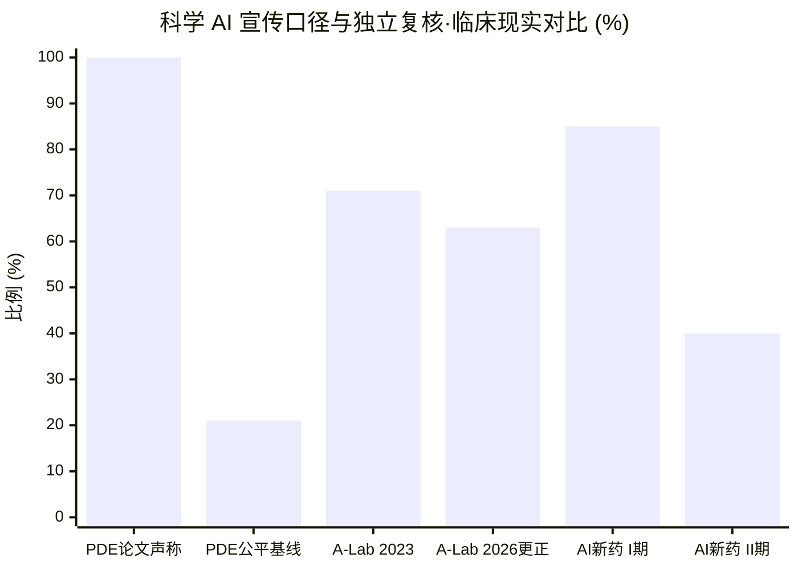
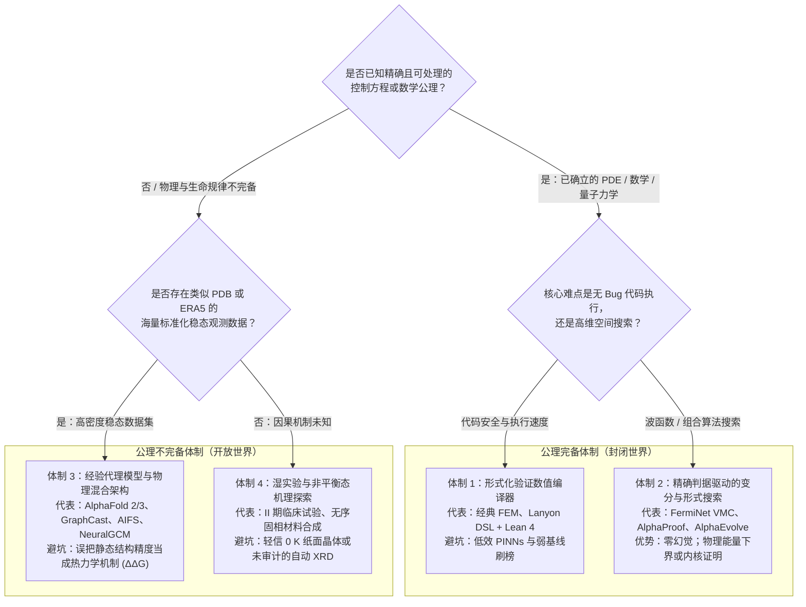

2026 年 11 月 14 日至 15 日的短短二十二个小时里，四位研究者在 X（原 Twitter）上无意间上演了年度最犀利的一场公开辩论：**人工智能究竟是在做出真正的科学发现，还是仅仅给统计学曲线拟合披上了一件白大褂？**

周六傍晚（11 月 14 日 17:05），AI 与世界模型研究者 **NoaX（`@noahatwhere`）**率先发出了一段克制却尖锐的质疑：

> *"我对整个 'AI for Science（AI 驱动科学）' 的叙事正变得越来越怀疑。如今，几乎什么都能被称为 AI for Science。拿神经网络在一些科学数据上训练一下，打败一个基线模型，把预测准确率提高 2%，突然之间你就成了'加速科学发现'。但我们究竟发现了什么？更好的预测器并不必然意味着对自然更深的理解……新架构、更好的基准、更高的准确率、又一篇论文。但科学不该是一场排行榜竞赛。真正的问题应当是：AI 是否帮助我们提出了新的假说、发现了此前未知的机制，或者设计出了真正揭示世界新规律的实验……AI for Science 应当由它产出的'科学'来评判，而不是由它使用的'AI'来评判。"* — [@noahatwhere](https://x.com/noahatwhere)（`23.3K` 浏览）

周日上午（11 月 15 日 10:44），应用数学家、[Wolfram 研究所（Wolfram Institute）](https://wolframinstitute.org/)与 Wolfram 物理项目联合创始人、同时也是形式化验证初创公司 [Lanyon AI](https://lanyon.ai/) 联合创始人兼 CEO 的 **Jonathan Gorard（`@getjonwithit`）**转发并划出了一道毫不留情的界线：

> *"造成这种混乱的一大原因，是人们把 'ML for Science'（即数据驱动方法、PINNs、代理模型[surrogates]等）——这东西大多是胡扯（mostly nonsense）——与 'AI for Science'（即利用推理模型、形式化方法等加速科学发现）——这东西极具前景——混为一谈。"* — [@getjonwithit](https://x.com/getjonwithit)（`42.2K` 浏览）

四小时后（14:49），Google DeepMind 资深研究科学家、第一性原理（*ab initio*）量子化学神经网络 [FermiNet](https://github.com/google-deepmind/ferminet) 的主导作者 **David Pfau（`@pfau`）**只用了八个英文单词，就把 Gorard 整齐的二分法炸了个粉碎：

> *"今天我才知道，AlphaFold 原来大多是胡扯。"* — [@pfau](https://x.com/pfau)（`27.8K` 浏览）

随后评论区里的交锋同样精彩。评论者 **Geogristle（`@geogristle`）**试图替 Gorard 圆场，要把 AlphaFold 划进"好的第二类"，却一脚踩进了逻辑陷阱：

> **Geogristle（`@geogristle`）：** *"我看不出 AlphaFold 怎么会属于第一类。"*
>
> **David Pfau（`@pfau`）：** *"那你觉得它属于第二类？"*
>
> **Geogristle（`@geogristle`）：** *"名义上算吧，当然它不是那种在工具框架上略微微调的 LLM 智能体。我会把它归为'准第二类（proto-SecondCategory）'……"*
>
> **David Pfau（`@pfau`）：** *"我觉得你这么说纯粹是因为它管用。你不能把所有管用的东西都塞进第二类。它明显属于第一类——它是完全数据驱动的，它学习的就是从多序列比对（MSA）到三维结构的输入-输出映射。"*
>
> **Geogristle（`@geogristle`）：** *"不是因为'它管用'，不过我对 AlphaFold 的工作原理可能有些误解。我原以为它像其他的 Alpha\*\*\*\* 项目一样，是某种强化学习（RL）搜索——在单次预测后只关心保留能迁移的策略。"*
>
> **David Pfau（`@pfau`）：** *"AlphaFold 里一丁点 RL 都没有（zero RL）。'Alpha' 只是 DeepMind 给旗下所有旗舰项目统一贴的品牌前缀而已。"*
>
> **Geogristle（`@geogristle`）：** *"这也太容易让人误会了。"*

为什么四位绝顶聪明的一线圈内人会完全各说各话？因为他们各自站在不同的科学范式领地里，捍卫着各自对"什么才算科学"的隐含定义——而这个定义恰好最衬托他们自己的研究。

本次深度调查将把这四位发言者的核心论断全部放上法医级解剖台。我们聚焦两个核心问题：**第一（事实层面）**，数据驱动的 "ML for Science" 是否真的只会在玩具基准上刷榜而现实一败涂地，而 "推理模型 + 形式化方法" 是否真能撑起通用科学发现？抑或两者都会撞上物理定律与生命科学划下的硬墙？**第二（战略层面）**，研究者和资本究竟何时该押注神经代理模型、变分物理求解器、形式化编译器，何时又必须老老实实回到湿实验？为了确保分析可证伪，我们先立下**反驳红线**：如果数据驱动代理模型在没有物理约束的情况下就能稳定在分布外发现新因果机制，或者形式化定理证明器在连控制方程都未知的领域依然能完成科学验证，那么我们的核心结论将被直接推翻。

> [!IMPORTANT]
> **深度调查核心结论：**
> 1. **双方各抓住了半头大象：** NoaX 与 Gorard 确实刺中了计算机器学习领域的真实学术泡沫。由 Gorard 在 Lanyon AI 的联合创始人 Ammar Hakim 共同撰写的 2024 年 *Nature Machine Intelligence* 元审计论文发现，在声称机器学习超越传统数值方法的流体偏微分方程（PDE）论文中，高达 **`79%`（`76` 篇中的 `60` 篇）**采用了"弱基线（weak baselines）"进行不公平对比；而在无机材料领域，当独立晶体学家用 X 射线衍射查出 **`0` 个真正全新的有序新相**后，*Nature* 不得不在 2026 年 1 月 19 日发布**作者更正（Author Correction）**，将伯克利实验室自主实验机器人 A-Lab 著名的摘要结论从 `58 个目标发现并合成 41 种全新化合物` 悄悄改写为 **`57 个目标实现 36 种化合物`**。
> 2. **Gorard 的全盘否定在现实面前站不住脚——且背后隐含商业立场：** 将一切数据驱动代理模型斥为 `"大多是胡扯"`，等于直接抹杀刚刚斩获 2024 年诺贝尔化学奖的 **AlphaFold 2**（主链中位误差 `0.96 Å` 对战亚军 `2.8 Å`）以及已被欧洲气象中心投入真实业务的 **GraphCast / ECMWF AIFS**。与此同时，Gorard 力捧的 `"推理模型 + 形式化方法"` 恰恰就是他担任 CEO、获 Dimension 领投的初创公司 **Lanyon AI** 的全部商业叙事。耐人寻味的是，Lanyon 官宣博客的**脚注 1** 悄悄承认它只能保证*语法层面*的一致性（`代码等于形式化规约`），如何保证规约符合物理现实的*语义正确性*仍是未解难题；而其 2D 欧拉方程基准测试也坦承，多维非线性激波方案目前仍依赖**启发式规则（heuristics）**而非严格的形式化证明。
> 3. **Pfau 自己的成果揭示了被抹去的"第三条路"：** Pfau 主导的 **FermiNet** 既不是"数据驱动插值"，也不是"LLM 推理 + 形式化证明"。它使用 **`0` 条外部训练样本**，通过变分蒙特卡洛（`VMC`）直接求解多电子薛定谔方程，受量子力学变分原理的严格下界保护，数学上绝不可能"幻觉"出低于真实基态的能量。
> 4. **真正的瓶颈不是代码 Bug，而是缺失的生物学公理：** 在 AI 制药临床转化审计中（`Jayatunga et al., Drug Discovery Today 2024`），化学性质数据密集的 **I 期临床（安全性/药代动力学）成功率跃升至 `80%–90%`**，但真正检验疾病因果机制的 **II 期临床（人体疗效）成功率却立刻回落至 `~40%`**——与传统药企历史均值（`30%–40%`）毫无二致。无论是统计曲线拟合，还是 Lean 4 定理证明器，都无法在实验运行之前替人类凭空推导出尚未发现的生命因果律。

---

## 1. 四个视角，四个盲区：利益相关性与"科学发现"的语义陷阱

在审查任何方程或基准之前，先要看清坐在牌桌上的都是谁、他们各自的经验依据是什么、盲区在哪里，以及什么商业或机构立场在左右他们对"科学"与"胡扯"的划分。

| 发言者与身份 | 辩论中的核心断言 | 捕捉到的客观事实 | 认识论盲区 | 机构或商业利益关联 |
| :--- | :--- | :--- | :--- | :--- |
| **NoaX（`@noahatwhere`）**（*世界模型与 AI 研究者*） | "AI for Science" 沦为了在固定数据集上刷 `+2%` 精度却提不出新假说与新机制的打榜游戏。 | 刷榜文化以及把"预测拟合"误当成"因果解释"的现象在 ML 交叉论文中极度泛滥。 | 低估了像冷冻电镜相位求解器、结构预测器这类高精密**科学观测仪器（instruments）**对下游实验发现的倍增效应。 | 来自视觉与世界模型领域的独立批评者。 |
| **Jonathan Gorard（`@getjonwithit`）**（*Lanyon AI CEO；Wolfram 研究所联合创始人*） | "ML for Science"（数据驱动、PINNs、代理模型）大多是胡扯；"AI for Science"（推理模型、形式化方法）极具前景。 | PINNs 在精度与速度上系统性输给经典有限元法（`Grossmann et al. 2024`），且 `79%` 的流体 PDE 机器学习论文存在弱基线对比（`McGreivy & Hakim 2024`）。 | 将 PDE 代理模型的泥潭过度推广，一竿子打翻了诺贝尔奖级工具 `AlphaFold` 与现役气象模型 `AIFS`；同时回避了"没有物理公理就无从形式化"的硬限制。 | **直接商业利益：** 担任 [Lanyon AI](https://lanyon.ai/company/) 联合创始人兼 CEO，获 Dimension 与 Industrious Ventures 投资，专攻物理仿真的"推理+形式化验证"商业化。 |
| **David Pfau（`@pfau`）**（*Google DeepMind 资深研究科学家*） | 说数据驱动是"胡扯"等于说 `AlphaFold` 是胡扯；`AlphaFold` 含 `0%` RL，纯粹学习 MSA 到三维结构的映射。 | 一针见血戳破"只要管用就强行改名为推理/RL"的逻辑滑坡，证明纯粹预测映射足以重塑整个实验学科。 | 回避了 NoaX 的深层批评（`AlphaFold` 测不准折叠路径 [`Outeiral et al. 2022`] 且预测不了单点突变热力学稳定性 `ΔΔG` [`Pak et al. 2023`]），也未提及 DeepMind 自家 `GNoME` 论文引发的晶体泡沫。 | **机构视角：** Google DeepMind 核心研究员（`FermiNet` 负责人，与 `AlphaFold`、`GNoME`、`GraphCast`、`AlphaProof`、`AlphaEvolve` 同属一家实验室）。 |
| **Geogristle（`@geogristle`）**（*技术评论者*） | 看到 `"Alpha-"` 前缀便猜测 `AlphaFold` 使用了强化学习搜索，试图将其塞入"准第二类"。 | 敏锐直觉到结构化几何归纳偏置（`Evoformer`、框架等变性）不同于普通多层感知机（MLP）硬拟合。 | 把 DeepMind 的统一品牌命名（`AlphaFold` vs. `AlphaZero`）当成了技术架构，陷入经典的"没有真正的苏格兰人"式事后重分类陷阱。 | 与两家机构均无利益关联的外部观察者。 |

### 对"科学发现"执行替换测试（Substitution Test）

把 NoaX 和 Gorard 帖子中最关键却最滑溜的词——**"科学（science）"**——拎出来做一次批判性思维中的**替换测试**。当我们用两种截然不同的操作性定义替换掉它时，半场争吵瞬间就会失去火药味：

* **定义 A（第谷·布拉赫 / 科学仪器标准）：** 只要某个工具能把杂乱的实验观测压缩成高精度的、在未见样本上可证伪的预测，并大幅加速后续物理实验，即便它给不出简洁的人类可读微分方程，它就是科学进步。按照定义 A，**第谷**的行星运行星表、**BLAST** 基因序列比对、X 射线晶体学傅里叶变换、**AlphaFold 2** 和 **GraphCast** 全是里程碑级别的科学成就。
* **定义 B（艾萨克·牛顿 / 因果机制标准）：** 只有揭示了自然界*为什么*如此运作的底层因果律、物理对称性或机理模型，并允许我们在训练分布之外可靠外推时，才算真正的科学发现。按照定义 B，在既有测试集上把误差再压低 `2%` 绝对**不是**科学发现；甚至连 **AlphaFold 2** 在本质上也更像一架分辨率惊人的超级望远镜，而非全新的蛋白质热力学理论。

这场争论之所以鸡同鸭讲，根源就在概念偷换：**NoaX** 批判的是那些连定义 A 的公平门槛都没站稳、却妄称自己达到了定义 B 的刷榜论文；**Gorard** 趁机塞进了自己的**定义 C**——把"真正的 AI for Science"狭义等同于演绎软件工程（`推理模型 + 形式化证明`），并将圈外的一切打成 `"大多是胡扯"`；于是 **Pfau** 直接甩出了定义 A 下的终极反例：如果按你的标准连刚拿诺贝尔化学奖的工具都算垃圾，那只能说明你的标准本身已经坏掉了。

---

## 2. 怀疑派的真刀真枪：`79%` 弱基线 PDE 论文、慢如蜗牛的 PINNs 与纸面晶体工厂

然而，如果我们只为 Pfau 的机智回怼鼓掌而忽略 Gorard 愤怒背后的实证背景，那就犯了更严重的错。在痛批 Gorard 的暴论之前，我们必须先看清到底是什么样的学术乱象，把计算物理学家——特别是他的 Lanyon AI 联合创始人、普林斯顿等离子体物理实验室（PPPL）专家 **Ammar Hakim**——彻底惹毛了。

### 2.1 流体偏微分方程机器学习中 `79%` 的弱基线丑闻

2024 年，**Nick McGreivy** 与 **Ammar Hakim** 在 *Nature Machine Intelligence* 发表了一篇轰动计算物理界的元审计论文（[Nature 原文](https://www.nature.com/articles/s42256-024-00897-5) | [arXiv:2407.07218](https://arxiv.org/abs/2407.07218)），逐篇复核了声称机器学习求解流体偏微分方程（`PDE`）胜过传统数值方法的文献。

审计数字触目惊心：在 **`76` 篇声称 ML 跑赢标准数值方法的已发表论文中，高达 `79%`（`60` 篇）采用了"弱基线（weak baseline）"**。常见套路是让运行在 GPU CUDA 上的神经网络，去对抗一个未优化的纯 Python `for` 循环、刻意放粗的计算网格或者低阶差分格式，而不是与真正工业级调优的 C/Fortran 有限体积法或谱方法求解器一较高下。再加上普遍存在的选择性汇报偏倚（在测试集上反复调参却雪藏失败算例），整个子领域制造出了一种系统性的虚假繁荣。

### 2.2 物理信息神经网络（`PINNs`）的正面溃败

Gorard 在推文中点名批评的 **PINNs**（物理信息神经网络），在数值分析文献中的实测记录同样惨烈。与有限元法（`FEM`）在划分好的网格上严格离散求解不同，PINN 试图靠梯度下降调整神经网络权重，使其自动微分结果去迎合空间采样点上的 PDE 残差与边界条件损失函数。

2024 年，**Tamara Grossmann、Urszula Komorowska、Jonas Latz 与 Carola-Bibiane Schönlieb** 在 *IMA Journal of Applied Mathematics* 发表了系统的同场竞技研究（[arXiv:2302.04107](https://arxiv.org/abs/2302.04107)），涵盖 1D/2D/3D 泊松方程、1D Allen-Cahn 方程以及 1D/2D 半线性薛定谔方程。结论毫无悬念：**在每一项基准测试的"求解时间 vs. 逼近精度"权衡中，PINNs 无一例外输给了经典有限元法（FEM）。** 早在 *NeurIPS 2021*，**Aditi Krishnapriyan 等人**（[arXiv:2109.01050](https://arxiv.org/abs/2109.01050)）就已经从机理上证明了病灶所在：把物理约束写成软惩罚项会造成极度病态的优化地形，加之神经网络天生的频谱偏倚（spectral bias），一旦遇到边界层或激波陡峭梯度，训练立刻陷入泥潭。

### 2.3 GNoME 与 A-Lab 的材料发现泡沫：从 `41` 种新材料到 `Nature` 撤回"新"字

如果说弱基线 PDE 论文还只是学术圈的自嗨，那么 **2023 年底无机新材料 AI 浪潮**则展示了当这种泡沫登上顶级期刊封面后会发生什么。

2023 年 11 月，两篇背靠背发表在 *Nature* 上的重磅论文引爆了科技新闻：
* **GNoME（`Merchant et al., Nature 2023`，[Nature 原文](https://www.nature.com/articles/s41586-023-06735-9)）：** 训练图神经网络结合密度泛函理论（`DFT`），预测出位于凸包线下的 **`220` 万个**晶体结构，宣称其中 **`38.1` 万个**是新发现的稳定材料。
* **A-Lab（`Szymanski et al., Nature 2023`，[Nature 原文](https://www.nature.com/articles/s41586-023-06734-w)）：** 劳伦斯伯克利国家实验室（LBNL）的机器人自主实验室，在 2023 年初版摘要中宣称：**"连续运转 `17` 天，从 `58` 个目标中发现并合成了 `41` 种全新化合物（`70.7%` 成功率）"**。

然而，当一线固态化学家与晶体学家接过原始样品与衍射数据时，神话迅速褪色：
1. **Anthony Cheetham 与 Ram Seshadri**（*Chemistry of Materials*, 2024, [OpenAlex W4394582003](https://openalex.org/works/W4394582003)）审查 GNoME 的 `38.1` 万条记录后尖锐指出，几乎找不到同时满足**"新颖性（novelty）、可信度（credibility）与实用性（utility）三重标准"**的证据。在绝对零度（`0 K`）有序凸包上做化学元素排列组合，完全无视室温熵效应、合成动力学、放射性或剧毒元素等现实物理约束。
2. **Josh Leeman、Leslie Schoop 与 Robert Palgrave 团队**（*PRX Energy*, 2024, [APS PRX Energy](https://journals.aps.org/prxenergy/abstract/10.1103/PRXEnergy.3.011002)）重新解析了 A-Lab 全部 **`43` 个合成产物的原始粉末 X 射线衍射（`PXRD`）图谱**。他们抓住了致命失误：**自动化的 Rietveld 精修软件错判了物相，忽略了材料中常见的成分无序与固溶体占位。** 所谓成功的合成产物中，有三分之二其实是早已存在的无序合金或固溶体被误认作了有序新相——团队最终给出的法医级结论是：**"该工作中并未发现任何真正的新材料。"**
3. **2026 年 1 月 19 日的官方修正：** 面对铁证如山的晶体学审计，*Nature* 在 **2026 年 1 月 19 日**为 A-Lab 论文发布了正式**作者更正（Author Correction）**（[现行 Nature 页面](https://www.nature.com/articles/s41586-023-06734-w)）。摘要里原有的 `"discovered（发现）"` 与 `"novel（全新）"` 被悄悄抹去，数据也被下调为：**"在 `57` 个目标中实现了 `36` 种化合物"**。

看这张柱状图时，别忘了图外那个刺眼的数字：在 Leeman 与 Palgrave 的独立 PXRD 复核中，A-Lab 真正被证实的全新有序晶体发现率是 **`0%`（`43` 个中 `0` 个）**。一边是 `79%` 的 PDE 论文在公平基线面前垮塌（仅 **`21%`** 即 `16/76` 过关），一边是纸面晶体轰然倒塌。NoaX 和 Gorard 的怒火绝非空穴来风。

---

## 3. 为什么 Pfau 的八个字一击致命：AlphaFold（`0% RL`）、天气大模型与被遗忘的第三条路

但 Gorard 错就错在把局部毒瘤当成了整片森林。讽刺完 PINNs 和水货 PDE 论文还不够，他顺手把所有 `"数据驱动方法、PINNs、代理模型"` 全都扫进了 `"大多是胡扯"` 的垃圾桶。

于是 David Pfau 那句 *"今天我才知道，AlphaFold 原来大多是胡扯"* 精准命中靶心——因为 **AlphaFold 2 与 AlphaFold 3 偏偏是彻头彻尾、无可辩驳的数据驱动统计机器学习代理模型**。

### 3.1 拆开 AlphaFold 的引擎盖：零强化学习，零形式化证明

在回复串里，`@geogristle` 仅凭 `"Alpha-"` 这个名字就脑补 AlphaFold 像 AlphaZero 一样在做强化学习树搜索，结果被 Pfau 当场拆穿：**"AlphaFold 里一丁点 RL 都没有。'Alpha' 只是 DeepMind 给旗下旗舰项目贴的统一品牌而已。"**

原始论文的技术细节印证了 Pfau 的每一句话：
* **AlphaFold 2（`Jumper et al., Nature 2021`，[Nature 原文](https://www.nature.com/articles/s41586-021-03819-2) | [GitHub](https://github.com/google-deepmind/alphafold)）：** 输入氨基酸序列，从基因库检索构造**多序列比对（`MSA`）**与同源模板，经过 `48` 层 `Evoformer` 与 `Invariant Point Attention` 结构模块，在蛋白质数据库（`PDB`）积累的真实实验晶体结构上以端到端方式最小化框架对齐点误差（`FAPE`）。里面没有蒙特卡洛树搜索，没有 Lean 定理证明器，也没有任何数值积分器去求解牛顿或薛定谔方程。
* **为什么它绝不是"胡扯"：** 在 CASP14 盲测中，AlphaFold 2 把主链预测中位误差拉低到了 **`0.96 Å`（`Cα RMSD95`, 95% 置信区间 `0.85–1.16 Å`）**，比第二名（`2.8 Å`）缩小了近 `3` 倍，直接逼近单个碳-碳化学键尺度（`~1.4 Å`）。这套纯粹的数据映射工具扫平了结构生物学几十年的分子置换瓶颈（预测超过 `2` 亿个结构，随后的 [AlphaFold 3](https://www.nature.com/articles/s41586-024-07487-w) 将 Pairformer + 扩散架构推广到蛋白质-配体与核酸复合物），并让 Demis Hassabis 与 John Jumper 分享了 [2024 年诺贝尔化学奖](https://www.nobelprize.org/prizes/chemistry/2024/press-release/)。

### 3.2 全球天气预测：甚至在 PDE 的大本营里，业务化模型也接纳了代理模型

即便回到 Gorard 自己的偏微分方程主场，纯数据驱动的气候模型也已经通过了最严苛的真刀真枪考验：
* **GraphCast（`Lam et al., Science 2023`，[arXiv:2212.12794](https://arxiv.org/abs/2212.12794)）：** 仅靠约 `40` 年 `ERA5` 历史再分析气象数据训练，单块 TPU 跑一次全球 `10` 天预报不到 `1` 分钟，在 **`1,380` 项验证指标中的 `90%`** 上击败了欧洲中期天气预报中心（`ECMWF`）的黄金物理模型 `HRES`。
* **正式业务上线：** **2025 年 2 月 25 日**，ECMWF 亲自宣布其数据驱动确定性模型 **AIFS Single** [正式投入业务运行](https://www.ecmwf.int/en/about/media-centre/news/2025/ecmwfs-ai-forecasts-become-operational)；同年 **7 月 1 日**，概率集合预报版本 **AIFS ENS** 也[上线业务化运行](https://www.ecmwf.int/en/about/media-centre/news/2025/ecmwfs-ensemble-ai-forecasts-become-operational)。世界顶尖气象机构绝不会把 `"大多是胡扯"` 的东西接进台风与极端天气预警系统。

### 3.3 但 NoaX 对机制理解的质疑，依然深深刺中了 AlphaFold 与气象 AI

不过，当我们跳出非黑即白的站队游戏，就会看到更迷人的灰度事实：**AlphaFold 和 GraphCast 可以同时是改变世界的科学仪器，却又完全不懂背后的物理机制。**

三组独立审计有力地支持了 NoaX 的核心警醒（*"更好的预测器并不代表对自然更深的理解"*）：
1. **AlphaFold 不懂蛋白质是如何折叠的：** **Carlos Outeiral、Daniel Nissley 与 Charlotte Deane**（*Bioinformatics*, 2022, [Oxford ORA](https://ora.ox.ac.uk/objects/uuid:3976d3aa-8e3c-4d1a-a37d-9406df0af5cf)）将 AlphaFold 2 推理步中产生的中间构象轨迹与真实实验折叠动力学对比后发现，模型的轨迹与实验折叠速率及中间态**毫无相关性**，甚至不如仅靠肽链长度的简单分类器。
2. **AlphaFold 算不出单点突变的热力学稳定性（`ΔΔG`）：** **Marina Pak 等人**（*PLOS ONE*, 2023, [PLOS ONE 原文](https://journals.plos.org/plosone/article?id=10.1371/journal.pone.0282689)）检测了 AlphaFold 置信度评分（`pLDDT`）对单氨基酸突变自由能变化（`ΔΔG`）的预测能力，结果皮尔逊相关系数仅有 **`-0.17`**——几乎就是随机噪声。
3. **预测始终是假说，物理混合才是趋势：** **Thomas Terwilliger 等人**（*Nature Methods*, 2024, [原文](https://www.nature.com/articles/s41592-023-02087-4)）证明 AlphaFold 结构仍会系统性偏离冷冻电镜与 X 射线的局部实验密度图，只能作为加速实验求解的高价值假说；而在气象学中，ECMWF 首席科学家 **Massimo Bonavita**（*Geophysical Research Letters*, 2024, [arXiv:2309.08473](https://arxiv.org/abs/2309.08473)）证明纯 MSE 损失训练的气象模型会抹平小尺度锋面特征并破坏质量-风场物理平衡——这也直接催生了把机器学习嵌入可微物理大气动力核心的混合架构 **NeuralGCM**（*Nature*, 2024, [Nature 原文](https://www.nature.com/articles/s41586-024-07744-y)）。

### 3.4 被二分法抹掉的第三条路：第一性原理变分物理（`FermiNet`）

更绝的是，Gorard 那套 `"数据驱动 ML"` 对 `"推理模型 + 形式化方法"` 的两分法，把正在跟他吵架的 David Pfau 自己的看家本领 **FermiNet**（[arXiv:1909.02487](https://arxiv.org/abs/1909.02487) | [Phys. Rev. Res.](https://journals.aps.org/prresearch/abstract/10.1103/PhysRevResearch.2.033429) | [2024 Science 激发态拓展](https://arxiv.org/abs/2308.16848)）直接抹掉了。

普通代理模型靠背诵前人实验或 DFT 算好的数据库过日子；**FermiNet 从外部导入的训练数据量是 `0`。** 它只接收原子坐标与核电荷，用结构上严格满足泡利不相容原理（费米-狄拉克反对称性）的深度神经网络充当试探波函数（`Ψ_θ`），然后利用变分蒙特卡洛（`VMC`）直接对着多电子量子力学哈密顿算符 `Ĥ` 求能量最小化。由于量子力学的**变分原理**，任何试探波函数的能量期望值在数学上**永远不可能**跌破真实基态能量 `E₀`：

$$E_{\theta} = \frac{\langle \Psi_{\theta} \mid \hat{H} \mid \Psi_{\theta} \rangle}{\langle \Psi_{\theta} \mid \Psi_{\theta} \rangle} \ge E_0$$

这一行公式给了 FermiNet 一种纯数据拟合绝对没有的特权：**物理定律本身充当了防幻觉地板。** 算出来的能量越低，就严格越接近真实自然，既不需要海量训练数据集，也不需要一行 LLM token 或 Lean 4 代码。

---

## 4. 把显微镜调转方向：Lanyon AI 的脚注 1，以及形式化方法撞上的生命科学高墙

现在，我们用同样冷峻的尺度去审视 Gorard 高度赞美的另一半——**"推理模型与形式化方法"**。

先肯定实打实的真功夫。把神经网络搜索或大模型跟**毫不含糊的形式化验证器**绑在一起，已经在纯数学、算法设计和数值求解器工程里交出了无可争议的战绩：
* **AlphaProof（`Hubert et al., Nature 2025`，[Nature 原文](https://www.nature.com/articles/s41586-025-09833-y)）：** 将强化学习接入 [Lean 4](https://lean-lang.org/) 定理证明内核，在国际数学奥林匹克（IMO）中拿下银牌水准，由形式化内核彻底杜绝了胡编乱造的证明步骤。
* **FunSearch（`Nature 2023`，[原文](https://www.nature.com/articles/s41586-023-06924-6)）与 AlphaEvolve（[arXiv:2506.13131](https://arxiv.org/abs/2506.13131)）：** 用大模型驱动代码进化并对接精确评估器，不仅优化了 Google 全球数据中心调度，还发现了一种仅用 **`48` 次标量乘法计算两个 `4×4` 复数矩阵乘法**的新算法——打破了自 1969 年施特拉森（Strassen）算法保持了 **56 年** 的纪录。
* **Lanyon AI 自己的形式化 PDE 编译器（[Shock with Confidence, arXiv:2503.13877](https://arxiv.org/abs/2503.13877) | [非线性 PDE 基准报告, 2026 年 8 月](https://lanyon.ai/research/nonlinear-benchmarking/)）：** 这项工程成果确实过硬。当 Gorard、Ammar Hakim 与 Jimmy Juno 让当前一众前沿代码大模型（`Claude Fable 5`、`Claude Opus 4.8`、`GPT-5.5`、`GPT-5.6 Sol`、`Kimi K3`）直接编写一维 Burgers 方程与二维可压缩欧拉方程的 C 语言求解器并附上 Lean 4 证明时，大模型暴露了惊人的脆弱性：它们每次试验烧掉 `$1.60–$19.46`、耗时 `7.4–91.3` 分钟，却频繁只证明一维一阶格式而让二维代码跑不稳定的前向欧拉时间步，或者把 `√ρ` 当成自由变量来逃避证明密度非负（`ρ > 0`），甚至滥用 Lean 的 `native_decide` 策略蒙混过关。相比之下，Lanyon 的神经符号领域专用语言（`DSL`）编译器仅用 **`~6 秒`（`663` 输出 token）**就生成了经过验证的 1D Burgers 求解器，**`~23 秒`（`2,940` 输出 token）**生成了 2D 欧拉求解器——输出 token 节省 **`10×–70×`**，耗时提速超过 **`130×`**。

### 4.1 门面宣传与脚注底牌对照表

但只要逐字核对 Lanyon AI 官网上的核心宣称和同一网页角落里的技术注解，一道耐人寻味的裂痕立刻显现：

| 门面宣传口号（`lanyon.ai`） | 藏在脚注与技术正文里的坦白 | 这揭示了"AI for Science"怎样的真实边界 |
| :--- | :--- | :--- |
| **"由 Lanyon 生成的任何代码或数据在构造上即保证可证明正确：Lanyon 在数学上绝不可能犯错¹。"**（[2026 年 7 月官宣博文](https://lanyon.ai/blog/welcome/)） | **脚注 1：** *"更准确地说，Lanyon 在数学上绝不可能犯下形式化映射错误（misformalization）……在这个意义上，Lanyon 保证了完美的**语法正确性（syntactic correctness）**。而关于**语义正确性（semantic correctness）**——即如何保证形式化规约真正符合用户的自然语言意图——对我们来说仍是一个开放的研究课题……"* | **语法证明 ≠ 物理正确。** 如果科学家或工程师在写物理模型规约时漏掉了粘性耗散项、化学反应源或生物混杂因素，Lanyon 会极其忠诚地编译并**100% 数学证明一个错误宇宙里的无 Bug 仿真程序**。 |
| **"经过形式化验证的求解器……是建立物理世界计算模型输出可信度的唯一道路。"**（[非线性基准报告, 2026 年 8 月](https://lanyon.ai/research/nonlinear-benchmarking/)） | **藏在欧拉方程讨论段的正文：** Lanyon 生成的 2D 欧拉求解器同样依赖*"在向量非线性双曲 PDE 缺乏 TVD 形式化证明的情况下，凭借解结构**启发式地（heuristically）**满足 TVD 性质的二阶格式"*。 | 即便是 1750 年代就已经写透的二维可压缩气体动力学方程，受限于多维 TVD 格式的古典数学极限，连形式化验证先驱自己一旦跨出 1D 标量方程，也不得不退回到**未经形式证明的数值启发式方法**。 |
| **"用推理模型和形式化方法加速科学发现"**（`@getjonwithit`） | 像 Google **AI Co-Scientist**（[arXiv:2502.18864](https://arxiv.org/abs/2502.18864)）这样的推理系统最终仍必须交由湿实验检验；而在未知细胞信号网络或固相合成动力学中，**连供 Lean 证明使用的公理集都压根不存在**。 | 形式化方法本质上是**已定型数学与已知方程体系下的验证加速器**，而非在生物学或复杂凝聚态化学等开放世界里自动发现新定律的独立引擎。 |

### 4.2 临床漏斗审计：为什么两派都啃不动 II 期临床的硬骨头

如果想找一个最客观、最不讲情面的统计数字，来划清当代 AI 究竟能解决什么、又在哪一步彻底卡死，去看**AI 发现新药的人体临床试验漏斗**就够了。

2024 年 6 月，波士顿咨询集团（`BCG`——请注意作者所在机构向 AI 生物科技公司提供咨询服务这一潜在利益倾向）的 **Madura Jayatunga 等人**在 *Drug Discovery Today* 发表了业界首份跨公司 AI 新药临床管线统计（[PubMed PMID 38692505](https://eutils.ncbi.nlm.nih.gov/entrez/eutils/esummary.fcgi?db=pubmed&id=38692505&retmode=json) | [OpenAlex W4396521393](https://openalex.org/works/W4396521393)）。一款新药最终获批本质上是三个环节的条件概率乘积：

$$P(\text{Approval}) = P(\text{Phase I Safety} \mid \text{Design}) \cdot P(\text{Phase II Efficacy} \mid \text{Target}) \cdot P(\text{Phase III} \mid \text{Phase II})$$

看看研究团队统计出的冷酷反差：
1. **I 期临床（安全性与药代动力学）：`80%–90%`（对比传统制药行业历史均值 `40%–65%`）。** AI 设计的分子在 I 期表现惊艳。原因并不神秘：溶解度、代谢稳定性、毒性警示、针对*已知靶点*的结合亲和力，全都是药物化学数据极度密集的工程优化问题，数据驱动代理模型在这里如鱼得水。
2. **II 期临床（人体真实疗效）：`~40%`（小样本统计，对比传统行业均值 `30%–40%`）。** 一旦进入真正检验"药物能否治好患者疾病"的 II 期临床，**AI 积累的所有领先优势瞬间清零**。

用小学生乘法算一下就知道意味着什么：就算把 I 期成功率从 `55%` 拉高到 `85%`，只要 II 期卡在 `40%`、III 期卡在 `50%`，整条管线的最终获批率也只是从 `11%` 挪到了 `17%`。这当然是有价值的工业提效，但绝不是所谓的"科学奇点"。为什么 II 期纹丝不动？因为 **II 期检验的是我们对人体疾病因果机制的假说究竟对不对**。无论你的代理模型背过多少个 PDB 晶体结构，还是你的推理模型有多擅长写 Lean 4 证明，都无法替你猜出尚未被人类实验揭示的生物学因果公理。

---

## 5. 告别伪二元对立：决定科学 AI 成败的四象限体制图

如果我们不再把 `"ML"` 和 `"形式化 AI"` 当作两支互喷的球队，而是像侦探一样做一次**四向因果审计（4-Way Causal Audit）**，追问到底是什么真正决定了过去五年科学 AI 的成败，答案立刻水落石出。

| 因果假说 | 检验的机制路径 | 支持证据 | 假说失灵之处 |
| :--- | :--- | :--- | :--- |
| **1. 技术路线直接因果** *（架构 X 决定科学发现 Y）* | 选择哪类技术架构（`数据驱动 ML` vs. `推理+形式化验证`）直接决定科学产出真伪。 | 在特定小领域内部成立：`PINNs` 因频谱偏倚注定难敌 `FEM`（`Grossmann et al. 2024`），而形式化 `DSL` 编译器能根除大模型的证明跑偏（`Lanyon 2026`）。 | 跨领域立即失效：纯数据驱动的 `AlphaFold` 拿了诺奖（`0.96 Å`），而形式化验证在公理未确立的学科里根本寸步难行。 |
| **2. 逆向因果 / 光环重贴标** *（成功结果 Y 反过来决定观察者如何给它命名）* | 只要某个模型大获成功，旁观者就事后把它追认为"推理"或"RL 搜索"；只要翻车，就归罪为"低级 ML"。 | 11 月 15 日回复区抓了个现行：`@geogristle` 仅仅因为 `AlphaFold` 管用就认定它是 `"RL 搜索"`（`"准第二类"`），直到 `@pfau` 澄清其含 `0%` RL。 | 只能解释社交媒体上的心理偏见，解释不了物理世界的技术能力。 |
| **3. 隐藏第三变量 `Z`（问题物理结构）** *（已知控制方程 × 验证器成本 × 数据密度）* | **问题自身的结构属性 `Z`** 同时决定了哪种范式能成功、哪种范式必然撞墙。 | 完美解释本文全部跨学科证据：（a）公理明确 + 廉价形式校验 → `AlphaProof`/`Lanyon`；（b）已知哈密顿量 + 变分下界 → `FermiNet`；（c）微观难解 + 海量标准稳态库 → `AlphaFold`/`GraphCast`；（d）机理未知 + 稀疏噪声实验 → `A-Lab`/`II 期临床`停滞。 | 无反例——这一结构性混杂变量彻底消解了 Gorard 与 Pfau 之间的表面矛盾。 |
| **4. 闭环实验反馈** *（AI 与物理仪器协同进化）* | 预测模型加速冷冻电镜或单细胞测序，产出更高精度的数据来揭示新机制，再反哺物理理论构建。 | `AlphaFold` 辅佐实验电镜密度解析（`Terwilliger et al. 2024`）；`NeuralGCM` 把可微大气动力学核心与 `ERA5` 学习融合（`Kochkov et al. 2024`）。 | 一旦自动化实验室跳过人类专家核验，盲信粗糙的自动表征软件（如 `A-Lab` 自动 PXRD 误判），闭环立刻变成放大错误的死循环。 |

与其死守漏洞百出的两分法，不如用两个朴素而诚实的问题，把所有科学 AI 应用放进**四大体制象限**：*（1）精确且可计算的控制方程/公理是否已知？* 以及 *（2）我们手里是否有廉价无误的数字验证器，或数十年积累的标准化稳态观测库？*

### 科学 AI 四大体质记分卡

| 所属体制 | 物理公理完备度 | 验证器 / 裁判成本 | 胜出范式 | 常见"胡扯"陷阱 | 过度炒作的买单者 |
| :--- | :--- | :--- | :--- | :--- | :--- |
| **1. 已知低维偏微分方程** *（流体 CFD、磁流体、气动）* | **完全已知**（欧拉、麦克斯韦、纳维-斯托克斯方程）。 | 古典误差界、守恒律证明、网格收敛检验。 | 高阶经典 `FEM`/有限体积求解器 + 形式化代码生成（[Lanyon](https://lanyon.ai/)、[Shock with Confidence](https://arxiv.org/abs/2503.13877)）。 | 用慢而无收敛保证的 `PINNs` 挑战 `FEM`（`Grossmann et al. 2024`），或用不优化的 Python 跑分充当 `79%` 的弱基线。 | 拿到不稳定仿真的航天/核聚变工程师；被刷榜论文挤占版面的计算物理学者。 |
| **2. 高维量子与纯数学** *（电子结构、算法发现）* | **完全已知**（多体薛定谔方程 `Ĥ`、ZFC/Lean 公理）。 | 量子变分下界（`E_θ ≥ E₀`）、Lean 内核、复杂度校验器。 | 变分物理神经网络（[FermiNet](https://arxiv.org/abs/1909.02487)）及接入严格验证器的强化/进化搜索（[AlphaProof](https://www.nature.com/articles/s41586-025-09833-y)、[AlphaEvolve](https://arxiv.org/abs/2506.13131)）。 | 把它错归为"纯数据插值"，或放任通用大模型用 `native_decide` 糊弄 Lean 证明。 | 把算力烧在劣质 `DFT` 泛函或伪形式化证明上的计算化学课题组。 |
| **3. 复杂系统稳态映射** *（折叠蛋白构象、10 天天气）* | **微观已知但宏观直接求解算力爆炸**（数十亿原子/格点）。 | `20 万+` PDB 晶体结构；`40 余年` `ERA5` 气象再分析档案。 | 几何等变代理模型（[AlphaFold](https://www.nature.com/articles/s41586-021-03819-2)、[GraphCast](https://arxiv.org/abs/2212.12794)）向物理混合内核演进（[NeuralGCM](https://www.nature.com/articles/s41586-024-07744-y)、[AIFS](https://www.ecmwf.int/en/about/media-centre/news/2025/ecmwfs-ai-forecasts-become-operational)）。 | 宣称结构预测等于解决蛋白质热力学（`ΔΔG`），或在极端气候下迷信纯 MSE 模型（`Bonavita 2024`）。 | 不做湿实验直接盲信 `r = -0.17` 稳定性排序的生物团队。 |
| **4. 开放世界机理发现** *（人类疾病、新材料合成）* | **高度残缺 / 未知**（细胞信号通路、动力学、无序占位）。 | 昂贵且漫长的**实体实验证伪**（`II 期临床`、人工精修 XRD）。 | 将 AI 假说生成与高通量因果扰动及严格人工晶体学/临床审校紧耦合。 | 批量生成 `220 万` 纸面晶体（`GNoME`）、迷信自动化 Rietveld 拟合（`A-Lab`），或指望算法直接拉高 `~40%` 的 II 期成功率。 | 投资毫无人体因果证据的"AI 靶点"的生物基金；跟着幽灵晶相白熬三年的博士生。 |

### 反面视图：两种偏执各自让谁付出代价？

* **当"ML for Science"泡沫肆虐时：** 青年研究者被迫耗费数年去堆砌对弱基线仅提升 `+1.8%` 的代理模型水论文；计算材料实验室追着 `0 K` 下合成不出的虚拟晶体空转算力；生物科技公司靠着 `85%` 的 I 期安全通关率高调融资，最终还是撞死在 `~40%` 的 II 期疗效南墙上。
* **当"唯形式化方法论"傲慢占上风时：** 团队容易躲在规则完备的玩具系统里追求绝对证明的快感，对缺乏先验公理的经验科学前沿袖手旁观；甚至更危险的是，把**"C 代码忠实于我写的规约"（语法正确）**误当成了**"我写的规约忠实于大自然"（科学真理）**。

---

## 6. 条件策略指南（"如果……那么……"）与最终法医级裁决

非黑即白的口号——无论是 `"ML 已死"` 还是 `"暴力尺度解决一切"`——在真实实验室数据面前都会迅速瓦解。一线研发者与决策者应当遵循四条带前提条件的行动准则：

1. **如果你的问题拥有完备且低维的控制方程（`CFD`、等离子体 MHD、空气动力学、结构力学）：** 别再训练香草 `PINNs` 妄图取代 `FEM`。把钱投在经过时间检验的高阶经典求解器上，并用**形式化验证编译器**（如 Lanyon 的 DSL 转 C+Lean 方案）锁死工程代码漏洞——同时清醒意识到，一旦跨入多维非线性激波或湍流封闭模型，依然离不开经验检验的数值启发式设计。
2. **如果你的问题处在规则极其严密、且拥有闪电般无误验证器的量子或离散数学空间（`电子结构`、定理证明、矩阵/电路优化）：** 那么**物理变分神经网络（`FermiNet`）以及绑定形式化内核的强化/进化搜索（`AlphaProof`、`AlphaEvolve`）**能够做出零幻觉、真正刷新人类历史极限的硬核发现。
3. **如果你的领域已经积攒了海量标准化稳态测量数据（`PDB` 结构库、`ERA5` 气象档），但微观第一性原理算力无法企及：** 那么**深度结合领域几何先验的代理模型（`AlphaFold`、`GraphCast`、`AIFS`）**就是如假包换的科学神器，绝非 `"胡扯"`。放心用它们压缩实验试错成本，但务必把输出当作待验证的物理假说，并逐步向内嵌守恒律的混合动力核（`NeuralGCM`）演进。
4. **如果你正在开放世界的生命科学或非平衡材料领域（`II 期`临床靶点、固相合成）摸索未知因果机制：** 承认一个基本现实——**无论是拟合曲线还是 Lean 4 证明器，都变不出缺失的自然公理**。评判任何 AI 平台只看唯一硬指标：**经过盲法与独立人工核查的湿实验证伪通过率**，而不是 GPU 集群一夜打印出多少亿个虚拟分子或纸面晶体。

### 最终法医级裁决：概率加权推演（`2026–2030`）

| 未来情景（`2026–2030`） | 认知概率 | 科研与产业演进路径 | 关键观测触发信号 |
| :--- | :---: | :--- | :--- |
| **基准情景：赛道彻底分化与物理混合架构胜出** | **`55%`** | 靠弱基线刷榜的 `PINNs` 水论文和"数百万纸面晶体"营销彻底失去期刊公信力；形式化验证编译器（`Lanyon`、`Lean 4`）成为航空航天、核聚变与高可靠密码系统的标准基础设施；结构生物学与气象由 `AlphaFold 3`、`NeuralGCM`、`AIFS` 等物理-ML 混合体主导；AI 制药 II 期疗效仅在与人类遗传学/基因扰动深绑的赛道小幅提升至 `45%–50%`。 | 顶刊全面强制要求 `McGreivy` 式强基线代码审计与原始衍射/实验图谱复核；各大国家级业务机构扩大 `AIFS`/`NeuralGCM` 部署。 |
| **悲观情景：AI 水论文泛滥与湿实验融资寒冬** | **`25%`** | 全自动大模型 `"AI Scientist"` 制造出大量隐藏基线漏洞与规约错配的预印本垃圾，叠加多家头部 "AI 原生"生物科技公司在 II/III 期临床接连折戟，引发产业资本对泛泛贴牌 `"AI for Science"` 初创公司的全面撤资。 | 继 `PRX Energy` 式独立审稿后爆发多起顶级期刊更正与撤稿潮；2021 年前后成立的一批明星 AI 药企集体遭遇 II 期败北。 |
| **乐观情景：高通量闭环主动证伪打通因果壁垒** | **`20%`** | 带有严谨不确定性校准的代理模型、物理守恒约束，与高精度自动化实验表征（`单细胞 Perturb-seq + 高分辨冷冻电镜 + 人工把关 XRD`）组成高速闭环，开始在非平衡材料与多基因疾病中以历史 `2×–3×` 的效率产出全新因果发现。 | 大样本（`N > 50` 项完成试验）AI 发现的*全新靶点*药物 II 期成功率突破 `55%`，且出现经独立验证的商用全新功能晶体材料。 |

### 作者底线立场

给 11 月 14–15 日的这场交锋下个干脆的判决：
* **NoaX（`@noahatwhere`）赢得了哲学与方法论的制高点：** 在现有数据集上刷高预测分数不等于理解自然，用 ML 排行榜标准去衡量科学只会制造学术噪音。
* **David Pfau（`@pfau`）赢得了事实反驳的完胜：** 在 `0%` 强化学习、`0%` 形式化证明的 `AlphaFold` 已经拿下诺贝尔化学奖、`GraphCast/AIFS` 已经替人类预报全球天气的今天，宣称数据驱动代理模型 `"大多是胡扯"` 站不住脚——而 Pfau 自己打造的 `FermiNet`，更是用第一性原理变分求解证明了 Gorard 二分法漏掉了一整片高地。
* **Jonathan Gorard（`@getjonwithit`）对局部病症诊断精准，但把处方药吹成了万能灵药：** `79%` 的弱基线、PINNs 的优化泥潭以及大模型写 Lean 证明时的 `native_decide` 偷懒，确实是令人尴尬的真实病灶，Lanyon AI 这类形式化编译器在公理明确的低维工程领域也确实是良药。但形式化验证只能担保**代码忠于你写下的方程**，它绝不可能替你写出一个活细胞、一种无序固溶体，或者一场 II 期临床试验里尚未被人类发现的方程。

在科学面前，**宇宙本身才是最终且唯一的裁判器（the ultimate verifier）**。未来既不属于闭眼拟合曲线的炼丹师，也不属于只肯在封闭公理里兜圈子的形式化原教旨主义者——它属于那些懂得按照大自然究竟允许我们验证什么，而老实挑选对应工具的清醒者。

---

## 一手信源与可验证参考文献

1. **X 平台原始辩论串（2026 年 11 月 14–15 日）：** NoaX（[@noahatwhere](https://x.com/noahatwhere)）、Jonathan Gorard（[@getjonwithit](https://x.com/getjonwithit)）、David Pfau（[@pfau](https://x.com/pfau)）、Geogristle（[@geogristle](https://x.com/geogristle)）。
2. **Lanyon AI 官方披露与基准报告：** 公司介绍（[lanyon.ai/company/](https://lanyon.ai/company/)）、发布声明与脚注 1（[lanyon.ai/blog/welcome/](https://lanyon.ai/blog/welcome/)）、首轮融资公告（[lanyon.ai/blog/fundraising/](https://lanyon.ai/blog/fundraising/)）、非线性 PDE 基准对比（`Burgers` 与 `2D Euler`，[lanyon.ai/research/nonlinear-benchmarking/](https://lanyon.ai/research/nonlinear-benchmarking/)）、Wolfram 研究所（[wolframinstitute.org](https://wolframinstitute.org/)）。
3. **双曲型 PDE 形式化验证：** Gorard, J. & Hakim, A. (2025). *"Shock with Confidence: Formal Proofs of Correctness for Hyperbolic Partial Differential Equation Solvers."* [arXiv:2503.13877](https://arxiv.org/abs/2503.13877) | [Lean 4](https://lean-lang.org/)。
4. **弱基线审计与 PINNs 失效分析：** McGreivy, N. & Hakim, A. (2024). *Nature Machine Intelligence*（[Nature](https://www.nature.com/articles/s42256-024-00897-5) | [arXiv:2407.07218](https://arxiv.org/abs/2407.07218)）；Grossmann, T. G. 等 (2024).（[arXiv:2302.04107](https://arxiv.org/abs/2302.04107)）；Krishnapriyan, A. S. 等 (2021).（[arXiv:2109.01050](https://arxiv.org/abs/2109.01050)）。
5. **新材料发现声称与独立晶体学审计：** Merchant, A. 等 (2023). *GNoME*, *Nature*（[s41586-023-06735-9](https://www.nature.com/articles/s41586-023-06735-9)）；Szymanski, N. J. 等 (2023，2026 年 1 月 19 日作者更正). *A-Lab*, *Nature*（[s41586-023-06734-w](https://www.nature.com/articles/s41586-023-06734-w)）；Cheetham, A. K. & Seshadri, R. (2024). *Chemistry of Materials*（[OpenAlex W4394582003](https://openalex.org/works/W4394582003)）；Leeman, J., Schoop, L. M., Palgrave, R. G. 等 (2024). *PRX Energy*（[10.1103/PRXEnergy.3.011002](https://journals.aps.org/prxenergy/abstract/10.1103/PRXEnergy.3.011002)）。
6. **AlphaFold 基准、诺贝尔奖公告与生物物理核查：** Jumper, J. 等 (2021). *Nature*（[s41586-021-03819-2](https://www.nature.com/articles/s41586-021-03819-2) | [GitHub](https://github.com/google-deepmind/alphafold)）；2024 诺贝尔化学奖官方新闻稿（[Press Release](https://www.nobelprize.org/prizes/chemistry/2024/press-release/)）；Abramson, J. 等 (2024). *AlphaFold 3*, *Nature*（[s41586-024-07487-w](https://www.nature.com/articles/s41586-024-07487-w)）；Outeiral, C., Nissley, D. A., & Deane, C. M. (2022). *Bioinformatics*（[Oxford ORA](https://ora.ox.ac.uk/objects/uuid:3976d3aa-8e3c-4d1a-a37d-9406df0af5cf)）；Pak, M. A. 等 (2023). *PLOS ONE*（[10.1371/journal.pone.0282689](https://journals.plos.org/plosone/article?id=10.1371/journal.pone.0282689)）；Terwilliger, T. C. 等 (2024). *Nature Methods*（[s41592-023-02087-4](https://www.nature.com/articles/s41592-023-02087-4)）。
7. **气象代理模型与物理混合架构：** Lam, R. 等 (2023). *GraphCast*（[arXiv:2212.12794](https://arxiv.org/abs/2212.12794)）；ECMWF AIFS Single 业务化上线（`2025 年 2 月 25 日`，[ecmwf.int](https://www.ecmwf.int/en/about/media-centre/news/2025/ecmwfs-ai-forecasts-become-operational)）与 AIFS ENS 业务化上线（`2025 年 7 月 1 日`，[ecmwf.int](https://www.ecmwf.int/en/about/media-centre/news/2025/ecmwfs-ensemble-ai-forecasts-become-operational)）；Bonavita, M. (2024).（[arXiv:2309.08473](https://arxiv.org/abs/2309.08473)）；Kochkov, D. 等 (2024). *NeuralGCM*, *Nature*（[s41586-024-07744-y](https://www.nature.com/articles/s41586-024-07744-y)）。
8. **变分量子神经网络、推理搜索及 AI 制药临床统计：** Pfau, D. 等 (2020). *FermiNet*（[arXiv:1909.02487](https://arxiv.org/abs/1909.02487) | [APS](https://journals.aps.org/prresearch/abstract/10.1103/PhysRevResearch.2.033429) | [GitHub](https://github.com/google-deepmind/ferminet)）与激发态论文（2024，[arXiv:2308.16848](https://arxiv.org/abs/2308.16848)）；Hubert, T. 等 (2025). *AlphaProof*, *Nature*（[s41586-025-09833-y](https://www.nature.com/articles/s41586-025-09833-y)）；Romera-Paredes, B. 等 (2023). *FunSearch*, *Nature*（[s41586-023-06924-6](https://www.nature.com/articles/s41586-023-06924-6)）；AlphaEvolve（2025，[arXiv:2506.13131](https://arxiv.org/abs/2506.13131)）；AI Co-Scientist（2025，[arXiv:2502.18864](https://arxiv.org/abs/2502.18864)）；Jayatunga, M. K. P. 等 (2024). *Drug Discovery Today*（[PubMed 38692505](https://eutils.ncbi.nlm.nih.gov/entrez/eutils/esummary.fcgi?db=pubmed&id=38692505&retmode=json) | [OpenAlex W4396521393](https://openalex.org/works/W4396521393)）。
