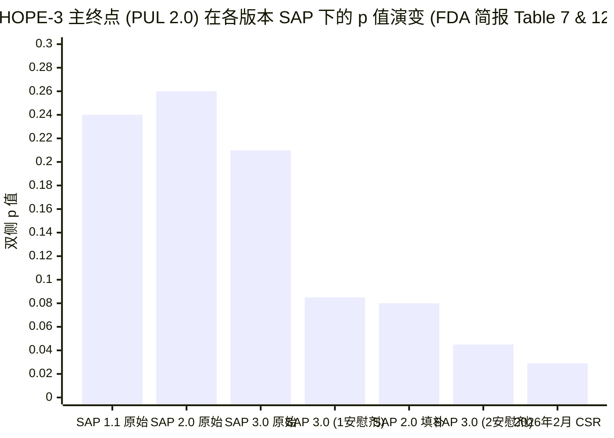
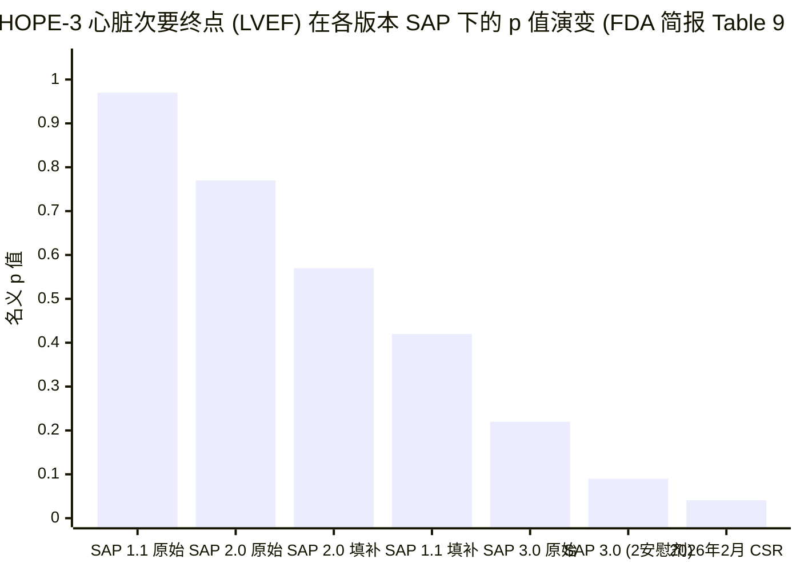
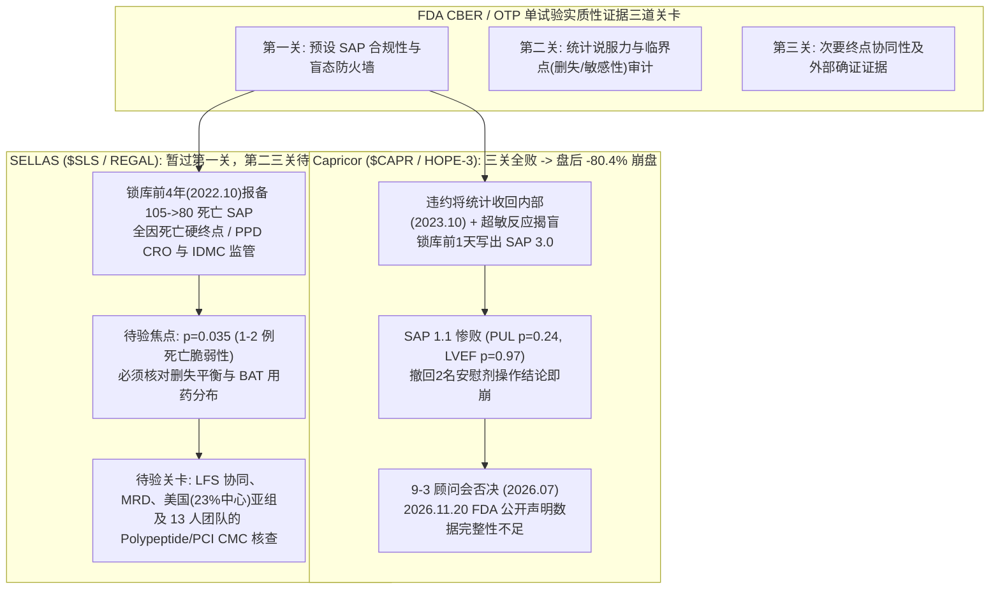

**2026 年 11 月 20 日周五**，在治疗杜氏肌营养不良症（`DMD`）的细胞疗法 **deramiocel（`BLA 125842`）** `PDUFA` 目标审评日（11 月 22 日）前两天，**Capricor Therapeutics, Inc.（`NASDAQ: CAPR`）**常规时段平静收于 **`$7.59`（`+0.80%`）**。然而美东时间傍晚 6 点过后，买盘瞬间蒸发，`CAPR` 在盘后交易中**垂直暴跌 `-80.37%`（`-$6.10`）至 `$1.49`**（按 `5,814 万股`计算，总市值从 **`$4.413 亿`** 瞬间萎缩至 **`$8,660 万`**）。

引爆崩盘的是**美国食品药品监督管理局（`FDA`）**提前做出的拒绝批准决定，以及一封极其罕见的公开声明（*《关于用于治疗杜氏肌营养不良症的 Deramiocel BLA 的声明——FDA 认定现有证据未达到批准所需的证据标准》*，日期为 2026 年 11 月 20 日）。路透社等媒体报道指出，FDA 认定其关键临床试验存在**严重的数据完整性（`data integrity`）问题**。

几分钟后，著名生物医药空头 **Martin Shkreli（`@MartinShkreli`）**于太平洋时间 11 月 20 日 `4:14 PM` 与 `4:20 PM` 在 X 平台连发两条引爆全网的帖文：

> *“FDA 对 `$CAPR` 的声明几乎是史无前例的。出于显而易见的个人原因，我极度不愿对任何人提出这样的建议，但我们必须通过 `@USDOJ`（美国司法部）发出明确信号：操纵临床试验数据是生物医药与生命科学领域最恶劣的犯罪。抄送 `@linda_marban` `@AGToddBlanche`”* — `@MartinShkreli`（2026 年 11 月 20 日）

> *“顺便说一句，`$SLS` = `$CAPR`（`$SLS = $CAPR by the way`）”* — `@MartinShkreli`（6 分钟后发出，同期 **SELLAS Life Sciences (`SLS`)** 股价下跌 `-8.08%` 至 `$13.66`）

Shkreli 究竟只是在为自己 2025 年底被 `$CAPR` 逼空的旧账“赢回一局”，还是真的指出了潜伏在 `SLS` 体内的同一枚监管炸弹？本调查直接调取 [FDA `BLA 125842` 官方简报文件](https://www.fda.gov/media/193839/download)、[Capricor 申办方简报](https://www.fda.gov/media/193840/download)、[Capricor 2026 年三季报 `Form 10-Q`](https://www.sec.gov/Archives/edgar/data/1133869/000110465926125355/capr-20260930x10q.htm)、`ClinicalTrials.gov` 原始方案（`NCT05126758`、`NCT03406780`、`NCT04229979`）与 SELLAS SEC 公告，剥离情绪宣泄，还原技术真相。

> [!IMPORTANT]
> **法证核心结论摘要（Forensic Thesis Summary）：**
> 1. **`$CAPR` 暴跌 `-80.4%` 的铁证（`FDA BLA 125842` 实锤）：** FDA 并非因无关紧要的文书瑕疵拒批。根据官方简报审计，**双盲三期 `HOPE-3`（`NCT05126758`）在预设统计分析计划 `SAP 1.1` 下两大终点全军覆没**：上肢评分 `PUL 2.0` 仅 `p = 0.24`（`+0.66 分`），心脏 `LVEF` 更录得 **`p = 0.97`（`-0.041%`，安慰剂略优）**。此后 Capricor 违背盲态保护计划将生物统计收回公司内部，在 **`41.5%` vs. `15.4%` 超敏反应**导致功能性揭盲（`functional unblinding`）之后，于**数据库锁定/正式揭盲前一天（`2025 年 11 月 24 日`）**赶制出 `SAP 3.0`——通过更换终点（百分比变化 / 秩转换）、将 `22%` 受试者踢出心脏分析、删除一名成绩改善的安慰剂受试者 `6–12` 个月数据、给另一名安慰剂退组者填补全场最差值（同时假设 `3` 名停药的给药组患者保持疗效）、并在揭盲后违背自身 `SAP 3.0` 规则，才将 `p = 0.24` 改造为《柳叶刀》发表的 `p = 0.029`。
> 2. **为何手握 `$1.976 亿`现金却跌到 `$8,660 万`市值（`$1.49`）仍不算便宜：** 截至 2026 年 9 月 30 日，账面现金及可售证券虽有 `$1.9758 亿`（`每股 $3.40`），但因在获批前强行扩建圣地亚哥 `cGMP` 洁净室，**租赁负债暴增 `6.3 倍`至 `$9,223 万`**，外加 `$2,610 万`不可撤销采购承诺、`9M 2026` 经营现金净流出 **`$9,643 万`（年化 `~$1.29 亿`）**，以及与日本新药（`Nippon Shinyaku`）的合作纠纷、Mesoblast 专利诉讼与多起 `2026` 年证券集体诉讼。
> 3. **检验 `"$SLS = $CAPR"`（警钟敲对了什么，等式又错在了哪里）：** Shkreli 存在双边利益冲突（`2025` 年做空 `CAPR` 爆仓，近期做空 `SLS` 在 `REGAL` 公布当日被轧空 `+156%`）。**他警告对的部分在于：** 两家公司都由**同一个 `FDA CBER/OTP` 部门**按单试验标准审评，且顶线均处于 `p ≈ 0.03` 的 `1–2` 例脆弱边缘、伴随方案调整且未公开完整曲线。**但“全等于”是严重的虚假类比：** SELLAS 的 `REGAL` 终点是无法篡改的**全因死亡率（`OS`）**（而非可改写计分方式的主观量表与 MRI），其 `SAP` 修订（`105 → 80` 死亡）早在最终锁库 **4 年前（`2022 年 10 月`）**就已递交 FDA 并在外部 CRO（`PPD`）与 `IDMC` 监督下执行，且实打实赢了 `14.7 个月`的强劲对照组。

---

## 1. 周五夜崩盘背后的三种叙事对撞

| 分析维度 | Capricor 与《柳叶刀》辩护口径（管理层叙事） | FDA `CBER / OTP` 法证审计（`BLA 125842` 官方档案） | Martin Shkreli 的“`$SLS = $CAPR`”传染论 |
| :--- | :--- | :--- | :--- |
| **核心论点** | `HOPE-3` 使 `PUL 2.0` 功能衰退减缓 `54%`（`p = 0.029`，2026 年 7 月发表于《柳叶刀》），且 `24 个月 OLE` 显示衰退放缓 `76%`（`+1.56 分`）。 | `HOPE-3` 在预设 `SAP 1.1` 下 `PUL p = 0.24`、`LVEF p = 0.97` 均未达标；公司违背盲态计划收回统计权，锁库前 1 天重写 `SAP 3.0`，靠对 `2 名`安慰剂患者做手脚制造显著性。 | 不公开底层曲线仅凭 `p ≈ 0.03` 新闻稿轧空散户/机构的生物医药股，一旦进入 `FDA CBER` 原始数据核查就会像 `CAPR` 一样腰斩再腰斩。 |
| **监管与法律后果** | 2026 年 7 月 `BIMO` 现场核查（`Form 483`）仅有 1 项关于 SOP 与供应商监管的瑕疵，不影响数据真实性；`SAP 1.1` 只是早期过时草稿。 | 事后更改 `SAP 2.0/3.0` 违反 `ICH E9`，从 `LVEF` 踢出 `22%` 患者，违背 `2+1` 心脏 MRI 共同判读规范（单人判读最大误差达 `12.7%`），迫使 FDA 11 月 20 日发公开声明拒批。 | 呼吁 `@USDOJ` 介入调查 `CAPR` 涉嫌数据操纵，同时断言 `SLS` 的开放标签 `p = 0.035` 将面临同样的 `CBER` 断头台。 |
| **关键盲区** | 绝口不提 `3` 名停药治疗组受试者按 `MAR`（维持疗效）插补，而仅对 `2` 名安慰剂受试者实施惩罚/删失，一旦撤回这两例 `p` 即跌回 `0.21`。 | `CAPR` 统计瑕疵铁证如山；但 FDA 今年 7 月 `CTGTAC` 会议并未安排对 `PUL 2.0` 投票，致使市场误以为改走上肢适应症还有一线生机。 | 将**已有 FDA 实锤的锁库前 1 天内部改 SAP 与揭盲违规（`CAPR`）**，与**尚无欺诈证据的客观死亡率试验（`SLS`）**强行画等号。 |

---

## 2. 深入 FDA `BLA 125842` 审计档案：`p = 0.24` 和 `0.97` 是如何变成 `0.029` 和 `0.041` 的

打个通俗的比方：这就像 106 名选手参加投镖比赛，比赛结束时你在记分牌上以 `24 比 97` 惨败；**在你亲眼看到所有飞镖落点之后**，你把独立裁判赶出场外自己接管计分板，把计分单位从英寸改成百分比，找理由作废对方表现最好的两支飞镖，假定己方退赛的 3 名选手都能投出平均好成绩——然后在正式揭榜前一天晚上修改规则并宣布自己以 `p = 0.029` 夺冠。

这不是段子，而是 2026 年 7 月 29 日顾问委员会（以 `9–3` 否决）前公开的 [FDA `BLA 125842` 官方简报](https://www.fda.gov/media/193839/download)第 `8` 页与第 `26–44` 页白纸黑字记录的事实。

### `SAP 1.1` → `SAP 2.0` → `SAP 3.0` → `2026 年 2 月 CSR` 的四步“数字魔术”

1. **打破独立盲态防火墙（`2023 年 10 月`）：** Capricor 获批的盲态计划明确规定 *“由独立 CRO（Pentara Corporation）的盲态统计团队负责制定 `SAP`”*。但 `FDA BIMO` 审计追踪发现，Capricor 于 2023 年 10 月违背该计划，将统计编程与分析职能**收回公司内部**，并亲自起草了 `SAP 2.0` 和 `SAP 3.0`（`FDA Briefing`, pp. 31–32）。
2. **改写 `SAP` 前的功能性揭盲（`2025 年 6 月 18 日`之后）：** 双盲期 `HOPE-3`（`106` 例随机：`54` 治疗 vs. `52` 安慰剂）于 **2025 年 6 月 18 日**完成，全部患者转入开放标签扩展期（`HOPE-3-OLE`）。试验期间治疗组 **`41.5%`（`22/53`）**出现超敏反应，安慰剂组仅 **`15.4%`（`8/52`）**，且 **`11` 名第一年无反应的安慰剂患者**在第二年转用真药后立刻出现超敏反应（`FDA Briefing`, pp. 8, 36）。在两组分配已高度暴露的情况下，事后修改分析方案严重违反 `ICH E9`。
3. **围绕两例安慰剂患者翻转 `PUL 2.0` 主终点（`Table 7 & 12`）：**
   * 用于设计和计算样本量的预设 **`SAP 1.1`（`2022 年 7 月 19 日`）**采用 `PUL 2.0` 绝对分值变化，结果显示 **`+0.66 分`（`-1.73` vs. `-2.39`，`95% CI: -0.45 至 +1.77`，`p = 0.24`）**——明确失败。
   * 试验结束三个月后的 **`SAP 2.0`（`2025 年 9 月 26 日`）**将终点改为**较基线百分比变化**（FDA 指出 DMD 领域无此临床解读标准），并给 `1` 名因不良事件（`AE`）退组的安慰剂患者填补**全试验最差值**。结果：**原始 `p = 0.26` / 填补后 `p = 0.08`**——仍然失败。
   * 在数据库锁定与揭盲**前一天（`2025 年 11 月 24 日`）**，未曾提交 FDA 亦未获同意的 **`SAP 3.0`** 突然新增条款：**将另一名完成全程随访且 `PUL 2.0` 表现改善的安慰剂受试者自第 6 至 12 个月的所有真实观测数据抹除**（理由是使用了禁用药物）（`FDA Briefing`, pp. 35, 39, 52）。与此同时，治疗组 `3` 名因“撤回知情同意”退组的患者却按**随机缺失（`MAR`）**处理——假定其保持与完组者同等药效！即便在 `SAP 3.0` 下，若不启用对这两名安慰剂患者的操作，结果依旧是 **`p = 0.21`**（仅填补 1 名则为 **`p = 0.085`**）；唯有**同时惩罚这两名安慰剂患者**才勉强压到 **`p = 0.045`（`+4.16%`）**。
   * 而在 **2026 年 2 月 3 日正式临床研究报告（`CSR`）**中——即**正式揭盲之后**——Capricor 甚至违背了其自定 `SAP 3.0` 中“当某亚组人数过少时必须剔除”的规则，强行保留了“缓慢进展者（`slow progressor`）”协变量（治疗组仅 `1` 人），最终将 `p` 值压低至 **`p = 0.029`（`+4.55%`，“减缓 `54%`”）**——这正是 7 月 29 日刊登于《柳叶刀》的数字！
4. **心脏 `LVEF` 幻象与单人 MRI 读片违规（`Table 4, 9 & 13`）：**
   * **`SAP 1.1`** 下 `LVEF` 差异为 **`-0.041%`（`p = 0.97`）**；**`SAP 2.0`** 为 **`-0.37%`（`p = 0.77`）**。
   * **`SAP 3.0`** 将 `LVEF` 改为**秩变化（`ANCOVA on ranks`）**并从分析中剔除缺乏配对扫描的 **`23` 名受试者（占全样本 `22%`）**，依然仅获 **`p = 0.09`（未填补 `p = 0.22`）**；直到**揭盲后的 2 月 `CSR`** 临时塞入未预设的交互项才挤出名义 **`p = 0.041`**。
   * 此外，`Table 4`（`FDA Briefing`, pp. 26–27）揭露：当第二名中心读片专家（Reader B）因传输配置问题只完成 `62/82` 份片子时，Capricor 直接放弃了章程规定的 **`2+1` 共识裁决机制**，只采信 **Reader A 单人读片**——然而两人第 12 个月 `LVEF` 绝对差均值高达 **`3.20%`**（筛选期最大差 **`12.67%`**、第 12 个月最大差 **`9.88%`**），远超其宣称的疗效幅度！

| 统计版本与日期 | 主终点 `PUL 2.0` 差值（`95% CI`）与 `p` 值 | 次要终点 `LVEF` 差值（`95% CI`）与 `p` 值 | FDA 审计记录的核心方法学与合规篡改 |
| :--- | :--- | :--- | :--- |
| **`SAP 1.1`（`2022.07.19`）— 预设标准（Pentara CRO）** | **`+0.66 分`** `(-0.45, +1.77)` \| **`p = 0.24`** | **`-0.041%`** `(-2.58%, +2.49%)` \| **`p = 0.97`** | 最初用于 `HOPE-3` 效能计算的标准 `MMRM` 绝对分值变化模型（`MAR`）。**两大终点均告失败。** |
| **`SAP 2.0`（`2025.09.26`）— 内部事后修订（原始）** | `+2.38%` \| **`p = 0.26`** | `-0.37%` \| **`p = 0.77`** | `HOPE-3` 双盲结束（`2025.06.18`）后将 `PUL 2.0` 改为**百分比变化**；不做填补时两大终点皆败。 |
| **`SAP 2.0`（`2025.09.26`）— 填补 `1` 名安慰剂** | `+3.74%` \| **`p = 0.08`** | `+0.74%` \| **`p = 0.57`** | 对 1 名因 `AE` 退组安慰剂赋予全试验最差值后**仍未达标。** |
| **`SAP 3.0`（`2025.11.24`）— 锁库前 1 天（原始 / `1` 例）** | 原始：`+2.53%`（**`p = 0.21`**）；`1 例`：`+3.34%`（**`p = 0.085`**） | 原始：`+6.88 秩`（**`p = 0.22`**）；`1 例`：`+7.76`（**`p = 0.17`**） | 将 `LVEF` 改为**秩转换**并剔除 **`23` 人（`22%`）**；只要不抹除第 2 名安慰剂完组者数据就依然不显著。 |
| **`SAP 3.0`（`2025.11.24`）— 同时应用 `2` 名安慰剂规则** | **`+4.16%`** `(0.09%, 8.23%)` \| **`p = 0.045`** | `+9.51 秩` `(-1.64, 20.65)` \| **`p = 0.09`** | 删除第 **2 名改善型安慰剂完组者** `6–12` 个月数据 + 填补 AE 退组；治疗组 3 名退组按 `MAR`（未获 FDA 同意）。 |
| **修改版 `SAP 3.0`（`2026.02.03 CSR`）— 揭盲之后** | **`+4.55%`** `(0.47%, 8.63%)` \| **`p = 0.029`**（《柳叶刀》口径） | **`+11.65 秩`** `(0.47, 22.82)` \| **`p = 0.041`** | **正式揭盲后**违背 `SAP 3.0` 自身规则强留 `slow progressor`（治疗组仅 1 例），并擅自引入未预设的 `LVEF`/年龄交互项。 |

为公平还原申办方立场（见 [Capricor 简报](https://www.fda.gov/media/193840/download) 及 [Q3 10-Q](https://www.sec.gov/Archives/edgar/data/1133869/000110465926125355/capr-20260930x10q.htm)）：Capricor 辩称 `SAP 1.1` 只是圣地亚哥生产切换（`Cohort B`）前的旧稿；`SAP 1.7` 与 `2.0` 曾送交 FDA 且未遭事先否决；`SAP 3.0` 签署于 11 月 25 日正式揭盲前一天；《柳叶刀》完成了独立同行评审；且 `24 个月 OLE` 中转用真药的原安慰剂组衰退放缓 `76%`（`+1.56 分`）。但一旦仅将两例安慰剂患者的特殊处理撤回，`p` 值立刻打回 `0.21–0.24`（`PUL`）与 `0.22–0.97`（`LVEF`），在 `ICH E9` 准则面前根本无从过关。

---

## 3. 账面 `$1.976 亿`现金却跌到 `$8,660 万`市值（`$1.49`）：破产级资产负债表审计

据 [Q3 2026 Form 10-Q](https://www.sec.gov/Archives/edgar/data/1133869/000110465926125355/capr-20260930x10q.htm)，Capricor 坐拥 **`$1.9758 亿`**现金及有价证券（`5,814 万股`对应**每股 `$3.40` 现金**），但 `$1.49`（`$8,660 万`市值）绝非捡漏，因为管理层在获批前已签下了沉重的刚性债务：

| 资产负债与诉讼科目（`2026 年 9 月 30 日 10-Q`） | 一手财报数据 | `$1.49` 盘后价下的法证含义 |
| :--- | :--- | :--- |
| **现金、等价物与可售有价证券** | **`$1.9758 亿`**（现金 `$4,428 万` + 证券 `$1.533 亿`；含受限现金 `$1.985 亿`） | 表面折合 **每股 `$3.40`**，制造出“仅 `0.44×` 账面现金交易”的诱多错觉。 |
| **经营租赁负债（圣地亚哥洁净室扩建）** | **`$9,223 万`**（短期 `$152 万` + 长期 `$9,071 万`；**较 2025 年底 `$1,452 万`暴涨 `6.3 倍`**） | 在未获批前重金锁死商业化 `cGMP` 车间长租，直接占用了将近一半的账面总现金。 |
| **不可撤销采购与流动负债** | **`$2,610 万`** 不可撤销采购承诺（PO）+ `$1,638 万` 应付/应计 + `$1,200 万` 递延收入 | 扣除 `$9,223 万`租赁、`$1,638 万`应付与 `$2,610 万`不可撤销 PO 后，重组前无负担净现金仅剩 **`约 $6,290 万（每股 $1.08）`**。 |
| **惊人现金消耗（`9M 2026`）** | 前 9 个月经营现金净流出 **`$9,643 万`**（净亏损 `$1.1733 亿`；9 月裁员 `10%` 后年化烧钱仍达 **`~$1.29 亿`**） | 每月烧掉 **`~$1,070 万`**，管理层多犹豫一个季度，每股净现金就再蒸发 **`$0.50+`**。 |
| **商业伙伴与法律围城（`Note 15`）** | 与 **Nippon Shinyaku / NS Pharma** 的经销纠纷、**Mesoblast** 专利诉讼、**两起证券集体诉讼**（`Nkamga` 7 月 30 日、`Novick` 9 月 28 日）、`Rosen` 衍生诉讼及前员工索赔。 | 周五 FDA 的数据完整性公开定性将直接喂养 `Rule 10b-5` 欺诈集体诉讼并加剧合作方索赔/解约风险。 |

---

## 4. 检验 Martin Shkreli 的“`$SLS = $CAPR`”论断：真警告还是假类比？

先明晰 **Shkreli 自身的立场冲突**：2025 年底他重仓做空 `$CAPR` 指责其数据造假，结果被 12 月 `HOPE-3` 顶线公告轧空亏掉数百万美元，直到一年后的今天才凭借 FDA 公开声明彻底翻盘；与此同时，他也是近期 **`$SLS` 空头阵营的核心旗手**，并在 11 月 17 日 `REGAL` 宣布胜出时（`24.0 vs. 14.7 个月`、`HR = 0.59`、`p = 0.035`）经历了 `+156.4%` 暴涨的冲击。

当他说出 **`"$SLS = $CAPR"`** 时，真正的核心警告是：*不要迷信只发新闻稿不给底层图表的 `p ≈ 0.03` 生物医药数据——只要 `FDA CBER` 查验原始数据与统计更改记录，就有可能出现 `-80%` 的毁灭性反转。* 下面用七个硬核维度检验这句类比到底成立几成：

| 结构性检验维度 | Capricor `Deramiocel`（`HOPE-3`, `NCT05126758`） | SELLAS `GPS`（`REGAL`, `NCT04229979`） | “`$SLS = $CAPR`” 是否成立？ |
| :--- | :--- | :--- | :--- |
| **1. FDA 同一审评部门** | **`FDA CBER / OTP`**（单三期 + `20` 人 `HOPE-2` 辅助）。 | **`FDA CBER / OTP`**（单三期 + `22` 人 CR1 / `10` 人 CR2 二期辅助）。 | **成立（高度相似）。** 同一部门适用同样严苛的单试验审批标准。 |
| **2. 擦线 `p` 值与 1–2 人脆弱性** | `p = 0.029–0.045`；**动摇 `2` 名安慰剂患者即退回 `p = 0.085–0.24`**。 | `p = 0.035`（隐含 `95% CI [0.36, 0.96]`）；**`1–2` 例死亡归属/删失变动即突破 `0.0416`/`0.050`**。 | **成立（高度相似）。** 两者统计安全边际都窄到极点。 |
| **3. 顶线日透明度缺失** | 2025 年 12 月只晒 `p = 0.029`，隐去 `SAP 1.1` 失败与两例处理。 | 2026 年 11 月 17 日只晒 `OS` 顶线，未给 `LFS`、KM 曲线、删失表、`BAT` 构成与美国（`23.3%` 中心）亚组。 | **成立（警惕黑箱）。** 完整会议数据公开前，`SLS` 仍存信息盲区。 |
| **4. 临床终点的客观度** | **主观上肢评分（`PUL 2.0`）** + **高误差心脏 MRI（`LVEF` 最高相差 `12.7%`）**——可被改写为“百分比/秩次”。 | **客观硬终点全因死亡率（`OS`：存活或死亡）**。无法将其变魔术般改成“百分比变化”或“秩次”。 | **不成立（本质区别）。** 死亡日期无法主观篡改（仅删失偏差需严审）。 |
| **5. `SAP` 修改时点与盲态治理** | 违背盲态计划在 **`2023.10` 将统计收回内部**，在功能性揭盲后的**锁库前 1 天（`2025.11.24`）**私定 `SAP 3.0`，并在揭盲后破坏自身规则。 | `105 → 80` 例死亡修订早于**最终锁库 4 年（`2022 年 10 月`）**提交 FDA，由独立 CRO（`PPD`）与 `IDMC`（`2025.01` 期中通过）监督。 | **不成立（决定性分野）。** “提前 4 年报备 FDA” ≠ “锁库前夜内部突击改规则”。 |
| **6. 对照组真实强度** | 在预设 `SAP 1.1` 下两个终点（`p=0.24`, `0.97`）全盘落败。 | 对照组高达 **`14.7 个月`**（接近历史 `5.4` 个月的 3 倍，与 `QUAZAR` `14.8` 个月持平），`GPS` 仍跑赢 `+9.3 个月`。 | **不成立（本质区别）。** `REGAL` 并非靠对手躺平才胜出。 |
| **7. 机构背书与资产负债表** | 年烧钱 `~$1.29 亿`、背负 `$9,223 万`租赁负债，此前已有 `CRL #1` 与 `AdCom 9–3` 惨败记录。 | **摩根大通与 TD Cowen** 刚刚承销 **`$1.725 亿`零权证纯普通股融资**（备考现金 `~$2.965 亿` vs. 年耗 `~$3,000 万`）。 | **不成立（本质区别）。** `SLS` 握有约 `10 年`研发跑道，而 `CAPR` 早已警报拉响。 |

---

## 5. 法证最终裁决：条件句推演与概率加权判断

* **如果（`If`）** Capricor 无法迅速脱手 **`$9,223 万`圣地亚哥租赁负债**与 **`$2,610 万`不可撤销采购承诺**，或者在现有 `Rule 10b-5` 集体诉讼之外真的引来司法部/SEC 调查，**那么（`Then`）** `$1.49` 看似“低于账面现金（`$3.40/股`）”只是海市蜃楼，高额烧钱与法务支出会持续吞噬净值。
* **如果（`If`）** SELLAS 即将公布的 `REGAL` 完整会议报告展现出**协同一致的 `LFS` 优效、高度对称的删失比例（差异 `<5%`）、以及美国（`23.3%` 中心）和积极对照组的稳定获益**，**那么（`Then`）** `"$SLS = $CAPR"` 将被证实为一记经典的**株连式虚假类比**——尽管 `CAPR` 在 11 月 20 日惨遭 `CBER` 当头棒喝本身依然提醒所有多头：`CBER` 绝不会放过任何未经彻底核验的 `p ≈ 0.03` 漏洞。

| 标的与情景推演 | 认知概率 | 2026–2028 年基本面路径 | 隐含每股合理价值 | 期望价值贡献 |
| :--- | :---: | :--- | :---: | :---: |
| **`$CAPR` 基准情景：深度重组与项目收缩** | **`55%`** | 除非重做多年期三期试验，否则 deramiocel 美国上市已死；裁员止损、削减租赁、转向 `StealthX` 外泌体或借壳/战略出售，现金缓慢消耗。 | **`$1.10 / 股`** *（`$0.75 – $1.50`）* | **`$0.61 / 股`** |
| **`$CAPR` 悲观情景：租赁与诉讼现金陷阱** | **`30%`** | `$9,223 万`租约 + `$2,610 万` PO + 日本新药/Mesoblast/证券集体诉讼（及潜在监管调查）困死现金储备，残值大幅缩水。 | **`$0.40 / 股`** *（`$0.15 – $0.65`）* | **`$0.12 / 股`** |
| **`$CAPR` 乐观情景：低成本退租或海外挽救** | **`15%`** | 成功低成本解约圣地亚哥洁净室保留 `~$1 亿+`净现金，或达成欧日监管妥协 / `StealthX` 授权合作。 | **`$2.60 / 股`** *（`$2.00 – $3.25`）* | **`$0.39 / 股`** |
| **`$CAPR` 概率加权估值（`vs. $1.49 盘后`）** | **`100%`** | **每股 `$3.40` 总现金扣除约 `$2.32/股` 租约/PO/应付及每月 `$1,070 万`消耗** | **`$1.12 / 股`** *（较 `$1.49` 隐含 `-24.8%`）* | **`$1.12 / 股`** |
| **`$SLS` 传染风险评估（“`$SLS = $CAPR`”？）** | *分类评估* | **`CAPR` 式锁库前夜改 `SAP`/揭盲造假概率约 `10%–15%`**；但因 `p = 0.035` 脆弱性、开放标签删失、海外中心占 `76.7%` 或 13 人 `CMC` 缺陷触发 **非欺诈性 `CRL`/补做试验风险仍维持 `~35%`**。 | **`$12.63 / 股`** *（vs. `$13.66`）* | *静待 `REGAL` 完整曲线与 `LFS`* |

### 底线投资立场（Bottom-Line Authorial Stance）

1. **`$CAPR` 为何暴跌 `-80.4%`：** Capricor 并非倒霉撞上了挑剔的审评员，而是在 `HOPE-3` 预设 `SAP 1.1`（`PUL p=0.24`, `LVEF p=0.97`）全败后，被 `FDA CBER` 抓个正着——违约收回统计权、在超敏反应暴露分组后于锁库前 1 天重写 `SAP 3.0`、依赖对 **2 名安慰剂受试者**的特殊操作与单人 MRI 读片才凑出 `p = 0.029`/`0.041`。即便盘后跌到 **`$1.49`（公允估值约 `$1.12`）**，在 `$9,223 万`租约、年耗 `$1.29 亿`及诉讼缠身明朗前也不宜盲目抄底。
2. **如何看待 `"$SLS = $CAPR"`：** 切勿全盘照搬 Shkreli 的等式——**在预设失败后于锁库前夜私改 `SAP` 的 `HOPE-3`**，与**提前 4 年报备 FDA 并在客观死亡硬终点上击败 `14.7 个月`强劲对照组、刚完成摩根大通/TD Cowen `$1.725 亿`融资的 `REGAL`** 并不处于同一维度。但**这句推文敲响的监管警钟真实有效：** 11 月 20 日晚的 `CBER` 声明证明监管层对 `p ≈ 0.03` 单试验的数据瑕疵零容忍。在 `REGAL` 的 Kaplan–Meier 曲线、`LFS` 协同性与删失审计表落地前，最理性的策略依然是保持克制，等待真相摊牌。

---

## 一手信源与已验证参考文献

*(临床试验注册信息检索自 [ClinicalTrials.gov](https://clinicaltrials.gov/) API；以下所有 URL 均已通过程序化检测返回 HTTP `200`。)*

1. **FDA `BLA 125842` 官方审查档案（`Deramiocel`，2026 年 7 月 29 日 CTGTAC）：** [FDA 顾问会公告页](https://www.fda.gov/advisory-committees/advisory-committee-calendar/cellular-tissue-and-gene-therapies-advisory-committee-july-29-2026-meeting-announcement-updated) | [FDA 官方简报 PDF（`Table 4, 6, 7, 9, 12, 13` 与 `BIMO` 审计）](https://www.fda.gov/media/193839/download) | [Capricor 申办方简报 PDF](https://www.fda.gov/media/193840/download) | [FDA 投票问题 PDF](https://www.fda.gov/media/193857/download) | [FDA 演示文稿 PDF](https://www.fda.gov/media/193912/download)
2. **FDA 单试验监管准则：** [《基于单项充分且良好对照临床研究及确证性证据证明有效性的指南草案》](https://www.fda.gov/regulatory-information/search-fda-guidance-documents/demonstrating-substantial-evidence-effectiveness-one-adequate-and-well-controlled-clinical)
3. **Capricor Therapeutics SEC 文件：** [2026 年第三季度 `Form 10-Q`（`2026.11.10`）](https://www.sec.gov/Archives/edgar/data/1133869/000110465926125355/capr-20260930x10q.htm) | [2026.08.24 `Form 8-K`（`PDUFA 延期`）](https://www.sec.gov/Archives/edgar/data/1133869/000110465926100071/capr-20260824x8k.htm) | [2026.07.29 `Form 8-K`（`AdCom 9-3 否决`）](https://www.sec.gov/Archives/edgar/data/1133869/000110465926088667/capr-20260729x8k.htm)
4. **ClinicalTrials.gov 官方登记：** [Capricor `HOPE-3`（`NCT05126758`）](https://clinicaltrials.gov/study/NCT05126758) | [Capricor `HOPE-2`（`NCT03406780`）](https://clinicaltrials.gov/study/NCT03406780) | [SELLAS `REGAL`（`NCT04229979`）](https://clinicaltrials.gov/study/NCT04229979)
5. **SELLAS Life Sciences SEC 文件：** [2026.11.17 `REGAL` 8-K](https://www.sec.gov/Archives/edgar/data/1390478/000110465926128825/tm2629947d1_8k.htm) | [2026.11.19 `424B5` 招股说明书](https://www.sec.gov/Archives/edgar/data/1390478/000110465926130132/tm2629996d2_424b5.htm) | [2026.11.20 `8-K` 全额绿鞋行权](https://www.sec.gov/Archives/edgar/data/1390478/000110465926130331/tm2630303d1_8k.htm) | [2022.11.15 `SAP` 修订实录（`8-K Ex. 99.1`）](https://www.sec.gov/Archives/edgar/data/1390478/000110465922119139/tm2230620d1_ex99-1.htm) | [2026 年第三季度 `Form 10-Q`](https://www.sec.gov/Archives/edgar/data/1390478/000139047826000020/sls-20260930.htm)
