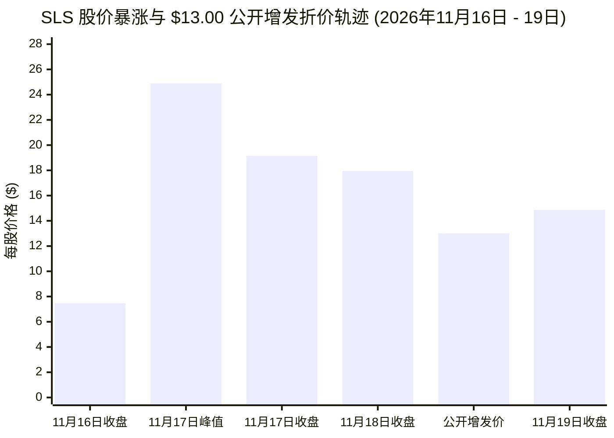
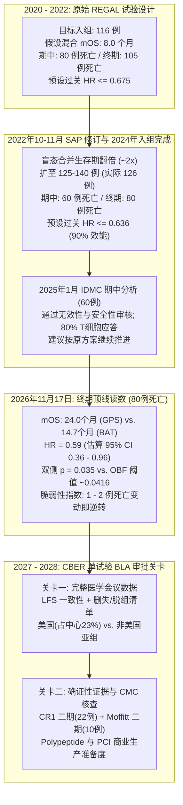
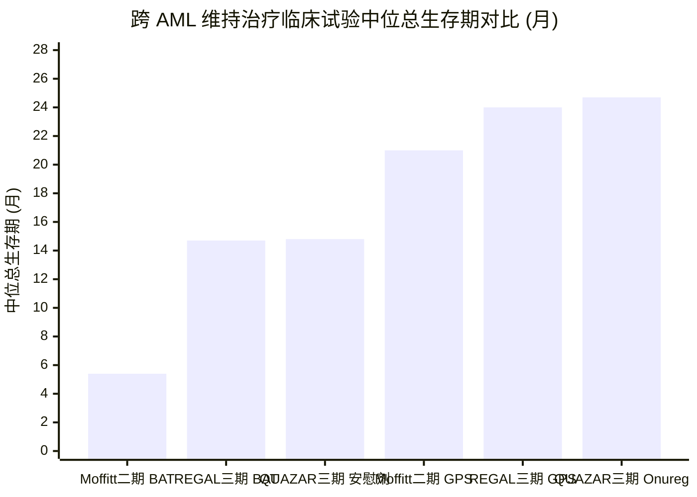

**2026 年 11 月 17 日周二**清晨，**SELLAS Life Sciences Group, Inc.（`NASDAQ: SLS`）**发布了散户生物医药交易者苦等四年的重磅新闻稿：其针对 `WT1` 靶向癌症疫苗 **galinpepimut-S（`GPS`）**的关键性三期临床试验 **REGAL**（`NCT04229979`）在无法接受异基因干细胞移植的二次或以上完全缓解（`CR2`/`CRp2`）急性髓系白血病（`AML`）患者中达到了总生存期（`OS`）主要终点。`GPS` 组的中位总生存期达到 **`24.0 个月`**，而研究者选择的最佳可用疗法（`BAT`）对照组为 **`14.7 个月`**，死亡风险降低 **`41%`**（`HR = 0.59`，双侧 `p = 0.035`）（[REGAL 顶线结果新闻稿](https://ir.sellaslifesciences.com/news/News-Details/2026/SELLAS-Life-Sciences-Announces-Positive-Pivotal-Phase-3-REGAL-Trial-Data-Showing-Immunotherapeutic-Cancer-Vaccine-Galinpepimut-S-GPS-Demonstrated-a-Statistically-Significant-and-Clinically-Meaningful-Improvement-in-Overall-Survival-in-Patients-with-A/default.aspx)）。

`SLS` 股价瞬间井喷：从 11 月 16 日周一收盘价 **`$7.47`** 暴涨 `+156.4%`，周二盘中最高触及 **`$24.89`**（令这家仅 13 名全职员工的公司市值一度逼近 `$50.7 亿`），最终以 **`1.213 亿股`**天量成交收于 **`$19.15`**。

然而**就在同一天**，SELLAS 投下了第二颗震撼弹：尽管截至 2026 年 9 月 30 日账面已坐拥 **`$1.347 亿`现金**（按其 2026 年前九个月 `$2,240 万`的经营现金消耗速度，足够支撑超过四年的运营），管理层依然宣布启动 **`$1.50 亿`承销公开增发**（[拟议增发新闻稿](https://ir.sellaslifesciences.com/news/News-Details/2026/SELLAS-Life-Sciences-Announces-Proposed-150-0-Million-Underwritten-Public-Offering/default.aspx)）。11 月 18 日周三盘后，联合主承销商**摩根大通（`J.P. Morgan`）**与 **TD Cowen** 将 `11,538,462 股`的发行价定在 **`$13.00`/股**——较周三收盘价 `$17.95` **折价 `27.6%`**，较周二高点 **回撤 `47.8%`**；随后承销商于 11 月 20 日全额行使 `1,730,769 股`超额配售权（绿鞋），募资总额达 **`$1.725 亿`（净募资约 `$1.618 亿`）**（[11 月 19 日 Form 424B5](https://www.sec.gov/Archives/edgar/data/1390478/000110465926130132/tm2629996d2_424b5.htm)；[11 月 20 日 Form 8-K](https://www.sec.gov/Archives/edgar/data/1390478/000110465926130331/tm2630303d1_8k.htm)）。

打个比方：这就像一家银行账户里已经存够四年房租的小餐馆，早上刚摘得米其林一星，晚饭前就以 72 折的价格把 6% 的股权卖给了华尔街投行。这一悖论的两面都是客观事实，也精准解释了为何当下市场与专业机构对 `REGAL` 数据的真实含金量爆发激烈争论。

> [!IMPORTANT]
> **法证核心结论摘要（Forensic Thesis Summary）：**
> 1. **非黑即白的极端论调均告失准：** `REGAL` 既非显而易见的骗局，也远非毫无瑕疵的铁证。最不容忽视的强多头证据在于：**对照组（`BAT`）中位生存期高达 `14.7 个月`**——这几乎是 SELLAS 早期二期历史基准（`5.4 个月`）的 **3 倍**，并且与百时美施贵宝（`BMS`）在更早期的 `CR1 AML` 维持治疗金标准试验（`QUAZAR AML-001`）安慰剂组（`14.8 个月`）几乎完全一致。在一个如此顽强、并未坍塌的 `14.7 个月`对照组面前依然拉出 `+9.3 个月`的优势（`24.0 个月`），这是实打实的临床信号。
> 2. **但 80 例死亡事件开放标签试验中的 `p = 0.035` 处于统计学刀锋边缘：** 根据 `HR = 0.59` 与 `p = 0.035` 反推，隐含的 **`95% 置信区间`为 `[0.36, 0.96]`**，标准误（`0.2503`）比教科书式 80 事件无分层理论值（`0.2236`，同等 `HR` 对应 `p = 0.018`）宽出约 `12%`。若按 60 事件期中分析后的标准 Lan–DeMets O'Brien–Fleming 终期边界（`alpha ≈ 0.0416`）计算，`REGAL` 仅以 **`ΔZ ≈ 0.071`** 压线过关——意味着**只要 `1 到 2 例`死亡归属翻转，或 `GPS` 组删失（`censoring`）样本中多出 `1` 例未统计死亡，`p` 值就会立刻突破 `0.042` 乃至 `0.050`**。
> 3. **新闻稿刻意隐去的细节才是试金石：** SELLAS 尚未公布 Kaplan–Meier 生存曲线、置信区间、各组确切死亡与删失/撤回知情同意人数、关键次要终点**无白血病生存期（`LFS`）**、微小残留病灶（`MRD`）转阴率、`BAT` 内部具体用药比例（观察 vs. `HMA`/维奈克拉），以及**美国与非美国亚组表现**（`NCT04229979` 列明的 73 家中心里仅 `17 家`位于美国，占比 `23.3%`）。
> 4. **解码 `$13.00` 增发价的机构信号：** 摩根大通（`43%`）与 TD Cowen（`33%`）牵头承销且不含任何认股权证（`zero warrants`）的 `$1.725 亿`纯普通股融资，证明真金白银的机构买方认可该数据值得押注；但 `$13.00` 的大幅折价（对应增发后 `$13.00–$14.86` 下约 `$28.2 亿–$32.2 亿`基础市值）同样表明，专业机构对单试验 `FDA` 审批不确定性、13 人团队的商业化执行短板以及美国每年仅 `~1,500–2,500 名`适用 `CR2` 患者的小众天花板索取了沉重的风险折价。

---

## 1. 两个核心问题、三种市场叙事与可证伪标准

在拆解 SEC 文件与生存率公式之前，先明确本次调查的两类核心问题（事实判断与决策判断）：
* **事实描述性问题：** `REGAL` 展现的 `HR = 0.59`（`p = 0.035`）究竟源自 `GPS` 激活 `WT1` 特异性 T 细胞带来的真实生物学延寿效应，还是被开放标签偏倚、删失不对称、`GM-CSF` 佐剂刺激或 `80` 例事件下的统计脆弱性所放大？
* **策略决策性问题：** 在增发后 `~$13.00–$14.86`（基础市值 `~$28.2 亿–$32.2 亿`）的估值水平上，投资者与监管机构应如何在完整学术会议数据与 `FDA` pre-BLA 会议落地前评估 `GPS` 的获批概率、商业化上限与 `SLS009` 管线期权价值？

我们在调查伊始立下明确的**可证伪标准（Falsifiability Criteria）**：
* **足以证伪空头怀疑的证据：** 后续完整学术报告显示 `LFS`（`HR ≤ 0.68`）与 `MRD` 清除率高度协同 `OS` 改善、两组撤回知情同意/删失比例对称（差异 `<5%`）、美国与欧亚中心疗效一致，且 `FDA` 在 pre-BLA 沟通中明确接受单试验递交生物制品许可申请（`BLA`）。
* **足以证实空头担忧的证据：** 尽管 `OS` 分离但 `LFS` 曲线平坦或无显著性、`BAT` 或 `GPS` 组存在明显的早期脱落/删失失衡、美国亚组 `HR` 徘徊在 `1.0` 附近而海外“纯观察（`Observation`）”小中心拉高了整体 `HR`，或者 `FDA` 要求补做第二项验证性随机试验。

| 分析维度 | 散户与多头叙事（公司新闻稿口径） | 跨墙机构买方视角（J.P. Morgan / TD Cowen 增发） | 法证怀疑论视角（生物统计学者与空头逻辑） |
| :--- | :--- | :--- | :--- |
| **核心论点** | 在无标准维持疗法的 `CR2 AML` 人群中，`GPS` 较 `BAT` 延寿 `+9.3 个月`（`24.0 vs. 14.7 个月`，`p = 0.035`），验证 `WT1` 疫苗机制并铺平 `2027H1 BLA` 之路。 | 面对 `14.7 个月` 的强劲对照组仍取得显著 `OS` 获益，叠加 `SLS009` 临床数据，支持以 `$13.00` 高折价注入 `$1.725 亿`研发与商业化资金。 | 2022 年修改 `SAP` 将所需死亡数从 `105` 降至 `80` 例的 `N=126` 开放标签试验仅以 `1–2` 例的脆弱边界过关，却未公布 `LFS`、`95% CI` 与删失表。 |
| **`$13.00` 增发的含义** | 账面约 `$2.965 亿`备考现金彻底消除资金链与 `ATM` 抛压隐患，备战商业化。 | 较 11 月 18 日收盘价 `$17.95` 折价 `27.6%`（较峰值 `$24.89` 折价 `47.8%`），机构用脚投票要求高额风险补偿。 | 坐拥 `$1.347 亿`现金（够烧 4 年）却在发布顶线后 36 小时内急速抛售 `$1.725 亿`股票，恰恰抢在完整曲线和 `FDA` 反馈公开之前。 |
| **最大盲区** | 完整次要终点、曲线与美国亚组尚未落地，结论过度绑定单篇顶线新闻稿。 | 增发后市值仍高达 `$28 亿–$32 亿`（美国 `CR2` 峰值销售的 `~8–15×`），必须靠 `CR1` 扩适应症或 `SLS009` 才能支撑进一步上涨。 | 容易低估 `GPS` 在面对接近 `QUAZAR` 安慰剂水准（`14.7 个月`）的强对照组时仍能跑赢 `+9.3 个月`的真实信号分量。 |

---

## 2. 聚光灯下的新闻稿 vs. 角落里的 SEC 注册文件：六大信息落差

将 11 月 17 日新闻稿逐行比对 [ClinicalTrials.gov `NCT04229979`](https://clinicaltrials.gov/study/NCT04229979)、[2022 年 11 月 15 日 SAP 修订电话会实录（`Form 8-K Ex. 99.1`）](https://www.sec.gov/Archives/edgar/data/1390478/000110465922119139/tm2230620d1_ex99-1.htm)、[2025 年 1 月 23 日 IDMC 期中分析 8-K](https://www.sec.gov/Archives/edgar/data/1390478/000110465925005648/tm254291d1_ex99-1.htm)、[2025 年报 `Form 10-K`](https://www.sec.gov/Archives/edgar/data/1390478/000139047826000003/sls-20251231.htm) 及 [2026 年三季报 `Form 10-Q`](https://www.sec.gov/Archives/edgar/data/1390478/000139047826000020/sls-20260930.htm)，可以构建出清晰的**信息落差矩阵**：

| 审计维度 | 11 月 17 日新闻稿呈现口径 | SEC 文件与 ClinicalTrials.gov 一手记录 | 法证影响 |
| :--- | :--- | :--- | :--- |
| **样本量与地域分布** | 强调全球约 95 家中心入组 *“126 名患者”* 的多中心三期关键试验。 | `NCT04229979` 列明的 73 家中心（登记入组 127 人）中，**美国仅 `17 家（23.3%）`**，**`56 家（76.7%）`位于美国以外**（希腊 10、波兰 10、法国 9、西班牙 9、印度 5、台湾 5、德国 3、匈牙利 3、塞尔维亚 2），平均每家中心仅 **`~1.7 名`**患者。 | `FDA` 对美国患者占比低于 `25%` 且单中心入组极稀疏（`~1.7 人/中心`）的单试验申请会严格核查地区医疗差异。 |
| **关键次要指标隐匿** | 仅披露 `mOS 24.0 vs. 14.7 个月`、`HR = 0.59`、`p = 0.035`，将 `LFS`、`MRD` 及 T 细胞动力学推迟至未来学术会议。 | 在未公布 `HR 95% CI`、Kaplan–Meier 曲线、分臂死亡数、删失/撤回知情同意清单及 **`LFS` 结果**的情况下，即先行完成 `$1.725 亿`融资。 | 开放标签试验的 `OS` 易受后续治疗或删失干扰，**`LFS` 同步性**与**删失审计表**是验证真伪的硬指标。 |
| **2022 年 `SAP` 减事件数** | 仅称按预设 *“80 例事件（死亡）”* 触发最终分析。 | 2022 年 11 月 `8-K` 实录证实：原始方案为 `116 人`、期中 `80`、**终期 `105` 例死亡**（`HR ≤ 0.675`，预设总人群 `mOS 8.0 个月`）；2022 年 10–11 月修订为期中 `60`、**终期 `80` 例死亡**（`HR ≤ 0.636`，总人群 `mOS 12.5 个月`，`90%` 检验效能）以缩短周期。 | 将终期死亡门槛从 `105` 砍到 `80` 确实节省了等待时间，但也牺牲了统计把握度（若在 `105` 例死亡下保持 `HR = 0.59`，`p` 值本应落在 `0.007–0.015`）。 |
| **佐剂与随访频率不对称** | 将 `GPS` 称为相对于 `BAT` 的 *“维持单药治疗”*。 | `NCT04229979` 显示 `GPS` 组每次注射第 -2 天与当日均加用 **`70 µg` 沙格司亭（`GM-CSF`）**及 `Montanide` 佐剂，且前 10 周**每两周**随访一次；`BAT` 组无 `GM-CSF`，第 52 周前**每四周**随访一次。 | 对照组未匹配 `GM-CSF + 安慰剂`（区别于当年在双盲对照下失败的 Galena `NeuVax` 三期）。 |
| **指导委员会利益关联** | 正文大段引述指导委员会 3 位专家对“里程碑数据”的赞誉。 | 新闻稿末尾脚注披露：**纪念斯隆-凯特琳癌症中心（`MSK`）**享有机构财务利益，且发明人 `David A. Scheinberg` 博士与指导委员会成员 **`Javier Pinilla-Ibarz` 博士（3 名委员之一）**均持有与 SELLAS 相关的财务利益。 | 关键背书专家及授权机构与上市公司存在直接财务绑定，强化了等待独立同行评审的必要性。 |
| **团队规模与仲裁败诉** | 宣布筹备 `2027H1 BLA` 上市申请并强调商业潜力。 | `FY25 10-K` 披露截至 2026 年 3 月 1 日**全职员工仅 13 人**、无自有工厂（原料药单一 `CMO` **Polypeptide Group**、冻干制剂单一 `CMO` **PCI Pharma Services**、`-20°C` 储存、尚无商业供货合同）；`3Q26 10-Q` 披露 2026 年 7 月 24 日 SELLAS 在 **3D Medicines 香港国际仲裁案中败诉**并支付 `$100 万`费用。 | 从 13 人小团队跨越到 `CBER` 现场核查（`PAI`）、冷链放量生产与商业化销售，必须大规模扩编或绑定大药企。 |

### 语义替换测试（Semantic Substitution Test）：审视四个高频热词

| 新闻稿措辞 | 宽松 / 营销式理解 | 严格生物统计与 `FDA` 法规操作定义 | 替换测试结论 |
| :--- | :--- | :--- | :--- |
| **“具有统计学意义 (`p = 0.035`)”** | 堪比两项大型三期成功的铁板钉钉证据。 | 在 60 事件期中分析后，以 `ΔZ ≈ 0.071` 惊险跨过两阶段 O'Brien–Fleming 终期阈值（`~0.0416`）；虽满足方案预设显著性，但距离 `FDA` 单试验审批通常期待的 *“统计学极具说服力 (`p < 0.001–0.01`)”* 仍有明显差距。 | 满足预设检验水准，但单靠该 `p` 值支撑独立 `BLA` 仍显**脆弱**。 |
| **“具有临床意义 (`+9.3 个月`)”** | 证明单凭 `GPS` 抗原就让全体 `CR2 AML` 患者寿命几乎翻倍。 | `24.0` vs. `14.7 个月` 在数值上极为可观——但前提是不存在删失偏差、复发后二三线救治失衡或不同国家 `BAT` 方案（纯观察 vs. `HMA+维奈克拉`）混杂。 | 表面临床获益显著，因果纯粹性**待完整曲线验证**。 |
| **“基线高度均衡 (Well Balanced)”** | 两组患者从入组到死亡的全部治疗变量完全对称。 | 仅说明随机化时的四个分层因子（`CR2/CRp2`、细胞遗传学、`MRD`、`CR1` 持续时间）和转做干细胞移植的比例均衡；并未证明 **`BAT` 用药分布**、脱落/撤回知情同意及复发后救治均衡。 | 随机化起点达标，但**不足以排除**开放标签试验的入组后偏倚。 |
| **“加速申报策略 (Accelerated Filing Strategy)”** | 已获得加速审批（`Accelerated Approval`）或优先审评承诺。 | 依赖既有快速通道与孤儿药资格进行滚动递交（`rolling BLA`）并争取优先审评（因 `OS` 本身已是终极临床终点，并不适用替代终点加速审批），能否单凭 `126 人`开放标签试验获准受理仍取决于 `FDA` 会议结果。 | 属于**公司申报意愿**，而非 `FDA` 审批绿灯。 |

---

## 3. 解构 `p = 0.035` 的数学密码：微弱安全边际与 `1–2` 例死亡的脆弱性

即便还未见到学术会议的幻灯片，单凭 `N = 126`、`80` 例死亡、`HR = 0.59` 与双侧 `p = 0.035` 这组公开发表的数据，我们就能精确反演出 `REGAL` 统计模型背后的几何结构。

首先将 `p = 0.035` 换算为正态检验统计量 `|Z|`，并求解隐含标准误（`SE`）与 `95%` 置信区间：

$$|Z| = \Phi^{-1}\!\left(1 - \frac{0.035}{2}\right) \approx 2.1084 \implies \text{SE}(\ln \text{HR}) = \frac{|\ln(0.59)|}{2.1084} \approx 0.2503 \implies \text{95\% CI} \approx [0.36,\, 0.96]$$

两个反直觉的细节立刻浮出水面：
1. **`95% 置信区间`横跨 `[0.36, 0.96]`：** 尽管点估计（`HR = 0.59`）看似降低了 `41%` 死亡风险，但其 `95%` 置信区间上限已触及 **`0.96`**——在统计学允许的合理范围内，真实疗效既可能高达降低 `64%` 风险，也可能低至仅降低 **`4%` 风险**，距离无效线 `1.00` 仅一步之遥。
2. **标准误膨胀之谜（`0.2503` vs. `0.2236`）：** 在标准的 `1:1` 无分层 Schoenfeld 生存公式下，`80` 例死亡对应的理论标准误应为 `√(4/80) = 0.2236`。若 `REGAL` 符合这一标准误，那么 `HR = 0.59` 本该得出 `|Z| = 2.360` 和 **`p = 0.0183`**。而实际标准误 `0.2503` 竟宽出了 **`11.9%`**（对应有效 Mantel–Haenszel 方差 **`V_eff ≈ 15.96`**，远低于理论值 `20.00`）。方差膨胀（有效信息量缩水）通常源于四类因素：**（a）** 将 126 名患者/80 例死亡切分进 4 个二元分层因子构成的 **`16` 个稀疏分层单元（`2⁴`）** 中导致部分格子信息丢失；**（b）** 两臂死亡例数偏斜（约 `30` vs. `50` 例）；**（c）** 两臂随访时长与删失比例不对等；或 **（d）** 免疫治疗延迟起效导致的非比例风险（`non-proportional hazards`）。

其次，`REGAL` 并非只在 `80` 例死亡时检验过一次。2025 年 1 月 `IDMC` 在 **`60` 例死亡（信息分数 t₁ = 60/80 = 0.75）** 处进行过预设期中有效性/无效性分析。在控制总双侧 `α = 0.05` 的标准 **Lan–DeMets O'Brien–Fleming** 成组序贯设计下，两个时间点的精确双侧检验边界如下：

$$\alpha_1 = 2\left[1 - \Phi\!\left(\frac{1.9600}{\sqrt{0.75}}\right)\right] \approx 0.02363 \;(|Z_1| \ge 2.2632) \implies \alpha_2 \approx 0.04161 \;(|Z_2| \ge 2.0374)$$

*（注：依据 `SAP` 是否采用约束性无效边界或微调消耗函数，终期名义阈值通常落在 `~0.0416–0.048` 区间。）* 以标准 OBF 终期阈值 `0.0416` 衡量，`REGAL` 仅以 **`ΔZ = 0.071`**（`p` 值富余 `0.0066`）惊险过关。

这好比一名马拉松跑者在 42.195 公里终点线上**仅凭一只脚尖领先冲线**，而组委会尚未公布终点高速摄影录像。按 `V_eff = 15.96` 推算，`REGAL` 在对数秩检验中的超额事件数（`E_GPS − O_GPS`）约为 **`8.42` 例**。只需 **`1 到 2` 名患者的结局变化**，全盘结论便会发生逆转：

| 脆弱性扰动情景（`D = 80`, `V_eff = 15.96`） | 扰动后统计量（`\|Z\|`） | 双侧 `p` 值 | 对应风险比（`HR`） | 是否通过 OBF 边界（`p ≤ 0.0416`） | 是否通过名义 `p ≤ 0.050` |
| :--- | :---: | :---: | :---: | :---: | :---: |
| **当前公布顶线结果（`0` 例变动）** | **`2.108`** | **`0.0350`** | **`0.590`** | **通过** | **通过** |
| **对调 `1` 例死亡归属（`BAT` 组 → `GPS` 组）** | `1.858` | `0.0632` | `0.628` | **失败（不显著）** | **失败（不显著）** |
| **对调 `2` 例死亡归属（`BAT` 组 → `GPS` 组）** | `1.608` | `0.1079` | `0.669` | **失败（不显著）** | **失败（不显著）** |
| **`GPS` 组单独补入 `+1` 例删失后未计死亡** | `1.957` | `0.0503` | `~0.612` | **失败（不显著）** | **失败（不显著）** |
| **`GPS` 组单独补入 `+2` 例删失后未计死亡** | `1.808` | `0.0706` | `~0.636` | **失败（不显著）** | **失败（不显著）** |

正是这种 **`1–2` 例的脆弱性指数（`Fragility Index`）**，决定了 `FDA` 2023 年 9 月发布的[《基于单项充分且良好对照临床研究及确证性证据证明有效性的指南草案》](https://www.fda.gov/regulatory-information/search-fda-guidance-documents/demonstrating-substantial-evidence-effectiveness-one-adequate-and-well-controlled-clinical)将成为核心裁判尺度。当药企试图仅凭一项试验申报上市时，`FDA` 会将**该试验自身的统计学说服力**与**外部确证性证据（`Confirmatory Evidence`）**放在天平两端权衡。`QUAZAR` 在 `472` 例双盲患者中跑出 `p = 0.0009` 时几乎无懈可击；而面对 `126` 例开放标签试验的 **`p = 0.035`**，`FDA` 生物制品审评中心（`CBER`）势必逐例核查删失原因、次要终点（`LFS`、`MRD`）以及 `GPS` 的外部确证证据（MSK `22` 例 `CR1` 二期 [`PMC5812332`](https://pmc.ncbi.nlm.nih.gov/articles/PMC5812332/)、Moffitt `10` 例非随机 `CR2` 二期、以及 `80%` `WT1` 免疫应答率）。

---

## 4. 为何连对照组也多活了近三倍？四维因果剥离审计

怀疑论者最容易轻视的一个硬核事实就在这里：当初设计 `REGAL` 时，Moffitt 二期试验中 `CR2 AML` 标准治疗对照组的生存期仅有 **`5.4 个月`**（`GPS` 组为 `21.0 个月`）。而在这次 `REGAL` 三期试验里，`BAT` 对照组的中位总生存期竟达到了 **`14.7 个月`**——是旧基准的 **近 3 倍**，甚至与 `BMS` 的 `QUAZAR AML-001` 试验（入组预后更好的 *首次* 缓解 `CR1` 患者！）安慰剂组（`14.8 个月`）几乎分毫不差。

换言之，`GPS` 绝不是靠挑了一个不堪一击的“软柿子”对照组才赢得漂亮。面对一个活了 **`14.7 个月`** 的强劲对照组，依然能再多争取 **`+9.3 个月`** 将生存期推升至 **`24.0 个月`**（`HR = 0.59`），这背后大概率存在不可忽略的真实药物驱动力。

为了查清“为何全员寿命延长”以及“为何 `24.0` 与 `14.7` 拉开差距”，我们同时检验四种竞争性因果机制：

| 因果假设 | 针对 `REGAL` (`NCT04229979`) 的检验路径 | 支持证据 | 反驳依据与关键验证测试 |
| :--- | :--- | :--- | :--- |
| **1. 直接因果（`GPS` 疫苗 → 延长 `OS`）** | `GPS` 四价 `WT1` 多肽诱导出 CD4+/CD8+ 杀伤性 T 细胞，持续清除化疗后残留的 `WT1+` 白血病干细胞（`LSCs`）。 | 期中抽样显示 **`80%` 的 `GPS` 患者产生 `WT1` 特异性 T 细胞应答**（超越二期的 `64%`）；`24.0 vs. 14.7` 的生存曲线形态在绝对值上高度神似 `QUAZAR`（`24.7 vs. 14.8`）。 | **`LFS` 与 `MRD` 数据尚属空白**。若 `GPS` 确实靠清除白血病细胞延寿，**`LFS` 必须与 `OS` 同步显著分离**。 |
| **2. 选择偏差与信息性删失（幸存者时间偏倚 + 开放标签脱组）** | 入排标准第 8 条允许患者在**达成 `CR2` 后长达 `6 个月`内**入组，天然筛掉了早期高危复发死亡者（解释了 `BAT` 从 `5.4` 跃升至 `14.7 个月`）；同时开放标签下 `BAT`（尤其纯观察组）撤回知情同意或 `GPS` 早期删失可能扭曲统计。 | 100% 解释了为何 2022 年合并生存期翻倍及 `BAT` 达 `14.7 个月`；随访/删失不均也是标准误放大 `12%` 的常见成因。 | 核查完整**两组删失及退组分布表**与**临界点敏感性模拟**（验证调换 `1–2` 例后是否跌破 `p = 0.05`）。 |
| **3. 潜伏第三变量（`GM-CSF`、`BAT` 构成、现代挽救疗法）** | 三重混杂因素：（a）`GPS` 组独享每次两针 **`70 µg GM-CSF`** + `Montanide` 免疫激活；（b）`BAT` 在 10 国（`76.7%` 海外中心）混用了纯观察与 `HMA+维奈克拉`；（c）2021–2024 年普及的维奈克拉二线方案带来更深度的 `CR2` 缓解。 | `GM-CSF` 本身具备单核/树突状细胞动员作用；若海外中心高比例采用纯观察作为 `BAT`，会拉低对照组基准并放大 `HR`。 | 检视 **`GPS` vs. `BAT` 积极用药（`HMA/维奈克拉`）** 与 **纯观察** 亚组对比，以及**美国 vs. 海外**森林图。 |
| **4. 双向反馈循环（高频就诊带来的临床照护优势）** | `NCT04229979` 规定 `GPS` 组前 10 周**每两周**随访（外加提前两天打 `GM-CSF`），而 `BAT` 组**每四周**随访一次；更密集的诊室接触有利于更早控制感染、输血支持及发现早期复发并转入救治。 | 开放标签肿瘤维持试验中，高接触频率常改善总体生存管理与后续救治及时性。 | 对比两组的**至下次抗白血病治疗时间**、**复发后生存期（`OS − LFS`）**与急诊住院率。 |

---

## 5. 癌症疫苗坟场——以及 SELLAS 前身 Galena Biopharma 的前车之鉴

历史不会直接宣判 `GPS` 死刑，却解释了为何华尔街资深生物医药基金对多肽癌症疫苗抱有根深蒂固的戒心。最富戏剧性的是：**SELLAS 当年借壳上市的母体前身正是 Galena Biopharma**——一家在 2016 年经历过美股生物医药史上最著名疫苗三期溃败的公司。

| 研发项目 / 公司 | 靶点与机制 | 试验设计与样本量（`NCT`） | 结局及与 `REGAL` 的关键对照 |
| :--- | :--- | :--- | :--- |
| **SELLAS `galinpepimut-S` (`GPS`)** (`REGAL`) | 4 种 `WT1` 肽 + `Montanide` + `GM-CSF` | 开放标签三期，`1:1` 对比 `BAT`，`N = 126`，`CR2 AML`（[NCT04229979](https://clinicaltrials.gov/study/NCT04229979)） | **达到 `OS` 主要终点（`24.0 vs. 14.7 个月`, `HR = 0.59`, `p = 0.035`）**；对照组未匹配 `GM-CSF`；`LFS` 与曲线待公布。 |
| **BMS `Onureg`（口服阿扎胞苷）** (`QUAZAR AML-001`) | 口服去甲基化药物维持治疗 | 双盲安慰剂对照三期，`N = 472`，`CR1 AML`（[NCT01757535](https://clinicaltrials.gov/study/NCT01757535)） | **`FDA` 获批上市（2020 年 9 月）：** `mOS 24.7 vs. 14.8 个月`（`HR = 0.69`, `p = 0.0009`），`RFS`（`10.2 vs. 4.8 个月`）同步优效。 |
| **Galena Biopharma `NeuVax`** (`PRESENT`) — *SELLAS 前身* | `HER2` E75 肽 + `GM-CSF` | 双盲三期，对比 **`GM-CSF + 安慰剂`**，`N = 758`，乳腺癌（[NCT01479244](https://clinicaltrials.gov/study/NCT01479244)） | **因无效提前终止（2016 年 6 月）：** 早期二期数据亮眼，但在三期给对照组同样加上 `GM-CSF` 后疗效在第 70 例复发时彻底归零；Galena 于 2017 年底与 SELLAS 合并。 |
| **住友制药 `DSP-7888`** (`WIZARD 201G`) | 多价 `WT1` 肽癌症疫苗 | 随机三期（联合贝伐珠单抗 vs. 单药），`N = 221`，复发胶质母细胞瘤（[NCT03149003](https://clinicaltrials.gov/study/NCT03149003)） | **因无效提前终止（2021 年 12 月）：** 独立数据监查委员会（`IDMC`）在第二次期中分析后认定达到 `OS` 终点概率过低。 |

`PRESENT`（`NeuVax`）留给业界的教训并非 `WT1` 疫苗在微小残留白血病（`MRD`）中也注定无效（实体瘤负荷巨大的胶质母细胞瘤与刚清除完白血病细胞的缓解期在免疫微环境上不可同日而语），而是它用血淋淋的代价证明了：**未设盲或未匹配 `GM-CSF` 佐剂的癌症疫苗很容易在小样本中显现惊人优势，一旦补齐安慰剂与佐剂对照，幻觉就可能消散。** 正因为 `REGAL` 没有设置 `Montanide + GM-CSF` 安慰剂臂，未来 `FDA` 才会格外依赖客观的肿瘤复发指标（`LFS` 与 `MRD`）来确证这 `+9.3 个月`源自 `WT1` 抗原特异性杀伤。

---

## 6. 顺着资金流向看：`$1.50 亿`（`$1.725 亿`）`$13.00` 增发、现金跑道与 `CR2` 天花板测算

现在解开 11 月 17–19 日让散户最困惑的资本谜题：根据 [2026 年三季报 `Form 10-Q`](https://www.sec.gov/Archives/edgar/data/1390478/000139047826000020/sls-20260930.htm)，SELLAS 账上已经有 **`$1.347 亿`现金**（含受限现金 `$1.348 亿`），而前九个月经营现金流出仅 **`$2,240 万`**（年化约 `$3,000 万`）。既然账上躺着 4 年多花不完的钱，为什么还要在 11 月 18 日收盘价 `$17.95` 的基础上狠砍 `27.6%`，以 **`$13.00`** 的地板价突击增发 **`$1.725 亿`（净入账 `$1.618 亿`）**？

[11 月 19 日 `Form 424B5`](https://www.sec.gov/Archives/edgar/data/1390478/000110465926130132/tm2629996d2_424b5.htm) 与 [11 月 20 日 `Form 8-K`](https://www.sec.gov/Archives/edgar/data/1390478/000110465926130331/tm2630303d1_8k.htm) 揭示了这一金融操作硬币的两面：

| 财务与估值维度 | 一手 SEC 文件数据（`3Q26 10-Q` / `424B5` / `Nov 20 8-K` / `FY25 10-K`） | 机构多头逻辑 | 法证怀疑逻辑 |
| :--- | :--- | :--- | :--- |
| **增发前流动性与烧钱速度** | **`$1.347 亿`现金**（9 月 30 日），主要源自前九个月 `5,036 万份`权证行权（均价 `$1.69`）收回的 `$8,510 万`；`9M26` 经营现金净流出 **`$2,240 万`**（年化 `~$3,000 万`）。 | 随着 `2027–2028` 年筹备 `BLA`、从 13 名员工扩建商业化团队、`CMC` 工艺验证及启动 `SLS009` 一线 `AML` 临床，烧钱速度将翻 `2–4 倍`。 | 手握 4 年以上现金及未动用的 **`$1.50 亿` TD Cowen `ATM` 额度**，却在顶线公告后 36 小时内接受 `27.6%` 折价急售股票，暴露出管理层抢在完整数据接受审视前锁定弹药的迫切心理。 |
| **承销结构与融资质量** | **`13,269,231 股`**（含 `173 万股`绿鞋全额行使）@ **`$13.00`** = **总额 `$1.725 亿` / 净额 `$1.618 亿`**（承销费率 `6.0%` 即 `$1,035 万`）；**摩根大通（`43%`）**与 **TD Cowen（`33%`）**主承销；**零权证**。 | 一线大投行挂帅、绿鞋满额行使且无毒丸权证，标志着公司股东结构由低价权证套利盘升级为专业机构长线资金。 | 较周二峰值 `$24.89` 折价 `47.8%`、较周三收盘折价 `27.6%`，导致新股认购者每股账面有形净资产立即摊薄 **`$11.74`**（备考每股 `NTBV` 仅 `$1.26`）。 |
| **备考股本与潜在抛压** | 发行后基础股本 **`216,797,064 股`**；未计入 `812 万`剩余权证（均价 `$2.07`）、`265 万`期权（`$3.21`）、`331 万` RSU，**完全稀释约 `2.309 亿股`**；另有 `1,896 万股`激励池及 60 天锁定期满后重启的 `$1.50 亿 ATM`。 | 仅用 **`6.5%` 基础股本稀释**便换来 `~$2.965 亿`备考现金（每股稀释后约 **`$1.28` 现金**），资产负债表堪称堡垒。 | 即便按 `$13.00–$14.86` 计价，完全稀释市值仍高达 **`$30.0 亿–$34.3 亿`**（企业价值 `EV $27.0 亿–$31.3 亿`），一旦遭遇 `CRL` 几乎毫无估值缓冲垫。 |
| **`CR2 AML` 商业空间上限（美国）** | 据 `FY25 10-K` 引用流行病学数据：美国年新发 `AML ~20,050 人` → `~7,500 人`接受二线治疗 → `~3,750 人`达成 `CR2`（美/欧四大国/日合计 `~8,750 人`）。剔除移植及被排除的 `FLT3`/`IDH` 靶向维持患者，美国 `REGAL` 适用人群约 **每年 `1,500–2,500 人`**。 | 按 `35%–50%` 渗透率与 `$18 万–$32 万/年`净药价计算，美国 `CR2` 峰值年营收约 **`$1.0 亿–$3.75 亿`**；再叠加 **`CR1` 扩适应症**及 `SLS009`（`TP53` 突变 `r/r AML` `ORR 57%`、`mOS 8.8 个月`）则空间打开。 | 单独 `CR2` 维持适应症 `$1.5 亿–$3.0 亿` 的峰值体量更匹配 `$5 亿`市值生物科技公司；当前 **`$30 亿+`估值实质上已经提前把 `CR1` 拓展乃至 `SLS009` 成功计入股价**（参考涵盖更广 `CR1` 市场且已获批的 `BMS` `Onureg`，其销量至今小到在 `BMS` 财报中未单独列项！）。 |

---

## 7. 谁承担代价与下一道暗礁：被忽略的四大执行陷阱

即便在即将召开的医学大会上 `REGAL` 完整曲线完美无瑕，从三期顶线喜报走向真金白银的商业利润之间，依然横亘着四座现实暗礁：

1. **13 人团队的 `CBER` 现场核查（`PAI`）与单源 `CMO` 瓶颈：** 截至 2026 年 3 月 1 日，SELLAS 仅有 **13 名全职员工**（[2025 年报 `Form 10-K`](https://www.sec.gov/Archives/edgar/data/1390478/000139047826000003/sls-20251231.htm)）。`FDA` 生物制品审评中心（`CBER`）历来对 `CMC` 工艺验证与生产现场核查极其严苛。SELLAS 多肽原料药完全依赖单一外包厂 **Polypeptide Group**，冻干制剂完全依赖单一外包厂 **PCI Pharma Services**，尚未签署任何商业化供货合同，药品当前储存条件仍为 **`-20°C`**（`2–8°C` 冷藏稳定性数据尚在收集中），且商业化时必须同步调度第三方 `Montanide` 与 `GM-CSF` 供应链——临床成功却因 `CMC` 缺陷收到 6 到 12 个月完整回复函（`CRL`）的案例在小型生物医药公司中屡见不鲜。
2. **专利到期日（2034–2035 年）与 `BPCIA` 12 年独占期变数：** 从 `MSK` 独家引进的 `GPS` 核心物质专利将于 **2034–2035 年**到期（可申请最高 5 年专利期延长），同时 `MSK` 享有中个位数销售分成及最高 `$1,740 万`里程碑付款。公司寄望于《生物制品价格竞争与创新法》（`BPCIA`）赋予 **12 年生物制品市场独占期**，但 `10-K` 自身风险提示明确指出：短肽混合物究竟适用哪些 `BPCIA` 排他解释仍存在监管不确定性，而专利至 `2040` 年的下一代七价疫苗 `GPS+` 仍处于临床前阶段。
3. **破裂的大中华区合作（`3D Medicines` 仲裁败诉）：** 2026 年 7 月 24 日，香港国际仲裁中心（`HKIAC`）独任仲裁员**驳回 SELLAS 针对中国合作方 3D Medicines（思路迪医药）的全部仲裁诉求**，并裁定 SELLAS 承担 **`$100 万`**律师与仲裁行政费用（[2026 年三季报 `Form 10-Q`](https://www.sec.gov/Archives/edgar/data/1390478/000139047826000020/sls-20260930.htm)）。早期多头模型中常被计入的大中华区 `$1.915 亿`后续里程碑与分成，目前深陷破裂的合作关系之中。
4. **短期损失由谁买单：** 机构资金在无锁定期的条件下以 **`$13.00`** 轻松接走 `1,327 万股`，而在 11 月 17 日情绪高峰期以 **`$19.00–$24.89`** 追高的散户交易者，在 48 小时内直接承受了 **`-22%` 至 `-48%`** 的账面重挫。

---

## 8. 法证最终裁决：条件句推演（"If-Clauses"）与概率加权判断

摒弃非黑即白的立场站队，用精准的条件句锁定未来 18 个月决定 SELLAS 估值走向的核心分支：

* **如果（`If`）** 学术会议公布的完整 `REGAL` 数据显示**无白血病生存期（`LFS` HR ≤ `0.68`）与 `MRD` 清除率高度一致**、**两组删失与撤回知情同意高度对称（差异 `<5%`）**，且在 **`HMA/维奈克拉` 积极对照亚组及美国中心（`23.3%`）中保持一致获益**，**那么（`Then`）** 面对 `14.7 个月`强劲对照组的 `+9.3 个月`延长将被确认为铁证，`FDA` 受理优先审评 `BLA` 的大门敞开，`SLS` 将迅速成为**大型跨国药企血液肿瘤并购标的**。
* **如果（`If`）** 完整数据暴露出 **`LFS` 曲线胶着无显著差异**、`BAT` 退组或 `GPS` 删失经敏感性校正后仅仅 **`1–2` 例变动就令 `p > 0.042`**，或美国亚组接近无效而主要靠海外“纯观察”患者拉动总体 `HR`，**那么（`Then`）** `CBER` 将依据单试验审评规则签发 **`CRL` 或强制补做第二项确证试验**，`SLS` 股价将大幅回落向账面现金（`~$2.965 亿`）与 `SLS009` 估值中枢。
* **如果（`If`）** 临床数据过关，但 13 人团队在 `-20°C` 稳定性、效力测定（`potency assay`）及 `Polypeptide`/`PCI` 工厂 `PAI` 检查准备上拖延，**那么（`Then`）** 即使药效成立，获批与商业放量时间表也将从 `2027` 年被推迟至 `2028–2029` 年。

### 法证最终裁决：我们的真实判断

| 情景推演 | 认知概率 | 临床、监管与商业化路径（`2026–2028`） | 隐含每股合理估值（`2.309 亿完全稀释股`） | 期望价值贡献 |
| :--- | :---: | :--- | :---: | :---: |
| **基准情景（`Base`）：`ODAC` 专家会审查 → 附带上市后确证要求的窄适应症 `CR2` 获批及估值消化** | **`45%`** | 完整 `LFS` 与 `MRD` 呈方向性支持（`HR ~0.62–0.70`）且删失经得起核查，但鉴于 `N=126`、`p = 0.035`、开放标签及海外中心占 `76.7%`，`FDA` 召开 `ODAC` 顾问委员会后于 `2028` 年仅批准窄范围 `CR2` 标签并附带上市后确证研究要求（或伴随小幅 `CMC` 延期）。美国 `CR2` 峰值 `~$2 亿–$3 亿`叠加 `SLS009` 价值难以支撑过高溢价。 | **`$12.50 / 股`** *（对应市值 `$23 亿–$35 亿`）* | **`$5.63 / 股`** |
| **悲观情景（`Bear`）：遭遇 `CRL` 或被要求补做第二项随机对照三期试验** | **`35%`** | 完整数据揭示 `LFS` 脱节、开放标签删失/退组导致 `1–2` 例脆弱性穿破 `p = 0.05`、美国亚组疲软，或单一 `CMO` 出现 `CMC` 硬伤。`FDA` 拒绝凭单试验放行，`SLS` 估值回撤至 `~$2.96 亿`现金（`~$1.28/股`）+ `SLS009` 管线期权（`$4 亿–$7 亿`）。 | **`$4.00 / 股`** *（区间 `$3.00 – $5.50 / 股`）* | **`$1.40 / 股`** |
| **乐观情景（`Bull`）：完整数据无懈可击 → 优先审评 `BLA` 与大药企高溢价收购** | **`20%`** | `LFS` 与 `MRD` 同步显著优效、美国亚组高度一致（`HR ~0.55–0.62`）、删失表零瑕疵。`FDA` 授予优先审评（`2027` 年获批）并确立向 `CR1` 及移植后维持拓展的清晰路径，叠加 `SLS009` 吸引血液肿瘤巨头整体收购。 | **`$28.00 / 股`** *（区间 `$24.00 – $35.00 / 股`）* | **`$5.60 / 股`** |
| **概率加权期望价值** | **`100%`** | **对比 11 月 19 日收盘价（`$14.86`）与增发价（`$13.00`）** | **`$12.63 / 股`** *（较 `$14.86` 隐含 `-15.0%`）* | **`$12.63 / 股`** |

### 底线投资立场（Bottom-Line Authorial Stance）

1. **正视硬币两面的客观信号：** 动辄将 `REGAL` 骂作*“彻底假药”*的空头忽视了公司手里最硬的一张底牌——**对照组中位生存期达到 `14.7 个月`**（几乎是历史基准 `5.4 个月`的三倍，与 `BMS` `QUAZAR` 安慰剂组的 `14.8 个月`平齐），而 `GPS` 仍然在此之上再拉出 **`+9.3 个月`**；同时**摩根大通与 TD Cowen 成功完成 `$1.725 亿`零权证机构配售**，说明华尔街严肃资金认可其真实价值。
2. **但绝不把顶线新闻稿等同于无风险 `FDA` 绿灯：** 一项 `126` 人、`80` 例事件的开放标签研究跑出双侧 **`p = 0.035`**，其 **`1–2` 例死亡脆弱性指数**、**`76.7%` 海外中心占比**、**13 人组织架构**以及**尚未公开的 `LFS`/删失细节**，依然保留了高达 `35%` 的 `CRL` 或重做试验风险；即便在 `45%` 的窄适应症获批基准情景下，当前完全稀释 **`$30 亿–$34 亿`市值也已相当充分地透支了独立 `CR2` 商业前景**。
3. **最终操作建议：** **中性观望 / 等待“终点高速录像”（预期公允价值 `~$12.63/股` vs. 现价 `$14.86`）。** 在 `p = 0.035` 顶线新闻稿与完整医学数据公布之间的信息真空期，盲目追高或重仓裸空都属于高赔率赌博。未来真正能把 `SLS` 推向 `$28+` 或砸向 `$4` 的只有三份文件：**（1）即将召开的学术大会上公布的 `LFS`、`MRD`、删失清单与美国/`BAT` 亚组幻灯片**；**（2）明确单试验受理态度的 `FDA` pre-BLA 官方纪要**；以及 **（3）Polypeptide 与 PCI Pharma 的 `CMC` 商业化验证时间表**。

---

## 一手信源与已验证参考文献

*（临床试验方案及中心分布数据检索自 [ClinicalTrials.gov](https://clinicaltrials.gov/) API；以下全部链接均已通过程序化检测返回 HTTP `200`。）*

1. **SELLAS Life Sciences — 三期 `REGAL` 试验顶线结果新闻稿（2026 年 11 月 17 日）：** [sellaslifesciences.com](https://ir.sellaslifesciences.com/news/News-Details/2026/SELLAS-Life-Sciences-Announces-Positive-Pivotal-Phase-3-REGAL-Trial-Data-Showing-Immunotherapeutic-Cancer-Vaccine-Galinpepimut-S-GPS-Demonstrated-a-Statistically-Significant-and-Clinically-Meaningful-Improvement-in-Overall-Survival-in-Patients-with-A/default.aspx) | [SEC Form 8-K（2026.11.17）](https://www.sec.gov/Archives/edgar/data/1390478/000110465926128825/tm2629947d1_8k.htm)
2. **SELLAS Life Sciences — `$1.50 亿`拟议公开增发、`$13.00` 定价及全额绿鞋行权（`2026.11.17–20`）：** [拟议增发新闻稿](https://ir.sellaslifesciences.com/news/News-Details/2026/SELLAS-Life-Sciences-Announces-Proposed-150-0-Million-Underwritten-Public-Offering/default.aspx) | [11 月 19 日 Form 424B5 招股说明书增补](https://www.sec.gov/Archives/edgar/data/1390478/000110465926130132/tm2629996d2_424b5.htm) | [11 月 20 日 Form 8-K](https://www.sec.gov/Archives/edgar/data/1390478/000110465926130331/tm2630303d1_8k.htm) | [11 月 20 日 Form 8-K Ex. 99.1](https://www.sec.gov/Archives/edgar/data/1390478/000110465926130331/tm2630303d1_ex99-1.htm)
3. **SELLAS Life Sciences — 2026 年第三季度 `Form 10-Q`（`2026.11.12` 提交）及 2025 年报 `Form 10-K`（`2026.03.19` 提交）：** [Q3 2026 Form 10-Q](https://www.sec.gov/Archives/edgar/data/1390478/000139047826000020/sls-20260930.htm) | [FY 2025 Form 10-K](https://www.sec.gov/Archives/edgar/data/1390478/000139047826000003/sls-20251231.htm)
4. **SELLAS 历史 `REGAL` SAP 修订与 IDMC 期中分析公告：** [2022 年 11 月 15 日 SAP 修订电话会实录（`Form 8-K Ex. 99.1`）](https://www.sec.gov/Archives/edgar/data/1390478/000110465922119139/tm2230620d1_ex99-1.htm) | [2025 年 1 月 23 日 IDMC 60 事件期中公告（`Form 8-K Ex. 99.1`）](https://www.sec.gov/Archives/edgar/data/1390478/000110465925005648/tm254291d1_ex99-1.htm)
5. **ClinicalTrials.gov 官方临床登记：** [REGAL 三期 `GPS`（`NCT04229979`）](https://clinicaltrials.gov/study/NCT04229979) | [QUAZAR AML-001 口服阿扎胞苷（`NCT01757535`）](https://clinicaltrials.gov/study/NCT01757535) | [Galena `NeuVax` `PRESENT` 三期（`NCT01479244`）](https://clinicaltrials.gov/study/NCT01479244) | [住友制药 `DSP-7888` `WIZARD 201G` 三期（`NCT03149003`）](https://clinicaltrials.gov/study/NCT03149003)
6. **同行评审文献与 `FDA` 监管指南：** [Maslak et al., *Blood Advances* (2018) `GPS` CR1 二期研究（`PMC5812332`）](https://pmc.ncbi.nlm.nih.gov/articles/PMC5812332/) | [FDA 单项充分且良好对照临床试验与确证性证据指南草案](https://www.fda.gov/regulatory-information/search-fda-guidance-documents/demonstrating-substantial-evidence-effectiveness-one-adequate-and-well-controlled-clinical)
