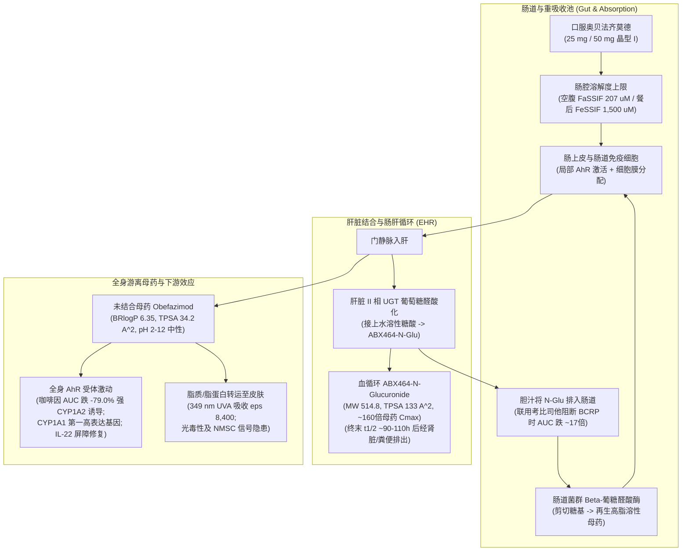
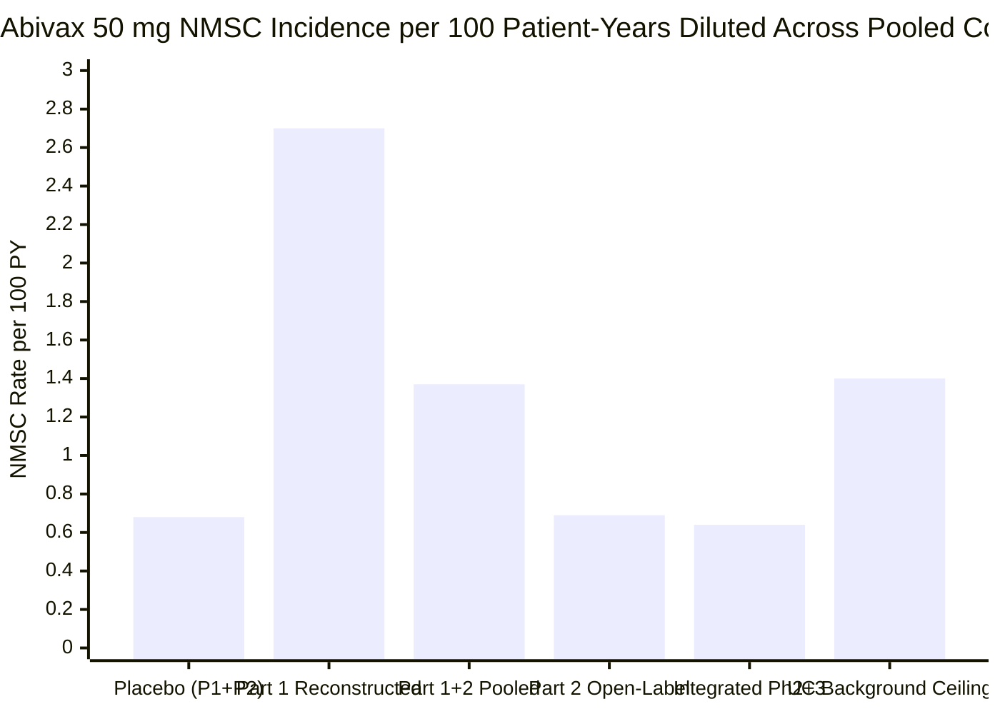
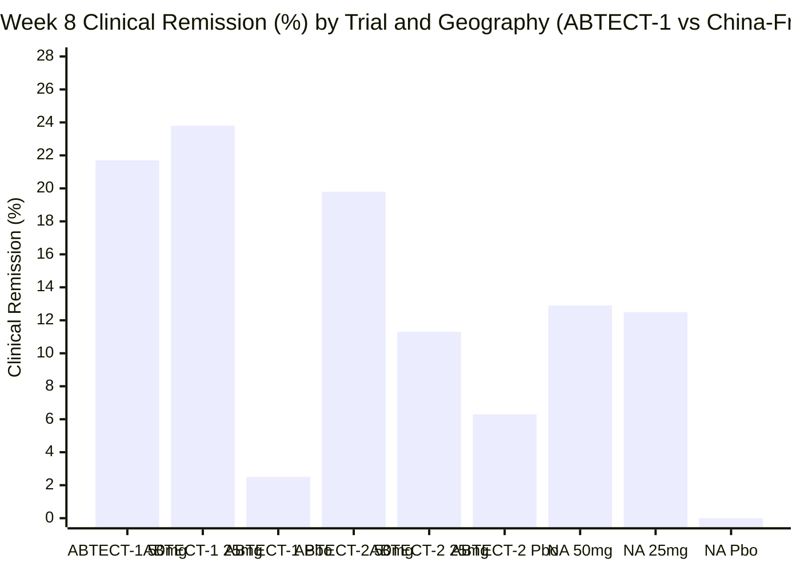

**2026 年 11 月 20 日周五**，激进做空机构 **Scorpion Capital LLC**（由 Gurkirat "Kir" Kahlon 掌舵）抛出一份长达 **297 页的做空调查报告**及**四份付费委托 CRO 实验室手稿**（[主报告](https://scorpionreports.s3.us-east-2.amazonaws.com/ABVX.pdf)、[A1](https://scorpionreports.s3.us-east-2.amazonaws.com/A1.pdf)、[A2](https://scorpionreports.s3.us-east-2.amazonaws.com/A2.pdf)、[A3](https://scorpionreports.s3.us-east-2.amazonaws.com/A3.pdf)、[A4](https://scorpionreports.s3.us-east-2.amazonaws.com/A4.pdf)），将法国生物医药公司 **Abivax SA（`NASDAQ / Euronext Paris: ABVX`）** 痛斥为*“载入史册的生物医药骗局（A Biotech Fraud For The Ages）”*。报告指控其核心溃疡性结肠炎（`UC`）口服药 **奥贝法齐莫德（`obefazimod`，`ABX464`）** 是一种*“处于 DDT、二噁英与持久性有机污染物（POPs）同一梯队”*的极端亲脂性细胞膜毒物，不仅具有诱发紫外线 `UVA` 皮肤癌的隐患，其主打的 `miR-124` 作用机制也是凭空捏造。

周五美股收盘，`ABVX` 应声下跌 **`-9.24%`（`-$7.45`）收于 `$73.20`**——按 [2026 年 7 月 2 日 SEC `424B5` 招股说明书](https://www.sec.gov/Archives/edgar/data/1956827/000119312526294491/d111359d424b5.htm) 披露的增发后总股本 **`87,054,535` 股**计算，基本市值降至 **`$63.7 亿`**，较今年 7 月 6 日 `$9.2 亿`增发价（`$125.00/ADS`）回撤 **`-41.4%`**，更与 2026 年初传得沸沸扬扬的礼来（`Eli Lilly`）`€150 亿`（`$175 亿`）收购传闻相去甚远。

Abivax 当日强硬回击，指责该报告*“包含大量与事实不符且具误导性的陈述、假设与结论，其中包括基于 Scorpion Capital 自身出资委托的研究得出的结论”*，同时重申其三期 `ABTECT` 临床数据的完整性及 **2026 年底前向美国 `FDA` 递交新药上市申请（`NDA`）** 的时间表——并特别指出 Scorpion 在免责声明中坦承“将在报告发布后立即开始平仓（回补）相当比例的空头头寸”。

这究竟是继 *Avacopan（Tavneos）* 之后又一宗即将引爆 FDA 审评桌的提前预警，还是空头机构拿“化学品恐惧”狙击真三期赢家的资本把戏？回答这个问题必须拆解两个层面：第一，**客观事实究竟如何**（分子理化性质、真实药理机制、皮肤癌分母账与三期数据）；第二，**这些事实对 FDA 批文、药品说明书（Label）与并购估值意味着什么**。交叉核对 PubChem、SEC 原始文件、未删节临床方案及期刊论文后，真相远比双方口水战更加立体。

> [!IMPORTANT]
> **法证核心结论摘要（Forensic Thesis Summary）：**
> 1. **Scorpion 真正击中要害的部位（机制隐瞒、信息披露落差与地理断层）：** Abivax 自己登记的人体 `CYP1A2` 药物相互作用试验（`NCT05121714`）实证了**咖啡因 `AUC` 暴跌 `-79.0%`（`7,420 → 1,560 h·ng/mL`）**——这是**全身性芳烃受体（`AhR`）激活**在人体内无可辩驳的临床铁证，而非单纯的 `miR-124` 剪接故事。同时，`FY2025 Form 20-F` 只字未提 2022 年未删节 2b 期方案（`Prot_NCT04023396.pdf`）中明文警告的**非临床光毒性**、**致畸性（男女均须避孕 `6 个月`）**及**狨猴心肌纤维化**，3 期方案（`Prot_NCT05507203.pdf`）更是将 `AESI` 条款涂黑。再加上随机对照 `50 mg` 维持 `Part 1` 还原出的**`~2.70 例/100 患者年`非黑色素瘤皮肤癌（`NMSC`，安慰剂的 `4 倍`）**以及不含中国中心的 `ABTECT-2` 中 **`25 mg` 宣告失败（`11.3%` vs. `6.3%`，`p = 0.165`）**，FDA 审评摩擦真实存在。
> 2. **Scorpion 明显夸大其词的部位（“胶囊里的 DDT”与“零疗效毒药”论崩塌）：** 将奥贝法齐莫德比作 *DDT/二噁英* 无视了人体内高速进行的 **N-葡萄糖醛酸化（`N-glucuronidation`）**：肝脏迅速在分子上贴合一枚水溶性糖酸标签，生成高极性代谢物 **`ABX464-N-glucuronide`（`TPSA 133 Ų`）**，其血浆 `Cmax` 高出母药 **`~160 倍`**，终末半衰期为 **`~90–110 小时`（约 `4 天`）**，与脂肪半衰期长达 `6–11 年`的 DDT 天差地别。更致命的是，**在一家中国中心都没有的 `ABTECT-2` 中，`50 mg` 组依然大胜安慰剂（`19.8%` vs. `6.3%`，`p = 7.23 × 10⁻⁵`；内镜改善 `35.5%` vs. `10.1%`）**，并在 `ABTECT-Maintenance` 中录得 **`51.3%` vs. `10.4%`（`p < 0.0001`）** 的硬核成绩。更具讽刺意味的是，正是 Scorpion 自己证实的 **`AhR → IL-22` 通路**，完美解释了为何该药在肠道中确实能产生真实黏膜愈合疗效！
> 3. **资产负债表护城河与现实定价：** 不同于现金捉襟见肘的小市值题材股，Abivax 账面拥有 **`€11.695 亿`（约 `$13.3 亿`，合每股 `~$15.31`）** 近乎零负债的备考现金（借款仅 `€120 万`、特许权使用费负担清零、**现金流支撑至 `2029 年 Q4`**），且已于 **2026 年 7 月 30 日顺利完成 FDA `Pre-NDA` 沟通**。在 `$73.20`（市值 `$63.7 亿`）价位上，真正的风险不是破产或 `$0` 骗局，而是 **FDA `BIMO` 现场核查（中国与 `25 mg`）、`NDA` 审评延误以及沉重的说明书黑框/警告（致畸避孕、光敏/皮肤癌、`CYP1A2` `DDI`）** 令 `€150 亿`高溢价并购预期破灭。

---

## 1. `$73.20` 股价背后的三重叙事碰撞

在钻进分子式和统计学细节之前，先把 Abivax 管理层口径、Scorpion 做空起诉书以及我们从一级档案中核验出的事实摆在同一张桌面：

| 分析维度 | Abivax 管理层叙事 | Scorpion Capital 做空逻辑（`297 页 + 4 篇实验`） | 独立一级档案法证核验 |
| :--- | :--- | :--- | :--- |
| **作用机制（`MOA`）** | 全球首创口服小分子，选择性结合帽结合复合物（`CBC`），上调抗炎微 RNA **`miR-124`**。 | `miR-124` 纯属幻觉（`ddPCR` 仅 `0.00013` 拷贝/细胞）；实为非特异性亲脂性**质量作用膜毒物/驱虫药**及 **`AhR` 激动剂**。 | **Scorpion 拆穿 `AhR` 记一功，“纯毒假象”站不住脚：** 人体 `CYP1A2` `-79.0%` 与 `GSE116073` `CYP1A1` 居首证实全身 `AhR` 激活——但 `AhR→IL-22` 正是已被验证的肠炎愈合机制。 |
| **化学物性与体内滞留** | 快速代谢为活性 `ABX464-N-glucuronide`，4 周达到稳态，长期口服耐受性良好。 | 中性 `BRlogP = 6.35`（脂水分配 `220 万:1`）、溶解度 `0.16 µM`、`V/F = 1,228 L`、肠肝循环（`EHR`）——*“比肩 DDT 与二噁英”*。 | **极高母药亲脂性与高度疑似 `EHR` 属实**（突破多项成药性红线），但 `~4 天`半衰期的水溶性葡糖醛酸排泄路径否定了多年期 `DDT` 蓄积类比。 |
| **皮肤癌与安全性** | 无新安全性信号；2+3 期汇总 `1,704 患者年` `NMSC`（`0.59/100 PY`）与非 NMSC（`0.35/100 PY`）均符合 `UC` 背景率。 | `17` 例恶性肿瘤中 `16` 例在给药组；`349 nm UVA` 吸收超 `ICH S10` 标准 `8.4 倍`；`64` 例皮肤病变未细分；`4` 例活性药 `NMSC` 判为可能/很可能相关。 | **双方均存在分母视角选择：** `50 mg Part 1` 还原 `NMSC`（`~2.70/100 PY`）被合并稀释；同时 SEC `20-F` 隐去了临床方案内的光毒性与致畸警示。 |
| **三期 `ABTECT` 完整性** | `50 mg` 与 `25 mg` 在诱导（`ABTECT-1/2`）和维持（`∆39.3%` 与 `∆40.3%`，`p < 0.0001`）均达标；Q4 冲刺 `NDA`。 | 依赖 `41` 家中国中心（含解放军医院）与 `15` 家乌克兰中心；北美安慰剂缓解 `0/36`；组织学评分由 `Robarts` 换为 `Geboes`。 | **一分为二的真相：** `50 mg` 在**零中国中心 `ABTECT-2`（`19.8%` vs `6.3%`，`p = 7.23 × 10⁻⁵`）**与维持期货真价实；**`25 mg` 在 `ABTECT-2` 失败（`p = 0.165`）**且北美 `0/36` 极脆。 |
| **财务与并购前景** | **现金撑至 `2029 年 Q4`（`€11.7 亿`）**、零特许权累赘、**`2026-07-30` 积极 `Pre-NDA` 纪要**支撑商业化或战略合作。 | *“史诗级生物医药骗局”*；面临 FDA `CRL` 甚至更糟结局；经历了 `Avacopan ($40 亿)` 与 `Etrasimod ($70 亿)` 惨案的药企只会避之不及。 | **毫无短期流动性危机（每股现金 `~$15.31`）**封杀归零论；但 `AhR`/避孕/光毒/中国 `BIMO` 隐患令 `€150 亿`天价并购大幅降温。 |

---

## 2. “胶囊里的 DDT” vs. “穿糖衣的排泄”：化学物性与肠肝循环审查

要把这场化学之争讲透，只需想象往一杯清水里滴入一滴机油：机油拒绝溶于水，会瞬间躲进杯壁或任何油性脂肪层里。这就是**母药分子（`parent drug`）奥贝法齐莫德（`ABX464`）**的物理天性。

根据美国国立卫生研究院 [PubChem (`CID 49846599`)](https://pubchem.ncbi.nlm.nih.gov/compound/49846599) 数据，奥贝法齐莫德（`MW 338.71`）计算亲脂性 **`XLogP = 5.9`**，极性表面积 **`TPSA` 仅 `34.2 Ų`**——小巧、扁平、不带电。Scorpion 在 [手稿 A1](https://scorpionreports.s3.us-east-2.amazonaws.com/A1.pdf) 中委托实验室实测了缺失的两项基础参数：
- **实测分配系数（`BRlogP`）：** 三次平行实验测得 **`6.35 ± 0.07`**（`6.31`、`6.32`、`6.43`），意味着其在脂相与水相之间的分配偏好高达 **`220 万比 1`**。
- **酸碱解离常数（`Sirius T3` 电位滴定）：** 在 **`pH 2 至 12` 范围内未测出 `pKa`**，即它在胃液、肠道与血液中全程呈电中性（`logD = logP`）。结合 Abivax 专利披露的晶型 I 熔点（`120.5°C`），通用溶解度方程算出的纯水溶解度仅有 **`0.16 µM`**（`0.000054 mg/mL`，专利中人工肠液溶解度为 `FaSSIF 207 µM`、`FeSSIF 1,500 µM`）。
- **表观分布容积（`V/F`）：** 利用 Abivax 已发表的空腹 `50 mg` 人体药代动力学数据（`Scherrer 2017`），推算出 `CL/F = 966 L/h`、**`V/F ≈ 1,228 L`**——接近人体总水量（`42 L`）的 **`29 倍`**（即便按 `10%` 生物利用度折算仍有 `~123 L`），表明游离母药极易逃离血浆、钻入脂质膜和脂蛋白。

那么，它真的像 Scorpion 所说的那样“等同于 DDT 或二噁英”吗？运用批判性思维的**语义替换检验（Substitution Test）**，立刻就能看清边界：

- **定义 A（严格生态毒理标准——典型持久性有机污染物 `POP`）：** 抗人体肝脏代谢的含氯化合物，在人体脂肪中半衰期长达 **`6–11 年`**，永不达到稳态并持续生物蓄积。**奥贝法齐莫德不符合定义 A。** 因为人体肝酶会在母药氮原子上火速焊接一条带负电的水溶性葡萄糖醛酸“糖衣”——这就是 **N-葡萄糖醛酸化（`N-glucuronidation`）**。生成的主代谢物 **`ABX464-N-glucuronide`（[PubChem `CID 122499702`](https://pubchem.ncbi.nlm.nih.gov/compound/122499702)）** 分子量升至 `514.8`，**`TPSA` 暴增近 4 倍至 `133 Ų`** 并在生理 `pH 7.4` 下电离，人体血浆 `Cmax` 达到母药的 **`~160 倍`**，终末半衰期为 **`~90–110 小时`（约 `4 天`）**，并在给药 **第 4 周达到稳态**（见 [2b 期临床方案](https://cdn.clinicaltrials.gov/large-docs/96/NCT04023396/Prot_000.pdf)）。
- **定义 B（药理动力学标准——伴随肠肝循环的超高脂溶性异类）：** 中性 `logP > 6` 母药迅速潜入膜脂与脂蛋白，经肝脏糖醛酸化排入胆汁后，随进食胆囊收缩进入肠道，再被肠道菌群（`β-glucuronidase`）剪掉糖基、还原为高脂溶性母药重吸收入血，形成**肠肝循环（`EHR`）**。**奥贝法齐莫德高度符合定义 B。** Abivax 自身临床 PK 数据中多达 6 项反常信号指向 `EHR`：食物效应令母药暴露暴增 `≥2.8 倍`、水溶性葡糖醛酸竟拖着 `~4 天`长尾、数字化曲线在 **`10–12 小时` 餐后窗口一致回弹（`p = 0.003`）**、以及当 HIV 患者联用阻断胆汁泵 `BCRP` 的 **考比司他（`cobicistat`）** 时，`N-Glu` 的 **`AUC` 骤降 `~17 倍`**（而 `Cmax` 仅降 `~5 倍`）！

将 PubChem 一级数据库中的禁用污染物、安全撤市/警示高脂溶药物及 `UC` 同类口服药拉在同一张表格中对比，位置一目了然：

| 化合物（PubChem `CID`） | 药物分类 / 监管状态 | 分子量（`MW`） | PubChem `XLogP`（实测 `BRlogP`） | `TPSA`（`Ų`） | 真实临床与监管参照 |
| :--- | :--- | :--- | :--- | :--- | :--- |
| **奥贝法齐莫德（`CID 49846599`）** | `UC` 三期口服药（母药） | `338.71` | **`5.9`**（实测 `6.35`） | **`34.2`** | `pH 2–12` 中性；`V/F ~1,228 L`；方案含严格防晒与半年避孕要求。 |
| **`ABX464-N-glucuronide`（`CID 122499702`）** | 人体主要活性代谢物 | `514.8` | `4.1`（中性值，`pH 7.4` 电离） | **`133.0`** | **母药 `Cmax` 的 `~160 倍`**；`t1/2 ~90–110 h`；4 周稳态；**动物模型具光毒性**。 |
| **`DDT`（`CID 3036`）** | 禁用有机氯杀虫剂 | `354.5` | `6.9` | `0.0` | 极难代谢，人体脂肪半衰期 `6–11 年`。（*与 `ABX464` 排泄速率不在同一维度。*） |
| **`TCDD` / 二噁英（`CID 15625`）** | 持久性工业污染物（`POP`） | `322.0` | `6.4` | `18.5` | 不可逆超级 `AhR` 激动剂；半衰期 `~7–11 年`；氯痤疮与致癌。 |
| **阿伐可潘 / `Tavneos`（`CID 49841217`）** | 血管炎口服药（安进 `$40 亿`收购） | `581.6` | `7.2` | `61.4` | 中性高脂溶先例：**[2026 年 4 月 FDA CDER 拟议撤市](https://www.fda.gov/drugs/drug-alerts-and-statements/cder-proposes-withdraw-approval-tavneos)**（致命肝损伤与试验操纵）。 |
| **阿维 A / `Acitretin`（`CID 5284513`）** | 银屑病口服维 A 酸（已批准） | `326.4` | `6.1` | `46.5` | **妊娠 X 类强致畸**；停药后 **3 年严禁怀孕与献血**。 |
| **胺碘酮（`CID 2157`）** | 抗心律失常药（已批准） | `645.3` | `7.6` | `42.7` | 典型组织蓄积药；半衰期 `40–55 天`；黑框警示肺/肝毒性及光敏反应。 |
| **氯法齐明（`CID 2794`）** | 麻风病孤儿药（已批准） | `473.4` | `7.1` | `40.0` | 胃肠及脂肪结晶沉积、皮肤红棕色沉着、数月滞留。 |
| **艾曲莫德 / `Velsipity`（`CID 44623998`）** | `UC` 口服 `S1P` 调节剂（辉瑞 `$67 亿`） | `457.5` | `6.4` | `62.3` | 带羧酸基生理电离降低 `logD`；获批 `UC` 但上市销售不及预期并计提减值。 |
| **塔皮纳罗夫 / `Vtama`（`CID 6439522`）** | 外用 `AhR` 激动剂（已批准） | `254.3` | `4.6` | `40.5` | 证明 **`AhR` 激动是 FDA 认可的真实抗炎靶点**——但仅限**局部外用**而非口服。 |
| **乌帕替尼（`CID 58557659`）** | `UC` 口服 `JAK1` 抑制剂（`Rinvoq`） | `380.4` | **`2.7`** | `78.3` | 常规亲水/平衡脂溶性小分子；携带心血管/恶性肿瘤黑框警告。 |
| **托法替布（`CID 9926791`）** | `UC` 口服 `JAK` 抑制剂（`Xeljanz`） | `312.37` | **`1.5`** | `88.9` | 高水溶性小分子；携带恶性肿瘤与血栓黑框警告（`ORAL Surveillance`）。 |

---

## 3. 机制实锤：人体咖啡因暴露暴跌 `-79%`，揭开 `miR-124` 背后的 `AhR` 真面目

试想你买了一辆宣传册吹嘘“全靠静音纯电马达驱动”的豪华轿车，直到独立技师掀开引擎盖，发现电池电压只有 `0.00013` 伏，而真正轰鸣着拉动车身的是一台隐藏的柴油发动机。

这正是 Scorpion 报告科学拆解中最具杀伤力的发现——而且**最致命的实锤并非出自空头花钱雇来的第三方实验室，而是出自 Abivax 自己提交在 `ClinicalTrials.gov` 上的人体临床数据。**

### 铁证 #1：Abivax 人体 `CYP1A2` 试验（`NCT05121714`）的 `-79.0%` 咖啡因崩盘
2022 至 2023 年，Abivax 在 `59` 名健康受试者中开展了探针药物**咖啡因**的 I 期相互作用试验（[`NCT05121714`](https://clinicaltrials.gov/study/NCT05121714)）。在临床药理学中，咖啡因清除率专门测量肝脏 **`CYP1A2`** 酶的活性；而人体内直接开启 `CYP1A2` 转录的主开关，有且几乎只有一个——**芳烃受体（`AhR`）**。

`ClinicalTrials.gov` 公布的实测结果极其震撼：
- **第 1 天（单用咖啡因）：** 咖啡因平均 `AUC` = **`7,420 ± 4,760 h·ng/mL`**（`Cmax = 931 ± 285 ng/mL`）。
- **第 4 天（合用 `ABX464`）：** 平均 `AUC` 降至 **`5,460 ± 2,740 h·ng/mL`**（`-26.4%`）。
- **第 17 天（合用稳态 `ABX464`）：** 平均 `AUC` 暴跌至 **`1,560 ± 719 h·ng/mL`**（`Cmax = 564 ± 242 ng/mL`）——**全身咖啡因暴露量蒸发 `-79.0%`！**

按照 FDA `DDI` 审评标准，将探针底物 `AUC` 压低 **`≥80%`** 即定义为**强效诱导剂（`Strong Inducer`）**。`-79.0%` 紧贴红线边缘，无可置疑地证明奥贝法齐莫德在人体常规临床剂量下**正在全身肝脏强烈激活 `AhR`**。

### 铁证 #2：从 Abivax 自家转录组到竞争对手的跨源印证
1. **Abivax/Tazi 自己公开的人类 CD4 T 细胞 RNA-seq（[`GSE116073`](https://www.ncbi.nlm.nih.gov/geo/query/acc.cgi?acc=GSE116073)）：** 重新排序分析显示，在全部 `40,475` 个基因中，经典 `AhR` 标志基因 **`CYP1A1` 在未感染（`+9.93 倍`）和 HIV 感染（`+14.39 倍`）两组中均高居全基因组上调第 1 位（`p = 1.6 × 10⁻⁴`）**，且 `AhR` 六大核心靶基因（`CYP1A1`、`CYP1B1`、`CYP1A2`、`TIPARP`、`AHRR`、`NQO1`）全线齐升。
2. **第三方药企 Equillium 验证（2026 年 5 月 27 日网络研讨会）：** 研发口服 `AhR` 调节剂 `EQ504` 的 Equillium 将 `ABX464` 作为对照药直接对接至已解析的 `AhR PAS-B` 晶体结构（`PDB 7ZUB`），测得直接 **`AhR` 报告基因 `EC50 = 404.2 nM`**（在 Abivax 最常用的 `5 µM` 细胞浓度下达到 **`92%` 最大激动**，而 `ABX464-N-Glu` 未检出活性）；更重要的是，加入 `AhR` 拮抗剂 **`GNF-351` 后，Abivax 式 RT-PCR 测得的 `7.7 倍` “`miR-124`”信号直接跌回 `0.85 倍`（彻底归零）**。
3. **Abivax 自己的 2017 年结肠炎论文（[Chebli 等, *Sci Rep* 2017](https://pmc.ncbi.nlm.nih.gov/articles/PMC5501810/)）：** 早在当年 Tazi 团队就发现 `ABX464` 通过诱导 **`IL-22`** 减轻肠道炎症——而 `IL-22` 正是肠道 **`AhR` 信号修复黏膜屏障的经典下游分子**！

### `miR-124` 叙事的裂痕与 Scorpion 逻辑的自相矛盾
- **同项目 `0.00013` vs. `8,517` 的单位乌龙：** 在 2b 期维持研究（[`NCT04023396`](https://clinicaltrials.gov/study/NCT04023396)）中，绝对定量的 `ddPCR` 显示全血 `miR-124` 基线为 **`0.00000 ± 0.00000 拷贝/细胞`**，24 周升至 `0.00011`，**48 周仅 `0.00013 拷贝/细胞`**（平均约 `7,700` 个血细胞才凑出 `1` 个 `miR-124` 分子）。然而在 2b 期诱导试验（[`NCT03760003`](https://clinicaltrials.gov/study/NCT03760003)）同样的 **`copies number/cell`** 单位栏下，8 周全血数字却变成了 **`4,598`（`25 mg`）、`8,517`（`50 mg`）、`13,753`（`100 mg`）**——比 `ddPCR` 绝对值凭空放大了 **`5,700 万至 6,900 万倍`**，实则是把 [Apolit 等 2023 年论文](https://pmc.ncbi.nlm.nih.gov/articles/PMC10132720/) 中的 `miR-16` 归一化比值直接塞进了“每细胞拷贝数”栏里。
- **撤稿记录与离心损失实证：** 联合创始人 Jamal Tazi 教授 2003 年的 RNA 结合奠基论文于 2023 年遭 *Journal of Cell Biology* 罕见**[撤稿重发（`PMC10482727`）](https://pmc.ncbi.nlm.nih.gov/articles/PMC10482727/)**；Abivax 2023 年路演 PPT 核心机理图引用的中国 `miR-124 → STAT3` 论文（[Lin 等](https://www.frontiersin.org/journals/oncology/articles/10.3389/fonc.2024.1506202/full)）于 2024 年因图像完整性问题被 *Frontiers in Oncology* 撤稿；Scorpion 实验室 [`A3.pdf`](https://scorpionreports.s3.us-east-2.amazonaws.com/A3.pdf) 与 [`A4.pdf`](https://scorpionreports.s3.us-east-2.amazonaws.com/A4.pdf) 更重现了 [Campos 2015（`PMC4422473`）](https://pmc.ncbi.nlm.nih.gov/articles/PMC4422473/) 的实验，证实 `ABX464` 超过 `0.16 µM` 即聚集沉淀，**离心步骤直接将 `84.9%` 药物甩进弃用沉淀中，上清液实际浓度仅标称值的 `19.4%`**，把所谓 `60 µM` 安全阈值人为抬高了 ~5 倍。
- **反噬空头自身的回旋镖：** 尽管 Scorpion 借助驱虫药文献（`PMID:38134663`、[`PMC13270096`](https://pmc.ncbi.nlm.nih.gov/articles/PMC13270096/)）和上述实验将 `miR-124` 故事打得千疮百孔，但它**自己掏钱证明的 `AhR` 激动机制（`EC50 = 404 nM`）恰恰推翻了“该药只能靠非特异性毒杀肠细胞假装起效”的阴谋论**。在消化病学界，**`AhR → IL-22` 调节黏膜免疫与屏障修复**正是青黛临床研究、获批外用药塔皮纳罗夫和 Equillium `EQ504` 的真正靶点。Abivax 或许在说明书外皮上印错了靶点名字，还掩盖了 `CYP1A2` 诱导副作用，但驱动大肠愈合的那台 `AhR` 引擎本身却是真家伙。

---

## 4. 披露断层矩阵：临床方案与 SEC 年报（`20-F`）之间消失的警示

将发给临床一线医生的详尽试验方案，与呈交给华尔街投资人的 `Form 20-F` 和 `$9.2 亿`增发招股书（`424B5`）逐字对照，信息不对称立刻浮出水面：

| 安全性 / 药理议题 | 未删节 `2022` 年 2b 期方案（[`Prot_NCT04023396.pdf`](https://cdn.clinicaltrials.gov/large-docs/96/NCT04023396/Prot_000.pdf)）与 `ClinicalTrials.gov` | `FY2025 Form 20-F` / `2026-07 424B5` 及删节版 3 期方案（[`Prot_NCT05507203.pdf`](https://cdn.clinicaltrials.gov/large-docs/03/NCT05507203/Prot_000.pdf)） | FDA 审评与说明书影响 |
| :--- | :--- | :--- | :--- |
| **非临床光毒性与防晒铁律** | **第 39 页 §8.2：** *“知情同意书（`ICF`）已告知受试者，**临床相关暴露水平的非临床模型中口服 `ABX464-N-Glu` 呈现光毒性（`phototoxic`）**。”* 强制戴帽、**戴太阳镜**、涂 `SPF ≥15` 防晒霜、避开强日照，皮肤病变拍照并由中央皮肤科医生审核。 | `104 万`字符的 [`FY2025 Form 20-F`](https://www.sec.gov/Archives/edgar/data/1956827/000195682726000012/abvx-20251231.htm) 与 7 月 [`424B5` 招股书](https://www.sec.gov/Archives/edgar/data/1956827/000119312526294491/d111359d424b5.htm) 中 **`phototox` 命中 `0 次`**。3 期方案第 75 页 `§8.1.2` `AESI` 描述**被大块涂黑删节**。 | 未来获批大概率附带**严格日晒防护/光敏警示**；FDA 势必追问维持期 `64` 例未细分皮肤病变的病理属性。 |
| **致畸性与 `6 个月`超长避孕** | **第 17–18 页：** *“**ABX464 显示出致畸活性（`teratogenic activity`）**。”* 兔胚胎-胎仔发育 `NOAEL < 1 mg/kg/d`。要求**育龄女性及男性受试者均须在停药后继续高效避孕 `180 天（6 个月）`且禁捐精子**。 | `20-F` 与 `424B5` 中 **`teratogen`、`embryo-fetal`、`contracep` 均命中 `0 次`**（`424B5` 仅列示 `2` 例试验期妊娠）。竞争对手艾伯维（`AbbVie`）研发高管曾公开将这种严苛避孕要求点名为隐患。 | `UC` 核心患者群大量处于育龄期，**妊娠禁忌黑框警告或 `REMS` 管控**将严重削弱其作为“便捷口服药”的商业吸引力。 |
| **人体强 `CYP1A2` 诱导（`AhR`）** | [`NCT05121714`](https://clinicaltrials.gov/study/NCT05121714) 实测 **咖啡因 `AUC` 暴跌 `-79.0%`**（`7,420 → 1,560 h·ng/mL`），紧逼 FDA `≥80%` 强诱导剂门槛。 | `20-F` 与 `424B5` 中 **`CYP1A2` 命中 `0 次`**；`AhR` 在 `20-F` 全文仅出现 **1 次**，还是作为潜在联合用药靶点一笔带过。 | 说明书必须写入替扎尼定、氯氮平、茶碱等 **`CYP1A2` 底物药物相互作用警示**，同时坐实全身 `AhR` 暴露。 |
| **狨猴心肌纤维化与小型猪肝毒性** | 9 个月狨猴高剂量 `N-Glu` 出现 `2` 例心肌纤维化（归因于*狨猴消耗综合征*）；小型猪 `≥10 mg/kg` 出现肝小叶中心坏死（`NOAEL 5 mg/kg`），故临床全程监测肌钙蛋白、`NT-proBNP`、心超与 `ICVSC`。 | `20-F` 及 2026 年 6 月 `6-K` 报告临床**心肌纤维化 `0 例`**、心脏标志物平稳、`DILIsym` 阴性且无 `Hy's Law` 肝损伤病例。 | 临床心、肝安全性表现干净，**是与 `Tavneos` 致命肝损伤划清界限的重要正面证据**。 |
| **食蟹猴免疫抑制信号** | 9 个月食蟹猴经口灌胃 `N-Glu` 观察到免疫抑制，故列为 `≥3 级`重度/机会感染 `AESI`。 | 3 期维持期重度/机会性感染率极低：安慰剂 `1.0%`（`2` 例）、`25 mg` `1.0%`（`2` 例）、**`50 mg` `0.5%`（`1` 例）**。 | 相比 JAK 抑制剂和抗 TNF 生物制剂，**极低的感染率属于明确的临床亮点**。 |

---

## 5. 临床与统计法证审计：抓出双方的“分母游戏”

### 5A. 非黑色素瘤皮肤癌（`NMSC`）与 `EAIR` 稀释算术

Abivax 在 [2026 年 6 月 2 日 `SEC 6-K`](https://www.sec.gov/Archives/edgar/data/1956827/000119312526252360/d98688dex991.htm) 公布了惊艳的 44 周 `ABTECT-Maintenance Part 1`（`N = 580`）疗效，但同份文件也披露 **`50 mg` 组（`N = 195`）集中出现了 `7` 例恶性肿瘤/异型增生**（`25 mg` `1` 例、安慰剂 `1` 例）：
- **非黑色素瘤皮肤癌（`NMSC`）：** `50 mg` 组 **`4` 例**（基底细胞癌 `2`、鳞状细胞癌 `2`），`25 mg` `1` 例（鳞癌），安慰剂 `1` 例（基底细胞癌）。
- **非 `NMSC` 肿瘤/病变：** 前列腺癌 `1` 例、乳腺癌 `1` 例、结肠异型增生 `1` 例——**全部落在 `50 mg` 组**。

**27 天后（6 月 29 日）**，Abivax 公布了针对诱导无应答者与复发者的开放标签 [`Part 2` `SEC 6-K`](https://www.sec.gov/Archives/edgar/data/1956827/000119312526288752/d110874dex991.htm)，新增 `4` 例 `NMSC`（`25 mg 2`、`50 mg 2`）及 `2` 例非 `NMSC`（`50 mg`），并甩出按 `100 患者年（PY）` 折算的暴露调整发生率（`EAIR`）表格。然而，只要用小学减法对 6 月 29 日数字做一次反推，**Abivax 没有单列的 `Part 1` 独立 `EAIR` 立刻原形毕露**：
- `Part 1 + Part 2` 合并 `50 mg` `NMSC` `EAIR = 1.37`（`6` 例 → 分母为 **`~438.0 PY`**）。
- `Part 2` 单独 `50 mg` `NMSC` `EAIR = 0.69`（`2` 例 → 分母为 **`~289.9 PY`**）。
- 两者相减：**随机双盲安慰剂对照的 `Part 1` `50 mg` 实际暴露量约为 `148.1 PY`**，发生 `4` 例即折合 **`~2.70 例/100 患者年`**——是安慰剂（`0.68`）的 **`~4.0 倍`**，也几乎达到 Abivax 自定 `UC` 背景上限（`1.40`）的 **`2 倍`**！

| 分析队列（来源：`2026-06-29 6-K` 及反推） | 安慰剂 `NMSC`（`/100 PY`） | `25 mg` `NMSC`（`/100 PY`） | `50 mg` `NMSC`（`/100 PY`） | `50 mg` 非-NMSC（`/100 PY`） | `UC` 预期背景参考值（`NMSC` / 非-NMSC） |
| :--- | :--- | :--- | :--- | :--- | :--- |
| **3 期维持 `Part 1` 单独（`N = 580`，反推）** | `1` 例（`0.68`） | `1` 例（`~0.70`） | **`4` 例（`~2.70`）** *（泊松 95% CI：`0.74–6.91`）* | `2–3` 例（`~1.35–2.03`） | `0.70–1.40` / `0.30–0.70` |
| **3 期维持 `Part 1 + Part 2`（披露）** | `1` 例（`0.68`） | `3` 例（`1.09`） | `6` 例（`1.37`） | **`4` 例（`0.91`）** | `0.70–1.40` / `0.30–0.70` |
| **3 期维持 `Part 2` 单独（开放标签，披露）** | `—` | `2` 例（`1.52`） | `2` 例（`0.69`） | `2` 例（`0.69`） | `0.70–1.40` / `0.30–0.70` |
| **2+3 期综合 `UC` 库（活性药 `1,704 PY`）** | `0.46` | `0.53` | `0.64` | **`0.64`**（全活性 `0.35`） | `0.70–1.40` / `0.30–0.70` |

客观地为两边的统计手法打分：
- **Abivax 玩弄的把戏：** 不断并入低发率的开放标签 `Part 2`（`0.69`）与老旧 2 期库，将 `Part 1` 刺眼的 `2.70` 一路稀释为 `1.37` 再降到 `0.64`。哪怕合并 `Part 1+2` 后，`50 mg` 非-NMSC 发生率（**`0.91/100 PY`**）依然高于公司自设的 `0.30–0.70` 上限。此外，7 月路演 PPT 把 `68` 例皮肤病变中除 `4` 例皮肤癌外的 **`64` 例笼统塞进“所有类型皮肤病变”**而不披露光敏皮炎占比；[`A2.pdf`](https://scorpionreports.s3.us-east-2.amazonaws.com/A2.pdf) 也证实母药在 `349 nm` 深层 `UVA` 波段的摩尔消光系数（`ε = 8,400 M⁻¹cm⁻¹`）高达 `ICH S10` 门槛（`1,000`）的 **`8.4 倍`**，且研究者将给药组 `4` 例 `NMSC` 评估为可能/很可能与药物相关。
- **Scorpion 玩弄的把戏：** 高喊 *“17 例肿瘤里 16 例发生在给药组”* 却隐去**活性给药组累积患者年占比超过 `85%`**（`>1,704 PY` vs. 安慰剂 `~217 PY`），属于典型的**缺失分母误导**。而且 `148` 患者年出现 `4` 例的**精确泊松 `95% 置信区间`高达 `0.74 至 6.91 例/100 PY`**，仍覆盖了 `0.70–1.40` 背景区间；患癌患者平均 **`62` 岁**（全组平均 `42` 岁）且多有长期硫嘌呤/皮肤癌史；[`A2.pdf`](https://scorpionreports.s3.us-east-2.amazonaws.com/A2.pdf) 脚注 2 也坦承仅测了紫外吸收（`Step 1` 初筛），并未实测 `ROS` 产率或动物光致癌实验。

### 5B. `ABTECT-1` vs. `ABTECT-2`、中国 `41` 家中心与北美 `0/36` 悬崖

Scorpion 指控 Abivax 三期依靠不透明的中国中心（[`NCT05507203`](https://clinicaltrials.gov/study/NCT05507203) 列出 **`41` 家中国医院，含解放军联勤保障部队第 900 医院与东部战区总医院**）和 `15–16` 家乌克兰中心撑起虚幻疗效。脱离中国数据后，药效真的归零了吗？看 `ClinicalTrials.gov` 与 SEC 原始表：

| 试验 / 亚组（`一级来源`） | 是否含中国中心 | 安慰剂缓解率（`n/N`, `%`） | `25 mg` 缓解率（`n/N`, `%`） | `50 mg` 缓解率（`n/N`, `%`） | 内镜改善（`50 mg` vs. 安慰剂） | 法证诊断 |
| :--- | :--- | :--- | :--- | :--- | :--- | :--- |
| **`ABTECT-1` 8 周诱导（`NCT05507203`）** | **含 `41` 家（含 `2` 家军医院）** | `4/158`（**`2.5%`**） | `38/160`（**`23.8%`**, `p = 7.5 × 10⁻⁹`） | `69/318`（**`21.7%`**, `p = 1.9 × 10⁻⁹`） | **`33.3%` vs. `5.7%`**（`HEMI`: `23.0%` vs `3.2%`） | 安慰剂极低（`2.5%`）；剂量效应倒挂（`25 mg > 50 mg`）。 |
| **`ABTECT-2` 8 周诱导（`NCT05507216`）** | **不含（`0` 家；日本 `49`、美国 `46`）** | `10/159`（**`6.3%`**） | `18/159`（**`11.3%`**, **`p = 0.165` 失败**） | `63/318`（**`19.8%`**, **`p = 7.2 × 10⁻⁵` 胜出**） | **`35.5%` vs. `10.1%`**（`HEMI`: `23.9%` vs `7.5%`） | **`50 mg` 在无中国参与下完胜（证伪全盘造假论）**，但 **`25 mg` 垮塌（较 `ABTECT-1` `p = 0.0049`）**！ |
| **`ABTECT-Maintenance` 44 周（`2026-06-02 6-K`）** | `20` 家（占 `413` 中心仅 `4.8%`） | `20/192`（**`10.4%`**） | `98/193`（**`50.8%`**, `∆39.3%`, `p < 0.0001`） | `100/195`（**`51.3%`**, `∆40.3%`, `p < 0.0001`） | **`64.1%` vs. `12.5%`**（`MES=0`: `47.7%` vs `9.9%`） | 中央盲法判读内镜缓解（`47.7%`）与 `HEMI`（`57.4%`）极为扎实。 |
| **北美 8 周亚组（`ECCO 2026.02`, `N = 122`）** | **不含（美加地区）** | **`0/36`（`0.0%`）** | `3/24`（`12.5%`, Fisher `p = 0.059`） | `8/62`（`12.9%`, Fisher `p = 0.025`） | 客观内镜改善：**`p = 0.08`（`50 mg`）、`p = 0.15`（`25 mg`）均未达标** | **极端脆弱：** 只需安慰剂多出 **1 例缓解（`1/36`），`50 mg` 即跌破显著性（`p = 0.148`）**！ |

冷冰冰的数据给出了极其精准的划分：
1. **Scorpion 对 `50 mg` “中国造假论”不成立：** 在**完全没有中国临床中心参与的 `ABTECT-2`**（日本和美国为主力）中，`50 mg` 照样以 `19.8%` vs. `6.3%`（`p = 7.23 × 10⁻⁵`）显著胜出，客观内镜改善（`35.5%` vs. `10.1%`）甚至优于 `ABTECT-1`（`33.3%`）。同样不含中国的欧洲 2b 期 96 周扩展研究（`PMID:40417999`）也保住了 `75.6%`（`164/217`）完成率。
2. **但 Scorpion 挖出的两颗 FDA 雷区货真价实：** 第一，**`25 mg` 诱导在无中国参与的 `ABTECT-2` 中彻底失效（`p = 0.165`）**，与 `ABTECT-1` 的 `23.8%` 形成显著统计学撕裂（`p = 0.0049`）；第二，**北美区（仅占总入组 `10%`）`50 mg` 缓解率仅 `12.9%`**、客观内镜改善未达显著（`p = 0.08`），且全靠 **`0/36` 零安慰剂缓解**勉强维持 `p = 0.025`（一旦出现 `1/36` 即跳至 `p = 0.148`）。叠加 2b 期放弃未达标的 `Robarts` 组织学评分（`50 mg p = 0.187`）改用单一 `Geboes` 标准，以及涉军中国/乌克兰中心背景，FDA `BIMO` 核查绝不会轻松。

---

## 6. 四维因果审计、前车之鉴、`$13.3 亿`现金堡垒与空头信用核查

| 因果假说 | 检验逻辑 | 符合的实证 | 无法解释的缺口 | 审计结论 |
| :--- | :--- | :--- | :--- | :--- |
| **1. 直接药理作用（`AhR` 激活 + 亲脂/UVA）** | `AhR`（`IL-22`, `CYP1A1/2`）带来真实肠炎愈合，同时高亲脂母药/`349 nm UVA` 吸收与慢性 `AhR` 构成光敏及皮肤癌推手。 | 解释 `-79.0%` 咖啡因 `AUC`、无中国参与 `ABTECT-2 50 mg` 黏膜愈合，及 `50 mg` 剂量关联的 `NMSC`/肿瘤集中现象。 | 无法单独解释为何 `ABTECT-1` 中 `25 mg`（`23.8%`）显著高于 `ABTECT-2` `25 mg`（`11.3%`）。 | **核心机制驱动力**（真实疗效与真实长期毒性风险同源）。 |
| **2. 反向选择偏倚（高龄难治 `UC` 基线）** | 大龄（`62 岁`）且经多线硫嘌呤/生物制剂失败的患者本身自带高 `NMSC` 风险及较低安慰剂反应率。 | `45%–49%` 入组者为既往高级治疗失败人群，且 `NMSC` 患者较全组平均年长 `~20 岁`。 | `Part 1` 随机分组已平衡年龄与用药史，难以仅凭基线解释 `50 mg` 对安慰剂的 `4 倍`差距。 | **部分背景贡献**（解释绝对发生率，不解释 `50 mg` 偏高）。 |
| **3. 第三变量混杂（中心地理结构与合并稀释）** | `ABTECT-1`（中国 `41` 家、东欧 `38%`）与 `ABTECT-2`（中国 `0` 家）构成差异，叠加 `Part 2` 合并池化扭曲读数。 | 直接解释 `25 mg` 跨试验跌落（`p = 0.0049`）与 `Part 1` `2.70 → 0.64` 皮肤癌率稀释。 | 无法否认 `ABTECT-2 50 mg` 内镜改善（`35.5%`）与维持期（`51.3%`）在西方/日本人群中的显著胜出。 | **关键方法学混杂因素**（主导 `25 mg` 裂痕与 `NMSC` 稀释）。 |
| **4. 双向正反馈（`EHR` + `UVA` + 潜在病变）** | 肠肝循环（`EHR`）延长母药组织滞留，皮肤光敏发色团在 `UVA` 照射下反复产生活性氧，慢性 `AhR` 加速存量癌前病变生长。 | 串联起 `EHR` 特征（`10–12h` 回弹、考比司他 `17 倍`降幅）、`349 nm` 吸收与 `40 岁`以上人群隐匿皮肤癌前病变规律。 | `44 周`试验样本中绝对事件数仍少（`50 mg` `6` 例 vs 安慰剂 `1` 例，泊松 `CI` 极宽），尚无定论。 | **长期潜在隐患**（全看 NDA 中 `2 年`致癌性与 Tier-2 光安全数据）。 |

### 谁在承担隐性代价？行业墓碑与 Abivax 的现金堡垒

- **隐性代价与前车之鉴：** 若最终说明书强行附带 **`180 天`男女双避孕与致畸警告**，**育龄 `UC` 患者**与临床医生将面临巨大处方障碍；联用替扎尼定、氯氮平等 **`CYP1A2` 窄治疗窗药物的患者**面临代谢加速失效风险；而 **2026 年 7 月以 `$125/ADS` 参与增发的机构已浮亏 `-41.4%`**。跨国药企更刚经历了血淋淋的教训——[**安进（Amgen）`$40 亿`收购的 `Tavneos`（阿伐可潘）**](https://www.fda.gov/drugs/drug-alerts-and-statements/cder-proposes-withdraw-approval-tavneos) 已于 2026 年 4 月 27 日遭 FDA CDER 提议因致命肝损伤与数据操纵撤市（*NEJM* 随后撤稿），**辉瑞 `$67 亿`收购的艾曲莫德（`Velsipity`）**亦因销售不及预期计提减值——这两款分子恰恰都位于高脂溶区域，令买家对任何 `BIMO` 瑕疵和长尾安全性警铃大作。
- **但 Abivax 不是缺钱跑路的空壳股：** 据 [2026 年 9 月 21 日半年报 `6-K`](https://www.sec.gov/Archives/edgar/data/1956827/000195682726000027/a6-kpressreleaseq22026fina.htm)，截至 6 月 30 日公司账面现金 `€4.024 亿`，加上 7 月增发净募资 `€7.671 亿`（`$8.741 亿`），**备考现金高达 `€11.695 亿`（约 `$13.3 亿`，合每股 `~$15.31`）**，有息借款仅 **`€120 万`**，5 月 7 日斥资 `$9,000 万`买断注销了全部特许权使用费凭证，按上半年 `€1.025 亿`经营现金消耗（年化 `~€2.05 亿`）测算，**现金跑道直达 `2029 年 Q4`**；同时 **2026 年 7 月 30 日已完成积极的 FDA `Pre-NDA` 沟通**。

### 审计做空者：Scorpion Capital 的利益冲突与历史战绩

| 过往做空医药标的 | 核心指控与施压手段 | 最终监管与市场结果 | 对 `ABVX` 的对照参考 |
| :--- | :--- | :--- | :--- |
| **Allakos（`ALLK`, 2021）** | 质疑嗜酸性胃肠炎靶点与临床设计。 | 三期临床失败，股价暴跌 **`-99%`**。 | 证明当临床本身脆弱时，其对炎症机制的早期嗅觉相当敏锐。 |
| **Harmony Biosciences（`HRMY`, 2023.03）** | 366 页报告炮轰 `WAKIX` 安全性并向 **FDA 递交撤市公民请愿**。 | **2024 年 6 月 25 日 FDA 正式驳回（`DENIED`）Scorpion 请愿**，并扩展批准 `WAKIX` 儿童适应症！ | 表明只要随机对照临床过硬，空头委托的实验室报告未必能撬动 FDA 审评结论。 |
| **TransMedics（`TMDX`, 2025.01）** | 指控计费违规与器官操作不当，喊出 **`$0` 目标价**（初跌 `-13%`）。 | 公司聘请律所反击并持续推进商业扩张。 | 极度耸动的 `$0` 口号往往远远跑在基本面崩溃前面。 |
| **Soleno Therapeutics（`SLNO`, 2025.08）** | 狙击已获批 `VYKAT XR` 的临床与安全性（初跌 `-8%~12%`）。 | 药品维持上市，但上市后安全事件加剧波动并引发集体诉讼。 | 哪怕顺利拿到批文，未被充分消化的安全隐患仍会长期压制估值倍数。 |
| **Abivax（`ABVX`, 2026.11.20）** | 297 页长文 + 4 篇付费手稿；**第 2 页披露发布即准备*“大比例回补空头”***，引述付费匿名离职员工言论。 | **收盘跌 `-9.24%` 至 `$73.20`（`$63.7 亿`）**；公司重申年底递交 `NDA`。 | 必须剔除“DDT/$0”修辞泡沫与回补时间差套利，但**切勿轻视其翻出的一级铁证（`NCT05121714`、`20-F` 缺失、`ABTECT-2 25 mg`）**。 |

---

## 7. 灰度综合与“法证终局研判：我们的真实观点”

真正严格的判断必须同时拒绝两种懒惰的极端——既不是*“无瑕疵的 `miR-124` 神药坐等 `€150 亿`收购”*，也不是*“只值 `$0` 的胶囊版 `DDT`”*。未来 `12–18` 个月估值锚点取决于以下四项 **条件句（`If-Clauses`）**：

- **如果（`If`）** Abivax 尚未公开的 `NDA` 非临床卷宗里包含阴性的 **2 年啮齿类致癌试验（`Tg.rasH2`/大鼠）**与 **Tier-2 功能性光毒性（`ROS`/活体光安全）**数据，**那么（`Then`）** `349 nm` 吸光与 `Part 1` `2.70` 皮肤癌读数将转化为可控的**防晒标签警示**，而非拒批硬伤。
- **如果（`If`）** FDA `BIMO` 现场核查在 `ABTECT-1` 的 `41` 家中国中心（含 2 家解放军医院）或 `15–16` 家乌克兰中心查出原始病历或方案偏离瑕疵，**那么（`Then`）** 无中国 `ABTECT-2` 中 **`25 mg` 失败（`p = 0.165`）**与北美 **`0/36` 零安慰剂脆弱性**极易触发 **完整回复函（`CRL`）** 甚至要求补做西方人群试验。
- **如果（`If`）** FDA 聚焦于 **`50 mg` 单剂量**审评（依托无中国参与 `ABTECT-2` `p = 7.23 × 10⁻⁵` + `ABTECT-Maintenance` `∆40.3%` + 7 年 `Study 108` 安全性），**那么（`Then`）** 即使监管机构拔掉 `miR-124` 宣传并写入 **`AhR` / 强 `CYP1A2` 诱导警告**，**`50 mg` 的有效性依然跨过了法定批准门槛**。
- **如果（`If`）** 最终说明书同时背负 **致畸/半年避孕、光敏/`NMSC` 监测与 `CYP1A2` 药物相互作用警示**，**那么（`Then`）** 经历过 *Tavneos*（`$40 亿`）和 *Velsipity*（`$67 亿`）教训的跨国药企绝不会轻易开出 `€150 亿`支票。

### 概率加权情景推演（现价 `$73.20`，展望 `12–18 个月`）

| 情景分支（`主观概率`） | 核心触发变量 | 监管与商业推演 | 目标估值区间 |
| :--- | :--- | :--- | :--- |
| **基准情景（`50%`）：带病获批与审评摩擦** | 2026 Q4 `NDA` 受理；`BIMO` 暴露局部瑕疵令 `PDUFA` 延期（+3 个月）或砍掉 `25 mg` 诱导；**`50 mg` 凭借 `ABTECT-2` 与维持期获批**。 | `50 mg` 成功上市，但**沉重说明书限制**（致畸避孕、防晒/皮肤癌监测、`CYP1A2` `DDI`）压制渗透率与高溢价并购空间。 | **`$40 – $85 / 股`** |
| **悲观情景（`30%`）：重大 `CRL`、专家会否决或安全暂停** | `BIMO` 否定关键中国/东欧中心数据，2 年致癌性/光安全卷宗爆雷，或 `AdCom` 因 `0/36` 北美安慰剂及 `50 mg` 肿瘤信号拒绝放行。 | 审评推迟数年甚至重做试验；股价回落向 **`~$15.31/股` 现金底** + 克罗恩病（`ENHANCE-CD`，2027 年中）期权估值靠拢。 | **`$15 – $35 / 股`** |
| **乐观情景（`20%`）：`50 mg`（或双剂量）首轮顺利获批并重启竞购** | 非临床 2 年致癌性与光毒性卷宗完美过关；欧美日 `ABTECT-2` 与维持期零瑕疵通过 `BIMO`；标签仅列常规 `IBD` 级警示。 | 凭借 `44` 周 `51.3%` 缓解、`MES=0` `47.7%` 与 `0.5%` 极低感染率成为口服 `UC` 新标杆，战略并购重燃。 | **`$100 – $145+ / 股`** |

### 法证终局研判：我们的真实观点

**事实并不站在任何单一阵营的极端宣传稿一边，证据的天平在不同战场明显倾斜：**

1. **在药理真相与披露透明度上，Scorpion 握有更强证据：** Abivax 自家临床数据录得的 **咖啡因 `AUC -79.0%` 崩溃（`NCT05121714`）** 与 **全基因组排名第一的 `CYP1A1` 诱导（`GSE116073`）** 铁板钉钉地证实奥贝法齐莫德是一个**全身性 `AhR` 激动剂**，而 `miR-124`（`ddPCR` `0.00013` 拷贝/细胞）被严重透支。把 2b 期方案早已写明的 **光毒性、致畸性（6 个月避孕）和 `CYP1A2` 诱导** 在 `FY2025 Form 20-F` 中抹去、又在 3 期方案中涂黑 `§8.1.2`，是公司自身埋下的治理隐患。
2. **在“急性毒药与虚假疗效”控诉上，Abivax 的临床硬数据击碎了空头极端叙事：** 一个能够在**零中国中心的 `ABTECT-2` 拿下 `19.8%` vs. `6.3%`（`p = 7.23 × 10⁻⁵`）与 `35.5%` vs. `10.1%` 客观内镜改善**、在 **`ABTECT-Maintenance` 做到 `51.3%` vs. `10.4%`（`p < 0.0001`）**、并在欧洲 2b 期留住 `75.6%` 患者两年的口服药，绝非*“靠肠细胞中毒制造幻觉的 DDT”*。人体 `N-glucuronidation` 将半衰期控制在 `~4 天`、临床心/肝/重度感染指标保持平稳，且 **`AhR → IL-22` 正好为真实的黏膜愈合提供了坚实的生物学解释**。
3. **最终立场：** 在 **`$73.20`（市值 `$63.7 亿`）** 位置上，市场原先押注“无痛获批 + `€150 亿`礼来稳赚收购”的牛市幻觉已经打破；但凭借 **`$13.3 亿`（每股 `$15.31`）近乎无债的现金护城河**与独立于中国的 `50 mg` 硬疗效，在当前价位做空赌其像 *Capricor（`CAPR`）* 一样立即归零同样危机四伏。在 Abivax 公开披露 **（1）完整 2 年致癌性与 Tier-2 光安全性报告、（2）维持期 `64` 例皮肤病变细目、（3）剔除中国/`PLA` 医院后的 `ABTECT` 敏感性结果、以及（4）致畸避孕与 `CYP1A2` `DDI` 的标签预期**之前，`ABVX` 是一只典型的**高分歧“亮牌检验型”监管博弈标的**，而非无风险的并购折价筹码。

---

## 8. 一级证据验证清单（均已程序化核验 `HTTP 200`）

- **Scorpion Capital 做空报告与委托手稿（2026-11-20）：** [主报告（`ABVX.pdf`, 297 页）](https://scorpionreports.s3.us-east-2.amazonaws.com/ABVX.pdf) | [A1：`logP`/`pKa` 与 Meyer-Overton 分析](https://scorpionreports.s3.us-east-2.amazonaws.com/A1.pdf) | [A2：`UVA` 吸收与光毒性（`349 nm`）](https://scorpionreports.s3.us-east-2.amazonaws.com/A2.pdf) | [A3：`DLS` 聚集与自发荧光](https://scorpionreports.s3.us-east-2.amazonaws.com/A3.pdf) | [A4：`LC-MS/MS` Campos 复现](https://scorpionreports.s3.us-east-2.amazonaws.com/A4.pdf) | [Scorpion Capital 官网](https://scorpioncapital.com/)
- **美国 SEC EDGAR 官方申报（Abivax SA, `CIK 0001956827`）：** [FY2025 Form 20-F 年报](https://www.sec.gov/Archives/edgar/data/1956827/000195682726000012/abvx-20251231.htm) | [2026-06-02 `6-K`（`ABTECT` 维持 Part 1）](https://www.sec.gov/Archives/edgar/data/1956827/000119312526252360/d98688dex991.htm) | [2026-06-29 `6-K`（`Part 2` 与 `EAIR` 汇总）](https://www.sec.gov/Archives/edgar/data/1956827/000119312526288752/d110874dex991.htm) | [2026-07-02 `424B5` 招股书（`$9.2 亿`增发/`8,705 万`股）](https://www.sec.gov/Archives/edgar/data/1956827/000119312526294491/d111359d424b5.htm) | [2026-09-21 `6-K`（上半年财报与高管变动）](https://www.sec.gov/Archives/edgar/data/1956827/000195682726000027/a6-kpressreleaseq22026fina.htm)
- **ClinicalTrials.gov 登记档案与临床方案 PDF：** [`ABTECT-1`（`NCT05507203`）](https://clinicaltrials.gov/study/NCT05507203) | [`ABTECT-2`（`NCT05507216`）](https://clinicaltrials.gov/study/NCT05507216) | [`ABTECT-Maintenance`（`NCT05535946`）](https://clinicaltrials.gov/study/NCT05535946) | [`CYP1A2` DDI 试验（`NCT05121714`）](https://clinicaltrials.gov/study/NCT05121714) | [2b 期诱导（`NCT03760003`）](https://clinicaltrials.gov/study/NCT03760003) | [2b 期维持（`NCT04023396`）](https://clinicaltrials.gov/study/NCT04023396) | [2022 2b 期未删节方案（`Prot_000.pdf`）](https://cdn.clinicaltrials.gov/large-docs/96/NCT04023396/Prot_000.pdf) | [2024 3 期 `ABTECT-1` 删节方案（`Prot_000.pdf`）](https://cdn.clinicaltrials.gov/large-docs/03/NCT05507203/Prot_000.pdf)
- **PubChem、GEO、学术撤稿及 FDA 监管先例：** [PubChem: Obefazimod (`CID 49846599`)](https://pubchem.ncbi.nlm.nih.gov/compound/49846599) | [PubChem: `ABX464-N-glucuronide` (`CID 122499702`)](https://pubchem.ncbi.nlm.nih.gov/compound/122499702) | [NCBI `GEO GSE116073`](https://www.ncbi.nlm.nih.gov/geo/query/acc.cgi?acc=GSE116073) | [Campos 等 2015（`PMC4422473`）](https://pmc.ncbi.nlm.nih.gov/articles/PMC4422473/) | [Chebli 等 2017 `IL-22`（`PMC5501810`）](https://pmc.ncbi.nlm.nih.gov/articles/PMC5501810/) | [Vautrin 等 2019（`PMC6349857`）](https://pmc.ncbi.nlm.nih.gov/articles/PMC6349857/) | [Apolit 等 2023（`PMC10132720`）](https://pmc.ncbi.nlm.nih.gov/articles/PMC10132720/) | [JCB 2023 Tazi 撤稿重发声明（`PMC10482727`）](https://pmc.ncbi.nlm.nih.gov/articles/PMC10482727/) | [2026 绵羊/线虫生物转化（`PMC13270096`）](https://pmc.ncbi.nlm.nih.gov/articles/PMC13270096/) | [Frontiers 2024 Lin 撤稿声明](https://www.frontiersin.org/journals/oncology/articles/10.3389/fonc.2024.1506202/full) | [FDA CDER 提议撤回 `Tavneos` 批准公告（2026-04-27）](https://www.fda.gov/drugs/drug-alerts-and-statements/cder-proposes-withdraw-approval-tavneos)
